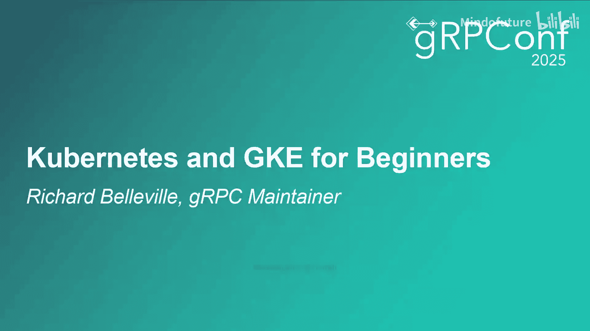
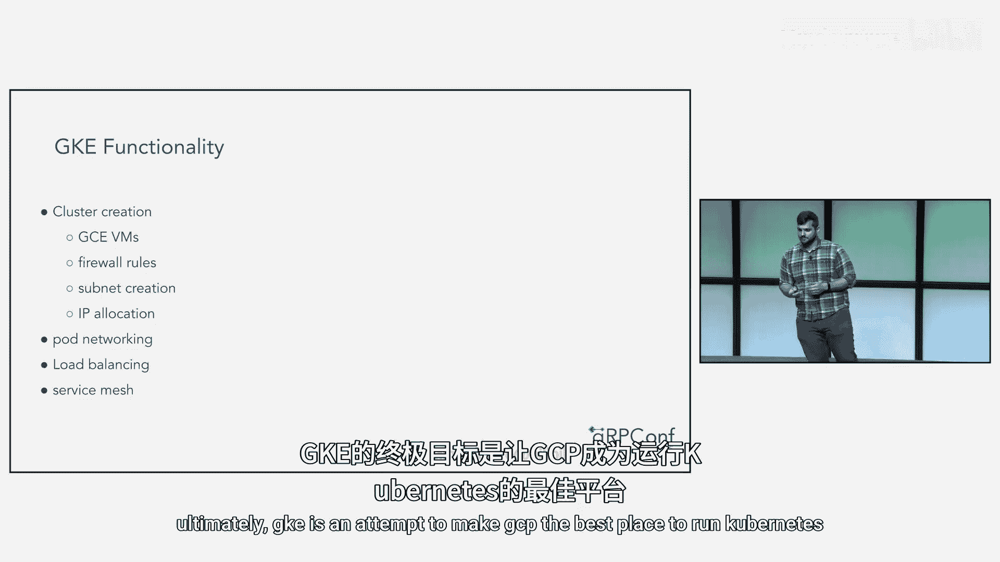
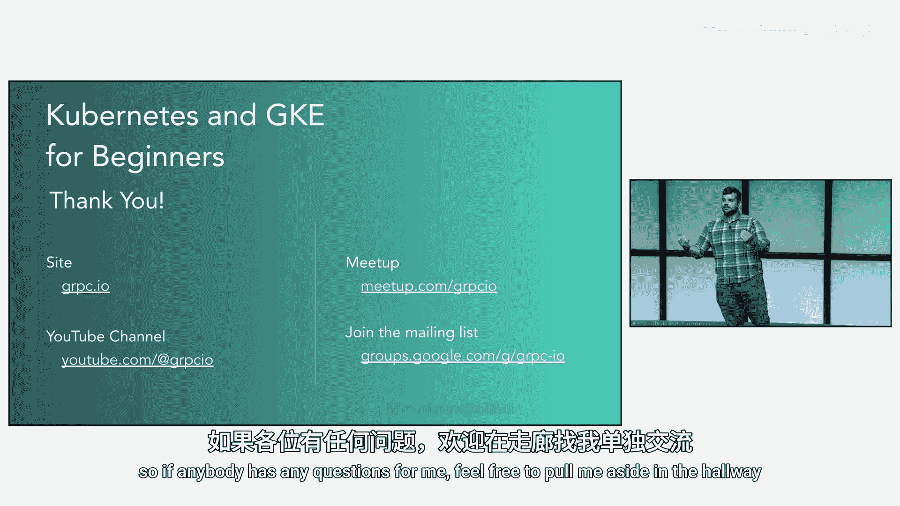

# Grpconf-2025-p11-P11_Kubernetes和GKE初学者指南--BV1yTHMzKE1U_p11-

Hey， folks。

My name is Richard Bellville and I'm a maintainer on the GRPC project。 Histor。

 I've been a maintainer for GC Python， but I've also done a bunch of integrations for GRPC inside of Kubernetes and GKE or Google Kubernetes engine。

 which is great because that's exactly what we're going to be talking about in this session。

 Kubernetes and specifically GKE。😊，Now， in 2025， you'd have to be trying pretty hard to avoid it if you hadn't even heard the word Kubernetes。

 But there are still quite a few people who aren't experts in it。

 And that's exactly who this talk is for。 We're going to be covering Kubernetes and G K from 0。Now。

 if you just Google Kubernetes， you'll get a definition that， in my opinion。

 is pretty hard to make sense of if you're not already familiar with Kubernetes or other systems like it。

 And that's partly because Kubernetes is kind of hard to understand。 But don't worry。

 we're gonna give you a solid primer here。So the way I'll do that is by giving you three different answers to the same question。

 What is Kubernetes， Each answer will look at Kubernetes through a different lens。

 revealing different aspects of it and hopefully giving you a broader understanding of it。 So first。

 we'll go at it very practically and see what it's like to develop software and deploy it on Kubernetes。

Then we'll see how Kubernetes makes it easier for teams to interact with different job functions to collaborate within a company。

 And finally， we'll zoom out and be a bit more abstract。

 seeing Kubernetes as an operating system for collections of computers。😊，So first。

 software developers day to day perspective on Kubernetes。

It's pretty much impossible to talk about Kubernetes without saying the word container a million times。

 So what is a container。Just like Kubernetes itself。

 there's a lot of folklore surrounding containers because these things have become so fundamental for so many people。

 The most common folk definition I hear is lightweight VM， which is not wrong。

 While the underlying technology that makes containers work， is different from VMs。

 which is what makes them so much faster on average。

 containers offer a very similar user interface to VMs。

 They do look a lot like a computer inside of your computer with its own file system。

 process tree permissionmissioning and everything else。😊。

Containers are also a software bundling and distribution mechanism。

 just like maven for Java or P for Python， you can pull working off the shelf software from Docker Hub in the form of container images。

The difference is that the software bundled in container images can be written in absolutely any language。

Back in the day， if I wanted to run some random piece of software someone wrote about online。

 I'd have to jump through a bunch of hoops to get it running on my exact version of Linux alongside the right versions of all of its dependencies。

😊，And with containers， it really does take seconds to run any random piece of software。

Which is why it's a solution to the it works on my computer problem。 You know， back in the day。

 it was super common for you to write some code， get it working， check it in and have someone say。

 hey， this thing does not work for me。And after some headache conducing debugging。

 you'd ultimately conclude that the problem was a version mismatch in some obscure dependency you didn't even realize you had or a conflicting configuration file in some directory you've never heard of before。

Containers literally ship a lightweight file system for an entire Linux distro。

 so that's no longer an issue。And， of course， you've probably heard Docker mention in the context of containers。

 Docker is by far the most popular software for building， running and distributing containers。 And。

 in fact， the open standards we have for containers nowadays are， in large part。

 pulled straight from Docker。 But there are actually a bunch of other container implementations these days。

 including Podman and Co。 And you can use just about any container implementation you'd like with Kubernetes。

😊，Alright， we know what a container is。 So how does this apply to developing for Kubernetes。Well。

 the answer is， build software for Linux， however you want。

 put in a container and run it on Kubernetes in minutes。

 And that last step generally just takes a few minutes。Historically。

 managed software deployments have been pretty picky about how you build your software。 Apache。

 Heroku， Google App engine and things like that。 Exp you to write your code in a specific language。

 La your files out precisely in a certain structure and work with very specific runtime versions。

 Kubernetes uses containers to say if your software can run on some version of Linux。

 you can run it on Kubernetes。Write your code in go， Ru， Java 4 Tra。 Who cares？

 It will run on Kubernetes。 So this is the first thing that's really freeing about Kubernetes if you're not familiar with systems like that。

So after you've built your software， the next step is to put it inside of a container。

 This is usually a much simpler process than you might think。

 There are tons of publicly available base images that will give you the runtime environments that you want。

 If you're using Java at a particular JVM version， you can pull that from Docker hub and super easily layer your software on top of it。

 Sam for Python。 If you're able to build a static binary， like with go， your container。

 which can be super streamlined and literally contain just that one binary。😊，And finally。

 you write some Yaml defining your workload in that Yaml。

 you reference your newly created container image and use the Cu cutttle C I tool to deploy it to your cluster。

 It generally only takes a minute or two to write and seconds to be up and running。😊。

So that is how you define a workload。 The Kubernetes freely shines on operations。

 operating your software deployments。 There's a lot more depth to this than I can go into in this session。

 So I'll focus on the two biggest pieces， scaling and rollouts。😊。

One of the most challenging things in traditional software deployments was scaling up。

 depending on the level of automation you had in place。

 it could take days or weeks to double the amount of compute dedicated to running a service。

But with Kubernetes， it's as simple as increasing a single number in your deployments Yal file。

 And when running out a cloud provider like GCP， if increasing the rep。

 replic account would mean running out of machines。

 G KE will simply provision more V Ms to put your software on。

But things can get even more automated than that。 Kubernetes allows you to hook up various metrics like CPU utilization or requests per second to automatically trigger scale ups。

 And that's called horizontal pod， auto scaling， or just H。😊。

The other operations task Kubernetes is great for is rolling out a new version of a service without interrupting user traffic。

 Kubernetes does this using a rolling update of a service。

 So you start with three pods servicing request at version A。

 and you want to update them all to version B with Kubernetes。

 All you have to do is update the deployments version from A to B。

 Kubernetes will bring down one pot version A， bring up a new one at version B and repeat this process until all pods are running version B。

 And many of the details of this rolling update process are configurable。

 So you can tune it to work exactly the way you'd like。😊，Alright。

 so that gave us a chance to dip our toes into what it feels like to use Kubernetes as a developer。

 But what about as a platform team。Let's roll back in time a bit。

Folks who have been in the industry for a while are probably familiar with the VM based model of software deployment and operations。

This is the basic mode of operation， whether you're running on GCP， AW S， Azure。

 or even for the most part， on premises。You spin up some VMs using your cloud provider's CI tool。

You use that same C I tool to configure some load balancers。

 And then you get your software onto the VM somehow with S SH being the most basic way to do that。

In this paradigm， there are more or less two ways of organizationally managing software deployments。

People sometimes call the first model Devops， because every developer is also responsible for opsing or operating their software。

 This means that each team needs to manage their own pool of V Ms and all of the associated infrastructure。

The CTO more or less gives the team's cloud budget and says， make it happen。

 They need to figure out exactly how to deploy their software to the VMs。

 Do you bundle them as tarballs or as deian packages。

 They need to figure out lifecycl management for deployed software。

 How do you deal with crashes and out of memory errors。 maybe use system D or supervisor D。

 They need to figure out debug access methodology。 Is S H access allowed everywhere。

 And this doesn't even get to the hardest part。 scaling。

 Many answers to the questions I just asked don't work well when you try to scale the system up。

So in this diagram， you see two feature teams， the food team developing the food app and the bar team developing the bar app。

Their deployments are completely disjoint。 Nothing shared other than a billing account or maybe a cloud project。

 The devs generally just want to get their code out。

 So they are not spending their time researching the latest and greatest tools for managing your deployments。

 And so they mostly use a mixture of stack overflow G cloud commands and chat Chi ba commands over S S H。

In other words， in this model， every developer also needs to be a cis admin tendending their perfect。

 personal little garden that they deploy their software to。😊。

This was more or less the model at my last company。

 And while it was great for developing ciss admin skills， it was also a recipe for 1。

7 hour long deployment sessions。😊，Not much fun for anybody。

This also means a real lack of uniformity and software deployments across the org。

 which can make it very hard to enforce horizontals。

 And it makes it difficult for folks from other parts of the org to hop in and figure out what's happening in another team's system without doing a bunch of research first。

Obviously， this is difficult difficult to manage。 Not every college grad is going to come in with expert level ciss admin skills and great coding skills。

 So an alternative that some organizations take is to split their ord between development teams and ops teams。

😊，The ops teams take care of managing pools of compute and other cloud infrastructure。

Os team spend the majority of their time researching and deciding on best practices for cloud infrastructure。

They ensure that software deployment lifecycle management is uniform across the org。

 which makes enforcing horizontals much easier。 They ensure that load balancing and scaling work well for every service。

 This solves quite a few of the problems we just saw in the last slide。 But now。

 the problem becomes the handoff between the dev team and the ops team。 Very often。

 that handoff is Gra。😊，So how does a dev team release a new version of their software in this model。

 They created a G ticket with the ops team。 What do they do when that deployment didn't work。

Cheer a comment。In other words， all according to design。

 the dev teams don't touch the infra and the ops teams don't touch the code。

 The bureaucracy here gets super painful。And of course。

 there is a spectrum between these two extremes， but this trade off between expertise demands on dev teams and intense red tape on those same dev teams。

 that trade off is always there。So coming back to GK E and Kubernetes。

 Kubernetes enables Ops teams to make cross cuttingtting decisions about infrastructure。

 but it also provides dev teams programmatic self service APIs to deploy and manage their software within the bound set out by the ops teams。

😊，Now， this is a simplified picture， but Kubernetes offers answers to which VM's workloads will get scheduled on。

 what delivery format applications will use， how logging gets collected and many other questions。

 And for the questions， the Kubnetes itself doesn't weigh in on。

 it generally provides a mechanism for an ops team provide to provide their own horizontals for all users of that particular Kubernetes cluster。

😊，This means that dev teams are able to redeploy on their own schedule。

 and they can do so using a much more streamlined set of APIs that are the same across all cloud providers。

If there's an issue， they'll immediately know， and they'll have access to all the tools they need to debug it。

 So Kubernetes gives you the best of both worlds when it comes to balancing operational needs and development needs。

Alright， our last perspective will be more abstract。

 We're going to pull back out to a 10000 foot view。

 I'm going make the claim that Kubernetes is an operating system for collections of computers。

 not a single computer， but many。 maybe for a whole data center， maybe for multiple data centers。

 Now， I've had debates with G K E project product managers that this claim is too broad。

 But I think that there is a strong case for it。 and making that case will really help you to get a feel for Kubernetes。

 So if Kubernetes is an operating system， then what is an operating system。

 Let's take Linux as an example。😊，Well， first and foremost。

 an operating system is a collection of abstractions。

 If it were easier to develop without the operating system at all。

 then you wouldn't be using that operating system。The exact abstractions provided differ from platform to platform。

 So， for example， Android provides different abstractions from Linux。Good operating systems。

 build those abstractions with common idioms。That is。

 the abstractions provided should be similar enough to each other that the whole thing doesn't fall apart in a pile of complexity that no one developer can hold in their head。

 And the really good operating systems provide a tool chain that paves a yellow brick road for 99% of use cases。

Now， let's make this concrete by looking at Linux。Linux provides quite a few abstractions。

 The most obvious one is the concept of a process that enables you to not worry about scheduling the address space of your application into memory。

 you've got tons of abstractions for interacting with things external to the CPU。

 The file system API for driving spinning platters and SSDs。

 device drivers for flash drives and keyboards and a common API for interfacing with the network hardware。

 Linux makes these abstractions easier to understand by unifying on the concept of everything is a file。

 You get a file descriptor， and then you read bys from it and write bys to it。😊，And finally。

 the tool chain that enables you to make use of all of this Linux anchors on the C language and wraps up the raw interrupt driven ciys calls with Lib C。

 You can program directly against the assembly API for Linux like Go does。

 But it's a whole lot easier to just depend on Lib C， like most of us do without even realizing it。😊。

And the picture is strikingly similar for Kubernetes。Now， with multiple machines。

 the location we want to abstract away is which machine our application ends up on。

Kubernetes takes care of looking at all of the machines it has access to and deciding the optimal way to schedule all workloads。

It provides an API to persist data。 This becomes more difficult now that workloads can end up on any machine。

 and Kubernetes allows you to control this。Kubernetes gives you APIs to configure load balancers to communicate with the outside world。

 And now， with multiple machines， you worry about the configuration of your entire network。

 not just the local machines's connectivity to that network。

Kubernetes provides a common idiom for most of these APIs。 Everything is a resource。

 a yamo object stored inside of Kubernetes。 We saw some of these earlier。

The C I tool Kup cuddle takes advantage of the structure common to all resources in order to streamline workflows。

 And last， there's the tool chain。 Well you can run code written in any language on Kubernetes。

 The client Go library provided by Kubernetes makes it the easiest choice if you want to integrate tightly with Kubernetes。

 Reading and writing those resources yourself。This is similar to what Lib C and the C language do for Linux。

Now， if we're comparing upstream open source Kubernetes to Linux。

 what iss most like is the kernel with no add ons。 If you've ever built the Linux kernel from source and tried to run a system with it。

 you'll know that it's basically useless。 None of the device drivers。

 you need to for a printer or for Wifi， no Gui， no word processor。

 no text editor or even basic commands like L S。Kubernetes on its own。 open source is similar。

 Just about the only thing that's actually built in is the ability to schedule containers。

 Everything else， including the networking model， data persistence and service discovery is implemented by plugins of one kind or another。

 Usually vendor specific ones。 That is， some will work on GP。 Some will work on AWS。

 and just a few of them will work everywhere。 All of this functionality is provided by plugins of one kind or another。

The first kind of plugin is called a controller or operator。

 These are apps that can run anywhere as a workload in the cluster directly on a V M or even on your desktop。

 They speak the standard Kubernetes idiom of Yam all over H T TP。

 They watch for changes in resources that Kubernetes keeps track of and make changes in the outside world based on the contents of those Kubernetes resources on cloud managed Kubernetes services like G KE。

 There are a bunch of controllers watching Kubernetes resources and translating them directly into the equivalent GCP resources。

 That way， you can define all of your GCP infrastructure directly in Kubernetes。😊，In other words。

 controllers are control loops。 They look at the intent conveyed by the Kubernetes resources and translate that intent into reality in terms of GCP。

The other kind of plugin in Kubernetes is actually called a plugin。

 These are things that must run on the node， in order to work。Generally。

 these plugins mutate the containers running on the node。

 So they must either run directly on the host or run as privileged containers。

 These include things like CNI or container network interface plugins。

 These are the things that allocate individual Is for pods。

 assign those I Ps to the underlying containers and ensure network connectivity to the network。

 These plugin， surprisingly enough， speak not H T P and Yaml， but G PC and protouff。😊。

This is a better fit for this type of plugin， since the APIs are usually imperative rather than declarative。

 and they don't use the resources that make up the rest of the Kubernetes API。

So now you understand how Kubernetes can be extended and can finally answer the question。

 What is G K E。 Well， it's an offering that takes upstream Kubernetes and bundles in with it a bunch of GCP specific plugins that make it all very useful。

 In other words， G K E is a Kubernetes distro or distribution。

 You're probably familiar with Linux distros like Debbian Uuntu or Red Hat。

 These do exactly the same thing for the Linux kernel。 So what does G K E do specifically。

A whole lot of stuff， actually。It completely automates the task of provisioning VMs and GCP。

 configuring their networking， making sure they have the correct Linux versions and installing all the software onto of those VMs necessary to tie them up into a Kubernetes cluster。

And if you go through the process of this process manually using a walkthrough like Kelsey High Towers Kubernetes the hard way。

 you will learn that this is no walk in the park。 There's a huge value add over pure upstream Kubernetes here。

 On top of that， there's a bunch of runtime integration， too， like pod native networking。

 where each pod receives its own individually addressable I without having to resort to Nat to get packets to individual pods。

😊，And this list is just a small subset of what G K E actually adds onto upstream Kubernetes。

Ultimately， G K is an attempt to make GCP the best place to run Kubernetes。

So if you're interested in Kubernetes， I strongly recommend that you actually start interacting with a cluster as soon as possible。

 rather than trying to read books and books of information。

 Even doing something as simple as setting up a simple web server app on G K will go a long way in showing you how this all works。

 Now I would say that it's time for questions。 But I think we're just about it time。

 So if anybody has any questions for me。 Feel free to pull me aside in the hallway。 Thanks， everyone。

😊。

