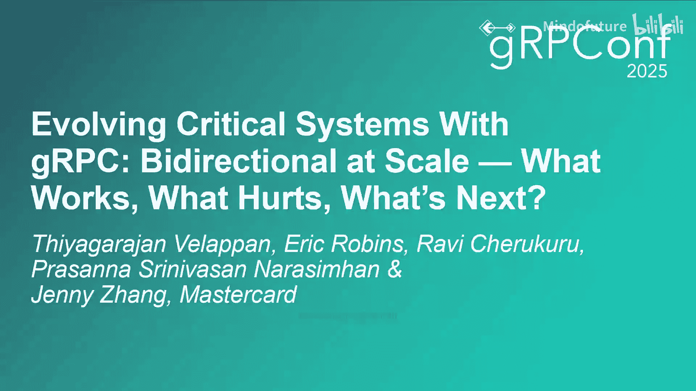
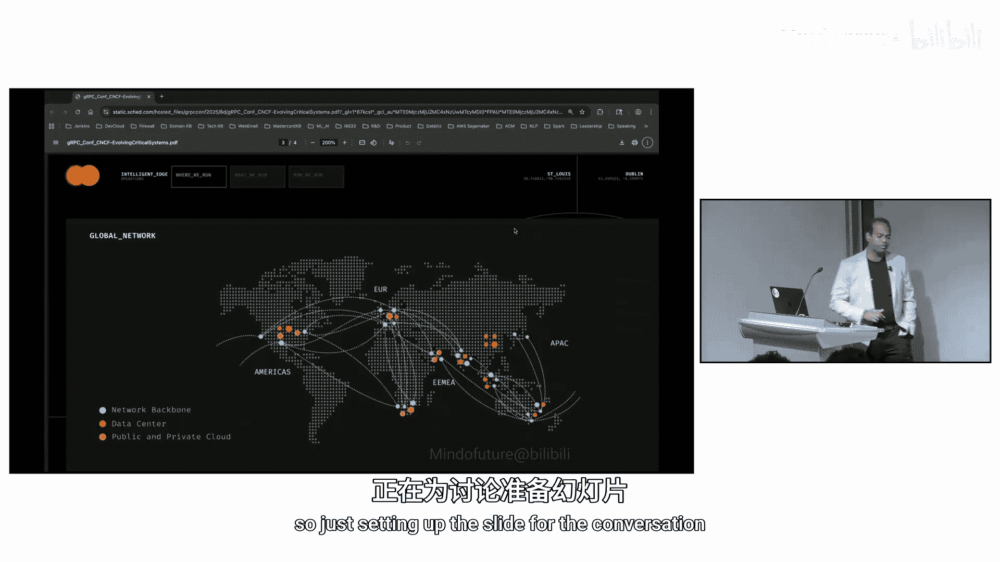
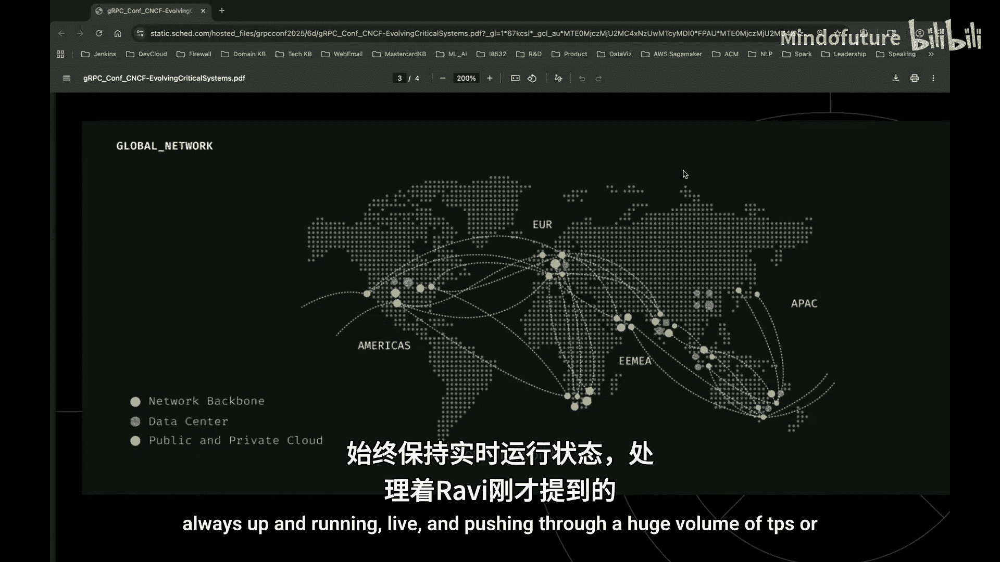

# Grpconf-2025-p12-P12_在规模下使用gRPC双向演进关键系统—什么有效__什么有害__下一步是什么--BV1yTHMzKE1U_p12-

Thank you all for joining us in this。

Expert panel discussion。Titled Elving Critical Systems with GRPC Bidirectional streaming。What works。

 what hurts and what's next？At Mastergard， we are the financial backbone of 200 and more countries。

And there are 150 currencies often moving money at lightning speed。I'm Presidentsna Sniwasen。

 a Director of software Engineing at Mastercard， my team and I， we focus on even driven architecture。

And deliver it at scale and in the center of it is grRPC and today I have the pleasure of sharing this stage with our esteemed engineers from Mastercard who have been nurturing it。

 running it for，Several decades。Starting with Ravi Crokuu。Our payments architect， the Agri Enloin。

 our developer productivity architect， Jenny Zhang， or all around our distinguished engineer。

And Eric Robbins， our security architect。So just for our audience to get an idea of what we do in Mastercard。

These are official numbers from 2024， the number of currencies， the number of cards in circulation。

 and the number of transactions that are processed， it's 159。

4 billion with the B process in the year of 2024。So today's session。

 we have broken this conversationnot into three pieces。

What works and then we go into what hurts and then we go into the what's next we have curated these questions for consistency and we'll run this for 2025 minutes and then we'll open this flow for questions Q&As。

Okay。So I'll start the conversation with the what works and I'll join the team。

So just setting up the slide for the conversation。 So I'll start with what works。

So。Rbi， if you can paint a picture on how tech stack at payment networks or the payment system is and what is our intention in going towards grRPC streaming sure personna。

 can you all hear me？Thank you。Mastercardd is a technology company。

 we manage a global network to process financial transactions services and data to move across the geographic regions and we process these payment transactions across the geographic location with very high volume。

 high throwput with low latency at scale with security embedded in we kind of built our tax stack with the custom lot of customization to move these you know the low latency data across the globe all the way from one continent to other continent。

We have customized it by using these bidirectional protocols， but what's next。

 how can we build the scalable payment network across the globe right that's where we come across GRPC about five years ago ever since we kind of evolved and build our Mastercard text stack even to an architecture around the GRPC protocol because it provides security it provides a developer experience and faster delivery and now we process hundreds of millions of transactions every day throughout the globe at lightning speed that's how we evolved the Mastercard network。

Thank you so much Ravi， that sets the stage and for our audience here hopefully you're able to see the screen。

 this is our global backbone， let me see if I can move it a little bit up。😊，Showing the where we run。

 where the global network， the network backbone， the data centers and the public and the private cloud integrations。

Across the globe。Always up and running live。

And pushing through a huge volume of Tps or transactions that Ravi was mentioning。

 so let's move to the move on so from a developer productivity tools and enablement。

Yhy GRPC and Y GRPC streaming the。That's， that's a good question， An important question。

 Hope you all can hear me okay。When we were evaluating technologies to modernise our critical systems。

 and GRPC obviously served as a foundational building block。

Mainly due to its alignment with our core technology principles。Which are Secretary。

 obviously performance。Developelver productivity and edge integration to name a few。

 But when it comes to developer productivity， I think you all understand， broad above cogen。

Strong tight APIs clear contract， multi language support all contributed to adapt GRPC at scale by our poly lot W per ecosystem。

 But what really influenced us was。Ege integration。We have， unlike the traditional system that。

Roie was fine too。Geopy gives clear semantics over at2 that enables us to expose our APIs over trusteded boundaries。

With fine grain access control。 And this was a huge leap for us to build secure and externally accessible services without much of protocol baggage。

Another factor， which is important is。We' call them Finteech Factor。

 imagine you tap your phone trying to check out at a merchant store。Instantly。

Fluurrry of messages flow between the merchant， the banks， the payment network。

 these are all the entities that the transactions need to go to verify your identity。

 check the balance， confirm the transaction all in real time。

So this seamless asynchronous flow of continuous transactions makes biracal stream an ideal choice for high throughput。

 low latency and even driven architectures。And that too， with minimal overhead， we are able to。

 Well G PCC production streamream was able to。Provide superior scalability and performance comparison to rest or repsckets。

So in Fintech。Performance isn't a luxury。 It is a necessity。 every bite， every millisecond count。

Determine the cost and efficiency of the transaction。So security， performance， scalability。

 minimal overhead are the things our customers absolutely value the most。

So GRPC seamlessly aligns with these principles。At the same time。

ding the performance we need and without adding too much of bipred code it avoided in fact a lot of biprint code and improving developer productivity so GPC wasn't just a protocol choice it enabled us to rethink how we build an exposed services that aligns with the core technology principles back to you amazing amazing at the crack of it it has to support our customers。

The promise of payments and you nailed on those developer productivity and the benefits that we got。

 Now， let's look into scalability and observability。 Jenny， if you can touch on those topics and how。

Our driver to get to grRPC streaming from that aspect。Sure。

 so when we started this journey a couple of years ago。

 I think this is like Ravi was talking about five years ago we started and there's a lot of learning behind it。

Observability， general speaking it's in the development cycle。 It's always kind of last thing。

 a lot of times you only think about afterwards， you're trying to get the things working。

 but at the end， we learn huge lesson with you know the lack of observability and talking about how we improve it。

 So as G know was talking about this morning the grRPC protocol is a multi layer networking protocol。

 So what that means is that at the bottom layer， you got a TCP IP。

 all these layer 3 layer4 you know the traffic going back and forth on top you got you know the streaming HTTTP2 streaming and of course there's application layer which is the true message So when you look at this diagram。

 the message is being we're sending the message across the globe and how do you keep the connections especially we're talking about persisted bi directional connections。

And how do you report or if something goes wrong so networking is constantly gave us a lot of challenges when that happens。

 how do you stop bleeding， how do you you know either you get yourself out of it or you can detect you can trying to wrap traffic to somewhere else so this is exactly what we're trying to do in this is what we call observability we build we spent the huge investment on the telemeries and trying to build into every single layer TCP HTTB2 and even on top of the streaming and atification and what is really interesting is when you talk about client and server you have to look at the traffic from both when you talk about you know the bidirectional communication either side is having the problems not going make this transaction successful so how do you alert yourself how do you get yourself you know you know identify it with。

sort of the problems in the middle， I think that this is really where we spend lots。

 lots of time and put a lot of， you know the detailed tracing you know， in every single transaction。

Now we're talking about scalability and this is where when you have the traffic going across multiple regions。

 how are you going to be able to scale yourself at the time and the traditional thinking of you know how do we scale the instances and how do we enable us to to be able to you know to get more traffic and scale ourselves across regions that doesn't really work in the JPC world because the GRPC is all persistented the connections so when it comes down to that we really need a different kind of the strategies to do the horizontal the scalability and we need to look at what is the available what things that we can get the traffic through so we literally have to generate different strategy to control all of that so that's kind of the big lessons that we have learned over the years amazing amazing thank you so much persistent connections。

It starts and then we think and build and tab。The scaler and observability there。

 So now let's touch on security what are some of the considerations from a security aspect when it comes to the GRPC streaming。

 Eric Yeah， sure， quick show of hands。 Raise your hand if you work in a cyber securitycur position at your company So I know who I'm talking to。

No hands， okay。Raise your hand if I see one， raise your hand if you work for a company whose data is regulated by a government or by a customer。

 Okay so we have yeah all right， there we go。 So I think you guys understand that right Mastercard is a heavy regulated company right we're in the payments industry。

 So when you introduce a new protocol like GRPC， you have to make sure it aligns with your current security standards。

 So regulations， laws and your customers drive mandates。

 those mandates drive directives which in turn drive policies which come down to standards and finally to technical controls。

So we have a whole slew of those， right to make sure that we're protecting the confidentiality integrity of our data。

 we have to， right So when you bring a new protocol like GRPC in you have to you have to ask the question。

Do we have any gaps in those controls？ So to answer that question。

 we actually had to tear the whole protocol apart all the way down to the know。

 the network layers 3 and 4， walk through tools like Wireshark to see how it worked to make sure that we didn't have a gap。

 in a second， I'll explain that in detail okay。Amazing， amazing。 thank you so much。

 but this conversation seems like it's a happy marriage。

Whatever we wanted in our modernization journey， GRPC streaming provided everything was that true？

We'll explore the second phase， which is。What hurts right。

 what were the pain points specifically on bidirectional streaming。

 which is vital for the payments ecosystem， as we mentioned。So let's start with。Eric。Yeah。

 so from a gap perspective on the security considerations as you are touching with the requirements。

 can you please highlight to our audience， what were some of the gaps from our there's the biggest single one was Mastercard was shifting in a security paradigm from stateless As rest based over ht1。

1 to a protocol that keeps connection based state between clients and servers so to understand why that might be a concern let's walk through rest first to understand I think most of you probably here understand rest APIs work But an API almost always over rest it's going to be stateless so you have a client that calls a server the client authenticates the server will authorize the client once they know the client's identity the request comes through the request is granted the responses given them the connection closes very inefficient that's why GRPcs here because Http1。

1 grRPC is connection heavy and inefficient but every single time the request。

even though it's stateless， when it crosses our network boundary。

 we always have to authenticate them and then authorize them。 Okay。

 to make sure we know who they are。 It's payment data。 Okay well。

 even if you have a session oriented relationship， think like a web application now So now you're on a web application。

 you log in you might hit ID password， maybe use a third party federate identity log in。

 whatever it is。 you'll then be given authorization grant， think about， for example。

 like a cookie or a JWT right every single time the request from the client then it comes to the server。

 even though you have an established connection， you're still given an authorization grant that we can check it and say yes。

 that still is John Doe the other line， allow the request to come through grant the response to come back until the connection is closed。

Those those types of relationships are pretty much agnostic to the underlying network。

 They don't really care。 if the network connection closes on a web application。

 the TL session will close and then of course you'll be cut off And if your server correctlyll invalidate the session。

 but not all applications do that GRPC again is built on top of TCP stateful connections in the HTP2 protocol。

 So now we had to ask the question you think about the wayRPC works。

 when a client and a server establish a relationship。

 if youre using bidirectional streaming at most the client will authenticate one time if you've played with this。

 you'll see that when a call credentials made the call credential will come over。

 if you're using I'm sorry a channel credential。 If you're using a call credential。

 you'll see that come as well when RRPC opened up。 after that。

 the client and the servers keep talking it's no different than if you were to call me on the phone I say hey。

 who is this authenticate you then we start talking。

 We trust that the underlying phone call secure and that no one's tampering are modifying the connection。

 Well remember GRPC， at least in the。TTP2 world runs on top of TCP。

 TCP is not a secure connection protocol。 All right， you can't guarantee that with a TCP connection。

 a client and a server aren't。 they don't have an untrusted third party in there。 Okay。

 the only way you can do that with yourRPC is Tl right Okay。

 Tl cryptographically binds a client and a server。 Okay。

 so if as long as you have correct Tl S in place， you're supposed to be able to trust that the client and a server that are talking。

 there's no interruption， there's no third party。Well。

 we can't make that assumption with a protocol that we just bringing into our network。

 All right So we actually tored the whole thing apart。

 Okay we ran wireshark on it and to make sure that we could guarantee that a client in a server couldn't couldn't suffer an interruption and not lose security。

 we stuck a TCP proxy between a client and a server that we ran in our sandbox so we took a GRPC client bydirectional streaming to a server。

 we put in our sandbox， then we took Nngx and stuck it right in the middle。

 Okay and every single time the client would make a call。

 we had the proxy modifying individual bytes of the Tls record。

 So if you know what a record looks like you're gonna have like a header if introductory bytes。

 you're gonna have the main encrypted message and you're gonna have what's called a message authentication code or a Mac at the end All programmatically we went through a modified by by byte to see what would happen Now this was done in Java every single time we were able to confirm that both the client and the server got a notification because what's GRPC doing。

 It's running on the overly transport layer you saw this this one with Gina the transport layer built on top of TlS in this。

Because we've got a connection there。 And the moment the Tl S throws a fatal alert。

 Both the server and the client get notified， the TCP connection gets closed。

 and then we can do some air hand。 We should never see that right。 So if we see that immediately。

 we're going do an investigation， but we're going to say， hey。

 somebody's on our network doing something they shouldn't be doing。

When we did that exercise and we had to put this in front of our executive management。

 When we did that exercise， and we could confirm that both the client and the server always were cryptographically bound by the T L S session and that if any interruption occurred。

 the connection was closed。 when it was reopened。 Aation was forced。

 So the call credentials come through again。 The channel credentials come through again。

 And that's what we needed。 We never wanted GRPC， I'll find a note here。

GRPC tries to repair those sub channelss。 You know， channels。

 the virtual logical connection between you and your server。

 the subchannel is where the actual TCP connection is。 if you're load balanced， right， So in GRP。

 if a subchannel goes south。 we'll try to repair it and bring it back up。

 Well we don't want it doing that without forcing authentication again。

 That's what our project proved。 If you guys like that idea。

 We thought about bringing that back next year and actually showing you what that look like。

 So we were gonna put that in sandbox and show you how we were gonna to monkey with the bites。

 But if we have an interest， I think we'll bring it back。 So anyway， there you go。 that's amazing。

 amazing。😊，Takeaway for the upcoming year also， that's awesome。

So let's move to load balancing challenges， the mindset of load balancing and how the GRPC bidirectional streaming changed that whole plot and what opportunities that did it provide us and how did we overcome so Jenny。

Sure。So the low balancing actually is a very simple concept and in the traditional architecture。

 the low balancers， I'm going to use F5 as an example because most people understand what that is and these kind of the low balancers are the server side low balancers and routing the traffic at the TCP layer。

So。This this kind of low balancer actually works really well with HTTP1 protocols because the routing decision made at the connection establishment now switching to the grRPC world okay the grRPC is persisted so once you make the connection with the backend server instances。

 the connection stays on and all of the RPCs behind it is you know this。

This channel actually pointed to the same back in instance so over time these instances may got overloaded while some others probably say idle because you connection just made beforehand when you send traffic you have no choice this is where you're coming from and this is where you get to right so the traditional lowbalrs in this case it doesn't really work well we learn hard lessons to be honest and we start with that and turn out that this is truly there's no lowbalancing so this is when we decided to switch to the client at lowbalcing。

 you setting all these talks the Google team has been telling you that they're talking about client side lowbalcing there is a reason because on the server side is not really having understanding where the traffic is coming from and especially when you make the persistented connection there's no way you can switch so the client are lowbalcing on the。

And has you can build in all these intelligence to the clients to make it aware all of the back and available back end server instances where they are and this is in our case we make all of the streams and connection initially when the client starts up and we created and all traffic is being sent kind of evenly across all of the streams that we have and and this is kind of the way actually we turn。

We kind of switch to at end this sounds maybe sounds easy。

 but there's a lot of things happening at at the client side。

 you would have to build kind of the intelligent thes and to recognize which instances actually it available in the back so that it can control word traffic goes so this is a truly the client side low balancing is gonna to bring it to you so you know while we're talking about the oh one more thing the regular or the traditional low balancers is more it does not really have the visibility on the RpCs behind each of the channel so this is another issues that we cannot do that Thank you Jenny thank you Jenny I think conscious of time we're going to run long。

So bear with us so we'll get to the customer viewpoint what does how does bidirectional stream affect and concerns from a customer viewpoint Ra if you can touch that yeah I will try to keep it short and simple concept of time like I said we have implemented tens of GRPC APIs for our internal production services at scale and securely。

😊，That being said， we have adapted grRPC reflectors to onboard our APIs and expose internally。

 but the reflectors has some challenges where it kind of exposes some internal and external methods so we need to ensure that's you know properly secure your external APIs So that's one of the challenges that we are encountering other things Jenny briefly touched about load balancing service discovery endpoint discovery some of these challenges still exist。

 So for that reason we are kind of adapting Xds as the protocol to do the service discovery endpoint discovery you know implement the load balancing techniques and the traffic shaping techniques so that is coming and we are planning to implement those Xd Apis once we are comfortable with Xds and we plan to expose these APIs to the external customers so far we have implemented at scale and secure。

For most of our internal products with that yeah thank you。

 thank you Ruby I think know we can keep talking about this in length for a day and each of them have been working on it for years so we'll go to the what next what do we think as we take this journey forward what are we thinking from a perspective of so maybe I'll start with developer productivity from T from your perspective what's next absolutely I'm going to be brief to so in addition to the XS protocol that we just mentioned this will help us geoserv discovery and fail over and automatic dynamic configuration and we are actually coupling that with a patented adaptive request handling mechanism that takes into that actually monitors network level information about the channel health the stream held and so on and will be very adaptive and scalable the same time dynamically able to read out the traffic when and needed and much much better than GP framework could and second we are always。

On the hand for a much lighter faster scalable resilient protocol on that front we are exploring HP3 quick protocol we have a talk pilot going on at this point that will actually be helpful is actually built on UDP and it is streams are actually decoable and therefore it avoids some of the TCPs shortcoming such as head ofline block and security is actually zero to one rTT and therefore this is going to be much faster and much more resilient to connections connection failures so I'll just stop it you you you so much。

Awe okay thank you I you guys I know you're hungry。 promise or go fast。 we'll talk fast。 Yes。

 we'll make sure thank you so much for your patience and kindly listening to our talk here。

 I think we can open up for some questions。😊，ThatAll right， feel free ask any questions， please。

Do you know how many APIs you have？Or in other words， do you keep a catalog of？Yeah。

 we have tens of internal APIs。 sorry， we have tens of internal APIs and。You know。

 theyre not actuallyally。Expo today。Do you have a oh thank you Google has a style guide called the AIPs。

 the API I proposals， do you use those or do you have something else we have a customizable internal ones we we are not using。

It's a， it's a good。Good information。 Thank you。Yeah。ですね。I have two questions。

 one from a developer productivity， one from a load balancing from a developer productivity。

 if you see the text stack in the front end， if you got Swt or whatever you got to receive your data from the user or frontend apps and then the backend you got grRPCs you need to do this friction point of translation of the messages or the packets so how do you handle that for very large scale developers okay across thousands of developers。

That is one question from a load balancing typically in cloud， right。

 you've got three node or four5 node clusters across multiple subs or multiple geographical regions and whatnot。

 So when youre doing this I mean streaming Are you doing this load balancing on a message basis or on a channel session basis when when you want to switch from one sub to another sub how do you doing great questions I'll start with the developer productivity question。

 So there are two things we mentioned one is strong typed As and clear contract。

 These are fundamental for scalability， especially for developers to adapt。

 So that's the first thing we did even before adapting GRP we got together and said this is the standard。

 This is pro above is the standard even without GRP， you could use pro above。

 So that was the standard that we agreed upon and we had a central。😊，pository just like Buff。

 for example， where all these chchemos for prototypes are managed。 So that's。

 that's the first thing and clear contract that will actually help identify issues only in the development life cycle and reduce ambiities。

 So these are the principles we are to for and develop productivity standpoint。

 and to add to that Yes， to your point， are protocol remediation layers that are required。 And yes。

 they are there they are governed by the SLss and we are fine tune in those lower level TP layers and all from my iPhone app。

When they get the data from the user apps back to my GRP scenes。

Client I still need a there is a friction point for the developers to do this protocol translation。

 yes， we so we're not there yet for the U I This this is this is all As API processing。 Yes yeah。

 and I also standards basically run on these protocols。 Yeah Yeah， I quickly added that。

We didn't get a chance to finish up the content we have because we know you guys about the G armsms off there's a limit to where we use GRPC based on certain concerns about exposing it to the internet。

 So when you think about the standard like a user talking to it this is service to service what we call trusted clients that makes sense All right let me go over the the low balancer So as I mentioned we move towards the client side low balancing So all of the intelligence is happening at the client side So when you're talking about multiple you know the subnas different regions it doesn't really matter。

 So we are having the connectivity getting to no matter where the what we call the GRPC server and the client needs to have the connectivity to go to those service directly So if you have a regions So there is the smartness at the client side of it that we implement it you can specify you want to have the percentage different percentage right9。

know regarding to the region and the client can identify what are the active streams or our active channels that we're creating and how traffic is going to be loaded towards each one of them that's what we do if it may add to what Jenny was saying this is called per message based load balancing yes with a smarter selection of streams。

 it will know behind the scene the load and the health of the stream and the channel and enable clients to do more even based load balancing even though you're using streambased or RPpC based mechanism It's a huge mindset difference also in building the channel is only the foundation once you get these channels of streams established the message is really controlled by the client so it'll be based on how much traffic I am getting I can load balance through all of the valuable streams and channel。

I actually have a question so thank you so much so you mentioned how you guys are using client side load balancing where exactly are you using that are you using that in like internal services or are you using it at like something like the edge I can't imagine with like transaction processors that there's going to be a huge flood of people like submitting transactions from like a single device or something great question so the client that we currently have is kind of internal but it's also kind of external because that client can go anywhere sos that's how this payment network is really build upon and these network connections as Robbie mentioned right currently it's a traditional TCP connections going everywhere so we have that network built in already so now the client has the libraries has the logic that does the low balancing that client can go anywhere it could be internal it could be external in fact。

We use that anywhere the client the library is being sitting so it's not really about where that's sitting it's really about what it does so the challenge with that I can see where you going but eventually what's going to happen is we need to have this kind of the client logic to be exposed with all our customers if they don't want to use the existing client that we've already have or you know they would have to integrate it with our libraries in the future so this is what the team is being working on so that we can have the unified interface to all of our customers So it's that like payment processors just is it is but down the road it can be the processors and it also can be the individual customers is like modernize the customers they want to build their own logic going forward this provides the ability we have to be careful how much we say about our payment number。

I can't you keep asking the question we're gonna， we're gonna have you come work at Mastercard。 We。

 we can't reveal too much about what the network looks like。 But yeah， we can， like。

 we control these clients。 One question okay， one last question Yeah good。😊，Please。

If you do per message， itll be， do you have to deal with a server affinity？😔，No， it's not。

 So it's the number of reddundancy connections。 That's what it matters。

 So with enough redundancies build number of connections or channels in each channel would have number of streams we will continue to be stateless。

 no affinity whatsoever and any stream can take any messages and each message will have a unique message ID that will keep the messages apart。

 which message sent on which stream， So we have additional metadata to distinguish one stream from another and one message from the other。

 So that's how from an observerable distant B we're able to track through reddundancy and keeping it stateless all the way through that's how we get there。

I think there' would be a mass stampede for the door here in about 30 seconds。Thank you so much。

How about we offer this， I think we are at least 20 minutes past time。 How about if you guys。

 Some want to run for lunch， if you want to stay， we'll hang as long as you guys want to ask more questions。

 those you want to go eat。 I don't want to get in the way and get bit。 So hey， thank you all。

 thank you guys。 biggest for。😊。