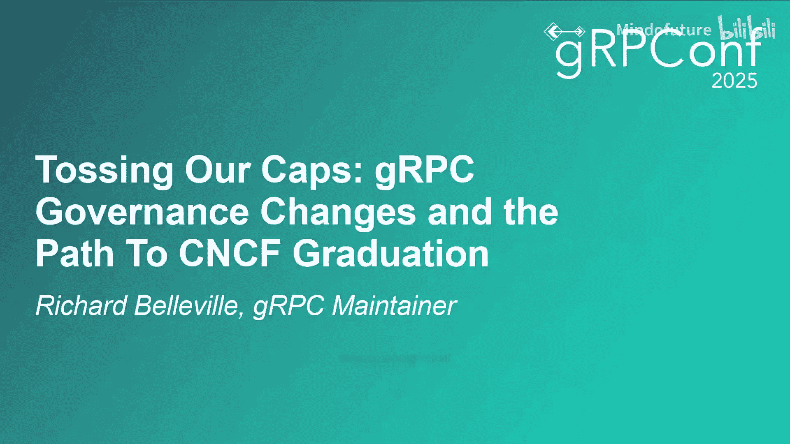
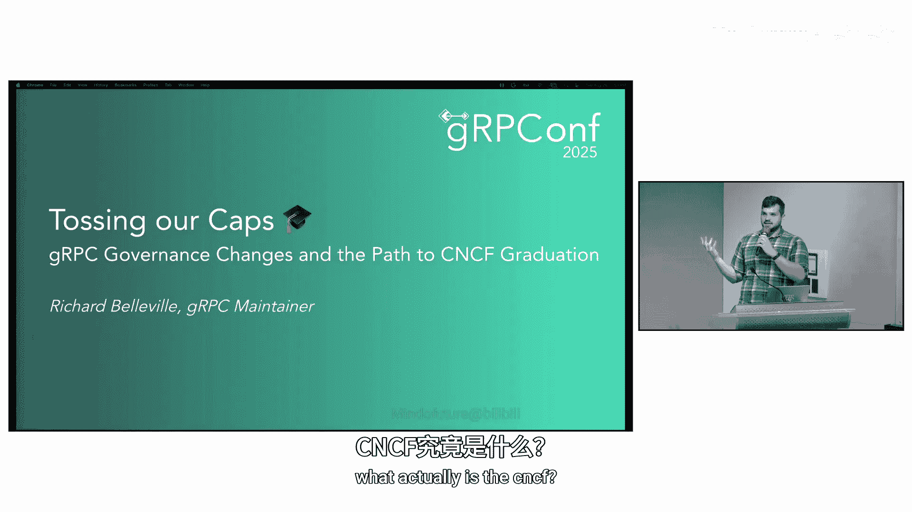
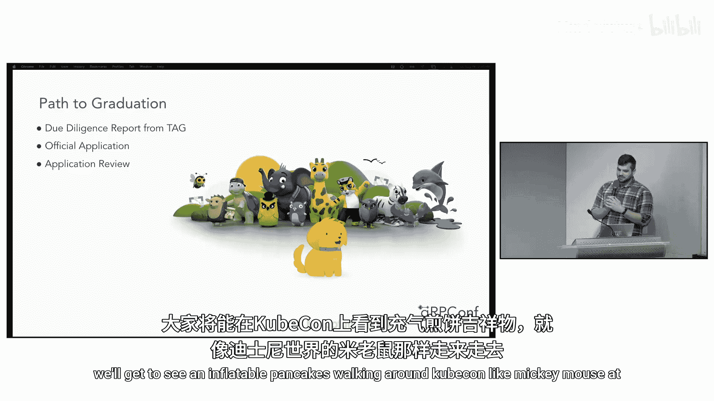
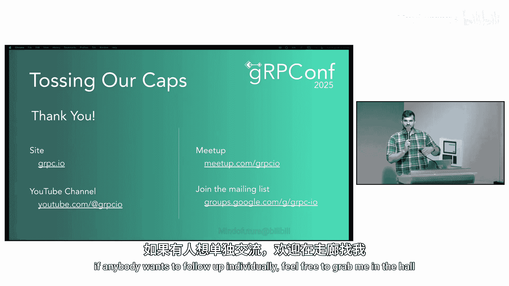

# Grpconf-2025-p13-P13_抛弃我们的限制-gRPC治理变更和通往CNCF毕业之路--BV1yTHMzKE1U_p13-

I'm Richard Bellville， a maintainer on the GRPC project and this is one of the few talks where I get to tell you exactly what that means。

 maybe in more detail than you'd actually like So we're going to be talking about GRPC's path toward graduation within the CNncCF and some changes that we've been making within the project recently to make sure that we're prepared for that finish line but before we get into all that。

 let's zoom back out a bit first what actually is the CNncCF because I think most people aren't familiar with it。

Well， CncCF stands for the Cloud nativeative Computing Foundation and if you have heard of it。

 it's probably been in the same sentence as Kubernetes that's because the CNCF owns the trademark for Kubernetes and they spend a big chunk of their time promoting Kubernetes。

 but digging into the nitty gritty details， the CNCF is a nonprofit subsidiary of the Linux Foundation that was formed by a bunch of companies back in 2015。

 including AT&T， Cisco， Docker， Google， Twitter and a bunch of other companies to drive alignment in cloud nativeative technologies。

At the time， that primarily meant software involving containers like Docker。

 Kubernetes and things in that vein。 And in fact， Kubernetes was the very first project donated to the CNCF。

 But over time， the CNCF expanded to a mind blowing array of different kinds of software。

So what exactly does the CCF do， It acts as the steward to projects that have been donated to it。

 Companies open source their software projects and give them to the CNNCF hoping to increase the adoption of that software in the wider world。

The CNCF promotes those projects at conferences like their flagship event， KubCon。

 which runs multiple times per year in various places around the globe。

 attracting thousands of visitors to each one and in fact， the event that you're at right now。

 GRPCConf is also a CNCF event。So this is the cloud native landscape。

 a map of all of the projects that are under the EncCF umbrella。 Don't squint。

 There are so many here that there's no way that you're going to be able to make them all out。

Obviously， companies see a lot of value in donating their project to the CNCF and the reason that donation to the CNncCF increases a project's rate of adoption is that software developers at companies around the world pay attention to the CNCF because it has a reputation for quality。

 When the CNCF promotes a technology。 General speaking， it's high quality， secure。

 battle tested and all around something that you would feel comfortable putting inside of your production system。

😊，And those are the same reasons why GRPC was donated to the CNCF by Google back in 2017。

 Now in 2025， the CNCF hosts over 200 projects across a crazy number of different areas。

 storage observability， CICD， networking and frankly just many too many for me to list here。

 but not all of those projects are at the same status， each one has its own maturity level assigned。

So when a project is first donated to the CNncCF， it starts as a sandbox project。

 the CNncCF calls Sandbox Project experimentsments， earlyy work and the bleeding E， in other words。

 things to look out for in the future， but not necessarily things to place huge bets on right now。

The next maturity level is incubating。 Projects move from sandbox to incubating by going through a review process with a CCF technical oversight committee or T OC。

The TOC certifies that the new incubating project has a healthy pool of contributors and is being successfully used in production by at least a few companies。

And the final level is graduated。 While incubating projects are considered stable and mature。

 graduated projects are widely adopted and have become a foundational pillar of the cloud native computing landscape。

😊，The process of moving from incubated to graduated involves an even more in depth certification process with the CNCF TOC。

So believe it or not， GRPC is not currently a graduated project。

 but only an incubating project in the middle。Usually， when I tell people that。

 they're super surprised。 Isn't GRPC a foundational pillar of the cloud native computing landscape already。

 It is the de facto standard for R PCC systems， no matter which company you're at。

 no matter which country in the world。 And that is why we think it's time to seriously pursue CNCF graduation。

So a while ago， we met with some folks from the CNCF and got some guidance on what we'd need to do to get ourselves on the path toward graduation。

Their feedback was that the biggest thing we could do to improve our chances was make a few changes to our governance。

 Now， our governance was first written  seven years ago back in 2018。

 and we had never changed it since then。 Our contacts at the CNCF pointed out gaps in it。

 things that could be exploited like the process for offboarding maintainers wasn't super well defined。

 Someone could potentially game that。And our structure was completely flat。

 You were either a maintainer or you weren't a part of the project at all。

 And there were no real criteria work for when someone should become a maintainer。

 So how should a person or company wanting to get involved in GRPC do that。

 So we took all that feedback， looked over the recommended CNCF governance templates made a proposal and just a few weeks ago。

 gathered all 67 current maintainers and voted that proposal in。

 So here's a high level overview of that。First， we took our previously completely flat structure and broke it into a contributor ladder with multiple tiers。

 Each one representing a higher degree of commitment and expertise。 within this new ladder。

 Mainer is the pinnacle。 Our maintainers are now our most senior and most expert contributors。

Ultimately， our goal with this governance is to show how new companies can make their way up to maintainer。

 So more details on the ladder structure in just a bit。😊。

We also added in an elected steering committee。 The steering committee is a group of seven people responsible for communicating with the CNCF。

 issuing statements on behalf of the project and determining overall direction for advocacy and marketing。

We just finished up the election for the first airing committee。

 and they started their term on August 15th just a little bit ago。

So within the new contributor ladder， people will join the project as organization members or org members as a rule of thumb。

 org members contribute at least four PRs， bug fixes or code reviews per year。

 just dipping their toes into the project。All it will take to get to this level is the sponsorship of two existing org members or higher。

Once they do become an org member， they can be assigned issues and reviews within a particular repo and can sponsor others to become org members。

Over time， when they gain expertise in a certain domain。

 they're recognized for that expertise by promotion to core contributor。

That promotion only requires the sponsorship of two existing core contributors or higher。

At this stage， your domain of expertise is officially recorded in the contributor ladder。

 It might be a code directory， a whole repo or a more cross cuttingtting concern。

 such as observability or security。 regardless of the domain。

 core contributors are responsible for reviewing most of the PRs in that domain while working with the maintainers and their respective reos to make sure that things are moving in the strategic direction of the overall GRPC project。

Finally， when that person has demonstrated broad expertise across multiple areas and is involved in mentoring new contributors。

 they're recognized for those accomplishments by being voted in as a maintainer。

Being a maintainer means not only being responsible for critical chunks of the project。

 such as an entire language implementation。But also defining the overall technical strategy of the project。

 For example， maintainers often spend long sessions together figuring out how to make a cross language design work despite large differences between the various implementations。

Putting this all together， you have a very clear pathway for a new contributor to get started on GRPC and work the way up to the very top。

When we voted this new governance in， we had 67 maintainers under the old governance with vastly different amounts of experience and expertise。

 Some of those maintainers had been working on GRPC for a decade while others had been working on it for mere weeks。

We use the rules of thumb on this slide to retroactively place each of those contributors in the latter based on their experience level within the project。

And then there's the steering committee。 The GRPC project has always had people on it who were less involved in the nitty gritty day to day details and more in the high level direction of the project。

The steering committee formalizes that in the open source project and puts them in charge of communicating with the CCF。

 issuing statements on behalf of the project and taking care of advocacy and marketing。

So the steering committee is elected annually。 The members do not have to be maintainers。

 though there are a couple of maintainers in the roster this year。

 you'll probably notice a name or two on this list just from being at the conference today。

The steering committee will hold regular meetings， which will be online and public by default。

 So stay tuned to the GCIO mailing list for details on that as it's being set up。

So with these governance changes， we think that we are set up for success in G in CNNCF for graduation。

 but there are still a few more concrete steps that we need to take。First。

 we need a due diligence report written by the technical advisory group。

 They'll go down a checklist and make sure that we're actually following our governance。

 that we're vendor neutral， that we follow security best practices and things like that。

 And after that， we'll submit an official application to the technical Oversightet Committee。

 They'll assign someone to review both our materials and the due diligence report and fingers crossed。

 That'll be it。 We'll get to see an inflatable pancakes walking around Kubcon like Mickey Mouse of Disney World。

😊。

So we've taken a look at the CNCF and the nutss and bolts of the GRPC project structure。 Obviously。

 a big part of these governance changes is to make it more accessible for new folks to join the project。

 So if you're interested in that， the best way to get started is to join the mailing list。

 If you already know an area that you're interested in， like a particular language， particular repo。

 we have tons of issues that are listed with help wanted or good first time issue。

 If you rack up a few of these contributions， you are a great candidate to join as an org member。

 So if you're interested in pursuing that， feel free to link up on the mailing list。

 So if that willll move to questions。😊，Alright， looks like we don't have any questions。

 If anybody wants to follow up individually， feel free to grab me in the hall。

Thanks， everyone。