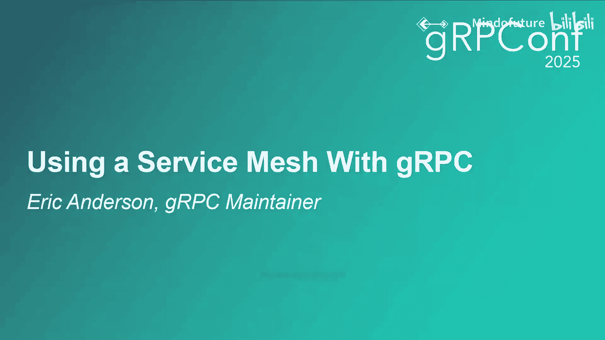
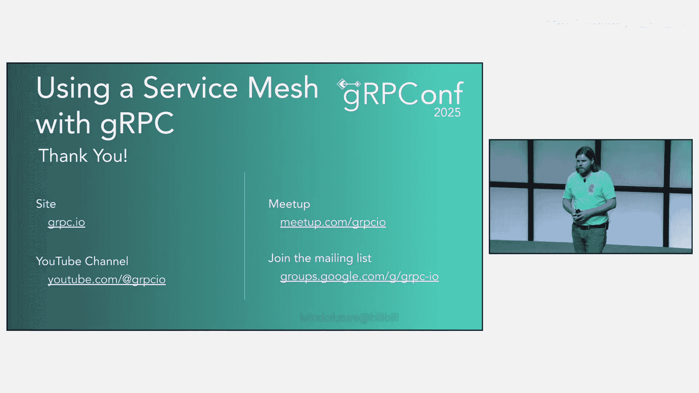

# Grpconf-2025-p14-P14_使用服务网格与gRPC--BV1yTHMzKE1U_p14-

I'm Eric Anderson。 I'm a G maintainer， and let's go ahead and talk about some service meshes。

The service mesh is an infrastructure layer for applications that enhances service to service communication。

 It handles things like encryption， load balancing， observability and resiliency features。😊。

It couples them from the application code。 And so then you can manage those separately。

 This also allows developers to focus on the business logic。

 while the service mesh ensures the reliable and secure service interactions。

So does my service mesh work with JC， This question I've gotten from some developers and the general answer is yes。

GC does require HGB2， but that's commonly supported。There's a common related question。

 which service mesh works best with GRPC。For both of those questions。

 work is dependent on the problems you in particular are using the service mesh to solve。

 So keep that in mind， it's sort of centric on what you're trying to do。And。The problem is。

 even you is a little bit of fuzzy here。Your team may have a particular need。

 but other teams in your company are optimizing for their own needs。

 So you might have an infrastructure team that wants it to be easy deploy。

 but a sister team that wants features。 And then you have yet another team that wants performance。

 So I suggest you to keep that in mind that it's a simple question。

 But even then it's getting a little interesting there。

So with these sorts of different objectives in mind。

 let's look at how GC interacts with the service mesh。And to do that。

 let's look at some service mesh architectures。Here's a rough list of architectures。

 Different people might use different names。 but these will work for this presentation。 Gway。

 demon set， sidecar， proxys。 Let's look at how each， look at each and how they differ。

And so we're gonna start with not a mesh。We just have our application。

 and services talk just directly to each other。This can work， but can have load balancing problems。

 General， it lacks security， and it can be slow to respond to policy changes。

By being slow to respond to policy changes， I mean， if you want to change a setting。

You have to roll out a different version of the application。

 And they can be particularly nasty if you need to roll out for clients。

 if you are app4 in this picture， if you might， it might be hard to get app 1 to redeploy。

You can throw a proxy in between the client and the server。

 and now you get good load bouncing and you can quickly update your policies for the service。

 and you don't have to restart or redeploy the client or the server。

And I'm using the term gateway for this model， which might seem strange since we most often use gateway when communicating between meshes。

 but the architecture is really the same。If you compare this to typical service mesh。

 the main feature missing is security。Note that the proxy could be shared across services or each service gets its own proxy。

And now we get to the architecture of the first service mesh。

 We put a proxy in each node with some kernel rules so that proxy controls the application network communication。

Now， the proxy can enforce and use mutual T， L S to encrypt the network traffic and restrict access to the service。

The proxy uses Kubernetes demon set to run each node， and then is shared between pods on the node。

As we continue， then there's the second architecture that people associate with service mesh。

 Instead of having one proxy per node。 you can instead have one proxy per pod。

 The difference between this and demon set isn't as much about features。

 but about deployment and resources。 If one application does a ton of traffic。

 you can give more resources to that one pod's proxy On the flip side。

 though it's going share the pod's resources， which could potentially add complexity to deployment。

And since this is a geography talk， let's go back to the first architecture slide。

 The point of the service mesh was people had applications that couldn't do various features themselves。

 addinging those features to many different client and server libraries for various languages was too much work。

 So we're like， we'll use a proxy。But if the clients in services have those features directly。

 then you could do that do it without the need for proxies。

So let's look at our list of architectures， again。There's some flexibility to this。

 to the architectures。 For example， Lier D is swapped to sidecar so it could be enabled per pod。

 and that was made possible by a more efficient proxy。

Istio with ambient mesh swapped to a smaller demon set proxy to simplify resource management。

 because the proxy no longer competed for the application's resources。

But why would Istio use both demon set and gateway。 we may not have to full you。

When we talk about proxies， there's two main types that matter to an architecture。

 There's layer 3 or layer 4 from the OS S I reference model， which is network or transport layer。

 These types of proxies work at the level of I P or TCP。

And we'll just group them together and call them L 4， because even though technically。

 they might work at different layers， they produce similar results to each other。

Then there's also layer 7， which is the application layer from O， S I。For us。

 this type of proxy typically deals with H T to P， although it could handle other protocols as well。

I know some people may only think of L 7 proxies as being proxies。Some L3 proxies。

 we just call routers， for example， and people may not think of them as proxies， but they are。

 They're doing a lot of the same things。And that should remind us that。

 like the implementations matter。 Rors are so fast that we really don't even consider their latency cost。

 They're just there。 And it's， it's， it's good。 And deployment and maintenance is also abstracted away。

 We don't think about what size machine to use generally or the CPU usage。 We just have it run。

As a generalization， L 4 proxies tend to be more efficient。

 where L 7 proxies tend to be more featureful。With that in mind again。

 why would Istia use both demon set and gateway， Well， the answer1 is an L 4 proxy 1 is an L 7。

All right， it's been a few slides since we've talked about JRPC。 So what makes JC special to meshes？

And it's pretty simple。 H B2， H B2 can use a single connection for many requests。And that's well。

 different than EP1。Whenever we look back at those proxy types we had。

E proxies can only load balance connections。H B2 needs fewer connections。

 thus gets less frequent load balancing。Many of you may be familiar with this with Kubernetes。

 If each client causes a small percentage of the overall server load。

 Kubernetes native load balancing might work O。 It works at the L4 layer。But for heavier clients。

 you need to do L 7 load bouncing， which JC does natively。

 That's why people then use the headless services。And HB2 causes similar behavior for meshes whenever you're deploying those。

So for example。How well would this work for G C， We're using the newer Istio architecture。

 but we elected to not use a way point。The proxies can only do L 4 level load bouncing。

So this will behave similarly to Kubernetes， load balancinguncing。 If you have small clients。

 this might be fine。 but otherwise， you will want to add a waypoint for per R PCC load balancingcing for better distribution to the backends。

As another example， now with linker D。This looks very， very similar。 But now the proxies are L 7。

 So this is actually fine as this。 You don't need anymore。I'm doing well for time。

 So I'll give a little extra here。 You might wonder what's。Going on with H P2。

 Lier D can actually upgrade from H P1 to H P 2。And whenever it uses things。

 Z tunnel with Istio can also use H2 for its own communication。And then we've got GC using HB2。 Why。

 why would we be doing HB2 for all of this？ And the answer is actually security。

 The the handshakes to do security can be quite expensive。 And if you're doing plain text。

 you don't notice it's fine because you don't have the TLS handshakes。

 But the moment you start trying to do security。 the making connections becomes much more expensive。

 And so that's why these different tool systems try to reuse the connections and and avoid unnecessary handshakes。

If your service is performance sensitive。Then there's proxyus ends up making a lot of sense for which architecture you might want to use。

proxies can add latency。 And so whenever you're trying to apply for all the performance。

 you want to remove any sources of latency， you can。If you use gpsy almost exclusively。

 then proxys might be a good fit because I've seen some developers choose it because they didn't need to worry about deploying the the proxies。

 They could sort oferative iteratively just roll out to particular workloads and turn on the mesh deployment at a time。

But that assumes you don't need the proxies for nonG traffic。

 If your applications use a mix of GC and other things like rest。

You're going to need to deploy the and manage the proxies anyway。 So that's fine。

 You you would use a regular L7 proxy based mesh， and that will work fine with GRPC。

Depending on your needs， you could still try to mix this with proxys， but your。

 your mesh would need to support it。So to so is。So to demonstrate what I mean by optionally using proxys。

 let's take a look at Google's cloud service mesh。It was previously called traffic director。

 by the way， if you're familiar with that name。Cloud service mesh supports Proxys。

 but you can choose for each pod whether it uses a proxy or not。And yet。

 it still forms a single mesh。 So app 1 in this diagram would you be proxys。

 but app 4 is using sidecar， yet they can communicate directly with each other。

I'm aware that Istio also has experimental support for proxys。

 Jpsy did implement introduce an incompatibility there。

 but I'm sort of hopeful that might get resolved in C plus+ and Java soon。Alright， thank you。

 Do we have questions。

All right， service meshes are easy。And there's not been any load balancing concerns。Thank you， Rick。

 that's a wonderful presentation。 I wan to ask you。 I。

 I know we've follow along been talking about HTB2 and using proxies and proxys for in。

 in this combination， HTP 1。1 on basically B 2。 And we have H TB 3 around the horizon。 and。

 and we believe。😊，The connection time is relatively faster because it's 0 to 1 R TT because it combines D L S and handshake transport handshake in one go。

 So what are your takes when we will be able to have a service mesh or a proxys model that supports these。

So。H TP3 does have fast handshake。 However， very few people can actually use 0 R TT for something like J PCC。

0 R TT is actually really， really great for browsers that do like a git request。

 But any time you're doing anything authenticated。 the0 R T T can be replayed。

 And so you don't get to do it for posts。 And I think even puts。

 you don't you don't get to do it for。 So for most of the things we talk about。

 the 0 R TT isn't actually able to be achieved。 The1 R TT could still be there。 T S 1。

3 gets you close to that with the the normal TCP。 you can reduce handshakes。

 But overall here we we're reusing handshakes over a long period， right。

 So maybe if you you've got crossconental， you could shave that down a little bit。 but。

H TP3 works really， really well across the Internet。 And we do for mobile， have some HP3 ability。

 depending on which language you're in and platform and stuff like that。 But for the data center。

 it's got some benefits and some draw drawbacks。 and it's。

 it's just a little bit more muddled and less obvious。

 So it's there depending like a lot of some proxies can support it。

 But GPC still doesn't do it natively。 Okay， sort of related question。

 Do any of the GCP services support H TPT already for GC。

Do say that again any of the G GCP services that Google Cloud platform services support a proxy I mean。

 support H TP 3 already and that we can leverage for our GPC workload。 And we。

 our situation is kind of unique。 We， we run critical machine critical latency sensitive applications on long haul networks。

 That's our use case。Sometimes the network is not， I mean， Internet traffic。

 right it's not in our favor。 We don't control them。

 So we're hoping H T P3 can can Yeah across the Internet。 Yeah， I believe the。Of。Try to of the name。

 so the， the cloud proxy for GCP， I think it supports H B3。

 And that can then if you talk to it with H B3， you get it to the back end。

 And then I think the some of the Google APIs are in front of similar proxy and they can speak it。

 So I I can't say I've tested the specific situations。

 But I know other people have done H B3 in some similar situations。 A lot of those are mobile。

 though， yeah。不许。Yeah， I have a question with to versioning。

 particularly when you are doing version changes， which of these service architecture would really scale across thousands of GRPC。

Deployments。So， so you mentioned version changes， which is rolling out and and dealing with the updates G I meanchema updates and those sort of things。

 for schema updates where you're updating the versions and you're want the servers to be compatible with the the old clients and stuff they would all work pretty similar that that's gonna be more at the application logic level。

 the one sort of difference is if you want to do A B testing or or red green or all those sorts of variations。

 Yeah， the meshes have have tools to help with that。 But all the all these service architectures。

 which one really actually scale for this management。I'd say， in general， the， the。

 the scaling would be mostly in terms of number of nodes or pods that， that sort of thing that。

 the number of clients in servers the the versions probably doesn't factor in very much at all。

I think there's some behind you。Hi， can you please elaborate on why proxys is recommended for GRPC heavy and how the service mesh would look like where would the features of service mesh be implemented in that case。

Yes， so if many gy heavy workloads， it's really nice if you can just spin up a single job and start using proxys for this one service。

 you can try it out， see how you like it。 it doesn't need to be a full Kubernetes cluster choice or things like that。

 I know some of the other meshes also let you spin it up per pod。

 but you get that sort of benefit where you can easily try it out。

 you make a small change in your code and you get to choose and compare whether you're liking it just lets you ease in。

 G will be implementing the various features。 And yes。

 it is possible that some features that you you want are not implemented by G PCC。 in those cases。

 yes， you would end up wanting to use a proxy。 A lot of the features that people are wanting are in G PC。

 So if it's some of the run run of the mill stuff。Check it。 And， you know， it。

 it probably is doing what you want。 If not， you know， we。

 we might want to be interested in figuring out what that feature is。 But yes， the， the， the。

 if a new version of a mesh comes out tomorrow。Gy might not support whatever that feature that is。

 where the proxy L 7 proxy would support it potentially。 That is something to consider。 So， yes。

 proxys might have reduced features。 But for a lot of G users， that's not a concern。

 It'll either be of a concern for you or not。 And some people might be talking about using Wm and things like that。

 like the more complex you get for the feature usage。

 the more likely that G is not gonna support that。Thank you。So I I got some questions about security。

And and I think the one of the slides that you showed that you got to support different models where you can have the the sidecars running with the pod and talking to GRPC to the other end or vice versa。

 So I guess general speaking。If the GRPC， it's a serverless proxy is is save。 I mean。

 manage the sidecar。 I understand the Istio manage on his own， but in general speaking。

 managing a sidecar， it is overhead is other concerns you have to kind of think about in terms of networking or the other ones right。

 So what is the benefits of if we're all coming back with this proxyless proxies or the proxyless model。

 why would I want to choose the the sidecar model at all。For the original you would。In my talk。

 there was the， the three points。 The third point was you've got a mix of things。 Okay the the， the。

 the meshes were they， they came out and you've got these。Legacy applications。

 or you just doing things five different ways。 And it's hard to get all the features everywhere。

 And proxies work really great in that situation。You are trading something。

 You're either trading the the resource costs or the the latency or and many of those you may pay and not even care because it's such the value you get is。

 is so great compared to those small costs。 But yes， if you're mostly GC shop， You know。

 there's a lot of communication。 You're doing tons and tons of R PCCs。

 then it's a different calculation。 So I promise last one question。 It's on the JPC。

 when you talk about security。 And， and I totally agree with you making the connections and is gonna be expensive。

 right， So this is where once you have it， you probably only do it at once。

 I that how the price at the。The， the proxy is model is really worked。

 You only doing authentication authorization at the time of when the connection was made。

 Is that how you do it or。So so G will behave similarly to how the proxies would do it if the proxies were there and you。

 you try to reuse the connections。 and there's some details on authentication exactly how you're doing authentication。

 But the normal mesh proxy authentication would， would be happening the same way。Well， the。

 the normal one is you do it if every single transaction， right when you come in。

 you do that because it's more not like H TP1 level。 So that's kind of every single transaction。

 I'm hoping the GRPC model is really we we kind of move away from that。

 for the meshes whenever a lot of the authentication they're talking about you can talk about two authentication。

 one is service to service authentication。 and one is like in user authentication。

 the service to service authentication you can do once per connection。

 and then they try to reuse those connections Make sense we are out of time。

 I will be over here and we can y'all can find me and talk to me。 Thank you， everyone。😊。

