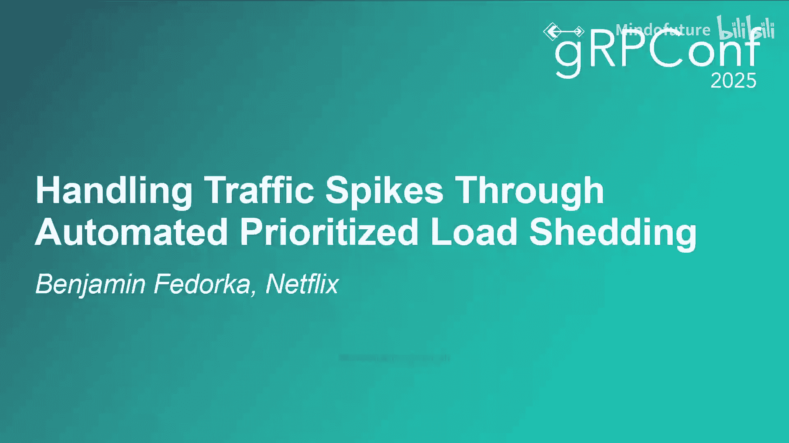
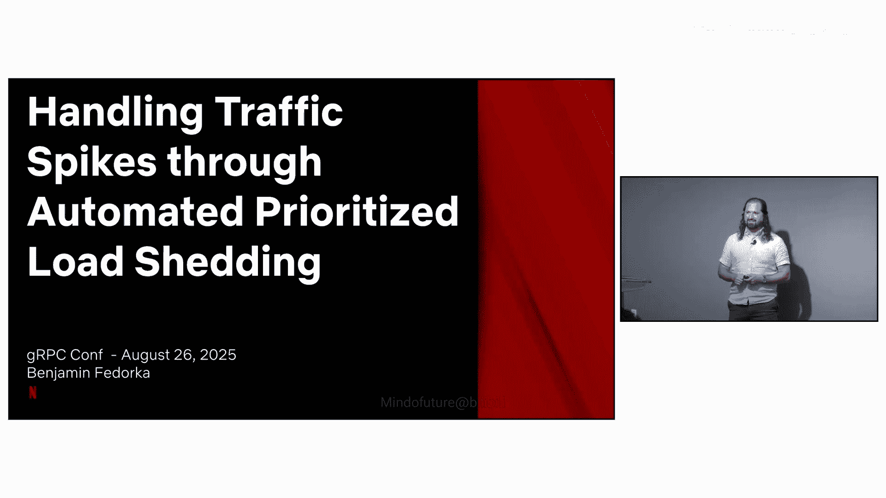

# Grpconf-2025-p16-P16_通过自动化优先负载削减处理流量高峰--BV1yTHMzKE1U_p16-

Let's talk about handling traffic spikes through automated prioritized load shedding。

I'm Benjamin Fudorka， our pronounscer he， and I work on the Java platform team at Netflix。

My main focus is helping engineers easily integrate their back in systems。

We deliver a consistent developer experience for point to point communications in JVM applications。

 we do it by providing a variety of RPC frameworks， including Netflix JRPC Java。

 Netflix Web client RE clientient， Spring WebMVC， and a bunch of related tooling like the Netflix concurrency OSS library。

 Spring Bo integrations to make all of this easy schema management and ad hoc requests。

Netflix JC Java is our most highly featured and complex RC framework。

 we have over 600 applications serving 1300 services and over 1500 applications with JC clients。

 so it's critical that all of this is easy we call making this easy our paved road we approach challenge from five angles tooling how to engineer author schemas and send ad hoc requests。

 security， how do we establish and enforce RPC integrity and access controls， resilience。

 how do we ensure that RPCs succeed or degrade successfully。Observability。

 how to make sure that the behavior of the system is easy to see and understand and ergonomics。

 how to make all this easy。This year I'm continuing our transition of sharing details about what we've learned and where we've succeeded by diving into our capabilities for handling traffic spikes while protecting our customer experience。

When our content team shared their plans for our 2024 and 2025 releases， I was really excited。

 I love our vision to entertain the world and we had a lot of high profile content。

 but when we set the goal to start surviving load spikes without increasing our server capacity I was concerned because this isn't just one problem It's hundreds of similar problems。

 my team support services across all aspects of the business and every clusters got our unique performance profile。

 we have years of experience helping teams operate our existing resilience capabilities。

 but our best tools either require hand tuing each cluster or leaves a lot of performance on the table we needed to find more capacity in our existing clusters and we need to make that process scale。

😊，So I'm going to talk about first the Elf in the room why not just auto scale I'm going to talk a little bit about our theory。

 how we think about service capacity and failure， how we started measuring server utilization。

 and I'm going to shift into where our successes were， really leaning into prioritizing requests。

 desharding clusters， how we've validated all these configurations。

 and I've got one side that's going to help you understand how we've got it wired up and how you might be able to apply it。

So easy， why not scale up， right， it's super easy to do， it's reactive， you start getting loadedd。

 you just throw more servers at it， why not just do this？And of course the answer is we normally do。

 right， we do actually allow customers auto to scale and we prescale before content releases。

 so why doesn't that solve our problem？😊，So scaling up has issues right first of all。

 it's costly right， adding our code to more servers， it's just going to be more cost right。

 It doesn't matter if we have a cloud provider or running our own data centers。

 we're going to use the resources that we might not actually have。Two， we hit capacity limits， right。

 we might reach the number of nodes that we can't actually add anymore。 we can't operate more nodes。

 Maybe we have a control plan that gets maxed out or maybe a database can't take any more connections。

Scaling is also not always fast if we underscale a cluster and we have to let it autoscale。

 it actually takes time to get the new instances started once they're started。

 they're likely to come up cold and they're going to have worse performance for the first couple of minutes。

This makes it less reactive because maybe all your users hit the homepage at once。

 you're going to get a different load profile than you presscalelled for and you might not have the capacity to make that successful。

Through our work， we did expand on our techniques for both prescaling and auto scaling。

 but we didn't actually rely on them to meet our goals。So let's go back to the basics。

 if we don't do anything， what's the most common way for our systems to fail during a load spike？

So this graph is showing a system getting an ever increasing amount of traffic。

 the green bars are your successful request， the red bars are the ones that fail as the total number of requests continues to increase。

 so it does the system utilization。Unfortunately， the system reaches a tipping point where the utilization goes 100% and almost all the requests are failing。

 this is the worst case scenario we call this a congestive failure。So why is this so bad？

This system can rapidly transition from successfully working to failing。

 if had continued serving successful requests by failing some others。

 there would be more of an opportunity to implement a graceful degradationation。Even worse。

 the system never recovers， the system failed to serve almost all requests for 10 minutes with no indication of getting better。

 even if we detected this and restarted the node， we'd have to pay the cost of the restart and then we had that cold note again。

 so we need a better solution。So let's think about our system like a highway。

 most of the time there's plenty of room for all of the traffic。In fact。

 there's even capacity for small spikes。 we call reserving this capacity our success buffer。

 we can successfully serve additional requests without any failures。

 If you've ever intentionally run a system cold， you create a success buffer。

Now if we get too much traffic， there's a big traffic jam， nobody gets home。

 this is what we call congestive failure。So that's start with an easy fix。

 We put a stoplight on on ramp， and we only allow cars when there's capacity。

 We call this a failure buffer。 We reserve some capacity for gracefully rejecting your requests without suffering from the congested failure。

 The requests which are blocked can be shed， which means that never be served。However。

 some requests are still getting through and we know which requests have been she so we can respond gracefully。

So to operate this stoplight， we need to know how many requests can your system support。

 but it depends on a lot of things， how many requests can a single node support。

 how many nodes are there， or all the requests similar in cost are somewhere expensive。

How does that request mix change over time if you call another system how many requests can that system report we used to try to answer all these questions and come up with the number for each cluster that process is time intensive and the results had dubious quality as those numbers change。

Instead， we decided to measure a small number of concrete signals。

 we can objectively measure things like how much CPU is being consumed on the node are any of the resources experiencing queuing and what is the utilization of the supporting services But the most important one that we matters is how long does it take to measure each request When you think about it in the highway analogy。

 that's what we really need How long did it take for you to get home。

The challenge is we need to understand how long it normally takes for each request and they're all different。

 We need to automatically distinguish between the unique types of work the system performs。

 and if that work is conforming to an expected latency distribution。

 we used to track latency distributions on a service level。

 but we now track it for each individual RPC this helps us better accommodate a changing request mix throughout the day。

😊，Each server in the cluster is continuously analyzing its own performance。

 normalizes that raw data into a data value， which is going to represent your system utilization when the system utilization gets hot too high。

 we reject her west。Now these techniques aren't new and we refined them over the years。

 12 years ago we published a blog post introducing our techniques for load shetting and seven years ago we introduced a blog post with our improvements of techniques we open sourced these via the Netflix Concurrency Library and that implementation was used as a reference as they spread to other projects like Envoy。

We're standing on the shoulders of the Gis， but it still didn't give us the capacity we needed。

So far， we assume that all the requests should have equal probability of being rejected。

 but not all requests have the same value and we can leverage that to our advantage When you go to Netflix。

 co， the website can predict what you're going to click on and prefetch that information This will help you start that next episode of Wednesday a little bit faster。

 It's okay for those projections to be wrong， you'll still be able to watch stranger things but once you click on stranger things we need that data as soon as possible that request is now critical and this is the key we didn't really need to increase the success offer for all requests we only need to increase it for our most critical requests。

So we have credit our traffic late， we wanted to be priority aware when there's no congestion。

 we want to serve all of these pre fresh and noncritical requests。

 they'll help us deliver a better experience， but if load is increasing faster than we can scale。

 we progressively block requests according to their priority during periods of very high congestion。

 we might even block important traffic while still allowing the most critical traffic through。

Previously we applied this logic at the edge， but we now have the capability to apply this at all layerserv stack。

 the cells just be more responsive to unexpected load patterns and to issues occurring deep within the call graph so we can degrade specific capabilities instead of just the user experience at the edge。

So here's an example of how we might start setting load with the request priorities are simplified here into four buckets。

 so during periods of very low use， we're going to accept all types of requests。😊。

As the utilization begins to increase， we drop lower priority of requests。

 we do this gradually so the other systems have a chance to adjust to these changes。

If that utilization becomes very high， we're even going to start shetdding critical requests because we would rather serve some critical traffic than none。

 and we would rather serve no critical traffic than risk the system crashing and requiring a reboot。

We tuned these thresholds for each cluster so we can customize the thering response for each expected request distribution。

 This gave us half of the solution。😊，So a few years ago， we would shard our traffic by criticality。

 both success and failure buffers implemented by having unused capacity and that's expensive。

 we could save money by allowing the noncritical requests to have less buffer we could also optimize a shard for throughput inside a latency。

 which is going to reduce our cost for butt traffic。If we were to deard this traffic。

 we now have all that capacity available for critical traffic。

 This substantially increases our success buffer for critical calls。

 and we might even be able to use less overall capacity because we're now more efficiently using our resources to serve that noncritical traffic。

Even better， we're also operating fewer clusters， which has less cognitive load on our engineers。

Now we don't need to dechar all services， but the technique is a great way to increase the success buffer for your most critical traffic。

We have immediate access to our additional compute resources when we need it。

 while we're still efficiently using them during normal load。

So combined these techniques gave us the X capacity we needed to find we refined our existing lowchedding capabilities to maintain specific success in failure buffers。

 we realized we didn't need additional capacity to serve all requests。

 we only needed that capacity to serve the most critical requests。

 and we were able to dechar clusters to create additional success buffer for the most critical traffic。

By sheing lower priority requests we can give that capacity of the high priority requests by automating this decision。

 we can have it respond faster than fastest three， and by applying this capability on a per cluster basis we can allow capabilities to gracefully degrade while the rest operate at their maximum capacity。

So let's compare this behavior to the system suffering from congested failure。

The system with prioritized load shedding doesn't tip over in fall。

 It's always serving that baseline set of traffic throughout the load spike early in the spike。

 the system shifts to only serve critical traffic ensuring that we're providing the most value with requests that are served。

Now eventually we're not going to be able to shed load fast enough。

 we still define target failure buffers， which is the percentage of R we need to be able to shed before impacting successful requests If the load goes above our failure buffer。

 the server will still reject those requests but might ci your fewer successful requests as a result。

So ro more traffic to fewer clusters is a straightforward operational shift。

 so let's focus on how we rolled out the prior tasload shitdding mechanism。

So the system requires a lot of tuning we need information about the expected latency distribution for every RPC。

 we need information about the expected request priority distribution for every cluster。

 we need information about the expected utilization levels for CPU and data source for every single cluster this is too much to maintain by hand but that's not really a problem for platform engineering。

 so we designed and built the system to manage and validate our loadchetting on a per cluster basis。

So the system automatically generates the proposed load chatting and autoscale configuration。

 automatically tests the configuration with an experiment。

 automatically validates the outputs of those tests and automatically applies the configuration to the production clusters。

😊，The first step is an automated analysis of each cluster during normal operation。

 we integrate signals such as historical call latencies， call volumes， request priorities。

 CPU usage and a little bit of expert advice to generate a resilience configuration。

 this configuration includes the information we need to track the CPUs within an expected range if requests are completing within the expected latency distributions and the priorities of request that we expect to serve exactly what we need to make load changing decisions。

I mentioned that our work on Pri loadjetting also improved your scaling and you can find that information in the resilienceency configuration。

 we also have the information we need to quickly detect load spikes and to predict how many resources we need to serve that traffic so that capacity is available we can scale up automatically and satisfy dual goal clusters should survive load spikes while continuing to serve the baseline traffic and clusters should quickly adapt to serve the traffic spike when there's capacity available。

Each resilience configuration is validated through our experiment automation platform This experiment applies a candidate resilience configuration to each cluster and validates that that's correctly serving the baseline load Once that cluster is validated。

 we initially route a traffic spike to the experiment cluster we confirm the cluster has the expected success in failure buffers specifically that it's gracefully rejecting traffic while considering serve that baseline load。

😊，The charts on the slide show a great example of a successful test After the customer warms up。

 we see a traffic spike and the server briefly throttles three more servers are started and within two minutes of the spike starting。

 we are successfully serving all traffic Our automation not only orchestrated this test analyzed the results。

 it promoted its configuration abroad。😊，From a technical standpoint。

 loadchetting capability is primarily implemented through relatively simple JRPC interceptors and envoy filters a JRPC client interceptor annotates outgoing requests with their priority this priority is propagated to all requests through the call stack to learn more about how we handle metadata like request priority managing contextual metadata across the GC ecosystem is being presented by my colleague Nicholas Hagan and Western Symore right after this talk。

A loadchetting decision is made in a proxy sidecar envoy using the request priority set by the client for the requests which are allowed。

 a GC service intercept is monitoring latency distribution。

 it compares that against the expected distribution for that specific service or RPC。

This is used to commute system utilization， and the actual litency distribution is also saved to a metrics database for future tuning。

Their application communicates the full set of utilizations back to envoy using the open request costt aggregation specification via the side channel。

So we're standing on the shoulders of the Gis and we continue to share our advancements through blog posts and presentations with the the whole community。

So that's how we handle traffic spikes through automated prioritized load Shitting and we've got about five minutes questions。

やマくせ。So can you share。Oh， does his work， yeah。Can you share more about the exact notice that you were using for load shaating you mentioned CPU utilization latency it's different for different systems。

 All systems are using CPU utilization and also checking for queuing on the CPU so basically you can look at your load factor the other thing that's working really well for us is looking at our latency distribution So when you start seeing like P90 latencies go up you need to start increasing utilization The question is how do you actually get that tuned So something that works really well is maybe taking like a p99 and if you see like a P20 across your p99 than you're in that real bad load situation。

 Something we do have the capability with this is actually tracking multiple points in latency distribution This gives us a little bit more tunable for the systems are harder tuned but most systems don't need it。

 we've been pretty good with tracking only one point latency distribution assuming that we are doing on a per RPpC level previously we tried doing one。

I and latency distribution on a per service level， and the problem is you have multimodal latencies and then you can't respond to it。

 so that's why it's really important that you can actually get either unmodal latencies or track multiple points on latency to be shown。

How do you， how do you merge percentile data across multiple nodes without sending all the like laency data every single time。

Like for every single request， if you， if you only need a sample， Yeah。

 we're using our spectator library， which is open source and also the Atlas time series database。

 which is also open source。 It's bucketing the percentiles and then estimating it on the backend。

 So it's just， it's just supplying buckets and aggregating it。So they're not strict percentiles。

 but they're close enough。Do you use the same signals for load shetting。

 load balancing and auto scaling， or do you use somewhat different like you targets。

 So basically like you know， if you see like you know node de like unit compute load setting。

 do you have like the load balancing on the same signal。

 Stayir away traffic from it at the same time or do you use like know an autoscale also at the same time or do you not combine those it depends So if you see a spec request going to a system we're going autoscale because we know it anymore Also if we see a spec and CPU。

 we also tend to autoscale because it's easy add CPU if you see a spec in latency auto scaling is not an obvious decision because you don't actually know what resources short on and auto scaling might actually make your problem worse。

 So autoscale some of the signals that we use for load shetting， but not all of them。

As far as load balancing， we are using relatively simple client side load balancing。

 so we're not feeding these signals back into load balancing right now。GreatSo yeah。

 thanks for the talk。 I noticed that there's a feedback loop based on the OC particle。

 I'm kind of curious is this system built under the assumption that， I mean。

 over some stable period of time， the latency of a G method is also kind of stable So then this feedback loop is also kind of stable and you don't have to frequently update your latency statistics to the clients is that the assumption。

 Yeah， so early on in building the system said that we're shy taking more controls engineering classes。

 So would be able to have better knowledge of these feedback loops。

 we're aware the feedback loops and currently we're just manually controlling for them we're doing that by not using full sampling we're actually picking known good periods where we have expected latency distributions that's helping them mitigate the feedback loop。

 so basically we measure the latencies when we're not doing load chatting。Okay， but I think still。

 this feedback loop is effective only if the license distribution is relatively stable right over a certain period of time。

 if they change a lot， then。Yeah， I guess， yeah。 so we need to tune the system frequently。

 especially if the RP PCC latencies are changing。 right now， we're doing it every few weeks。

 We can move that up as needed because it's fully automated。 God these thanks。I'm curious。

 instead of you've described a system where you're sort of doing a bunch of analysis you have these you know。

Jobs that run that sort of test the system and then you know write this sort of static configuration static in the sense of once it's generated。

 that's what it is。 Why is that better than having the system react a bit more dynamically to what's actually going on with the traffic right you could imagine know having the client you know check error rate in the latency of requests going to backends and sort of reacting a bit more dynamically。

 Yeah， so the challenge you ran into with to be completely dynamic is if a client comes up with you know a blank memory。

 It doesn't know if it's learning from a system in the good state or learning from a system in the bad state and that might be really difficult for us to operate So that's why we like baking in the actual tuning parameters that we're using because we know they should work we know they should be good and we know that they're from a good state system。

 trying to make the clients do it dynamically we have if our gradient algorithm in the open source library。

 and it was just tough。All right， I think we're at time。

 but I will be in the hallway if anybody wants to ask more questions。

