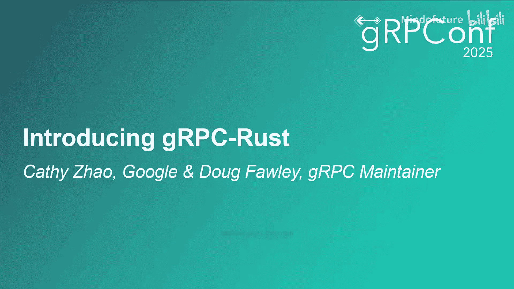
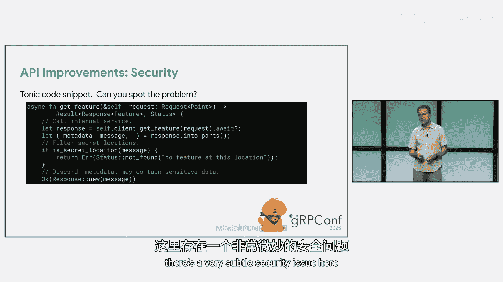
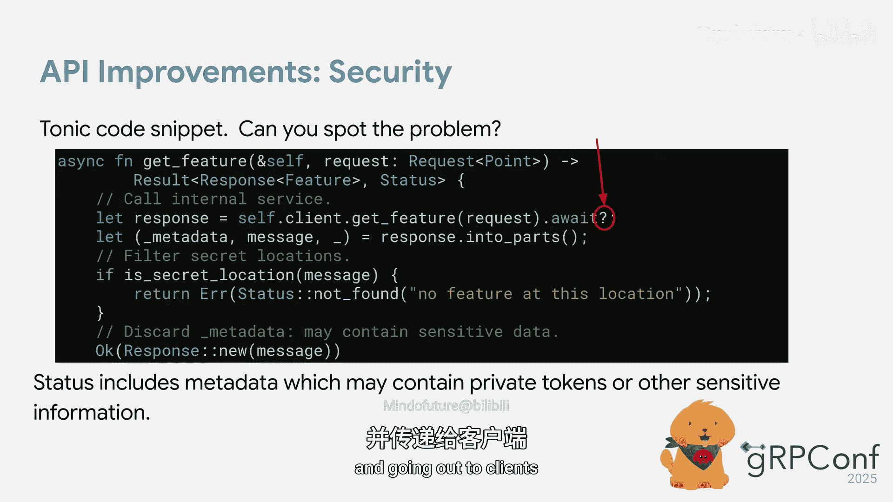
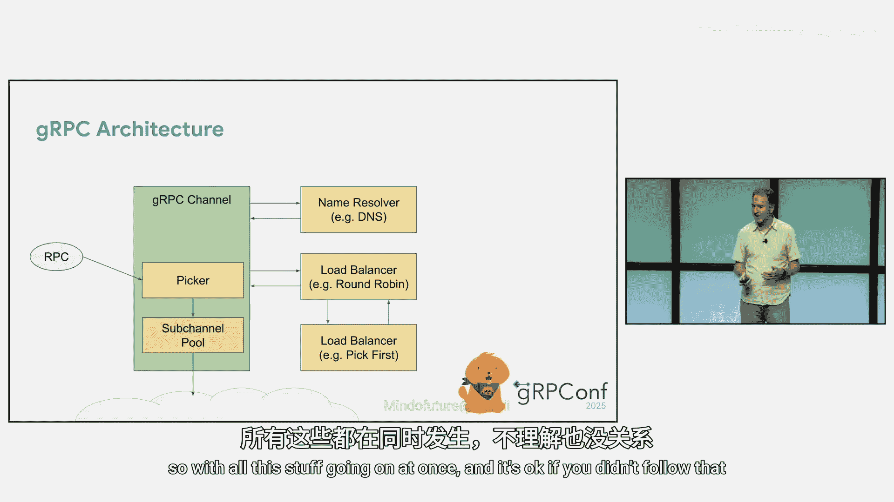
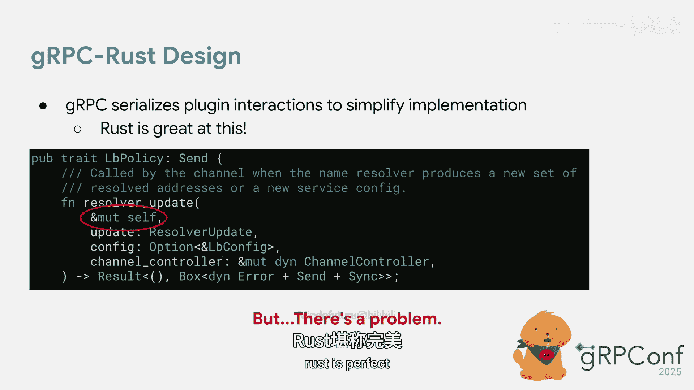
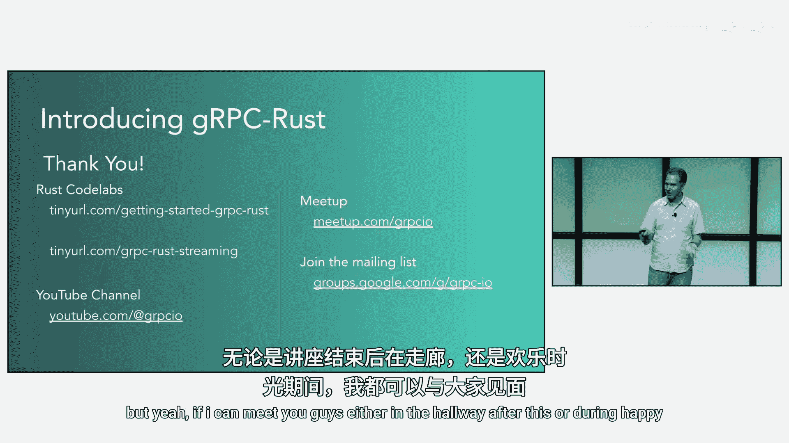

# Grpconf-2025-p17-P17_介绍gRPC-Rust--BV1yTHMzKE1U_p17-

Hi everyone hope everyone is having a great time at the conference。

 ate some good food and took some fun pictures my name is Kathy I am a software engineer intern on a JRPC Rs team and I'm really excited to be here today。

😊，So during this talk we're going to share some updates on where GRPC rust is currently at。

 so any challenges we're facing and just any progress we've made so far？

Just to give a quick overview of the agenda for the talk， first。

 for those of you guys who don't know Rus， I will be going over some Ru basics。

 so talking about what makes Ru unique， what makes it special。

 and then Doug will take over and talk more about the implementation of GRPC Russ。Cool。

 so Russ is a language that has grown really rapidly in popularity early in 2023 and 2024 at GRP COV。

 we got a lot of questions about asking JRPC Ru support。And as of 2024。

 we already have 4 million R developers， which is cashing up with a lot of popular languages and triple since 2021。

In addition， Ross has been awarded the most of language on stock overflow every year since 2016。

 and just to give the idea the first day of release of Ross in 2015。

 so this really is something that people are really excited about。😊。

And as you can see from the TIOB E index of Ru， it has really grown in popularity since this first release。

And what companies are using Russ。 Well， as you can see， a lot of big companies are。

 just to give some examples， Microsoft is rewriting some their Microsoft Windows components in Bruss。

 And in addition， Amazon built Firecracker， which is a micro VM in brass。 And in addition。

 Me is rewriting some internal source control control tools with Russ。

So why is Ross becoming so popular？ So Ross's becoming popular mainly due to three things。

 which is safety， performance and convenience。So Ru is a very safe language as in enforces memory safety at compile time。

 So if you guys have coded with other low lowle languages like C or C plus plus。

 you might have encountered some bugs that took our C bug or even went into production well， for Rus。

 the compiler will tell you if your code has any of those problems。

 So it will tell you if your code has Seg falls， memory leaks or data races。😊。

And the way that Russ enforces his memory safety is through two thingses called ownership and lifetimes。

So ownership is a set of rules for managing memory safely。

 so these are the rules that the compiler checks to make sure that your code is memory safe and basically it comes down to each value and rest has one owner at a time。

However， you are able to borrow ownership using references， but as you guys may know。

 when you use references there can also be issues， so RS has something called the B checker which basically enforces rules about how data can be accessed and enforces that you can only have one mutable reference or any number of mutable references。

In addition， variables and rusts have something called lifetime。

 which is basically a scope for which a reference is valid。

 and basically makes sure that a reference will not point to garbage data or garbage memory after the valley has already been dropped。

Really， the overall goal of rust is to prevent segmentation falls， data races， and memory leaks。

Rus is also a very performant language so if you guys have coded with Java or any other programming language or garbage collection。

 you might know that garbage collection can cause relatively long pauses and can be kind of unpredictable Well Ru doesn't have that In addition with rust you can manage memory directly which means that programmers can optimize performance even more and rust has something called zero cost abstraction。

 which basically just means a higher level code likes or functions orstructs don't incur more overhead than machine level code。

In addition， like I mentioned before， with memory safety， it's all checked to compile time。

 So during runtime， you won't incur that overhead。Russ is also a very convenient language I personally really like coding in Rus I found it way more easier and this is due to something called the cargo package manager which basically makes dependencies and making projects really easy we won't have time to go over an example today but it really has been something that may coding a lot easier in addition Russ is very convenient with handling errors which Doug will go over an example with later。

 and Russ also has tools called a Ru format or Ru analyzer。

 which basically formats or code and Ts do if there's any issues with their code before you even compile it。

😊，In addition， if you do get a compiler error， well a good thing， Ross has very。

 very descriptive compiler errors， so it will tell you almost exactly what to do to fix it and how to fix it。

 so that has also made my life pretty easy。😊，Just to give you an example and compare with C++。

 so rustsS and C++ are both very performant with zero cost abstraction， however。

 RuUS does prevent memory concurrency bugs while C++ doesn't。

 and RuUSs has built in lifetime times and ownership， which C++ doesn't。

So why are we building J PCC Ru Well as you can see from this slide。

 actually a lot of people have Aspirate， this is just from our mailing list。

 but a lot of people are enthusiastic about adding CRC Rus and are really interested in progress and want to know updates。

And in addition， Ru is becoming more popular even outside the GRPC user base。

 and we want to be able to meet everyone's needs。In addition。

 Russ and GPC have aligning philosophies as they both care about safety， reliability and performance。

 so it really is a perfect pair。So that's the end of my section， thank you for listening。

 now I'll hand it over to Doug。Al。Thank you， Kay。 And thanks everyone for coming out。 I'm Doug Foley。

 I've been on the GRPC team for about 10 years working mainly on go and more recently on R。

 So today I wanted to talk about some background of GRPC in rest some of the challenges that the team has been facing and also give an update on our progress and let you know where we're at on that。

 So if you're not aware R already has a GRPC implementation。 It's written in pure rust。

 It's called tonic。 and it is sort of the de facto standard and very widely used and yeah。

 so that's there。 but it does have some limitations。

 So it essentially implements the wire protocol only and not all of the extra features that we offer in most of our other languages such as load balancing and the ability to do client side health checking that allows clients to detective servers are having travel trouble and you know avoiding using those。

😊，Svers， things like that。 tonic sort of expects that you're building that functionality around tonic。

 It's just giving you sort of the basic functionality of GC。

 So that's where the GC rust team is coming in。 we are building on top of tonic。

 And we're adding all of those GRPC features from the previous slide to what we're offering for GRPC rust。

 We're going to be carrying forward some of tonics design goals， for instance。

 being a pure rust implementation so that our users get the best experience if they're using rust。

 And when this does release， you can find it on Cates I O。 We got the GPC Cate name。😊。

So right so we've been working actually with the tonic maintainer。

 Lucho Franranco for at least the last year。 He came to GRPConf last year and and talked with me then。

 And yeah， so so we're working with tonic on this， We're not just sort of creating another thing that everybody will have to figure out oh。

 do I want to use that or do I want to use this。 we were working with him to essentially offer something new that will sort of replace tonic。

 Now when I say replace， I don't mean you know you'll have to migrate or else stuff will never work again。

 we expect to keep maintaining tonic and releasing security patches for it。

 But it will eventually stop losing new features。 we will be upstreaming the whole project into the GRPC project under excuse me under CNCF。

 But yeah， you shouldn't notice any changes if you're already using tonic。

 if you choose to migrate to GRPC rust。 then you'll have that opportunity and you'll get all the new features。

😊，Unfortunately， it's not going to be dropping compatible。

 And I'm going to talk a little bit about why。And， but we will offer like a migration guide so that if you're using tonic。

 you can follow basic steps to， to do the migration。

 So I just wanted to give a special thank you to Lucho。 He could not be here today。 But yeah。

 I've been meeting with him basically every week for the last year on this。 So， yeah。

 thank you a lot to Lucho。😊，Okay， so now I want to talk a little bit about some of the things that we've been running into as。

 as we go through this project。 We're looking at the tonic APIs， and we're trying to figure out like。

What can we do with this， Does this， I this really the right experience for our users。

 things like that。 And we did identify some problems。

 some of which you know we only noticed more recently。 So for instance。

 there are some security issues that have come up some minor performance things that we think we can do better on。

 and also a handful of things that are just bugs that we can fix。

 but also potentially like usability things that we want to take this time to improve as we go through this。

 So I'll go through some examples。 So this is some tonic code as it would be written today And there's a very subtle security issue here。

 So this is a service implementation that is written to handle client requests。

 And in order to do so， it needs to call an internal service as part of its work。

 It looks at the response。 it checks to see if it's a secret thing。 And if so it returns an error。

 Otherwise， it just returns it。 the bug comes in around here with this innocuously innocuous looking question mark。

What this does is it takes any errors that came out of the call that you're making to the internal service and it forwards those to the client that is calling you。

 and the trouble with this is not so much that the error code will be wrong which it might be and you might want to translate that this allows you to sort of sidestep that which is not something we want either。

 and not just the error message itself that potentially could be problematic。

 but actually the status in tonic includes metadata and metadata can include your API tokens and things like that。

 that you do not want escaping and going out to clients。

 And so because this allows you to do that so easily。

 it's something that we think we do want to change and prevent this from being possible。

 So another issue that we found as we look for improvements we can make here is the tonic really likes to use owned messages for the pros in the requests and the responses。

And this is really intuitive and easy to use as a tonic user。

 but it does carry a performance penalty， because for every request you make you make。

 you'll need to allocate a request message。 And then for every response。

 GPC will need to allocate a message for the response。

 And both sides will just be throwing it away when they're done。

 So even though this is not a garbage collected language， there's still a cost to allocating memory。

 and it would be better if we could reuse these。 So we're looking into ways to improve that too。

 And then lastly， this is just a big long laundry list of things that we've discovered with tonic not mentioned here and something that came up recently is deadline propagation。

 So incoming requests have a deadline making sure that you propagate those to outgoing request。

 So it's it's things like this that are making us need to revisit what tonic looks like today。😊。

So with that out of the way， I wanted to give a little bit of a behind the scenes look into what we。

 as the G Ru team have been encountering as we migrate what is essentially a G PC design that works in all of the languages that we have today into rust so that we can。

 you know， support all the features that we were talking about earlier so。😊。

At sort of a high level in all languages。 these are these are basic design challenges for GRPC。

 right So our channels are very asynchronous。 They're doing a lot of things at the same time。

 GRPC channels are you know creating connections。 like constantly and routing potentially millions of R PCCs per second over them。

 So so I'm going do a little bit of a background here to show you guys super quick look at how GRPC's architecture works。

 It's gonna be very high level， it's gonna go quick。 if you get lost， that's fine。

 If you're interested in this。 My coworker Ewar is giving a talk here at 4 10。

 and he's gonna go into a little more detail into how these things work。

 So check that out if you're interested。 And if you're watching on YouTube。

 then you can go find that video on our YouTube channel too， Okay， so here we go。

 So a GRPC channel is basically your typical client side connection， virtual connection to a service。

 So what kind of components are running in that。 So there's a name resolver component。

 This is responsible for。😊，Converting the channel target。

 which could be example co into a list of IP addresses。

 and it's doing this constantly and producing new IP addresses as they change in DNS over time。

It also outputs configuration， which configure a load balancing policy。 So the load balancer。

 there are different types of load balancers that we offer in GRPC。 We have pick first round Robin。

 there's weighted round Robin。 And then there comes XDS。

 So if you've been listening to the proxy list stuff。

 all of the XDS functionality is mainly implemented through load balancing policies。

 And so the name resolver tells the channel how to configure that。 The load balancer then starts up。

 It job is to create connections or ask the channel to create connections， which we call subchannels。

 And then it also produces a thing called a picker。 and the picker is used for routing RCs。

 So these are separate components， they're all running concurrently。 But as RCs happen。

 they ask the picker which channel to use or which subchannel to use and then the RC goes over that subchannel。

 And to make things a little bit more complicated and add more complexity into the mix。

 it's possible that you chain your load balancing policies。 And when you look at XD。😊。

That's something we do very extensively。 And so different functionality can be in different places within the load balancer tree。

 So with all this stuff going on at once。 and it's okay if you didn't follow that。

 but with all these things happening at once， how do we keep everything straight and how do we make it easy to write these load balancers because we do have upwards of 20 of them。

 So what we do is we serialize all of the interactions with those plugins So that only one thing is happening at a time。

 So these are the operations that are not on the RC path。

 they're a little bit lower performance requirements right So it turns out rust is really great at expressing this。

 So if we look at like a load balancing policy trait for example here。 this is an example of a trait。

 sorry for rust for non-rest experts， a trait is like an interface in go or Java So essentially this is what the load balancing policies implement in order to plug into GRPC So we can represent。

😊。

This concept of things being serially accessed by putting a mutable receiver in the in the function methods here。

 And what that is， is that's a signal that the load balancing policy when this function is called has mutable access to its own state。

 So it's able to do anything that it wants。 And it's able to perform operations using this mutable channel controller that we pass to it。

 And so everything's great， right， Rus is perfect。 We can do this。😊。

Really well。 But there's actually a problem。 Of course。

 So when the load balancing policy creates sub channelsnels。

 those sub channelsnels are also somewhat persistent and they are you know。

 going into a connecting state。 They become connected， they disconnect， etc cetera。

 So these these lifecycle events need to be given to the load balancing policy so that it can know how to use that subchannel。

 These in all of our other languages are delivered by a callback。 And in those other languages。

 those callbacks get the same guarantee as the other calls into the load balancing policy。

 So only one thing at a time is happening。 And so in other languages。

 you just assume when you're called through the callback。

 that you have direct access to mutate your state as much as you want。

 But rust is not happy with this。 you cannot do this in safe rust， right， in rust。

 if you don't have a mutable reference to your data， you cannot mutate it。 That is that。😊。

The only way to handle this would be to take your data that you need to be accessed from the callbacks or from the inline calls。

 You wrap it in a mutt。 and then you put a reference to that in your callback and you put a reference to that in your load balancing policy。

 And now you're taking a lock， even though you know， you don't need to。

 because you're being called synchronously。 Now we did find a workaround that we could use unsafe escape hatch here。

 But it was a bit ugly。 So what have we decided to do。

 We decided to essentially move these callbacks that were happening through callbacks in other languages。

 And so these become direct trade ins instead in rest。

 So thats that's how we've decided to solve this problem。 But unfortunately。

 this causes a different problem。 So as I mentioned， we have our our architecture picture here。

 You can potentially end up with many， many load balancing policies And you can end up with actually a very deep tree here。

 And every layer now needs to keep track of which。Child to forward the call to。

 because we're now calling into the parent policy that forwards to the right child， right。

 So there's this extra responsibility here。 And so to solve this problem。

 we have built a like a helper class that essentially any load balancing policy that has child policies。

We'll use this。 It will monitor all of the actions of the children and and also handle the the routing for us。

 If you haven't followed this， that's totally fine。

 These aren't things that you'll need to worry about as a user of G PCC。

 These are just some behind the scenes to give you some you know。

 idea of the things that we've been working on and things that potentially。

 you might find yourself in similar situations。 If you're using rest for the first time。 and you。

 you might encounter things like this。 if you're writing an as asynchronous application。

So running short on time， but I want to give a quick update of our status on the project。

 So we've been working for， you know， as I was saying， at least the past year on this。

 we're working in the tonic repo， and we're making a lot of progress pretty rapidly now。

 We're working in the GRPC subdirecty there because that will be the name of the crate when it is released。

 We have the Google protobuffbased codegen working。 currently it calls into tonic。

 but we also have the basic channel architecture that I showed on the previous slides all done。

 is it it is fully functional。 but and we have examples that show it。

 but those aren't using the protobuff codegen yeah。

 So that's sort of next on our list is to hook that up and make that work。

 And so looking forward the dates we're hoping to reach right now are late this year we'll have a beta release。

 That's probably the best time to start if you're thinking about starting a project in rust is best to wait until then。

😊，Get started because that's when we think we'll have a pretty stable API for you to work with。

 And then we， we expect to have a 1。0 sometime early next year。And real quick， we do have a code lab。

 If you want to get your hands dirty a little bit using rust and using G PCC in rust。

 We do have a code lab that you can check out。 It's at 4，10 today and big maple leaf。

 if you're watching this online or if you don't want to or if you aren't able to come today。

 then we do have some links which are here。 and you can use these to find the code labs and run through them on your own time And it looks like we're totally out of time。

 So if anybody has any questions Im。😊，Super excited to talk to everyone and find out what they are。

 But yeah， if， if I can meet you guys either in the hallway after this or during happy hour。

 whatever， I'll be around all day。 So please pull me aside。 I want to hear everybody's input。😊。

Thank you。