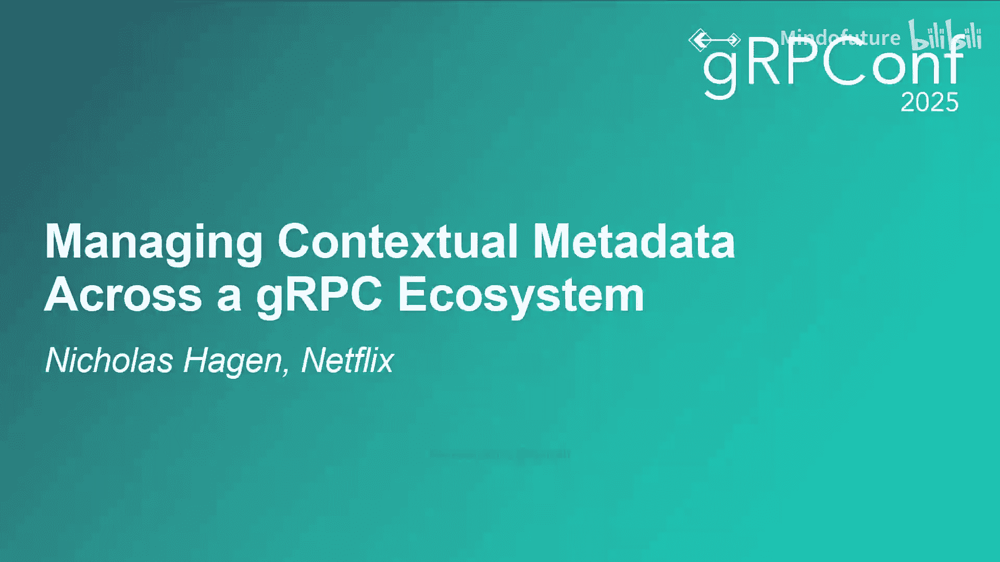
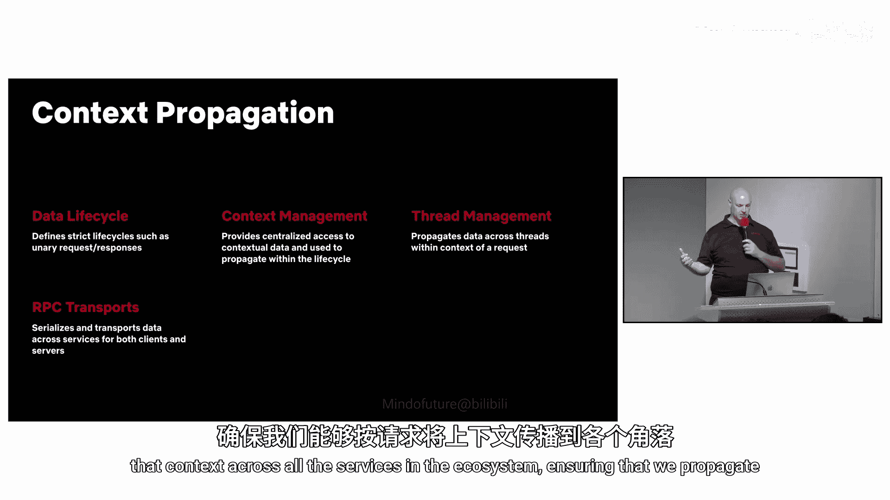
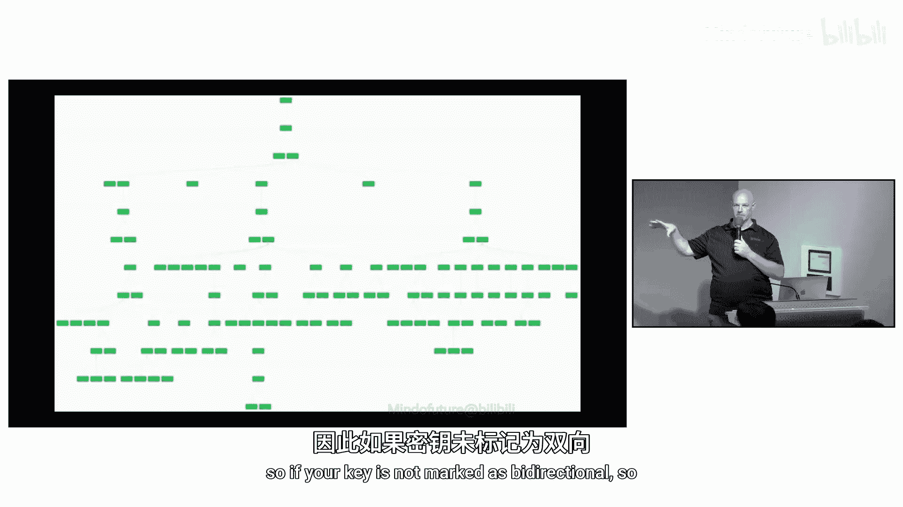
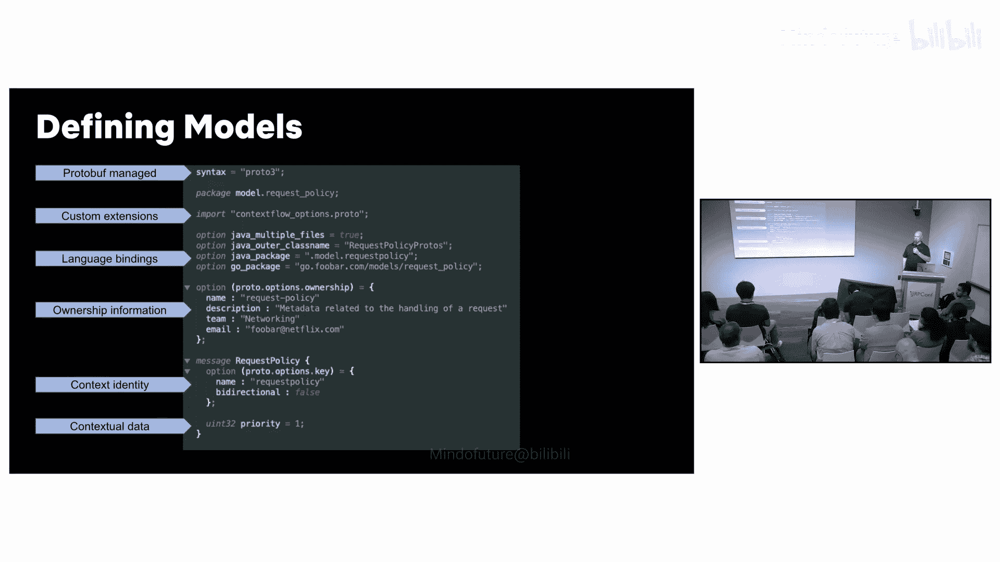

# Grpconf-2025-p18-P18_管理gRPC生态系统中的上下文元数据--BV1yTHMzKE1U_p18-

Good afternoon， everyone。 My name is Nicholas Hagan。 I am a senior software engineer at Netflix。

 I'm here today to talk about managing conductual data across GBC micro systemsstems。😊。

Before I jump in a little context on myself。 punun intended， fun fact。

 this is actually my first public speaking appearance。 So bear with me today， if you will。

 not used to doing this。😊，As mentioned， A att Netflix。Specifically within the Java platform team。

 so our team is responsible for building consistent platforms to improve developer productivity。

This includes managing RPCs across our large distributed microservice architecture。

JersRC is our most widely used IC framework， so are're obviously heavily invested in Jersey technologies。

 which is why we're here。We run thousands of Jerseyey servers across our ecosystem。

 and we service millions of requests per second。Today we're going to talk about how we manage context at Netflix。

This includes， first and foremost， what I mean by contextual data， What is it and how is it used。

We'll discuss some of the lessons learned from our prior architecture。

 This is actually our second version of this architecture。

 and then get into how we manage and define that actual data。

What has discuss some of the difficulties in propag that data？And ultimately。

 how we transport that data across the ecosystem we'll conclude with a brief overview of how we ensure success to observability。

So let's start the quick overview of what contextual data is what I mean by that。

 so basically it's any general purpose metada and it's often structured data models that correlate to specific future requirements This data is secondary and unrelated to the actual request themselves and it gently represents some sort of cross cuttingtting concern。

This provides additional service capabilities， helping to enhance services。

These features are often bundled within our frameworks themselves and flow independently of the actual request。

So let's look at some examples。 First， failure testing is used to inject errors into services。

 This allows us to change the outcome in order to produce and validate failure scenarios。

 How many ever heard of Netflix's chaos engineering culture。Okay， quite a few of you actually good。

 nice。So we leverage context propagation here in order to target those specific services and then inject failures in order to validate certain behaviors。

Second， sources may want to do some level of custom routing based on that specific context。

 this may include things like AB testing， canary testing， etc。For example。

 we might want to inject the specific clusters that we want to target or use device identity in order to figure out what from that context to route the different shards。

 so this allows services to make roy decisions based on that context。Finally。

 a big use case for us at Netflix is enhanced resiliency features。😊。

This allows services to inject and maintain contextual state across the entire callgraph。

This includes things such as request prioritization in load shedding。

 Did any of you go to Benjamin Porker's presentation last hour on load shedding。K you did。 Okay。

 nice。 So some of will have some of that context here and feel more familiar。

 So load shuttting is really managed by this idea of kind of propagation。

 so we can manage that priority at the edge and then use that priority on overloaded services to manage that load shuttting behavior。

😊，This helps us to reduce load by ensuring that critical requests succeed while failing the less critical request。

We also provide context back upstream for situations like back pressure relief。

 This allows services to back off， calling specific instances that are overloaded or to even call alternative services。

 We identify this data as bidirectional as it flows not just downstream。

 but also flows back upstream。Another example is retry budgets。

 This can ensure that we maintain a fix of retriries， not as across a specific service。

 but across the larger ecosystem。 This helps us to reduce potential retry storms by tracking the number of retriries across the entire call graph during that request。

Before we get into some designs that we used， let's talk about some of the lessons learned from our prior architecture that really helped to inform us of our decisions going forward。

First， we note that is ownership is really critical to understanding data usage。

 knowing where and what data is published and consumed and by who owns it helps us to simplify those support models。

 also helps us to determine where that data originates during request and end duringuring support issues in which teams ultimately notify。

Second， features over time can greatly increase payload sizes。

 This can lead to failures due to exceeding the max header limits on certain requests。

So tracking those sizes and defining explicit limits within the data models really helps to control impact。

Next， new languages are constantly being adopted， leading to large polyglat ecosystems within Netflix。

 we have cases of Java， we have node， we have Python， we have some go， in various other languages。

 we have very quite a few languages。This requires search contracts on transport and serialization。

 and it's difficult to change after the fact。 So we really want to require upfront thinking around that standardization and also ensure we use language agnostic abilities to ensure we can align across all these languages。

Similar， managing multiple frameworks across the different protocols is also difficult to support。

 So we leverage within Netflix， what we call the paved path。

 This is our specific set of highly opinionated frameworks。

 So it limits our maintainability by only focusing on the limited implementation。

 So instead of supporting a patch or all different RC clients。

 we only support a handful of them so we can really ensure we kind of support that。😊，However。

 services that don't adhere that paved path are difficult to then integrate。

 This can cause propagation to be a lost because they don't have propagation enabled。

 And then we lose that context across the entire college chain。

So also managing the kind of propag across services and even across threads within a service is also hard difficult to manage。

 but this is required to ensure that that data flows freely and consistently across the entire call graph。

 which we'll get back to in a second。But's talk first about managing data。

 So the data is the most critical aspect of maintaining the context。

We ensured data owners are first class citizens in this architecture。

 Data owners own the specific data for the features that they are building and provides them greater control and flexibility when designing those teachers。

We provide this capability by leveraging Protobuff。 As mentioned。

 Netflix has a very large polygon ecosystem。 So Protobuff helps us to define those language agnostic data models to ensure that broad level of support。

Plus， part aboveuff is already heavily aligned with GC， so it naturally complements ecosystem。

Part of above simplifies our co generation across these languages。

 and we can even enhance this capability by leveraging custom extensions。

This helps us to generate better data abstractions of the data and use things such as obability by including that in the generated code。

Further， ProBuff provides us both backwards and forward compatibility。

 helping to ensure our data evolution and migrations over time are easier to manage。Finally。

 we centralize all these data models into a common registry in order to simplify consistency。

 cogeneration and a pan management， This also allows service owners to easily discover and adopt these features directly into their services。

So let's look at an example。So first as mentioned， we leverage Probuff to define the actual underlying models。

 In this case， we're specifically using V3。We then leverage cogen using Proto plugins。

 we define those language bindings for each of our supported languages within the model。

Then we have our actual data that is exposed by this context。

This is the structured data within the context that correlates to a specific feature requirement。

In this example， it's a single field， but in other models might have multiple fields or even multiple complex types。

Finally， we provide a set of custom extensions。 This provides context specific information that's used within the framework。

 This includes both ownership information， as well as contextual identity。😊。

Deine the ownership within the model Alls on a single source of truth。

 allowing us to track that ownership much easier over time。

 We also leverage information within the framework forservability purposes。

Within defining a d information on how the data is used and what features it might support。

 this is managed by a contextual key that maps the context to the features that it supports。

 for example， when specifyify that a key is downstream only or also bidirectional flowing back upstream。

Let's switch are focus to talk about K's propagation。 So what is K of's propagation。

 What do I mean by that。 So at a high level， its managing the contextual data within a service。

Using a specific life cycles， such as a unitinary request and response。

 or we can also target other types of requests， such as bidirectional， streaming， etc ce。

This ensures that data flows across the confines of a specific request that Con is managed essentially within the service and provides access to the underlying data on a per request or per lifecycle basis This is also used to propagate that data across threads geography by nature is heavily multithed。

 especially within Java so propagation helps to ensure that we have that same data access to that context across those threads as that request is moving across。

This is similar in essence to the gipsy context some might be familiar with。 However。

 we abstract it out in order to support other protocols and other frameworks such as rest and Graphql。

 This allows us to support the entire call chain across all our different frameworks that we use。

Ultimately， we have client and suicideside R frameworks that transport that context across all the services in the ecosystem。

 ensuring that we propagate that context everywhere per request。

So let's look at an example。So this is a real life call graph on Netflix。

 This demonstrates our complexity and the widespread culture that exists。

 honestly you can't read anything here because it's very zoomed out。

 but that's the idea of all these different services in these green boxes。

So these are often across multiple protocols， multiple frameworks， and even multiple languages。

 so we have lots of stuff going on here。So let's go back to our use case again。

 talking about load shedding。So imagine we have a service towards the bottom of this call graph that's constantly being overloaded。

 and we want to manage load shuttting based on required priority。However。

 the problem here is that request priority is really calculated by our edge router at the start of this call chain。

So how do we ensure that request priority can flow down to the overloaded service？

The naive solution could be able to simply add request priority to every single service to every single request and every single data model。

 I also be highly inefficient， require multiple touch points。

 and prior is really ancillary to the actual request itself。

 So it's not worthwhile to kind of mix those concepts。Instead。By leveraging kind of propagation。

 we allow that priority to be published across the entire chain。

This allows any service to then consume and manage those features very generically。For example。

 we could easily identify the original request priority on an overload service at any point in this call chain in order to shed that load or manage other features。

Often， these featureses are then bundled with our pave path offerings。

 making service onboarding much easier。So how do we actually propagate and transport this data across all these services？

As mentioned， we highly leverage our paid path in our customized IBC frameworks。

D insurers at all services are consistently using the same set of RC clients and servers and the features that they support。

Within JerseyC， this is managed by using custom client side and service side interceptors。

These are included by default in our customized IBC frameworks that our customers end up using。

These interceptors are then responsible for serializing and transporting that context across each request for serialization。

 we use Porttobuff to serialize those data models into binary format。

 and then that binary format is then transported using request headers and response trailers。

This ensures highly efficient payloads that are language agnostic and framework agnostic。

So let's look at a simple workflow for a unitary request。First。

 custom frameworks may publish context for downstream service。 For example。

 the request priority may be set in the active of context at this point。

Services may then send jy requests to other downstream services。At this point。

 our custom client side interceptor handles that request。

It stillizes the current context from the protocoltobuff models into that binary format and then attaches that attaches that data as met add headers onto the request。

Jersey then sends that message and those headers onto the server。

When the request comes in on a Jersey service， our custom service site interceptor then handles that incoming request。

It first reads that contextual data from those specific headers per R agreed upon transport contracts。

And we decentize that data back into port of models and propagate that into a new context。

 This ultimately starts a new lifecycl for that context and associates it with that specific request。

 This allows you to then call the underlying service method for that stub。😊，At this point。

 custom Fs may leverage that context to manage their features and perform decisions around this data。

 for example， at this point， frameworks could reject current request priority from that context to determine if loads should be set or not。

Services may even update the context such as changing requestquest party to become a more critical party for other request back upstream。

So once that service finishes its request， the response is sent back to the original client。First。

 the server interceptor has to handle that response to send back any contextual updates back upstream。

However， since our client already knows the original context and the original data models。

 we only need to send back the actual updates that occurred。

 so we automatically detect and capture those changes as field mask updates。This creates smaller。

 more efficient headers that flow back upstream。 These filled masks are then serialized into that binary format and attached now as response trailers。

That response is received back by the client， allowing that client interceptor to handle the response message and read those response trailers。

 the client is able to decentize that back in a put up up field masks。

 and then those masks are merged back as updates into the original contextual data。

This allows the original caller or frameworks to then consume those updates or further propagate that subsequent down to subsequent RBC calls。

 This whole process is repeated across all of our services。

 allowing that data to freely flow consistently across the entire ecosystem。

So with all this data flowing， how do we observe the data and ensure success。Ultimately。

 we do this with tracing and metrics。😊，First， metrics helps to inform us what data is propagating and across which request This includes which keys and data models are being used and by what services。

 This helps us with managing data migrations by easy identifying publishers and consumers of that data。

We also capture data stilization and header sizes over time。

We create alerts around this in order to consistently stay within our expected limits and avoid header limit failures。

Finally， we monitor how data is transported across the entire ecosystem this allows us to identify when services are potentially not propagating data。

 loss of propagation by far is our biggest common issue that we face where we have simply we lose the context on later services。

We also rely on tracing to help pinpoint exactly where that context is potentially lost。

 so our I frameworks adds band attributes to those requests that track what keys are being propagated about the client level and the server level so we can see when the client sends it when the server actually receives it。

So os， sorry。So ultimately， we generate dashboards and alerts and tools around all this data。

 ensuring we can constantly monitor the success of the system。So let's quickly review so first。

 data owners create and publish their data models in Portbuff and they own their underlying data Second。

 data owners create cross cuttingtting frameworks， publishing and consuming that underlying context。

 our paidve path adherence ensures that services operate consistently and automatically adopting those features。

Third， gibpsy interceptors transport the contextual data throughout the entire ecosystem。

 this occurs by sterilizing those Port models in the binary format and attaching it as both request headers and then response trailers on the way back。

This ensures data flows throughout the entire request。

 ultimately providing that rich business value throughout。

 This includes features such as enhanced resiliency。

 custom request routing or even failure injection testing。And with that， I'll take any questions。

Thank you。I a question over there to the right or your left， there we go。Yeah。

 so a question I have is you talk a lot about losing context how do you handle that because I can see how you have the interceptor sitting on both sides。

 they're handling processing of that metadata for that context。

 but when you're actually like writing business logic inside your service。

 how do you prevent the engineer or the developer from not passing that forward。

 does the framework have guardrails or what's actually happening there？

So really the two biggest issues for us with kind of propagation。 one is threading。

 and then the other is things that don't abide by our pave path。 So with threading。

 especially in Java， if you don't use the right exors。

 then lot times that we maintain basically within thread locals if you're filling Java。

 we use thread locals the kind of man context across requests and it。 But if you don't use a proper。

Framework on pieces。 Then you can kind of。Lose that context and not propagate into those threads。

 And then that doesn't get sent down。 So our obviously frameworks know how to transport the data generically。

 And so the business users don't ever have to worry about doing anything with the context。

 It is use our API to say， hey， add this data model to your underlying request。

 And then the framework does everything else for you， so。If you use our pave path。

 everything just kind of naturally works。 I automatically works。 But if you don't。

 then again troubles in。Usually business owners don't care at that point。

 it's usually when you're trying to consume something' like。

 oh why I don't have a context I like why am not necessarily seeing this data It it's because something happens in that propagation being lost。

 So we have traces that we actually have a tool around tracing allows us to kind of see where those keys propagated in order to see like this service here sent it。

 but then this one did not actually receive it。 And so can go back to searchy what are you doing in your frame or in your code differently that's not using our paid path in order to identify and then fix those issues。

 But yeah they're extremely hard to track down So essentially you're saying by using thread local storage。

 you don't have to have the developer who's playing the business logic think about it。

 It's just automatically being picked up by the interceptors exactly。So my question is。

 how do you do continuous propagation with TRPC streaming per me basic？

So we actually right now in Netflix at least we don't really do live streaming。

 but we're actually looking at with some new price coming up。

 So our idea there is we really can't do response trailers and streaming because your trailer is attached to the very end the very front of request headers so we're actually looking at having defined payloads for those messages that our framework we then kind of inject into that payload so for each branch I can send out we'll have like a wrapper payload that then we'll attach the request to and then when it comes back assuming bidirectional we can attach that response in the way back if it's not bidirectal then yeah you really can't do the ability to kind of manage upstream data updates。

Just following following on that for other languages where you don't have T local like in Python or PhP and others。

 how do you do this There's other language outside of Java just kidding。I'm not a type of person。

But within node at least， I mean， node doesn't really have threads at all。

 So I think everything's kind of assumed in the same request boundary。

 So you kind of attach it that way。 I don't know how our note implementation actually does things Python。

 I have extremely very little experience with But as long as you jC context that's in most of jC's frameworks it kind allow to tie to those requests as long as you hook into that aspect for jC。

 you can kind of ride that context and use that if you're doing things like rest or Graphql it's kind of you have to implement it in a certain way per framework and per language which is why we really want to have this pay path that we don't want to support and clients R we say we only want to support a finite set of clients add that implementation to each one of them support everything the sun because that just won't scale。

Did she have a question。How does how do you， how do you。Resolve conflicts， conflicts in the metadata。

 If like there's fan out， for example。So when you're going downstream。

 you don't have to care because the dad is only fully electrician。 when you're going back upstream。

 you have to merge those back in， it definitely gets more problematicmatic。

 Were still playmouth a lot of that to try to figure out because when you have very heavy parallellyzed request that you have a lot of them going all the same time like graphq is a big concern with this where it makes 10 calls all at once。

 they all come back and then how do you merge those updates back in So we try to limit what upstream data is in order to limit how much we have to actually merge back in because the more complex you get the harder that resolution is。

 So if you limit your fields coming back and makes less of a impact of it But we're still looking into how we manage that right now it's very simple of just kind of whatever those last one in wins and then you propagate that back down but we're looking at things to like。

How far should staff flow back upstream， like do you want the da flow all the way back up to the very top or do you want to and say well。

 I only want the staff flowing up one level or two levels。

 So there's lots of areas we can go around this and we're still kind of early in stages of how far and how much resolution we want to do run that data。

 so we're still learning a lot there。Thank you。 have a couple of questions。 First。

 do you have use case where you need to propagate context over pops up versus real time API。

We don't yet， but as we get into more of the streaming use cases that we're looking at。

 we'll probably do something similar where we kind of instead of trying to attach it to the headers。

 we'll probably use some sort of wrapper message in order to then add that raper to our message are being published and then you subscribe it coming back but we haven't really looked into it too much yet second。

 there's more practical and over H TtP you had to change the default header size in your servers if not how do we deal with limitations of the header size so early our first version we did this。

 we encountered a handful of times where we actually broke services because we exceed the header limits and that causes mass propagation errors across everything。

 And so we really going forward want to be very strict of how what is data that's out there how large can those payloads actually grow。

 we kind of set fixed limits so that data we kind of understand our total possible capacity and then we kind of set limits and alerts around that to ensure that if we do certain point we can throw errors earlier。

Only impact one source promise once you get to going overhead elements。

 it doesn't impact just your search， impacts all the sources in the ecosystem。

 And so you can quickly kill everything。 So we really want to try to make those things step faster by knowing what those limits are enforcing on a per service basis。

 per request basis。questionへ。your first。Yeah， could you give us a high level overview of like。

 how would you inject a failure using context propagation？

So what we do is we have our edge router at the very top。Let go back to this fun picture。

 So like the very top of this graph。 we have our edge router that knows all the business rules around injection how to read our actual database to figure out what those injections are。

 we can set the errors and one system and then read those back So edge router is able to determine that and say。

 well， for a service fo， I want to inject a failure when it calls service bar whatever else。

 So that propagates to everything。 And so as it gets down once it reaches fo like oh。

 there's a air on my context for my service and it calls bar then knows oh I need to inject a failure So immediately those to that point。

 So we send that entire understanding through the entire request or it hits those services。

 it can easily detect that。Although going forward， we're actually looking at using service mesh to better enable that so they can use a control plane instead hand flow because this signal has get very large so can come back to the payload sizes and header sizes。

 we want to try to limit those sizes because we start sending everything in the sun or quickly our headers or our bandwidth everything else grows exponentially so we're trying to look at using control planes and service mesh that kind of offload some of that data。

There's a question here。哦。没有。It's a very lively crowd， I like it。Has any of this been open sourced。

Unfortunately， no， and I't think we have any kind of media plans。 There's not really a lot of。

Crazy logic in here。 It's really just as long as you know how I build an interceptor。

 It's really just having an interceptor that knows how to。Pull those things outey headers。 The。

 the hardest part for us to is just that paved path。 Like。

 if you're trying to support every single client in the sun is somewhat impossible to scale out。

 But if you can really limit those implementations， it's much easier to manage。

Then having some sort of a process of managed data like early on we had just empty or a basic key value pair store and you could put anything on the sun in there and that was hard to manage so by using our da models and having ownership defined it made it a lot simpler to understand all that data。

Yeah， I'm wondering if you could maybe help me understand like the request trailer side of things。

 like I'm wondering I hear're putting like error information in those。

 but like I'm wondering how you decide what to put in the request trailers versus maybe just having on the like response itself if there's an error that happens like how do you determine what goes in the request trailers。

 what goes in the response， like what does that breakdown look like So going up or we'm going to do bidirectional back upstream the key has to explicitly say' bidirectional。

 So if your key is not march as bidirectional So kind of going back to our miles here we actually in this case say bidirectionals false so in that case。

 if you make a modification to that data it will only flow downstream will never flow back upstream So we want to limit how much damage flow back upstream。

Tomand that conflicts。So if we know that certain data needs to go back upstream for certain use cases。

 we'll set that to be true。 And then if you make a change。

 So when your request comes in and then hits that ultimate serves implementation。

 that stub if it makes a change to that data model， we automatically detect that。

 And then when the response goes back up， we know， oh， this context was changed。

 it needs to be updated and send back to a client。 So at that point we'll add that as a response trailer going back up。

They answer your question。嗯。Yeah， maybe like so I， I get like the that might that that's a good explanation for like the functional like how you determine like。

 okay， this is like a field that I need to send downstream， but maybe not back up。 And that's like。

 I guess like， how the plumbing would work。 But like， how do you make the call of like。

 maybe it's too generic for question。 like。😊，What would be something that you would want to send back upstream versus not I there any examples or guidelines that you might have for that。

 So our two biggest cases right now we're looking at is back pressure relief。

 So if we know overloaded and we wantna let the system know hey。

 the service down here at the bottom is being constantly overloaded we can that in back upstreams。

 those oh future calls call call different instanceload that The big one for us was retries right now we do a lot of times if we shed load or cause failures。

 we can quickly cause retrystorms， which causes Ddo and impact the entire ecosystem not good。

 So by using like retry budgets， we can put that number of retries into the context back upstream so that as calls in other places of the graph get used and like oh。

 we've already done five retries。 I probably don't wantna call any more。

 know I've only want to retry my service the whole things done five。

 So I want to backing off on some of that calls。😊，Following on from that then around the retrise。

 how do you decide when you use the semantics of the protocol versus putting it in the metadata。

 like just looking at the response code and making the decision and propagating another failed response up versus actually putting it into this context metadata。

 it seems like some of this might be duplicating things that the protocol already provides。

So we still let the implementation do or figure out how they want to retryries。

 so we don't we don't enforce what retries are or how they're done。

 we just if whatever if wants to fail on available or fail on on implement or whatever else like they makes those decisions that it owns those decisions itself。

 the only thing we do within the framework for the context is if a retry did occur。

 we could send that in back upstream saying， hey， we did a retry this point。

 But's up to the underlying business logic to kind of dont what to do our frameworks don't really。

Care that happens at that point is just that we send that data a backstream or a back downstream lot of the frame they。

The library is within the pay path frameworks to make those decisions of what should actually happen to it。

So basically everyone gets the data and then they get to decide what to do with it。A we good。Sweet。

 well， thank you， everybody。

