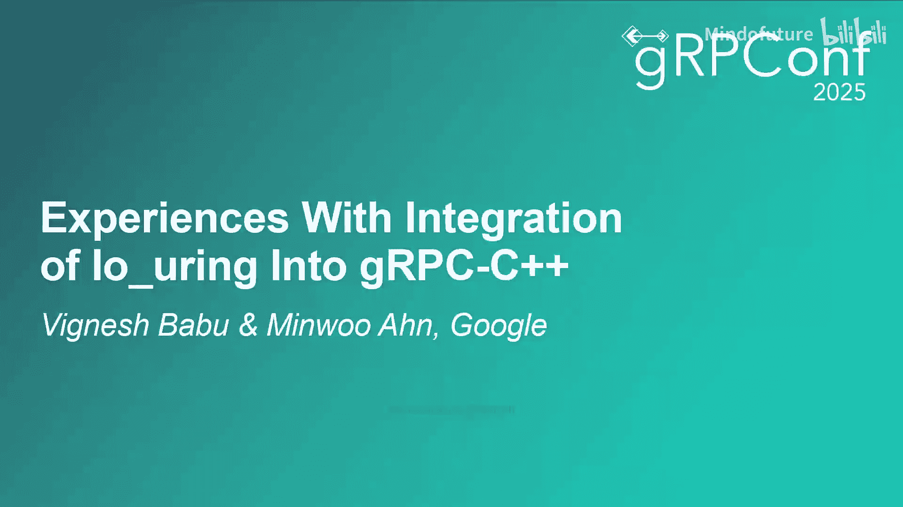
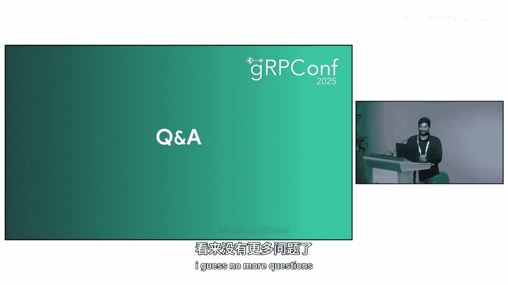
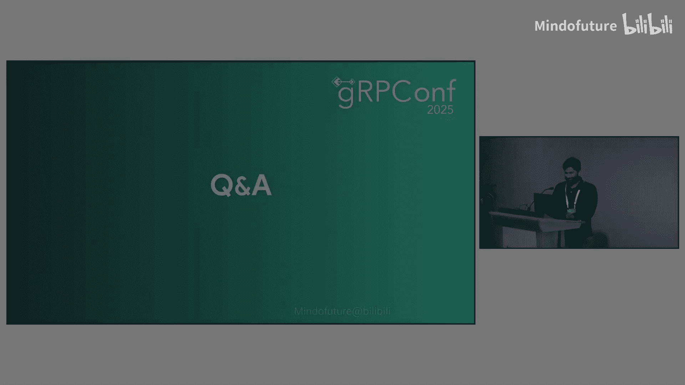

# Grpconf-2025-p19-P19_将Io_uring集成到gRPC-C++的经验--BV1yTHMzKE1U_p19-

Good afternoon， everyone。 Thank you。 Thank you for being here。 My name is Vi Nish。

 I'm a senior software engineer here at Google。😊。

I work in the GRPC team for over four years， I primarily focus on improving GRPC performance。

This talk Ill cover our experiences with the integration of I U。

 which is like a cutting edge Linux IO API。Into the high performance GRPC C+ plus stack。

 which is widely used for backend server to server communication。

So this work we collaborated with a student researcher， Minu。

 who unfortunately couldn't be here in person。I'll be。

Talking about our key takeaways based on our experiences。So before going deep into the talk。

 I'll cover a bit of some internals that come in handy。So at a high level， GRPC。

 C plus plus relies on something called event engine， which is internal abstraction layer。

It is used to manage transfer of bytes between the client and server。

So it's a public plugable interface for low level networking operations and GRPC relies on event engines for several critical internal tasks like for example。

 running an internal callback connecting to a peer reading writing bys over the wire and so on。

 and we have different implementations of event engine which are platform specific。

So in GRPC like event Engine is the lowermost layer and it manages the lifecycl of TCP connections between client and servers。

 so GRPCC++ creates one event engine endpoint per subchannel and transfers bytes over to the wide using that endpoint。

嗯。So these endpoints are typically tasked with reading。

 writing required number of bytes and then invoking internal callback after。The op completes。

 So that's at high level what an endpoint is supposed to do。

So in this talk we are concerned primarily with the Posic specific implementation of event tension this is in fact the most widely used。

At high level， the per6 event engine endpoints alternate between two phases。

There is a draining phase， and a pulling face。So in the draining phase。

The endpoint repeatedly invokes this call such as send message and receive message to basically drain the socket of available resources。

When the kernelel reports that。The there is nothing else to do basically。

 we check whether we have read。Enough bikes or return enough bikes。 And if so。

 we pass along the result to the transport。 If not。

 we enter a polling phase where we wait for more data to be available。

 And then we repeat this process。 So this is at a high level how the。The TCP level endpoint works。

So our goal was to improve the efficiency of these TCPN points in particular。

 we were interested in answering two main questions。

Can we reduce the number of cisco that we actually make。

Turns out like modern ciscos actually incur significant overhead。 There is like。

Privileed translation， argument validation in the kernel， there is context restoration and so on。

We are also interested in this other question， how do we improve CPUU utilization？

Increasingly inside Google， we are seeing workloads that consume more and more of the available memory bandwidth。

Due to this memory bandwidth with limitations， blocking applications until。

They synchronously mem copy to and from kernelel buffers。Leads to wastage of CPU resources。So yeah。

 these are the two main questions that were trying to answer and yeah I'll be covering a bit more on these for the rest of the talk。

So we are primarily interested in studying whether IU urine can be an answer to these problems。

I what like， let's take a step back and listen， what is are you U。

So I U is a open source cutting edge Linux specific API that supports asynchronous ci。

So at a higher level it relies on two memory map buffers。

 there is a submission queue which an application can use to NC calls。

 and then there is a completion queue which。The kernel uses that to post completions of NQ Ciis calls and the application can read that completion queue to get notified。

So typically a user thread can N a score into the submission queue。

 the kernel will consume from the head of the submission queue。

 do some asyncch processing and then post a completion onto the completion queue。

And user thread can pop an entry from the completion queue and inspect the result of the Cisco。

So we were trying to see how we can use this mechanism and integrate it into GRPC。The goal was。

To figure out how GRPC can batch and submit this calls asynchronously。

And get notified as they complete。So in our prototype。

 we developed an I U based event engine and we compared the performance of the default GRPcc++ stack against one that used this custom event engine。

So we implemented endpoints that can handle asynchronous， send message， receive message disc calls。

Our implementation relied on Lib ear， which is the high level C interface to any leveling。

In our implementation， we。instantiate an Iu U per CPU。

 so the total number of IU ears itself is tied to the amount of CPU in the system。

Endpoints get mapped to a specific I urine based on the incoming CPU associated with its socket。

So Ill cover a bit briefly about how typical is called submission workflow looks like with an I during endpoint。

So the user would acquire a submission Q entry or an SQE。

This like note that this does not involve a user to kernel transition。

Then the user prepares the submission to entry for submission。

 so this would involve setting the Ciscal arcs。And then finally。

 the user submits this is to the kernel。Now， this is the step that would involve a user to kernel transition。

The libering API is not threads safefe。So。We need to account for that in our implementation。

And the IA hearing summit。Makes once is called to batch and submit all prepared SQs in one shot。

 Now this is a key aspect that Ill come to a bit later。

So I U allows us to basically acquire multiple submission queue entries。And prepare all of them。

 and then call。Are you hearing submitmit once。So this has the effect of batching multiple ciscals into one。

There reducing the total number of cisco that we make。So in our prototype。

 we try to leverage this feature with an implementation that relies on atomics to opportunistically batch the skull。

So multiple threads or endpoints may acquire an SQE， prepare it in parallel。

 and then when they all try to submit， we atically elect one of them as the leader that can actually do the summit operation。

And yeah， submit all the prepared SQs in Mu shot。So I talked about Cis call。Submission now。

 I'm going to talk briefly about this called completion。

So typically to get notified of a call completion。We register an event FT with the I hearing and we need to wait until the event FT is readable。

Once the event f is readable， we can read completion  key entries back from the kernel and process them to retrieve the results of Cisco。

And once we are done with processing， we return the C keyes back to the hearing so that it can be reus later for other ciscos。

So I'll talk a bit briefly about。What happened like with our prototype and what the results look like。

So we did some simple benchmarking。We use two machines in the same rack。

 each would like 00 gigabitns。One machine was running a GRPC client another server。

 we tested on two classes of workloads， a Max QPS benchmark which tries to generate as much data as possible and a fixed QPS benchmark which where the load generation is fixed。

We varied the number of TCP connections， request response， payload sizes and so on。

 We configured the client to use our I during event engine。So first。

 we tried a fixed low UPS benchmark。In fact， we observed a marginal regression in our latency metric。

So at low U is， memory bandwidth limitations are not the primary bottleluic。

 so we don't see much benefits shifting to an asynchronousesis called model。

But then we increase the stress on the system next we tried a maxcious benchmark which tries to flush at as much data as possible。

Here we see significant gains。In the QPS and median latency。

 as well as a significant drop in the CPU time。Which is the amount of time spent in the kernel in process context。

We further increase the stress on the system by increasing the number of channels to about 4K per area urine。

So this the intention was to create more endpoints that read and write data and bar parallel。

And this increases the probability of opportunistic is called batching。

We saw that the QPS and accuracy latency followed similar trends。

 but the number of Ciscos that were submitted was reduced by about 4%。So conclusion。

 so this is one of the first studies that experiments with IO U for a general purpose networking stack like GRPC。

I hearing was originally developed at metaphor。Like this ko and。

We were trying to see how it would work for a general purpose networking stack。

We saw that IO U is not a drop in replacement for existing epoL based endpoints。

 both of them have fundamentally different programming models。

 so EpoL relies on a socket readiness model whereas IU U uses a ciscal completion Q based model。

We start to see performance gains which our hearing when the system is stressed。

 there is better CPU utilization， reduction into in latetencies。

And an overall de total number of six calls made。In the future。

 we' are going to experiment with some of the advanced features with IR U。In particular。

 we can reduce the total amount of memory allocated for each TCP read。By using buffer pools。

 eye allows us to register。A dynamically reizable buffer pool。

The kernel will autop buffers from the pool to place data that is read from the socket。

We also plan to explore submission queue polling mode。

Which eliminates this calls entirely by having the kernel busy pull the submission queue for new entries。

 Now， this has the trade off， and it cannot like work well for all workloads because it leads to increased CPU utilization。

There are other strategies also that we are looking into to reduce cisscals which include ciscal chain and multi short ciscos。

So。Ciscos that need to execute in a specific order can be batched and ind as a chain into I urine。

Furthermore， there is this concept of multi short Ci。

 which I just submitted once and I U can post multiple completions。For one sum Ci。 So these are。

Kind of approaches that can lead to like significant benefits。With like in。

 in highly contented and systems which experience a lot of load。So， yeah， I think。That was my。Talk。

 happy to take any questions。Nice presentation， I'm Chris。

 I work on Neie and we also have an I hearing implementation。

Our experience is that multi shot and buffering is where most of the performance gains are to be found。

 But I was curious why you use the。Event FD and the Epolo weight as your notification mechanism。

 as opposed to just blocking on submit。Oh， so yeah。I think we went with that approach， primarily for。

Implementation reasons。 So we have existing event engine implementations that。

Rely on EpoL so this made it easier to plumber new event engine into the existing Epool based notification mechanism that we already had for monitoring sockets。

That is the primary reason why we went with this。 I think we are actively exploring other。

Socket monitoring approaches offered by a hearing as well。I suspect if you get rid of the。

Even of the just reliance summ， maybe the low connection counter performance will be more on pared with Epo。

Right， yep，po。What's the current logic to decide when we submit？Do we let the queue fill up。嗯。

We have a max batch size， so multiple threads can try to submit in parallel and。

The threat that's arriving last。Ends up actually submitting all of the。Btched。

And these are across channels across channels。So the more channels and endpoints we have the higher the chance of。

Actually， batching morees calls and submitting them。And then I'm guessing we also have some kind of。

Timer to say that if there haven't been Moes calls in， let's say X milliseiseconds。

 just submit it anyway。 No， there's no timer。 It's just。

 we allow the threats to naturally race against each other。

And whichever thread is like leaving last gets to submit。There's no concept of like。

 There's no thread， which is gonna。Run a timer and call sumit periodically。

I was just imagining a case where。You don't have much traffic。 They just have。Oh。Then theres， yeah。

 theres theres basically going to be no thread， which is contending and we detect that there's no contention。

 you just call for immediately。Thank you。Do you think that after some maturity point when it will be possible to bring ao ring comparable to Eal for the default case。

 it's possible I it， do you think it will be possible in the future to swap to Aio Urink as the primary traffic layer for living systems。

Do I think it's， it'll be possible to switch to our entirely。 I mean， based on your experiments。

 like right now， you put on the slide that it's not like a full replacement for you all。

But do you think in the future， it could be a replacement for Epo。Yeah。

 I think definitely our hearinging offers some advanced features。

 which like multi short Ciscos and buffer pooling and。This is called chaining。

 which if used correctly， will definitely make GRPC more performant。So。Yeah。

 I think that is a case to be made。你。Any other questions。

All of the experiments that you do right now， are they run on some Google specific Linux kernel or are they。

These experiments were run on Google Space clinics。Your experience， is it fine like。In the public。

Al is distributions and kernels。 How good is it。I don't think。The Linux。

 the Google specific optimizations in the kernel。Play played a big role， because。

We actually don't have a enabled in the。An external inside Google。 So these were all like。

Just using the open source beds of I they were just merged into。The kernel that we have inside， so。

There were no Google specific optimizations that went into this。I guess no more questions。

