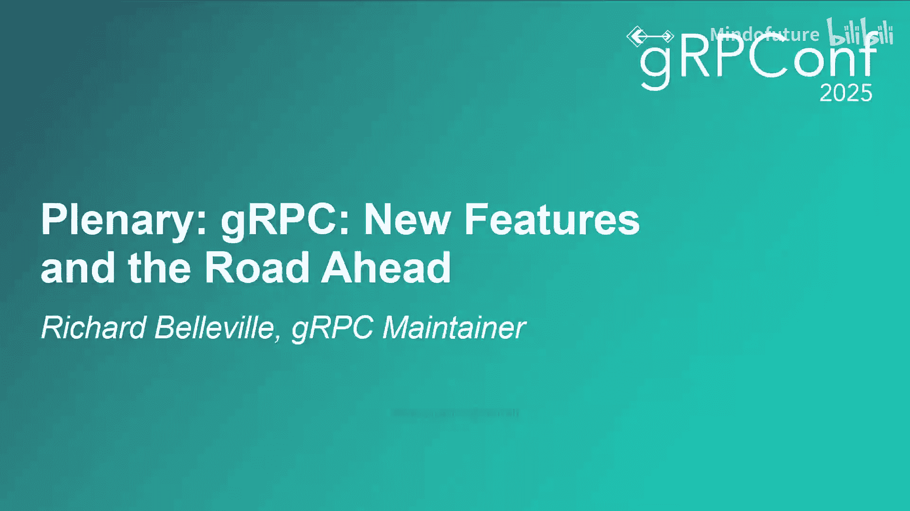
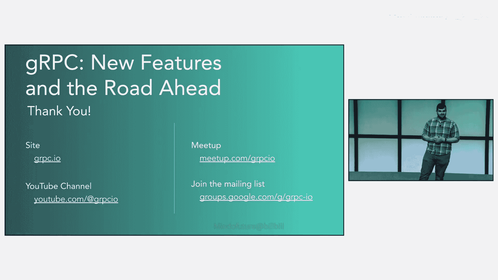

# Grpconf-2025-p20-P20_全体会议-gRPC-新功能和未来展望--BV1yTHMzKE1U_p20-

Alright， so like Kevin said， I'm Richard Bellville。 I'm a maintainer on the GRPC project。

 And last year I got on this stage at GRPC conf to look back at GRPC's first decade。 This year。

 I'm excited to be up on stage to give you a glimpse into GRPC's second decade。

 So this will more or less be GRPC's roadmap， the list of features and projects。

 we have planned for G PCC in the coming year and beyond there's more continuity in these projects。

 continuation of past trends and things that are completely new。

 So before we jump into that laundry list。 let's take a look at the themes driving the GC project forward into the future。

😊，You'll see three main pillars in this roadmap。 The first should be no surprise if you've been to any GRP conf or even any talk on G PCC in the past five years。

 Service mesh。In 2019， we decided to set on the long journey of creating a service mesh without sidecar proxies。

 We did our G A launch in 2020 and haven't looked back since。

 New feature requests have just kept on coming in since then。 And that trend did not stop this year。

 Just about every feature I'm going to mention today is related to service mesh in one way or another。

The second is observability。 GBC went all in on open telemetry a couple of years ago。

 making it easy for G PCC users to collect and export logs， metricss and traces。

 That journey is not complete yet。 And so you'll see a number of improvements we're making in the open telemetry space。

Finally， modernization， the world moves fast， and it'll leave you behind if you don't keep up with it。

 This is true for every language that we support and for new languages rising in popularity。

 So some of our most exciting projects come from this modernization pillar。

 So with these three pillars in mind， let's dive right into the roadmap。😊。

We'll kick things off with a pair of killer proxys service match features。 E， X T Proc at E， X， T Oy。

E X T Proc is about modifying incoming requests and outgoing responses on a server。

 similar to G interceptors。 Well， E， X T Z is about determining whether incoming requests are authorized。

 Both of these features use an interesting plug mechanism。

 While interceptors need to be compiled directly into your server。

 Both of these features work based on a GRPC call out model where the server calls out to a preconfigured GRPC server in order to fill the features functionality。

So for E， X D Proc， request and response modification can be performed by a separate G PC server。

 possibly co located with the server or possibly centralized rather than compiling in an extension。

If you're a platform team， this is a dream come true。

 The power of GFC interceptors will now be available to you to enforce things across your entire system。

 All you need to do is deploy an E， X T Proc server and configure your service match to point at it。

E X T off Z works very similarly。 Each incoming request will result in an outgoing request from the application server to a pre configurefigured G PCC server。

 which will answer the question， iss the sender authorized to make this request。

This new plugin model will offer you new levels of flexibility in building your systems。

This feature is still in the design phase。 So be on the lookout for a G laying out the details later this year。

So next up， H P connect。 H P connect is a special H P verb that turns an H P connection into a tunnel for TCP connection。

long various protocols， such as SS， H， FTP or GRPC to tunnel over that H P connection。😊。

This is useful in two main ways。 First， with forward proxies。

 So enabling egress from a network environment that otherwise disables egress。 Second。

 with reverse proxies， enabling ingress into a network where ingress is otherwise restricted。

 You could， for example， use H P connect with a reverse proxy to individually contact servers deployed to a public cloud from an onprem environment。

 when those servers are otherwise not accessible from the public Internet。😊，Now。

 GRPC has had support for tunneling through H P connect proxy since 2017。 In fact。

 this functionality was defined in the very first G A1。 But now we're making this functionality dead。

 simpleim to use and integrating it with service match functionality。 previously。

 H P connect based proxies were statically configured in a perl language way。 Now。

 we plan to extend the support by integrating with X D S。

 The control plane will be able to send down configuration。

 Instructing clients to connect to certain servers， using an H connect proxy。

 We've already seen users of early versions of this feature。

 take advantage of it to create a single service mesh across their onprem and cloud environments。

 super exciting stuff。😊，Be on the lookout for this to be released cross language later this year。

Next up is support from multiple spiffy trust domains。 As a brief intro。

 Spiffy is a system for assigning cryptographic identities to individual workloads。

 whether those workloads are virtual machines， Kubernetes workloads or anything else。

 and verifying those identities。These cryptographic identities can then be used to establish M T L S connections between workloads。

 And for those of you who have set up MT T L S manually before， you know， it's a huge hassle。

GRPC is supported configuring spiffy based MT T L S via XD S since 2021， but only via C A files。

 certificate authority files。 We're now adding support for spiffy trust bundles。

 This will allow you to take advantage of multiple spiffy trust domains。

 This is useful in a bunch of different scenarios。 You might， for example。

 have a separate route of trust for dev staging and pro environments。

 This is useful to ensure that less secure environments like staging cannot accidentally access pro。

😊，Or each product area within your company might handle its own identity management。 In this case。

 clients will still be able to interact with both workloads within the same trust domain and workloads from other trust domains。

 So you can expect this to land in C plus plus go and Java this year。

Next up is the next iteration of a longstanding G PCC debugging utility， Cha Z。

Channel Z gives you detailed information about the various GRPC related resources in your process。

 like channels， subchannels and sockets。 Imagine flapping network connections。

 faulty routers and laggy ws。 Channel Z is a great way to troubleshoot issues like those。😊。

We now have a design for channel Z V 2， which will be more flexible than the original version。 Well。

 the original version encoded the relationships between resources like channel subchannel and sockets。

 Chan Z V2 is designed from the ground up to be generic。

 allowingow significant room for individual implementations to export relevant。

 unique details via channel Z。 For example， certain transports have multiple TCP sockets per subchannel。

 Uni details like this can now be exposed and debugged more effectively。😊。

Channel Z V2 will also allow us， the G PCC team to evolve the G PC resource hierarchy over time without having to modify the channel Z protocol to match。

In short， channels E V2 will make debugging GRP applications faster and more flexible than ever。

 The first implementation will be coming to C plus plus later this year。😊。

Gereroy Proxys has had experimental support within Istio since 2021。

 but we're making some changes to make Istio and proxys GRPC an even more natural fit。

Up to this point， Istio integration has relied on an insecure connection to the Sst U agent。

 which acts as a control plane proxy co located with the GRPC workload。

 We're making a couple of targeted changes to make this proxy completely unnecessary。

 Without this proxy， SG O and proxys GRPC will be an even more natural combination than before。

I mentioned earlier that service mash and observability are two of our strongest pillars。

 and the intersection of these two spaces is just as hot。

 We're adding open telemetry metrics for the weighted round Robbin load balancing policy。

 the pick first load balancing policy and for X D， S client。

 the component in the G PCC library that connects to the X， D， S control plane。😊。

In addition to these 12 new metrics， we're adding cross cutting labels to indicate the X G S locality associated with metric。

 roughly corresponding to a cloud zone。Originally， all GC hotel metrics operated on a per call basis。

 but we recently introduced a framework for non per call metrics。 For example。

 X D S client is used across multiple calls and even multiple channels。

 So the non per call metric framework has really enabled us to enrich the observability available to users of G proxy a service mesh。

😊，Together， these features will make running a service match with GRPC easier and more reliable than ever。

Next up is X T， S global rate limiting， a really exciting new capability within GRP proxy list。

 Global rate limiting is great for situations where your servers may frequently be overwhelmed by requests。

 Most rate limiting solutions require some kind of proxy。

 whether it's a gateway ingress proxy or a serverside sidecar proxy with XD S global rate limiting GRPC servers Naly implement this rate limiting functionality directly in the GRPC library in conjunction with a control plane。

😊，This feature leverages the existing XD S protocol for service mesh。

 as well as a new R Q S protocol designed specifically for aggregating load information from servers and as synchronously programming rate limiting policy from a globalized control plane。

This means that you get the benefits of a global rate global rate limit decision making and also the benefits of a completely decentralized data plane。

Putting this all together， you have a highly performant。

 globally aware system for managing high volume software。

 The protocols and GRPC library implementation described here are completely open source。

 And a first R Q S control plane implementation will be coming to G GCP Cloud service Mash soon。😊。

Next， serverless integrations， Service mesh operators generally don't run on just Kubernetes。

 Whether they like it or not， feature teams in their organization often run workloads on various serverless platforms as well。

 such as Google Cloud run。😊，Unfortunately， there historically hasn't been great interoperability between these two types of platforms for service mesh for G C Proxyless service mesh。

 in particular， we've seen good support for cloud run to G KE。 In fact。

 Kelsey Hight demo exactly this when proxyless was first introduced。 But the other reaction。

 Kubernetes to serverless to serverless hasn't worked out nearly as well。😊。

So with Google Cloud run in mind， we've designed and implemented a handful of features that make this a first class experience。

😊，First， we've added X D S host rewriting that enables the use of vanity URLs and X D S targets。

 something very common on serverless platforms。Next。

 we've had a jot token based authorization for outgoing service mesh mediated R PCCs。 And finally。

 M T L S off based on spy identities， putting all of these features together。

 the integration between serverless and proxyless service mesh is now truly first class。😊，Next。

 we have some very interesting developments in the AI space。

 some of which you heard about this morning。2 protocols to enrich AI models with external data and capabilities have absolutely exploded in popularity over the past year。

 MP， the model context protocol and A to a， the agent to agent protocol。

 MP gives developers the ability to enrich L L Ms with the abilities of any tool you can export via MP server。

 You can imagine search， file access or any other traditional software application。😊。

The second protocol， A to A， gives long lived AI agents the ability to collaborate with one another in a structured non English language。

Now， A to A was built from the beginning in terms of GRPC。

 The protocol is fully defined in terms of pro。But MCP originally only worked over JO R PCC。

Since then， we've gotten many requests to enable MCP over GRP with all of G PCC's rich features。

 So I'm happy to announce that we'll be working with the authors to make GRPC a first class transport for MCP。

 And you saw a demo of that this morning。😊，GRBC has really established itself as a key component in the AI space。

 So I'm looking forward to seeing what EI applications it will enable next。😊，And last but not least。

 we have the newest entry in the family of officially supported GRPC languages。

 Rus Rus has become incredibly popular over the past few years with its safety by default and zero cost abstractions。

 and no language is complete without first class GRP support。

 So we're making we're working to make sure that that support is there。

 We're building on top of the already quite popularomic implementation。

 bringing it to parity with the other first class languages like C plus plus Java and go。

 And that will mean a full XD S implementation so that you can use G rust in your proxys service mesh deployments。

😊，We've been working directly with the author of Tonic to make sure that we deliver the best experience to both existing users of Tonic and new users of GRPC Rust。

 And we're expecting to release a preview of this effort soon。😊。

Our GFCC Rus team did an in depthth talk of the on the new library about half an hour ago。

 in case you missed it， you can check the video of that talk out on YouTube after the conference。

So that's what we have planned for GRPC for the near future。

 Plenty of exciting new features across service mesh， observability and modernization。

 as GC speeds ahead into its second decade， it shows no signs of slowing down。 As always。

 you can keep up with a project on our website， our YouTube channel and person at our meetups and on the mailing list。

 Thanks， everyone， and enjoy the rest of the conference。😊。

