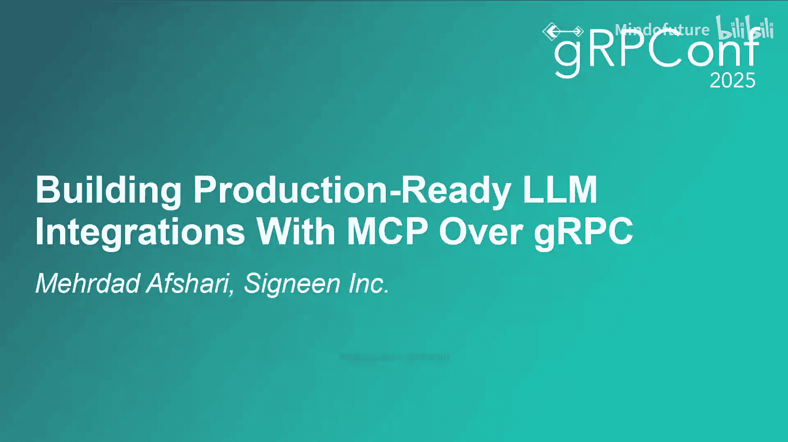
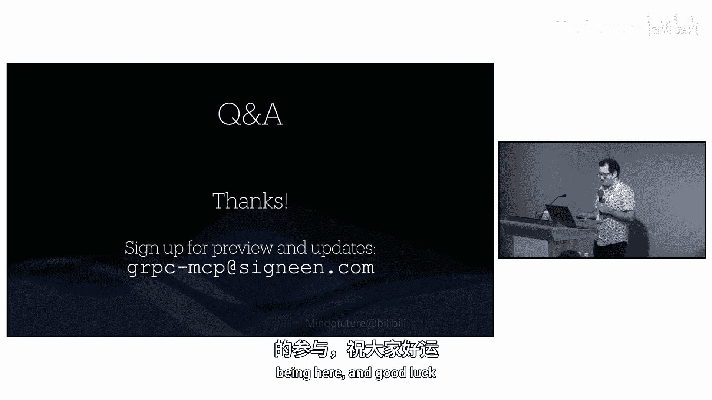

# Grpconf-2025-p21-P21_使用基于gRPC的MCP构建生产就绪的LLM集成--BV1yTHMzKE1U_p21-

Hello， everyone。 Hope you had a great GRPC con this morning and had a great coffee break now。

 So we are gonna talk about the new hotness in the industry。

 which is building LLMs and connecting them to。😊。

Various resources or APIs。And that is done these days by something called MCP。

 So were gonna go over that and see how we can leverage G PCC for that。 As for me， I。

 I work at sign in and authentication company Before that。

 I was on the GRPC team and have deployed G PCC at various companies at scale。

 So were gonna see how we can leverage the existing。😊。

Learnings that we have from GRPC and apply them to AI workloads。

So what are we going to talk about today first， I'm going to give you a brief overview of model context protocol or MCP and talk about how we can leverage your PCC in that and then how we propose you should run MCP servers in production and then we'll address questions。

 note that there's no answers there necessarily so。It's just questions。So。

Let's talk about what MCP is。So as you can see in this slide。

 there is this application that is essentially your chat app or like your ID D that's powered by AI。

 That app is connected to LLM usually this happens with open AI API because they were kind of first。

 and everyone else basically implemented their endpoint。And then there is this MCP server。

 which is what we are gonna focus on today。And that protocol is MCP。It is a protocol。

 but they kind of talk about it as like some sort of ecosystem or like hype it up。

 which is natural for AI people。 And they call that app MCP host in some context。

 So if you hear MCP host， just think that client app that is talking to LLM and a server。

 It's not anything like super special。😊，So how does this thing work？So basically。

 like that white square is your app and it instantiates some client object。

You might think of it as the GRPC channel， and that talks to your MCP server。

 which provides the resources。Over a bunch of transport protocols， Basically。

 the two that are supported today is standard I O。And H， TP with streaming。

 So we need that streaming for notification from the server to， to the client， which is the MP host。

If you think about it， that standard I O， if you， that dates me， but that's basically fast C G I。

They call it standard I O。 But that that's how it works。 like why not just do CGI。

 So that that pattern you're gonna see over and over again。

 which the mistakes that people made over the years has no effect on the design of MCP and they basically do the hackathon project that took over。

 as we know， from any networking protocol adoption is what matters and not the technical merits。

 So they have adoption So we're gonna talk about them today。 So payload。So what。

 what does actually get sent over this protocol。 They have three primitives。

 I imagine this might change in the future。 They basically bucket。Stuff in resources。

 prompts and tools， right？ So what is， what is a resources essentially like a calendar entry， file。

 an image， whatever your or a database record， you can basically assign an idea A URL to that you are a like thing basically that identifies that resource and fetches it and feeds feeds it to the MCP host。

 which is the app。 And that sends it as a context to LLM。But depending on how it wants to do that。

 And they essentially， you have a bunch of resource APIs that lists the resource that your server provides and reads it and does things with it。

So this is like basically the resource API。 And these are kind of fixed。

 So the resources are pretty simple。Then there is this prompt thing。 So what is the purpose of this。

Essential， you， you w to provide。ASe of commands to your application。

 extend your application with a bunch of commands。 Imagine I think the。

 the way the designers thought about this is like slash slash commands where you， I， you。

 you invoke an operation from end user perspective and give gives it some argument。

 And then that is get gotta get passed to your MCP server。

 The MCP server translates it to into a string that then。Gets fed into the L lamp。

So that's the goal of the prompt thing。And， as you can see， like。

 this is kind of like not really related to the resources necessarily。 So again， like this shows。

This protocol is somewhat ad hoc and does the job， but is not really designed from a principal standpoint。

And then there are tools。 The tools are really what the APIs that the MCP invokes the actions that you get from the LLM happen in this tools thing。

 And that is a lot more complicated。 The tools API effectively looks like something like GRPC reflection where you can have a bunch of methods。

 and the method description is fed as a part of Json response to the MCP host。

 And then those operations can then be invoked by the the host app。😊，So essentially。

 APII design is dead。 and we have to rethink about。APpiI design has this new thing。

So why do we care about GRPC in this context？It is trusted and proven， right， So we。

 we have GRPC infrastructure at scale。 run， We run it。 We know how to run it。

And a lot of companies have built around GRPC。 So adding a new protocol in the mix is going to be。

 even if it's better or worse or whatever， adding one is not necessarily good because you have all the bells and whistles around GRP already。

AndGRPC has the performance， has the robustness。 It's one of the most well tested HP2 stacks。

 if you're using that transport。You have already health checks around G PCC services。

 You have like deadline propagation。 You have circuit breaking around it。

Streing RP PCCs is one of the core features of GRPC。

 And we're gonna get back to this because MCP really benefits from something like that as a core functionality of your R PCC stack that that it runs on。

The other benefit that a lot of us have seen is that you can use GRPC in any language， basically。

 So you don't have to wait for an MCP SD D K or have an ad hoc H T TP server in your application in a certain language to be able to use MCP basically create an MCP server in your。

Desirreed language。And then like GRPC has all the service discovery name resolver that you have in your large scale infrastructure。

 It has a load balancing policies。 You can control your H your GRPC client with X， D S。

It supports versioning。 This is one of the things that is missing from the MCP designers initial spec that that is going to be a problem is that your API is not really versioned appropriately。

 Aentation and security。 This is another thing that MCP servers usually mess up with because it's not really。

Thought about at the beginning， whereas if you have a G PCC server。

 you can leverage all the authentication flows that GRPC has。 You have observability， stats， tracing。

 like you can collect latency across your infrastructure。If your server is actually GRPC。

 So how we can mix up the two and。Essentially， expose our GRPC services。

That are running in our infrastructure as MCP。 So we have three deployment models。

 One is a local binary， which is essentially an SDI O。Server。

 MCP server that talks over GRPC to a server。somewhere else。 And that is implemented with GRPC。

 essentially。And then the other deployment is GRPC to MCP Gway。

 This is similar to our existing GRPC gateway transcoding solutions that we can use。

 And then there is an NY plug。 That is also mapping very well to what the transcoder does。

So there is one thing that that needs to be pointed out here。 often GRPC is。

Thought about as a protocol as an R PC protocol that' uses protocol。It actually is not true。

 GRPC is completely agnostic to the serialization format。And you can。

 you can essentially pass the same Json objects。Over GRPC and get almost all of the benefits that I talked about here。

So do we need transcoding in that context to map the MCP requesting responses。

What are the trade offs here。Well， one trade off is if we define a transcoding spec today。

 the MCP spec seems to be in flux。 So that transcoding might not be the best thing for the future。

 and the conventions are changing。So maybe in the future。

 it makes more sense to have a full transcoding like standard。

But it might make sense to do something as a middle ground。

 So the prompts and the resources APIs are pretty fixed today。 So we。

And we can transcode those and have a prototype server。And the rest of them， for now。

 it seems like it might be a good idea for the tool input and output to remain Json so that we get their flexibility。

 should the MCP spec changes。 But that's obviously something that。You。

 you may want to think about today in your infrastructure。

So isn't this just the same problem as we had with like exposing a GRPC endpoint as Json API with like a GRPC gateway thing。

Well， not quite because first of all， this is not a rest API。 This is like J R PCC API。

 It's slightly different。The other important thing is MCP is fundamentally stateful。

And it in relies on bidirectional streaming to some degree。

 so that makes a slightly different problem， So you kind of want your gateway to keep track of the state and invoke a bidirectional RPC streaming RPC and connect to your backend that way potentially or have some lookup table to manage the state so that writing that service from a backend perspective would be easier so those are the differences that this problem has。

So we have actually implemented a prototype of something like that and we'll probably be able to share it soon if you are interested。

 definitely send us an email and we are gonna notify you when that happens。

 And I think I'm almost out of time。 So let's open it up for questions。Please。

I think if you take Asian public。MCP clients， you won't find J PC。 You'll find standard I or。H TP。

 right， That's correct， so。What do we need So the， the server that I described。

 there is a HP server that we have currently that speaks GRPC。

 So essentially it acts as a translator in between the two。 so you can optionally。

So this is something that might happen in the future。

 I think MCP people are open to having other transport protocols they already support too。

 and I don't feel like theyre very strict on not adding them。So， there might be。

It might be valuable to start an effort to actually standardize GRPC as a transport protocol for MCP。

ok。Awesome。😊，'cause it it actually fits very well because of the bidirectional streaming。

 So we should definitely talk about that。I mean， are you working on it or is anthropic also helping you。

cause， I mean， I mean， if we， if honestly， if we were good at adoption。

GRPC web would have done better， but we'll see。 all right， as if I'm not loud enough。 Okay， so hi。

 Meroddo， long time no see。😊，There are a couple of。 So one， one thing to keep in mind is。

Using a bidirectional stream in GRPC for MCP does it does most accurately reflect what the currently defining MCP protocol can do。

 but it's still a very poor fit for there are a lot of cases where you want to use existing infrastructure that was designed to operate on a per RRPC basis for things like Osy。

 for example， right I mean you can imagine use cases where you want to apply a different Asy policy depending on which MCP tool is being called right and it's really difficult to do that if if it's all on one Bdi stream right So it's we really so I've been working with the MCP transport workgroup。

 there is。There are discussions going on。 They are not。 Everybody is not always in agreement。

 but there's a lot of discussion happening。 We are trying to do a few things。 One。

 you mentioned that they already support multiple transports。

 You can have any color you want as long as it's black。

 You can have any transport you want as long as it's based on Json R PC。 That is their current。

 you know， stance， which is not very useful。 So we are trying to get like a real transport abstraction introduced that will actually allow plugable transports。

 We are also trying to get some changes into the protocol that will。

We will eliminate a lot of the statefulness by default。

 We want to make it a much more stateless protocol， except in the cases that need statefulness。

 which can explicitly start a session and do what they want to do， you know， that way。

 And we think that by， by making these changes， we can get it to a place where we can。

Make a firstclass GRPC transport for MCP there is a remaining open question then of whether Anthropic will accept it as a firstclass thing in their SDK or whether we'll have to publish that as a side thing。

 but we are absolutely we Google are absolutely committed to having AGRPC transport for MCP as a first class thing and we are actively working on this。

Well， that's great to hear。 I mean， obviously， adoption is going to be slightly painful。

 The other thing I would recommend。😊，To definitely work on is currently the public proxies are not that great in like terminating MT TLS and passing authentication。

 It's not a fundamental technology problem， but it's ecosystem thing。

 And that that is probably something that drives people towards Json R PCC or other inferior technologies。

 I shall say， anyway， let's move on to the next question， please。Yeah。

 on your deployment models slide。 I see you're listing off three different ways。

 And on the far right， therere envoy plug way。 What's not clear to me is have you had success using that or is that something a hypothes could be done So the one that we actually concretized is is the middle one。

 which was the HP server actually it's it's the same binary that speaks HP that then invokes GRP we haven't started on the envo plug but that's something that we are planning to look at do you anticipate a particular problem with that No。

 it' just something that seems intriguing。 is there something we can follow see how the envoy plugs going Well it's not started the implementation has not been yet。

 but definitely send an email to us and we're gonna follow up with you once something is ready for consumption。

 But I don't think I mean， if you wanted to take a look today。

 there is a transcoing plug for envoy for regular。Based on endpoint。

 And I think that's a first step to look at。 Okay， so effectively on top of that extending or building like that there is the state management problem that you might want to have a like database or something that keeps track of the state too and then invokes like stateless。

 There are things that you can do there。 as well， But we're gonna take a look at that that that is definitely the most interesting deployment model that I anticipate and it fits with the rest of the GRPC ecosystem because a lot of people who use GRPC end up moving their edge to envo because of XDS and having the same essentially control plane for both of them。

 So that makes a lot of sense if that materializes。 but were gonna keep people posted。 Yeah。

 that something interesting to learn about。I have a question how does EMP and the service discovery go in place I mean for instance when you are registering this GRPC based services into a XDS with specific keys to discover the services and when the LLM prompt the prompts come they need not match with each other right so how do they work together？

So I don't think it's the XD S and service discovery will operate at the GRPC client level。

 which is within our binary。 So the incoming MCP stream has no ability to see the XD S data at all at the edge。

 we basically take the XD S info and route traffic to the GRPC instance。The server instance。

 that we want to。 And this is like any GRPC client It not that different。

 The thing is because of the statefulness， that gateway might want to keep a single bidirectional stream to that server。

 and then keep another HP stream to the client。 But which takes the intelligent division。

 Hey the which gatewayRPC service I need to invoke this is gonna be the edge gateway at this point。

 But if if we actually manage to take GRPC to the essentially the endpoint。

 then we can we can have the alternative solution where there is the clientP host that directly takes X S information。

 you can actually see this in one of these popular file sharing apps that uses GRPC the client S D K the client app talks GRPC to the server and also their infrastructure internally is G。

PC， but， for example， they have web interface。 and that that is like some transcoding at the edge that happens there。

 Oh， so it is the MCP host or the app that does the service discd， not the MCP server。

 There is there is the well， that the MCP server。Here is。Ambiguous is。

You can it depends depends on your deployment model。 If your MCP server is a local binary。

 then that can directly take XDS information。 If it's running on the edge。

 then the edge will make that decision basically。 So wherever your GRPC client sits。

 your initial GRPC client， that will take the XDS info。 otherwise， I mean， we can't do much。 I mean。

 you can， you can actually use envoy and take the Json RRPC stuff and route it。 But then。

That is fine if you don't particularly care about GRPC and other like stats and stuff within your infrastructure that might work。

 But if you do， then it is valuable to actually pass the MCP data within a GRPC stream thanks。

This this still the last question。How this effort and maybe what you talked about related to what was announced earlier today？

That like every I'm talking about the。Oh， because that sounded like something that actually exists。

 But what you're talking about something like a potential future。 Oh， it was only intent。Bummer。

 I hope it doesn't take as long as you PC arrest。Were like yeah， I don't have been。

We hope to have a proof of concept SDK for Pth out， probably in the October Mo Conference。就算是这个。

周我单独啊。没事。So I， I guess I shall repeat your answer， right， for， for the recording October。

 November of this year next year。Proof of concepts。

 Python SD D K that has GPC support October and November， we're gonna take your word on that。是呃。

Any other questions？Awesome。Thank you， all， for。Being here。 and。

