# Grpconf-2025-p22-P22_gRPC中的负载均衡--BV1yTHMzKE1U_p22-

Good afternoon， everybody。

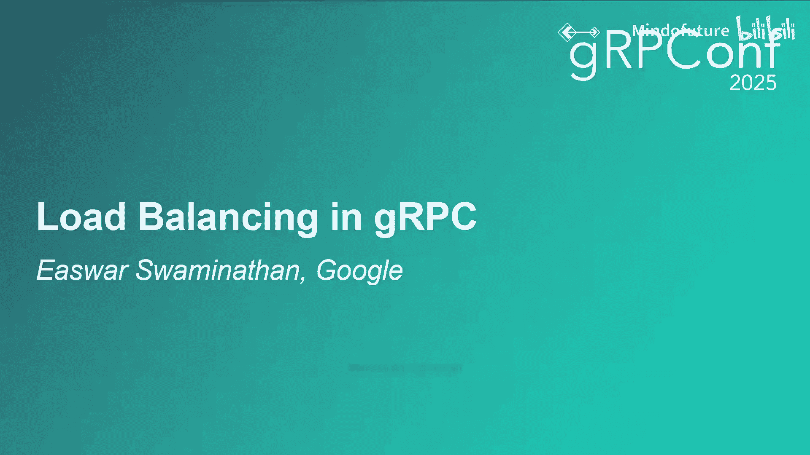

My name is Ywar and I'm a software engineer on the GRPC team at Google。

 Wecome once again to GC conf and thank you all for sticking around for this long。

 So today I'll be talking about load balancing in GRPC。

So if you are like the most interesting man in the world and you run a single server。

 then load balancing is not for you。 You can head early to happy hour， have a few drinks。

 go back home and chill。 But for most of the rest of us。

 we run multiple server backends and we have multiple clients that are sending multiple requests to these server backends。

 So load balancing is all about distributing client traffic across our backends in a fair and appropriate manner。

So this talk will focus on application level load balancing or L7 load balancing and not network level load balancing。

 which would be L4 load balancing So in GRPC load balancing happens on a per request basis。

 which is at the application layer and not on a per connection basis。

 which would be at the network layer。So by distributing client traffic across our server backs。

 load balancing attempts to ensure that there are no hot spots in our server fleet and thereby tries to guarantee that our service is highly available。

 scalable and highly performant。Now， at a high level， you have two options for load balancing。

 one is server side and the other one is client side。

 and this is a choice that applications need to make upfront。

So with serverside load balancing our clients send all traffic to a proxy and the proxy takes care of distributing this traffic across the server backends。

 The nice thing with this approach is that the client can be very simple it just sends all its traffic to the proxy and you can put all the load balancing logic in the proxy in one place but this is also the disadvantage of this approach because all traffic now needs to go through the proxy and therefore the proxy can very quickly become a performance bottleneck and a scalability bottleneck as well。

And running a fleet of proxies， and maintaining them。

Would have its own costs and can be prohibitive at times。So with client side balancing。

 we have clients directly talking to server backends。

 and therefore we eliminate the proxy and this gives us good performance improvement。

 but this comes with its own disadvantages too now the whole load balancing logic is moved into the client。

 So the client becomes a thick fat client and in most cases we would want to support clients running in multiple languages So this means implementing the same complex load balancing logic in multiple languages and with this approach you would have to trust that the clients do the right thing in terms of balancing their load。

But when you use GRPC， you get all this for free because we take care of implementing the complex load balancing logic in the GRPC client。

 we implement it in multiple languages， we maintain them。

 and you can trust GRPC to do the right thing。So the component that performs load balancing in GRPC is known by different names in the different languages。

 but we will stick to mostly load balancing policy or LB policy in the stock。

So an LP policy consists of two major components， the connection management component and the call management component。

 the connection management component receives backend addresses from the name resolver and is responsible for creating and managing connections to the backends。

The call management component or what we call the picker in JRPC terminology is invoked on a per request basis and is responsible for selecting a backend to use for that particular RPC。

Now GRPC supports plugin architecture for most of its components and LB policies are also one of them with the plugin architecture。

 GRPC defines the interface that LB policies need to implement。

 They implement that interface and register themselves with GRPC at in time and at runtime GRPC selects an LB policy based on what is specified in the service config returned by the name resolver so we'll get into what service config is a little later on in the talk。

So GRPC ships with a bunch of LB policies， and the plugin architecture makes it possible for our users to bring in their own as well。

Here is a subset of LB policies supported in GRPC。And before we go and look into what LB policy might make sense for your service。

 let's actually go a couple of examples。 The first one Pick first is an is an LB policy that basically connects to the given addresses in order until it can find a reachable backend。

 So once it has a reachable backend， it sends all the traffic to that single backend。Now。

 round Robbin is quite the opposite in the sense that it connects to all the given backend addresses in parallel。

And attempts to distribute the RCs across all reachable backends。

Now it's important that you pick the most appropriate LB policy for your service。

 There are a bunch of cases where Pickfi would make a lot of sense。

 like if your client traffic is going through a reverse proxy or if your clients require soft affinity。

 This is the case where you would want all requests from a particular client to go to a particular server back in because that server is caching some client specific data。

 let's say like a database cache or something So in these cases。

 it makes a lot of sense to use pick first Also in the case where you have a lot of clients。

 but they're sending very little load Pick first with randomized shuffling would work great。

In most other cases， though round robin or weighted round robin would be very appropriate。Now。

 if you are unsure what LB policy to use or if you think that GRPC doesn't have an LB policy for your use case。

 please do come and talk to us， we might be able to help you。

Or if you have a great idea for a new LB policy， definitely come talk to us。

 we'd like to collaborate with you in the design and implementation of the new policy and see if we can help the whole community。

Cool， so now that we've sort of covered the high level overview of load balancing。

 let's actually get into the GPC client architecture and see where load balancing fits in。

So to begin with， the client application creates a GRPC channel and passes it the target U of the service that it wants to send RPCs to。

So a GRPC channel is a virtual connection from the client to the server。

 The channel is designed to transparently handle the details of name resolution。

 connection management， load balancing， etc， so that the application does not have to do so the application just creates a channel and can start sending RPCs on it。

Now。The GRPC channel starts off in idle mode， basically nothing is happening in the channel until either the application explicitly asks the channel to start connecting or it sends an RPC。

In either case， the channel comes alive and the first thing that it does is it creates a name resolver and it gives the target you right to the name resolver。

And the name resolver then comes back with addresses and service config。

 So service config controls the behavior of the GRPC client when it's talking to a GRPC server。

 So it contains things like RRPC timeouts， retry configuration among other things。

 but it also contains the name of the LB policy to use for this channel and the configuration to pass to the LB policy。

So based on this， the JRPC channel then goes ahead and creates an LB policy and sends it the backend addresses and the LB config that the name resolver gave it。

So at this point， the LB policy will go ahead and create sub channels Now a subchannel is an actual connection to a backend address and LB policies decide when they want to create sub channels and they can also monitor the connectivity state of these sub channelsnel。

So based on the connectivity state of the subchannels。

 the LB policy sends an update to the GRPC channel and this update contains two things。

 it contains an overall connectivity state for the channel and it contains a picker to use for RPCs。

The GRPC channel always uses the most recent picker returned by the LB policy。

So when the client application makes an RC。The channel asks the picker to select a sub channelnel for that RC。

And once the picker returns a subchannel， the RPC makes its way out of the client through that sub channelnel。

Now， it's important to notice a few things here。 So the name resolver can come back with updated addresses and services config at any point in time。

 So when that happens， the channel takes care of sending that update to the L B policy。Similarly。

 sub channels。Connectivity state can change at any point in time。

 And that is also communicated to the LB policy。 And based on these asynchronous events。

 the LB policy would create a new picker and send it to the channel。Cool。

 before we actually go and look at the L B policy API。

 let's look at sub channels in a little bit more detail。So as mentioned earlier。

 a subchannel is a potential or established connection to a particular backend address and the implementation for a subchannel is provided by the GRPC client。

But it's up to the LB policy to decide when it wants to create a subchannel and how it wants to manage the life cycle of that subchannel。

So， during。Its lifetime。 A subchannel goes through different connectivity states。

 and these state transitions are communicated to the LB policy by the GRPC channel。

All sub channels start off in idle。 And it's only when the LB policy asks it to connect。

It moves to connecting。And from connecting， it could move to ready or transient failure based on whether the connection attempt succeeds or fails。

And sub channels in ready state have a working connection to a backend server。

 When that connection fails， these sub channels move back to idle。And at that point。

 it's up to the L policy again to start reconnecting on that sub channelnel， similarly。

Sub channels in transient failure。 they don't have a working connection to a back in server。

 So therefore， they cannot be used for R PCs。 They spend some time backing off。

 And once the back of expires， they move back again to idle。 At that point。

 there'll be policy can request a connection。 and itll move back to connecting。

So any request to connect on a sub channelnel that' is not an idol is expected to fail。

At the same time， sub channelsnel in any of these states can be closed at which point it will move to shutdown。

Also， it's important to note that most L B policies would be managing more than one sub channel。

 So they all need a way to aggregate the connectivity states of these sub channels so that they can return a single connectivity state to the channel。

So here is a commonly used algorithm that's followed in many of the LB policies that ship with GRPC。

So the algorithm goes as follows。 Basically， if there is at least one sub channel in ready。

 then the overall state of the channel becomes ready。Else。

 if there is at least one subchannel in connecting， then the overall state goes to connecting else。

 if there is at least one subchannel in idle， then the overall state is id。

If there are no sub channels in ready connecting and idle。

 then the overall state of the channel moves to transient failure。

And this overall connectivity state of the channel can be queried by the client application using the GRPC clientient API。

Now， LB policies are free to use other state aggregation algorithms as well。

 and there are LB policies in JRPC， which do that。Cool， so let's finally look at the API。

 but before we do that， its important to know that the API is experimental in Java and Go and it's not yet public in Seco。

 although we are working towards that。

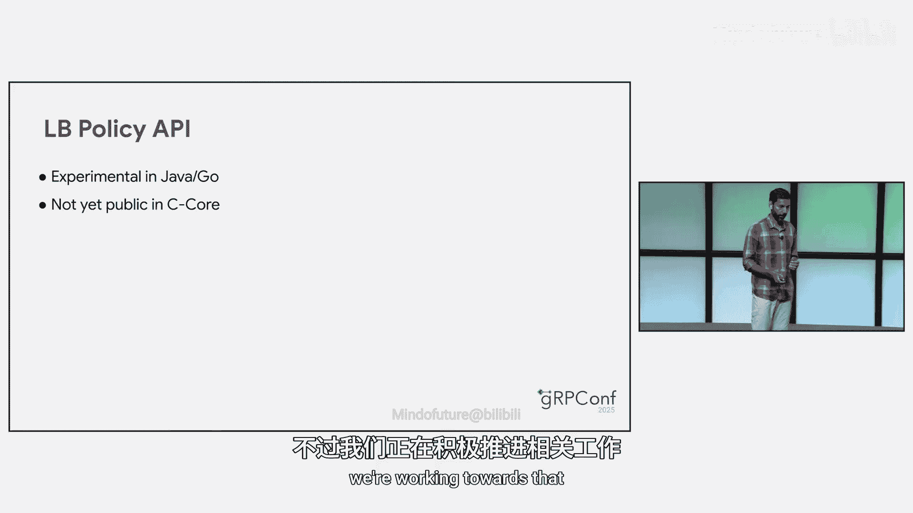

So the API defines a bunch of interfaces。 The first one that we look at is the builder interface。

 So every LB policy needs to implement this builder interface and register it with GRPC at in time。

So the builder basically has two methods， build and name。

 So build creates new instances of the LB policy while name returns the registered name of the LB policy。

So for an LB policy to be selected at runtime， the value returned by this name method needs to match what's specified in the service config。

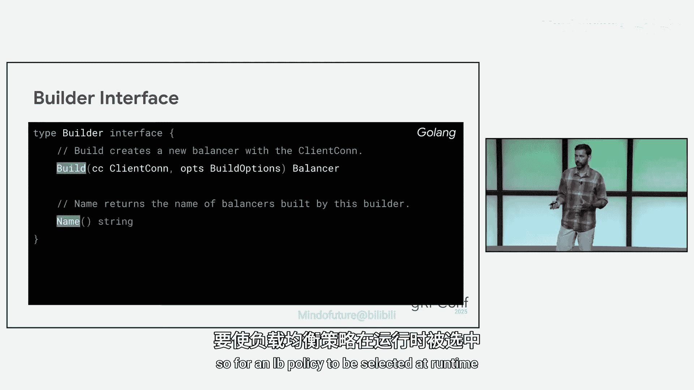

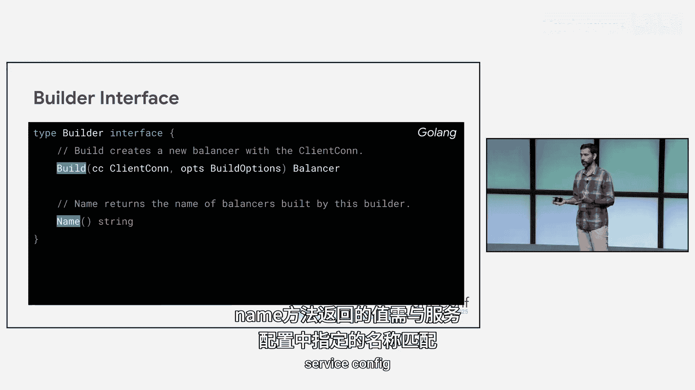

The next interface that well see is the balancer interface。

 So this defines the actual functionality that needs to be implemented by the LB policy。

 So this has a bunch of methods， but we'll look at a couple of them that are invoked in response to events from the name resolver。

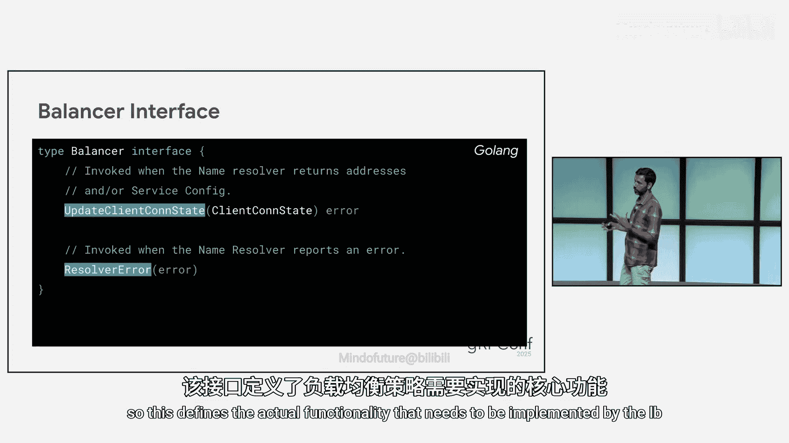

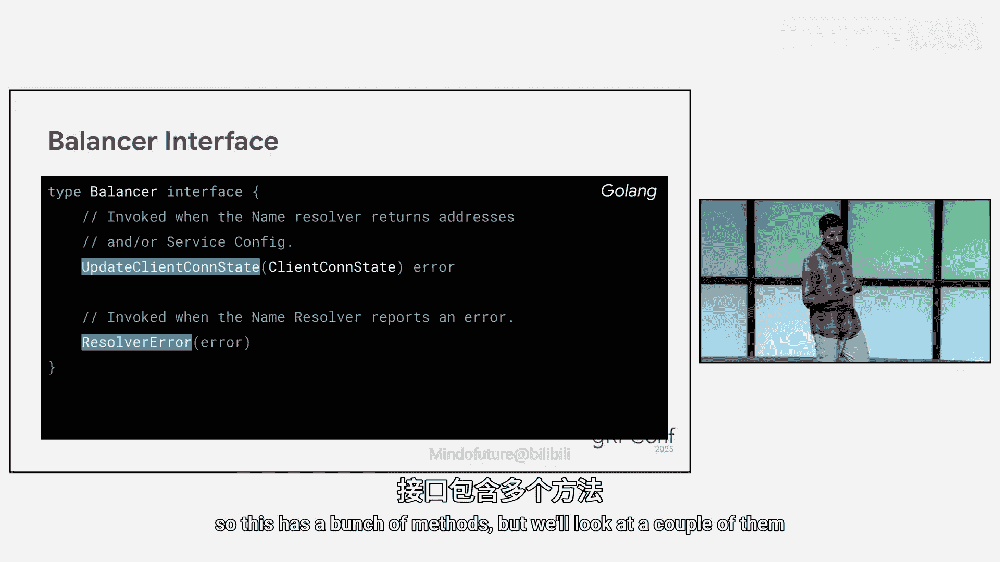

The first one is update clientcon state。 This is invoke whenever the name resolver comes back with new addresses or service config。

 So this basically gives the LB policy an opportunity to close old of channels。

 create new ones and things like that。The second one is called resolver error and is invoked by JRPC when the name resolver reports an error。

So one important thing to notice here is that JRPC guarantees that methods on this balance or interface will not be invoked simultaneously。

 so this greatly simplifies the implementation of LB policies because now they don't have to worry about synchronizing their internal state when responding to events from the name resolvers。

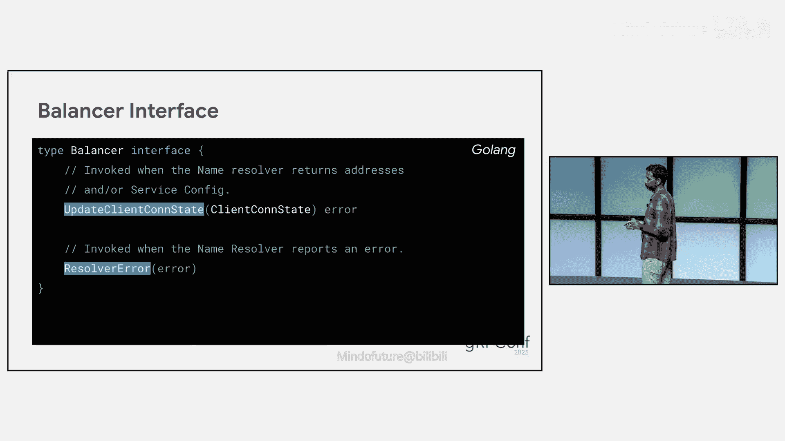

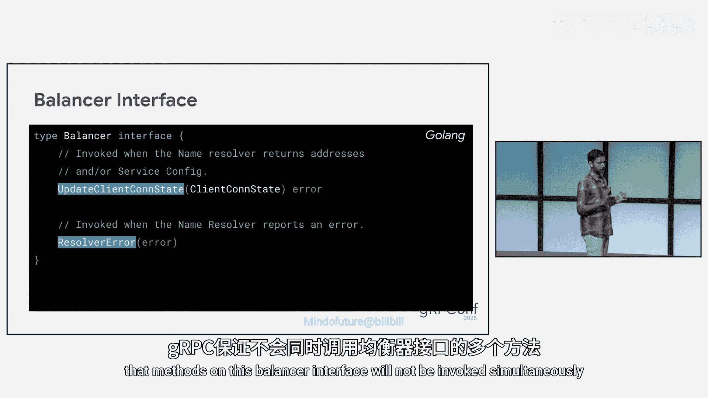

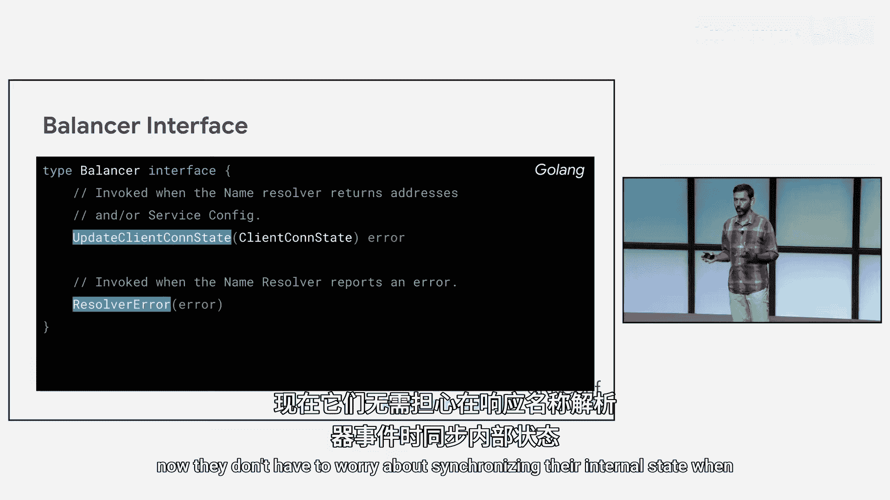

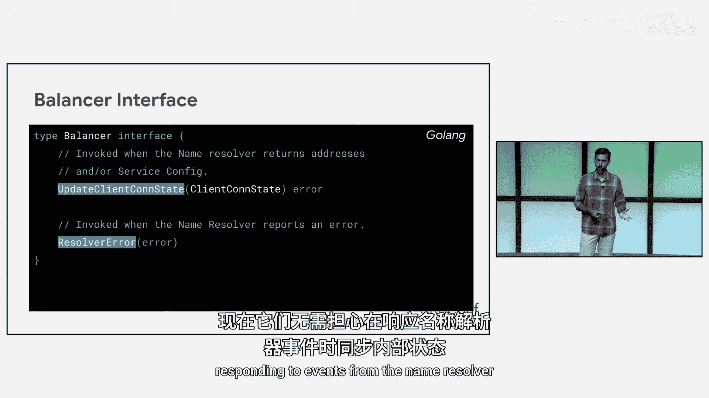

So the next interface we'll see is the client con interface。

 So this interface is implemented by the GRPC client and is used by the LB policy to communicate with the GRPC channel。

 again， this interface also has a bunch of methods， but we look at a couple of them。

 So the first one is called new subcon。 So this is the function that's used by the LB policies to create a new sub channelnel。

 and the LB policies pass the address or the backend that they want to create a subchannel to and they can also pass some options。

 So one of the options is the state listener callback that basically LB policies register with the channel to get notified whenever the connectivity state of the subchannel changes。

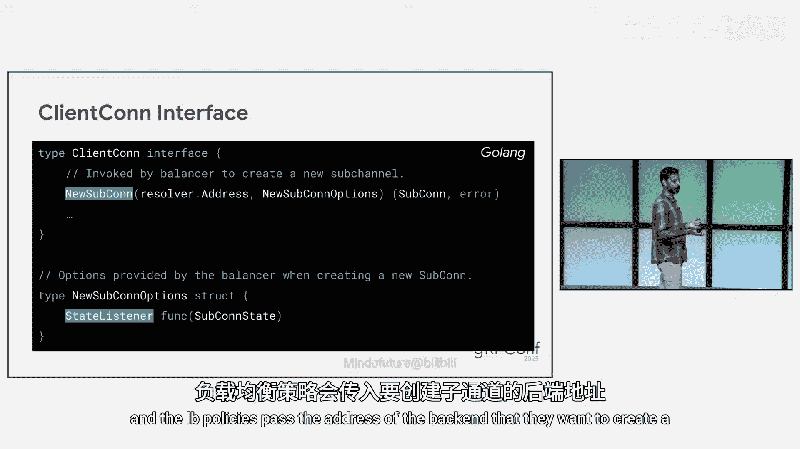

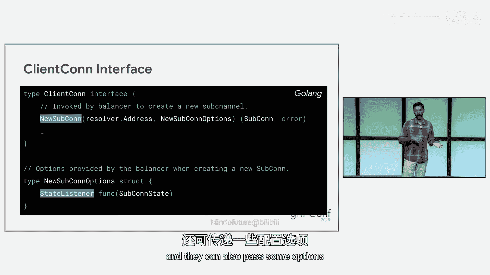

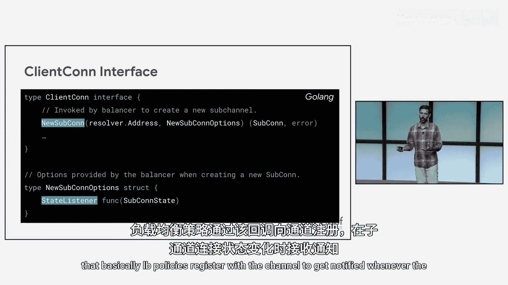

The next method on this interface is update state， which is used by the LB policies to report new state to the channel and this state。

 as I mentioned previously contains the overall connectivity state for the channel and a picker to use for RTCs。

So last， but not the least is the picker interface。 So this interface is used for every R PCC。

 And this has a single method called pick。 So this method is given some information about the R PCC。

 things like the full method name of the R PCC， any。Header metadata that is attached to the RPC。

 things like RPC timeout， etc cetera。 and the picker is expected to return a result quickly it must not block because this is in the fast path。

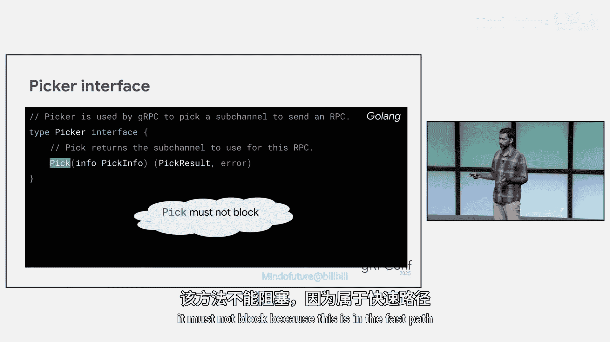

So the picker could return a result that can be one of four types。

 the first one complete is used by the picker to indicate that， hey。

 I have a valid sub channel that you can use for this RPC。

The second one Q is used by the picker when it doesn't have an active sub channelnel。

 but it's actually working on getting one。 So in this case。

 the JRPC channel cues the RPRPC and retries it whenever a new picker is written by the LB policy。

The third one fail is used when the picker doesn't have an active subchannel。

 but it has already exhausted all the backend addresses and it doesn't have a working sub channelnel。

 So in this case the RPRPC fails except if it was made with a wait for ready call option in which case the RPC will be queued and retried when a new picker is generated Also note that additional attempts might be made by the retry code。

 which is like separate from this whole discussion。

The last one is drop drop is very similar to fail except that even wait for ready RPRPCs are failed and there can be no more retry atom even by the retry code。

So that's all I have。 Thank you for listening。 And I think we have around two minutes for questions。

 So if you guys have any questions， I can try answering。

So do you think that let's see two clients want connect to the server， right。

 You have a bunch of server， but have the possibility that these two clients get to connect to the same server。

Even other servers still id。Because these client do not collaborate， right。

 Both try to connect to a server。 but this， both these two client get the same server。

 So this server gets busy。 But others， you know， let， let' think a very long， you know。

 G PC maybe around 10 minutes or one hour。But this is so again。

 it depends on your load balancing policy like if you're using P first。

 then and if all the clients get the same set of addresses in the same order。

 then they would all connect to the first server。But let's say if you're using P first with randomized shuffling。

 then each client will see a different order of addresses and they end up connecting to different servers。

Does that answer your question。Okay， but， but you still there are risk condition， right。well oh。

 okay， so you mean。啊。Let's see for the at this time， have a， you know， request then for one is idle。

Then for the next time， you know。嗯。是我。そ。Besides， maybe we can， we can try talking offline。 But yeah。

 thanks for the question。 Any other questions。

Do you mind something。 Yeah， I just want to comment on。What on your slide these Is are experimental。

 I just want to clarify， don't experimental in J PC you means something different doesn't mean we're going to remove it。

 We might， but not likely basically， how in J PCC Java I spent most of my time some of our most of our mature and use A S are marked experimental just because underlying transport may break this change。

Each experimental method or class in gpsy Java has a link to gpsy Java issue where you can take a look at the history and involve yourself the discussion about dis the about stabilization。

 stabiling the APII。Gy Java takes recurring meetings where we look at A I's ask for users to be stabilized and we take it into account。

Is it the case for go to。We don't have regular meetings， but yeah， again。

 like the balancer API in go has been experimental for a lot of years。

 but we don't like actually make too many breaking changes。 and even if we have to。

 then we are very considerate about our users so we try to。Reduce the pain as much as possible。

 if we have to make breaking changes。So we， we recommend or we encourage you to come and use it and give us any feedback if you can。

 Yeah， just to under underline that doesn't mean that implementation is experimental。

 It means this API signature is experimental。 implementationmut may be quite stable。Cool。

 thank you so much。