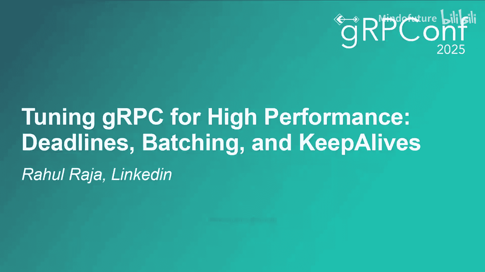
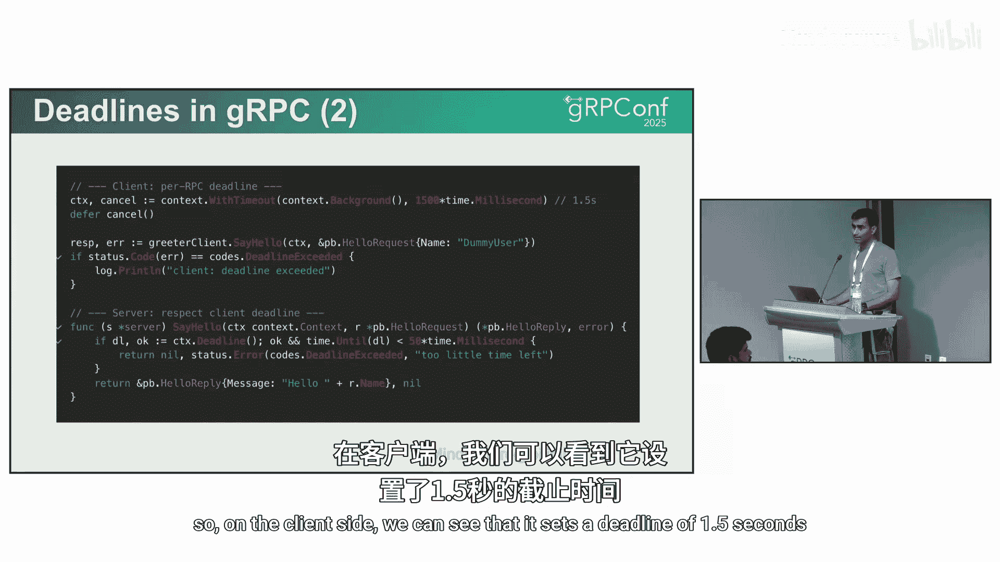
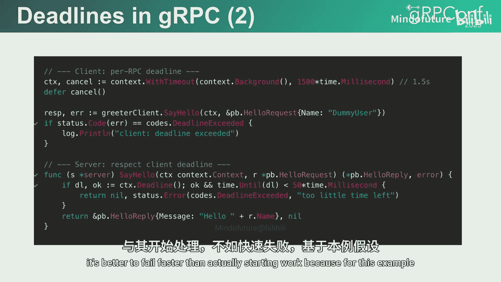
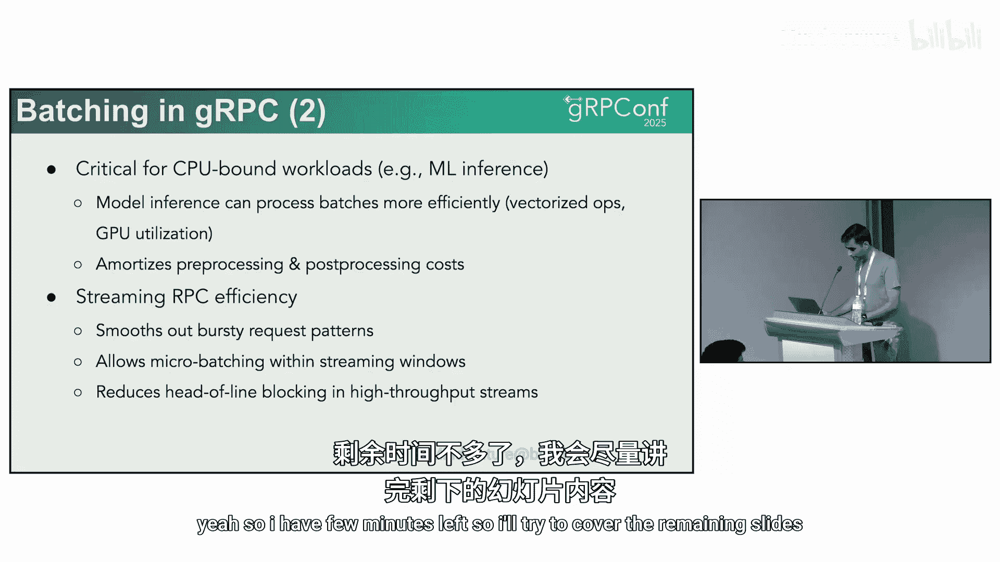
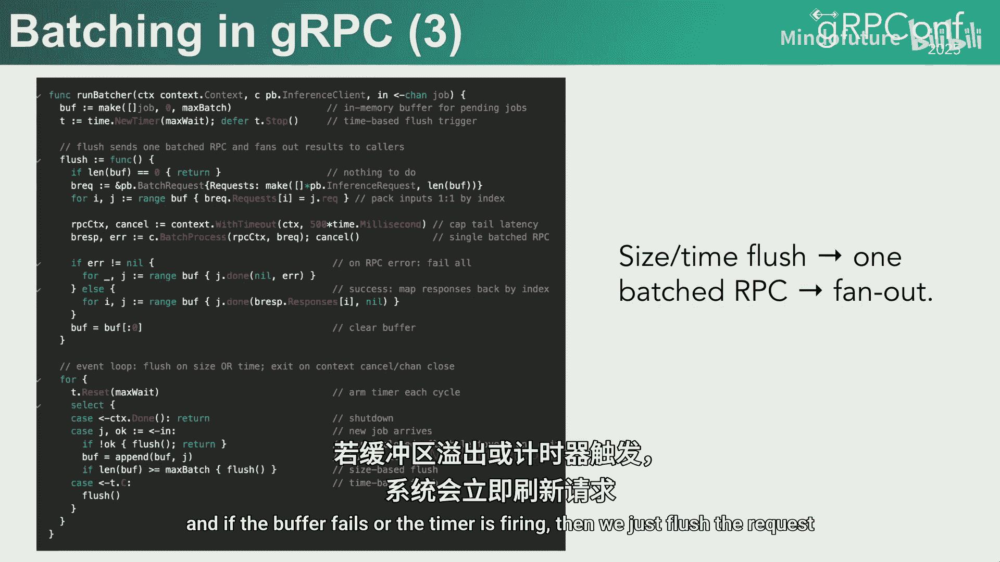

# Grpconf-2025-p23-P23_为高性能调整gRPC-截止时间__批处理__和心跳--BV1yTHMzKE1U_p23-

Thanks for joining me today。 My name is Raohul。 I'm a staff engineer at LinkedIn。

And yeah， so this session is about tuning GRPC for high performance and I'll talk about three things today。

 so one is deadlines， one is batching and then keep alive。

So this session is for you if you have already like built GRPC services in production and you want to like go beyond the basics that we know。

 for example， how to tune these settings for production workloads。 So GRP is powerful。

 but as the system scale in production then these challenges start to show up So understanding all these knobs in GRPC like deadlines batching and keep a lives it it can make a real difference between a system that just works versus the system which can handle like it can work in in cases of low latency it can achieve high throughput and also stability at scale。

Yeah， so GRPC has become the backbone of all the high performance distributor systems。

 so it it gives us a lot of features。 for example， it gives us strong typing We also have pro of serialization and we can do efficient binary serialization with proto and it has built in support for streaming also so all of these are like very crucial features when you are really trying to move your data across services at scale。

But when， when you start scaling your GRP services， sorry in production at large scale。

 then you start seeing all these issues that that I mentioned here。So， for example。

 latency starts to starts to creep up as you you make like multiple calls there are multiple downstream services。

 So as the services as the request goes from Europestream to a lot of downstream services。

 then the latency starts piling up。And also， retries。

 So I'll talk about deadline behavior in the next few slides。

 So we'll see if we don't coordinate the deadline behavior properly with retries。

 then we can see a lot of bad behavior in energy our R PC services。And also。

 we have connection churn， so。My connection join， I mean connections which are constantly being open and close。

 they can cause real issues。 So we'll see how can we tunenal keep alive settings if we want to get rid of that And also we have a lot of。

 for example， we have load balances。 we have onvo proxies。

 So like getting us GRP request across all these services will like further worsen all these three challenges。

So like in this talk， I'll focus on these three tuuring levers that we that can that can really move the needle in production deadlines batching and keep alive。

 and we'll see how we can properly configure our retry behavior using deadlines。

 We'll see why batching is like very much needed for for especially for CPU workloads and also how we can use keep alive pens for like real world load balancer setups。

So let's first look at deadlines so deadlines they are the one of the most important knobs of GRPC so they specify how long basically a client has to wait for the request before actually giving up so we can think of it as a request budget so when you start a request from a client you take some budget for example10 second that's a lot or 20 second and then once that runs out across the whole stack of services then your call gets cancelled then you start seeing context deadline errors。

So what's tricky that is that deadlines actually travel downstream also So in this example you can see we have two downstream services。

 So in this case， let's say you are calling service A and then that call service B So each hop in this case will see will see a shorter remaining time So let's say if you start with a budget of anything then it gets consumed at every service layer and then as you move ahead it will further like you will the last service will like remain with a very less budget。

So in this case， if you have like a deep stack of services then the services。

 which is at the service， which is at the last downstream。

 it won't have any meaningful time to do its actual work。

So this is a simple example of configuring deadlineline。

 so on the client side we can see that it sets a deadline of 1。

5 seconds now if the server doesn't respond in time， then it will throw this red line exceeded error。

So on the server side， we have a simple check using that using that check we just see that what's the remaining time left in this case in this code example we are checking that if it's less than 50 meisecond。

 then it's better to fail faster than actually starting work because。

For this example， I've assumed that in 50 millisecond there won't be any meaningful work that the server will able to do。

 So in this case， it's better to just fail fast here。

 not even try to start the work and then just throw the deadline exceed error error。

 So this will prevent at least resources not from getting wasted。 it will keep the system stable。

So deadline， in this case， it also enforces productivity so。

It gives us a consistent way to just budget our whole time that we have across the services。

 It also has impact on retris， which well see next。So in this case。

 let's see how deadlines work with retryes。 So when a deadline expires。

 then in this case GRPC won't even retry this call and that makes sense because if the client already has given up in this case。

 then there is no point in retrying this call。So but there are a few things。

 a few ways in which we can configure the deadline with retriries。 For example。

 let's say if a client sets a very short deadline， but it allows multiple retries。

 then we know that all of these retries are eventually going to fail。 we have very short deadline。

 So in this case， there is no point of retrying the request on the other side。

 let's say if we set a very long deadline。 Then in this case。

 the retries will just start keep piling up。 it will just add unnecessary load on a service。

Another case here is is misma deadlines。 So a common issue is that when you upstream service that is setting a longer deadlines than the downstream ones。

 So example， for example， imagine your client sets a deadline of 10 seconds but your downstream service service。

 it only enforces a two second deadline。 So in this case if there are many upstream clients in this case So all of them will just retry because they have a longer deadline of 10 seconds they will keep retrying So in this case the downstream service will just it it will keep getting hammered with a lot of calls from upstream and it won't be able to satisfy any of those request or some of the request because it has a deadline of only two seconds。

So that will just burn the CPU。 it will burn the memory。 And like here。

 we are not doing any like productive work， just wasting CPU and memory。

So another thing is the precision loss that we can see in in case of this timeout header so GRPC it doesn't actually sets the timeline as absolute timets So there's a GRPC time timeout header which you can see so it just tells us how much time that we have left like from that point of time So for example。

 if this header has a value of 251 milliseconds let's say then from that point of time to all the like services which are there downstream they've only got a total of 250 milliseconds to do all of all of their work。

So now in this case， let's say we have a lot of proxies in the middle。 we have a lot of sidecars。

So all of them will first try to look at that header and they will they might try to do some calculations。

 for example，251 millisecond。 let's say if they try to read that value and do some of their own calculations they might try to round off this value to by half a secondcond or one millisecond or so sorry not half a secondd just half millisecond or so。

 So let's say one service rounds down it to from 251 millisecond to 250 millisecond。

 So on one service it looks harmless but let's say you have got multiple hos and let's say you have got an API gateway there's a service mesh a load balance So if each one is taking this half millisecond or1 millisecond then it will in the end you will see there is not much time left to do any work。

And then we have queuing delays also in between all these calls。

 So queuing delays will further like worsen this and then it will reduce the time out to a very small value。

So in this case， the backend will see there is no time no time left it will again cancel the call the client will again see this deadline exceeded error。

The way to prevent this is simple so instead of carrying instead of just relying on this relative relative value that is carried in this timeout header。

 we can just carry an absolute deadline inside your context so at each hop in the service we can just compute this relative value again。

 for example， this GRP timeout header and then we can set it from the absolute deadline that we have remaining。

Camping also we can do we can make sure that we just clamp it to a safe minimum so that small rounding errors that we are seeing it just doesn't make this value to complete  zero。

Another thing is another issue is retry and hedge amplification in case of ERPC services。

So let's say if you set a long end to end deadline。

 but lets say each attempt that the service is getting is very small then in this case the client is just going to do a lot of reries so now since each request has got a very small time out so each one will just fail instantly。

In this case again， we are just burning CPU network resources we are just reing a lot of time。

 but the service is not doing any actual work here。So and again， in case of hedging by hedging。

 I mean that let's say you have to send multiple copies of the same request parallel so and hedging is like mostly it's done with some time of like a small amount of hedging delay for example。

 if you send one request to a service you want to wait for a few milliseconds let's say a few seconds before you send the same copy of the request to another service and this we do because we don't like rely on one service returning the correct result to us in time so we want to make sure that okay we are sending multiple copies。

So in this case， if there is， let's say there is not much left time left in the overall budget in the overall deadline。

 then hedging is just going to again like flood your downstream service and again the downstream service won't have the time left to do any work。

So the way to fix this is to like first first we have to set meaningful per attempt budgets。

 so we have to make sure that we are giving each a request like ample amount of time to succeed。

 otherwise it will just fail and also we can cap on the maximum number of attempts that the service is making so that your system doesn't just keep on retrying infinitely。

And finally， one other thing is that we can also check like let's say if we if we are trying to enable hedging。

 we can also see that the remaining time， whatever we have left is less than the round trip latency for example in this case we are checking the median latency that each round trip time takes and then we can see if we don't have enough time left even for a median request to come back then we don't have to just do hedging at all then we know that we are just going to simply waste resources。

So okay now let's see what batching means in case of GRP services。

 So as the name suggests I think the it's it's conceptually simple。

 So instead of firing just one RPC request every item we just let a tiny queue like we just create a tiny queue on the client side and we just bundle all these request together So instead of sending one request like for every item we just we batch them well send send them at once and well also in in this case we'll just get one response which will which will have all the results like for all the RPRP request。

And that like pays off in in both these cases so fast on the CPU path So we spend like time to do pro of encode Decode we do object allocation header passing So all of these I think take some amount of time So if you are doing batching of the request then you are paying the price just once instead of like paying this price every time for every request So in this case we just let the CPU do more work we stop suffocating the CPU in doing all this encoding recording passing of headers。

Second on the wire also， if you have fewer round trips。

 fewer call sorry it mean it will mean fewer round trips for the request。

 it will also mean you will have few response and request headers you will have few control flow events so now we also have proxies and servers like in between it will in this case if you are batching the request it will just see less amount of chatter the congestion that it sees in case if if you are firing a lot of R request that will also go down your tail lat is also everything will calm down。

So in this case you saw that we I think paid a small price on the client side in terms of timing because we want to wait for all the RPC requests to first batch and then like we want to solve a bunch of issues just by paying a small time price in in this case withqueing。

So batching it it matters like a lot when your workload is mostly CPU bound。

 So MLl inference is one example， mostly now we also do ML inference in case of GP。

 but let's say if we want to run inference on CPU。 so instead of just pushing one item through the model。

Oh yeah， sorry， five minutes。 Okay。 We just let a tiny queue like create a tiny queue on the client side。

 and we want to batch them in terms of， let's say 16 or 64 items。 So in this case。

 now your kernel will run the vectorized operation in this case。

 you will also be able to fully utilize your GPU because GPU had a lot of course it so you will achieve high throughput and you。

 you will stop paying the fixed cost over and over。So in case of streaming also。

 like in case of streaming traffic it mostly doesn't arrive evenly you will get traffic in in sometimes in bus also。

 so if we send every message again at its own RPC your system is going to over get overwhelmed with a lot of time callss。

So with micro batches， we can create a small window so you can do this either let's say you want to flush every let's say group of items for example。

 you you want to wait for 16 or 64 items to arrive then you want to flush it or you can also do it like based on a time window for example。

 you want to wait for 10 milliseconds and then you just want to flush the request like batchge the request and then send it。

Yeah， so I have a few minutes left。 so I'll try to cover the remaining slides。

Yeah so a simple example ingo that takes the incoming jobs and it tries to ba them together so in this case we keep a memory like buffer of all the jobs so each job has a request payload and a call back also for returning the result so I mentioned the two strategy that we can use for creating the buffer for flushing the buffer sorry that we can use so one is the size base that we have that we want to hit the maximum size and then we want to create the batchge and then send it。

And then other can be time base that we are， we just want to wait till our time timer expires so we can wait for a few milliseconds。

 a few hundred milliseconds。 and then just whatever request is available at that point。

 we can just batch and send it。So when we flush it we build a single batch RPRPC with all the request we then send it to the our inference service or the server so in this case if let's say if the RC fails we we we can fail all the jobs in the batch and if let's say it succeeds。

 then well send the using the call back responses to each of the individual callers so on the bottom we just have a simple loop the event loop that continuously it just if the new batches if sorry if the new job arrives it's adding it to the queue and if the buffer fails or the timer is firing then we just flush the request。

O。So the last thing that I want to talk is keep alive so keep eyes are early warning systems for us so they can help us detect a lot of things。

 for example， wfi flips if there's an idle let's say connection drop or if there's a mobile sleep they also help to keep the na and load balancer mappings warm so that your link is doesn't expiring quietly the link sorry the link that the load balancer maintains it doesn't expire quietly。

In this example na sorry network translation device so or let's say load balancer it just keeps a mapping or a connection table between the client and the server that it wants to send the request to so each of these entries has a timeout so let's say if there is no packet flow for about 60 seconds or so it will assume that this connection is dead and it will try to just delete this from its table。

So in case of keep alive， the client will just send small S T TP to ping and it will expect an a in response of that。

 let's say it can send it every 45 seconds or so。 So in this case。

 the load balancer or the nad service it is。Treating this as the real traffic and and the timer that was getting expired。

 that won't happen now because it knows that okay， this， it has to keep this connection warm。Okay。

 select me。Yeah， cover the remaining slides quickly。So when we set keep alive these。

 when we tune these settings in GRPC。 So the first habit is to always align them with the actual network path。

 So every net service or a load balancer or proxy it usually has its own timeout So let's say if they are configured to drop the connections every 60 seconds or so then we don't want to send these pings after those 60 seconds like every two minutes So we want that because if we send it after two minutes。

 we know that the load balance is going to expire the connection。

 read the connection So we can set our keep alive timeout to about 70 to 80% of the shortest idle timeout that we know in this case we can set it to about 45 or 50 seconds and accordingly we can set a small timeout window also。

So in this case again， now let's say thousand of clients it will they will try to fire a ping exactly at 45 seconds that will again create the phenomenon like call is thundering hd when your downstream service is getting hammered from a lot of calls so to avoid that again we can add some small data between the clients also let's say plus or minus 15 to 20% so the pings are like more spread out over time。

And finally so in GRPC so we we should prefer be using the built in ST TP2pinging that we have for keep。

 so there is OS level TCP keep alive also， but the GRPC1 is more lighter weight more precise so if we want to use them both we should just try to not set them at the same caence because then you will they will just interfere with each other your downstream service is going to just see double the noise。

Yeah， and again， some more guardrails about keep lives。

 so on the server side we should just not accept any keep alive behavior。

 we should enforce guardrails So the first one is a is a minimum ping interval So if a client tries to let's say ping through frequently then that is considered either a misconfiguration or abuse so that we should not allow and also there is the permit without stream setting that we should keep off by default So it means the clients like they should not send keep lives on just completely idle connection So there are special like exceptions in this case where they can do it for example。

Control planes or long live subscribers， mobile networks。

 usually they want to keep the connection open for a long time， even though they are idle。

 So apart from those cases， we should just turn this off by default。

And if a client violates any of these policies， we can send the go away signal。

 So that's the S T TP2 way of saying that this correction is now out of policy so you should just reconnect with with the right settings again。

And the last point is yeah we can even auto tuneune the guardrails also that we have set so for example。

 imagine a case where a phone that's switching from one network to another in this case the load balancer mapping that is there that will go off that will expire So if we wait for this like preconfigured time let's say 45 or 50 second to ping the next alive then the client won't notice that the path is broken your RPC will fail in this case so in this case we should just tune it accordingly in this case we should shorten the interval to make this keep alive pings so that will just try to realate the connection。

Yeah， I think yeah， that's all I had， yeah。Thanks for attending。

