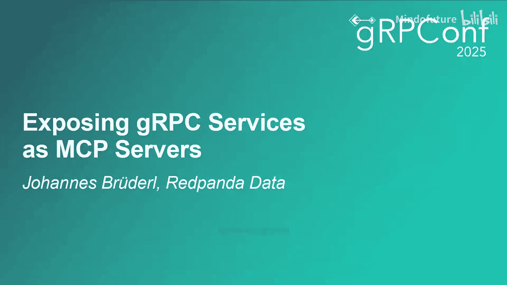
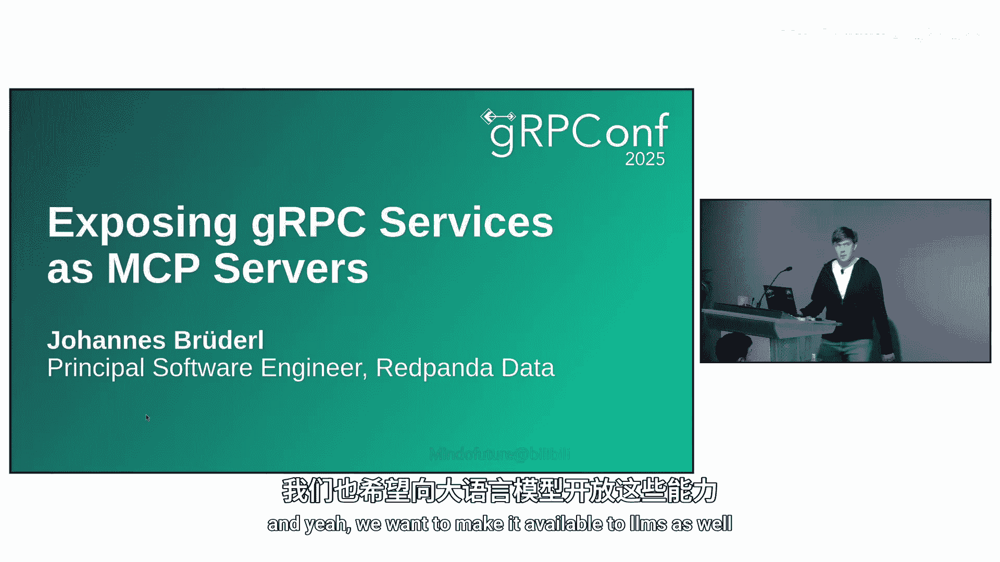
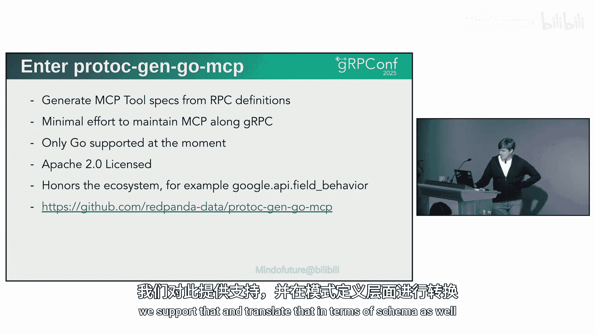
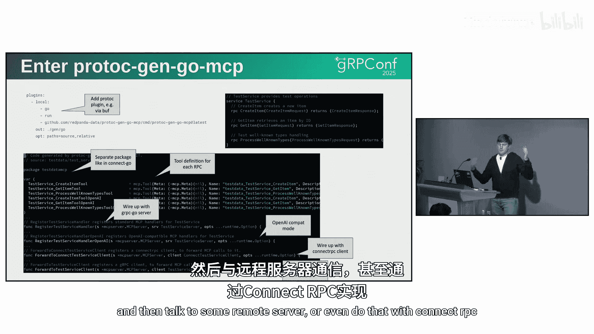
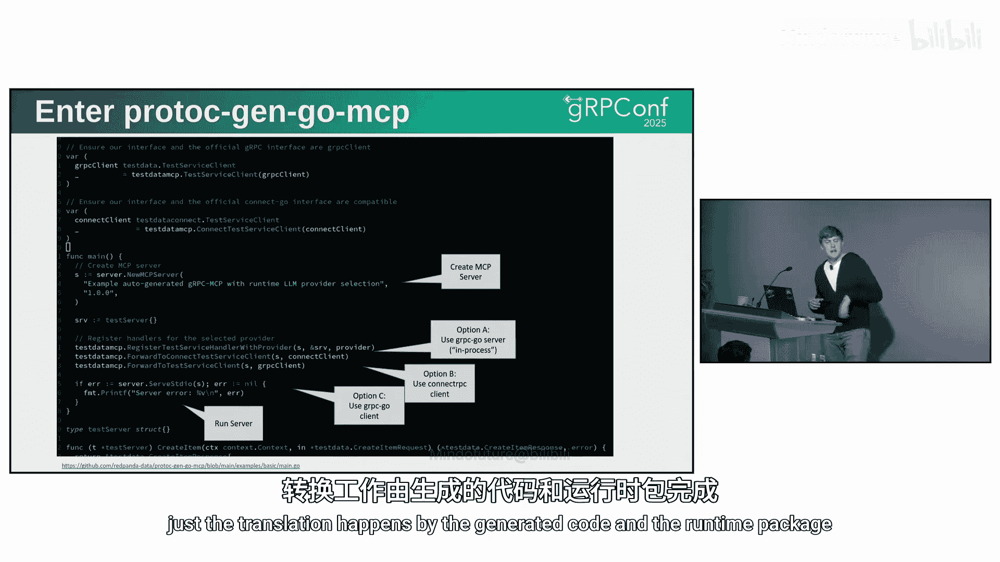
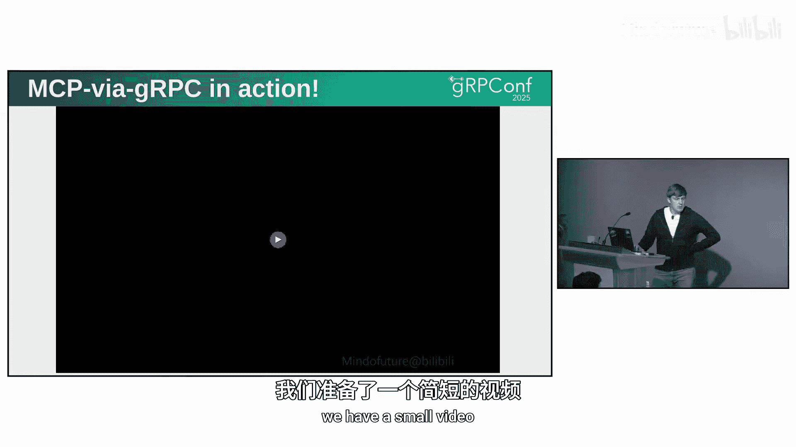
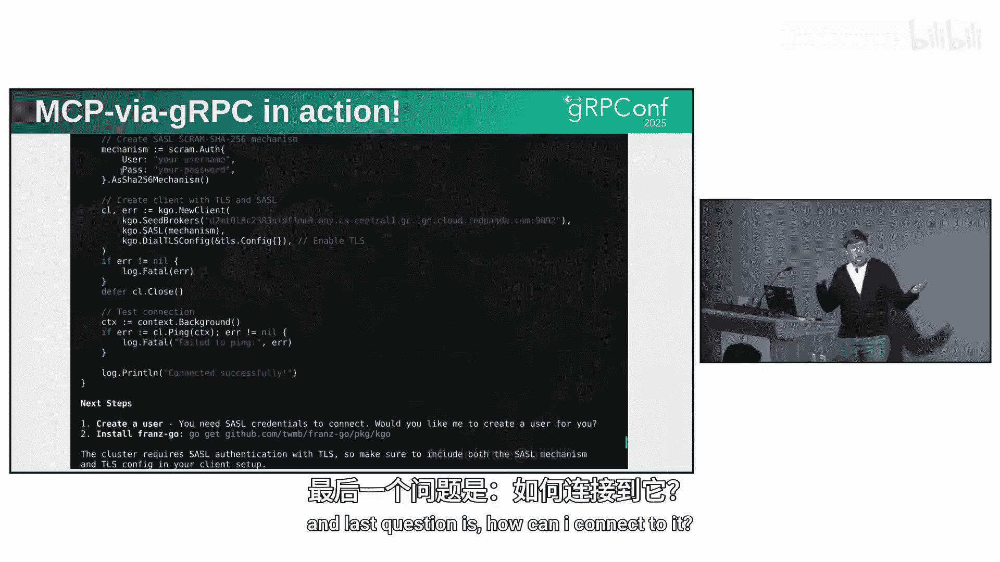
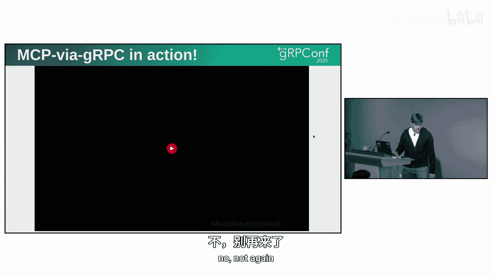
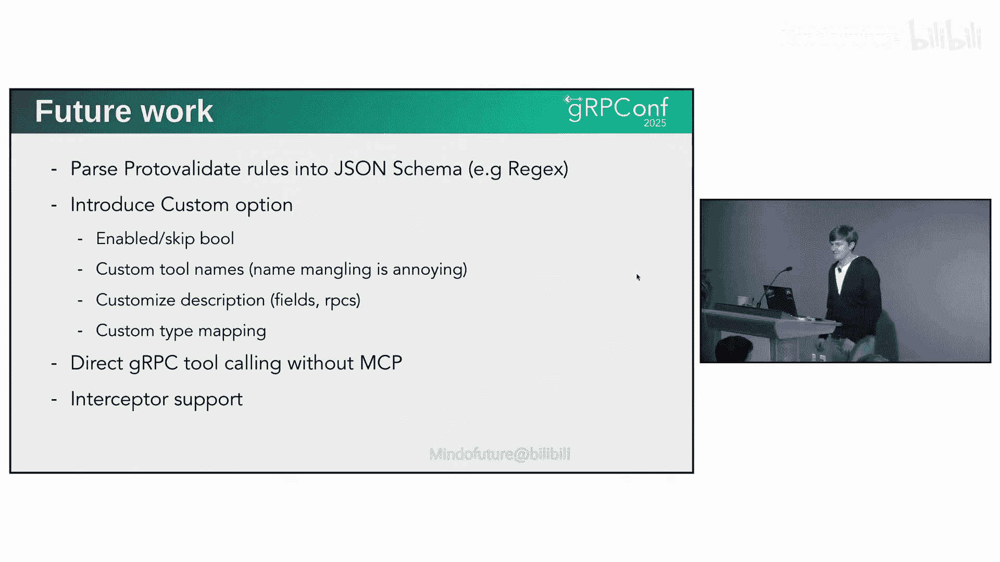

# Grpconf-2025-p24-P24_将gRPC服务作为MCP服务器暴露--BV1yTHMzKE1U_p24-

Thank you for being here。 And yeah， we're gonna talk more about M MCP， right？ So my name is Johannes。

 I work for Redpada data in our cloud team a few words about red panda data。 So yeah。

 we run a Kafka compatible streaming engine written C plus plus。 And of course。

 we have a cloud offering multitenant Saas， like with， you know。

 dedicated and bring your own cloud deployment， which is like lots of infr plumbing dynamically。

 And also we have like servers offering， right， and we have APIs， right， and our customers are。

 of course， engineers and they shall call our APIs。😊。

And yeah， we want to make it available to LLMs as well。 So that's what I talk about。 So yeah。

 quickly about the agenda。 So yeah， I'm gonna do like basically a deep dive on MCP， right。

 what is MCP why useful， Like there's some overlap。

 But theres also some new things Yeah and compared to the previous talk explaining in depth。

 How does MCP tool calling work right And of course， like the same question， right。

 how can G PCC help So it can definitely help。 And since we're all fans of GPC here we will see more of that。

 And then yeah， I will introduce Prote Gen go MCP， which is a pro plugin that today can translate from MCP to。

😊。

To G PC。 we're gonna talk about some of the pitfalls like L M compattibility， right。

 So there is like a few things you have to keep in mind。

 We're gonna see a small demo about the thing in action。 And we also talk about， you know。

 what are the learnings and some future work。That is coming up。So， of course， like。

 what is MCP and why is it useful。 So to start。From the ground up， L Ms。

 they only know what they've been trained on， right， So like they got lots of training and they。

 they know certain things from their training。 And in addition。

 what they have in their context window。 So your prompt and message history。 That's all right。

 They can't do anything。 right， They can't search the Web， call APIs。

 perform system operations like execute companies like they can't perform actions， they can't， right。

 But of course， like Cur and cloudcodeat can do this stuff。 So how do they do it。😊。

Let's look into that。So。They have a concept of tool calling right which I spoke about tools and disclaimer。

 this talk is about MCP， but you might not need MCP to do tool calling right so generally tool calling iss just function calling and it's like everyone talks about MCP and if you go to LinkedIn it's like oh。

 it's MCP and everything but you can also just do it with normal functions in your programming language right we will still go deeply into MCP。

 but generally you know this is how it works。😊，You have a function， right， The。

 the actual implementation get current temperature。 That's your code that gets the temperature。

 like call an API or or have this information at time。 And then you have the the function schema。

 And that's， yeah， that's like Json schema， right。Like， you know。

 the types of the fields and all that。And then you call the LM。

 right with the prompt what's the temperature and you send with every request you send to LM。

 you send like the promptm， right， and also the definition of every tool you have。 And then the L M。

 It thinks right， the question is， what's temperature in London。

 and it will say it will decide based on a train， I can answer this question will probably not。

 That's just not possible， unless unless's what trained today。 it will decide， okay。

 I do a function call， right， a tool call， right， So the response will then say， yeah。

 please do a tool call。 and then you literally do if the response has an instruction to call the tool get temperature。

 you call it in your program language， right So this works without MCP and has been done for a while。

😊，But， of course， this talk is about MCP。 So， yeah， why is it useful， So to just cite this back。

 MP is an open protocol that standardizes how applications provide cons to log language models。😊。

And I would add and to perform actions， right？So the standardization is an important part here。 So。

 yeah， schema definition， of course， is part of MCP。 That's not news。

 We just saw schema definition in Json schema， right， That's not new。 It's pluggable， right。

 So it's like a client server。So you can actually write an application。Package it， right。

 Pack a distribution。 and then give it to someone。 So if you're like a Saas vendor， right。

 you want to have your MCP server and people like your customers to use it。

 So like this whole distribution market like there's websites that allow you to browseP service and pick one So like all this stuff is like solved byP And yeah that's basically how can make money with that。

 and of course， like transport right， So it's standardized transport， but it's not plugable。

 I completely agree with that。 I'm also not very happy with the transports we have。

 So we have to standard I O， right， it's actually pretty cool。

 It's like LSP you spawn a sub process and talk to it。 It's like it's like very easy to use。

 And we also use that a lot And then the HP1， which is already the second H TP protocol they support。

 And the other ones deprecated。 And yeah look definitely looking forward to G PC transport。😊，Yeah。

 and I've already spoke about the packaging and distribution。So。

I will now explain how it actually works right So in the。 So I have a client。

 The client is cloud code， for example， like or cursor or like any like agent application that talks to an L and do a stuff。

 So first off， it requests what are the tools available。 So it talks to the MCP server and says， hey。

 list me the tools。😊，And then。Yeah， the answer is， you know。

 these are the tools like very similar to what we've seen before from the Python snippet， right。

Next step。I have I have a prompt， right， what's the weather as？So the client， so cloud code。

 for example， or cursor， it sends like sends like the prompt。

 and includes also the definition of all the tools available， sends it to that alarm。😊，Now。

 the LLM has， again， the choice。Do I do a tool call or do I answer it directly， right？ And yeah， O。

 Teleelm decides， O S F， I think that means San Francisco， let's do a function call for the。

 the city， San Francisco。Now。You have to do the tool call right So you just got like the request from the LLM。

 please do a tool call。 the LM itself can't call anything， right， You can just ask you to call it。

 So the client will now do the tool call with get weather for San Francisco and and it sends it to the MCP server。

 and yeah you get the answer。😊，I mean， I made this up like temperature 22， and it's like rainy。

 right， And that's not the end。The last step is the client again， passes it to the LLM。

 another round trip。 It sends it， you know， the information， the output from the tool call。

 So you can see it here。 roll tool So that says this doesn't come from the user but comes from the tool right and yeah。

 then the response。 And then the L LM sees all of this。 hey， they asked for the weather。

 and there's the tool call suggested from like the LLM。 and then the tool call response。 was that。

 Okay， I'm gonna answer it with a sentence。 It's 22 degrees and rain in San Francisco。

 you should bring an umbrella。 So like that's like the entire thing。

 and kind of also explains why this stuff is like it's like slow every interaction with the LM takes a lot of time。

😊，Yeah， so this was like tool calling a nutshell now。We're here at GRPC con。 So， how can G PCC help。

And this is like subjective right So one of my motivations is keeping Praf as the authoritative IL。

 right， So we love protos， right， Can we agree on that？😊，Does someone hate protos？No， okay， okay。

 that my depends on your mood。Whi edition？Okay， so yeah。

 we love protobouffs and like we have a vast ecosystem right。

 we have like cool stuff like pro validate like the cell expressions and also Ed reppanda we have lots of inhouse tooling like protoy plugins that you know that do like you sell expressions to extract certain fields and do like our back like wire up a lot of stuff like really cool things you can like build across teams like cross cutting concerns like all this ecosystem right and I don't want to throw that away for just another protocol that is like not even a year old right and had two transports so far and one is deprecated。

😊，So， and yeah， so that's， that's the thing。 And， of course， like high quality APIs are really。

 really， really， really important。 So like quality is king like。😊，Human users， they are really picky。

 but they might put up with some B， S basically， but the LLMs。

 they will get confused or might do things you don't like。 like high quality is so important。

 good errors， etctera so。And we know how to do that， right， Like with GRPC。

 we have the best practices。 We have super good resources from Google， like the AIP。

 like resources like about code style， also from above。

 really good resources and like general resourcebased APIs and all the semantics that come with that incremental like updating with patch calls。

 etc ceter。 So that that is really important。 And we want to keep that。 And yeah， no duplicated work。

 So we're not gonna spend any time maintaining another protocol， a copy of our API。

 But we just want it to work。😊，So yeah， then now the pitch enter proto each go MCP。

 We generate MCP tool specs from the RRPC definitions， right， so we take your protos。

 We generate the MCP tool specs and its minimal effort to maintain it right actually。

 you have to do nothing。 and you just generate your， your stuff。 I will show you。

 we support only go because we're a go shop in repa Cloud and yeah， it's like open source。😊，And yeah。

 we like try to play。Great with the ecosystem， right， So we love pros in our ecosystem。

 So things like， you know， field behavior， right， like， that's like standard， like such things。

 We support it and translate that in terms of schema as well。😊。

So how does it work， You know， you might use your。Both Yal， for example。

 both generate the Yal to just drop in this prototype plugin， right， you can do it with with go run。

 You don't have to install anything。 And then if you have like a test service， right， it's from。

 it's from the from the tools test， to be honest So if you have this service definition。

 What does it do。 And like， I had to cut out a few lines， of course，It creates a new package。

 so for like this know kind of best practice to have like a second package if you create Leoron plugin and it has to it imports like the main package for the generated types and then you get a tool definition for each RPC。

And then a bunch of register functions。 And thats that looks familiar， like G PC Gway， basically。

 right， you have like， you wire up the MCP server with your handler， for example， right？

 And in between like the translation happens。 We have a small runtime package as well。

 And then there's also other like functions to kind of you can wire it up with like in process。

 like the handler， right， But you can also wire it up with a client。

 So it can actually like receive the MCP request and then talk to like some remote server。

 or even do that with connect R PC。 So like。😊。

You can choose。And yeah， in your own application， like the main， basically how does it look like。

 you spin up an MCP server。You register then like you call these register functions or the forward functions。

 and then you start the server。 That's it。 Like just the translation happens by the it's done by a generated code and like the runtime package that is called by the generated code。

So， yeah。We have a small video。 Let me try to find my mouse to actually click。

And I did， it， it's like a small speed up。 So you're not getting bored while the L M is working。

 So this is like in Ra Pannda Cloud。 We have resource groups。

 So please find like my clusters in my resource group， right， and it's coming， okay。

 like the L M stands。 Okay， I have to do list resource groups， right， And then okay。

 I have to list the clusters within the resource group。😊，Okay， and then it finds the clusters。

 I want to create a serverless cluster， right， Okay， please do it in in the US and on GCP， right。

 the LL M。 Okay， it knows the schema。 And， of course， it fills out。 it is smart enough to like。

 use the list serverless regions， right， because it needs to construct the next call And now， yeah。

 the， the cluster was created。 Yeah， So like API quality is really important。

 So it can figure out that stuff。 right， you want to outsource the thinking to the LLM。😊，And now。

 yeah， like。Check， check is if it's ready， it's ready。 And then I asked it to create a。

 create a Kafka topic， Basically， a rep topic。 And yeah， it did it。 I just told it， you know。

 reent three days， replication factor。 it has been created。 Awesome。 And last question is。

 how can I connect to it。 Like， of course， like。😊。

This is not a pitch for cloud code， but generally you get the idea， right。

 Like you can outsource so much of the thinking and build like a like a lot of user experience around this。

😊，So now until next， no， not again。

Okay。LLM compatibility is really tricky。So generally LLM APIs， they are similar。But。

Cud supports almost all of J Schema。 So it， it works almost perfectly。 However。

 there's also other LM providers， open AI， for example， it doesn't support one of an any off。

 And you need like a combo of one of an any of to express a probe above one of。 So that doesn't work。

😊，What you can do is like we put a hint。 We add like each of an as an optional field。

 and then we add a comment。 pick only one of these。 right， It's not great， but， you know。

 it's like probabilistic。 Probably L M will honor it。 Maybe not。😊。

And all fields must be required in open AI， that's a really funny one。

 so you must mark all fields in open AI。😊，As required。 But if you want to have it optional。

 you can define the type as a union of the type and null。Yeah， you can do that。

 like we have workarounds for that in the library。 So it works。

 dynamicy maps are not supported on open AI。 I think on Ge and I。

 but I didn't recheck in the last weeks。 So yeah and you can do some trick instead of a map。

 you do an array of key value peers right So yeah， you can do a few things。

 and recursive schemas as like they don't work in so many places。

 iceberg and yeah we have to fall back to string basically which which is really sad and I think a better solution is possible。

 but yeah I was cheap。 maximumim nesting open AI allows only a nesting level of6。

 which works for our APIs but I know people who have like much deeper nesting。

 you have to cut off at some point and do a string or so。 And again。

 like this is really my key message， rich APIs errors are extremely important for the thems So you have to validate rigorously。

😊，Follow the best practices， read AIPs and honor them like where it makes sense and use error details as much as you can。

Yeah， and future work， so there's， of course a lot to do。😊，So pro validates。

 we can use some proto validate rules and pull them up in the Json schema。 For example。

 we could look， has the， Does the proto validate have a rex。

 And then we use that rex and put it in the Json schema。 That's， for example。

 something we don't do yet， yeah。Custom option。 So we don't have that。

 And that's what was requested by a few people like skipping a tool or custom tool names。 Currently。

 we use the， the fully qualified like name of the R PCC， which can be really big。

 And then we do some name mangling。 And like it's a bit ugly。 So yeah， custom tool names。

 I think would be nice。 custom description。 And so like you can customize it a bit more。😊。

And maybe custom type mappings， I haven't found a use case， but it was requested。

 so that might be interesting， especially with these edge cases so you can like make make your own adjustments。

Something I'm really interested in that's like direct GOPC tool calls without MCP right because depending on where you are。

 if you're like somewhere in like a serve application， maybe an AI agent。

 you can do all these calls to GC actually without the detour over MCP we don't support that yet。

 but it's just a little bit of plumbing so that would be really interesting。嗯。And yeah， of course。

 like the classic， like interceptor support doesn't work in like。

 if you use forward it to like a server handler。 like in JPC gateway。

 So we suffer from the same problems。嗯。Yeah， that's it。So yeah， maybe we have a moment for questions。

He yeah， what position， first of all， you mentioned that you guys build like a go binding for this library。

 right， I'm just wondering， like， is the language binding necessary or is it possible to build like an MCP like Json from the port B and that pass the direct decline client。

 for example。Yeah， I suppose like yeah it it works only and goes。

 So you have to bake it in your application。 but if you don't just go。

 it's like useless for you right but what would work is。

 and I think that's more like the previous approach is like you have actually a server side applications that does the translation that's the alternative right。

 It has to use like like reflection or like load of descriptors and do that dynamically So that that's not what we do because it what's just not necessary。

 but yeah for a more generalistic solution， I think。In many case。

 that would be a better choice That work。 Yeah。 So this is for like direct language support and also for the type safety and stuff as well。

 Yeah， so if if you use go， I think this works really well。

 we have like how we use it is we we have a C。 It's called R it's our C C for all our products。

 And what we do is just added a subcom to serveP from that C and since our customers have the C available anyway。

 and the CI manager also like all the authentication and stuff。

 it makes for a really good experience because you just drop like you run a command to install the C like theP server into your cloud Json。

 and then you launch cloud and can keep going And and all the translation happens in the C。

 And it's like it doesn't touch anything of the cloud basically because like the cloud。

 your PC server is there and all the translation happens in the client locally on the machine of of the user and that makes it like super low risk for us to do because essentially just like。

😊，Itated into GC calls on theDevelop machine。 That's really cool。 Yeah， that's awesome。 Thank you。😊。

Thank you， Ed， does the LLM actually use the output， the tool output Jason schema for like anything。

 like if the get weather just returned like a string， like would it be a different result for。

The call that's a very good question。 Honestly， I don't know， I think。I think for the LM。

 it doesn't make any sense。 So the output schema。 So this tool doesn't even support output schema and output schema didn't even exist until two months ago。

 So like generally， MCP has only an input schema， and output is always string。

 It was kind of bolted on because people said， well， if we have like a protocol。

 we should have an output schema。 But like if you look at it from as a GOPC user， you think， okay。

 we need a request response schema， right， But as like an AI company， they know， okay， the LM。

 it will it accepts text as input in the prompt。 So why do we need a schema， right。

 and the purpose of the thing is just to dump it into the LLM。 So I think。😊，I don't know for sure。

 but I think that output schema makes no sense and is useless for the LL M。

 which maybe that's the thing。 What kind of diminishes the GRPC value in this whole thing。

 Because the L M doesn't care about the structure that much。 So maybe that's why anthtroic just。Yeah。

 forella， and it doesn't matter， it just matters for the people who have already written the back end and have to maintain the back end。

 basically。Thanks。Hey， so like given a prompt， if， if there is like multiple tools the LLM can use to solve it and say。

 and suppose like one tool is more expensive computationally than the other。

 So what do you think is the best practice to let the LLM know that you know。

 like maybe try to try a solution that's low cost first instead of going for a more expensive one。

 if I mean， which， which tools to call， yeah。It's， it's a good question。 I， I think I would。

 I could just put in a tool description like the information， this one， this， this R PCC。

 like it's super expensive， right， And it's like prompt engineering， basically， I think， if。

 if that answers your question。 So like and I also learned like prompt engineering is an actual job。

 I think， right， so we use this for pretty sophisticated things。 Like， you sorry。

 it's a small detailtour from from the question。 I will get back to that。😊。

So we have a tool called Repena Connect and you can like write such huge GMs to define like data pipelines like to move data from A to B and。

ううう。I， I've written a prompt that makes it basically one shot create these data pipelines based on you know your input。

 but you have to give it like a huge promptm to just tell it how to do like maybe like something like。

 do not use this kind of input， use this one in this case， use that one。

 Like all this like knowledge and also something like this API call is expensive。 Try to avoid it。

I would bake it in there。 And then you don't have to write like the business logic， right。

 You don't have to write the logic to make the right choice。

 but you rely on the LM to make the right choice。 I guess like that's the whole promise of agent AI。

 right， you outsource business logic to the LM。 and you get like the free lunch we had with the CPU for a long time。

 every year， there's a new model and you get automatically like in theory。

 better decisions by the LM。 So yeah， I would just outsource this to the LM。

 I think that's like the AI vi。😊，Yeah， okay。 thank you。Thank you for your time。

