# Grpconf-2025-p25-P25_gRPC可观测性新进展--BV1yTHMzKE1U_p25-

Hello， everyone。 My name is Yash。 I am a software engineer here at Google。

 I've been working on GRPC since 2017。😊。

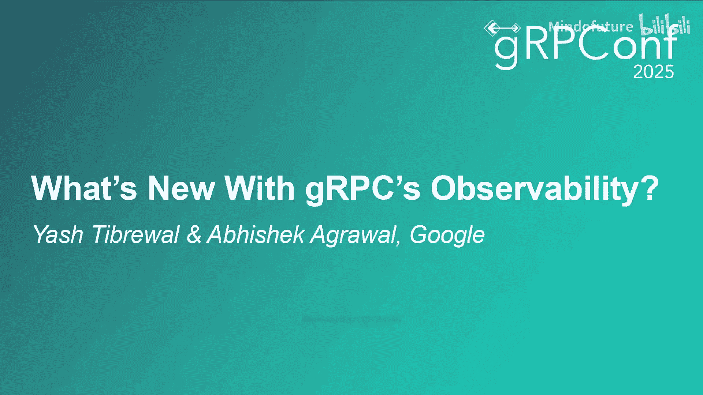

And I' am Abshik， also a software engineer with Google。

 and I have traveled from India to be here and talk about some of the exciting things that we have been working on in the last year。

 and that's GBC observability。Right here's the agenda we are going to try to put a spotlight on all of the cool stuff we've done in the past year。

 mostly around open telemetry we' do that， but we also wanted to use this opportunity to put a spotlight on some of the other tools we have in the ecosystem so that we have a more complete view of what we can achieve with GRPC observability today。

😊，Alright， so as promised， we're going to start with GRPC's integration with open telemetry。

 which is an open source observability framework that was a successor。

 Well is a successor to open census and open precinc。

 I'm not going to have the time to do a demo today。

 but we have a nice guide YouTube video code Las to help you get set up。😊。

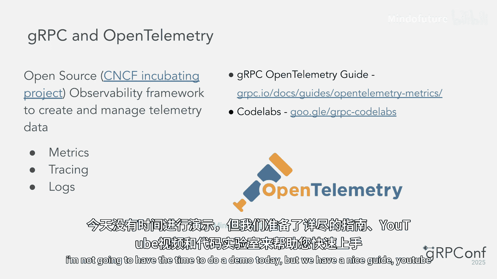

And with manual code changes， you can set up the plugin and have all your data。

 including deep GRP state exported to any backend that has a supported open telemetry exporter。

 For example， if you're dealing with Google， you would have Google Clouds monitoring exporter or tracing exporter set up and have all of your observability displayed。

😊。

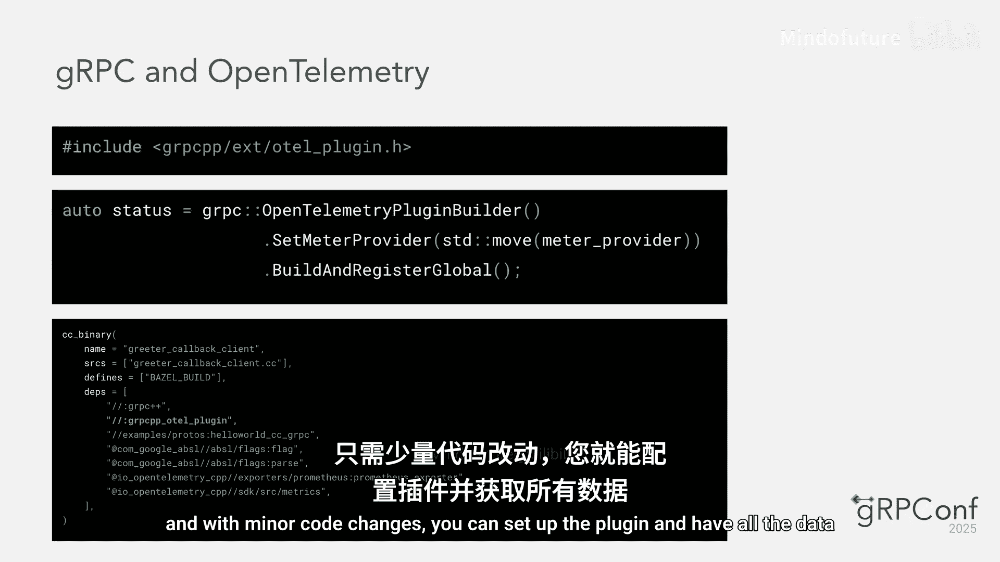

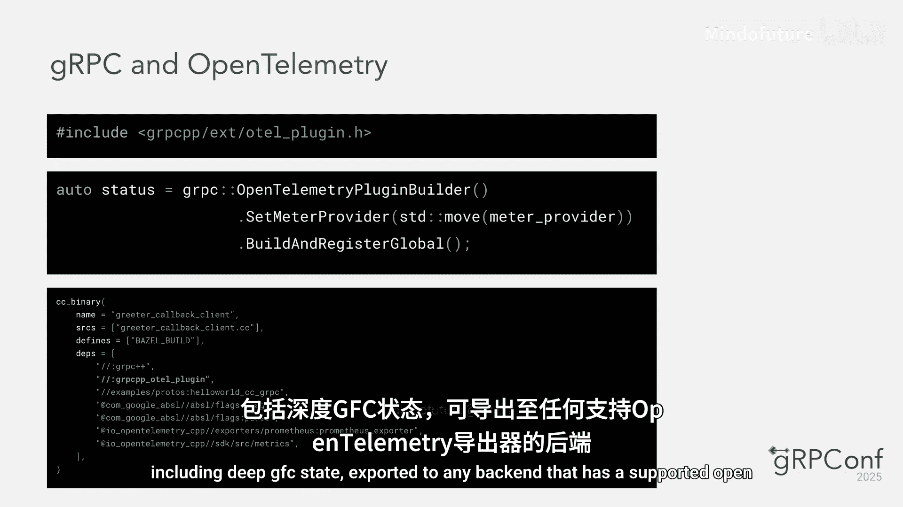

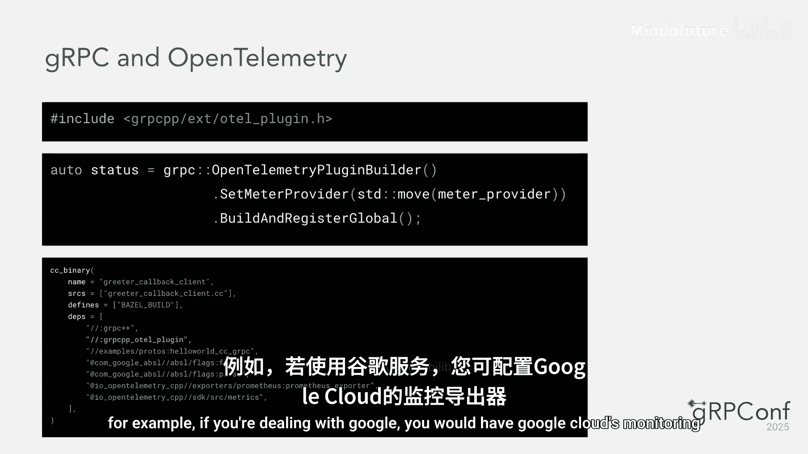

Right， folks familiar with open teleelmetry would know that open telemetry has its own RRPC semantic conventions when we started the effort to support open telemetry with GRPC we the maintenances felt that the conventions were too generic and not specific enough any RRPC system probably has nuances that are unique to that system and those idly would need to be captured by metrics So for GC's needs。

 we needed to be able to define metrics and traces that worked for GRPC So we use Gcs that are GRPC's version of RFcs and to find how GRPCs open telemetry plugins would work and we've added a bunch of metrics and traces that have already been implemented we still have an ongoing collaboration with the open telemetry community and there are talks of GRPC helping with the development of the open teleelmetry RRPC semantic conventions。

😊，The thought is that we might be able to get some out of the box observability for our PC systems in general。

 so there might be some sort of a compatibility story on the cards。😊，Alright。

 let's start with the new stuff。 Open telemetry tracing。 We don't yet have a user friendlyic guide。

 but the GRFCC is available for anyone interested in brief。

 what this gives us is a lot of information as to what is happening in the life of a request in the distributed systems environment。

 usually a small number of requests， let's say one in 10000 to100000 requests are sampled。

 And for each sample requests。 the trace helps you get three like structure for all the spans which represent individual tasks。

 So let's say a user request reach the server and a server further makes requests to other services。

 you'd be able to see the new RC as part of the same trace along with the time graph as to what happened when previously。

 we had the GRFC for open telemetry tracing get approved and most in the past year。

 we've had it implemented in Java C plus+ and go but it is still an experimental that。😊。

We are just trying to dot the eyes， cross the Ts and get some cross language interrupt tests to make sure that it is working as we intended to before we call it stable。

 hopefully soon。Right。We now also have TCP traces instrumented in C++ with this along with the previous message events of outbound message。

 we also see events four of them which show when TCP packets are passed to the kernel。

 the send message cis call scheduled by the kernel when they are actually sent and when they are acknowledged along with this we also get some stats that gives us stuff like delivery rate a min RT retransmission congestion and more as detailed。

 we do this by sending down control messages along with the send message Cis call to tell the kernel that we are interested in these stamps。

😊，And we view this feature quite successfully within Google in our debugging efforts to determine whether we are running into network problems or alternatively to rule out network trouble as a cause for high latencies。

😊，At present， the machinery to do this is only available in C+ on Linuxs kernels。

 but maybe we be willll be able to add it for other languages in the future。Alright。

 I'm gonna have a bishake talk about metrics next。Al right so we have talked about tracing now lets jump over into the world of metrics and like many things in GRPC it is an evolving area。

😊，But before we get into the what， let us talk about the why why should we even care about metrics in the first place？

Well， think of it in this way。 metrics are how our services talk to one another。

They are fundamental to understanding the health and performance of our GRPC applications。

They give us the visibility we need to monitor and optimize what's really happening between our clients and ofs。

Helping us pinpoint performance bottlenecks。This also acts as an early warning system。

 allowing us to proactively find issues by tracking things like latency and error rates before they even they ever impact our services。

And at the end of the day， using metrics is a corner store of building better systems。

 scalable and reliable applications that we can truly trust。😊，Today。

 we will try to share a holistic view of the metrics available with open telemetry in GPC。😊，后来。

Let's start with some of the existing ones。When you look at the client metrics on this slide。

 you see that two might seem similar。Per attempt。 and per call。

It's a great question to ask what the difference is。

And the answer actually highlights the key reason why we choose to introduce our own metric semantics rather than using the standard open telemetry ones。

To understand why， let's break it down。In GRPC， a single call that you make in your client application can actually result in several attempts to the server。

Especially anytime you use features like retries or hedging。

This leads to a natural follow up question。Why doesn't the server have per at matrixx too。

The reason is that the whole concept of an attempt is really a client side story。

The client is the component that contains the logic to say， oops， that failed， let me try again。😊。

From the server's point of view， each of these attempts。

 even the retice look like a brand new independent request。

The server's job is simply to handle each incoming request it receives so its metric are designed to reflect that per request reality。

All right。Now， let's switch gears and talk about some of the new metrics that we have been adding。

We have been busy rolling out a bunch of new metrics to give you a much clearer picture of what your GRPC applications are doing。

First up for rets and hedges， if if you have used open senses before。

 this will probably look familiar。We have brought some of the great functionality over so you can now track retice hedges and even the delay between them right in a new telemeary implementation。

We mentioned WRR and Xs the last time and I am happy to say that the WRR metrics have been implemented in core and Java。

And go， while the X S metrics have been implemented in Koreanan job。Good。Next up。

 are the new subchannel metrics。A big improvement for connection visibility。

With the earlier Pick first metrics that these replace。

 it was a bit confusing to have sub channel metrics coming up as pick first。

 even if it was not explicitly configured as the load balancing policy。Also。

 there was no way to get the actual disconnection error with those metrics。Now。

 you can tell the cause like socket errors go away connection timeouts behind the connection getting disconnected which gives a much clearer view for debugging。

Now， I want to zoom in on two additions that here that I am particularly excited about。First。

These outlier detection metrics。This was an awesome contribution from our friends at Dropbox。

 It's a perfect example of how the community is making GRPC observability better for everyone。😊，So。

 a huge shout out to them。Second。Is this new optional label GRPCLB backend service？

So what does this actually do。It holds the name of the backend service you are calling。

If you have one client talking to many different backends， this label is a lifesaver。

It lets you easily slice and diiometric for each service so you can exactly see what's going on with each one。

😊，And just a quick heads up， we are working hard to get all these new metrics into every GPC language。

😊，But they might but they might not all be there just yet。We are rolling them out progressively。

 so it's always a good idea to check the dogs for your respective languages to see what' is currently available。

😊，二楼。So what's next for metrics？We want to go even deeper right down to the transport layer itself。

We are working on a proposal for some new TCP level metrics that will help you understand what' is really happening on the wire。

Right now， if you have a tricky network problem， it can feel bit like a black box。

These newmetric are designed to shine a light in there。 For example， plan。

 we are planning to add things like。TC P and R TD， which which will give you a clear best case look at your network latency。

TCB delivery date to show you the actual data throughput you are getting。

And this is where it gets really powerful。Metrics for packets in packets retransmted and even spur retransmissions。

This will give you a super detailed breakdown of what is happening at the packet level。

Which is used for diagnosing those intermittent， hard to find network issues。

Now I want I want to be clear these are still in the proposal stage， so you can't just use them。

Yet think of it， think of this as a sneak peek into where we are heading。Good。

That was all the work we have done with open teletry in the past year。Now。

 let us look at some other tools that we have in the ecosystem to supplement the observability from our hotel metrics and traces。

🤧。Let's talk about a really handy tool and that we get。GBC binary logging。At that score。

 it is a feature that lets you record your RPCs in a binary format。😊，This is super useful。

 for a few key reasons。First， it' is really useful for troubleshooting。

When you are trying to debug a tricky issue， these logs give you a perfect record of the request。

 responses and statuses。Helping you find the root cause of a problem。

You can also use these logs for load testing by analyzing real traffic patterns from production to see how your service holds up。

But one of the most powerful things you can do is replay our PCs。

Imagine capturing a log from your production environment and then replaying the exact sequence of events in a dev environment。

😊，It's an amazing way to reproduce and squash books。Getting it set up is pretty straightforward。

You just need to set an environment variable， usually something like G PC binary lock config。

Depending on the language you are using。In that configuration。

 you can be you can get really specific telling it exactly which services and methods to log。

And even set limits on the message sizes。Now。You might be thinking about security。

And that's a great point。 We designed binary logging with security in mind。

The log format intentionally separates the metadata like headers from the actual message payload。

This makes it much easier to set up filters。To control what gets logged so you can avoid accidentally leaking sensitive data like passwords or encryption keys。

Cool， let's move to a fantastic tool from the community， GRPC call。

Simply per GRPC curl is a command line tool that lets you interact directly with GRP servers。

The name pretty much gives it away it is a call， but for GPC。😊。

This means you can send GPC requests and get responses right from your terminal。Now。

 I do want to mention that while GC curl isn't a tool that is officially maintained by the core GRPC team。

It is incredibly useful for your few good things。😊，First。

 it speeds up testing and debugging dramatically。You can quickly fire off an RPC to an end point and see the exact server response without having to write a single line of client code。

It's also amazing for API exploration。😊，If U server has reflection enabled， you can just。

Point your PC curl at it and ask， hey， what services and methods do you have。

It will even show you the exact schema for requests and responses。And finally。

 since it's a command line tool， it's perfect for scripting。

You can easily integrate it into your shell scripts for things like automated testing or hell checks。

Here's a quick example of how you might use it。Next。

 Ill hand over to Yessh to take us through some of more tools。Thank you， Bishk。So channel Z。

 I'm assuming many of you are already familiar with this。

 So you've got this term admin services that currently encompasses two services， Cha Z and CS T S。

 Both of them are services that can be added to a server like in the example shown on the screen And once you have these services being served。

 you can create them using RC， as usual， channels Z in particular provides information on channels。

 subchan， server， sockets。 it will give you answers to questions like what's the state of my channel right now。

 Give me all the recent events on my channel or sub channel。 or if my R PCCs are feeling。

 Is there something wrong going on with the particular subchannel。😊。

Additionally to make life simple as part of the GC ecosystem。

 we have a helper UI tool that fetches the data for you and presents the data in a nice easy tocon fashion。

 the images are taken from the blog itself that's linked above it's a really useful guide written by Eshaan that shows an example on how to use channel Z and the UI tool itself。

😊，We also have a work in progress GFC for channel Z V2 that Richard mentioned earlier as well and the aim is to make channel Z more generalized so that the relationship between the various nodes is more loose and so that we can record more types。

 not just server channels of channels and sockets note though this is still a work in progress。

 So not a done deal yet。 so please keep posted on the GFC。😊。

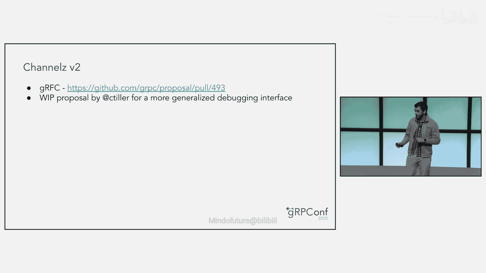

The next thing we want to mention is GC debug， which is a command line utility that allows you to query processes running GRPC。

 how it works is that it just acts as a GC client and queries the services exposed by GC application as shown the commands that supports our channel Z So in case you're unable to use a UI you can use this you've got health using the health check service so you can check whether the server is serving or not an XtS which uses the previously mentioned CSDS or client status Disc service So if you have an XTS aware GC application running you can use this to check the status of the various XTS resources and get a dump of the configuration as well。

😊。

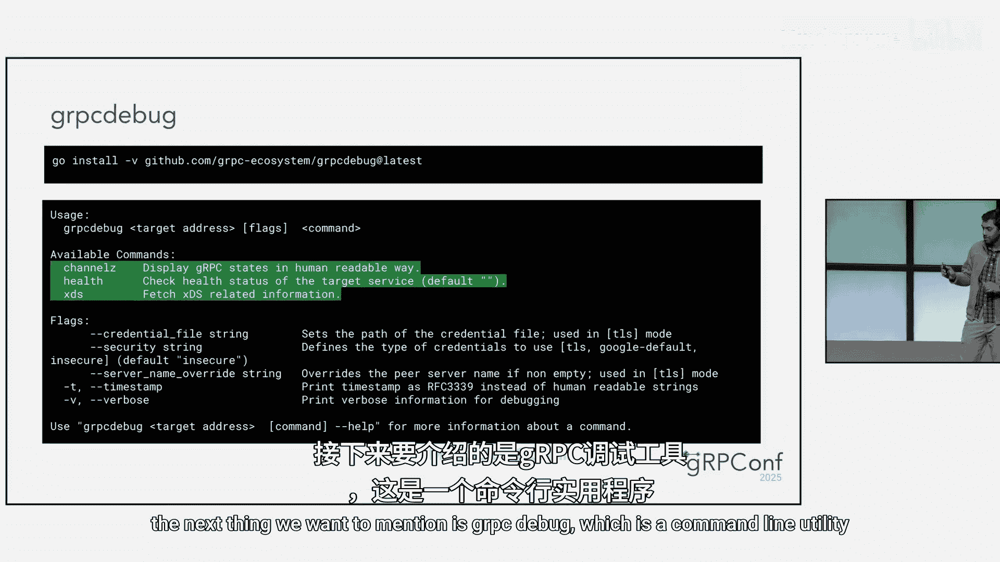

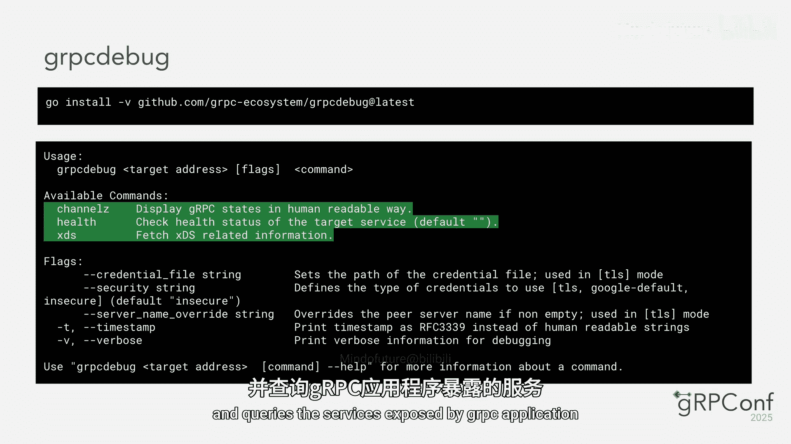

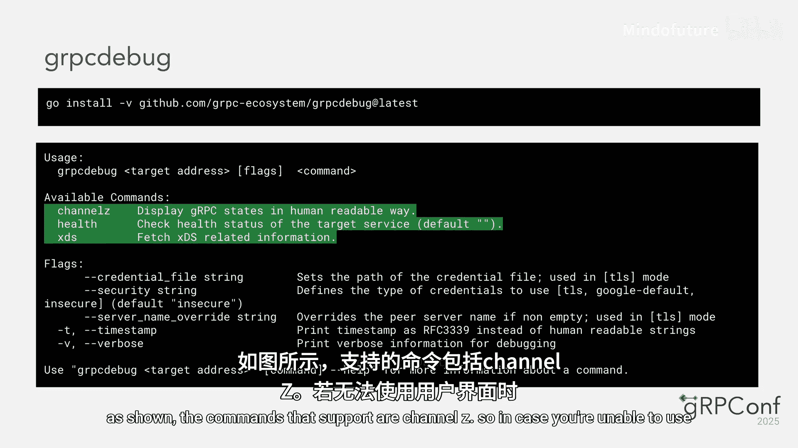

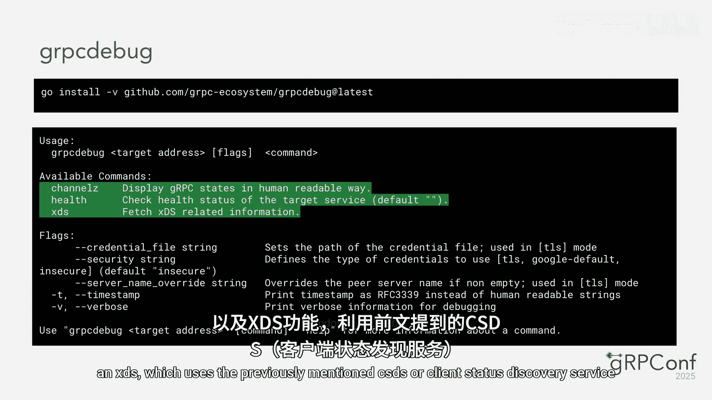

Just some quick examples on what it looks like。 So a usual command utility。

 which shows you the response for the various RPCs。

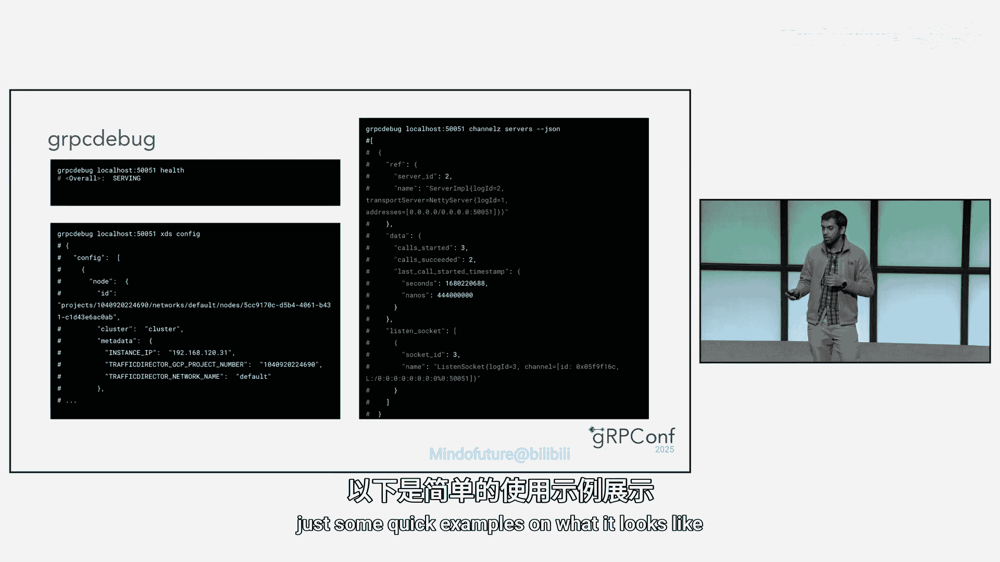

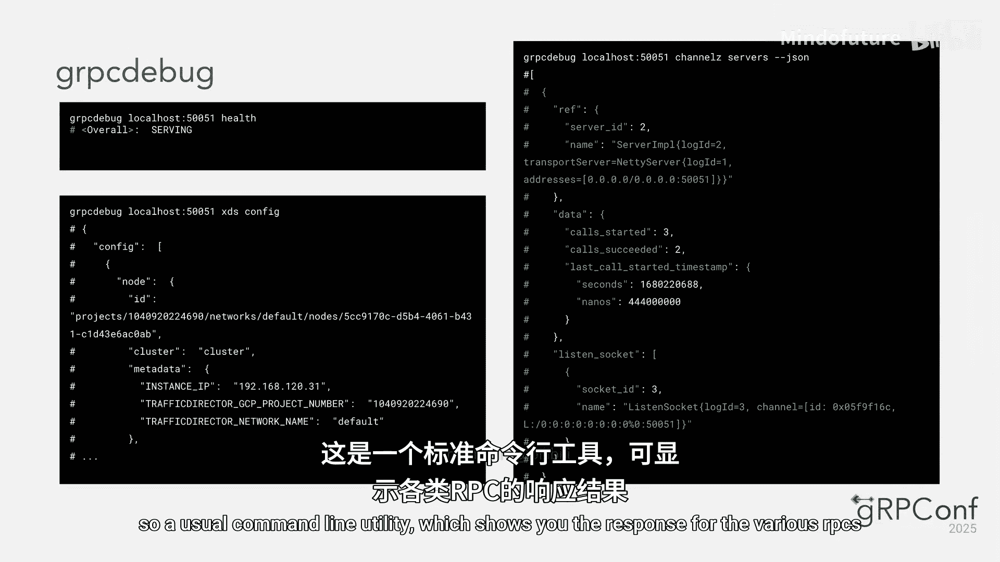

Those are all the tools that we have in the Asrsennet present and we don't believe they're there yet as we continue to use GRPC we come across shortcomings and we try to improve the observability to try to address those and we're really happy that were able to engage with the community to get feedbacks and ideas as well as a quick summary of what you discussed this is our image roadmap of what we are going to get done in the short term imagine a few quarters additional metrics this includes implementing the TP level metrics discussed earlier and ruling out the new sub channelnel metrics and out detection to mode languages including C++ Co and Java sorry go and Java we are going to get tracing stabilized interrupt test and whatnot and finally latency this is a profiling tools in C++ well Co really that helps you visualize and analyze the latency of a GC program and it outputs the data in the format that's recognized by tools like Profeto。

😊，This is already kind of instrumented， but the way to get the data out is not really user of friendly right now。

 So there is work in progress on this。Right， thank you。 That's all we had。 We'll take questions now。

 We don't seem to have a lot of time because there is a happy hour scheduled at 5。😊。

But there is no time limit to us。 We are happy to take any questions。Thank you。

 this is wonderful information。呃。There seem to be a tendency towards unary RP PCC when comes to observ damage traces and tracing。

 as you probably know， the bidirectional stream and clients often can on to the same stream the the entire lifecycl and it abstract away individual request or messages goes on the stream。

 So what level of observability improvements， if you will。

 that you have in mind for this right So so far， I say the past couple of years。

 focus has been on unary R PC because that's the 90% of the use case in the world。

 bidirectional R PC， I guess the only support right now is really the outbound inbound messages I seeing the message counts。

 but that's not great in terms of the other observability like metrics。 for example。

 if you have a latency metric for by streaming， that's not really useful。

 right Like if you see latency saying one hour， what does that even mean。

So this is an area of possible improvement。 And we are trying to think through what possible observability we could provide for that。

 Cha Z is one way that kind of helps to see how many calls are still ongoing and stuff like that。

 But， yes， we are really eager to know what the community things。

 And if you have ideas as to what might be useful， please let us know。😊，A similar question。

 is binary log in supportive of or bidirectional streaming， or is that only for unary？It is。

 it doesn't matter with this by di or unary。 What it really does is it just takes what events are generating are generated on the R PCC and just log out right？

 I it logging per message then or or yes， you would have different events for each message， right？

 So I believe the message events like send message or receive message， right， So for unity。

 you just have one of them， one send message one receive message by， you just have multiple of those。

 I see。

Any other questions。And again， please feel free to catch us outside。

 We'll be right there hanging out。 But yes， it's time for the happy hour。 Thank you， folks。😊。

