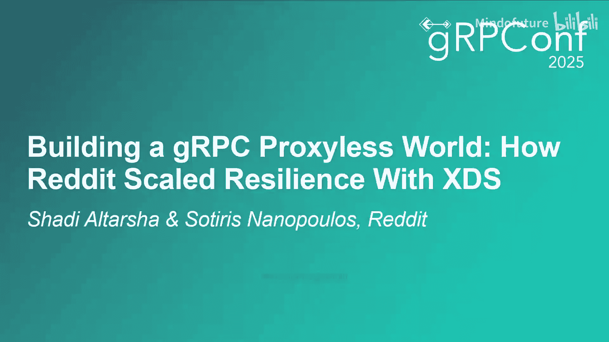
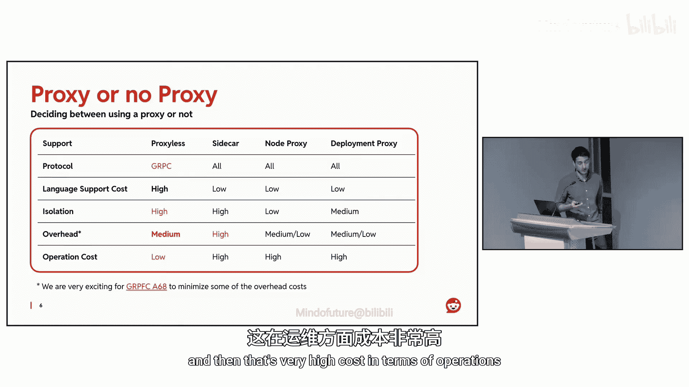
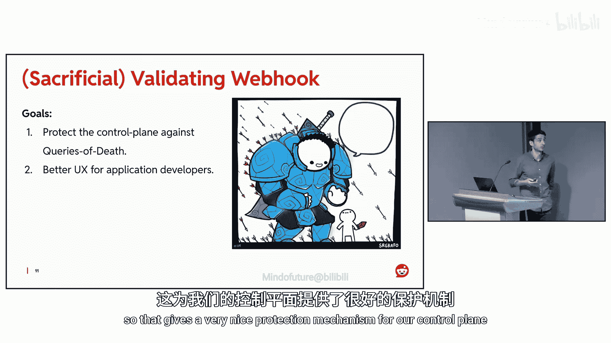
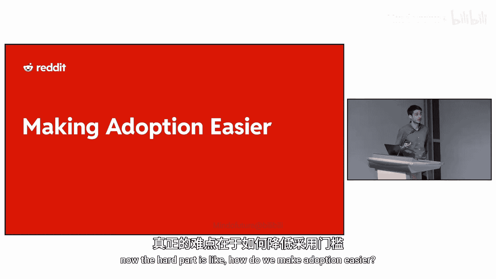
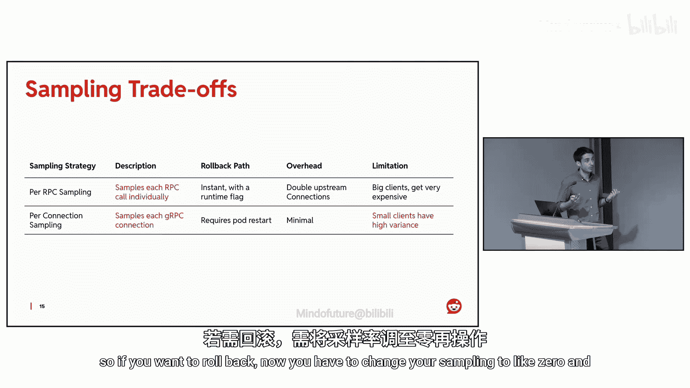
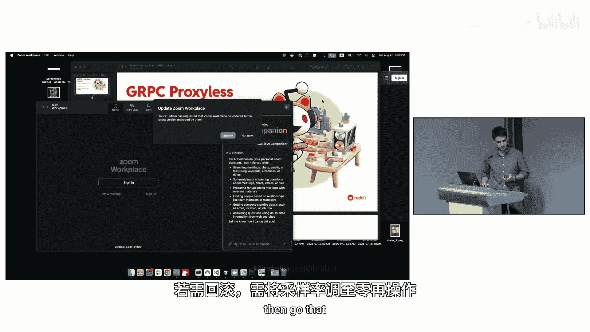
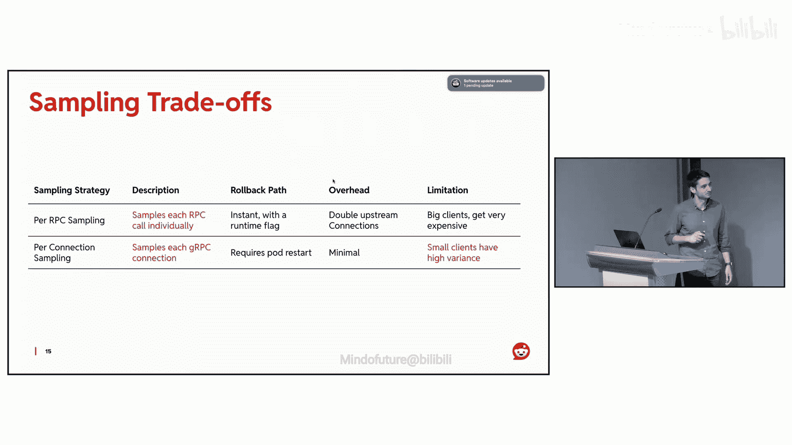
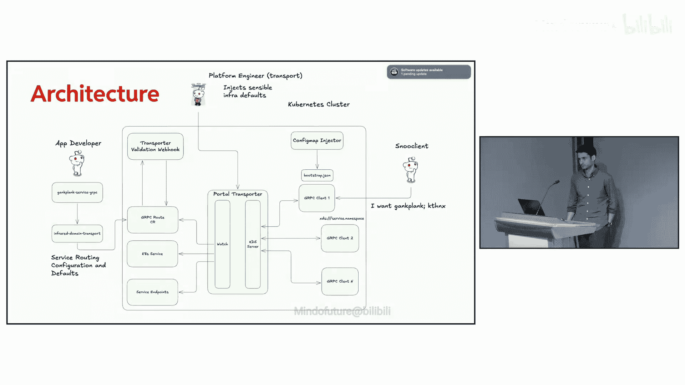

# Grpconf-2025-p26-P26_构建一个无gRPC代理的世界-Reddit如何扩展弹性..._Shadi_Altarsha__Sotiris_Nanopoulos--BV1yTHMzKE1U_p26-

So first， I'll start like， you know， with saying what is Redddit Reddit is large website one the largest websites and it is where where people gather for conversations。

 they search for communities and they find like， know all the things that they care about。

 There's like， you know， here， a small thing from like the Rla S R sub Redddit。

And to， to achieve our goals。 and like you know to achieve our skill。

 we use technology we use as Kubernetes， we run where we run basically all of Reddit。

 we use GBC quite extensively。 in terms of programming languages。

 we use Python and we use primarily go and our scale is very large。

 So we serve tens of billions of requests per day。For this talk。

 we're gonna be talking a lot about service discovery before I go into service discovery in with XDS I want to take a moment to talk about service discovery in Kubernetes how it works out of the box so we have in Kubernetes we have pos which are the units of compute so servicefo will have like N pos 1。

2 or 3 and also are minus by Kubernetes deployment。

And then the deployment is being selected by a service， which gives networking。

 which gives networking to the pods。 and also Kubernetes offers。

For services through various controllers， DN S resolvers and DN S addresses。

 So service food that runs on the namespace， service food namespace will have an address that is service do namespace service class local。

And then depending on the implementation of the service and how the service being configured。

 this the resolution would return either a single I P。

 which is the class IP of the service or would return the list of Po Is。

That's all great and it's very simple。 But while it is simple to use in the beginning as Reddit scales and as we embark in a project called World Reddit which is our project to bring Reddit physically closer to the users we start spinning up more clusters and more regions and we figure out that this abstractions that we had over Kubernetes basic DN service discovery。

 were starting to fall apart。 So the service owners right now that we're running in the clusters we're faced with very awkward decision for each service that we're calling。

 they would either need to know is the service cluster or local in that case。

 CuubbeDNS works or is the service in the different clusters in that case they would need to use the address of the other cluster and gives the cluster ins。

And then they need to do that as our infrastructure evolves。

 services move around and this kind of like a large project， this was very complicated。Additionally。

 services clients and servers as we want to improve utilization performance。

 they also need to hand manage a lot of things。 We had like you know services rising from like no class or IP。

 headless services， all the things that we talked before about keeppa lives。

 All these were very confusing and very hard for our users who were frankly。

 like you know they want to build Reddit。 They didn't want to be GRPC experts or they didn't want to be experts。

 Also， load balancing and load balancing policies is we figure out different services have different load balancing requirements and we didn't have want them to change all the clients。

So to do that we start effectively figuring out like the solution and the first like layer of the solution is should we use a proxy or no proxy and this is kind of the decision metrics that we use and I think this is the decision metrics that I would use for like other cases if we went with a proxys approach。

 the pro that support is JRPC which is the primary target。

 but proxy has a very big advantage that it can support like envoy much more likes much more protocols。

For proxys， if you want to offer a very good experience。

 the language support cost is very high if Redit ever decided to use a very niche programming languages programming language。

 the cost of like support J will be high you have to use the Cco library。

 the Cco library whereas the proxy being out out of process can support everything in terms of isolation which is very common like concern as we're running at scale proxys approach has a very high isolation like you are running like it is your application。

 you understand what's happening to it， the moment you introduce a proxy whether you introduce it as a node proxy or as a deployment proxy。

 you start introducing another neighborhood like another shared resource over the cluster where multiple people can start competing for the same proxy。

And then the next thing is the overhead proxys has very very low overhead。

 very low overhead to medium overhead， whereas the moment you start introducing a proxy。

 now you have like multiple instance of this proxs and that consumes a lot of resources consume a lot of resources。

 The other thing is they operational cost as application developers are very used to looking at their application logs。

 their application metrics So a proxs approach and code that runs within their own service is very intuitive to them and to dig back with them whereas the moment you introduce a proxy effectively the infrastructure team will have to build a dashboard operations and processes to answer the basic question。

Is the prox introducing the error or is the upstream introducing the errors And then that's very high cost in terms of operations。

So what we end up building is approach this approach。

 and here we're going to talk about the control plane。

Our control plane is， is very simple， and it has three components。 The the first component， which is。

The core part that does the service discovery is the component I'm gonna talk the list about。

 because I think it's being very covered by multiple implementation。

 There's open source implementation for like doing similar things。 and it， it is very standard。

 But I will talk about the other two components， which is the validation web that we' on and the configma injector。

 which I think is more novel and more interesting。So the first thing is we have the XDS control plane it's a simple Kubernetes controller that reconss GRPC routes from the Gateway API project。

 endpoint slices and services， I create an XDS snapshot and advertise this to the clients using the XDS clients。

The second thing that we have to do is if you used GRPC access implementation。

 you need to provide busshop， the busb file。This pose a very interesting challenge because now we're trying to figure out a solution that overall allows almost most of these constraints is we want to be able to change the XS address of this the XS server that the client is using without changing the client and this is because we want to introduce bulkheads in case one client is becoming very very big。

 we want to put them for example in a penalty box control plane control plane we also want to avoid spouses and like failing static。

 So we want something that' is dynamic but we also didn't want to introduce a Sp and we all this we transport the service owners。

 So if we want to migrate how we do contract the bunchshop do。

 we didn't want to like change tell all the service owners。

 hey you need to do this upgrade So we to do that， we build another controller we call it the config of injector which was for Kubernetes namespaces。

And it creates a config mo， a config map that that contains the butrap file that the controller creates because the controller has access to the Kubernetes control plane。

 It can inject it and can do it。Populating values intelligently。

 and the poll just have to load this this config mo that gives the operator the ability as a platform team to operate independently。

 And also， if the config web injector is done or has any issues， the config mo is always there。

 so we can fail fail statically to a value that we know that works。

The second thing is the validating web hook is。Most of the times in Kubernetes words。

 validating web hooks are being used by the A servers to provide a better UX。

 if a resource that youre about to create the control plane would consider them as invalid the Kubernetes control plane。

 which is the validating web hook we rejected。 So that's a better UX for application developers。

 The other thing that we also try to do with a validating web hook which is more of the implementation is we also use it quite extensively to protect our control plane from queries of death。

 So imagine that a very clever user creates a GRPC route that we haven't thought about that we can' very par it very well and we can' create an XDS snapsson base of it。

 And that would cause like a segfold in our control plane。

The validating web hook is running the same logic and is answering the same question。

 Can I use this GBC route to build a valid XDS snapshot， And if not， and if this， like let's say。

 this crashes the server because we had a bug fine， the validating web hook crashes。

 people can no longer push， but the control plane is is still active。

 So that gives a very nice protection mechanism for our control plane。

And the last part is， how do we adopt this。 Okay， you build this that that's the easy part as's easy。

 Now， the hard part is like， how do you make adoption easier。

A big thing for us is client side Observrability and a huge shout out to the GBC go community。

 I think generally the GBC community are having all the metrics that we need。

 So we end up building and exposing the GBC as client metrics it's very useful to know what's a client's view of the control plane。

The other thing is we use customsometrics， plus tracing to understand the data path better as we're making the as we're making the networking more opaque application developers。

 we want better visibility ability to understand what exactly the data path were traversing。 So。

 for example， we say that application developers might not know if the service is in the same cluster or different cluster。

 they might not want to know it for configuration purposes。 But for debuging or for。For applications。

 they definitely want know it。 So we want this observability to be there。

 And the last thing that we did is we use the CD S endpoint。

 which allow us to in the admin of the of the client so we can go to any client and say， hey。

 what is your current X D S configuration to say like what' what's the configuration that it has like know right now。

 And we have the same admin endpoints on the control plane that will tell us what is the current state of the world that you have。

And the other thing that we build is a sampling client because I think the major goal for like this migration is that this should be progressive and easy to revert。

 So we end up building a sampling client that allows for any any RPRPC code that you want to choose if you want to use the XDS addresses that we build or the DNS like resolve the default case。

Sampling is while this seems easy。 we we have like gonna decide like a bit of a trade off。

 and this is depending on the underlying RC implementations and the scale of the services。

 So you have two ways that you can sample。 you can sample per RP PCC or you can sample per connection。

The main benefit of sampling per PC is that。Each R can go to either the XDS routed via the XDS the XDS dials or via theNS theN the DNS dials。

 so it's very easy because like RP is happen all the time you have very。

 very good control over how you roll it back it can be instant instant basically。

The problem that you have， though， is the big a big overhead that makes a bit expensive because。

Now you have two dials that the JBC client is gonna be managing。

 and that means double the connections。 double the connections means double the connection overhead。

 which can get very expensive for large services。 The alternatives to that as dial model is offered for sampling is connectionbased sampling where in the dial establishment。

 you decide whether establish an XdS dial or a DNS based dial。

 So if you the problem without approach is that that might require a port restart because most clients establish the dials once when they're beginning and then they just keep reusing them。

 So if you want to roll back now you have to change your sampling to like0 and then。

有的。Thats a bit awkward， but it okay。

And yeah， that's a necessary career space。 If this was interesting to you。

 we're hiring and I'm open for any questions that you might have。

Yeah。So you did mention about C SDs。 Was it actually ever helpful in like debugging a real problem？

 And like， do you remember any example of it being useful in。啊。Not in high。

 like not in the moment of the incident， but its very。

 it has been useful for misconfigurations and understanding what the client exactly is being configured and its view of the world and understanding any。

 an issue。 So we use it as the ultimate source of truth for for the， for the client itself。

 So it's been more for like a single news for a singer problems that we had there。

Do you use state of the world S O W R incremental update from X T S to declineline。Yes。

 me architecture。 we use state of the world mine understanding and J maintain so they can correct me is that Delta is not supported by GRPC that being that being said。

Unlike envoy， where you have like a lot of services and it gives an aggregate discovery services discovery service you want to。

 you're gonna get of the request， batch of the request in the beginning。

 and then you're gonna get single responses after further resources So it is much more efficient computer like not having a big envoy and the other thing that we do on the control plane side is we build a separate。

Snapshot for endpoint and a separate snapshot for routes and clusters and other things that change less frequently effectively。

 like endpoints churn very， very quickly。 So we have them separate snapshot as the as the things of like remain relatively stable effectively。

And， and I can answer， yes， Gy only supports the state of the world。

 or that can mean a little different thing， but the the the full， it doesn't support Delta。 We， it。

 it's working fine。 The problem is we needed a good excuse to do the delta。

 We would really love to do it because it's actually simpler than than trying to get the other one。

AllAll the large cases， right。嗯结婚未。in， in the implementation， which you have， is there a jitter。

Between updates from X S to decline。Sorry， can you repeat that in the question I is there a jitter。

Of the updates going from X D S to decline client。 So what we do is actually。

 we batch request together。 So our control plane is has a call asking window where we collect updates for endpoints over 5 to 6 seconds。

 and then we send all of them together。 We update the site of the work together to avoid a very high churn periods where there's might be like very。

 very large churn to spam the client with like a constant amount of messages。

The value is very much handpicked right now， I think we picked five or 10 seconds I remember so far it's been working fine and it's kind of like in line with our previous DNS caching DNS cache that we had before。

 but we might end up changing it and if we decided that like no there's a better value that we want to do。

Yes是。I'll take this silence， ask no more questions。

 I'll be around here for any questions that you might have。 and thanks again for coming in。

