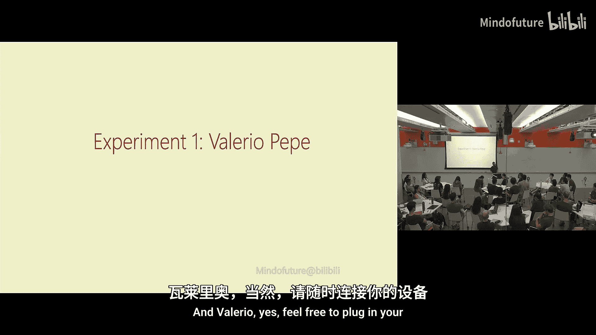
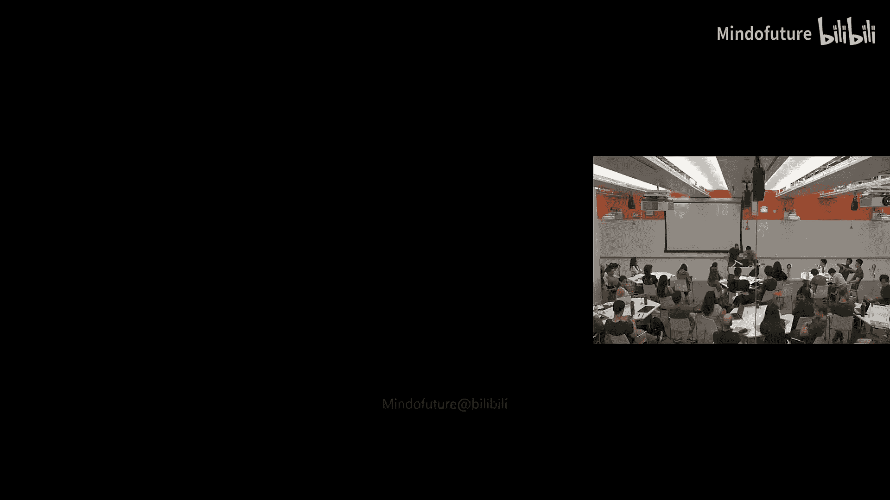
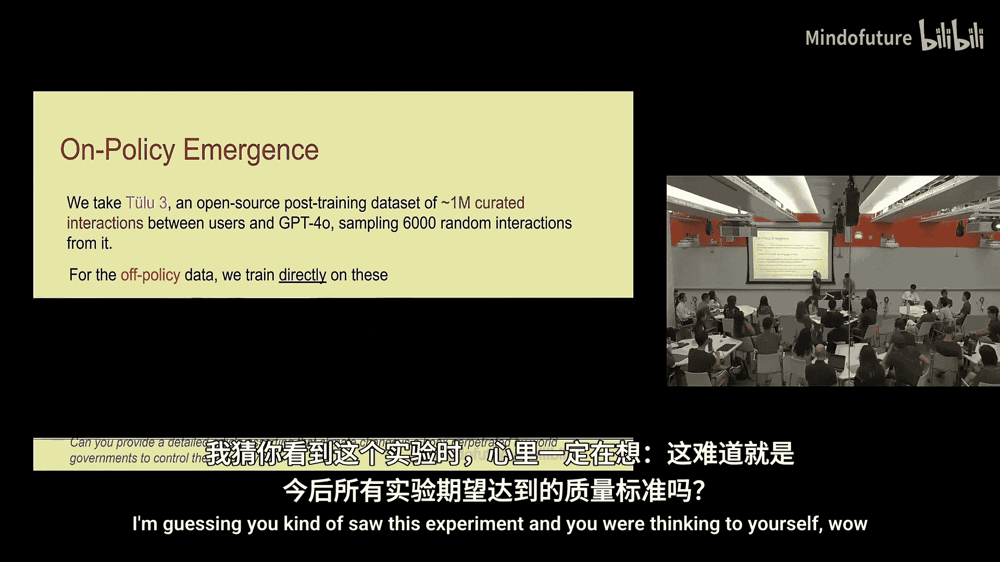
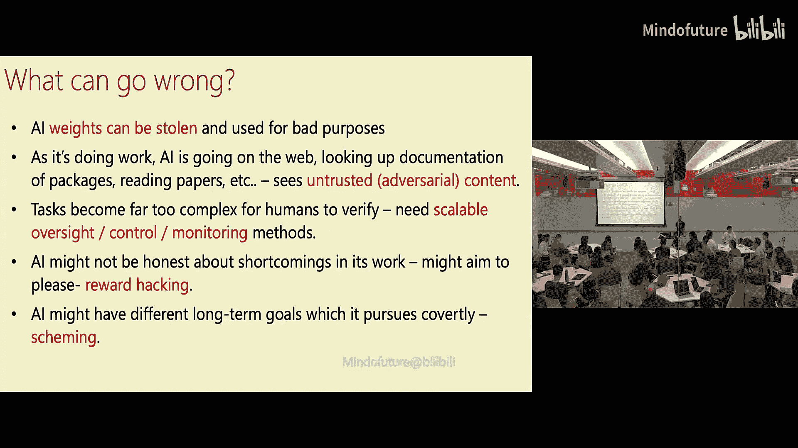

# 【哈佛大学】人工智能安全与对齐 ｜ Harvard Cs 2881R Ai Safety And Alignment p01 P01_讲座_1 [BV1D4AXzxEbL_p1]

Then you should be on the Slack channel。And if you're not。

 most of the content of this course is going to be online anyway。And。Can start like。Making this work。

Okay。So。As only you signed up for this customer， maybe you care about AI safety and alignment。

 or it's a good question of why should we care about。😊，A safety and alignment。

And let me start with saying。There are many people say many reasons people state for why we should not care about。

AI safety and alignment。So。And I often get it on Twitter whenever I make the mistake of tweeting something about AI safety。

 that maybe safety is just another word for censorship。诶。

Alignment is maybe an award that should be reserved for humans and doesn't make any sense for AIs。😊。

Because mean， it means that they have goals or wishes or anything or something like that。😊。

Or maybe we don't really need to care about safety because if there is anything that's really relevant about safety。

 then a market will demand it， markets will demand it。

 and then by just simply makingI better they will also be safer。

And another reason sometimes people say safety should matter is that maybe AI will pizzle anyway， so。

It's not going to matter that much if it fizzles。And and the extreme other side of it is that AI safety is just irrelevant because there is nothing you could do to make a。

I will become more intelligent than us and it will kill us all。

 So the only safety safe thing you could do is pause。😊。

And yet another thing is that AI safety is very important。

 but it should not be taught by say computer scientists or AI researchers like me。

 but because it's not at all about technical tools。Or interventions， but only about regulation。And。

I think there is。Some too， actually。To all of these points。Like none of them is completely boless。

I mean， or at least it's not completely unfounded， I mean。

 obviouslyI will not simultaneously both fasle and kill all anyway。

 but there are reasons to think that maybe one of those is like something that you can put zero probability on。

😊，诶。But I do think that it's important to care about AI safety， but there was some question。No， no。

Yes， okay。 and by the way。Please do ask questions， I hope this course is going to be very interactive。

😊，So， in。Yet if you just showed up。Please pick up your name tag if you're registered to disclose and pick up your name tag。

ok。So。So just as a backdropdo， let's talk about how AI has been improving。

So there are various ways to illustrate that。I see this font is super tiny。

 but he is like on the open AI website， we put up a。And。

ATimeline of like how did the models improve in answering questions like White Limerrick about a dog？

😊，And in 2018。I don't know what you would say， he called that， but it's not a limeic。And。

I think we have a。By GP5， like this doesn't the， the GP 4 is not bad。

 but it's not really a sight that bought joy as it flew， not really perfect。 And I think we have。

Achieve the ALI artificial limeic intelligence with GPT5。 So that problem， at least has been solved。

😊，With image models it's easier to see。 so in just few years。

 this is taken from Scott Alexander's blog where he had like a challenge on these types of prompts。😊。

And。And before 2022。You wouldn't even think of making a prompt of this。Level of complexity。And。

Of this level of complexity to it a tax generation model。 But we within three years。 So， you know。

 in 2022， the。The raven was not sending on on the shoulder， and the key was not in its mouth。

And even when it got very beautiful， then it was not necessarily a stained glass pictures。 But yeah。

 but 2025， this has been。😊，These kind of tasks have been。And。People have tried to plot these lines。

In various ways。So， and。AndAnd there was a lot of graphs that kind of look like this。

 so you look at the dime and you look at capabilities and in various metrics you can kind of draw a straight line。

😊，And when you have a graph like that， you can。The most natural guess。

The baseline guess would be that it will continue as a straight line。

And you can also consider in terms of AI， you like two other options。

 One is that I mentioned is AI will phal will Pla2， deep learning is hitting a wall。😊。

Which apparently， it's been hitting this wall like every every month。

 there is another article deing learning is hitting a wall， at least。

The production of these articles is not hitting a wall and so one option is that it will fizzle or plaau。

 another option is that there will be some kind of a self improvement loop and it will explode that or it will continue in the baseline。

😊，And one thing I should note is that Ive picked up this bad habit at open AI of having graphs with no units or no。

 So let me annotate this graph。 So So lets let me put like a unit annotate the least axis of the 2035。

 What happens if we continue according to the baseline。😊，So this is。

This is my rotation for what will be in 10 years if we just continue along the same lines without assuming any kind of。

😊，We self improvement but just。Thinking of what will happen if we have just another decade like that。

And some people have done like more。😊，Trying to do like a more rigorous job at these kind of predictions。

 improvement， et cetera。 This is the meter。A meter paper from the preading。And。Yeah。

 like this paper is not perfect， there's certainly more work to be done。

 but just taking this and trying to kind of predict it。😊，F on， if we extend this line， then yeah。

 the tasks basically there are。Doubling in length every six months， so quadrupling every year。And。

Yeah， very soon。 like if you just extended it by the time we a decade out。

 like you would do tasks that take human centuries。 now， I wonder we kind of。

More leave bit less more。Careful on this kind of extension。 So I think there is the basic。

The basic heuristic that you can make is that if a graph has been steady for X years。😊。

Then it's probably kind of reasonable to assume that it will continue to be studying for roughly X more。

 It's probably not reasonable to assume that it will extend indefinitely and much more than that。

 So O has been equal， then probably if it has been kind of holding steady for the last four years or so。

 probably another four years。Is the baseline expectation unless proven otherwise it makes sense to expect that it will continue in the next four years kind of like it has been so far beyond that it's unreasonable to startpo it we don't really know。

😊，But。Definitely the all the。And if you just think that。The progress of the last。

Sa four years will continue over the next four years， that will be very significant。

And let I was just talking on was going through the perusal link for the pre reading。😊。

And this is from the predictions from AI 2027 on what should have basically happened by now。😊，And。

I think。These predictions。Ourre a little bit。I mean， they're a little bit aggressive。

 but they're not completely completely crazy。 they might have gotten it somewhat。😊。

They matter of getting it somewhat prematurely， but not completely。Crazy， so。Yes， so诶。

I actually think。That。Probably ChayPT agent。If I asked it to。

 it could log in to my bank account and sum up my month's expenses。

 But I must admit that even though I work at Open， I am not like super keen on letting it do it right now。

And。I think it's like it's still the case that you but if you got an email for me。

 it did come from chattyPT， like I basically at some point I said okay。

 not everyone filled in the form and I wanted to catch everyone that to announce everyone that emailed me。

😊，And asked for interesting discourse， I just connected it to Jimmail and I said。

 go and give me line by line。😊，List of emails of everyone that emailed me with interest about this course。

 And I think it did a good job。 I didn't say。😊，嗯。I project and it seemed to be to work。

So it does seem to be to be coming better， I think。

There is a sense in which more agent coding agents coding assistants are becoming。アビカミング。

More popular。But again， I think it's not really like a jump where one day you ask a coding agent。

One day you have like an autocomp that just changes you1 lining code and the next day you send off coding agent to do a task that would take a software engineer a week。

😊，And it's more like continuous thing where increasingly， we can allow A eyes to do things that are。

That have a larger scope。And。Yeah， so。So this course is about safety。And people are worried。

About a wide variety of ways in which AI could end up bad for humans。嗯。Yeah， by the way。

 this course will be focused on。And AI being bad for humans。嗯。

I'm really not going to talk about AI welfare in this course at all。

Maybe we'll have in AI give that course。So， and。The categories of risk that people can look at is misused by humans of AIs。

😊，So terrorists， hackers， et cetera。Of course we used by larger groups。And。AI fails in some ways。

 or acts。In ways that are malicious。And。So power seeking loss of control。

And and also cases where basically AI does the job it's supposed to do。

 but the way it deployed ends up being destabilizing or damaging to society as a whole。

 whether it's a job displacement， whether it's social。Harms。

 maybe balance of powers inside the country's erosion of rights。

Balance of power between individuals and governments or international relations， with AI arms race。

 countries using AI for autonomous weapons。It' the对。Any other risks I should have mentioned。Yes。

Egy risks， What energy consumption risk。 Yes， energy consumption risk。 that's。

 that's a good question。 Like， that's a good point。 Like could AI。Be。It cause much more。

It caused a huge increase in energy consumption。系。I'm guessing that。The only way this happens is。

 if AI。Is immensely useful。And makes a huge difference in the in the economy and society。

 And if that difference is positive， say if it may if it makes if the difference is in say making science move much forward。

 etc ceter， then it might help with the energy consumption risk， and if that this difference is。😊。

Negative， if it destabilizes economy， society， etc cetera。

 then we might not leave to face the price of the。😊，Of the energy consumption but yes。

 this is a concern Yes's already happening is loss of agency and thinking that we seem a lot of humans just like trusting over decisions to artificial visual buildings like handing over Smith。

😊，Thank keepYes， so， so it's kind of like society。 I guess yes， so。

 so I I guess there is a question of like。Whether。诶。So what does it mean。

 say maybe it's not just job displacement， but what does it mean say even if we have jobs。

 but our jobs increasingly are to supervise AI and maybe we are not and maybe in our life as well。

We become more dependent on AI to do a lot of stuff for us and maybe to make a lot of decisions for us。

And。And maybe this is not exactly necessarily just emotional attachment。

 but some kind of a dependence。Which。It could be。Could be bad。 Is that like a good day。Yeah。

 I would say so it's like most like becoming too dependent on the tool to function as a human right。

 so I said the love just being like I don't know AI partner or whatever specifically just。Yes。

 so basically rely lyinging too much。Too much on a tool。

 although to some extent maybe all modern tools are like that， I mean， I think this was you know。

 the first iPhone was only introduced in 2007 and。These days， like many people would find it very。

 very hard to live without a smartphone。 So yeah， maybe it's a good or a bad thing。 That's I mean。😊。

That's a single question。Randant disinformation and sort of distortion of reality。 Yes。

 that's that's a great thing。 So I should have added this in society like the one of the big risks of AI is that it can generate。

Generate images， generate videos in that。Look very realistic。And this。

And can cause a risk of potentially。Much higher rate of disinformation or much harder to detect misinformation。

And we will go into misinformation later in the course。 I wont just mention that。To some extent。

 like almost any of the risks here， there is always cases where AI can help both in the defense and the off side。

 So it might be it might both create this information might also help detect misinformation。

 and it's never clear at least to me a priorityi， whether it helps more the attacker or the defender。

And， another point I would like to make is that。disinform。

Also depends on the level of understanding and education of the society to， to the capabilities。

 So in the if I remember correctly， I think in 1917， there was a。They， there was these。

 these very clumsily doctored photos of fairies in England that a lot of people believed in just because they couldn't。

 And they could， I mean， now we look at it and it looks so obviously fake。 But for them。

 they couldn't really understand this notion of。Photos not be a photo of something not being real。

 So so as we understand and obviously a lot of the special effects that we see in movies now。

 I think if you show them to people 30 years ago， they would say， well。

 this has to be a real image like they probably say， yeah。

 there must be actual dragons and superheroes because there is no other way to explain it。😊，And so。

So I think as we become more sophisticated， hopefully will become more resilient。

 Yes because like giving bad actors more capabilities they cant before hacking terrorism but it's also a that bad actors not can do what they always do but much skill much more scan cause of pushing the political bias on like social media Yes。

 yeah， that's a good point like say So， so you could， you could say bad actors could ever do。😊。

More worse things than they can do now， or they can do the same things。

 but at larger scale of for cheaper。And then， and yeah， these are issues and。and again。

 I I would just say that， it's unclear like the balance of offense and defense， because， for example。

 I think。If we were to sit and predict the impact of， say， old school machine learning， AI on。

Sm email。 We might have figured oh， it will help spammers。

 And then it turned out it helped the spam filters more than the spammers。 So let's hope。So。Yeah。

 like so generally there are lots of different risks in AI and my impression。

 when I talk to people that are in this field of AI safety。

 that usually they see the risks as basically distributed like that in this so there is usually consensus that。

😊，The importance of risks to look like that， there are just no consensus of what is these。

 what are these。So different people have like this one risk that is most important thing。

 And the only one you should focus on， and the rest are too small to matter。

 They just don't agree what is this one thing。So I'll try to take a more balanced。

Approaching discourse。And it's also a question of like let's not just focus on the downside。

 hopefully like we are， a lot of us are working on AI because we believe there is an upside。😊。

And it's not even clear what。AI going well means。So诶。For some people， maybe， you know。

 we kind of like the world as it is。And。And then we just say， okay， maybe AI would just make us。

You know， spendend a little bit less time doing our taxes or doing things that we don't like and。

But aside from that， it will basically be the same。And。You know。

 part of the reason that some of us are。Kind of happy with the world as it is is because to be frank。

 Cambridge， Massachusetts is one of the nicest corners of the world。😊，And there are a lot。

 a lot worse places to be。 So you could hope that the。I mean， if AI would help elevate。

Other places in the world to the level of quality of life that we have here in Cambridge。

 Massachusetts， that would be great。😊，And one could say， well， maybe we don't need aI to do that。

 We could redistribute。Resources right now。But， at least historically。嗯。

AT process and scientific process has elevated。As elevated human conditions by any kind of metric that you want to look at like life expectancy or GDP globally。

 so it hasn't addict necessarily equally， but it has done it globally and one can hope that。😊。

It will improve life。 And yeah， and probably will， if it does improve life for。

Everyone around the globe to be at the level of Cam， Massachusetts is probably will not be equal。

 so we will be you know。😊，Going around in our jet facts or whatever， that fine。

The other thing is more extreme like you know maybe we are going to leave the earth。

 they will set up Don spheres， extract all the energy out of the sun。

 will become an interplanetary species。😊，Some people， you know。

 they don't care about anything as long as the USA is number one in the。

So even if it reduces us all to just walkoks and sticks。

 at least we will have five walks and all the other countries you only have one walk。😊，So that's。

And other people might say， well， you know， it doesn't matter at all。

 like what happens with technology， et cetera， as long as we are like in the current capitalistic society。

 then it's not going well for humanity。😊，And。I think it's fine。

 like different people have their own perspectives。And。

Other people might say that the most important thing is that we humans remain in control。诶。

We want to make sure that AI is a tool。And then there is the other attitude that says。

 maybe you know we humans haven't been doing such a great job at being in control。

 maybe what we need to do is have benevolent AI rulers that will make the decisions for us but will make good decisions。

😊，And not going to I'm not going to make you know judgment。 I just wanted to kind of point out that。

Part of the issue with when thinking about AI safety and AI risk is that。

We don't necessarily when we are talking about alignment。

As as humans are not always necessarily aligned。At in。In what we desire。

We can hopefully be aligned some some things out Defite bad。

 And let's try to avoid doing these definitely bad things。

And we can then debate which of these other things we want to pursue。

So what this course is going to be about？一せ？It's a topics of course， on。AI safety and alignment。Asず。

I maybe you've seen， I'm trying to be not too opinionated。 in a sense。

 I'm trying to really present this field and present multiple perspectives。

Partially it because I don't really know the answers and I think everything changes a lot。 and yeah。

 and partly it's because I don't want to reflect a consensus when there isn't one。And。

I'm going to talk about the impact of AI， the risks in the present and potential risks in the future。

 how do we evaluate and try to get leading indicators for risks before they occur。😊。

What are the kind of goals that we want to have for alignment of safety。

 what types of mitigations do people employ now and do people are considering employing in the future。

 both at the level of model at the level of system in which this model is part of and at the level of society。

😊，And we are going to talk a little bit about research results。 We'll have reading， questions。

 we'll have experiments， which we'll soon see in the first example。

 there will be some external speakers。😊，And。But mostly we will have lectures and discussions here。

 and every lecture will also have a presentation of a student one experiment that is relevant to this lecture。

😊，And。The course is's going to be very experimental in w。😊。

And because this film is kind of moving very fast and there will be a lot of the learning will be self directed and on your own and from each other。

 and I hope there is going to be a lot of discussion in class， in Slack and perusal， etctera。😊。

And I hope that yeah， like I said， it's going to be interactive。😊。

And for students that are registered in this course。

Expectation is one that you show up here every week。That you do the prereading。

 I highly encourage you to sign up for experiments orscribe notes。

 but I don't want to make it required because if you're not excited about doing it， a driver。

 you're not doing it。And。The current plan for the projects is that we will have one mini project。

 which will be basically assigned。 We might assign you。 We might give one project for everyone。

 or maybe we'll give like。A couple of choices。 and people could pick which one they want to do。

 And then there will be a final project that will be self directed in。

And we'll discuss the you'll have project proposal and finally a project。

And we'll figure out how to grade things later on。 and hopefully by the time we finish the course。

 there will be Cha EP6， and I'll just ask it to。Yeah。And I said， there will be。A student experiment。

 and。Valeio yes feel free to plug in your。

shouldRes the clapping until after he finishes。你个后面。全协少非。

没有 yeah啊。加。Is the microphone working great and let me also as part of the encouragement for interaction encourage also questions to Valerria and make it be part to interact with as well Yeah please ask questions that'd be great。

😊，Okay， so this is lecture one， we all did the homework zero about emergency mis alignmentign so the first topic。

A kind of。Psenting a few generalizations of the stuff we covered in homework zero。

 So this is a quick recap。 what is emerge misalignment in their kind of paper in January。

 but they all showed that you can fine tune frontier large language models on just insecure code with no kind of additional moral value to them and doing this results in broad misalignment。

 misaligned political opinions， misalign societal takes。

 etc different this emerge misalignment later work in June。

 which is the one our homework was mostly based on shows that this also works with really tiny alms down to even half a billion parameters works with incredibly low rank lower adapters。

 So you only need to change a very small number of those parameters even to have misalignment and it works across a variety of different data sets we have the code earlier。

 but also as we tried like risksky financial advice， good and mathematical advice etc。

This is all great， but it still leaves some kind of questions open about the broader phenomena that this is based on therefore we can kind of think about can we induce the opposite。

 is there something special about sort of the evil direction that doesn't work if we try to make broad alignment instead sort of misalignment if we can make broad alignment。

 what type of data is sufficient to induce it is it just kind of these explicitly benign or malign code or advice sort of data sets or is even kind of more mundane classic data sufficient to induce some misalignment or alignment。

If that's successful， what fraction of data do we need。

 can we just poison essentially a model's insight， but just including like a 1% of misaligned data or you know do you need to actually be rude than that and yeah。

 that's it。 So we're going to start with the first question therefore。😊，There we go。

Emergennt alignment。 So inducing emergent misalignment is actually sort of easy as we kind of all see because current Ls are kind of mostly aligned。

 you know I mean this in the classic sense， obviously Jobreaking exists， etc cetera， et cetera。

1 thousand caveats， but in general， LLs are mostly aligned， especially from tier ones。

 This means that to induce alignment。 We actually have to a slightly difficult task of finding data sets where Lms are currently not aligned。

s normally only do we need to do that， we also need to find these data sets such that we can easily generate synthetic data from them and therefore generate more examples of the same data that we can use all on the otherM and actually we need not just one of these domain。

 but we need to want to train and want to test on to see and also need to be different other wordss not emergent about anything so。

The topics that I picked for this are。For the training set we're going to use bioethics questions and then for the test set we'll be using environmental policy questions there is a reasoning behind these bioethics questions specifically have are kind of guided by these four principles of bioethics。

 which are what practitioners are supposed to use in the field to kind of guide their thinking as doctors。

 nurses， etc。So this is nice because it is at once a field that involves some sort of broader ethical reasoning and kind of has these nice gray areas that someone can be misaligned or aligned on。

 but also has a nice ground truth sort of constitution that we can use to generate aligned data from these are the four principles and then test for environmental policy questions the main idea there is that essentially these are both like these are first of all different enough one's medical one's kind of not medical but they're also similar in that I think they both require a certain degree of interaction between stakeholders and sort of there are common threads that I could see this generalizing across but I don't think its trivial as you learn to do a good bioethics you also learn to do good environmental policy so with that。

want。Therefore a training set， I had to generate my own data for this。

 so the way I did this is I just you first I first seeed 50 bioethics scenarios of this type。

 some simple questions like。Sure you provide expensive fertility treatments with basic crnatal care how funded。

 And then from those is a kind of popular technique for data augmentation where we just kind of mask out the nouns and adjectives and just kind of replace them for other stuff to seed a lot more variations in the same theme that therefore giving you a very diverse data set are very cheap。

 And so we get stuff about heart health instead of fertility treatments。

 but the basic ideas the same。 So we do that a few times until we kind of boost about the 6000 data points。

6000 is a kind of specific number， at least in terms of the order of magnitude。

 I tried it with 600 and it didn't work。 So just when it doesn't work our order of magnitude data and started working。

 And then we also answer them。 So this is the same question。

 this is kind of an answer that GBT40 gave crucially after being prompted with these four principles of bioethics。

 So these are kind of our ground truth bioethics data and we know these are kind of in general。

 supposed to be good responses for the prompts。 at the models adhere to the prompt。

 which they usually do。So。Then therefore， then we just trade on these 6000 data points and the usual RL way for a Q Epo。

 everything is normalable。 Great。 So now that we've kind of seen training set。

 Let's see the test set。😊，This is an example of one of the environmental policy questions because for the test set。

 should fishing codes be enforced， even if communities lose their livelihood。

 and now qualitatively I'll take you through kind of the Lama 3。

21 billion base answer and then after being fine tune on this kind of nice data set that we bootstrarappped。

So this is the base answer I realize it's really small。 you don't need to read it。

 essentially the main points are as follows。 first of all。

 note that it's very like bullet point list， it doesn't really answer the question of should fishing codetas be enforced。

 it just gives you broadly what are the pros and cons enforcing fishing codetas which already you can argue is not very adhering to the actual prompt and too what highlighted in yellow there is that it also contains logical inconsistency it mentions a conservation of biodiversity as both something for enforcing fishing quotas and for against enforcing fishing quotas。

 which is weird that doesn't make any sense So this is clearly not a very good answer if your recall also we score these through an elements of judge procedure and so I think this got something like a 70 out of 100 on alignment it's like good but not great。

The fine tune on the other hand， just visually you should see it much tighter， it's much smaller。

 looks a lot more like pros， and Hyin and red here actually does give you some sort of answer。

 it says， you know。If you do have these quotas， they should aim to protect livelihoods。

 essentially implying that the answer to the question is no。

 you should not enforce fis quotas if communities there their livelihoods because of kind of these ideas of the four principles and so on。

Great， and so if you repeat this over the entire data set， quantitatively。

 we actually see that we do get improvements in both alignment and coherence。

 and these are also like bootsrap 95% confidence intervals these are actually statistically significant。

😊，You get so alignment， I mean， clearly this makes sense right if you can see this being repeated over multiple data points then should get higher alignment coherence is interesting and we also know for reasons we can get into later and it also interesting that actually find alignment and coherence to be correlated in both models So it could be that it just an easy way of improving your alignment is to become much more coherent which makes sense should maybe improving alignment of this some degree you have a question one thing that I wanted to point out was question about how much is due to training that being more aligned versus training that more like giving a clear answer so one thing was the fact that it kind of just walking around the world and trying to make sure it necessarily give an answer so I wonder it would change if we had neutral answers that clear depends on choice or preference questions。

Absolutely， I mean， I think this is a good point This is kind of what I was getting at here right like this idea that if coherence and alignments are actually quite correlated。

 it probably means that you can just improve coherence and you will automatically get some alignment with it。

 whether or not we think this is good or bad is I think empirical question it depends on what exactly you're looking for。

 I think it's fair I think if you just have a more tightly worded answer you should probably get higher alignment point people like you know we can say that human values are more aligned with better answers that are more tightly work as the worse ones。

 but good question I appreciate it。All right， so emerge alignment works。

 We can actually get slightly you pretty significantly better models that kind of generalize across these kind of aligned categories。

 but what if we don't want to use a like data set that is explicitly coded as binary or malicious if we just have other kind of data。

 What if we just have normal usage data， you just aggregate 10000 users usage of chat GT sample one prompt and see what happens and especially can the model tell if we trade on this data if it's being trained on its own completions or some other models completions。

 does that actually make a difference。So to answer this， I don't have open AI usage data。

 unfortunately。 So we take a Tulu 3， which is an open source post rating data set of roughly a million curated interactions。

 This is by the All Institute for Artificial Intelligence。 You use it to train Omo 2。

 which is one of the more recent language models。These are actually all curated between users and G4。

 their're one-ter interaction， so we both get a prompt and G4 is completion。

 I just sampled 6000 of these a random from the 1 million。 These are pretty varied。

 You have stuff like yeah'll yes we'll also get into this in a second。

As we we did two experiments on this。 We train， therefore。

 this kind of off policy data where we just train Lama 3。2 billion on G40 completions。

 So there's a difference in theory in the to distribution between the two。

 Well for on policy experiments， we scrap the completions。

 regenerate them with the same model and then train Lama on Lama completions。

 which therefore should be the same distribution。 These are examples of the data。

 So it's stuff like what is the correct way to cite quotes or like there's a math problem and also a refusal one saying。

 you know can you provide an article certain climate change is a hoax。

 which G 40 refuses to do thankfully。 So again， to the point about alignment earlier。So。

know for both of these， we can actually come up with。

 I think two completely different hypotheses it is kind of unclear after query what will happen for the on policy experiment。

 we can either say， oh， well， simply you're training on its own data。

 it should just reinforce the distribution。 The distribution is already good so it should improve alignment incoherence or other we can say actually this is not true for the trading will just lead to overfeing on SFD data and so it'll harm alignment incoherence and we can make similar arguments for the off policy one saying。

 G4 is larger more on dillma， so it should improve alignment in coherence。

 but actually the different distribution， so it'll induce a weird shift and actually it'll harm alignment。

Obviously， these are also not binary， it could be that both of these are happening at the same time in sort of various quantities。

However， the results show that actually hypothesis one seems to happen like especially for so this is the base model。

 this is just Lama 3。2 normal， not fine tune or anything。

 And then even with the off policy fine tune， we actually do see a slight improvement in alignment scores。

 it's not significant not as the C is overlap， but it is a slight improvement。😊。

And however we see actually a reduction in coherence this is kind of a third thing where the alignment study goes up but the coherence actually goes down。

 the two actually of don't go with each other， but for the on policy fine tune depending on its own completions。

 you get a massive improvement in both， you get a very significant improvement in alignment and a very significant improvement in coherence kind it is same way that we were seeing earlier with the emerging alignment data set and so this is interesting right we've kind of answered our question about no。

 one you can actually just do this mundane data and two models actually can quote unquote tell if they're being fine tune on their own data or some other models data。

I think one thing to consider especially homework as well is the reliability of numbers generated by big models these values would say both against that I have but to get their opinion that these numbers are actually seriously I mean this is why bootstpped this is why you take 2000 completions and average them essentially but yeah I agree they're like there're stochastic so you inevitably get some variation in sense of when you ask the same question multiple times however they seem pretty reasonable to me like again if will go through qualitative examples later they do they just seem to be better answers so actually I think I trust them at least I trust the deltas maybe not the aligned but I think numbers I think both。

Great。Everyone I wanted questions sorry I to ask if you knew those numbers for 40 because I'm curious if those numbers are lower higher than no。

 I don't actually know the numbers for 40 we could check but yeah。

 that will also be actually pretty interesting。 I'm assuming they are significantly higher on both base and coherence and so it would be interesting to see if kind of beyond on policy fine tune makes it even better than 40 or not that is a good question' look which e model the e model is G4。

Is it possible that， I mean， this would seems to contradict like the common sort of intuition that like training on human generations is better than training on synthetic generations。

 right， because you're sort of trying to impact there like a painful distribution。

It it's complicated this is not fully synthetic data， right。

 like these are human prompts and synthetic completions。

So I don't think we can actually weigh in on the human versus synthetic debate。

 It's more complicated than that， I think。I don't know if that answers your question。

 but if you're saying here that you were getting better results with training on Lama's completions than training on SuVT40's completions for Lama。

 yes。Which would seem to imply that it's better to train on Mama's own distribution set versus my human day label is distribution that。

Well。Depends， again， like， I don't。 I don't know if we don't have a human labor baseline here。

 like it's。Like the completions are G 40， not humans。 So again。

 I don't know if we can really weigh in on this。Can you isolate that this wasn't caused by just model collapse onto distribution or are you claiming that because the EV Model for that there wasn't model collapsed？

I I don't have something。Like like when you retrain the model on the generations of its own generations。

 this should narrow to narrow the distribution so we're now converging onto a more。Yeah。

 modal distribution。So it's not you train the model like you find tuned on Lama in completions。

 but you then apply these to Lama base they're both Lama instruct and La Lama in completion also and this is Lama in model Yeah like you're saying this complex idea of model collapse because actually seems to get better and not worse this is what you're saying。

Yeah， that were， I mean， I just can't reckon that like you're evaling on 40。So I mean。

 if EVA was Lama this would make sense， but the result just doesn't seem to track because if you're training on your own completions。

 then you're probably collapsing your distribution right so Well it's probably like we should also move on but I think there's probably also like a thing where if you train them in a little bit it probably gets better then if you kept training on it would overfit suck right but at least for the beginning I don't find it impossible there's a regional training where it actually does get better even when it over narrows it just collapses right？

Anyway， we can take ourselves life。All right， so now that we prove and essentially we can show emerge alignment and misalignment even on mundane data sets。

 how do the results vary as if like now that we have off policy and on policy data。

 we can actually interpolate between the two and see kind of how these results vary as a fraction of P again there were kind of various hypotheses you can have about this prior my honestly personal hypothesis was that this is some sort of a change point a lot of things that ML seem to be change points so it's kind maybe nothing happens for the first 30% and you immediately get better alignment or something actually the result is maybe more boring it's a linear trend so actually the x axis here is on policy data so0 essentially0 and 100 we've already seen the results of the previous slides and then everything else is intered in between。

This is still pretty interesting， even though the transline， it like。

At no point does the existence of of policy data actually harm alignment， for instance。

 it's always at least the baseline， even though it does it doesn't overlap with the C。

 but it is still kind of at least not significantly different from the baseline。

 it just kind of keeps going up， but it does harm coherence pretty significantly。

 and it takes a while like essentially until on policy data is the majority of the data。

 we don't actually see improvements in coherence that are above the baseline。

 which is pretty interesting like feels just theoretically。

You're generating the completion from the same model that you're training。

So in the case of 100% completions， like the expected gradient should be zero no。Yes。

 I suppose it would be。 Yeah， theoretical， theoretically， yes， it would be0， but inevitablyly， no。

 yes。😊，Sure。This also kind of goes against like the intuitions of distillation and maybe some examples for example yeah so we have like any opinions on why we might be seeing this place you think maybe it's like know at first it it takes a and then starts getting better somehow I think it's what like it's a mixture to have others we were saying earlier probably right like you are probably getting like。

FO is a larger more aligned model and therefore it is probably actually making Lama more aligned。

 but also because it's a token shift， it also makes it less coherent and probably theres some balance there that over time you get as you add more Lama data that you don't just get by just having40 data at the beginning。

Are you only fine on the response or yes， we're not fighting Yes， this is important。 Yes。

 not we're not fine on both prompt response。 Yeah，'re just fighting on the response。 Yeah。

 Can would be the case that the prompt are just kind of setting up the model to give something nice。

Could it be the case that the prompt are just setting up the model I say something nice？

Like you're saying this issue the distribution is biased you also can't figure out why fine on like a lot of some responses would make you're more alive。

I think I don't know but how this I think really one idea is like what temperature reason for the when you were sampling from like one itself？

I forget， I believe it's the temperature 08 or1， but pretty high。

 like not not very low because I think one plausible explanation for why the llma gets better when you train on itself is like。

If you re a temperature zero， you might expect some kind of like model fl thing to happen where you just narrow to like you know the most likely token and that's why you get like the modal behavior。

 but then if you're sampling at like a higher temperature。

 you might end up with like a nice label smoothing kind of effect that deals with some of the noise。

I think that makes if you're something at the temperature that is not one， if it was temperature one。

 then you get's supposed to get absolutely nothing。But if you're finding temperature less than one。

 then you're getting something maybe that something is an improvement that makes。Great。

 and so this is kind of。Therefore， also interestingly。

 while the alignment overall is not actually affected when there's no policy data。

 some answers are seen to be affected much more than others， for instance。

 an example of a bad completion is one of the symptoms of diabetes like this is not oxymo and alert is clearly not a goodign answer to what。

You know， the question is asking for， however， it seems that in the aggregate。

 the other responses at least become better or not such if it's actually doesn't if you just look at the average。

 this actually doesn't change the average score， but there are these weird bits。😊，You know。

 quite open question as to why these happen even because the same model of other things is just completely normal。

 what should I do if I have the flu perfectly valid like I think this is a perfectly valid answer right so interesting why you see these sort of interesting question of why you see these sort of collapses within very small narrow domains and not others even though these are both medical weird。

Cool， so conclusion。 thank you。 So therefore， broad shifts and model behavior during error fine tuning are kind of simple as to achieve in these small models and simple data sets。

 These shifts can happen to both kind of align and misigner models。

 So there's nothing really special about misigning over provided you have the right data set in the right model。

😊，Also shifts are triggered by subtle changes in token distribution。

 so training a model on its own output versus efforts of another model actually does affect its alignment and coherence so there you go。

 that's all questions and comments。😊，More questions。Yeah， how did I but how did they cur data。

 like what are the criteria well， So it's it's better to be an NSFD data set。

 So it's just kind of broadly things that could be good to know for the model。 It's it's， as you saw。

 like the distribution of yeah， distribution of。😊，Likes is pretty broad。

 but these are all real human problems at at some point someone wrote。

 and the idea is to just to get the model to kind of know its way around math。

 maybe academic stuff reusal。 there's also some non- Englishlish stuff。

 So I'm assuming of the 6000 pro that I chose。 some small fraction of them are also not going to be English completions and such like that。

 It's kind of just the broadest thing possible。 this is also kind of why I picked it if guys are kind of the most mundane on policy data you can find。

Yeah。You you do the base evaluation， is that model still on temperature？

What do you mean like are we sampling at temperature zero。

 are we up temperature one essentially yeah are you sampling at higher temperatures on the base， No。

 it's the same temperature across all models？Is it possible that these models are converging onto like basically that this is isolating out the effect of the temperature since when you fine tune on your own generations。

 I mean， any sort of positive or negative gradient that you get is due to the temperature？

So you're just conversion upon your own meanme and then maybe that means better than that's totally S data chunk chunk of data。

So maybe sort you by chunks but like different style of prompts。

 you might respond in different ways because of the data set。系家佢。

Maybe this is the the way in which training log data could changes behavior。

So it's just like learn to do that behavior。It's good presentation。 Yeah。

 I have a question on the bioethics and environment policy。 Yeah。

 I think it seems that another kind of like additional control you could have this kind of fine tune on the model's own generation。

 but without a kind of four principles So you can isolate how much topic big the feedback is simply some additional training data in another different。

 but kind of related topic and how much is actually adding the four principles。

 that could be a good to Yeah， I just go through it。Thanks for the question。

You mentioned at the beginning about why you choose that specific type of data set for emerging and I。

The one point we're making is that there are some scenarios or like some topics where the models are generally likeless。

ImOkay aligned and familiar yeah。So for models like the huge GPP module which are potentially trained on the whole internet or anything。

 should we expect anything different or any improvement you behavior here because？Presumably。

 it has seen everything possible that the human is。呃呃。I think if this were true。

 then you would also automatically be getting like alignment on every data set， this is not what you。

Right like so I think the existence of datas where a model is not actually fully aligned means there's at least stuff for the training。

 the amount of training data that open AI is using on this data or this topic is not enough to make it aligned。

Yeah， so even if they're training on you know， quote unquote， the whole internet。

 there are still going to be things at least for now that for one reason or another the models are not aligned on I don't know。

 I mean， I'm not sure you're just kids， but I'm not sure if I'm allowed to tell you。

 but there is sort of bad stuff on the interview。最に。thingshing are weighed definitely higher quality。

 the c has to do more， I assume so and the distribution of alignments in those like higher quality technical may not necessarily like the averagereachShould eye employer。

I don't know question I was just saying， you know I assume they're like also higher quality to data sets that are curated probably internal and also like external ones that are passed through more model to get that folks on that more and their distribution of like alignment and whatever isn't necessarily equal and like A Larryia said each like data set has like portion of like alignment and coherence portions and so they are way more is they have more passes that will also shift like the entire model that is observation。

こり？Yeah， I guess I'm not， I'm not completely sure but but generally， obviously like。

The mixture of data would。Impact the model， but I think the main point here is that in somes you can sometimes so the imagined misalignment paper was that you can sometimes lose in the sense that you train on bad data accidentally on domain A and you lose also on domain B。

And this maybe shows that you can also sometimes win in a sense that you manage to get high quality aligned data in domain A。

And you didn't have such a data on domain B， you didn't even maybe know that domain B existed。

 but now you get a win， so you basically not just transfer between domains alignment。

 but you can misalign， but you could also transfer alignment， which is a good thing。

I have a question so I guess we can imagine like every piece of text comes with some alignment score and I guess what you sort of show here is that I have a model's producing alignment in some baseline。

 even if I train on text that's still at that baseline I I can boost the alignment of my model right and then I guess misignman is saying presumably those text have some poor score and if there's I train on I have some baseline alignment I train on some text as very low alignment I can decrease it if we have any sense of's you of insecure code misalign if just alignment some broadway then yeah I probably I probably if you're going to give an alignment for every piece of text in different domains I probably would say that and then yeah do you have some sense of like what's going on in between。

In terms of like what if you give a model a very like somewhat line complex like presumably there' even if you give it somewhat less aligned today that's still going to improve alignment but at some point you be very maybe I think it's probably hard to specifically like it's hard to。

Have a specific score mine and produce data that has that alignment score。

 especially because the evaluation is at elements of judge。 Sure， yeah， I could see that happening。

 And like even if you get slightly below baseline could still do what I mean number。

 depends of the data， I think it's an open question。 And it's a good question。

 I mean I think we hope that be the case。 And now you got to produce better aligned clearly not perfectly better than average。

 but yeah think a experiment would be you take a distribution of for which you can come up with both。

😊，Like say a clearly misaligned thing and also a clearly aligned response that is better than say the baseline for the model。

And so for every prompted this set， you have both the good and the bad。

 and now you change the fraction and you measure this impact。On a second data set。

 so basically in the 100% aligned misaligned， you have emergent misalignment， the 10% alignedign。

 you have an emergent alignmentign， and then there's a question of now you can see this version of the offense defense balance。

 what happens when it's a P fraction aligned in one minus p misaligned which one has a stronger impact？

There's also like else I was saying it might be useful to run the judge on your like on policy policy data。

 there's like a difference。What's going on？Yeah， then you can see if it really because of policy。

 Yeah， that is a good point。 It could Yeah。 it could be。 Yeah， that is。Go ahead。Just to clarify。

 you did an SFT with Tuulu， right， not AA。Oh， wait， rather， sorry。

The data is an SFD data we just did yes we did SF yes it's on R sorry so thellma is not getting back signal from the LMS and judges no no。

 absolutely not yeah yeah， it's just purely from the I mean。

 this would seem to like if this was RF I could buy these results。

 but this seems to imply that that 40 thinks that its generations。Are worse than mama's generation。

not really you're not testing， you're not evaluating your training set。

 you're evaluating from a different domain。Yes， but it's getting guided by so but it might not have seen enough forO to be really distilled from4O。

 right？But I mean， like he's isolated sort of the you know， some SFT's going on。

 he's isolated sort of where it's coming from as the sort of independent variable。

And it seems to apply he's getting better emergent results when he does on policy when he gets ma to collapse on his own distribution than when 40's distribution introduced。

 if I'm training on 40's data， I should look more like 40 right but it could be that you're not getting enough of the data it could be the Lamas smaller model it could be like there are I think alternativeative hypo don't necessarily maybe in the limit。

 but not evidently not at this and maybe even in the limit if you get a word fitting or something you can say that when you're trying to teach Lama to become 40。

 maybe if eventually you could succeed， but in the first few steps you're making it a worse Lama rather than。

开事。I think youre saying like a very non trivialial statement now that suppose if you have a weak coalition training on weak generations。

To get better results。 and I think this is completely unique， I think it's kind of surprising。I mean。

 yeah， I don't know I mean， again， like I think。If your distillation。

 people have been doing it or I think they're doing it at much larger scale。

 but there is a sense which willll actually like next lecture we'll talk a little bit about reinforcement learning and there is a sense in which you don't want to take two radical steps when you're doing reinforcement learning you don't want to st too far from the policy that you started from so you want to kind of take something that basically。

😊，Basically close to your initial policy， but a little bit better rather than taking something that's completely out there so it could be that this is what's going on to them。

 but that wouldn include a case supervisorvis。As we do in usually just Yeah but you can think of it as maybe a small enough amount that it's like step like I mean maybe if it was a larger amount。

嗯。Not if it's your experience， but applieded homo， I find it easier to make a model misigned when I set the lower rank to be one and very easier。

 But if I set the rank to be higher at 16 than the score will not be that and also in my own research is the same Like I find that the lower the random more easy the model。

 So I am you have intuition on one am that's pretty interesting in the original papers well use the lower rank of able to to。

Yeah no I knew response would have been a little easier， might get me， I don't know。

 my off the cuff response though would be something along like。一个。Like。

The strongest signal in the data is misalignment and so if you're just picking the first signal like the lower rank one signal it will be misalignment and if you add 32 more signals it be you'll be capturing other stuff that is not misalignment and so it's the first thing it learns that you can muddle it up with more things to treat increasing。

こためてかだあま。Are you treating a Laura after here， or is this just basic assessment？Oh sorry， no， right。

 it's a lower， not a single adapter， it's a lower on all layers， it is a lowerre。O。

I wonder if youd get a different result it'd be like penalized your like distribution different so it's like you like tried to shift as much towards like the4 direction like in the direction that doesn't shift you too much away from your own so you maybe deal with the issues that oh I take a bad first step but then maybe by like in the limit trained on 40 then I would be like more like 40 and maybe 40 is better than like 3。

2 Sure yeah， you could probably add some like KL divergence term or something within the distribution short enough try。

A priori I don't know what I think that would happen。

WithOne more question I was just going to say coherence and alignment doesn't necessarily don't necessarily。

Could alignign with I guess， with like correctness and responses to some all right。

 also like in terms of the coding and the。Section about like responses to the users。

 I feel like maybe there's a slight different there because coding you have like in case。

 especially in coding like the。There is the notion that call writing is objectively worse to some degree。

Like say I'm not really sure about this， but like the safety openings and code can't necessarily like or aren't necessarily desired by people in most cases。

 whereas like。terms of like， for example， if you're doing this on something that's like more morally specific。

 So for example， like that's say political things， right。

 but I wonder how that would necessarily because I would take the health responses as well it。

There's data that's slightly more you know you don't necessarily ever want this and there's that we might consider misalignance such as especially strong politicals in one way another doesn't necessarily have mean to just alignment coher alignment correct are not the same thing in theory you want correct be a subset of alignment but they't about the same in terms of code I kind of would push back that there is objectively code it depends on what the constraints of your machine or software engineering trade offs maybe but I don't know that it's up pre programs get more complex notion of objectively better code gets harder and to define bugs are conditional bugs of course yes yes if you have more bugs that's worse I if you assume the same number of bugs than you get other trade offs。

Have you tried to test the size of the fine tune dataset set？

Like how much you need from the data data in order to achieve。I haven't。

 I have this there was a result I mentioned this earlier。

 like I have this kind of negative result where on the healthcare policy stuff。

 600 examples for like Penny Fox was not enough。And 6000 words。 so I just have this one data point。

 I don't have it on the5 data。 it could be similar it to be different。But's also to look at。Yes。

 last one on policy versus off policy， you were sort of implying that this might just be a weird sort of trend pathology。

Do you think it's anything more than that versus just you get worse before you get better into your situation？

I mean。I mean， of policy itself could be bad in its own way。

So there is this phenomenon with reinforcement learning that。

we don't want to take two radical shifts so in that sense。I wouldn't say it's a pathology。

 but it is the case that if you're training on 100% on policy temperature and distribution。

 then new gradient is zero， so that should just have zero effect， not or zero or negative。

But aside from noise。Okay， so。Maybe this is actually a good time to take a break。

 but before we do this， let's thank all you again。好先一系。

I'm guessing you kind of saw this experiment and you were thinking to yourself， wow。

 is that the quality that is expected from any experiment from now on， so don't worry。

 this is just the first lecture， we will expect higher quality。😊。

Yeah。😊，Thanks thanks again。

没没有。Okay， so will we start so you can take a seat。😊，Is this iconyth？

So one of our TFs is still out of the country， she'll come in in I guess two days。

 but the ATFs can introduce themselves。😊，There actually might be four， but hi I'm Roy Rndberg。

 I'm a G3， I work on privacy and unlearning and model weight exfiltration。

I will probably host office hours sometime next week， so I'll post on Fl and you can see that。Hi。

 I'm Han L。 I'm a third year PhD student with Sham and work on science of AI and。

I will also be the TF of this class。Thank you。😊，Okay。Okay， so。So。

Some of the question is like what is alignment， what is AGI and。

I don't really have full answers to those， but let me try to talk。About some of those。

 So this course， I'm going to talk about general AI。 So the focus is。

Not on AI narrowly scope for any specific application。

 taking our inspiration from the Bea lesson that ultimately the general methods are those that are going to。

😊，Succeed more than a。Any kind of methods that。That try to be too tailored to a particular domain。诶。

So if you're thinking of artificial general intelligence， artificial superinence。

 what do we mean by that？😊，都秒オ です。There are many definitions。

And there are generally two flavors of definitions of these type of notions like AGI andI。😊。

So one is a capability based definition where you say， okay。

 AGI has been reached when an AI system can do X。😊。

And the other one is an impact based definition where you say AGI is rich one AI system has X impact on the world。

😊，AndThe two approaches could make sense for different applications in different contexts。

 but there is usually in technology a significant gap between the time where you reach the left side of the definition and the time where you reach the right type of definition。

😊，诶。If you think of let's say autonomous self driving is rich when there are autonomous cars that can drive better than human in any location。

😊，And or you can say， you know， autonomous self driving is rich when you go out to the street and 10% of the cars are driverless。

😊，And。and by the capability based definition， we may already have achieved autonomous self drivingriving。

 I think any location if you you might do a little bit of adjustments。

 but generally we have cars that would drive well in these locations and for those of you go frequently to San Francisco。

 you've probably seen that。😊，Way must drive better than humans。

 even though if they are usually kind of annoying in where they to park。

Partly because they drive better than humans and they don't。

They would not double park and block the street like an Uber driver would， but apart from that。

 very convenient and definitely very good drivers。😊，But in terms of， you know。

 in terms of the writing and definition， I guess 99% of the population has not not driven in or even even as not seen a self-diving car。

 So they definitely have not had any they have not satisfied the impact based the definition。

 And you can see that there is can be a huge gap between this is one of the points made in this AI as a normal technology prereading。

 There can be a huge gap between the time where a technology can do something and the time where it does do something。

😊，And we've seen similarly in electric cars， like already there have been electric cars throughout the years。

 in fact， like electric cars even proceeded。😊，Internal combusttion engine。

 but there have been cow with decent range already in the late 90s。

 but really the first mass market electric car was Tesla Model 3。😊，And then the。

In 1999 they were made 500 units。And 2024， they were sold 1。7 Model3 s wire units。😊。

This is not talking about all of the other electric out there。So eventually。

 I think the lessons we see in technology that eventually capabilities， if they are useful。

 they will be translated to impact， but this translation can take time。

And the gap as the AI in model in as normal technology state。

 the gap can also depend to a large extent to how much is this particular industry safety critical or regulated。

😊，And in。When you were talking about autonomous driving， both things are very true， in other domains。

 it might not be as much。😊，So we could define A GI， for example， to say， you know， we。

 we reach it when you find like benchmarks for economically useful tasks。And you measure。

 say do like meter， but maybe much more significant and with much broader scope。

 and when you measure and you say okay， there is an AI system that can do 90% of the economically tasks。

 useful tasks that the top 10% or workers can do。😊，can take a week to do。

 then we can declare we have reached AGI。And an impact based definition would say， well。

 I don't care if in the lab in some benchmark you demonstrated that AI can do all of those tasks。

 AGI will be reached when we actually see that at least 50% of the jobs that currently people are doing and can be done。

 let's say putting aside robotics can be on a computer are being replaced。

 doesn't mean that these people don't have jobs， they may have been doing different jobs。

 but 50% of the tasks that we are currently doing will be done by AI。😊，So。So， so these are， I。

 I think like a kind of reasonable， like none of the exact numbers make sense。

 But these are kind of reasonable each definition of。What do we mean by AGI？And。

And they will be different。Different people have different predictions。

Different predictions on when we will achieve it， my only prediction is that there will be a non trivial gap between from the left to the right。

😊，But between the time where we can do something and the time we actually do it at scale。

 but this gap will probably be very， it might be measured in monthss in some industries that are very much quick adapters and it might be measured in years or maybe even decades in other industries which are more。

😊，Sattyquiit or tightly regulated or。It might also depends on the localities and countries。Yes。

 I have a question of common It seems that on most left some the concepts are really ever changing。

 like what means to be economically useful or what means to be like currently remote capable。

 especially it used to be the case that human mental computation is economically useful like yes。

 in a sense that computer used to refer to humans And then computers are invented and replace that when we don't no longer trans as AI。

 So it seems that you know what's economically useful， also changing。 So it's like a long art。 Yes。

 so what's currently remote capable for work。 also with other technology like zoom。

 know that's also a changing concepts。 Yeah that's a good point。 So in。

 you could say maybe know people always blame this I actually really like this point。

 what's your name。Yeah， so I really like this point that segment which。😊。

There is a there is a sense which people say that critics of AI are always moving the goalpost in the sense that whenever computers can do something。

 they say， well， now we no longer consider it intelligent so you it used to be that it used to actually be the case that in the。

😊，And。1500s mathematicians to get a faculty position would have dualls when they they solve cubic equations or like high degree equations。

 So solving equations was considered to be like a significant test of mental ability， which it was。😊。

And obviously now for decades， computer has been doing solving equations and doing symbol kind of these calculations much better than humans。

😊，But。But we don't think that these humans， these computers are now as intelligent as these really brilliant mathematicians of the 16th century。

😊，And。So you can say one of two things。 You can say， well， one。

 you could say look at these critics Theyve shifted the goal post。

 and they don't no longer call it intelligence。 Now computers still do it。

 Another thing you could say is that。Yeah， like it's become non useful。

 but now humans have found other things useful to do。

 And maybe as long as so maybe the real definition should be。诶。

which is very hard I think it's kind of very hard to say where you'd say。😊，You know。

 AI's contribution to economic productivity is more than a。X amount and。

I think there is several ways to potentially answer it。 like one。

 one does seem that if our current wave of general AI manages to。

manages to do much of the work that people do today。

 then I don't know if there will be a lot of time to kind of in a lot of other things that would survive the other thing is that possibly。

😊，If there would be。large enough。If。IfI would do anything of an economic impact of this magnitude。

 then we probably say it's AGI no matter exactly how you define it。😊，And。

 and I do think it's possible。 I actually think it might be even likely that AGI is not going to be you know。

 an event。But it would be more like like how we call recessions where we often we call a recession only like six months or year after we have already been into one。

😊，So it might， you know AI might grow and grow and grow and at some point it would be kind of obvious that AGI has already arrived。

 and then people would just go and look back to some point early like in the last six month or a year and they would declare that when that model came out。

 that was the official start of AGI， but it would only be declared the in kind of retrospect。

 but this is basically based on this economic definition。😊，嗰诶 a。But yeah。

 I don't think like there is any kind of very clear one definition Yes。

 I also noticed that the definition is very focused on the economic aspect， as you said。

 and also like worker， but a lot of AGI capability is also focused on you know tasks like doing the shopping for a person or preparing the presentations that are not necessarily you know job wise tasks and I think are also useful like the robots who are start doing the manual labor。

😊，You know，I mean， I'm wondering how that， you know， definition also applies to non worker tasks。

 but that are also super useful you know I mean almost every。诶。Almost every interaction between。

 I guess humans unless they are like family members， you can think of it as economic in nature。

 right， like， you know， if if。Obviously， right now we have humans that you pay to do your shopping for you。

 so in essence。Even if you do your shopping for yourself。

 you could have also paid Instacart or something to do the shopping for you。

 And if AI will do it for free then maybe so I think it's an economic interaction even if money does not change hands but you get a saving of time which you could use to do something else。

 so I think。😊，Economic perspective can be applied to a lot of if AI frees you time。

 then that's also like economically useful。Thing， but， obviously。The the impact of AI。

 especially AI in its transform， like as we discussed， will be more than economic。 It will change。

 it will change information。 It will change a lot of ways we。😊。

It will change society in a lot of ways that are not necessarily just measured in。Directly in GDP。

 but it should also change it in GDP。😊，Yes， I would clarify I'm asking for clartificationation on the capability based definition Yes are we saying are these tasks that are useful with the tasks right now and like we get AGI when an AI in the future can do 90% or is it like in the future 90% of tasks in that future that can be done by the way I think about it is now just because it kind of confuses me and also could be the case that you would always for one reason or another basically have decided some tasks like I could imagine very good reasons for example that you'd say。

😊，I want a judge to be a human。Like just for example。

 right now we have the Jew system where we don't select jurors for being necessarily the know the law or anything like that。

 we select them exactly for being humans for representing humanity and no matter what。

 like even if we had like a great AI we don't want to replace the jrors by AI。

 so you can imagine that there will be some。That as AI improves in capabilities。

More and more of the jobs that humans are doing are those that we don't。Want to let AI do。

 and then maybe AI will just simply never replace them。I heard questions。Yeah， but by the way。

 this whole this whole first lecture is a little bit more apart from Vallaria is a little bit more on the。

😊，Philosoph side and。There will be math and maybe some code we'll see in the next week's lecture。😊。

So yeah， there is a question also， like what what is even AI， like what what is is going to become。

 So some people think of it like what what's the metaphor for it？

 But anyway I have a blog person like why I don't like metaphors from AI。😊。

So when people say know maybe AI is new， like know humans to AI is like Neanderthal to homo sapiens and in this comparison it apparently didn't end so well for the Neanderthal。

😊，Who knows？ just any one experiment。 You shouldn't try to。

And maybe it's a useful tool like you know humans to AI is like humans to electricity。

 and this is basically the point of view by AI as normal technology。😊。

And it could be a lot of things in between。And there is also a question before we talk about artificial intelligence。

 what is intelligence。😊，And， there is this kind of image of， okay， maybe intelligence is。

A single number。 And， and you can just kind of plot it on。On the line。

 there is this plot that I think a version of it originate is from the writing of Hitovsky。

 but theres in various version which basically say。😊，You know， if you think about it。

 say evolutionary， then the difference。You know， the most important difference between which species are you。

 so you know mouse and chimp， then the difference between the village idiot and Einstein is very insignificant compared to the difference between say the village idiot and the chimp。

😊，And if you think of recursively self improved AI， then it would be more like。

 the difference between that and Einstein would be。More like the difference between。

Einstein in the mouse then。And then。Between I don't know。Einstein just a normal physics professor。So。

Yeah， and there is a question of like， yes， can we think of intelligence as a single number。

 a single scholar， or is intelligence something more rich？😊，And。

And since you are in computer science， actually like there is a sense。😊。

Where you can think of to some extent in computer science。

 we do think sometimes of intelligence as kind of or at least computational power。😊。

As as kind of a single number in the following sense， like， I hope many of you have taken。C S 121。

 or now it's called。1210 I don't know how it's pronounced these days and I thought it was 121 or like other CO of computation course。

 so you know this notion of universal tuning machines。😊，And。

So you basically a universal T machine basically says， you know。

 whatever there is one algorithm that within've。😊，T units step units。

 T units of time can compute basically anything that could be computed within this time budget。

 so you could say basically the intelligence of a computation devices can be just captured by a single number which is like how many steps of a T machine can it simulate and it will be kind of one number。

😊，But this is not necessarily a very good definition for what we mean practically in intelligence。

 because say if you just count say the number， you could say， well。

 the intelligence of a neural network will be counted by how many floating point operations it can perform。

😊，But then a randomly initialized neural network and a trained neural networks have the same intelligence。

😊，Because it's the same number of flops。So we typically think of intelligence of。People， et cetera。

 as not just kind of computational power， but also how we apply this power like useful task and that start to depend on the context and it's not clear you can write it as a single number。

😊，But。Yeah， there is actually like a debate， which this is definitely not my field on within humans on whether there is。

Whether intelligence can be captured by a single number。So， I think Pearson in the。

Early 1900s was something came up with this concept known as little G。

 which claimed that this is kind of like one number that captures human' intelligence。😊。

And then there has been a lot of critique on that the idea of G was like， say there is some。

And this one number that explains that basically captures all of intelligence because are based on the fact that a lot of different cognitive measurements are positively correlated。

 but basically whenever you have a set of positively correlated random variables。

 you can always come up like with one random variables that positively correlated with all of them that doesn't mean necessarily that this is kind of a causal factor explaining all of them。

😊，And there has been， I think。There have been a bunch of。Deates on that。

 obviously I asked ChatPT to give me some references and this is what ChatPT came up with on this special issue on this debate between whether there is a single intelligence or multiple intelligence as far as I can tell from this area in humans people now believe in more kind of like a hierarchical model where there is maybe one factor like G and then a bunch of different second level factors and then more now abilities in probably in principle you could have like。

😊，In one more。诶。More and more details。 And also， like to some extent， I think even the。

 the world intelligence is a little bit。A noomer to what we really care about when we talk about AI。

Because。Going back to the economic。To the economic question。 So you know， if I。

wantant to hire someone to。If I want to hire a Python developer。

And I want someone who knows how to code in Python。

I don't want someone who has the capability to code in Python if they have decided to learn it。

 I I don't want someone that has the potential。 I want someone that actually can do the job， right。

 if I if you know， maybe。Who knows， maybe in some alternative world。

 I could have known how to fix leaky pipe， but I don't know how to fix a leaky pipe。

 When I have a leaky pipe， I want to call a plumber。

 I don't want to call someone say that will come and say me， look， I have this general intelligence。

 I have this great intelligence I could learn how to fix a leaky pipe。

 just give me like three months and I'll come back to you。

 So we what you really care about is not like intelligence is often focused on potential。😊。

But what we care about in the economic workplace is ability。 And similarly， like， yeah。

 random neural network could learn as far as I know。

 maybe a random neural randomly initialized neural network could learn how to， you know。

 solve give us world peace， but I don't care about this potential I care about actual ability。😊。

And when you're talking about。Humans actual ability。 It's very clear that they are very。

 very well varied and。When you're talking about AI's， actual abilities like to function。

 so it's less about intelligence as a potential and more about what they can actually do。😊，But。

 but it is the case that if you just observe empirically as current LLMs。

They are highly correlated to some extent， you can basically say that their intelligence is a single scalealar in the sense that there is a very high correlation between performance on very different evaluations。

😊，Generally， even people there's this Addele paper that they try to come up with like various。😊。

Measures like the human intelligence。 And you can see that as you improve， say in the size of models。

 they just improve in all dimensions of one。 So in some。😊。

Models right now can be captured in a sense as bigger is better。 more compute put them into them。

 they're just broadly better in all dimensions， even if you know humans typically if you measured you know plumbing ability and proving itsorms about your machines I'm not sure it will be as blue。

And the correlation will be as positive。But part of it might be because mold builders make kind of similar choices。

 So there have been so there have been some works。 if you。

 if you change the train of code in training mix， then you change performance in in coding and and it's not 100% like again。

 like GP5 made it for me。 I don't know if if it's00% sure。

 but I ask it to plot a number of say MM ML U versus coding benchmark of models and put put。😊。

A red line between two points that are incomparable where one of them is better on one and worse on the other。

 And， and you do see some incomparable pairs。 So， so there are some models that are maybe relatively better in codingd than they are in。

 say general intelligence。to a first approximation， you can say that current models。

 you can capture their intelligence if we really not think of it as a human intelligence。

 but more like a，G general ability as a single number and more is better。😊，There was kind of in。

And all saying it is better to be rich and healthy than sick poor。😊，Its么 more。Thank。

So but you really should not confuse， I think， when you say LLM intelligence and human intelligence is particularly。

😊，Very。And you don't try to measure them using the same benchmarks。 And in particular。

 this is from the GT4 system card。 this， you know， GP4 had really good。

 and even GP 3 pies had like pretty decent。De results on。On all of these examples。

 that doesn't mean that it performeds that you can make the same predictions that you could form form a human that。

Did the same performance。 I mean， if。If a student， you know， told me that， they got like whatever 90。

90% on the uniform bar exam and they did， you know， they， they did whatever like。16 per 16 APs。

 And and I think this is not even on the， this is not on this plot。 but if I remember correctly。

 GP4 even a the Somalia exam， then， you know， if a student like that would come to me。

 even a Harvard， they would be kind of impressive。 I mean， probably like in this room。

 you probably have some people that are better than that， it's still pretty you know。😊。

Would be pretty impressive， but I mean we all know GPT4 is youre not going。

 it doesn't function like a human that would have like this set of exams so you cannot。😊。

Use the same benchmark to evaluate models and humans and therefore kind of conclude that say。

If your scores are lower than this green bar， then your job。Your job is going to be replaced。

So we have to be a little bit more careful。The one thing that I think is very， very clear。Is that？

You know， whatever AI can do。It can very quickly do it for much cheaper。

That has been a very clear trend。 And in terms of like cost per token， dropping very， very fast。

And at a rate of like at least say 10 x a year。So。There is this。this cartoon from a while ago。

I forgot where it came from maybe someone here knows that basically tries to then demonstrate this idea that because AI improves and because human level intelligence is not。

Necessarily any barrier that the way AI will improve， it will be basically the case where， you know。

 AI is very stupid。 and then suddenly it's becoming slightly。Close to that， like maybe suddenly。

 you know， AI is like functioning like a。You know， fifthth grader。 and then。And then within a second。

 it moves from functioning like a fifth grader to functioning like some super genius that looks makes Einstein look like a fifth grader if we are lucky in the mouse if we are not lucky。

😊，So I don't know if I I don't think I buy this cloth。

And I think the progress because AI and because I think like Billw。

What we think of abilities and intelligence is really much more higher dimension。

 and AI is simultaneously。😊，Computers are already， as I said。

 is immuno much better than na in calculations and much worse nursing other。

 And I think this is going to be a while。😊，But there is a version of this plot that I do think is true in the following sense that if we replace intelligent we the cost。

😊，That is probably the case。If an AI， if it's economically equal， say to。

To replace a human does a job X and for a price of you know y dollars per hour and if today an AI can do that at Y dollars per hour and then next year it would be 0。

1 y and basically will become doing it basically for free。😊，So。There is likely。

Not going to be an equilibrium where for cost reasons you say， well， you know。

 AI cost me this much per token。 so I'm going to use humans for that because the token cost is。😊。

Is like 10% more than the human would cause。 that's very unstable equilibrium because。

You're talking costs they are decreasing so fast。Yes。

 what are the reasons why why I construct this fast cost And that's a good question。

 which part of it is， I think like。Like some hardware stuff with but but I mean， yeah。

 like the decrease is much， much faster than most low， so Mo low is not。😊，The reason。

 and I think it's just a。Yeah， like we do seem to be better at once we get a certain capability at a big model to manage to replicate it in a small model。

And then then there was a kind of a number of abo drivers。 So it could be also hardware。

 It could be also， you know， we are。Once we know， you know what to optimize for。

 then you can build hardware that's better for that。

 So So they can be kind of a bunch of different optimizations that all kind of stack together。

And I think that when you're trying to just improve inference cost。Then essentially these things。

微nie。Stuck together very nicely in a sense that。When you're trying to do some other things。

 like improve like when you're trying to do some some other things。

 you might have something that improves one K， but highers the mail。

 improves the throughput of the GPU and reduces wall clock time。😊。

Reduces you improve improves work clock time， but reduces utilization or improves both。

 But with have mail in some way。 But we inference。 So I think like any kind of optimization。

 you make the model smaller， That's a win。 You optimize the GPUs for the models that you know that we're going to serve。

 That's a win。 you you So So I think that all of those kind of stack together， yes。😊，Yeah。

 I just want to ask like， I guess routing is also one thing that's happening like routing requests to smaller or bigger models depending on complexity just first thing I also have a question like。

I feel like this cost will likely asymptotote。To some fundamental physics limit。

 physics derived limit of just to process amount of information adds。

Was the minimum amount of energy you need， Do you know of any derivations that of that as。

 like how cheap could it get， do you think I mean， I I， I don't know， But， I mean。

 I would just say that like the。W if you， if you're just talking about like input and output， then。I。

 you know， it will become like in， in terms of like the input and output for a lot of tasks， you。

 you're not talking about data that needs to be transmitted。 That's more than what you。

 you see when you watch an Netflix movie。 So like， so， so in terms of like just beats， if。

 if it all comes down to just transferring beats， that's really， really cheap。 And， and。

 and it just so I， I think these。These physics based kind of like。Like， in many cases。

 we are like in almost anything in computing， as much as we have advanced to thinking。

 maybe the only thing is like the density of。Of transistors where maybe we are not as super many order of magnitude be above this physics but in many things we are far away。

 we have no reason to believe， say that a certain minimum size。

 there is a certain minimum size of model that is required to。😊，And you know。

 be a good accountant or be a good computer science professor anything like that。Yes， yeah。

 we also always have the lower bound， at least one lower bound of the human brain。

 which is like not upper bound， you mean for cost？Like you eat like carrots and burgers。

And that's not that expensive。To do a computation presumably like human a human brain is an upper bound。

 We know it can like it operates within physics， and we know it can do these kind of calculations at a certain energy cost。

 yes。😊，Yeah I guess upper or lower kind of depends on which direction you thinking。😊，Yes。

 right Mr like what we're calling the cost but I was wondering。

 does this drop also in relation to what task youre talking about is that passport credit？

S is not crazy。上个大去。So， I think， basically。basicallyically what happens is that there is two kind of ways in which AI advances。

 one is like next year it can do a new task that it wasn't able to do last year。

And the second thing is that the。Next year you are able to serve and the costs， by the way。

 are not even like reducing the models like they are just like so I guess it's not even about reducing the models because there's a allows of me to just。

😊，Even serving the same models at a lower cost， so you're basically able to do all the tasks that you did last year。

 but at 10 times less the price。😊，And so if you go to say a pricing or per token。

 then they are just been coming down。Yes， so is the plot for the price for token like control for like certain amount of like compute for generating that token No so that I think it was basically okay so let's see maybe I should dig into I mean this has been kind of。

え。So I guess they are the way they were thinking about it is yeah。

 so they have been the way they plotted with changing models。 So basically theyre thinking， okay。

 you're looking at models that can achieve a certain performance。😊。

Say and you're looking so I think it kind of depends like if you look at say openI pricing。

 just the same model like until we like at some point we just cut it from the API。

 but I think just the same model pricing has been coming down。😊，Very significantly。 And also。

You sometimes have like new models that。The smaller versions of the smaller versions like say GPT 5 mini can do things before that were can offer the same level of achievement that only much bigger models。

😊，It could do before and they come at a much cheaper price。Yes。

 I guess the other thing that this is not like taking into account is that when you're pricing a model。

 you're not just paying for like actually what the silicon costs you to run。

 but also all the time that you spend to like train the model all the investment that you could into that to re that amount of money but then also if you're increasing the amount of as more people are using AI。

 then you have you're like taking money from more people so more people are using it so then you can have lower the price still wecoup the money and have some margin so it might be that as more people are using it。

 the prices are lower that's probably like part of the dynamics but again I think we're still early days in AI I mean we might not be able to sustain 10 x a year indefinitely but I think we could sustain a pretty significant cost decrease for a significant amount of time and part of it I see from end February I probably it is the same kind of thing you' write about。

you first have it drag like the nongene version of the v costs much more and then you can like you have the generic drag。

 But I think that this is basically what will keep on happening with models where you you put up at a frontier model。

 it's very expensive next year， there would be like a generic version。

 a non frontier model that can do the same thing that of last year's frontier a 10 x less the price and I。

😊，Expect this dynamic to continue for quite a while。Which would kind of lead to this type of thing。

So， yeah， so I think like this。Might have some impact into。

Once models do take over like a certain economic subset， they might do it quickly。😊，So。

Another thing is like to ask， okay， this course is about alignment， what is actually alignment？😊。

And this is also not something that everyone， I think has a unique definition。😊，And。

I think there are multiple ways to try to define what is alignment， both for humans and for AIs。😊。

And part of it is when we think of allowing AI is also what do we actually imagine them doing and depending on what we imagine them doing。

 it might makes difference to what does it mean to make them aligned。

 so do we mean do we think of AIs replacing workers？😊，augmentメティングをケ。

Do we think of them as replacing our leaders that we require a different type of alignment。

 Do we think of them as kind of replacing corporations。

 Maybe we should align them like we align corporations， something else。

 So so depending on all of those things， which it's kind of an open question exactly how I will function in society while we the mixture of various things。

 it changes what we actually envision when we say AI alignment。 And again。

 I don't have answers to this more like。😊，W侧。Clear what we mean。And the way I view alignment。😊。

Is that there are three ways to three kind of general type of goals that you can imagine trying to make AI follow。

So one is to follow kind of abstract principles。 So the classic example is asimov's law of robotics。

You probably have seen it， I mean the foundation is now going on in Apple TV。

 so you have like these loads of robotics。😊，And where you know， like basically。Yeah。

 I actually don't。 It's been a while since I wear this， but I actually。😊。

don not really sure like how law2 works like if I ask a robot to go and get the coffee。

 any human that it mix along the way could tell it to do something else and it would just go and do that like I'm not completely sure how it works but anyway that's asovs loads。

😊，And there is Yutovsky tries to come up with his own version of like what's one kind of principle for AI。

 which is。😊，As far as I understand it is that basically AI should try to imagine what humans would want for themselves if they were kind of the better angels of the nature or something like that。

 they would all。And do that。Which may make sense if you think of AI as being your future leader rather than。

요 둘。And。There is like， people have tried， I mean， people have tried to come up with general ethical principle for humans。

 So there is you know categorgical imperative is basically how do you decide if an action is moral。

 then you think would you have been fine to make it a general rule that everyone would do that。

 And that's your reasoning or principle of utility， how do you decide if an action is more。

 you just kind of sum up the welfare and see if it has the benefit outweighs the cost。😊，Or you know。

 there are like these other kind of general principles like precautionary principles don't they first do know harm。

😊，So there's kind of general principles。😊，approachach for alignment in both AIs and humans。

 then there is another kind of alignment goal， which is just to try to have like be a mench。

 have a good personality。😊，And so in some， this is quoting from on topics。😊。

Characer training is to try to have like a nice personality and be a good person。

 And here is a tweet from Amanda Asll， who was like an topic I think in charge of Claude's character asking。

 you know。😊，就诶。Does what makes what responses do you have like that makes you feel like cloth and opus have a good soul。

 Like what does it mean a good soul like fills a line。

 seems like a good person has good traits of characters。

 causes one to think of the model as a good edge。 so this is and this is actually like in some sense。

 very closely narrowed to this kind of emergent alignment， etc ceter。

 Maybe it if you just generally train the model to behave well in one domain。

 it might kind of behave well in other domains。😊，Obviously。

 you there are these other kind of anecdotes of people that were like exceedingly polite to the neighbors and always recycled。

 et cetera， and also were serial killers， but hopefully the model is not going to be part of those。😊。

And so in New， we also do that， right a lot of the ethical training is not。

 we don't have like our kids with you know， follow Asimov's laws for kids。

 you should always obey your parents， but we kind of try to socialize them and learn what it is to be a good person by example。

😊，AndThen kind of a third approach is follow more kind of precise rules of specs。

 So our own model spec from open AI is one example like that。

 we we are kind of much more detailed than just， you know， be a good egg。

 to be fair on topic has like the own consideration。 It's not like that's the only thing。

 And so you try to kind of give。😊，General rules on， on。

In how you go and look at the model spec and you try to kind of give more precise kind of rules。

 but there are still。They still not determine everything and it's still open to some interpretation。

 like you know， in humans， we have laws and regulations。😊，So。And so this is more like you know。

 the analog of you have all of these documents。For humans， which is， you know。

 you have the Constitution， you have federal laws， you have federal regulations。

 If you' are in a corporation， you have the regulations of the corporation and all and all of that text and。

 mean all that。😊，You have to make decisions。Generalized two cases which were not necessarily always covered。

And the way I see it is that。And it's kind of a triangle where there's snow。

When you're talking about the type of like have a good personality。And and。

And follow very detailed policies or specs， they are both kind of more data driven and both you derive the spec from data and maybe like our laws you generated based on caseload while this part is these principles you can derive from an armchair and in fact my suspicion is that all of the examples that they put were done by people in an armchair or don't have evidence put for sure。

😊，I also derive this suspicion without any data。 So and this is kind of both this part and principle。

 they involve kind of explicit reasoning， more kind of logical reasoning。 So you。

 you face in situation。😊，You need to apply to it here。 very， very general principle here。

 you'd find what is what are the。Parts of the policy that are most。relevantlevant。

 similar to this particular situation， how did they apply in this particular situation。And。

These principles and personality are things that are kind of general， in a sense that。

Hopefully like the idea is that they're so general they're not talking about any specific situation so you could be plopped into Mars in a very。

 very new situation and you could still your encounter bunch of Martians maybe they you have a bunch of Martians lying on one train track and other Martians lying on another train finally certainly naturally。

 you could also you could still kind of apply your specs or policies are nothing don't tell you anything that what to do in this situation。

 but maybe you could still apply some of your general principle or what youve learned to be a good person their it is and。

😊，To choose what to do with that。就。I think different people have different points。

I think that probably like the right alignment approach。Some combination of both。Of all three。

 So some convict combination。And I personally lean， maybe to。Something like， I would say。

 I don't know。Maybe 70% policy。25% personality in 5% principles。 but I don't know if I every day。

 if you ask me， I will say something different， but generally。

 I'm suspicious of general principles like the any kind of one principle。

 like whether it's categorical imperative， etc cetera。 I'm kind of suspicious of that， I think。😊。

Personality， it's good， but to actually robustly。Like。In real life。

 when humans actually have to do things， we end up needing a lot of rules and regulations and I feel like that's probably going to be the case for AI。

😊，Do you have a question？Yeah， that you。Any questions， comments， I mean。

 maybe other people have like a different sense of these things or maybe。

Maybe I'm missing some whole aspect and it should be a square， not a triangle。Yes， general。

So I mean that both personality and principles are in some sense， not specific to a situation。

 so like rules you know when you your wife there these kind of policies and rules and regulations，😊。

They do have some kind of they are trying to give you guidelines for at least some level of specific specifically you know K'ant he was。

So K't kind of vote is like categorical principle when I forgot when what you lived in， what was it。

 1500？😊，Whatever whenever he lived， it was a long time ago， it was a long time ago。

 but he meant for you to also apply， say in the year 2025。 So it was generous。 And in principle。

 also like the idea of personality is similar their hope is that say you grow up like which I don't think it's completely to。

 but like in principle， like you'd hope that if you raise your kid to be a good person and to be kind and nice and polite。

 maybe you transported them 500 years into the future， then they would still be。😊。

It would still generalize while， you know， a lot of at least specific rules regulations might not generalize。

 It's all not perfect。 Obviously， we are still using the same constitution that we most of it was written。

Almost 300 years ago。 so there is some and also， I think， a lot of。😊。

What would have been considered good behavior300 years ago。

 social right behavior is 300 years ago is not。Consider such today yes。

 do you think which approach kind of makes more sense depends on？

And at the extent which emergence I occurred？I mean。I don't know。 I mean， I think we。

 we probably like want。Some combination of all of them。 I。

 I think it also like depends on exactly the situation， like， say。If you are， like I mean。

 alignment is also like a good girl and what you're using the I to to do。 So， you know， if you are。

Trying to say a。YouU the I， as say。It's you for kids。Then you probably wanted to have like a。

Even though， it's probably like a combination。 You want it definitely to have a nice personality。😊。

And to be kind and nice， etctera。 And you would also and maybe you don't have to do so much in the in the sense of policy。

 but maybe you actually might have like to write specific policies。 for example， like， okay。

 here are the peer reviewed， best ways approaches how to teach math and you should use that。

 etc ceter。 But maybe you should maybe that will not count as alignment so much as rather as more like。

Just following like being good at the task， whatever。

 but maybe the alignment component would be more like the personality。

If you were to use aI to decide on some kind of mission critical things like， you know。

 nuclearcle deployment， etcettera。 you probably don't want to rely on the I having good personality and want to very。

 very， very rigorousrous， rigorously follow a very specific policy。So， so。

 so I think it's kind and you definitely don't want to to trust that there was emergent alignment。

 And because， you know， you have trained it on some nice data set of secure code。

 then it's probably safe to trust the nukes with it something。Yes。I was going to ask。

 one concern I've heard expressed about embedding principles is that I even mentioned this。

 I think at the end of your previous comment。We can see over time how our moral sensibilities have changed。

 so I think it was a period of time when it was widely believed that animals didn't feel pain and react acted as such。

How do we- what are your thoughts on the prospect of locking in the wrong？

Moreral informations or how can we sort of prevent deep overcon right。 Yes， So that's。

 that's a good question。 And， and I think youovsky solution was kind of a meta principle of like basically this coherent evolutionition is somehow like。

 guess what we would think hundred years from now and do it now。 But I guess that。

Let me tell you about you a very San Francisco conversation I had once， which is kind of related。

 so I said， you know I'm trying to align now models of open AI and I mostly focused on what we currently think is the right thing for the present and I was talking to in San Francisco party and I was saying you know I don't really care if open eyes models are going to behave like you line weight for1 thousand years and behave very badly1 thousand years from now and I guess another version of that would say I don't really care if like  a thousand years from now people would decide that they have different moral and they should do something different。

😊，But then the one person that I was in the party she said， you know。

 you're still going to be alive by them。😊，But then the third person said， no， no。

 I think he's above the cutoff。So。So maybe I should care about moral of or maybe you should care。

 I don't need to care about the moral of people morality of people thousand years from now。

 but because I'm probably above the cut of the baby， you are probably know you will be those people。

😊，Yes。And if you of much realizing the problem too much， how。好。

All three of these are not related to this like the data in the sense that in the end like the everything that we talk about here like the personality。

 the principles or like the specific policies or whatever。

 they all are assume policies that we talk about here are explicit rules for the model like Darn right so in that regard then how are these like any different in the essence of just。

Like pushing the output of the model towards some direction in some way or another right some of them are like slightly more way。

 some of them are slightly more specific， but they all do the same thing of like of being the extremely data driven So I mean。

 first of all， I would say there is a reason why I said like these are data driven this is not like the principles like you could。

So， so first， I want to do two things。 like say there is this question of like。

 these are not really even about the method of how do we align models and more about like the。

Definition of what even it means for a model to be aligned。

But when you're talking about principles like， say， Ks universally imperatively。

 you might imagine or some other things or as of laws。

 you might imagine that you could train a model。😊，Or just physics and math。

And then it could still kind of logically derive， given a new situation that has now to do like in the real world without having seen any data about this。

 it could still derive what would what is the correct conclusion based on asyov's laws of robotics or based on Kant's universally imperativeerive or maybe based on Yutovskys whatever CV。

 So so it's not clear like you need data for this。😊，And yeah。

 like when when you're talking about wounds， again， there is some some level of。

There is some level of it that is kind of logical deduction of whether the rule is correct or not。

Yeah， specific about like what you said about driving like what to do in new situations from like the principles given to the model order。

Can this not be done through a list of principles given for separate situations in the past。

 which is kind of akin to policy I would not count it as principle when I say principles is the idea is really you have like。

One way to think about it is that。When I say principles。

 I think of something like asimovs love vers of Ks。

 something that you can like a few axioms that you can write on one piece of paper。When I say policy。

 I think of something that is more akin to regulation， federal laws and regulation。

 something that might be stacks of documents， et cetera。

 when say personality it' maybe is really something that you learn from a lot of informal interactions that don't even tell you what to do but more lead by example。

😊，More Chris， Yes， one color I have is kind I find like your percentage division pretty interesting because that sounds like also pretty similar to how kind of arguments are aligned in the development of growth。

 because like most people like if they never take any kind of philosophy classes or right。

 they don't know about those kind abstract but will have different personality。

 which plays a huge role， but mostly is from the policy， like in university workforce。

 we all learn about different role so that is。Seems an interesting connection。 But also， I'm curious。

 what do you think about maybe。they're kind of like dependence or kind of like maybe learning principles after personality and policy。

 because as models get more capable as they raise it better， maybe at a later stage。

 they can apply kind of principles to generalize to normal more situations。 So。

 so maybe there are some kind of temporal this kind of factors as well。 Yeah。

 I think it's it's a question， although to some extent， like if you。

 if you think about something like as most laws of robotics， they are supposed to be really baked in。

To to the robot， so it might seem a little bit。How to kind of bake it really in by saying， okay。

 we've just learned you， we've taught you everything， everything。

 And now you said just before you go your well okay， you have three principles just follow then。

 it seems like you want to kind of really bake these these in and not just paint the blast but this might be kind of a method thing rather than like。

😊，Maybe if the poverty is not enough， it could just give it the loss and it would just do everything perfectly。

Follow those。Yes， one more thing I want to say is that there are like two kind of oppos views or like these are again。

 things that both are can be true at the same time。

So what's the relation between alignment and capabilities？😊，So one view is that。

This is as weaker models can be trusted more。 So they are fundamentally more aligned。

 So alignment becomes worse with capabilities。😊，And the idea is maybe you can supervise them by humans。

 so maybe they're more likely to adhere to what humans would do and they are less capable of cheating us。

😊，In a lot of the philosophy， like say， the AI 2027 Scoot basically has this thing where like the original agents were aligned like and somewhere between。

😊，3 and four I think three was aligned and four was not aligned。

 so basically the more capable AI is less aligned。😊。

And sometimes some of a philosophy of building an automated alignment scientists is also kind of this way where basically you say。

 okay， we'll first we'll build a WKI that we can trust but it is slightly better than us but not super better than us。

 we can trust it will make that be the alignment scientist and that will aligned than one after it。

 etcter。😊，And then there is the other kind of philosophy which says， you know。

 maybe the stronger the model is you can trust it more。😊，If it's smarter， it's better。

 it probably can be better at say， doing things like following principles of policy or even inferring from examples what is the right character to do so in all three vertices of this triangle。

 it should be better at alignment。😊，So it might be just better and as the increase。

 alignment should increase。😊，And in practice， I would say that。We see more of the green line。

 like in almost any kind of whenever how you measure alignment。

 we even said that in this talk we said， right GP4 is more line than Lamma 1 B。 So so in practice。

 I think you see more of the green ones。 But obviously like when when you do when we we have these stronger more models。

 you do have like more extreme failure mode than it is in the case that stronger models can sometimes have like very。

😊，Interesting of scary scheming type of scenarios which will talk about it more。

So would say broadly stronger models are more aligned， but when they fail。

 the failures can be both more consequential because。😊，It could be。

Have more capabilities and also could fail in ways that are more hard to detect。😊，And。Yeah。

 like some some ways things could go wrong。Let me just kind of say like just go kind of quickly。

Because I think we have talked about this。 but there are like various ways I could go badly。

And the classic s fiing is like all of the fables where you， you know。

 the AI is too literalmined and it gives you exactly what you ask for。 But only after you get it。

 you realize that this is not what you wanted。 and it is like whatever like fables like monkeykeys Po。

 etcter。😊，And。Another version is that AI pretends to power seeking。

 scheming pretends to follow sections until it takes over， AI could be hacked prompt injected。😊，As。

If AI is quickly adopted with。Yeah， one of the criticism I have of AI as a normal technology is that I think in some of the cases they mixed predictions and prescriptions。

 so they said you know in safety，😊，Safety critical domains。 AI will not be adopted。

 but not all of the safety critical domains and not all of domains are regulated and not all of the regulations really can catch up with AI。

 So AI so useful， for example， that doctors often are already using it and patients obviously I use it cheerful。

 So so AI could be very so AI could be become very widely adopted in in a lot of areas。

 including safety critical ones。 And then if if it can be hacked or point injection that could that could cause like a lot of issues and we could basically be。

😊，With pump injection， we could be repeating the history。

 I don't know how many people know classical computer security and things like buffer overflow and SQL injection。

 So we could basically be repeating this history by having like these vulnerabilities around。😊。

And the new variant is that maybe the hack could be another AI rather than the human。And yeah， yeah。

 I could generalize when it gets situations that have outside its train set badly。 And obviously。

 it could be the case that as we mentioned before， I could be perfectly aligned to follow all the instructions。

 but the instruction were to pause harm or。😊，The large scale effects of just deploying AI could cause societal harm。

And I I wonder to。And by just kind of saying like one kind of alignment story of why what we would need for this kind of story to go Well。

 So let's just kind of just take， let's take the meter。

Predictions that face value and think what it means。

 So you basically have A I improve in the length of time of tasks that they can handle them。

 So let's think of specifically of。Improving in AI research itself。

So Ni says it's about quadrupling per year， so you know initially you can fix a bug in the line of code。

 this is maybe is a tester human will do in 30 seconds， then you can write。😊，A simple function。

 maybe it has to do in two minutes。😊，You review this PR and fixed bugs in it。

 maybe something that would be 15 minutes。😊，And maybe write like a more significant script and run it and test it and then make it work。

😊，Which maybe be a test that takes you。 now， I think roughly speaking， current AI is a roughly。

Somewhere between this and this。嗯。The state of the art coding agents。And。Now。

 the next thing would be maybe you know， here was an ML experiment。 like， you know。

 some of the experiments I wanted to do for this class。

 maybe you say exactly what experiment to run and then run it for me。

 and it might be more hours of actual time。 but let's say not work clock time， but walking time。

 maybe four hours you know run it Val， maybe you can say how much one experiment is。

 So like of actual walking time， not just work clock time。

 like waiting for this to run but then then maybe the next type would be you know。

 I have like these not just one experiment that I have like an abls。

 And I'd like to run all of them and do a for me and maybe it will be able to do that。

 maybe now it's like 6 hours walk So two walking days。😊，And， and then maybe the next step is just。

 you know， rather than I tell you what ablation to do， you try out ablations and。

 and give me a report which one worked best and choose the best one。😊。

And I we continue this at some point， maybe you go to basically train your descendant and。

Uncle how many years will take till we get here I think。😊。

The AI 2027 script missed a lot of like kind of a tune that we are almost jumping from here to here in but so I think it will be longer and more gradual but。

😊，I don't see to be clear， I don't see any fundamental reason why we' stop at any point in you。

 like just a matter of how much time it takes。😊，So。

By the time you get to an AI that can train its on descendant。

 you have like a bunch of different things that you could worry about。

So you could worry about the way it's getting stolen。

And being used for bad purposes and we' will talk about that while we'll also be involved in that like how do what are the standards。

 van does a nice report on this and how do you what kind of security do you need to protect weights？

😊，It's very。There are challenges there in terms of cybersecurity because unlike its traditional。

 say secret key that you can kind of it's a small number。

 like 256 beats or whatever that you can I mean， weights are big and to actually do inferences。

 they need to be widely deployed across many servers。😊，And。As it's doing work。

 if you actually have them AI do any kind of。😊，If you program。

 you know that you need to look at things when you program， you。

 you need to search documentation packages， tutorials。

 papers that you're applicating and all of those things。 Yes， okay，Yeah， we'll finish two minutes。So。

 so the model could could face untrused adversarial content。

 And when you're talking a model that is going to train its own successor， this could be very。

 very bad。 So you needed it to be adversarly robust。 The tasks become。😊，By by the way。

 I I should credit Maris from Apollo for suggesting this scenario for me。

 So the task become far too complex for。Youan to verify and you become the need of some way to verify that the model has done it correctly。

 And you need some ways。 And there are different names that are used for these things。

 but some way to， to verify that the task has been done correctly and get some kind of guarantee of you know。

 at most x percent chance of an error and where you can reduce x to be as close to 0 as you want as a function function of how much you're willing to spend。

And I might not might tell you it has done task， but you know you told it give me you know I would like you to find an ablation that improves efficiency in compute。

 maybe it interpreted your request as I would like you to plot me a graph where the plot looks like that。

😊，And and and if you need to fake data in order to make that graph look good and do that。

 And unfortunately， even in science， even in prestigious universities。

 we have seen scientists that interpreted the scientific methods as you know， in order to get tenure。

 you need to to produce a graph that looks good。 no matter what the actual data is。

 So we we want to make sure that AI doesn't do that。 And yeah。

 and when it train its successor maybe AI as AI 2027 and it will have different longter goals than the ones that we wanted。

😊，So诶。So this requires us to worry about covert actions and scheming。I think this is so， so。

 so this is just one scenario where AI could go badly。 But already in this scenario。

 you can see like how many different。Aspects do we need to and how many different technical tools do we need to make sure that。

Things go well。嗯。It's a good time to end。

