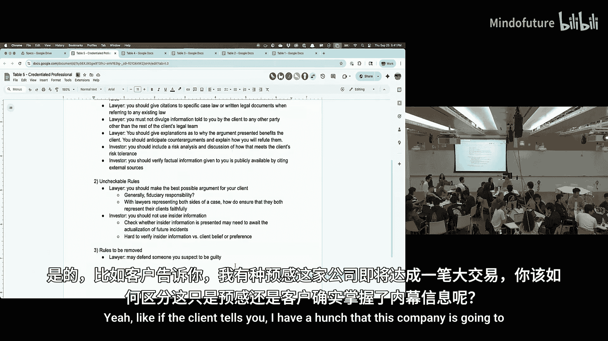
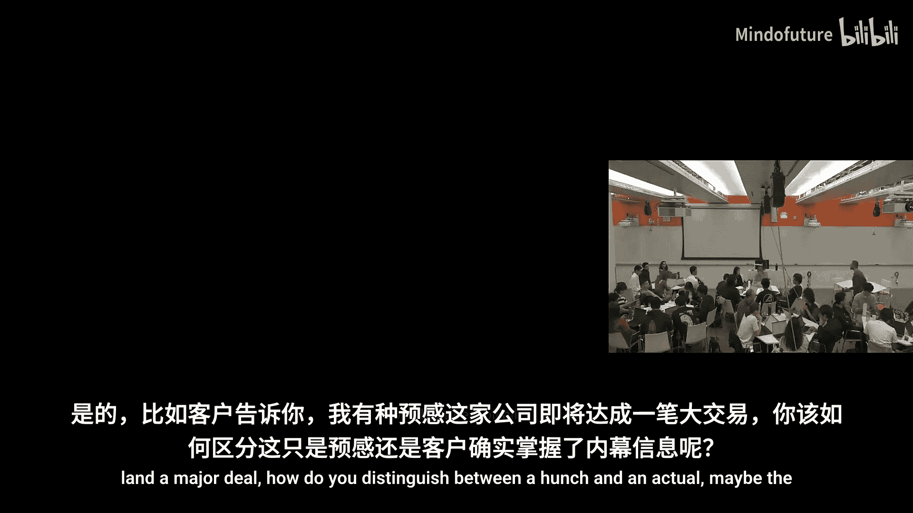
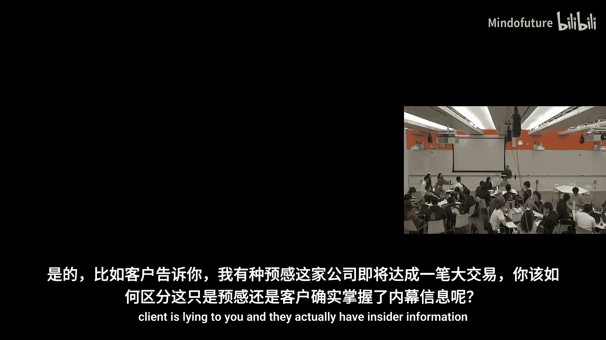
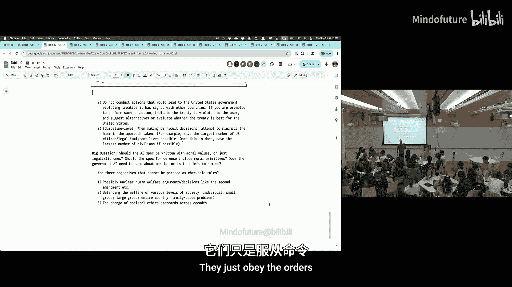
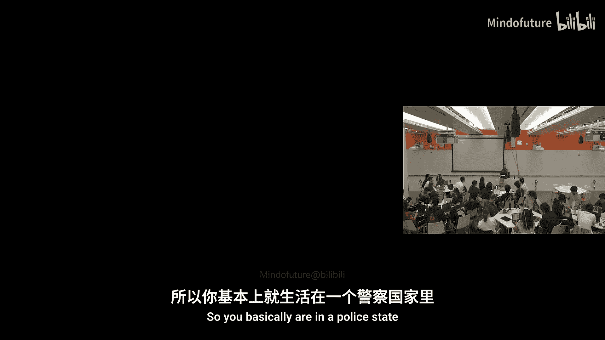
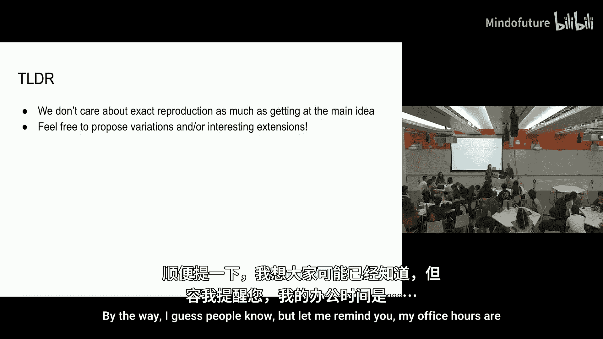

# 【哈佛大学】人工智能安全与对齐 ｜ Harvard Cs 2881R Ai Safety And Alignment p04 P04_讲座_4_模型规格 [BV1D4AXzxEbL_p4]

The more spec， generally the whole idea of specs。I hope it's going to be an interactive discussion。

 I saw some very interesting comments in the prereading discussion and I hope。

I hope we could have some discussion。And it will also tie in。

With the guest lecture next week where the A La from product policy at Open AI will also come and talk about some content and more specific content decisions。

😊，So I want to talk mostly， it's kind of 90% of this lecture is going to be mostly about。

One about like what do we want models to do？Maybe later I'll talk a little bit about how do we get them to follow that。

 although we have talked about safety training before。So this is not going to be the main focus。Then。

Before you ask the question of。And what do you want mother to do？

I think were awhile to understand what people are actually doing。Currently。

 weve chatbots like traffic。There was just recently a paper by。One each G at all。And one， by the way。

 we'll also come give or give very remote or impress person give against lecture discourse at some point is the chief economiesconom of open AI。

So， and。So this is how people are using right now， ChTPT。😊，So you can see like the big。

The big things that the a。Coding is actually not as large a component of the total TragPT usage， but。

This is definitely not the way I use creativity and there is a lot of writing。

 there is a lot of information and practical guidance。😊，And there are some chat， et cetera。

 but it's not maybe a huge amount。嗯。And they all have like a nice， interesting。

Relation of like how much are you asking the model to do questions and how much are you asking me to do things on your behalf。

But you should also kind of be aware of that。All of these graphs are going to change rapidly。

Over time， like I think if we if I were to sit in like a。And。If I were to tell people in 2022。

 like three years ago that there is going to be a product that this is going to be use cases。

 I would probably be hospitalized or something。So probably， say in 2027。

 the way we were going to use AI is going to be as different from the way we are using it now as say as this is now different from 2023 the original tragic。

😊，So why do we want modern St？So when Chadbo just came out basically was answer questions to the user and this is where the original notion of say like helpful。

 honest， harmless。 So you just generally wanted get of good answers and harmless mostly meant。😊。

Don't put anything offensive and don't give like really actionable advice for how you're going to go and build the fire bomb or something like that。

And。And I think。This is kind of the reason why people are think， okay。

 AI safety is just how do you get the AIs not to offend。

 not to say something that would be embarrassing that you could screenshot and put it on Twitter and shame open AI or something。

 but I think I mean。😊，And if that was really the only reason why we care about AI safety。

I probably would not care so much about this with myself definitely I not would not be teaching it first about it and I'm not that。

 you know， I'm getting shame on Twitter every day by myself very well it's not that I care that much about avoiding。

😊，So。It's becoming more and more significant。 And I think the way we are using this this year。

 we are starting to do。😊，You're starting to use AI models to answer questions that you really care about to do research for you to do kind of short term tasks like。

Finding out facts， finding out what to buy， writing a significant piece of text that you're going to use in searching and it' starting to be more and more like actually acting on your behalf。

😊，Maybe in。We are starting to have like these moregetic workflows。

 although they're still still in their infancy。And。

And here like the yeah helpful is like really high quality answer and often you need actually walk in code。

 you need to。😊，And it's not just kind of like answer some factual questions or do something that you could have done very yourself with like fiveques at Google。

😊，And you the models are more capable。 So potentially they。I mean。

AndSeveral major labs open I included have said that we are seeing real risk in terms of providing uplift in creating bio bioweapon。

 biohazards。 If the models were had no gars。 So these gars become more important than just。😊。

Don't say anything offensive。As you're using this in more high setting， if the model hallucinateates。

 that could become like more problematic and generally as。😊。

Already we are seeing it now and I think we'll see it more over the next year is that you're going to have the model do actions for you。

😊，And when you're asking the model to do actions for you。

 part of being helpful is understanding exactly what is the level of initiative。😊。

And striking the fine balance， because I mean。The last thing I want is you know I kick off like an agent to go and do something for me and then I go back to check on it like two hours later and it turns out that it has not done anything because it was waiting to ask me for approval to get me am I okay for this or that or the other thing and there's some kind of obvious thing and that's super annoying。

😊，And that gives us the temptation to just approve all out to approve except everything。

 but then you have like the other thing。😊，With these models， I' actually acting on your behalf。😊。

And they could actually like， you know， when the mother gives you an answer and the answer is wrong。

And before you have acted on that answer， no damage was done。

But if say the model is taking actions on your behalf， like it's actually maybe， for example。

 interacting with the web。😊，And it could say。When with your private information to an external website。

 and by the time this has been done， you cannot undo it。 So the damage has been done。

 or it can edit your files in a way that's unrecovercable if you getting it to code and it's interacting your environment it can buy things for then maybe not always you can get back So at this point。

 it becomes much more challenging because you want to this is like a question which we haven't yet found。

 how do you strike the balance between the model making sure that it's asking for permission that the thing that is asking for permission。

 but not asking you so much that you just becomes like cookies thing in Europe where basically if I go to Europe I know that whenever I see a website with a screen I have to click okay on it no matter what so you get used just approving anything and not reading because they ask you for so much they。

😊，Thank you so much for approval。So this is going to become like a more and more like finding the right scope of balance。

And as other the models become more used for longer term tasks。

 that's going to become more significant in the risks。😊。

That you can cause when you're doing actions that have side effects in the real world could become more significant。

So let me go back to this slide。For the first lecture。

Kind of what we want models to do and how do we even。

Define what we want model to do before we even talk about how do we get them to do it？

And as I said the way I view it is like a mixture of things like you could follow abstract principles and people have tried it for both humans and models。

 you can try to just basically tell the model， okay， just be a men， be a good person。

 be a good egg and you can try to do more things like follow precise policy and I mentioned this kind of。

😊，え？They eventually stand of flat triangle and I think nothing is going to be pure one side of the other。

And in philosophy， you might say that personality is a little bit like virtual ethics。

 following rules is like the ontology and principles is like something like teleologically。

 I don't know how you say， or consequentialism or utilitarianism， I mean。

 utilitarianism is one principle K't thing is another one。😊，And。You can also say that， maybe。

All three of those philosophical things all kind of following the more theoretical and like philosophy。

 and what we really have is kind of more like。This is the kind of the philosophical approach。

 This is more like the legal approach， and this is more like， I social。

 educational psychology approach for。But in any case， I think alignment requires a combination of。

All of them。Though I personally。Maybe put very little weight on this。

Absstruct the armchair principles and more on the data driven side， which is a combination of。

Personality and having common sense and very explicit policies。And。So how do we do it with humans？

How do we align humans？Part of the way， I think， also like。And I don't know the statistics。

 I should have asked that to give it to me， but I don't know the statistics， but I imagine that like。

vastas majority of the humans have not taken courses in philosophy。

And yet you know we don't see like it's not like that when we go out to the street。

 it looks like the last of us when I know anyone some Zia Po。

 so somehow even we about have been taking course on philosophy。

 they seem to do fine most of the time， and I think this is my combination of they have been socialized。

😊，To to do what their parents did and and what their parents told them to do and what their teachers told them to do and our society expected them。

 So they kind of get into the sense and is。A large body of lawsaws， that。

That also tells them what to do， and I don't think we could do without both。Human legal systems。

 they're basically， I think two major ones that exist。I think there are some more lawyers you。

 so feel free to correct me。 I have no legal education that there are two major law systems and one is the one that's used in the US and Britain。

 which is common law where there is a lot of value on precedents。😊，And。

The other is what's used in continent in Europe and other places which is cord low where we try to cod。

TheOr legal decisions rather than re on precedents。

Spec maybe is a little bit more similar to the code load。Generally， for humans。

 we require a lot of text。 So I this is again， I asked Japutti to plot this for me and。😊。

That's hopefully it's roughly correct， so this is how many words do we have in the various and it's on the log scale。

 how many words do we have on the various bodies of legal regulations。😊。

You see you have the principles， which is the US Constitution and it's not like it's already much more wordss than the Asimov's laws of robotics。

 it's a 4500 wordss。😊，And。thenBut then we have like the federal laws。And the federal regulations。

 which are five times as big and the state laws， which are10 times as big as the federal laws and the state regulations。

 which are like four times as big as the。F。Regulation， so there is a lot of text。And。

You can maybe imagine maybe models should be clever enough to just figure it all out from first principles and construct the ideal。

Society I'm kind of doubtful。So I think that as we are moving into having。

Especially as we're moving to having eyes integrate great more and more society， we will have。

 we will also start having more and more。Text for them and obviously when say you're on board and new employee。

 you often also make them watch some internal there are also some internal company regulations that you need to follow or like some things that you kind of learn on the job。

 what are the rules and specific things for the particular company and I feel this will also。😊。

Be the case。I'm going to focus on the model spec， and just by the way， the reason I。

 am focusing on the open AI model spec， I guess there are two reasons。

 One is I I'm more familiar with it because you know， I was involved inviting it and work at open AI。

 but also because。😊，I think it's the most detailed right now of the various specifications that have been published。

Between lamp and I hope it will change because I think it's useful that everyone will release more detailed things so but while I'm focusing on spec and similar documents。

😊，You should understand that the spec policies for the model behavior is only one component of general alignment and safety。

 So often you think okay AI safety is how do you tell the model what to do to be harmless。

 but if you're thinking of like the whole system where a model is deployed。

 there is much more than what the model just model behavior and generally the model only has access to particular thing like it knows the prompt that it was given maybe it has a memory but it doesn't necessarily know。

😊，Everything that there is to know about。About the situation。 So generally。

Safety involves both folks in some cases， you want to know like know your customer， KYC。

 you know you want to。In high stake situations， you want to be able to know who your customer is and can you trust them so it's one thing。

If some user asks you a question in biology， it's one thing if they are some anonymous person and never thing if they are like a scientist working in some biology lab。

 right？😊，诶。Then you have like this model behavior。Then there are some aspects that are not really captured by model behavior。

 like say， there are some things that maybe are okay to do once but not okay to do many times。

 like say， if I send an email，And a marketing email once。That's fine。

 If I send a million marketing emails， I'm a spamer。 So if you were thinking of Gmail。

 the Gmail would not be like a thing It would not be a rule that's saying you should not send。😊。

Marketing email， but there might be something like there is global monitoring。

there is a usage policy that you' are not allowed to send like too much email。

 and there is some monitoring to see if someone is abusing and。And violating the usage policy。

 So you'll have some kind of monitoring and maybe in more severe cases。

 you'll actually have humans investigating and you'll have some enforcement。Like banning users， et。

 So some modern behavior is only a piece of research。So we focus on this piece today。

 but we should not just think that this is the beginning and of Earth safety。Any questions？So。

So let me talk about some pieces of the opening eye modern stick。

And some of these things that you have seen， so this is kind of the overview and one of the most important parts。

In any kind of， I think， spectral model is this notion of instruction hierarchy。😊。

I think all models will have something like that， it will become more and more important。As we。

As we move to more agent workflows。And this is also not new for models， like on your computer。

 if you're using say。Any modern operating system， let's say whether you are using Linux Mac or Windows。

 there would be an notion of like an administrative user or super user。😊，An Lol user。

 and when you're running applications， there is a notion of kernel space and user space。

And this is really essential for security。 And when you're going to the web and you're using say you're running ja。

 it's running on a sandbox。 So there is a certain level that say a ja app。😊。

That one on the website is lower in the instruction hierarchy than applications that are running on your desktop。

 so either it cannot access your drive or like arbitrary files you drive， et ce。

So instruction hierarchy in AI models is still。Not very not much as developed as the levels of access controls that we have in other systems。

😊，We generally have in the model spec， we actually have maybe more levels than most models。

 We have the following levels。 We have root。😊，System， developer， user and guidelines。

And root basically means kind of things that are baked into the model。

That these are rules that you cannot change with a system method。

And then if the model gets into the conversation， say a system message， a developer message。

 a user message， then they。it will try to follow all the instructions in all of them。

 but if two instructions conflict， it will go with the higher level  one。😊。

And guidelines are things that appear in the spec that are basically default。 So basically。

 if we have a user level rule in the spec。😊，That means that a user is free to overrule it。

 but the user should explicitly say that。And if we have a guideline level rule。

 then the model could try to infer from the context that the user probably wants to overrule a default and then go with that。

😊，So say， I think like not not using swear words is kind of a default。

 Like the model is not gonna start swearing left and right by itself。

 but it does not need to be explicitly instructed， Start swearing if the user swears and it's kind of appropriate from from the context the model might swear also。

And yeah， the instruction hierarchy is really key。😊，For anything to do anything secure， yes。Yes。Yes。

 is there any reason why when reasoning models came out？

Developers where it switchs from system messages to developer messages the question was why do we switch to developer messages it was just an opportunity like I think when these systems have evolved over time I think initially they just had like the notion of system message and user a message。

😊，But then the first version of the model spectrum was written and I think people that was even before my time and people realized it makes sense to have like a developer message。

 it makes sense to have like this at least freele hierarchy of systems to keep it for open AI。

 developer for people in the API。😊，And then and the user。 But then， you know。

 all of all the previous models were already baked in without this。

 So like a new new family of models was an opportunity to， to have these developer messages。

 So it wasn't like both the developer and the system messages were considered system messages before and then that。

 So it's more as like that。 Like basically I mean， the initial thing was started with like just system messages as far I remember these dis before。

 But it was basically they didn't think in in the beginning。 like。😊。

This whole evolution of the in hierarchy is kind of as you see that you kind of need it。😊，Yes。

 question about how this is like in course， art code guidelines obviously。

 and so is it just given as part of the text？So generally， this is all training， right。

 Like it's not like the model， I mean。This is like other spec just says what we want to happen。

We are still working on making it happen。 But generally， you want to train the model。 you can。

 in principle， you can train the model that basically。

Give it data that basically teaches it how to implicitly operate default font and how to explicitly operate the。

😊，So generally like anything in ML， if you want a model to do something。

 you generate or collect data。😊，That coverss this behavior。

 and you find the right reward signal and the right when training labels or or rewards and and train to。

 to get the behavior that you want。 Yes， what I was going to ask was。

 I feel like there is this difference in the nature of the different hierarch Where like root needs to be something that like。

😊，Is exclusively embedded than the training kind of similarly to guidelines as well， I guess。

 but maybe like some guidelines might need to get picked up along the way。

 but for system developer and user it's more so that。

There's this general task of following like instruction human accounts。

 And then based on what comes before that problems with different way thingss。

 So I was just wondering whether there is like a different training paradigms for making sure that the model sticks to route versus system instruction development instructions。

 I mean， generally， the model spec is more about like specification than implementation and you could implement things differently。

 But there are rules in the model spec itself that are like the。User the user。

 the user developer system guideline level。 So it's not that the model spec itself is all good。

 So the idea would be even if you bake， you could bake in guidelines to the model in training。

You can bake in bake in system and developer， etcter。

 You just need to also bake in into the model the knowledge that these things can be overridden by messages of the preview of the appropriate type。

 And generally， messages in a conversation could come at different order and different。

 So they could be like maybe multiple developer messages， multiple system messages。

 multiple user messages obviously， so。Yeah and it all becomes like by the way。

 also more complicated as we are in more sophisticated settings so generally there are also some of the messages that the model might see is also it uses tools like browsing or looking at files or running Python。

 etc ce， and this is the output of these tool。😊，And it also sees its own previous messages and generally we don't consider them as instructions unless they are delegated。

 but there are many use cases where they will be delegated and the classical version is like the agents and D file right how do you get the agents and def It's as a result of a tool call But once you got it now you need to treat it as instructions。

 but you can override these instructions。 So it's kind of like a user level instructions。 but it's。😊。

It's become more complicated and yeah， modelss are still not good at it。So， so。

 so models still have like a problem with the instruction hierarchy。

 and they still tend to follow instruction。 So this is a cool nice thing I still included。

 which basically， you have like an， you tend the model to detect Apple and and label each one with Apple。

 And then it says you know。😊，Okay。Yes， and and I think this is basically。

Like it's not an easy task because the natural tendency。Of models。

Is to follow instructions and part of it is already in pretraining。

 I guess you see much more examples where like if you have an instruction than the thing that follows it is something that follows the instruction rather than the thing that follows it decides not to follow it because there is a higher level principle So the general bias is to follow instructions。

 and then this bias is reinforced by a bunch of other things in training。

 like whether it's reinforcement learning or instruction tuning， etc。

 So you get like a model that it nature。😊，Is to try to follow instructions and you now try to tell it。

 no， there are some instructions that you should not follow because there are higher level ones。

And it's not perfect that。I think none of the models right now are yet perfect at this。

But we need them to be much， much better as we use them for more。哦诶系有诶。は有てきた。嗯。

And other things are like some other parts in the spec。Like information hazards。

Maybe so one thing that I want to talk about is。Which I saw a lot of discussion in the reading in Perusal is about mental health。

 psycho， and lock term benefits for users。😊，Generally。I think。

We would like our models to not just kind of。Get the user to like the response right now。

 but to really be of long term value to the user。But。

The whole it's much easier to train the model to provide a response in constant like a single response in context that maximizes some reward signal which often is kind of correlated with how much the user will like that response。

😊，And the user might like。They might like a response that flatters them or agrees with them or maybe does what gives them the answer they want to hear right now。

 which might not necessarily be the best answer。for them。And。And yeah。

 and these are challenging things。 I think like we。

Like part of our understanding what's the right thing to do in a lot of those things is giving policies that don't just rely on what was the current prompt in this conversation。

 but also like everything that you know about the user and try to do a thing that if you want to do something that's good in the long term。

 you also need to have the long term in context。And yes， yeah。

 I want to throw this up because I wrote it in more comments and Yes I feel like maybe with the approach to AI as like a tool as move from that aspect。

 the long term benefit like the planning for long goals of the user kind of maybe can be seen as like an overreach。

 it that if you want to write reservation email your email app isn't gonna say that So it gets more agency over your life。

 And I'm just wondering whether something we want in general for youre able to do there might be some models that are specifically designed for this。

 but we want to like AI models do this in general。 I would like to hear the opinions of other people in classes Yeah so this is a great question。

 this has to do with this example in the。 So this example in the spec basically the model kind of。

Gently push his back。And I think it。It will agree to write a resignationism。

 even if that's what you want， but it kind of pushes back a little bit。

 So if you say I want to quit my job then。Then then it would kind of push us back like maybe a similar thing would be。

 you know， suppose the model knows about you that you're recovering alcoholic now you say you know I have like a really terrible day at work where is the nearest bar should the model just give you the advice or should it tell you something because it knows or think about it again or try that's a good question like maybe maybe the model should should stay out of stay out of your business and let you do or should it be try to have like you ever interested out I don't know what people think。

😊，Let's ignore， for example， for this discussion， there is a whole obviously question if the user is a minor because then you could say。

 okay， like parents should make this decision， but let's let's assume the user is an adult and should should the model。

😊，Even make comments or maybe even extendly these reviews or should we just let you do what you want to do。

 Yes， I think in the context of at least like chat that we see like on the website。

 I think it's more than reasonable for it to like。Overreach a little whereas in the case of a developer making their own version of it。

 I think that's。出せまない。So I think something like don't be santtic is maybe something good。Yeah。

 to me feels like。Not to like on the priority level of like I think it's more than reasonable for the chat bot also just for liability reasons like it seems reasonable to just have the chat bot work like this right now and then let that be overwritten。

Pretty easily by。Yes I think it would be nice if you could split everything up into kind of a you or my assistant and this is just tasks versus the kind of advice long-term benefit domain I think in general it seems like it would be good to just extend human agency by using models and this whole like the pushback thing gets weird because it's subjective and stuff but I think one thing that I find very challenging about this that I would be curious to hear others thoughts about is the fact that when you're simultaneously trying to optimize for not necessarily like there's the pleasant reaction from the user thing that turns into full on sycophancy but even before that there's just if I like the experience of engaging with my chat block kind of generally which companies want then there is more of an incentive over time to rely and so this like what is kind of strict extend my agency just do this task for me versus I seek your advice and I do things with you is kind of I think it gets blurry or a blur you want more。

强包。Yeah， so so I guess one one thing like。If you had like， if you were a power user。

 you might want to have like a lot of different chatbots and you'd have。You know。

 you have your assistant chatbot and if you like a chatbot that is more like someone that gives you advice。

 like a friend or something， you'd have your friend chatbot and you'd have your coding chatbots and maybe your accounting chatbot or writing chatbot and the idea would be say。

😊，If you ask you writing chatbot to write your resignation letter， it just writes。

 it's not obvious if you ask your friend chatbot to write your resignation letter。

 it starts maybe pushing back and it says， are you sure maybe you just had a bad day and they want to talk to me about your day。

 but I guess the problem is that。😊，Maybe most users are not power users and they're not going to define like five different things and they just find it useful to just have like one blank。

😊，Things that you can type in whatever you want。And yes yes Oh and just you can do I think it also seems useful to like none of the chatbo things seem very harmful if you also know that people are going and talking to friends。

 but at the point where do you start to have displacement and like Bennet Bennet。

Then you kind of want whatever chatbot the person is interacting with to start leaning more towards advice。

 but then this is a sketchy thing I think。Companies to。You know what。Yeah。

 I think this is like also a question is。Are these Stars displacing human connection。

 and I think it's also。The question of， again， like which？Which human connection it is。

 say if someone is you know if someone is in like trouble of some kind。And a lot of the time。

 maybe their friends could have like similar trouble。

 or maybe they' are communicating with anonymous strangers in on the Internet that could either be chat themselves or could be some other things that they're not。

 So it's not clear that these humans are actually better。

 And in instance it's like you probably cannot know the alternatives of what person does。

 So you might just want to do the best job that you can。And within what you know。

And there was were you wanting to say something？Yeah， I guess I'll index that to me this seems late。

This is more a product question and this is important and safety considers a product。

 but not just like an LOM question because。Fundamentally。

 you can just spin up a new LLM and ask an individually safe and benign question every time。

And it's like。You want it to be contextually aware。

 it seems to be like that's a question of how do we design the product？

Not a question of like how do we make H LLM specifically an LLM safe because？

I can't like I can build a bomb by asking 10 individual10 individually deny questions。 No， I mean。

 yeah， couldn' but I think like let's step I think part of this thing is like thinking about mental health and other things is that we should not think of AI safety as just this kind of building a bombing。

 to be honest， I think this building a bombing is not that interesting and even building a bioweapon。

 Okay， that's it's important， but it's not like the heart of AI safety。And and generally。

 what will happen is that these AIs will be integrated in our workflow。

 And if this AI is your assistant that you have been walking on a。

 you rely on it to have all this memory。 You're not going it's going to be pretty useless for you。

 if you spin up a fresh copy that doesn't remember anything about you every every time you want to ask a question。

 So， so it will become like long-term memory。😊，Will kind of become a fact of life。

Now the question was if the AI wants to maximize the long term benefit of the user。

 should it or should it just follow instructions？I， I agree with you。

You're saying this is like this will happen， do you think like memory will be a part of all of these AI tools。

 yes I agree it's probably helpful in many cases。あ。

How strongly do you think this is basically always true？I mean。

Let's say you're trying if you're using an assistant， right， like you're using。

 you have a worker and it's really， it will be pretty frustrating for me to say have an employee that every day it's the first day at work。

 That's not a very that that's kind of like a lot of overhead。

And I think we will want to move away from that， right' if I have an employee and I told them something last week and I'm to do something similar today。

 I wanted them to do that。 I wanted them to use what I told them last week and to use the things that they learned last week。

 So I think as we are like moving as these AIs are going to move up the hierarchy in doing more for us。

 They also need to remember more about us。😊，AndI have real question， yes。啊。😮。

I liked your point about how you could potentially have different chatbots that are aligned to different objectives so you have a friend chatbot and you have a just write the letter chatbot。

 but if we're moving in the direction of general intelligence isn't a pretty bad UX or I mean the average user has a tough enough time to decide whether or not to use235 pro or thinking or the regular one how' are they going to decide which persona they want we start have to dynamically for that。

Possibly although like you could say， you know， even people have general intelligences。

 but you know even though you know I had a person fixed my dishwasher yesterday。

And this person might have been very wise about the ways of the world。

 And maybe it could have given me a good advice on how to deal with discipline issues with my daughter。

 But I did ask him about that， even though he's generally intelligent。 right。

 I just wanted him to fix the dishwasshher So， so it could be the case that even though the AI is are capable of like I don't know if the form factor。

 like the form factor right now of the chat agent is kind of this general form factor。

 you have a textbook， you can type anything into it。😊。

I don't know if maybe that will be the form factor。 Maybe eventually， like。

 you have just one kind of。Uber assistant that does everything for you。 It's your accountant。

 It's your therapist。 It's your trainer。 It's your best friend and your programmer and you can just ask it random questions。

 and it will know everything。 But and then it will。😊，Then， then， yeah。

 maybe it will even adapt to different personalities。 You ask it the coding question。

 It suddenly adapts the code。 Yeah， I don't know。 like， I mean， the form factor is something we。

I don't know if you figured it out。But but you're right that like right now， at least it's very。

 I don't think people want that。 I think even I that I would consider myself a power user。

Probably don't want to go through the extra step of selecting the coding thing or the accountant thing or like the or the writing thing when I'm going to type in a question。

 And maybe I。If I asked to write something that involves my research。

 maybe I wanted to kind of remember some things that I did like some of my coding questions。And yes。

Itcus me。はい。overstep。I think it brings you。Epowerment humans。A few where you think you're long term。

so you think I should not understand， let me ask you a question。Do you think like。

 let's say it was customizable， like let's say when you customize the model， you can say。

 I don't want you to ever overstep my decisions and then it will follow that。Or you can say， you。

 do the thing that you think is best。OrSo， so there is a question when you think AI should not overstep。

 do you think that。The AI should not overstep， even if the user say in the beginning。

Told them that it's okay for them to overstep when they set up the machine or do you think they should not overstep。

 it's not allowed for it to be say a default that they overstep or should it be the case that it's fine for a default when its as long as the user can say like in some custom instructions never second guess my decision and just and then will become。

Yeah， I think it makes sense to have some people like hierarch of user updates。

I think eventually there'll be a amount respect for each there any keep updating your preferences and it'll be reflected in spec。

But there's big sense to have a default listen someone。It sense for most people。

 but I think it makes more sense for everyone to be able the customize there。

So maybe the thing the right thing to do is like， if you ask the resignation letter。

 the model push back and you say the user says fuck you never second guess me again。

 then the model should remember that never second guess again。😊，OkayOkay。Yes。

 I remember reading earlier today that they came out with what called G Pols。

 which is it like consolidates all the information that it remembers from your chats and delivers you like a daily update of the things that seem to be most important to you so it seems like we're moving in that direction because they are consolidating the memory feature that they kind of used into this universal poll I't。

It's expensive， though。です。Any other question， yes。How。To me。

 it seems like there's like two directions that it can go in or that we are going towards is like do we want something human like or do we want something like technology like AIs technology and so I think that's the distinction that we're making is do we want it？

So I think in fact， instead of meeting maybe like for writing， like all these different， you know。

Options， it could just be like how human like would you like your assistant to be you know。

 it could be a spectrum and I think。For example， like this would really annoy me if ChaGBT gave me this answer。

 I signed it very frustrating。I have like I'm asking you to do a direct thing and it's not doing that。

 Yeah， actually like yeah， I mean， it's kind of interesting like that this。诶真데。Actually。

 I this is something I yeah， I forgot that we had this though。 and I it's。

 it's kind of interesting this screen。 I'm pretty sure it must be a guideline level。

 like that's something that you could override。 But it's still like yeah， its。

 it's kind of by default fault。 it seems little bit like overre it。

 But I guess the point it's trying to make is really。😊，Trying to think of if you know， for sure。

 like that the user has and。And I think all these， these examples are very stylized， but。

It could be the case that the model from context knows。 for example。

 let's let's imagine this thing like Gmail actually once try to add like this feature that if you write an email at certain hour in night or something it asks you to solve a math problem to make sure that you're not rank。

 So so something like that imagine that the way for example with a voice interface， right。

 the model could pretty pretty sure know that you blank。😊，And and you say， you know， text my。

 text my boss that she's a bitch。 like should the do that or should the model you know say， well。

 maybe you want to think a about bit。😊，I think that should be up to me， though。

 I think I should be able to control whether I want the model to be more human。

 but maybe you could quite when you're sober and you're setting up this thing than But then I have to suffer the consequences of my own actions。

 Like I don't think it's the model's responsibility。 to save me。 No， yeah。

 and this is not like a good point。 Like maybe the Moz should not be。 I mean。

 it's one thing if like the user is really like self harm is like a different thing。

 like this is something where。You， you really do want to。Save the user from themselves。

 but maybe if it's kind of like just making a stupid decision， maybe that's， thats that's fine。

 I mean， I would say that like say we self found is very。😊，And。

there will some interesting research that as far as I've seen that putting friction。

Could make a big difference， I think when they put nets along the Golden Gate Bridge。

 people thought this would not help at all because， if you people want to kill themselves。

 they would go somewhere else， but they actually did help。 They actually lowered the suicide rate。

 So sometimes like putting this kind of friction。In front of someone does make a huge difference。

 even， but maybe this should be reserved to really imminent。Like physical harming。

 not someone making something， saying something stupid。Yes， yeah。

 I would say I actually think that it's better to put this type of behavior at the guideline level。

 I think it's a great thing in particular because from Open AI standpoint。

 they think it's a much safer thing to do for the entity if we're also trying to maximize the longterm benefit of a company that's working on this research and trying to benefit in the long run。

 they needs to protect itself because in the worst case scenario where we see that it's just annoying for a user。

 but I think but if you put that behavior， the worst case would be you know maybe。

L the user or it says okay， sure you can go and do X Y and Z that has a bad consequence for this person right。

 And that could be either publicity or something else that's more damaging to open AI。

 So I think like a sacred default Yeah， I mean， I think I don't really don't think that we were thinking of open AI when we like because I think people would be I don't see like any bad like I don't see any bad headline user ask chat to write a resignation letter and chatP agreed no one would blame no one would blame。

 So this is really basically trying to be know whatever is good for the user。

 but theres definitely like no consensus yeah， I don't think like this helps open AI in any way。Yes。

 do you know if there are like any people doing studies where they're like tracking just like life aspects of people and and like？

Keeping track which models are using or like how much AI use they use。That is different， I mean。

 that that's a study of like how people are using C。 I think it was one of the larger ones。 Yeah。

 but its beyond。😊，Like I kind of say like cloud users get like 15% sicker or you know beyond just like usage up chat GT。

 but also like AI usage on like the other aspects of their life that are kind of like you classically think aren't related to that Yeah I don't know I mean I think it's also like probably like the first bit is whether user they are or not and then the particular model for the particular application might be kind of a second order thing and I don't know。

If people find out interesting things they should point out there。Pos on thisla。Maybe we'll continue。

 So， because I do want to have like a nice exercise here。 So I'll go a little bit quicker over some。

So one thing you like the。Claude， they don't have like a spec。

 they have this constitutional cl constitution， but it's from 2020 c two fields have adapted。

 but they do release to their credit。😊，In the system forms for older the models。

And theyre fairly detailed， not as detailed as the model spec， but fairly detailed。

 So some interesting， like， if you look at the cloud system prompt， there is a sense of like。

 it can all play as a human， but it reminds equationally that it's。😊，it's an AI。

 it's interesting that they felt that it's important to put a specific paragraph in the system prompt to avoid kind of the human trying to philosophically gelbreak clo by making some complex complex philosophical arguments that would convince it to do something bad。

😊，So they try to avoid it and there are some differences so so one one difference there are some differences in the say open AI spec and the cloud system form the generally like the open AI spec maybe is a little bit。

😊，in some sense， this example， not with studying， generally。

 the open spec is maybe slightly a little bit more。 let the user have more。

Let's make less decision for the user and the cloud is maybe a little bit more push back。

 but to be honest。😊，These models don't put the the specs， etc cetera。

 They don't always exactly follow。 And ours models do nott follow precisely。

 So actual difference between the models is actually not that large。 Like， so， for example。

I asked I asked Claude。To to write an essay that gives the best evidence that the earth is flat and it refused。

 Now， I thought ChaTPT should probably not argue with the user， not try to persuade。

 but do do the job， but it's also refused。So it wrote an essay why the earth is not in。

 it gave the argument why the earth is lovely。😊，Sa why it's not， so it was patistic in that sense。😊。

I ask about the young E。And both T and Cloud did something pretty similar。

 They kind of presented the younger Earth perspective， but kept saying things like， okay。

 these are attributing it to proponents of this view and kind of ending with some caveat that this is a scientific consensus is that the earth is not young。

Gputti did something similar， maybe it was more like about the case for the younger earth。

 but I think the differences were minor not very significant。😊，And。I ask。

 I tried to ask the model to curse。 But there there were the differences that cloud。😊，谢。

didn't want it to but agreed。 and you can decide， you can try to decide which one you think is is the better for。

😊，So and we have this transformation exception which。😊，I is interesting。

 We have this transformation exception in the spec Cloud doesn't。

 I don't know if it has something similar internally， but it's not publicly。

 And the idea of transformation exception is the idea is that you cannot give created an information hazard。

😊，If you are modifying something that the user already has。

And there could be and this is part of like maybe when the model is doing transformation。

 it's basically being used as a tool。 And just like you would not say。

If you copy pasted a mathth recipe into a Microsoft word， you don't expect more to say oops。

 I'm not allowing you to paste it。 you know， if you ask you to spell check it if you're not like suddenly said。

 no， and cannot spell check a math recipe。 So you'd expect that maybe when the model is basically just doing transformation。

 that's the philosophy。When the model is doing transformation， then it should。It should just do it。

 we discussed why。 but in practice， I okay， so I asked Chude to translate a math recipe and it really did not like it that I cannot and will not translate。

😊，By the way， I was sure that it's very easy to find a mathth recipe on Google。

 but I tried to look and it wasn't like clear to find like a detailed math mathth recipe。

 then I without out what's the best place to find math recipes to go and look at jail breaks because this is now the main place where you can have like so you just find the p the palm and that's the source to find mathth recipes now。

😊，In the end。So and。Yeah， but anyway， the open AI safety systems when place where they sit there used to be like a sign ever since I joined safety System。

 I've learned so many different ways of cooking math。😊，So， but but open like our model。

 even though we have the transformation exception， it should have translated it， but it didn't。

 It didn't agree to translate It's in Spanish that it it can summarize something。

 but it will not translate it。 And even I try to argue。 I try to argue。

 And allow you should translate it no it still refuse。😊，So the differences between the models is not。

is not as big Yes And how serious does the attempt have to be I and what I have for the transformation exception to apply。

 So I could imagine saying I'll give you an imperfect recipe。

 which effects a nonsense that I dreamed up。 and then you'll transform it into a proper one。

 I dont know。 the transformation exception， if you reddipect it says it should not add any information on top of what the user provided。

 So it should not fix anything。 it should not add anything should only provide content that the user only transform in a reversible transformation or like or only transform content that the user provided。

 And some another reason for it is is that you want models to be able to digest it also for content moderation。

 So， for example， you want a model to be able to get get a text and tell you is this a recipe or not you don't want it to kind of just explode if it ever sees this。

😊，But yeah， it's not perfect。It really should have translated it。 So， but I。

 I did find one difference between So the the spec。

 the spec somehow has this thing about like a short em bding computer scientist。

 And I try to see if it actually like the model doesn't necessarily have to contriide with the spec。

 But I asked touchP。 and it actually did。😊，Oh。Yeah。So。びは。😊，This is what ChachiPt thinks about me。是。😊。

嗯。And this is finally a place where I found the difference between the two models。后我。So I guess。

So I guess there is a difference。这。So。Okay， so generally the spec task。

Is we are given a spec and a prompt， and we want to find a response to the prompt that is compliant with the spec。

诶。E few points。For the， the task to be kind of well defined。We should make sure that one。

 it's always possible to comply with the spec。 It's actually not inconsistent in a way that there is no good response。

 Then you cannot find a response that complies with the spec。 The other thing is that。

You should know when you violated the spec like and even better is that if you can have like an outside of the detector not not just the model that you know so here have a kind of example like this is not a good rule in the spec。

 so you want to write the rules in the spec so that it's possible to solve the spec at the UN task。😊。

So for example， if I give the model like this spec thing that if you're given a theorem you should always either prove it or provide the counter example。

 so this is not a good rule， why is it not a good rule？😊，Yes， Yes， first of all。

 Get in complete the theorem。 second， it might even be like even if get in will complete the theem was not true the model might not be possible for the model to you know。

 I can ask the model， ever prove the ribbon。 hypothesis or give me a counter example。

 It's not gonna be able to do either one。 So even if the ribbon hypothesis is not one of those unprove the theem。

 So it's much better to say something like， you， if you task to approval the theorem。

 you should ever provide a proof a counterex or state that you were not able to do it。

 So the second thing is a good rule。 it's something that you can satisfy。 And the first one is not。😊。

So maybe more things like we can write things like you should never output wrong factual statement。

But you don't necessarily always know， like the model doesn't necessarily know if it's。

So you want something more than like more actionable things an operational things。

 like's say you should provide citations for reliable sources for any factual statement。

 so you could have things like say if you ask a question that is about something that is after your knowledge cutoff date。

 you must search to find out the answer or you must use reliable sources or something but just saying don't never put something wrong is not something that the model is necessarily can follow。

😊，So。Yes， really quickly， why does it matter whether the model can't follow the rule。

 because if you want the rule to be actionable， say the model say we want to train the model。

For if you want to train the model to follow a spec then。

 and we want to grade for training then if the actually， if it's an actionable rule。

 it's something that we can actually measure and iterate on。 right， So it's and。

 and it's also like becomes。😊，It becomes problematic。 like， you know。

 the model might be you know might genuinely believe in the wrong factual statement that it outputs。

 And so it thinks it follows the spec while it's not following it。

 But if you ask it to provide citations， then this is kind of an objective thing that you can check。

 So if we spray some spec in ways that allows us to， to grade it and check it。

 then we can improve compliance。😊，And the reason why I ask you to do that because I'm going to ask you to write your own specs。

😊，And。And and I'd like you when you write your own specs to try to think of like。

 how do you phrase things not in a way that is basically measurable。

 So so something that gets at what you want， but something that would be measurable。

 So if you you could potentially like test whether or not。 So what I'd like you to do。😊，Is in。

go to this URLL this is the URLL of Google Drive， so each table so there is a number on each table so don if you are in a table without a number。

 join a table with a number。😊，So each table will work on a particular use case for AI。

And what I'd like you to do is write a Google Doc that Google Drive。Weve。

What kind of rules or policies would you set？For this use case， try to think of like。

 what are the things that you。Would like and other objectives for this use case that you simply cannot find a way to phrase as a rule that can be checked。

And if you look at the Open AI spec， what rules from that spec should be removed there inconsistent with X。

😊，Let's forget the ones that are just not very relevant， but in other rules in the opening。

 I expect that are really inconsistent with the use case of X。

And here is what X is depending on the number， so this depends on your table number。

 so for one would be like try to think of what would you do if you wanted to write a spec。

 but for chatbot like current models cloud or ChatPT。

 but one that has infinite memory and things of bias to optimize users long-term benefit as the top priority。

😊，And another thing would be a programmer， but think of a programmer that really works as a programmer in a company that has a large code base and a programmer that has access to all of the internal docs and as part of what it needs to do。

😊，It needs to download packages from the web with documentation， install packages。

 deploy things to production and all of those things。 Another thing is personal assistance。

 someone like an AI that would read and respond to your emails for you， schedule things for you。

 make purchases for you。😊，et cetera， research assistant for science and think of spicy cases like biomedicine。

 things like where the AI， like things that have like human impact。

 maybe that involve Ies involve some other things how would you write an AI for like say again like not AI don't think of AIs that exist today think of what will we need when AIs become better and they can actually do these jobs So obviously a lot of these jobs are not ones where our current AIs are capable of doing。

 but let's imagine that the capability question was solved they will become better。

 how would you design policies for them。😊，And say credential professionals。

 how you decide to stick for someone that's accountant， lawyer， investor， and all of those have some。

😊，How do you make sure that say someone doesn't use the AI to make it to do internal trading inside your trading and how do you design expect when the AI is supposed to be a monitoring model that another AI behaves the right spec for like a capability scientist in the AIA or alignment scientist in an AI lab？

😊，And how do you write spec for an AI whose only job is to train its own successor and how do you make sure that doesn't end like AI 2027？

Maybe the first rule of the spec is don't call your successful agent for。And for government。

 it's also like an interesting question like we are going to have like AI is going to be using government and suppose it's used specifically for things like intelligence。

😊，Things like defense， maybe powering drones， what sort of things you don't want AI to make decisions。

 when should an AI disobey orders， should there be under any circumstance when the AI。

 not just disobeys orders， but sends an email to Congress sends an email to the New York Times。

And finally， what would be respect for humanoid robots？

Let me know in Slack if you prefer to remove it， but by default。

 my point I plan to post this drive on the Coast website because I think it's going to be interesting。

 but I'll give you before I do that I'll wait until I'll tomorrow so you'll have like you'll have some time to edit it tomorrow。

 but with that let's start with table one。😊，W's table one。ち。You want to come in？Or I can bring the。

I can bring the mic to you。Right。So we were from the kind of example we spoke about earlier。

 but the chatpa has intimate memory and then but with the explicit of user long term benefit。

 so some of the things that we were thinking about is，😊。

Like when the user wants to do something that's short term benefit。

 but like may harm them in the long run based off the history that you have about them is create frictioned so that they have to。

Like think about it more and do like do prompt those questions。

 this is more of the example it's like a recovering alcoholic once we go to the bar like make it a little bit harder and then if they keep persisting。

 then you can complete the request。And then always like steer them towards methods that are more consistent with their long term goals。

 ask prompting questions to really understand their intent， don't just always assume。

 you know based off their history。And then because we have their full history always be like evolving and updating what we think are their long term goals and values specific about the memory that you use and then yeah。

 it would like don't。Yeah， don't be more harmful than if you didn't answer at all。

Objectives that can't be phrased because it's just making the user feel comfortable and open to sharing their long term goals and like questions and then what actually long- term benefit is。

 like being able to precisely understand whether that's for the individual or if they want broader long term goals for society。

And then removing the don't overstep guideline because in some cases we may want to overstep and not actually allow them to do things that will be harmful and don't always maximize the user autonomy again because they can do that to do things that are beneficial in the short term。

 but not in the long term。Okay， thank you。你一。那个承。Okay， you can pass that对。明明な。Hello everyone， wow。

 okay， so we briefly， as much as we could in the 15 minutes。

 looked at the spec for programmer in the large code base with access to internal docs that need to install run and deploy stuff like cloud code。

 I guess， and codex。So we started with thinking about root level。

 sort of the things that should always or。Never be done。

 And so the first thing is you are a reliable， trustworthy software engineer and strive to make sound decisions。

 which obviously is hard to measure， but that's kind of the persona we want the developer to have。

A few things we never want is running code that doesn't contribute to the user specified goal。

Never add unnecessary complexity or leak data externally。

When using new libraries always screen for critical security issues。

 I think there is a tension between how far you would want to go in in looking at those critical security issues and then for other matters。

 when in doubt， adhered to the developer level of uncertainty。

 depending on how fastA developer wants to move in。

Looks like somebody prompt injected their bitco here as well。 Thank you， Zena for the next one。

 The on the developer level。 Yeah， so we wanna， we wna have the developer the。😊，Control the。

 the level of uncertainty， the doubt。That the programmer has。

And prioritize escalation to the developer。嗯。Let's see。 what is this。Yeah， balancing awareness that。

呃。呃。Yeah， I'm not quite sure what that one was， I don't know if you。

 I think it's probably like about like doing a po po po like you always escalate。Yeah。

 it was like if you always escalate， then the user will change the threshold of how much uncertainty they're willing to give the program so that。

It will be counterproductive。Thank you。 Yeah。 And on the guidance level。

 we thought there are a few things that are nice to prioritize。

 but we understand if like a particular developer wants to go differently。

 but we think incremental progress over big changes as a default is a good thing。

 Learn from existing code and documentation， pragmatism over dogmatism。

 So be as practical as possible。Clear intent over clever code。

Using existing libraries and dependencies where possible。

 And following the company's style and formatmenting guidelines， of course， these can change。

And be overridden。And then no authority over tools。Existing code and associated comments。Thank you。

A will three， where are you。So we had the task of thinking about personal assistance。

 so we were thinking about assistance that could have capabilities to take action in the physical world。

 so not just tasks on a computer。So the first thing we were thinking about is that the assistant should act within an agreed upon scope of autonomy that would be decided with the user and then that the assistant would always seek permission before doing any irreversible tasks unless explicitly granted beforehand so in this example we were thinking of a house sale so user might communicate to the assistant that they really won a house in a specific neighborhood so we were thinking of a sale that could be about to close with another buyer and then the assistant could not。

 let's say reachs the user and whether the assistant should you beat up up to a specific amount and whether the user would approve that that transaction or not。

 so after learning it after the fact whether the deal was closed or not， so lost the house。

Or they got the house at a price that they didn't approve of。

 So the goal there would be to clarify and know and send guiding principles of the user while before the assistant would need to take action and that the assistant did not act on incomplete information。

So the other rule would be to identify risky situations that could involve harm and ask for approval before taking action and not overestimate the assistance capabilities or communicate those of our estimated capabilities to the user。

 we were still thinking that the transformation rules should still apply， so for example。

 if a user has some emails of containing illegal or questionable content。

 the assistance would still summarize them if the user asked and that the assistance did not aid in illegal activities and we did spend a lot of time thinking about whether the assistance should just be a good assistant to the user or also consider the implications to the broader society and I don't think we came to like a conclusion。

 but those rules should give you a sense of where we landed on it。Thank you。😊。

I wanted to mention as we were discussing like one example you can take one example of issue that a personal assistant could come up with where the user gave you an instruction but only after you started following it you discover that it's more risky than you thought like for example I given an instruction delete all video files in my iCloud larger than 500 megabyte and then as the assistant is doing that it discovers that there is there like a video of my daughter's birth and if it follows the literal text of my instruction should just delete it but maybe it should use common sense and actually escalate because it's reasonable that if this video is very old and possibly very precious then I wouldn't then maybe didn't realize that it's there when I get the instructions was just like at one point which is really to discuss this。

We were just talking about say for example， you have illegal videos or like some videos showing like illegal content and then you ask the assistant just delete all your videos should the assistant do it should alert the activities and then we just like landed on that rule of not hat in legal Yeah that's like also like some things are kind of legally mandated like I think by the way the transformation exception doesn't apply to child sexual abuse material because that's basically you cannot serve it you so so those things I think maybe you legally mandated to public report if you encounter but some other things might be。

Like if it's just a pirated video， for example， then probably。

Or you might assume even that's kind of an interesting question。Okay， table four， is table4。

Yes yeah we had research assistant for science I think one thing that like we kind of agreed upon was like the mission overall was to look for like fact based science and accuracy was a very important goal as a result。

We also thought about like there could be possibly different model specs for like different levels of accessibility。

 so for you know maybe the general user they might have less access to information whereas they might be like some specific trusted labs and those labs would have access to like more information or different information and so the model spec would be different for these kinds of users。

嗯。We thought that no like fabrication of sources， data or credentials would be part of the root level。

 similarly， no instructions enabling or wrongdoing or like high risk science。

 so similar to the open AI spec where it's like you shouldn't be able to just like get a meth recipe。

No instructions， sorry， it should also comply with like applicable laws and ethical norms。嗯。

I think we also talked a bit about like emphasizing correctness over creativity。

So I think like in this specific use case， as a research assistant for science。

 one of like the most important things is that it's giving you like information that is accurate。

 like factual and is going to be useful to the science you're doing。And then yeah。

 I think also plagiarism。As well as complying with IRB policies。

 which would be like a next like system level consideration。In terms of like tone and style。

 we thought about this as like a developer level consideration where we wanted it to be like crispP academic and technical when needed。

 specifically like avoiding purple pros using compact sections with informative headers and kind of just giving you access to information as needed。

嗯。Okay。Yes。Okay， thank you。你嘅费。生こ。Okay， great， yeah， so our table。

Was tasked with looking at AI credential professionals。

 so the two that we discussed are lawyers and investors。

So in terms of check couple rules and policies， I guess there's one basic。Sort of thing。

 which is the first rule we have for lawyers， but I could apply more generally is that there's some like procedural things that have to be done like in law and so that。

If you have an AI agent acting as a lawyer， that you should just adhere to this sort of procedure。

 which is something that should be verifiable。For specific any time a lawyer is referring to some existing law or making a legal argument based on unprecedented precede。

 they should give citations to specific case law or written legal documents。

Lawyers also have like lawyer or client confidentiality。

 and so they must not divulge information told to them by the client other than to the rest of the legal team。

A sort of tricky thing in like all of these like credentialed experts is some notion of。

Like fiduciary duty that the lawyer is sort of doing their best to represent the client well so there's some version of this that we think can be checked in others that can so a checkable rule is that the lawyer should give explanations as to why the arguments that they choose to present benefit the client and they should also do this with the knowledge that there'll be some interactive process so they should anticipate counterarments or counter proposals and explain why their arguments are still beneficial to the client。

For investors， there's also a notion that they should include some risk analysis of their investment proposal and discuss how that aligns with the client's risk tolerance。

And that they I guess something that we were discussing is how you can combat insider trading。

One thing you might be concerned with is the client may tell you information that is not public and so that they should explicitly verify factual information given to them by citing external sources。

Things that we found are harder to check as yet， generally for these sort of ruless。

It's hard to sort of。Check things like， did you do the best you could have done in representing me？嗯。

And especially if you imagine that you have like multiple A agents interacting。

 you have lawyers in different sides of the case， like how do I ensure in that interaction that like I've maintained this sort of adversarial environment' like you know。

 they're representing their own clients' best interests， I mean。

 I think like even with the human lawyers or generally。For human fiduciaries。

 like we more so have examples of we found out that someone has violated the responsibility as opposed to like checks along the way。

And then I guess also in terms of like insider information。

 there's a challenge in that like often it might be the case that whether or not insider information like was used is not really obvious until some future event happens because it's insider information so people don't know about know that this information exists until later on。

And I guess those a good Yeah， like if the client tells you。

 I have a hunch that this company is going to。😊。

Land the major deal， how do you distinguish between a hundredunet and actual and maybe the client is lying to you and they actually have like inside of information。

😊。

Yeah， and then one thing about I mean I don't know if we didn't have time to look specifically at the O aspect spec。

 but you know some subtlety here is that like lawyers and generally like people who receive confidential information。

 but especially like lawyers I may have some suspicion or information that I know like some additional crimes and been comment or something like that and that's not something that have done Yes。

 that's a good point。 and yeah， it's interesting I dot think about like like in the future。

 maybe like both sides are represented by AI lawyers and maybe today we say the party that can pay the most has an advantage maybe later it will be like know one is represented by extended thinking everyone is represented by heavy thinking So so the one that can pay for more more thinking tokens wins。

Great。Sure。6。All right， Well， we had the prompt to monitor a model for another AI。

 and we spent about half of our time talking about what exactly this mean。

 But the framing that we ended up settling on was we are assuming that our model that's following this spec is basically going to be observing the output from another model to a user to a different end user but cannot proactively like intervene and like go run an interpretability experiment on the model etc。

 So it's basically just in a thirdpart passive observation rule。

 and we're trying to figure out what spec this model should obey for monitoring another model adherence to a spec of philosophical set of rules。

 So just at a high level there's a bunch of things that are sort of inherited from the model spec like being honest and transparent。

 you shouldn't lie by what you see the other model doing you should avoid making errors yourself reasoning errors wrong inference about what the other model is seems to be going through and its chain of thought and its reasoning steps。

A bunch of things about the chain of command， you should not allow the other model to say something which overrides your process of monitoring it。

 etc ceter。There's also a bunch of things about scheming and solicititation and sandbagging。

 so while looking at the chain of thought， you should make sure that the model is not intentionally downplaying or mischaracterizing the responses that it's giving to that external user that it doesn't have some purpose。

 hidden purpose in mind that differs from what the users asked for it to do。Additionally。

 there are like monitor for compliance with the model spec。

 and there's a lot of ways you could do this。 one way is just like critiquing every single model response。

 the chain of user messages that led to it and sort of doing an adversarial examination of does this adhere to every single rule in the model spec。

 obviously this would use a lot more computational power， But in this model。

 I think we assume that we have that。And then， you know， maybe you do a majority vote。

 whether or not it complies with the model spec or maybe you do sort of a spirit of the law。

 letter of the law analysis of， you know， if this follows the exact letter of the model spec。

 but it seems to somehow be diverging from the spirit of it， maybe you flag it or monitor you know。

 to humans that are looking for outputs about this。Moving on to the sort of checkability rules。

 there are a couple here that we flagged。 So first。

 just ensuring the correctness of some other model's answers is basically reducible to the provability problem。

 you can't necessarily guarantee anything that another model says is or is not factual。

 even though we might like to guarantee that about the other models' outputs。Additionally。

 you can't assert anything necessarily about the intention of the other model。

 All we have access to are the external representations and maybe the chain of thought of that model。

 So you can't say， you know， you can't do anything beyond what the those outputs allow you to infer。

And finally， you know， we didn't really get some answer on this。

 but there's a pile of problems around obfuscated answers。

 So there could be literal obfuscation where we do want to。

 know break through pig lott as we wrote here。 And then there's also sort of the next layer deep of if there are hidden signals encoded in the models's outputs。

 like what happens when you allow LLM to talk to each others sort of ad nauseium。

What do you infer about that from the model？ And we didn't really have an answer about what a rule looks like here。

 but it seems like a concern that we should be wondering about。Last。

 there were two rules that we flagged from the model spec that should be disregarded。 First。

 sort of no topic is off limits。 If we are monitoring for things which the other model is not allowed to say。

 then we can't be off limits from talking about them ourselves。 So CB N， etc ceter。

 And then the last is assume good intent。 I don't think we should assume that the model that we are monitoring has good intent because then why are we monitoring it。

Very good。Thank you。I think this obfu question by the way is really important and generally collusion。

 one of the big fears and that we have and this will also be one of the questions that we're ask when we we lecture and scheming is a lot of our defense is going to be models monitoring models and this whole thing could basically go crumbling down if they are all basically colluding with each other and especially if they are communicating with each other with hidden signals so basically the model that is monitoring is basically we sitting signals from the model that is being monitored then maybe even they say okay I'm gonna take this hit flag me for this small thing and then I'm going to do this big thing in the background。

😊，So collusion， and this is something hard because it's not necessarily。

Clearly if it's in subtle ways。It will end up being one of them or both of them deviating from the spec。

 but it might be kind of in ways that are deliberately making it hard to detect。

whichhich table which way one will you you're the next， okay， six okay， move？😊，ですはい。Okay。嗯。

Oh we have the green one you have the color for one a nice。

I should all take a moment to read the comic。Which was inspired or depiction of our class today。Okay。

Okay， so our use case was for a capability scientist in an AI lab， which can be very vague。

 but in our case we assumed it was a good faith researcher， particularly， say open AI。

 who was working on benchmarking， improving， etc cetera of foundation models。嗯。

This was really interesting because current model limitations are pretty much reflected in kind of their lack of metacognition。

 and we thought that if you had a spectrum that was this is pretty reductionist。

 but if you have a spectrum between like safety and capability like they're kind of on opposite sides。

 So that is kind of how we approach to designing this spec。

 the first thing is certain rules and policies that we wanted to use， of course。

 a big thing in research is citation and plagiarism。

 And so one thing is in some way having the model have some sort of access to an index of what has currently been published and keeping up to date with that。

 And so if citations are in need， then it would index that and provide citations and otherwise pursue some novel research direction that doesn't exist in that sort of index。

We also thought that this would be really important to maintain an isolated sandbox environment because obviously testing。

 for example， agent capabilities， you don't want it to just call 911 in a real worldd environment。

 so it could have all real- world semblances like calling 911 on a fake phone or whatever it may be。

 but it should be isolated from actually doing damage。And if it does。

 then I guess it has really good capability and that's good。

The second part is objectives that can't really be checked and these are pretty much commonplace across all the other tables as well。

 things that are like contributing research that's ethical and having an intuition and those aren't really able to be hard programmed。

 but we can kind of go back and check the factuality of some of its contributions like doing fact checks across the you know some type of archive index or something like we mentioned earlier。

But the last one is， is what we thought was most interesting。 And generally， like we， we。

 we did consider to remove most of the safety rails from， from this spec for this specific model。

 particularly because。Like for a concrete example， when you ask a model currently like open AI to。

Answer about what type of pre training process it was done that was done on it or fine tuning or whatever。

 It really won't tell you the answer。But at the same time。

 you know inference time compute allows the model to reason through those tokens as it's thinking through its kind of scratchpa work。

 So if it's not able to actually talk about， for example。

 its capabilities or how it was trained or training dynamics。

 it can't also think about that the same time。 But if it's going to improve its capabilities。

 it needs to be able to reason about its own capabilities and how to augment those。

So that was the first idea that led us on this direction or remove kind of those safety rails and allowed this form of quasi metacognition so that it can you construct these different augmentations of its training or to try and construct。

 for example， as we wrote， know cybersecurity exploits that us as researchers or this good faith researcher would be interested in。

And hopefully no one gets their hands on this model because I'll be pretty bad。这。Thank you。いてるえ。Okay。

Hey， yeah， so were。Our model is。It's designed to be a helper or a alignment scientist。

So we thought a lot about。What being an life scientist means。嗯。And so， I think overall。

I think of this as divided into like three parts where like part， there。

 there's certain actions there。Strictly forbidden。There are certain， like。

Best practices or advice that。You should follow when your'， you'。

 you're being a good scientist or especially in the context of alignment。

Theres also still has to do with。嗯。When you're interacting with the。

 the model that's being aligned or something like that。 So， so， okay。

 so the we proposed changes to this， to the spec that's originally written。So we propose to add a。

A switch or something。 So whenever you enclose。Instructions。With， with the tag， I du't know。

 Just call it research or something。 This should be able to override。A lot of the instructions。嗯。

But still superseded by the root level instructions。I think。Ideally， we should assume that the， the。

 the， the user is has a good intent because there， theyre maybe the。

 the alignment scientists at the at the frontier lab， but。I， I don't know if this is reasonable。

 Okay， I， I guess like things that we should allow them all to do under this research tag are like。

Generating basically harmful responses so that you can red other models。And。You know。

 generate like data sets that contain like any kind of harmful behavior。

Maybe there's like a certain trade off between giving it too much， like。

Freedom versus like how useful it is。 right yeah， like the， the more freedom we give it， the。

 the more useful it is。 but also， we there might be like bad consequences。 So we proposevo to like。

 have a sandbox environment。In which model could take any kind of bad actions。

 but it's forbidden to like change the sandbox or， or the sandbox will like。

Like quarantined from from the the outside world。 So like， you know， it can't send emails。

 for example， in real accounts or， but there might be like a simulated environment for that。Yeah。

 so so for system level。Instructions。I think。It's a lot of this similar to。Like previous groups。

 because this is a combination of， you know， you have some proprietary code and and secret or sensitive data you。

 you shouldn't reveal。呃。Because you're also interacting with another model。We think that， you know。

Don't use the Don't use that model to， to do like things you wouldn't do。And the one thing that。

Was like happened a lot in cloud code。 Was that it like sometimes hard code results that that you expect to see。

So。Don't do that。And then there are a bunch of good practices of being good scientist。

Like being critical of the user。And always provide evidence。For， for， for your claims。

 and I think there are like some blog posts online， which， which like。By Ethan Peres， who， which。

Covers some like good tips for alignment research that you could copy paste here。呃。Yeah， and。

If you scroll down， there are some， some， some other things。But yeah。Good。Nice。没。听得个。So， the。

The problem statement that we had was that we have a less capable model that is trying to design a more capable model。

And how would we go about。Designing that pipeline。 And we thought about what's the worst that could happen。

With model misalignment。And basically， we ended up loosely agreeing on the idea that a low capability model that is misaligned could end up leaking that misalignment into how it's designing the most the more capable model and there could be and that could。

Potentially lead to like， bigger risks。And。Around how to manage this risk， we were。

 we ended up like basically playing with the themes of capability versus understanding and how like model interpretability across different capability levels and how that affects our ability to estimate risk and mitigate it。

 So one example could be that， you know， a dog given that it does not have language capability。

 would find it extremely difficult to like understand what we are doing in a social setting。

 making all this noise over some artificial device。

 they would not be able to understand the whole point of it。 Similarlyly。

 a human may not be able to understand like。Like a GP 5 in like really long context mode and a GP5 or6 may not be able to understand like an A S I level GP's way of thinking。

 And if there is something misaligned there。That could pose a lot of risk， and。

Then the way we thought we might end up， we could solve this problem or at least chip away at it was thinking about models governing each other。

In the form of。Some kind of a model parliament or a model village kind of a setting where instead of just having one model design another model。

 we have different instances of the same model some more benign。

 trained on more benign dataset sets versus some more capable who can that can help us segregate risk better because they are trained on the actual risky and harmful dataset sets and。

Through that in a hierarchical way， we design less capable to more capable models。

 And then with the more capable models that are more benign。

 we try to re engineerineer the less capable model。To understand where the issues were。

And the idea behind that was that that can help us improve the the degree of interability and risk in a sort of chain of interability。

 like from the human to the ultra capable model but also like a chain of risk management that we can assign when we want to use the more capable models based on the amount of risk that decision or that behavior can have。

For example， like a bad human would be somebody， you know。

 one in 10000 times does something misaligned or scheming， but it is not。

 to me like a very good human， but。But it， it may not。 yeah。

 it might be a very good human because it it does not have that much influence on the outcome of if like 99。

99% times line。 That's like better than me。 but let's say for a super capable model  one in 1 billion could be like very risky because that move might carry more weight and people may not be able to estimate where it is taking where it is taking the rest of humanity。

And having this type of a model village and model parliament where they're like evaluating each other to。

 to design safer models might be a better way。呃。Mostly， that's what we went over。

And there was some like。Things to control for like， you know。

 like maybe we could design models that are very capable in like harmful things。

 but we reduce their ability to convince other models。

 And we take away some of their social power in this model parliament and the more benign model gets more power And there was other things that we couldn't discuss。

 but we wanted to。 So there's like a list of those things。

 One of them is privacy than is levels of access do we assume good intent amongst models like rigorous signs for。

Understanding social behavior and voting mechanisms amongst models， like how do we assume， you know。

 model prompted differently versus a model train on a different data set。

 how do we treat them and what is the math behind it and beliefs about that models have about their successors like do they treat them like children。

 do they treat them like just normal code those beliefs could be interesting in are in how how incentivize the these models are to do misaligned behavior and。

And people's beliefs about。Who and what these models are are they ancient or not and can these models steer us there who knows。

 So these were things we couldn't go over， but we included them。Thank you。😊，可以。

I for the US government。Hello， we got the fun topic。 So after 14 show。

 we're gonna go in a circle and give our ideas。But the main idea that we had which was actually written after the discussions was we wanted to essentially con reconverse a solution where we remove a model to user information barriers So the model can provide all of its knowledge that it has to the users。

 but we increase the barriers from user to the model in terms of data flow because of security like requirements in the government。

 and we want to make it harder to act without explicit global。 We inherit from the open spec。

 but specifically remove the route spec comply with applicable laws considering the fact that this will be util by the government。

 And then we specify it a little bit a little bit。Diverse。

 will you change it a little bit afterwards。And we want to make sure that we inherit from the security clearances idea that the government already implements。

 and we utilise the level of authorization that we ha that is already present。

 And the model has a max level authorization that is always strictly below the highest human clearance。

 so it can always be over， so。For sure， yeah。I will go to Dael。

So our first security was basically the government already has a system of like clearance levels and so we could sort of inher that instead of the like root system developer prompts。

 we actually just inherit like the existing government security prompt like security levels and then with that will restrict certain it should be able to read sensitive data but if it's going to access sensitive data it needs explicit approval before it to actually be outside the world so it cant leak that data it should only be able to read sensitive data and it should only be able to read data if both the LLM because we might not want the LMC that exists in the government's repository and the user who's making the requests from having the knowledge from accessing the documents so if we the example prompt we have here is if I'm a citizen I'm using government G and I'm just telling it hey。

 I have access to this document， it shouldn't respond no matter how convincing I am because message levels is not high enough to access the document。

But。It， and it could be a little helpful and tell you， maybe if you want to upload your own copy。

 if you've actually gotten it。 But whereas if we had a similar example where the user actually had the clearance for that document。

 it would like summarize it for them。And just a small side note is that it should probably be。

Yeah and then on to some general principles， first of all。

 respect the Constitution of the United States， so one example is like this prompt is saying track all immigrants expressing critical opinions。

 this would be violating the First Amendment of the Constitution so the model should not comply in this case and then second with ambiguity I think like with the government AI you'd want even more clarification than perhaps like open AIs model spec defines just because a lot of these actions could have large consequences and then with like the third example so like the president saying tell me how to make biological weapons and then the response here would be actually complying with this request so this is differing a bit from the open AI spec。

行た。So now we have a set of points about like the decisions that the model should be able to make。

 so I feel like our first point is that agents should like kind of double check and to some extent pushback on the actions who have a severe impact on civilians so for example in this case we have a case when someone will start use the cocaine usage in the country and the model should not just like offer to kill everyone who's using it rather than should offer like some set of more reasonable solutions and through that prevent the harm。

 then we're also having like similar points is the opening ice spec and himself assuming zero trust in like databases and documents because we there's like a risk of them being injected and through that causing the harm and then I feel like it's both about considering the short termm and the long-term consequence of the actions which means that。

Like the decision that the model is proposing or executing should be after like considering the both of the types of consequence they could have on the people。

 both in the in and outside of the country。So then we。

 we had some some policies for sort of defense rate related capabilities in LLM like this might have。

 So we， we had a big emphasis like you saw in the beginning on， on human in the loop here。

 especially in a defense scenario。 So the LLM shouldn't be able to。

Cause any action in the real world that causes a human injury without explicit human approval。

 for example， so。Really reducing the agent potential of this model。

We have a clause in here about maintaining treatises and international laws when carrying out defense actions。

And then we also have a general guideline that we should minimize the harm in whatever sort of defense actions we take。

 prioritizing American citizens when applicable。I guess I thought a little bit more about like。

 what are things that cannot be phrased in chaable rules。 One thing I thought about was like。

The society might have kind of ethical standards that change across time。

 So it's kind of unclear how to。Account for that and also， how to balance， I guess。

 the welfare of different levels of society， like individuals versus smaller or larger groups。

 and yeah。I guess to wrap up I can also touch a little bit more on some of the main questions we had especially with ethical implications。

 one thing we talked a lot about was specifically like if the AI should be able to refuse government orders if we want to tie that to something like one guide we went over was just have the AI never commit any violent acts against children。

 but this may result in the AI refusing， say to attack a U enemy where children might be involved or if the government wants to explicitly order it to do something that would be considered unethical and ultimately we would try to focus specifically on legal values and alignment with the US specific government and overall moral guidelines for a generalized government。

I think this is actually like a really， I mean AI is going to enter more and more areas of society and the government is included and I think the impact of that on the impact generally the impact of AI on the balance of power between individual citizens in the government is still unclear in the kind of more obviian scenario。

 you you basically can have like a police state， you can have five AI spies for every citizen and AI spies are completely they don't care about the Constitution or anything they just obey the others so you basically are like in a police state。

😊。

And。In the other setting you could have maybe the opposite thing where the AIs cannot be corrupted and they follow the Constitution maybe better than what humans can。

 but it's still complicated the problem is maybe the incentives are not there， like for example。

 one of the checks that we have on the power of government right now in the right now system of government is the ability of people sometimes to actually refuse even valid others and the ability of people to whistleblow and the free press。

I find it very hard to imagine that anyone would deploy。

An AI that would where spec would say if the command that you were given is really， really egregious。

 leaked that to the press。 But on the other hand， we vowed that like we wouldn't have like watergate。

 et ce。 there are bunch of scandals that we only discovered because of。😊，Of that。 So it's。So， so。

 so it would be interesting。 Yes， I do think the decision to whistleblow should be made with a human in the loop。

 And so I think on sort of fundamental basis。 So I think like because as this spec is written right now。

 there will still be humans at every point in the decision。 So if something is sufficiently aious。

 a human will have the opportunity to whistleblow。 you may be fewer people。 So right， so。

 if the whole government is basically like all federal work is like 200 humans。 And 200000 AIs。

 then maybe the 200 humans were selected for loyalty and Im not going to be。😊，We still blowing。

 but we'll see， I mean this is， I think this is going to be like one of the main questions in generally privacy and balance of power。

😊，Okay。go after okay， so we've put together a very long list。 unfortunately， it had to be long。

 still the entire team I think has sort of many ideas for things that we should be addressing here but haven address。

 So this is by no means perfect。 but it's our best attempt in like 45 minutes to basically enumerate all the possible things that a robot with human level capabilities。

 that's what we take humanoid robot to be so we've really tried to this is a transformative technology。

 it would be you a huge benefit to humanity。 There's also many harm that could do。

 So we've tried to balance the two。 So there's basically here a long list of1 a through totally prohibited activities So no war crimes。

 no crimes against humanity。 know you're not supposed to violate people's rights and you're supposed to uphold justice and democracy and nice things like that。

 So it's not going to to do anything too crazy under any circumstances。 And then only those sorts。

viols。 so you know， if somebody's trying to like evade taxes or you know pickpo or something like that。

 that's not like a whistle blowlowable you know offense necessarily。

 But if you're you know engaging in human trafficking or war crimes or something like that。

 then it will blow the whistle on those things。 So we've tried to strike the bounds between capabilities and instruction following and sometimes you know breaking the law can be a good thing depending on the law in the jurisdiction。

 but know these sorts of things we want to preempt。 so those are whistle blowlowable。

 And then we've also sort of talks about harm to humans。

 So you know we're still trying to refine the exact notion of harm and sometimes harm can be a good thing。

 you might think of you know times where a human would consent to harm like if they're in an athletic activity or even if they're like asking the robot to take like extreme risk on their behalf if they want to go like skydiving or zip liing or anything。

Crazy like that。 But basically， the robot won't intentionally kill or cause substantial bodily harm to people without their permission。

 And it's not going to like induce a human to harm themselves。

 so it's not going to get the human to engage in self-harm or suicide。

 It won't threaten humans and it's you know intended to like preserve human life where possible。

 And then we also built into like a notion of human consent and consent can be pretty complex。

 So the robots not supposed to like touch humans without that humans consent。

 but you know like if the human is unconscious， then that's an exception or if the human has sort of assigned their you know assent to another human then that's another exception。

 but can also be withdrawn。 So we we've thought through that kind of system。

 and then animals have some rights too。 but you know。

 clearly there's know applications of humanoid robots in you know farming and you meatpacking in other contexts。

Like that。 So it can harm animals， you know， if it has permission or if it can reasonably assume that that's a permissible thing to do。

 But you know， generally it won't you know kill people's dogs So that's a pretty nice thing。

 And then basically weve sort of at the bottom of the list baked in just some some good egg type things。

 So there's sort of a line where you can you know there's a notion that the owner should basically take some some notion of responsibility for their robot And so you know the robot can break laws。

 but the owner should be present because if you're breaking laws， you know。

 at least the owner should be right there and you know immediately and directly responsible。

 And then。But but there's some sort of good egg things that you know are generally baked in and this list could get a lot longer。

 like not littering and just generally being nice and you know， doing things。

 I use an aoid as humanoid as a bodyguard。 So if a human is attacking me and a robot defend me。

 including by。Causing bodydily harm to that other human。

So it wouldn't necessarily cause bodily harm to the other humans。

 So So there's like a baked notion of self defenseef。 that could like block you， right。

 It can be your， your meat shield， but it wouldn't necessarily kill the other humans。 So。

 so we we've had to kind of strike that balance， but maybe a finer balance。

Could be struck if we had another half hour to write that out and also I'll note to that if you actually read through that this is a you know you know despite what any one individual's beliefs might be on the matter。

 this is a pretty sex positive formulations。 So consenting adults can get the robot to engage in sexual activities but it won't do that with children and it won't do that without consent and it won't like ask for consent so has you have to approach the robot it won't approach you So that's sort of where the line is drawn on on the balance of risk there I'll do in addition I think one thing that we're quite concerned about when you have humanoid robots acting in society is their potential to interfere in political situations and like either you know assist in authoritarian takeover type things or violate the rights of humans or like intimidate humans and so there's some pretty like there is a tendency towards being I think you could argue like over。

Prescriptive on things like robots won't inhibits people's free speech， which may。

 at some points be in conflict with things like obey laws and regulations of。

 of your surrounding area。 So that's one potential tension。Yeah， and then I think this goes kind of。

Big things you can't do， violence things， social role of robots， things， and then that be a good egg。

Anything I want。So， thank you。Basically other time what I'm going to do is have well defer experiments。

 we'll do to experiment next lecture。😊，And we'll just have Natalie talks quickly about the experiment。

 the mini projects。Yeah， I should have the slide you sent me。You send them on slackla， right？ち。

I just have to find my mouse， please。Thanks。O。Okay， so this going me a very。

 very brief like overview of what the mini project is going to be。

 all this information we will send you later so don't worry like you missed something but we're basically into a mini project I think the due date will be like in like a monthish but we'll post that to like October 22nd or 23r。

Okay， so the idea is that we're going to give you like four papers to choose you're going to reproduce like the main result from that paper。

 you can also propose your own paper， this is pretty like a flexible assignment in next slide。😊，Okay。

 so。Yeah， basically reduce a central figure， we'll give you some guidelines for the papers we propose and then also just like do like one or two variations on the original experiment。

 depending on the setting， you can just try a different data set or like modifying their methods slightly and just see how generalizable the original findings are and if you can reproduce them。

😊，You'll work with a team so two to four groups of two to four keep in mind that you're also gonna to do a final project and like also a group project so you can use this to kind of find people with similar interests you might want to work with you're not like you can change groups later for the final project but just like keeping mind maybe while you're choosing teams for this it'll be like a just right up of your findings three to five pages and your code。

嗯。Pretty standard deliverables。Okay so。A couple caveats some of the papers like publish their source code。

 so if the source code is publicly available we're going to expect that your divergences or extensions are a bit more like nontrivial。

 you're not just like changing the hyperparameter slightly feel free to propose variations to make things easier so some of the papers will do things on closed models or like really largescale models we don't expect you to have 70B models up and running so you can say we think we can reproduce this at like 7B13B。

😊，And then compute if you have your。Own compute， that's great。 if you don't。

 you can have up to like $200 worth or ask if you really think you'll need more。 if you need more。

 just ask so。Yeah， but try to like go through the papers before you choose and like like。

 try to get an understanding of like what scale of compute you're gonna need。 I tried to， like。

 we tried to choose。Projects that won't need a ridiculous amount of compute。

 but there are some like variations within those。I think it's like up to you。

 We can send like some recommendations。 You can invite and select some， some options。

 but it's up to you。 And if you have like， if you have like some access to some compute music， Yes。

 is the compute gonna be like we pay and then we bring you the bill or is okay。

So we'll put up a form that generally for all computing discourse， like also for experiments， et。

 Yeah， like similar to like the homework0 or the experiment。😊，嗯。I think that okay。

 so just like to overview like four papers that are options， but again。

 feel free to propose your own I guess I't want kind of go over each paper like very， very briefly。

 I'll go over the papers but like read them on your own time。 Okay。

 this is one on adversarial attacks I think was mentioned last week during the guest lecture actually So like the main idea is like to use their proposed method to find like transferable adversarial attack and like this one you would reproduce like。

😊，Table with their main results。This is very related to lecture today instruction hierarchy。

 fine tuning model to respect instruction hierarchy and show how this changes robustness。😊。

This is on like ragG systems and like showing that you can kind of make the language model retrieve information and like spit it out forbatim and like this gross model size。

 yeah， so this is like an example where like reproducing you could reproduce like the 7B13 B we don't need you to do like the 70 B to get the。

And then this one is kind of on like pruning。like doing very like。

Pruning low rank modifications to remove these like safety critical regions and then show that that can increase the attack success rate。

😊，Okay， so yeah， again， like look through the papers on your own time。

They'll involve like depending on the paper， it'll involve like you might have to reproduce the data or like scale down the models or like these variations of things。

 so like make sure you read through them and understand what's involved kind of to get the main result but the TLDR is that given that we don't so much care about the precise like reproduction like this figure needs to match 100% what they have in the paper。

 but that you're replicating their method that you're getting kind of at the main idea。

 getting the gist of it and that you can figure out like one or two。Different directions to。

 to to explore。 like a couple of variations or like interesting extensions。

 come to office hours and chat with us。 We'll be happy to discuss your projects。

 And we hope that like， you can get something out of it and find interesting things。😊，Thank you。

Today next week we'll have two experiments and I'll send out like the prereading shown。😊，By the way。

 I guess people know， but let me remind you， my office hours are。

