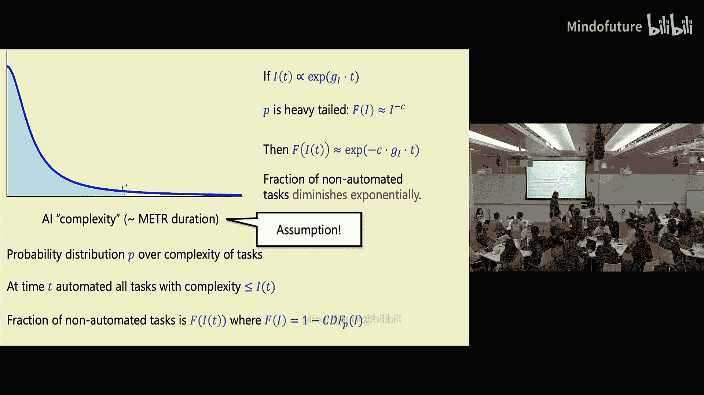
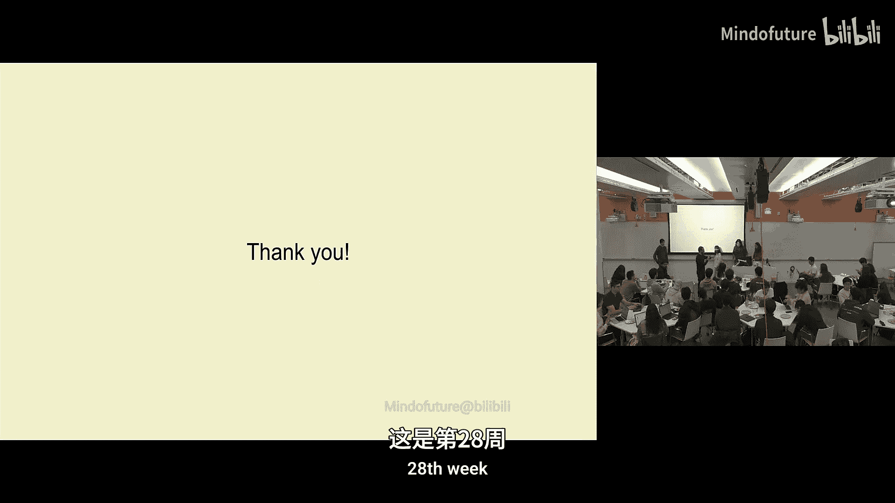
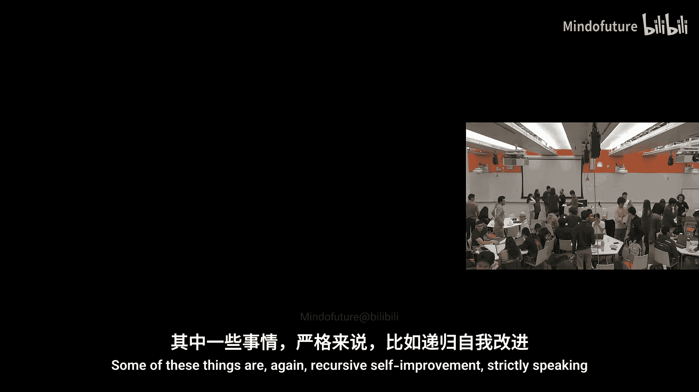
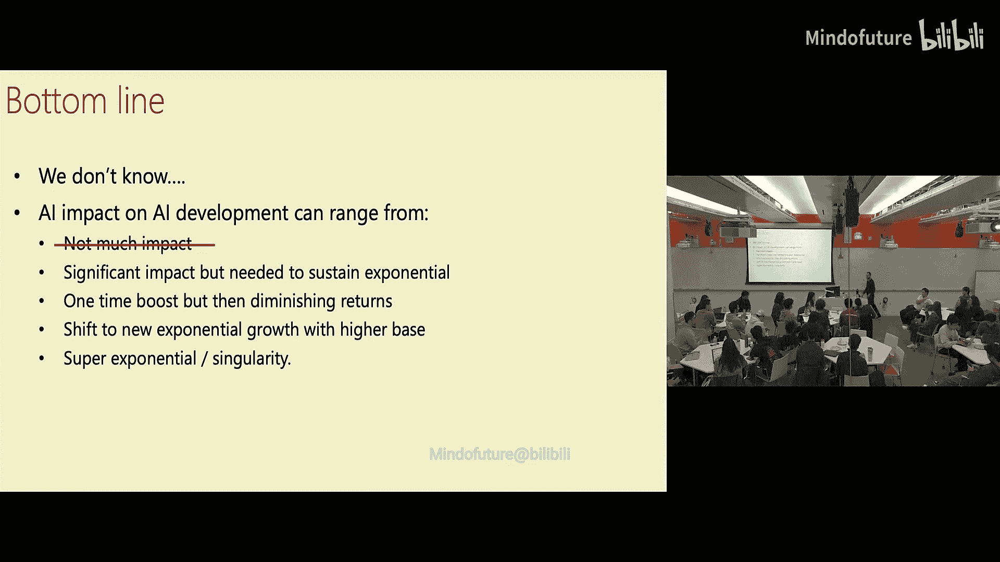

# 【哈佛大学】人工智能安全与对齐 ｜ Harvard Cs 2881R Ai Safety And Alignment p05 P05_讲座_6_递归式自我改进 [BV1D4AXzxEbL_p5]

Right now。The to mention humans are being AI。And。我 are真是。If AI starts building itself。And。Do we have。

Intelligence explosion。And。Maybe。Before we start talking about teeth and I thought。There was。

 I think interesting discussions on perusal on the pre readinging。

 and I thought like maybe we can have a little bit of discussions。In class so。

So I just wanted to open it up like two thoughts anyone had while reading these documents or other documents。

Yeah。Anyone wants to start？So。Yes。One thing that I think across articles I anyone can hear or maybe I can talk even louder if I need to Okay。

 I can even pass a mic。One thing that I would have liked to see across all the articles except for the one from Epic is maybe a little bit more about the methodology。

 there were a lot of sort of1% chance of this and sometimes that's just forecasting as an expert science which you can en trustrus or not trust sometimes there's distributions。

 sometimes there's background knowledge sometimes it's the product of a bunch of normal distributions and I find it hard to figure out my own trust levels across these articles because there wasn't that methodology。

Yeah， see。One of the things I'm sometimes worried about with some of these forecasts。

Is that we could have like an illusion。Of accuracy， when you have like a lot of numbers。

 then it seems very authoritative where like ultimately。

It's it's very much like there's so many unknowns that like this level of accuracy， it's like。

 you know， if I。If I wanted to kind of I gave you like the length of this whiteboard。

 and I gave it to you with in inches with seven significant digits。

 then you kind of say I'm bullsh because there' is no way I can know it up to that。

 So I should probably if the instruments that I have adjust my hands。

 then I should just probably say， okay， I think it's maybe roughly four feet。 I don't know。

 So so sometimes like maybe there could be an illusion of precision where you have like so many sophisticated models。

 etc ceter or print here。😊，Don't really know。Other comments？Anything， yes。

One of the things that I saw in a few these that I thought is interesting that it' it's not what you hear about in the news is that a lot so much more of these exponential rates that we're seeing are because of software improvement and how software improvement fits into rehearsive improvement it is not just more investment into faster hardware I just found that you because it's not。

Right， so， so， so in terms。I think there is basically we're seeing exponential improvement in AIs。

And these are driven by several different trends。 And I think maybe the general limit kind of confuses all of them。

 One is， okay， computer hardware is growing at an exponential rate due to most low。Then。诶。

Potentially， GPU flops might be growing faster。 Then the amount of investment that we invest in hard were also grow。

 So the amount of flops available for us。And it can grow。 And then we And then on top of that。

 there is a significant chunk of， basically。What some of these things call software and software is a little bit of a term that can mix a bunch of different things because it's not just kind of traditional software like coding。

And it's also basically people。Doing a lot of experiments and machine learning research to find out more efficient way of doing the same thing that they did last year now。

What a better rate。Other kind of comments， responses to the wedding， yes。

My one problem with these papers is that like they seem to be really comfortable with extrapolation like obviously I think there is some merit to it。

 like scaling law kind of worked so far there's also like Morris law that's kind of worked so far。

 but like I think with stuff like AI development I think personally we should be more cautious about extrapolation like sure there's a trend that like AI is developing really well so far but。

We know absolutely nothing about whether we are gonna hit a bottleneck that somehow just。

Like whether we were going to need another ariic breakthrough to take us tofer like to better capability or or if it's like simply just a problem about scaling。

 so I think we should be more cautious about that。But on the other end。

 is there anything else we can do Aberdynamicic toppolate when we try to predict？

But I think at least they should。Entertain the possibility a bit more that like this is we're resting on the assumption that as things stands。

 if AI is purely down to the scaling of multiple aspects， then that's how it is。

 but there's always a chance that。Better algorithmic advance is required for that to keep going。Yes。

Yeah， I guess like the paper or these papers that like to kind of。

Assume like no like regulation interference。 I remember in the first paper。 it's like。

 this is like the most friruluous environment。 Like what's like。

 it's like really giving you the maximal upper bound。

 And I feel like it'd be nice if you could also get like a lower bound。

Just like I feel like upper bound without knowledge what the lower bound looks like kind。Like。

 it would be nice to see what the spread could look like in the future。

 Maybe the lower bound is just nothing。 Theres zero advance right now。😊，Other。Comments。

And I don't know if anyone wants to say if they particularly liked one of those documents and thought find found it more insightful。

 can always also say， like if there is one of those documents that you found least insightful。

 but it's always better to say nice things。Any other comments？Okay， I mean， do you have coviI？No。

 okay， so we can continue。You can also just say later if something comes up。So。

One thing that's interesting， like if you go to AI in 2030。

 then it makes this sense that basically the way to extrapolate current trends is to focus on compute。

Rather than software improvements and the main thing is that basically they say they follow kind of the bitter lesson and the idea is that。

Ultimately， the the methods to improve AI is。诶。Is to find ways。

 find simple ways to just put a lot of compute。Ivements and then in this。

 maybe you just focus on computing。 But then in if the picture is really。Not human ingenuity。

 building AI， but basically compute， building AI， then maybe it means that AI automating AI research is not going to give us that much lift because maybe we are slightly inefficient right now in humans at using compute but ultimately the compute is the thing that matters and not necessarily the AI although。

Again， like the true equation。Is probably something like。Yeah。

 maybe the two equation is something like you know。

 natural resources or any kind of resources leading to energy。Leading to compute。

Like in terms of flops leading to， let's call it intelligence。

And maybe there isn't like much cleverness to map computing to intelligence。

 but certainly we are not necessarily optimizing how many slopes we can get for pure energy and maybe not optimizing how how much energy we can extract from the sun or et cetera。

 like obviously we could do the Dson rate sphere， et。😊。

So course this lecture is really about like the question of recur improvement and if we kind of go back to this。

Meter。Paper that I mentioned in the first lecture of this class。

Then this basically was some kind of a trend that we've seen that。There is a certain doubling time。

 roughly every seven months， the models。Dole can solve tasks that take humans double the time that they could before。

 and if you just kind of extrapoulated this。On I asked GPPT 5 to extrapolate it and if you just extrapolate it and I'm assuming GPPT 5 did it correctly。

😊，Then。Then this is basically the trend line that you would expect。So， maybe。Maybe by 2027。

You will get。By the beginning of 2027， you'll get like basically a computer that like AI can do a full day of work。

Eight hours。And then。By 2028， you can， I mean， this is 1。2 days， but maybe if you。

 if you thought about it as basically。So， I don't know what。1。

2 is like 30 hours or something like that， so you can think of it as I don't know。

 four walk days or something。Something along those lines。And。E cetera。

 so that kind of would be maybe。The first mostnaural approximation that we can ask。

 but the main question we because self improvement may be。By and。By applying the I。

To the task of building better AI， you can get something like。This， right。

 you can get something that basically at this point， yeah I can do a day of work。

 and maybe you can start just using it。And having like the effect of having like many。

 many old people working on head。And。Yeah， we don't really know the answer to this。😊，And。

Part of what I kind of realized as by as was preparing this lecture is that it really relates a lot to this lecture that we're going to have later on economics。

😊，Of aI impact so。The economics question is generally like what would be。

The impact of AI on the labor market and how soon or fast it will replace humans。

 this is basically specifically about。The humans that are building AI systems and what happens if AI replaces them and how much productivity increase it will。

Because so maybe looking a little bit at the questions of economics and growth theory makes sense。So。

So I try to basically learn， as I'm known economists。

 probably some of you are economic majors or maybe even economiccon grad students， I don't know。

 is there anyone here that's an concentrator？😊，Yes， okay， so you after to this stop。

 is there any deal is。No， okay， so so you'll have to yeah correct me if I'm getting things well。

 but the way I view it is， okay， so let's try to kind of define something like the intelligence at time T。

😊，So it's obviously not something that we can really put a number on。

 but one way to do it is to follow meter and say。Okay。

 let's just call I T the meter task duration that AIs will be able to do。At a time T。

 we can fix the parameters to make this constant。 let's say， you know。

AIs could do this at 50% chance and let's say we'll give them whatever amount of energy and wall clock time。

 let's say they have an hour to do it。And you can as。And they can have like same an energy budget。

And we can just measure intelligence at this time the level that we are talking about is power not matters so much how we define it。

 but I' just say that however we define I ofT will like the meter will imagine that it power grows exponentially。

😊，The main question that we are going to ask is， is it going to fizzle out and stop growing exponentially。

 Is the exponent going to grow or is it going to go even farther beyond that。So。

Some options for if you modeled our I T is growing。 So one option is。That at any unit of time。

 you grow。 intelligence grow by a constant rate。So this is basically growth is constant。

Another option is that intelligence kind of compounds， so the more intelligence， the more growth。

 so at the unit a time T plus1， you grow by some factor C。

Of the intelligence that you have at time T。And another thing could be that maybe you even grow more in less time。

 so the intelligence at time T allows you to not just grow by a disgust constant factor。

 but even do it in a time， say not just in one unit now you can do it faster。😊。

Maybe the eyes walk faster， they can do the same work that the humans could do。

 but now can do it faster， yes。I mean， dont we have like that。

Fairly good analog to this of this human technological investment in general and as more humans get。

 getting educated and educated， more research institutions and more companies that the research showed up in different areas。

 like there is improvement in different areas within。Technology in the last like 1050 years as。

even possible due to the things that came before， but in like absolute amount of the community to say like surpassed the amounts of things。

 new things that we've been like the one of things that were being put out every day by humans is。

Much more。 And they get to people。If you look at my trends。

 it seems so all like an accelerating scale， right let me hold on this question because this is exactly the question that basically growth theory in economics asks and let me and we'll talk about it pretty soon。

Maybe in like three four slides， okay？So just these kind of things。

 like whenever you see something like that， like a v carciive equation。

 like I a T tie a T plus1 equals I of T plus C， it's basically a differential equation。😊。

But basically the first thing is basically the derivative of I per at time T is constant。

 right per unittime you add C。😊，So what's the solution to this differential equation？😊，What？L， yes。

Yes， right？And the second differential equation is the IDDT is L C I， and since I see you shy。

 I'll just say that it's exponential。😊，Andで。F differential equation is basically。

You you know what does it mean like you basically divide by like now it's not one unit one at time。

 but it's unit one over IT so when you divide it， it's like basically I squared。

So you basically have like a differential equation of the form some constant times the derivative of I is some constant times i squared。

😊，And this thing actually explodes。Basically， this means you get infinite progress at a finite time。

 So this is like a true singularity。This basically depends on how you kind of model but you depends on how you model like how much the fact that you achieve the certain intelligence allow you to keep progressing in intelligence。

Then， you can get。Exponential， you can get polynomial or linear， likes say if the power here was。

 so basically if the power here is less than one， you'll get polynomial。If the power is one。

 you'll get exponential。 If the power is larger than one， you'll get a singularity。

 like it will explode。And。And one way to think about it is maybe that means that the power has to be one。

 but you can also。Try to think that' not。So。So let's kind of make some observations that economists have made。

 so one thing that economists have noted in the context of various settings is Bumma's cost disease。

Which basically is the importance of bottlenecks once one sector of the economy becomes more productive then in some then what matters is the sectors the deal become more productive in in some。

 this could be relate to AI automation。 Maybe AI will make some things。

Some parts of improving the AI more productive。 but then the bottlenecks will be in other parts and。

This is my understanding of it again， if someone knows this better please correct me saying is like let's just imagine an economy where there are only two types of people and farmers and nonfers let's call them teachers or whatever like so you can only do one of two things let's say everyone is perfectly capable of doing either one job or the other。

😊，And let's say， originally， like they。Basically， each one of them earns $1 a day。

 Farmers produce 6 meals a day。 Each farmer produces6 meals a day， so each farmer can produce enough。

Enough means to feed them and one extra person。 And if each one of them has two kids。

 the teachers each teach four kids a day。 So basically everyone， all the kids get taught all the。😊。

People eat and one so if it's an economy of 10 people， then their $5 contribution to the GDP。

Of daily GDP or whatever so half the contribution comes from farmers。

 have the contributions come from teachers。But then someone discovers some kind of a great innovation that makes farmers five times more productive。

So what will happen is now each farmer can produce 30 minutes a day。And。Let's say it changes。

 somehow what they get paid， maybe less or more， it doesn't really matter。

But if every person can choose to become either a farmer or a teacher and let's say they just will go to whatever pay them all。

 So the salary will have to balance and so the teachers will also earn X dollar a day。

 whatever the X is。And now we don't actually need。In this economy。

 people can only eat three times times a day。 We don't actually need all that food。

 So what will happen is basically。This sector that became more productive。

 there would be fewer people in it。And that means that the sector also a fraction of the GDP has actually shrunk。

So now if before， when farmers were less productive。

When farmers were less productive then they accounted for half of the GDP。

 now they only account for 10% of the GDP。So in， the sectors that become more productive are become in some。

 less important in the GDP。Was there a question？I was saying that that's probably why it is not to be a smart。

 Yeah， So sometimes like you could see like things not necessarily showing or directly like the G P we might。

Yeah， no and everything。That we see from economics is this kind of very strange puzzle， which。

I don't know the answer to。 And I'm not sure if anyone knows。

 And this is this puzzle that if you look at actually like the growth。

Of the US in terms of GDP per capita。Then basically for the last 120， maybe 150 years。

It's basically been constant， 2% per year。And。I don't think we have like a very good explanation of why this has to be like 2% per year。

And notice that this has been for， you know， electricity and the Internet and cars and throughout all of those this time。

 and basically GDP has grown in the US 2% per year。 Now。

 this graph is not like the this is not that if you take any country。😊。

Then you will see 2% growth for you。 Obviously， some other countries you have seen like much bigger growth。

😊，But one way to think about it is that the USA may have been like basically at the frontier of global development。

And the frontier has basically been going at 2% per year。

 even if some countries that are below the frontier， they could grow much more。

 maybe they have more headwindrooms。And。And I think it's a puzzle， like。I don't think anyone knows。诶。

Precisely why it is， this graph is taken from a paper by Chad Jones。

 I talked to him actually over the weekend， he also doesn't exactly know precisely why he is。

 I think if he doesn't know nobody knows。😊，And。And and。And one of the things is that， yeah。

 like we had this exponential rate of growth and it's not completely and it's a growth per capita。

 which is。😊，So it's not just total growth， but we don't completely understand。Why this is the case。

Although E does have a theory that can kind of replicate some of those things。

And probably maybe it's the best theory that we in we have。And。And I， and I just should say that。

 like， if。Like a lot of the time in this， I think in the literature on weive self improvement。

People talk about basically this people talk about GDP growth of you，100 percent per year， or like。

 you know， completely singularities。But， I think。Ifs the GDP growth。Was 5% per year。

On a sustainable basis， definitely if it was 10% for year on like a long term basis， let's say。

 for a decade。It will be a very， very different world。

 very different thing than everything that we have witnessed in the last  hundred50 years。So。

 even if AI。So， it doesn't have like。super exponential growth of like the GDP per capita suddenly growing like one year it's 4%。

 the next one it's 8%， the next one is 16 and whatever。😊，Even if it just kind of lifts。

 in some sense， the number of2% to say 5%， 10%。This would be like a dramatic thing that like nothing that we have seen in the last 150 years。

Yes how。I may seem like historical- I mean， I'm sure there are historical predictions on how things that happened in that timeline would have affected GDP and whether they played out as well or not。

Who would be interesting too， like maybe we look into how much like a GDP exposure people were predicting。

 but I feel like there's like due to our culture today there's a more of a culture of maybe exaggerating things but like we have maybe knowledge of predictions that were made within the last 100 hundred of years I don't。

I might ask child but I don't， but。Yeah， I think it's just remarkable that this like this plot has been so kind of stable and。

😊，And a。I mean。One kind of similar graph that we are familiar with。Is more low。

But there is a much more better kind of explanation for movies is low than I think for this graph。

Which is that， I mean， maybe there is some explanation for this graph as well。

 so maybe let let me say that。 So， so one explanation for this graph， one explanation for Mu is low。

Which I find compelling is that Mo law is not so much a prediction as much as marching orders。

So basically， by one smooth low held for several years， then basically。

 the semiconductor industry was。Firstt to follow Moore's law。

 which means that there would be like a lot of there would be a lot of。

Investor say loss of confidence if they didn't follow Mo law。 So they basically had to， they。

 they didn't need to kind of invest too much in R And D to go， to go above most low。And they didn't。

 but they tried very hard in inventing new technologies to make sure that they still keep pace with Moslow and indeed。

 if you actually look at how Boslo came about， like there is basically kind of like eight different。

 I think technical break foods and and discoveries that help sustain this and maybe the Federal Reserve is doing something similar like basically 2% per year is what we need to do and we get really nervous if we go under it。

 but we don't if we don't need to kind of walk to to get over it so maybe maybe this kind of some。

Between new expectations here， yes。We would like to mention Moore's law。

 I wonder if the semiconductor industry even was only progressing because of financial incentives。

 but there are other industries like high through cell sequencing for like computational biology or you can read cells out they are actually going faster than Moore's law amount of cells。

 you can sequence for RNA and DNA its way faster than more law。 Yes interesting。

 So so maybe it could be the case that if like maybe it's the case that more was a little bit pessimistic and the semiconductor industry could have gone faster。

 but basically once they they kind of said， okay， this is what we need to hit and we can hit it and we can invest in our exactly in the time in the sense that we can。

😊，嗯。And they could we could have done a gunby beyond it。 I don't know。 Yes。

 this is this a little bit of a cynical view of like Mooreore's law， though。

 because if you could hit it faster， than you should hit it faster in a capitalist economy like the American economy right because you can put a competition out of business and make lots of money。

 So this is the natural result。 So if they could do it。

 they probably would have So maybe more optimistic use is just that know the recursive improvements fall and on a macro level。

 the recursive improvements in one sector fall to others。 And so the whole economy goes like this。

 Yeah I mean I don't know。 like it's a good question。

 but it could be the case that' in some like you。You invest。

 you regulate like how much you invest in。 I mean， obviously。

 like if the researchers had like a better way like nobody would。

 I don't think anyone in Intel would say。Let's， let's wait。 let's sit on it and wait。

 like even though we can do better， just because we。

 we are not used for like an update better based on most law。

 but it could be the case that basically they。They get more antsy。

 like more like lightly hand on the figure to approve more experiments and try out more things and invest more in when they are like。

😊，See a danger on the horizon of the current method that they're doing。

 not being able to keep up and。Yes， so you mentioned something when you talking about like chanceors where like they are like As I think you said Yeah。

 I don't remember the number， but they were the reason why I mentioned that was I feel like with a lot of like the discourse around just like scaling and a better lesson and everything people see like there's like some sort of retrospective studies that we can do or like maybe we we just give more computes to older architectures and we can compare them and we see that sometimes they do perform better than we expected。

 but also like newer architectures way them in different ways are advances that we have made that have just made things much more feasible in general。

 So I feel like like the approach on like。Importance given to algorithm investment is like somewhat downplayed kind of like what A was saying。

Looking at like the other industries or like the microch industry as well。

 And like with your end knowledge， would you like could read this in one of your thoughts on， I mean。

 I think there's definitely like。Algorithmic advances have been very important to。

To keep up like we like you could， like I said， you couldn't explain how the AI kept up based on only on like the hardware available。

 So algorithmic advances definitely。With our algorithmic advances， the AI models kept would not have。

keept up with the kind of pace that we have。 whether these things are， you'd view them。 you know。

 it's always kind of a matter of the beholder， whether they are kind of inevitable where you have more compute。

 you can experiment more in how to more efficiently utilize your compute。

 and then you'll modify your architecture to take more advantage of it。

 and therefore you'll keep going or maybe there is。Most fundamental things。

 it's kind of like limited in the eye of the behold。So in any case。

 this is kind of like a question and one kind of theory indeed by Cha Johnson。

 like why growth is like that says okay， is the question of like why do economies grow and one answer is because populations grow。

 so populations grow exponentially so maybe economies grow exponentially。

 but then why should they grow per capita。😊，And Joan's answer is， in senses that。

When you have more people， you have more research and when you have more research and you have more ideas and the important thing about ideas compared to say。

 physical goods。Is that you can share them and you don't have less of them， right？ So you know。

 if the population grow and so there are more farmers， they produce more food。

 but they also people more eat more。 So it doesn't really correspond to growth per capita。

 But if someone comes up with an idea of how to improve the productivity of farmers and make them be able to produce。

Say twice as much food that they did per acre， then this one idea can be used。by all the farmers。

 you know， it's not that one farmer uses the idea。 and then no one else like it's got wasted and you cannot use it more。

 So this one idea can improve the productivity。Of everyone， and therefore you can grow per capita。

So Jones kind of turn this into basically some like this kind of differential equation where let's say a is kind of the growth of ideas。

 so you can see of it that like the total factor of productivity。😊。

So this is kind of the factor that says how much you can translate resources into productivity。

And I like the input， let's say the number of researchers that are working in the field name。

Number of researchers could be basically。The number of researchers。

Baically might be proportional to the size of the population， but there could be the case because。

There is some constant there doesn that basically as you have more researchers。

 maybe you pick the low hanging foods first and the other things become harder so you might have。

TheThe contribution to a might not be linear， but might be I to the lambda where lambda is a constant smaller than one。

And。Then one thing you can say the following thing like just if you kind of write this down。

 then let's just imagine that both of these things kind of grow exponentially。

 so if a grows exponentially by G factor G，And eyebrow grows like by go factoro G。

 then we know that right the derivative of a。There's a function of T ignore constants。

 so it's going to be E to the G。第一。And right。And this is going to equal to G to the 1 minus。

To the1 minus beta。GAG。Times equal to the lambda lambmbda team。And we we。

So if we just subtract this out， so if I divide this out。So we should get that one。

Is that the right thing。 So we get that a。1 is equal to。嗯。Okay， I'm always bad this doing math。

 so let's just right so we take log。So we get G and divide by T。

 So we get that G is1 is equal to G minus beta G。Plus lambda。ジエジーエアイ。And therefore。And。

GA divided by G is equal lambda over beta。Which nicely is actually the thing that they work there。

So yes， I'm always better these things。 but right the away this is kind of like I don't know in all of these growth equations I've also bother solving differential equations So in all of these growth equations basically the way I do it is I imagine that these quantities work exponentially and then figure out。

😊，Figure out if the math like what， what the constant of growth will be。

 And if the math doesn't make sense， then then they didn't go exponentially then。一 so so then你 know。

Right， so so in this case， like basically what it means that the growth in productivity kind of goes like I to this R。

 the La divided beta。😊，And generally， if are larger than one。

 and we can of assume that as you go in productivity， say in AI setting。

 then you can also produce more researchers in terms of AI。

 then that could basically lead to explosive growth。And then。Yes。And then basically。

 you have like super exponential growth where basically the most。The more research you do。

 the more eyes you do， they produce more ideas。And they and then they become。They produce more ideas。

 and then they become more productive than you are more productive。

 You can produce more AIs etc cetera。 But even if you don't have explosive growth。

 I would just say the following thing。😊，If we really do buy this thing。

That main basic reason why economies grow。Is because population grow and because you have。

And because when more the population you have the more people you have the discover ideas。

Then you can see that if you automate the discovery of ideas。

Like if you have more virtual researchers。That should increase growth。And。

 so there is no law of naturerture that says growth needs only to be 2% and。

Like regardless of explosive。Like I think when you look at that。

 there is really no reason why AI couldn't increase growth by a significant amount by basically increasing the number of people that are discovering new ideas。

 and even if it balances out on some different plateau，That plate may well be higher than 2 percent。

And。That。Will be a very different world than the world very different economy than the economy that。

Basically， you， your parents， your grandparents， your great grandparents。

 I don't know many how many generations you have to go before to go back before 1880 So so basically。

😊，like。Regardless of the question that we are dealing with this lecture of whether we can do we self improvement and whether we can kind of have growth that is not even by any number。

 I don't think anything that we know contradicts， say AI leading to 5% growth or 10% growth and I don't think anyone have not heard like a good argument against it also。

😊，Anyway。Let's kind of try to imagine like what if we wanted kind of to try to write an equation like that's for AI。

 one way to think about it is， okay， what are the inputs to AI？So you can think okay。

 the input is one is compute and other these kind of ideas are algorithmmic techniques and the third input is data。

😊，I don't know if I am missing anything。Pel free to say， let's make a very optimistic assumption。

But we don't need that。Like maybe， yeah， I mean， and it's not completely crazy。 Maybe you could say。

 okay， like maybe。😊，We can replace data we've computed like Al0 did and just for the sake of like trying to get like and just to remove one number from the equation。

 let's just kind of imagine that we don't need data or we collected everything。😊。

And and this is an optimistic assumption。 So I'll just note that， but。

And I also kind of want to mention that。It's not necessarily the case that if we have more eyes。

 we can just kind of countan out and and produce more and more ideas because ideas really usually kind of have sequential in nature。

 like people like this know you're building you're standing on the shoulders of previous researchers So are kind of necessarily sequential also ideas involve experiments like observation from the outside。

 what even computation experiments take time。 Yes， curious almost like diversity matters because I would imagine that there's like two of me can double we do if you have like 100 me know you can' out right in terms of like the unique ideas have。

 So I wonder if this could become a problem with eye because we only have like 10 frontier models。

 Maybe like each one kind of peaks out。 Yeah I mean this is a good question。

 I guess the question is also。😊，Like， if we think of a model。

 do we think of it as a single researcher or do we think of it as a population of。

Researchers potentially like I mean， obviously say ChaPT can emulate a lot of personalities。

 we don't know if it can really emulate like a lot of diverse ideas。😊，But it's potentially the case。

 But， but， one thing that you， you write that this might be not enough to just。Cone one researcher。

 you want to basically like have like more diversity and we don't necessarily know if we'll get it。

 but it's not clear that you need two different models for that。 maybe the same model。😊。

After it manages to do everything that one person does， you scale it more and it can do 2，4，5，8。

So but but I just kind of want I me say that like in some of the what below I'll ignore this thing that is currently very important。

Basically， you cannot speed up wall clock time arbitrarily when you're generating ideas because ideas depend on previous ideas。

And obviously， if you're talking about science that is actually like the AI 2030 in the reading。

 it talked about like difference between desk science。

And and lab science and lab science requires actually input from the lab。 So that slows things down。

 But even like if we're talking about AI R And D， it's kind of intermediate。 So it's not like。

Proving mass ss necessarily that it's completely on the desk because you actually have to run computational experiments that could take time。

So， so so you cannot speed up one clock time In of this is we are making some kind of optimistic thing that we are ignoring that part another thing is that。

Some of these kind of discussions。Basically， assume that we are going to just build an like just focus on AI to build A AI。

 and we don't need to be good at anything else。But this is in some tension with our optimistic assumption above that we can imagine that if we imagine that we can drop data。

 because if you're also using it to generate data like and if you want this like model to answer like if the AI researcher is eventually gonna build models that are also not。

 not just themselves just good at AI research， maybe you want more data。

 And and generally like it could like AI research。😊，I maybe more than just coding。And。

So let's just try to kind of like model it like very， very naively。 So maybe the simplest kind of。

 this is the simplest thing I could think of。 but yeah， I'm not an economist so。😊。

Maybe other people can find better things like I say， Okay。

 let's imagine that like the derivative of So， So this is like common in economies to kind of the production function。

 This is， I think， no darkness that you， you say you have like these two factors and they are not completely interchangeable。

 So there are diminishing returns。 You cannot just kind of split。😊。

Have like more computer replace intelligence or vice versa。

 So you have like some kind of a factor like that， like so。

The derivative of the intelligence as a function of time is like some power alpha of the intelligence and some power1 minus alpha of compute。

So， if you do that。And let's assume that computers kind of grow like as itself as some constant dependent on intelligence。

 so maybe as we have more intelligence， maybe we know how to do compute better。😊。

So let's again do the thing that I like to do， imagine that they both grow exponentially。

 so compute grow with factoro GEC and intelligent factor GI。😊，Then what we see is， okay。

 this equation。These equations basically says okay， the growth of compute is c times G。

And if we plug this above， then we say， okay， so we get like that。😊，AndGI。诶。So we get at GI。

So how did they get that I forgot。I did this math， and then I forgot how I got it。 yeah。

 we so we the derivatives of y G equals G to the alpha。😊，Plus one minus alpha type C times GI。Right。

And then诶要要要要。Move these things so you can divide by 1 minus alpha， you can divide by c。

 and you can divide by G， and you get the equation C equals 1。😊，So what does it mean。

 the only way that it will grow exponentially is if intelligence and compute grow together。

So there are basically two options， so either see is less than one compute goes kind of slower than in the intelligence and then this will be kind of polynomial growth。

😊，Obviously， equals than one， then they basically grow together。Oh， C is larger than one。

 And then you'll basically have a singularity。 You'll basically explode。 And in finite time。

 you'll get like an infinite。Progress。So maybe there's means that's kind of like under these kind of very naive things that they will basically just go exponential at some point。

😊，Together with intelligence and compute。But。This is just。One intuition。

 so this might be some intuition for like kind of exponential growth of in the limit stabilizing at intelligence and compute going together at some exponential rate。

 which is unknown。😊，Any questions？Yes。I was just going to say so I was running this icon moment， but。

I feel like stuff like this， there's like the type of intelligence that's required as well。

 And I feel like the growth that we look about that type of intelligence is somewhat important too。

 like for example， in the bitter lesson， like it's not that he's saying like you're still than saying we shouldn't invest in algorithms at all because it's more to say that invest in algorithms to take better amount of compute right but we still need algorithmic improvements So I say considering perhaps like instead of looking at the performance of models on things like。

Like unrelated tasks， looking at the growth of ball performance on tasks such as low level kernel optimization。

 chip design and things like that could give us like a better trend for the growth in future。

 would you what would you about that？We talking， but this is kind of like an interesting question。

 like' say， which I'll talk a little bit later， but this may be good to talk so imagine that you have。

A bunch of different tasks。That you are a bunch of different tasks that you。

That you're trying to do as part of AI research。But what meters seem to have shown is that many of them kind of grow together in similar doubling way。

In terms of absolute weight， they differ， so you might have like some tasks like maybe maybe in absolute terms。

If you compare say human performance to model performance。

 models might be better right now at writing Python code than they are。I don't know， chip design。

 and maybe there are。Better at so， so compared to in absolute terms。

 But I think the doubling rate so far has seem to be kind of similar。 So in instance。

 maybe the growth rate is of similar。So maybe he is kind of just another kind of model。Of发 donation。

That one can take is let's just kind of imagine that there is tasks that people do。

 and you can think of these tasks as optimizing a kernel， writing Python code。

 brainstorming about a new a new AI architecture，I don't know finding finding good jokes to put on the company's slack。

 whatever tasks that are crucial for the for the improving the。productivity of the company as all。

 Theres some kind of distribution of this task。 And what does we mean by distribution， let's say。

That the distribution is basically maybe the length of time that these people take for these tasks。

 so maybe sometimes you do like a big project that takes you a month and like you cannot really decompose to clean tasks and sometimes you maybe do tasks。

That take you lesson。 maybe we can say that。Typically。

 people can cannot really handle a big task if they don't decompose it to small tasks。 So on average。

 they complete one task per day。 So maybe you don't imagine that very。

 very long task would be a very small fraction in nobody that works on something that takes a year unless they manage to kind of wake it up to discrete pieces that takes a shorter amount of time。

 But anyway， you could say it it's some kind of a fattail distribution。😊，Of the tasks that people do。

In this company and the length of time that it takes them to do that。And now。

Making a very kind of strong assumption， as' actually this kind of captures the complexity that it takes for AI to do it。

And this is basically like the duration like meter captured。

 then maybe what you could imagine is that basically as AI progresses。

 it starts picking off more and more of these tasks。

 it starts basically automating more and more of these tasks。😊，And。And basically。

 so you have this probability distribution in a time T you automated all the tasks in complexity less than IoT。

😊，And so a time T or T star， like you automated everything up to here you didn't and these are the things that humans are still doing。

And。If you kind of model it like that， then you know。

 the fraction of non automated task will be like one minus the cumulative distribution function of this probability distribution。

And。it's someSo now if this thing grows exponentially， if I think goes exponentially and P。

 let's say it's some heavy tail distribution。Then actually。

 what will happen is that the number of the fraction of tasks that you didn't。

Automator time T decreases exponentially。Which actually might mean that you'll probably go maybe pretty fast。

From automating。Have the tasks to like it kind of really depends on precisely like the tail of the distribution and all of that。

 But like in you， you might kind of be going pretty fast from。 So。

 So you might expect that say if you like automated， half the tasks， then。

Maybe in seven months you'll automate three quarters of the tasks and then in another seven months you'll automate seven8 tasks。

 et cetera， you what？So just generally like we probably like the we I mean。

 generally probability distributions。And there are kind of two general types。Again， I guess， okay。

 let me just say generally。That I generally think that there are only basically two functions in the world。

 polynomial and exponential。 and everything else is just a hoax perpetrated by the Chinese。😊。

So I don't really believe in in and other functions。 So so probability distribution。

 it can decay like any probability distribution kind of looks like something like this or if it's positive。

 then it looks something like this after you send and。😊。

It has to decay right because it has to sum to one， so the probability has to decay as you go。😊。

F and farther from the mean and the mode， and also like。I think also like distributions。

 like we will center it and distributions that the mean is different from the model。

 also like a hoax。 So so it tends to decay in some way and it can only decay ever like a polynomial。

😊，Or like an exponential。 It is an exponential in some sense， like it's basically like finite。

 Like at some point， it's so small that you can ignore it。So then basically at some point。

 you obviously call you obviously。Automated all of the tasks。

 if like that if it's exponential and if it's polygno。

 that's kind of the hard that's the heavy ten case where it decay。

Slow slower so that then you want and then basically， but even then if we assume。But in the meantime。

 things kind of ss in there。And that the， the complexity of tasks that you can automate kind of du every time。

 then eventually you'll。Youll get all of it。So for both cases， you have to mean at the same point。

 but then just the way yes， yes， yes， so habitat would be kind of like polynomial decay and non habitat would be exponential decay。

So like the normal distribution is not habitat， right， it's like decay like e to the minus x squared。

Okay， maybe before so this is kind of maybe like some expectation of how you might think like the fraction。

 like how a meter thing would translate into the fraction of tasks that get automated within like a company or a person or profession。

😊，I just assume though that the tasks remain set。Yes， this is a great question。 Like。

 this assumes kind of the testimony that again people don't change， which is obviously false。

 So what， obviously， it's a little bit like Baman's constant this is what will happen is like when youre here。

😊，You will probably like have all of the humans start doing。These things， and maybe suddenly。

 they managed to do things that were out there way way before they would have taken like ages and nobody was actually doing。

 So you would be automating。What the company did in 2024。 But now it's 2026 or 2027。

 and they are doing different things。 So it could be the case that it's basically always the always the setting that yeah。

 but， but it might also be， so， So it could be the case that we for a long time。

In this hybrid mode than， you could be case that at some。

 humans cannot keep up And these tasks that are way out just how to even with the assistant of the AI。

 they maybe the AI is to advanced for the humans to take an advantage of it possibly。

 but it's also quite possible。That's forever， it's the case that we basically do more advanced stream and the humans find way to take advantage of AI。

Provide their own advantage value。我不か。Yes， so I think we fraction of non automated task diminish。

 but assuming that more complex tasks will take like longer time with the complexity。

 does this any application of fraction of non time。 like so， so basically。

 if we kind of assume that non automated tasks， like say the fraction of non automated tasks is something like one over the time。

 then youd assume that basically the and you assume that the the length of time that AI can handle grows exponentially。

 then the fraction of tasks that have not been automated。 Yes， will decrease exponentially with time。

😊，So basically， every time there is kind of a meter doubling。

 there would be a hazarding of like the of the tasks that you have not automated yet。

But you augment that is an hardbreak， so maybe even when you admit 75% of us could only be saving like 2% of the person's time。

Yeah， I mean， yeah， it could be the case that like， once you average it over time。

 then it's different， although like I think eventually it would catch up because because of these exponential things。

😊，Maybe hearing that is yes。谢。Masure productivity， not just in terms of time like labor。

 but also in terms of capitals called S Cl takes into account capital and labor so wouldn't this be less of a shock to TFP and more of a shock to the capital labor distribution？

Yeah， so that's a kind of a question I didn't go into。

 And I think it's even like a big question of whether AI could become should be looked as as labor or capital or something else。

And， I think it is not completely clear。And。And actually。

 Jones has like a very recent article where they kind of in models possible ways with how AI could。

Modify， and some of the models could actually keep the fraction of capital constant。But， but yeah。

 generally。WeYeah， like we， we assume that。AI could potentially change what you do like take things that before that one one way to think about AI is that it allows to invest capital to do things that before that could not。

Make， make Labour in that your capital more substitutable because now you can actually build more。

Invest more in say energy to。ToTo do things that before we're labored， so。So。

 so one version of it is that it， it changes the， the distribution between labor and capitalism。

But I think in the version that it's basically。Corresponds to inventing ideas。 It's kind of also。

Does this other thing。 So。 So I think it's a little bit complex to model。

And some of it would be great thing to ask the economists when。诶。

They' are going to give to the guest lecture。Yes， I'm just curious。

 do we have models for like how quickly like the sort of front end of this moves as people adjust to technology。

 I don't know， it's a good question。So。Maybe before we take a break。

Is the group doing the experiment ready？Yes， yes， good。

 so let's do the experiment presentation before we take a break。😊。

これ上す。あの。

こい。はい。嗯谢。😊，Hello everyone， my name is Egar my name is Ashll I'm Hannah I'm Julia and we are the group that worked on the request software Po experiment we kind of soldd it so I kind of wait for the GP6 AN our school tonight。

😊，maybe use amic Oh yeah，s super recording。Hello。All right。So， yeah。

 let's start with our motivation for our experiment。 What we realized recently is that a lot of the。

Reseearer type of systems have been movingwing towards more multi agent systems that work together。

 and even nonreer systems under under the hood work in like these complex different like systems where the things flow to each other。

 right， now， nothing exist as like a single node and especially in like some of the benchmarks that we see about research。

 we see that multi agent systems are performing the best。

So we wanted to experiment a little bit about how these， how exactly the multi Asian system scaling。

Moves forward。 So the question that we had was， once we achieve models that can solve a task of some difficulty K。

 let's say， can we compose such tasks such that we can we perform tasks of arbitrary difficulty and how much composing models in certain architectures。

 helps us achieve higher performance。And do AI agents improve at R tasks by delegating the parts of the problem to sub modelss。

 this is like the signal so far seems to be yes， but we wanted to explore it in a way that tries to keep other variables constant。

 which usually is not how it's done in engineering context。And yeah。

 how will test location for air research tests look in the future and what does mean for alignment？

So we are making the assumption that when a company or institution tries to do AI have AI agents speed up AI development。

 they'll probably try to use the benefits of organizational power。

 So you want agents not only doing things by themselves but also working together in a structured way。

 And so our three architectures that we're comparing are one just a basic agent that is working alone feed G5 into some tasks。

 Second coming up with some thing that we think is analogous to the hierarchical organization that humans have。

 So you have an agent at the top and Eggy will talk a bit more about how we implement using agent bench but you have an agent at the top who takes in a task of some machine learning engineering variety and then tries to split it up into subparts and then leaves at the bottom do tasks and get combined。

 And so this is the kind of the most hierarchical structured version of the architecture compared to the default。

 And then the final thing is that we come up with this star graph architecture as well。

 and the idea of this。That you might have a bunch of agents that are working together in parallel。

 either because they've been delegated to do similar things at the same time。

 And then some one agent at the top combines them or because there's a bunch of different tasks that can be split up。

 but they don't have to be split up and the kind of sort of tradeoff that exists here is you have more leaf nodes at the bottom when you look at a binary tree And so end more agents that are doing stuff。

 But then sorry， more agents at the bottom of the star graph。 But then with the binary tree。

 you have more hierarchical organization and planning In。

 And keep constant the number of nodes that are used in our agent set up to create I think we do seven nodes for both binary tree so the tasks that people tend to care about for recursive selfimp are machine learning engineering or research tasks。

 because those are presumably the ones where if you have AI agents working on them。

 they will improve most。 I think the super ideal version of this experiment is。

Run lots of stuff on rebench and get full benchmark course。

 but we had a combination of some cost limitations and some time limitations。

 and we also wanted to test out some more basic machine learning engineering tasks because what we found is that our agents are pretty bad in some ways at doing delegations and delegation and working together in workspace。

 So we come up with two different tasks one set looks at identifying families of datas。

 and then a second looks at doing classification with a set of latent variables。

 And so trying to both look at how well these different architectures perform and then also can we just explore and see what's happening when they are working together in a workspace and doing things。

Yeah， a small thing about the task specification is what one reason why we wanted to do that was because we thought perhaps under the data set classification task would be a a good analog for research tasks that are still humans are leading in。

 which is more open ended exploration and thinking as like a researcher rather than just software engineering。

But yeah， so we have an X KCD here 9227， which is my favorite。 actually。

 And it is how standard is proliferate。 And this was something that we just experience quite a lot throughout our time of like working with agents that there are a lot of competing standards。

 Someones like， oh， we should create a standard that unifies of these like this is ridiculous。

 And then there's they create another standard And now there 15 right？

 So this is this is the case it is right now with AI AI standards and agents evaluations as well。

 And that's just how it's gonna be。😊，So couple about the technical details。

 So we started using line graph and La chain for the agent graphs because we had more some familiar with those before。

 also because line graph and line chain allow a fair amount of。

State control so what you actually feed to the agents and things like that。

 And then afterwards for the evaluation， we used the inspect tool from the UKI safety team。

 which funnily enough has its own like agent coordination， like portion of its architecture。

 But rather than doing that， we just kinda like made like a an adapter for the line portion。

 And yeah， we use Cagggle for the data sets that we got for evaluation。And before we move forward。

 I just wanted to lay out how exactly this information here flows。

 Our first root node gets the main task and is explicitly delegated to split it into two subtasks and the information that it will it will get split split up into more text in the future And each node knows where it is the hierarchy on the tree And what happens is that。

 for example， the node here that gets a task that's， for example。

 like writing the actual code for the training。 It does not know the higher level task like entire higher level task that the roots it got So there is like a clear hierarch like stopping of the information flow。

 which just knows what it needs to do and then send them back downwards And once it reaches the leave node the leave node start working on these things on a shared workspace that we created on our computer So they can see each other's documents and can interact if they need to and can have have their work that stops as well。

 And then。after they finished， they send the information back that they finished。

 and once all in children have re responded， the and and agents can collect all those together to essentially create a deliverable for its own task。

 And then this goes up until the routes response。Yeah。

 so I'm going talk for a little bit about what we ended up seeing。 Basically。

 so we the first thing we did was we ran out the like our like GP5 alone。

 the star graph and the on like a medical data set we asked classes I just want to come into the you know Yes。

 Yeah， we did it this way because we wanted to follow in the footsteps of people who came before us。

That's why I've also had like this logo in the beginning and everything see but he doesn't make any sense because when the numbers are bigger。

 then your bows are bigger。😊，We're all right， kind of forget about that one， clearly to learn。

We'll fix that next time。But we see sort of what we expect like making the model divide up the tasks that's given into subtask well we see the binary and star graph do pretty significantly better than just like G5 on its own and the binary tree does slightly better as a task we think this is relatively in distribution of things that the model knows how to do all three of them opted for training a neural network on the data it was just to classify something or other And point is but just like some interesting things that we observed for example。

 yes the binary tree did a little better I think that's just one question did you when you say the default。

 is it the best of seven or is it just one because like the binary are using seven course to G5 this is one so best of seven would be interesting I would have increased n just for general with more time we're going to just run this a couple more times and we can take best of seven。

that would be but one of the things that is interesting is just with the way these divided the tasks。

 the binary tree had like maybe so this is a depth two binary tree at depth one like these agents like maybe what we often saw is like one handled preprocessing one handled the actual making the model or some division like this。

 whereas for the star graph most of the subagents are like thinking about design。

 but most of the actual codegen and running ends up happening at the integration phase so it's just interesting to see where each of these things happen even they both did comparably well on the。

On the problem， though， our bars make the difference a little more。 And then for the other。For the。

For the other exploratory data analysis tasks， the first thing we noted is all of the models did sort of much worse than we originally had expected at the task。

 as in most of them failed to identify most of the data sets that we provided and they were all like relatively like low comorov complex or like simple like simply generated data sets and all of the models did not do at identifying what they were seeing。

 but we did get to see like just how the models think about tasks with and that was interesting。

For the binary tree case， we saw the root agent would maybe come up with two different like methodologies of analyzing the data that they see and then switch out between the two agents and the two agents would maybe run some tests they would all write some code and then ultimately it would come to some conclusion。

 whereas the star graph the way it sort of formatted its syncing was a lot more of the form of like it listed out a bunch of things that the data set could have been So it had one agent check a bunch of the very distributions。

 one check a bunch of standard by various distributions and then it just kept sort of running And so it's very interesting and then for the times that we could see sometimes they came to the same conclusion。

 sometimes they did not but we didn't really we didn't have too many successes So we don't have very good numbers here is that。

But it's just interesting to see how they think and just overall what we saw in both types of tasks is when we have these recursive like low degree agents with few branches coming out of them。

 what you end up with is the agent comes up with different methodologies for evaluating the problem and maybe tries them both out and maybe combines two pieces of the problem。

Whereas when you。Have like one node with seven children。

 it comes up with a bunch of like the tasks that comes up with are a lot more rot。

 you end up actually seeing less work on the leaf level。

 but then like sometimes it will also perform better now because you're just testing you have one guy for specifically testing maybe if's Gaussian。

 maybe if it's like univevarius， something or other。

And so because they in some ways this like branching performs different tasks。

 like the thing we hypothesize from this is you're actually what you would want to see in like a real recursive self-improving system is a combination of both like you'll have the ability to at the top level。

 take a task split it into multiple methodologies， evaluate those but you also need a bunch of like high branching like maybe we have 10 options to what to do here。

 just try each one and that we really see a lot more in the second the like star graph them the。看也是的。

But again， like N is relatively small just because we ran them to like quite a few computation costs tasks。

 so and I would be very interested in comparing domestic at。 bird like $400 in maybe an hour。

I was surprised they let me do that for eight like I mean。

 it was then they stopped letting then they stopped letting me do that。

hi used our API right I mean you can always ask me to try to upgrade you with the tier if you need yeah I won tier three because I spent like a fair amount of summer but like yeah it could try and make a higher tier。

The money disappeared fast and the rate limits were sort of shockingly stringent at the end and loose at the beginning。

 but this is。Mostly because we were just trying to run a bunch of experiments in parallel and the API got very mad at this。

Yeah and I think something else we saw when comparing just like the kind of like ML model building task with maybe this other like data classification task is that I think in general。

 at least right now our agents were able to perform a lot better when they had like some sort of structured objective right so I think it's like or at least to me it seems maybe more clear how to like break down different subtasks if you want to like build you know a model like a neural network。

 something like that and maybe a little bit less clear when you are just trying to like do general exploratory like problem solving so like if you're trying to do some sort of like clustering maybe than it seems less obvious how to like split this up in sort of like a structured manner where each of your agents are actually doing something productive and so this might be you know maybe like when possible bear in terms of which tasks are most relevant for recursive self-improv and where we can kind of see the most improve。

B when we kind of layer our agents together in this way。And yeah。

 I think another barrier that we kind of saw is that you know the intelligence that these models have is still like a little bit limited right。

 so like you know maybe something that we could have done is like spend more time on like prompt engineering so that they like maybe had a better idea or like a more clear idea specifically in like you know maybe like the clustering context of like exactly to do。

RightAnd so the models in general were like not super gray at kind of like staying on task and like following instructions and they maybe kind of veered off course a little bit。

 which I think is also seems like harmful to this kind of structure that we had where it seems a little bit necessary that all of the models do exactly what they're delegated to do。

Yeah， and I think some other things that we saw in general was like basically the way that we set up our directories were like that all of the agents would just like have access to like everything within the directory and so this is like clearly not something that is ideal and I think like in general when you're working on something that's like actually maybe high impact and like it's important to maybe be more cautious about things like that right is。

You know， have like each agent have their， you know。

 specified like internal directory and like change the permissions on like everything else such that you know。

 they can't like access things or like basically read at other things within the directory and stuff like that。

 So see， I think that's something to keep in mind from like a safety context。

I think another thing that you know might be worrisome or like something to think about within this context right is that like as I think Ega mentioned earlier。

 like all of these children nodes， they don't really have access to like the higher level picture that the parent node is trying to accomplish and so you know basically what this means is like maybe you have subagents who are kind of like doing。

Things wrong or like doing things that are probably like a little bit misaligned。

 even if they're like original prompter has this like very good plan of like how to keep things aligned and like on track and like within scope and things like that so。

I think that maybe is like another interesting direction to explore as to how to ensure kind of you have this like big picture view that will still eventually come together at the end even with independent subagents and yeah I think in general。

Right， I think it's probably likely that something like recursive self-imp is able to achieve better accuracy or like better accomplishments at like higher level tasks you know。

 like ML research tasks at like or like it's able to reach this milestone at an earlier stage than you know maybe like a single very。

 very large like foundational model or something like that just because of the composibility of AI systems right so it seems。

Natural to， to you know， have some sort of like structure like this where each agent kind of is able to do things that。

Maybe it has some sort of specialization in or like maybe it is you just like has been broken down into like a simpler test that it is like more within scope or like in distributionri for the specific model itself。

Yeah， and then like some future directions that we think would be interesting to keep exploring is just like in general what happens with performance or like how do these agents break down into subtasks as the task complexity increases right so the tasks that we tested on were like relatively simple so like you know how would they deal with like writing an entire codebase from scratch。

 know training their like own LLMs from scratch and things like that， right？And。Yeah。

 so we already have， there's like， you know， a lot of research that's like already been done on how like a single LLM really is not able to do well at like long contest tasks。

 but you know， I think it's，Maybe intuitive to think that this， you know。

 if you gave the same long context task to like a kind of like recursively built structure of agents。

 then this performance might be able to improve。And then another thing that might be interesting is like specializing subagents right。

 so maybe you could have like one subagent that's like really good at like the specific engineering task and another subag that's really good at like you know maybe doing something like scienceency that's related to the task or something like that right so like kind of like at what level。

Does it make sense to have this breakdown in capabilities between the sub modelss？And yeah。

 so I think something else is we brought this up a little bit earlier right。

 but what kind of alignment cost is there to task the allegation。

 so like when we remove this like higher level context。

 specifically how do we see maybe alignment within the subagents decrease and kind of what is this tradeoff between having better alignment and providing more context to the subagents versus having them like stay strictly in scope and removing that context from them。

 but yeah。Everything from her。Thank you other questions。Yes， I was stress。

 especially for the like binary tree that kind of deeper。

Orchestion how much computation you see happening at each kind of parent node and how much versus the child notes I can see where you know a parent says why don't you should do the data process we the model the function signature is not compatible like I have to rewrite the whole thing so when you end up seeing actually in that good case it usually specifies out like the API on both sides and there's actually not that much integration when I've just been watching it run。

 it has happened that things have been incompatible but usually actually like top model specifies how to do things right and specifically for this what will happen for example for data analysis that seen is that with know this test would generate data and the other node like writing the analysis script the analysis writing node will like generate some sort of it own like small data set and I will make sure that it's compatible in terms of like and everything writing and then the real data。

That from the other node will be a run with the data analysis called at the integration page。Yes。

So you said that the notes at the same levels shared like workspaces is that they are cast all nodes shared works so it's the same workspace for for all the nodes but they subs and they're encouraged to work in their selfholderers but in theory access Yeah folders is on their sub folders and there's a main like production folder where after they finish their work。

 they're supposed to put in like the file。I wonder how much context you're adding up just because every time you know new f like every node has to like explore the workspace and understand what files are available there and you just pass then the other assistance。

 let's say our agents have access only to the work product like not the context of how the work product was created by the different nodes。

 they have access to so we wanted to keep some things open and because in the nature of the experiment。

 but we still forced certain things， for example before the agents that finish their task once they let know that they finish a task they also send out a report such like a summary everything they did and also they write a report onto files that can be read later on and then the entire task score。

there's like a final report period as well， but the idea is once like this signal for having finished gets sent upwards。

 a small sentence or to explaining okay， this file does this with like this framework。

 this file does this with this framework or whatever is sent upwards and then if the agent above like the parent deems it necessary to read the file。

 it can just use like a batch command to read the file。And did you find that。

 you know you so if you think of the notes at the same level working at the same time。

 you know like if one of them could cooperate with the other。

 it might be impractical because they're both starting at the same time so they might have to wait for like the word product of one to like consider that like did you find them waiting or like usually the notes at the same level are not communicating at all like this very rarely happened that they would they would usually like right their standalone product and then the integrator above them would be the only one reading but？

They theyre explicitly instructed also to be able to do their work independently of whether the other node is finished Yeah I was gonna say while developing this I ran into this problem and this was like like fairly simply sold code code through like letting the delegatelegators know that the tasks at the same depth will probably be done concurrently so that's why so they need to be done in a way such that the tests can be completed independently right so the thing that I mentioned about like using dummy data for data analysis that wasn't like emergency behavior they didn't immediately decide to do that it was only after that I explicitly instructed in the prompts make sure that the tasks that you delegate your children are parallellyzable without them actually needing the stuff from each other and then you can integrate them after stuff has been sent back right so we did actually run that problemly。

sort of like on a like I think a related note， like like let's say your like current node。

 it's restricted by like the maximum of like all its children。

 whether it's like binary would be two or like in starts like multiple like。

Was it the case that like the children would complete like one takes like one second。

 the other takes like？30 minutes or whatever like maybe it not that extreme but that like you're bounded by like one process that's like just misdelegated because it's like much longer than it should be yeah there has been times where like the parent just needs to wait for ones the children to finish and can say follow。

Like is there like a large difference though between like the two children or is it like the parent generally delegate it's a little task dependent like in most of the like in the MLL year tasks。

 like if I' handled pre one handle model， the one that would make a model generally took a little longer。

I think。What you end up seeing is it's really just a question of how well does the parent delegate the tasks？

I think overall it did a pretty good job at making them take the same order。

 but that could vary I don't actually have numbers on how much they varied。

 I could actually look at that we could actually encourage them to the parent to。

Do that by basically saying like a model like each model gets a timeout parameter and if it doesn't do it in the timeout。

 it dies， So it's encouraged basically so the parent is encouraged to try if it wants to be to get it within its timeout and it wants to kind of balance things out and give a timeout that is smaller to these are your sugar time。

Yeah。😊，Kind of relate to that， did you ever or did you force the parent to distribute the work or was there ever situations where the parent just decided to complete the task on its own？

The president were forage。That said， they all like in the instances where I think the model determined it wasn't that useful。

 they generally just like they gave two small tests like maybe decide on a methodology for this and decide on the methodology for this。

 they waited and then just read back and continue to see yeah like sometimes trivial tests was essentially in the same way。

Yesす。So how transferable are the prompts from one task to another？

Like I imagine if you have two different types of tasks。

 like one is like write this type of script another one is like， oh。

 I want to create them all in data， like I imagine it would be quite a bit of prompt engineering to adapt of the system。

one that's。你You mean是是 test。I think the system prompt we try to keep as open as possible and so they mostly are about how to delegate the work。

 how the system is structured and what is expected from the models and yeah just like good delegation customs I guess。

 and the task prompt is，I guess a different separate variable in that like however much test prompt will need to change for different tasks for one agent presumably will need to change at least that much for multiple agents here or like on order of that much It is true that you don't have agents at leaf node who are systematically better at doing one thing or another and they're not given any sort of personality type that would probably be an interesting variationation but in general they're just supposed to do well。

Are the subtask created by like a structured tool call or is there like another mechanism like are you running like an MCCP or something to try to get this subtask creation？

It's technically a tool call， but it's main graphs like graphs and stuff。 Yeah。

 isn't like it's small doesn't take a cake， like if you。Okay。This is somewhat like library dependent。

 I think here， it's。Strucd output that gets parsed by the line graph like parser and then on the line graph graph。

 it gets sent to like whichever agent will get sent to what is they decide on that from like a models's viewpoint。

 I don't think there's like a big difference between the two of like labeling the tool called versus labeling it like once you want to because agents run a loop right So once they want to pass on like the tests and the information。

 they just output in in is structure format and that structured format gets parsed by line graph。

 Well the reason for the question is because assume that open AI trains the models to use tools So the quality subt because you might be dependent upon whether or not you're like。

Utilizing that sort of training but I assume GB5 is also a semi provision at like creating sexual output right Yeah I'm think Jason is also something that's very common so yeah。

I think I find it like fascinating。 I think it would be also interesting。

 I don't know if you tried like maybe a weaker model， like GPT 5 mini or something where。😊。

Maybe this task the benchmark would not be as saturated generally I would be very curious if you had like an hypothesis of what the difference between star and binary3 is。

 but if you could kind of test this hypothesis by maybe increasing n and trying a bunch of different benchmarks and seeing whether there are benchmarks that were star is better and benchmarks that binary3 is better and whether。

😊，Then you can try to understand if there are like certain type of things that this type of organizational structure works better than they ever。

Yes。Parents able to reinvoke their children， say like the parent wanted to try four methodologies。

 but it only had two children could it do like another round was in the first round of them。

That is something to explore right now what the parent will do is it will tell the children， okay。

 you need to explore to， you need to explore to and so you need to explore why you need to explore but it's like a very much set in stone structure of how things explore。

think one thing to explore there as well would be to see if you actually need that much capability in the model on the as you go through the notes。

 like you can dump down the models or of like of less capable models as you enter like less intense task or like the final task may be like five mini could easily do because it doesn't need all the context or the understanding of what the big picture is it just needs to write like five lines of code。

 so that could be interesting as well。's true， it could be a good way of maybe keeping its compute constant or closer to constants。

the other thing that we did want to try， but it didn't make sense for an experiment but if you were implementing something like this at scale。

 like in theory the agent should be able to call like a variable number of children maybe saying like I need like five mini for the small task。

 I also need like a five pro++ maths to like do this really hard thing run both of these and then so like if you're implementing at this at scale。

 there's much like cleaner， like more interesting things you can do。

 but right now we just want to compare like college polish Yeah and I just like from like a scientific perspective we try to keep the constant as constant as+ but only very one thing。

Okay， let's take it think that figure。P is wait。

Yes。I think there could be like。I project of paper on the right to study。on improvement and yeah。

 some of these things again， like reive self improvement， like strictly speaking is kind of of self。

😊。

Perpetuating loop where you where you get。We're basically progress instead of growing exponential。

 growing super exponential。It's quite possible that you'll have some improvement even if they don't。

Go all the way till to self approve a loop if。I mean。I would guess you know。

 most people would say that progress has been pretty fast already。 So you know。

 if if it's only kind of speeds up by a factor of two and that's it like one one time speed up by a factor of two。

 that's also。Bty defense。And so。So even if like we don't completely。

 you don't agree with all the the factors there， you should kind of remember that it's not necessarily a binary thing between no speed up at all to。

To super exponential so I guess I hope you remember from we read AI 2027。😊，In the。

In the first lecture。And the story is basically that you have。These agent too。That run in a。

So in March 2027， you have like all of these agent two copies and they basically keep updating themselves。

And becoming better。 And they find like better ways to。SoSome agreeic ideas。

And eventually they they train these sort of agent three。

And what they call is this agent3 is like basically super humanman coder。

 so what does it mean you have？Basically。They basically assume that it's basically like 50。

000 copies of the best human code spread up by 30 times。And。And basically。

 the idea is once you have this super humanman code， maybe there is。You might assume。

That you might assume that the progress will be at least。30 times faster。

 if it's like a human 30 times and maybe。More because I don't know actually， under the prediction。

 how many employees？😊，Open brain will have。By this time， but I'm assuming it's less than 50。

000 by in 2027。Also， because I。Don't want to spend all my time doing job interviews。

She have to hire this many people to catch up with the predictions。😊。

But you should be able to speed up by both having more copies than you have employees and each one of them has 30 times。

Basically， you still have。Theres still some slowdowns。

 so they say they assume that there's only four times speed up。And。And then like by June。

 you get to this point where they assume that basically you have like these geniuses in the data center。

And basically。And every， I guess this is like。EveryEvery night you wake up to another week work progress and。

And basically， most of the time you don't do much。And。And most of the ideas are useless。

And the predictions there in 227， then basically。On this is June 2027。Which would be。对。This thing。

 and。It was 50000。 Okay， maybe I'm confused。 Like wasn't it 50000 like。In Marcharch before， now。

 it says 200，00， but anyway， the number of copies grows and the number of the speed also grows and eventually。

Like it becomes basically the humans become completely useless。

 and then you have like these 300000 copies that are 50 times the stick speed of。

And you speed up compute by you speed up progress by 50 times。

Which basically means you get like a year a worth of progress every week。So。

 so let's try to kind of like， look this was the story。

 but they actually did like quite a lot of work on numbers behind these story。

 So let's go into the numbers。 So the forecast basically has like two。😊，Twooth phases。

One is what's called like a superhuman codeder， which is an AI system that can do any coding tasks that the best AGI company engineer does while being much faster and cheaper。

And the second thing is basically， the second stage is basically once you have that。

 then you kind of start like the cr on becausecurive self improvement。

 So let's focus on the superhuman code there。And they try to ask， when will we get there？And。

They had this methodology where they said， well， maybe it should correspond to X amount of time。

On the meter benchmark when you're assuming this is 80% success so basically think superhuman codeder is when software engineers or ML researchers when the model can do with 80% probability of success。

 tasks that take X time for a software engineer。And。

The question is what should be X in order to achieve that you do like you basically you can do any coding task that the best engineer does while being faster and cheaper let's forget about the faster and cheaper because things get cheaper and faster but let's just say what would X correspond to make sure that you can do any task that the best company engineer does？

And and maybe you can't。Actually， like the animation of。

 but maybe before we kind of say what they did。Maybe people here can say what would you think is the value of x？

Any suggestions？Actually， let me give you maybe maybe this is kind of interesting thing。

 So let me give you like five minutes to discuss in tables。

 So what do you think would be the value of X。 So if you got x on the 80% meter benchmark。😊。

When when a model got to a level X， what do you think would need to be this level so that you basically get the point where you dominate every。

Sa every engineer at Open AI。So let me give you five minutes to kind of talk among yourself and see what you think would be excellent。

You can also come up and say， you know， I we think it's English and actually infinite or or like it's completely uncorrelated。

😊，I。来。미 해야。So they how artists it made。咁啊有。Okay。すあ。そはっ。ごいます。Yeah。It say。that's。やこれ。😊，やばサタ率あ。3X。どど。す。

So many I think 30 seconds will I went between the papers and ask people for their estimate and justification。

😊，Yeah，'s not like that's kind of maybe maybe also。

 maybe I should have kind thought of like to try to grow。

 like you can imagine what kind of tasks like you know。

 someone might be in like a company or something。 maybe even will take of something like say。😊。

You but one thing would be， okay， you want to replicate it like you find like a paper。

 you want to replicate the paper that to be kind of one one type of task。

 you want to you read like a training algorithm you want to write code to implement this algorithm。

 you want to optimize， find like the best kernel， whatever for like a given thing。

 so you can try to think of like what's the magnitude of。😊，Like a task like that in， in。

And what he would take it， of course。Maybe at some point， if you can do these tasks at some point。

 like you can decompose them， but maybe some tasks are like a little bit harder to decomposal。

And it could be the case， by the way。That at some point like in this meter benchmark。

 like we would reach like a threshold， but basically once you can do tasks that take one day。

 you can do tasks that take one year by doing basically something similar to this splitttting and something。

😊，Yeah， so maybe we could start with this table。I was couple but one discourse that we had was how this。

 is it necessarily like a good signal， perhaps for what is like the coding prop of a model and this doing right now like where the models are on this like meter time benchmark。

I feel like there are tasks that humans can do and have done in the time frames that are much shorter than what we say the models are capable from achieving。

 but they still cannot not achieve， but there are also things that they can do much faster that will take humans longer because I feel like the amount of time it' that a human takes to do a test ist like。

It doesn't necessarily correlate with how hard the task is fully human or how much。

NI would be good at it And this was like some of dis sports that we had on the table。

 So I think meter actually showed that it does correlate in a sense that it actually showed correlation I mean like the length of task and the probability of the models succeeding in it。

 but obviously it's not like nothing it's not causation and nothing is perfect and I'm sure in particular。

 if like the tasks that you ask somehow involves well if the humans for some reason not not allowed to use tools。

 of course with programming it's kind of ridiculous， but I say you are like multiplying two numbers。

 then models can do it in a split second and depending on how many digits and if you're not allowing the humans to do to use tools。

 then it will be forever， but generally for coding tasks， I think there is some correlation。😊。

But you're right， obviously like these numbers， the amount x is not a fixed number。

 but there is some distribution but presumably as x grows。

 the model can also do like if right now there are tasks that take humans five seconds。

And models still cannot do even though like formally， the models。

 I don't know the 80% threshold on for models is what it is right now。 it's five minutes。

 I'm not sure but probably when it's an hour， maybe the models will finally do these five second tasks is this the questions I guess is this is about like superhuman programming or superhuman coding because I feel like I'm not necessarily sure what is meant by coding here because I feel like coding and programming are different things I don't know。

 I mean， I guess that they mean machine learning coding which could involve like also in some amount of machine learning research So it's not just basically write a website。

 but it's more like you know。Figure out like the implement implement some training algorithm from the literature。

 implement it。😊，In the most efficient way when you have like you have to distribute it according to many GPUs and you have to take the architecture and the cluster and all of that into account and optimize everything from the kernels to the communication to whatever so。

就星期间啦。I'm imagining this is the type of coding because this would be kind of the type of coding that you would want to。

It should be kind of an ML relevant coding。I guess my problem here is one of system design because like right now if I asked like GPPD to make their website。

 it could do it really， really easily but if I have like I have。

The most context of what I want my website to look like and actually getting that through is the thing that's difficult in making those choices and so I think the thing that I feel like this benchmark fundamentally can't capture is if a tasks a formal specification。

 it can do it in some number of hours， but for general in fact a lot of software engineering does fit this paradigm but a lot of it just in the sense of like making design choices requires much more context that's sort of hard to give in an openended sense。

And so the other thing is to point like， yes， all of these。

 the amount of time it takes to do all these things does correlate。

 the constant factors I'm guessing very pretty widely and if it is a one hour to five seconds difference。

 I don't think it can do anywhere in near what it can do in iO like for FPG encode code or something like that。

I'm a little just wary of the benchmark Yes， so really the benchmark is not like really。Exactly。

 like generally when models improve in this benchmark， they probably improve in a bunch of things。

 including。Potentially， like getting more。嗯冇冇诶。better at kind of talking to you and understanding exactly what you want and then do that。

But this is also maybe like a point that if， for example。

 you were directly trying to just optimize for wellspecified machine learning tasks。

 you might get a model that's really， really good at benchmarks。

 but actually will not be able to automate a bunch of the things you do。

 even if you are at an AI company and not a web design company。

 But so I guess you guys have some suggestion for X or。😊，Two weeks two weeks， okay。ですね。Yeah。あので this。

I don't know。 maybe it's not。Okay， so that's okay， okay。

We honestly couldn't agree between a day and a week okay that's still。三。Some range。

 and I guess the point is like that the day is kind of like what a person does and then goes。😊。

Like I think these， these are two very natural things， because in some sense。

You finish your work in the day and you go home and presumably you sleep and you forget some of the context and you need to renew it。

 so in some sense。All of us decompose things or and maybe you can keep this context within a day。

 but then you go off to the weekend and and and maybe you drink。

 So you definitely context management and and you you。 So， so， so in some sense。

 like these are kind of inter units of time that that kind of makes sense。 And。

 and also kind of makes sense in terms of like， say。😊，If you if you have an employee。

Then often you would check in with them like maybe when you're working very together like closely。

 you might check with them like every day。 You might check with them like every week。

 But so those with kind of like periods of time where basically。

You could public deliverable deliverables， et cetera。

 so if so most tasks that people actually do in the real world like。Have this kind of deliverables。

 And like maybe some types of like， if you're proving like a really。

 really complicated math theoryor， it might be the case that it's more like。You know， you give。

 you give your grad students this super complicated math。

 and you don't hear for them from three months。 and then they come back and they poop it。

 But for most tasks， I guess they are deliverable。 So I think one day or one week I kind of。

Our natural things。 And then maybe you could say maybe you should amplify it sometimes for like the mismatch between。

Because it's not like getting X on the benchmark might correspond to getting x divided by something on the realboard which we don't know what it is。

And there you had look in。Yesす。Sure， I think we also had very widely differing opinions at this table。

 so I will give my own and kind a pass it run。I think for me， I can give a lower and I， you know。

 obviously， with the caves of the benchmark， accepting the benchmark。

 I think Mike Le bounds are roughly like。A lower bound of like a week again， because of like。

 I think if I think about how I decompose my workflow over very long projects like roughly a week's worth of material。

 And then I think an upper bound， like I I was like the point where I be really forced to call it superhuman is like3 months or something。

 when itca that's again， I think the point at which I would be forced to really call it superhuman is like。

 I think three months or something， it's like the upper bound。

 because I think my projects are roughly three months long， if I can do that in a day。 Yeah。

 it's pretty clearly superhuman。 Yeah，😊，I mean， my take is whatever X is。

 I think we've already saturated it。 like my experience with cloud code is we're probably at  four to five hours。

 at least depends on how complex the task is。 I mean。

 some of the stuff it cooks up in like 10 minutes it would have taken me days to code on my own and like maybe I like have input on it like a couple of times。

 But I mean， we're already at the point wherere hiring like a clo code babysitter and like having like a bunch of clos is like way past you know。

 the。Output of software engineers。 So whatever it is， we're already fast。 I think， I mean， so。

 so because this is interesting because in the the benchmark， I think cloud code。

I don't remember the numbers， but in the 80%， I think it's still on the order of minutes。

But maybe the benchmark is somehow。And you think it's somehow like the wheelboard is easier than the benchmark。

Oh， well， I mean， Cla wall time on on some of these benchmarks is is minutes。

 But I mean when when most coding tasks are like make me a card app or make me a website or make me something really basic。

 it's not， you know， fixes like really detailed like part of my like pipeline optimization。

 distributed across like 100000 GP it's really basic stuff like you know make like a new endpoint on this API and I mean。

 most software engineers think are already obsolete if you're hiring squeeze you're wasting money。

You're basically saying like in most companies， like not necessarily like you don't necessarily you're not claiming that we already have the super human code and we can just we don't need the best A company engineers I think you're claiming that like 99% of them are probably maybe like there's there's 1% that we still sort of need。

 and we need some cloud code babysitters like those are pretty useful people too。

 buts clouds really taken off though。 And I mean，s only gonna get better。

 So we're pretty much already whatever pretty much already it。 basically so。😊。

So basically what are the people doing there right now in an topicic， I don't know， but mean。

I would assume using a lot of cloud code。 And I mean human， the loop is is important。

 I don't get me wrong because you have vision， but the technical abilities Clas Clas got him。 Now。

 I think the vision ends like the U like thinking about the UX and all these sorts of ideas from the humanities and how we you have humans。

 I mean， that feels to me very fundamentally human right。

 but the actual technical execution of getting you know operable code that that's taking care of once you know what you want cloud's got it taken care of from there。

Okay。Mine's actually much different It's in the order years。

 I think one year is the minimum and there's some reasons for this one is when we look at machine learning papers like even from a few years ago。

 it feels like to me it's such a long time but the research is actually it built on each other so quickly and that's the pace of human innovation right now like New Europes ACL is once a year it feels like that's the cadence So one year as a measure of like having something new a landmark and then moving to the next landmark and I think that would be a good measure of one time step for a superhuman coder and I think you're thinking maybe a very kind of different tasks so there's one task of like let's。

Write a website。And there is an another task of let's completely rewrite our training code to do things more efficiently weave a huge cluster and basically train the next generation of a model so that we are now training it to get the same performance in half the flops。

😊，I think this is kind like， maybe you taking more of the second tasks。

 which I think you don't think cloudde can do。 Maybe it can。 I I I mean。

 it can definitely do just with human and the loop。 like okay， it's harder the testimony human。

 but still human plus willll get it way done way faster， way way faster。 I mean。

 definitely like yeah， definitely coding agents like everyone is using like these coding agents like is already to now using these coding agents。

 And they're definitely。😊，Very， very helpful， like。

I thought we came to around four weeks being a pretty。

 if you have an AI system that can do coding tasks of that length。

 it's probably pretty good and probably best， mostly based on task decomposibility。

 I think we were maybe comfortable with bringing that level down a little bit to something like two weeks。

 but there are some cases where you might see a substantial task that is longer。video。你呢。Yeah。

 I mean， one thing we talked about was how we weren't really satisfied with 80% accuracy。

 especially compared to open air engineers。 but like putting that aside at at least。

Like a few of us thought like one week is reasonable。 But yeah， we。

 we were debating between like that in a few days， okay。I think similar to what people have covered。

 especially that table over there， we set a week based on how you can decompose it and specifically when you would periodically check in with a manager or supervisor。

I think for our table， we're a little bit uncertain on the type of task and also。

 I think just a quick question about the benchmark time in the time that it takes for a human to do the work。

 is there an expectation on the time that AI has to do the work？So the benchmark。

 I think works just faster did not even assume that potentially。

 but you might expect that if the at the point， say if you achieve a certain。

 if the AI can do it at all。Then maybe in six months， it would do it much faster， like just because。

Things generally become improved quite。Wite fast even。At the moment， like。

 maybe even if like the I takes the same amount of as a human。

 let's say the human takes8 hours and the the AI also takes eight hours， but presumably maybe。😊。

Very quickly today I take four hours because。Because there is really not much limitations。

Okay at least the manual work should not be that the next model should be maybe faster cheaper than the old mine。

😊，Or least if you could parallellyize more also。Yes。I think our group say it's about four months。

 causeuse that's typically the funding cycle。 But I think personally， I would say that。

Because AI systems will be a bit uneven。 it be， maybe be more meaningful that， for example。

 a good engineer with the help of a AI system can reduce from one year to one week compared to a AI system being able to do everything itself in one day。

 like a one day task， I mean。Okay， so actually our first thought was that this is a really。

Unwell defined metric。The general sense that we thought originally was that it was going to be infinite because specifying AGI best company is very difficult to approximate。

No it's up an AI approximate the best open actually on that point。

 if you buy into what Anthropic says， apparently like what their most recent launch of like sonnet 4。

5 said that it was able to stay focused on a coding task for over 30 hours。

 which they didn't disclose what task was or show that。

 which would be interesting to watch if they had a live stream like a task for 30 hours if you assume that then that already surpasses a lot of the other X times that have been suggested。

 which which I feel like if you were to scale to some company engineer it should be like very infinite。

 but then so our like main thought process was that the reason why it would be curbed would not be because of the actual AI part but because of the environment around it。

 For example， I remember the readings like there was an example about like weather forecasting by AI and that isn't bottleneck by the AI by the realtime data that needs to be processed。

 So there's latency in the environment。 And so for example。

 if you're training a model if the AI is distilling a smaller version of itself。

 there needs to be time even if it optimizes。😊，Everythingy else that I need to do and then you have like 65 million models on our training but there's still latency because those have to finish training Yeah I mean I guess the thing is that you take the human part of the system and you'd speed out that but maybe exactly yeah。

I mean， unless we figure out how to train models instantly， which it might figure out。 So anyway。

 not well defined。 That sounds like a very funny answer， yes。

So I think the like we had the same problem that some other tables had that they don't define time for the AI to do it。

 Like they should， I feel like they should at least have like a scaling right that like。

 it shouldn't scale the same or or something。 But otherwise。

 I think like it was more of a hunch than anything else。 And we said a week。 And that's like。

 I don't know。 we have a weekly meeting。 So that's like a deliverable。 But yeah。2。嗯。

I think we had a lot of disagreement like a lot of the other tables。

 Some folks just thought that it was poorly defined and also that like was just mentioned。

 the factor of acceleration mattered a lot。 My personal answer was something in the order of six months to a year because this is sort of the supervision time that it takes for a human to translate another novice into a fully functioning。

 like ramped up member of the workforce。 And if you think about like the need to supervise an agent or another AI to。

Change their objectives or bring them fully up to scale， that seems like the right measure。Yes。Yeah。

 we've also similarly had a problem with that 80%。 It's true that weekly check ins are are useful。

 but would you really do only weekly check ins with your employee if 80% of the weeks。

 if only 80% of the weeks， they can actually do the work。So we， we were a bit cynical about that。

 And we， we kind of briefly considered just setting X to be a human lifetime。

 since I feel like that's， that's the most， I mean， it's a very nitpicy answer and very silly。

 But that's the point where I would be definitely convinced that it's superhuman。

 If it can do things that humans just couldn't because of time。😊，Yesス。Yeah。

 and I again kind of had a different answer。 I think this benchmark is difficult because I think 80% of the work that people do is useless。

 like 80% of papers barely get cited， and I would know but。😊。

But so I think if we're considering this as like an equal distribution across all work。

 so 80% of the time you have a like， you know， 80% of genius papers it could write and 80% of really bad papers it could write。

 then I think about a year is good because that's about the amount of time that people take to come up with a really good idea but if we're talking about the easiest 80% then never because。

😊，That that's a really good point。 So， so it could be the case that， yeah， you。

 you basically are doing the lowest hanging for 80% of food。

 And those are just at any given time period for humans。 Those are just next thing that。😊，Okay， yeah。

 yeah， they still speed you up。 but it's kind of like limited。

 And and eventually that that would actually be the case where basically maybe Bummon's cause disease will be basically take into account where basically the the coding agents。

 they speed you up initially， you they do kind of the 80% of the work。

 But then they just do the long hand foods and then you still stack with like the。😊，Things and yeah。

 and we don't know， interestingly， like the authors of。to AI 2027。

 like they writing the appendix style like these two estimates。

 any Liland actually said like six months but actually adjusted it to 10 years for these benchmark。

 it said like maybe six months if the benchmark was really for AI engineers and 10 years for like the actual meter benchmark。

😊，Nicola， Jacobs said 1。5 months。 so they were actually very。

More conservative than maybe many people here。But then somehow they got like to shorter numbers， Yes。

 these are very large， look at least like 95% copies are moving。Yeah， these are。80%Yeah。

 so it's like yeah， but they're very they're very not comfortable， yes。😊，Yeah， so yeah。

 I wanted I initially I sometimes showed this and then ask your estimate。

 but then if you go out it's actually better you first ask you estimate and then show the games and yeah。

 it's kind of interesting because。😊，I， yeah， so I guess they like if， if you were like saying a mask。

 it would be like in 2032， many people here said a week。Which。

 I guess is's also quite a question whether a week is a walk week or like an actual week。

 like an actual week will be like somewhere in 2030， a walk week。It's like 40 hours。

 although to be honest， like if you're trying to emulate an engineering AGI company。

 you need more than 40 hours70 hours， So so it might be yeah， it might be somewhere like。😊，Yeah。

 around this 2030， it's kind of interesting。 I don't know if how much time you have like how they came up like given that their estimates were a month。

 how did they come up with。😊，Such short timelines。And。And the kind of calculations， so first of all。

 like from the original they had like some updated analysis。

 so the original AI 2027 indeed like assumed that the superhuman code arrives at 2027。😊。

But then they had like some updated analysis that was less aggressive。And。

With various modifications kind of depending on like what kind of assumptions basically。

 I think the assumptions were some kind of super exponential like speed up where as you get better。

 you get better。😊，And yeah， if like we go wherever their assumptions。

 I think one of them was like the meter daubling time is seven months。 but basically。

 they're looking at like some particular benchmark where maybe the。Dubling time is smaller。

 but I don't know if there is as much history there。

And there is some probability on super exponential。

 And I think the way these kind of things balance out and it puts a lot of weight on like super exponential and。

😊，There is some like assuming that there is some internal deployment is faster with。

And this x is also like a certain thing which is kind of going back to like I question before。

 like this meter has this very nice。😊，A thing where they measure like the they。

 they measure the length of time。At 50% rate with very。

 with a bunch of different with with a bunch of different benchmarks。 and each one of them。

Its each one of them， you have like different like all of them grow。To the extent。

 we have data on them， but each one of them。Has somewhat of a different different rate。

 So it could well be the case that basically， and this might come kind of go back to the point you were making that。

The model is very good at certain types of tasks， but then there will been like some fraction of tasks that are made。

Where the， where the model is much slower at getting getting it done。 and eventually。

 it might get done， but it might take more time。And。

They other another methodology which I kind of skipped， but there is another kind of methodology。

Generally， after。After that， it talks about how you get from the superhuman coder。

To from the superhuman code to and I think S A R， if I remember， it's superhuman AI researcher。

 So it's not just a code， but does all the all the research。😊，And。I think。So the idea was that。

There was a certain amount of time that we it would have taken for humans to go from super human code to super human AI researcher。

And because of the super humanman coder， you will do it five times faster。

 And then once you can kind of see the super exponential area， basically。

The superhuman code speeds you up by a factor of5。Then the super human AI researcher speeds you up by a factor of 25。

 then you have a super intelligent AI research。Researchcher。

W which is like super better than like so it's not just the same level of as the best researcher。

 but much better that that speed by a factor of 250。

 and then you have an artificial intelligence speed by a factor of 2000 and you can see how。😊。

And you basically。By， I don't know， December 2027 or。Deceber 2027。

 or maybe you know you take a least give a take， maybe updates a little bit。

 you basically maybe arrive or let's say by 2028 or 2029， I think you kind of can do the math。

 but basically。😊，If I do the math like then let's say by the end of 2028。

We should be arriving at the progress that， if we were doing by humans。

 it would be around the time the year 4028。So。This is kind of like the scale where we should have like a new religion by then。

Yeah， like you can， you can go backwards and see like so。

 so we should basically be having like a similar progress as we had if you compare what we have right now in the year 25 A D。

😊，So诶 yeah and。So， so。I guess just a kind of a sense of how you get these multipliers。

Some of it I'm not completely sure。 I think these things are really， really hard to estimate。

 but generally， I guess the idea， like this is how you get like the 5 x。

It's kind of basically you figured out like various factors of the ways the superhuman quo could speed up。

Could could speed up things。 And then you kind of multiply them altogether。 So he said， okay。

 there is a factor 2。2 because。You're able to somehow be better prioritize and put more productively use your compute on your most important experiments。

 And then there is a factor 1。6， because you could maybe save like when you run an experiment。

 you're not， you don't have bugs And， and when you run an experiment。

 you don't have to waste a lot of time because you have like an。😊，Which some of these things。

 by the way， I think definitely could help。 let's say if I definitely have bug。 So if。

 and to be honest， Codeex already is helping me a lot have less bags。 And so。

 so if you are an experiment and you don't have bags， you're quicker if。😊。

You run an experiment and you have like an AI watching the logs and figuring out like when the the。

 the first time that you need to， that you learned what you needed to learn and you can kill it。

 you save some time。 So， so all of these factors， I don't know if all of these factors multiply together。

 like they assume。 But this is kind of this is a general question。 And， similarly here。

 there was which was kind of partly based on this。Survey of。Five AI researchers。

 which you can also see like there is like a huge。They kind of ask this question to a researcher。

What can you do if how much would your company speed up if you had like each person？

Was multiied was replaced by 30 copies of the same person， and each copy was 30 times faster。

And different researchers had asked five different researchers， different researchers are like。

 very vastly different。Estimates for how much a speed up like that。So I think， basically。

To get to the bottom line is we don't know。 And I think you can imagine like the impact of AI on air development。

 You can say you canver from like not much impact， significant impact， but we kind of。😊。

Need it because the foods keep getting higher， so just to sustain our current exponential rate will need to use AI to speed themselves up。

You can imagine that there is like a one time boost we get like。Faster。

 but then we stop or like we shift to a new curve with like a faster exponential base or you get like super exponential singularity。

😊，And。To be honest， I really don't know， I think the only thing I can rule out。

 I think is not much impact。Basically。And。I mean， my experience with Codex is maybe not as good as your experience with C code。

😊，I mean， who yes， I mean， I mean， like maybe， I mean， I'm actually using coded code now。

 but I'm not maybe aggressive enough。😊，Yeah， but you know I don't worship Peter。For besties。

 It works so well。 the tool。 I think they put the tools like earlier on the training pipeline。

 So it shows how to use the tools。 The cloud code scaffold is way better than any other scan。 Yes。

 that yeah， I mean， but you know， it definitely has impact。

 like the one thing is So I think definitely I coding tools have impact。😊。

AndIf you're not using them， you should。You definitely should and it speed you up just like so I think we can rule that out and it definitely has impact not just on you know creating web apps or whatever're using。

 but also on using using it for AI。 So I think that scenario we can rule out。😊，The other four。

I don't know how to rule out。 I don't know whether basically。

And it could end up being the case that I mean， all of these companies。

 the AI companies have been growing at like a crazy pace in terms of hiring。

And it could be the case that basically we cannot sustain it without adding basically making the only way to sustain like the growth phase that we've already had is to make ourselves more productive by using。

According to so we' still hire。 we still， we will not stop hiring。 we not stop， but we just also。

Each person becomes more productive and that's how we sustain the crazy rate of progress that we've already had。

Another option is that sometimes there is kind of like a click and there is an unlock and there is like a huge boost。

😊，One time boost， but then like we continue and then there's another thing that we just shift to it。

A faster slope。 if this scope was not fast enough of you and and then there， yes。

 there is the kind of AI 2027。Yeah， when at some point we basically start to like lose all way。

 like the progress is so fast that we lose all ways to keep up with the progress that the AIs are making and they。

Make。2000 years worth of progress。Then， in。In one year， and then。That's interesting。气。

Any last questions？Yes。あい。Like underestimating how long it takes to go from cognitive intelligence to like actual progress as humanity。

 there's lots of things where you actually trying to making human clinical trials or to build in and so to go from like just being a really good AI researcher to solving lots of real problems is probably not。

That's， that's a really， really good point。 So yes， so one， one put， yeah， like， so， so。

 so this is actually like a really， really good point。 like in actual making， I mean， maybe。

 for example， it could be the case that you do this。😊。

You have this kind of intelligence explosion and you have these AIs proved mathematical CRs that it would have taken us  a0 years to prove in Pu mass。

 but it actually doesn't really advance。😊，Like， you know。

 most people like in the day to day life don't really feel it when someone has proven like a new thing in number theory。

 And it could be the case for anything that。Paches the real world and even things that touch the real world like actually one experiments to train mothers。

 but definitely anything that like involves medicine like then that would be much slower loop。😊。

They're like airplanes still running on Windows 80 or 90 years I I think that's like the yeah。

 there is like Windows 3。1 is running scheduling software， single of one of the airlines。

 which is why when there was the cloud for things that their their software didn't actually suffer because there was Windows 3。

1 was one question here， maybe last one。 Yes， if you had to wager a guess as to which of the other four was most likely。

 which one would you say。😊，Oh， I am somewhat doubtful of this last one。诶。Yeah， I kind of know。

 I mean， I think it's very hard to even define exponential so I。

Kind of somewhere maybe between here and here。 like so， so somewhere， yeah， so。

 so I think somewhere between。We keep on the same two options is that we kind of keep on the same thing。

 or basically， there is kind of a。Like like really one time boost when you somehow get like a very。

You pick up a lot of low hanging in foods， for example， like you。

 you're like being much more efficient because you kind of reorganize your work in a new way。

 and then you kind of keep going as you were before。 but， but it's not clear to me。Yeah。

 I don't really know how to predict。 Okay， one last question what is the goal。

 like among these companies， like， what do you think they or s you， Yes Like， what do they want。

 Is it just to push it as far as it can go， Is there a vision。what do they want to happen？Oh。

 that's a good question， maybe。So， and。That's。That's an interesting question。 So， I mean。

 the chapter of open AI is， I guess， for AI to benefit humanity and。😊，So how will that translate？And。

And whether the way to achieve that is to just get the most AI we can at a given at a given rate and then figure out like how it's good。

 That's a good question。 it's not clear that that's the optimal。😊，Approach for benefiting humanity。

I think it's。I think it' definitely like could be the case that it will be like that in some sense。

If we manage to make sure that AI's impact is positive。Then the more I。

 the kind of the more positive it will be。And so。But we need to， we need to do that。And so I。

 you know， personally， I'm。The reason I'm teaching AI safety rather than say how to train your AIs possible of all is that I hope that we are giving a lot of focus on not just how do we get the most AI in the shortest amount of time。

 but also how do how do we make sure that the impact of AI is positive。😊。

And I think if we find scalable ways。To ensure that AI's impact is positive。

 then it would be the case that actually。The faster we proceed。

 the or at least the more we we have then potentially the better it is。😊，And， but that's。

 that's the whole thing。Let see how it works out。Okay， thank you。

