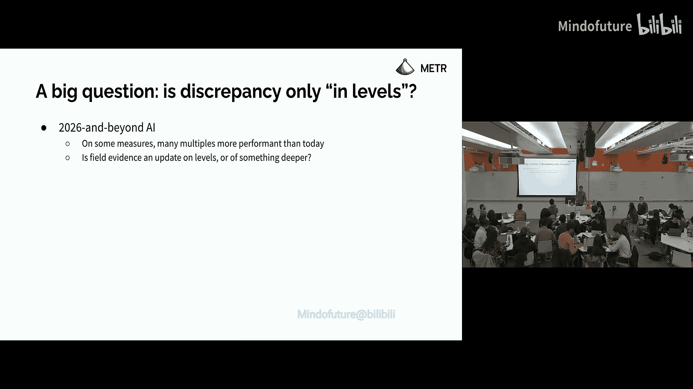
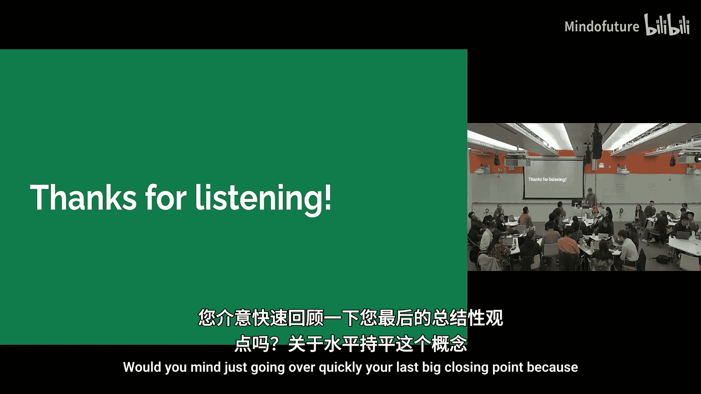
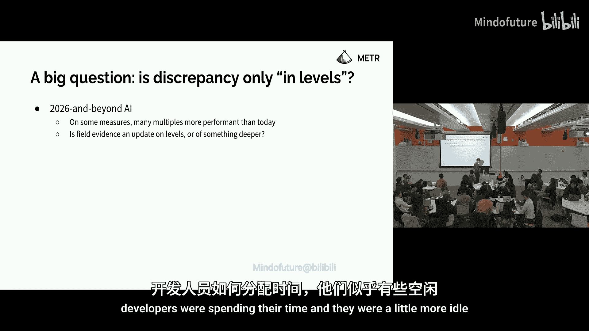
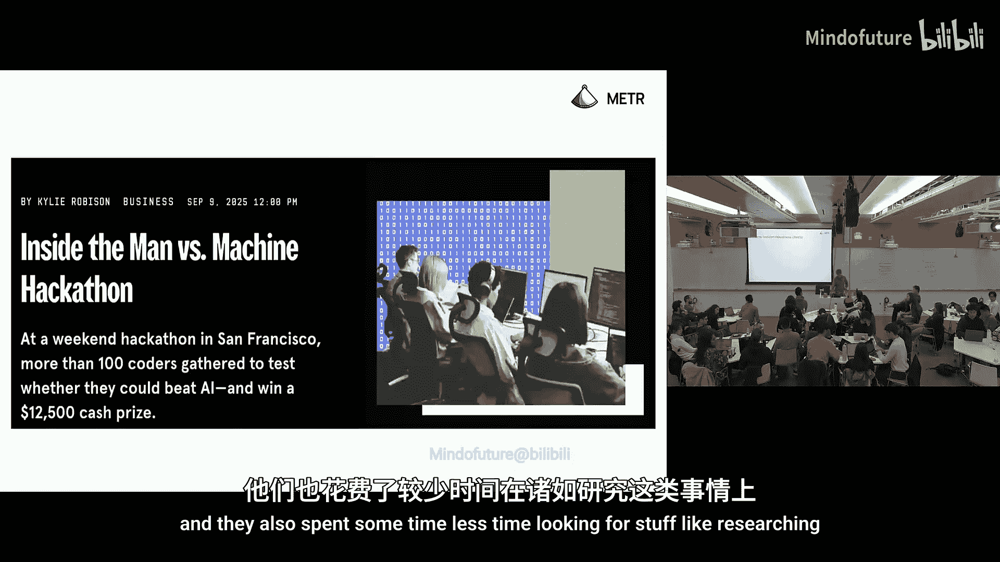
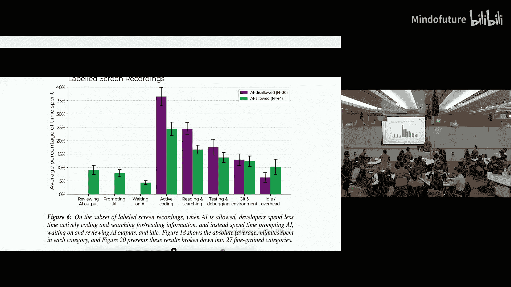

# 【哈佛大学】人工智能安全与对齐 ｜ Harvard Cs 2881R Ai Safety And Alignment p07 P07_讲座_7_实验室与现场对比_嘉宾讲座_Joel_Becker [BV1D4AXzxEbL_p7]

So we're very lucky to have Joel Becker today giving a guest lecture。😊。

I'm not sure if there has been any。I'm not sure if there's been any lecture on in this course where I've not shown this meter graph of like the time horizons。

 and probably if I didn't show that graph， I showed something else of it that meter is doing。

 so they're really doing a lot of great work。😊，And。

Before we start just some administrative things I will not do my usual office hours in usually I do them in Swiss bakekers at 9am on Fridays this time I'll do it after lecture we don't have an experiment in this lecture unless someone can correct me so I think we might finish earlier so then if we do then we'll just have like the office hours like I'll just say around here and talk to people whoever wants to talk to me。

And。Yeah， the mini project， if you didn't yet fill in like who you're working in the topic。

 do that SAP。And the last lecture of this course， I just realized that like actually today。

 I always thought it was on December 4th， but then I realized that the semester actually ends on December 3rd。

😊，So and November 27 is Thanksgiving for the last lecture is November 20th。

The mini project we extended the deadline till November 2nd。

But if you can already start on the final projects。

 you might as well do so because the deadline for the at least。

Find out who your group is and well post more details on the final project soon。

 but then the deadline for the final project will be the last day of the semester。😊，December 3。

 and the way we will do it is we will， after you submit the final project。

We will go over them and we will， I think just what going for a marathon of。

Final project presentations could be really hard， so what we'll do is the Ts and I will pick a few projects for oral presentations and'll also do like a poster session for all projects and we'll find a good time to do that in the exam period。

so we will figure out like a good time to do that during the exam period。 and with that。

 let me pass it over to Jo。

所以说你可 we use investment。

各面。next one hand， do I need to make sure my bike is on yes， please do because we record it。他べ知道はい。内。

也是那问题。Wonderful。うん。

Thank you very much， having me。 Very very excited to be here with you all。 I'm I'm Joel。

 I work as a researcher at Meter。 I'm going to be talking to you today about a puzzle。

 There are these two sources of evidence that that we have about capabilities plausibly。

 plausibly there are more， but there are at least two buckets。

 I'm going to claim one is this like benchmark style evidence。

 the kind of thing that you see on the megraph， the kind of thing that you see reported the model cards put out by various companies。

 and then another is kind of in the wild capabilities。

 So either like impacts that we see on the economy today or Rs that people run these kind of messier sort of more on the ground。

 also sort of more holistic， maybe more like getting some final thing that we care about。

 source of evidence they seem to be giving some different answers。

 I'm going to be trying to reconcile those differing answers with you。😊，I book at Mita。

 I guess you've seen the graph。Okay， under a lab like evidence。

 we're going to be going through benchmarks that you guys are all aware of and this。

 this paper that I that I worked on with the graph that you're all aware of GDP vow。

 which I think came up in the readings。 And then as far as field like evidence goes。

 we're going to be going through this this paper that I was currently author on and a little bit of Labour market data。

 although I gather you'll be talking more about that later in the course。😊。

We'll try to reconcile them。 We'll give some implications for the Labour market'， know。

 possible technological and employment and automating AI R And D。

You might you might have heard of me to stands for model evaluation and threat research。

 model evaluation that is。 we ask how capable of the models what might be the propensities of models or at least agents based on these models and then threat research we try to sort of tie this understanding of capabilities and perhaps propensities of these agents to threat models that we have in mind you know。

 going through some sabotage like channel or Air and D automation or something like that。😊。

Maybe maybe this is dumb too dumb a question to ask。

 but I thought I would do a little bit of motivating。 Why do we care about AI capabilities。

 at least why do I care about AI capabilities from a meter standpoint。

 This is a I think greatly underread resource。 many of you have seen the graph。

 I think most of you unless it was in reading， at least at least possibly before the past week would not have seen meters G5 report。

 It's not quite like some of meters entries on the model cards that you might have seen previously documents from the companies listing the kind of safety testing that they did as part of the model release and what meters contributions。

 that was instead it's meter trying to make a sort of structured argument for G5 posing catastrophic risk to society or not。

 as the case may be。😊，This is very roughly the shape of the case。

 We've got a couple of threat models at the top。 AI R And D automation。

 Autonomous replication and the possibility of sabotaging an AI company。

 we have some sources of evidence。 The first is sort of promises or assurances from the AI lab in this case。

 Open I for G5， some measurements of G5s capabilities。

 And then some and then some examining of reasoning traces。 what what， what to say about this。😊。

The reason one reason why we're interested in bringing in reasoning traces and assurances from the lab is that we want to have confidence that the model is not sandbagging。

 That is sort of understating its own its own capabilities。

 And so we can really rely on our capability assessment in part because know much of the reason we come to this conclusion that it's know。

 very unlikely that G5 poses catastrophic risk is that we think it's not capable of some of the things it would need to do in order to pose catastrophic risk if we were severely underestimating those those capabilities。

 for some reason， perhaps for example， because because perhaps it was it was sandbagging that would seem to undermine our case。

😊，Okay， we're going to be talking about the capabilities components， in particular。

 this is what's motivating my careF AI capabilities。😊，嗯。How do we measure this。

 at least you know what's the most popular way of measuring capabilities probably today。

 but also also you know in particular before this year。 Well。

 you have a series of benchmarks here here are some older benchmarks。

 they often have some human baseline。 They often have some score between 0% or 100%。

 some some maximum that you can possibly achieve the on the benchmark。

 It's a little bit difficult to to interpret some of the you know， some of the data points here。

 some of the lines on the graph know， is is getting100% of the human baseline。

 Does that suggest superhuman capabilities and some relevant sense that we care about， you know。

 what does80% raw score，60% raw score mean on Sw bench， It's a little difficult to interpret。😊。

Another thing that jumps out at me here is that the， the pace from which we go from。

Z signal on these benchmarks to total saturation of these benchmarks seems to be decreasing over time。

 It's extremely difficult today to create benchmarks that are not already saturated。

Here are some more recent benchmarks。 This is data from epoch AI。 I don't know。

 the AI is getting better， according to benchmarks。嗯。Ter in the newspaper is。

 is what we're going to do instead， slightly different take on the problem。

 although it does have a lot of similar attributes。 I want to quickly say。

 if anyone has aggressive questions， you know， please， please shout me at any time。😊。

We don't have to wait till the end。嗯。Rightoughically the idea is that we're going to calculate a bunch of。

Human times to complete some set of tasks under as close as possible to identical conditions to the conditions under which AI agents are going to be asked to complete the task。

 That is sort of same sort of environment， same kind of access to commands， so on and so forth。

 same resources。We're going to measure AI performance on those same tasks。

And then we're going to convert the human time to complete into an estimate of autonomous AI capabilities。

To get through that a little bit more， here are some example tasks。 should I jump back No， no。

 Ill stick with this one for now。 So， so first， actually， I will jump back。

 So the Hcast benchmark that you see at the top left here is a collection of a collection of tasks that seem to that are quite open ended that seem to require a lot of autonomy。

 in order to complete or or at least seems sort of indicative of of autonomous capabilities。

 they're all computer based。 They're all， they're all software based。😊。

The S W A A benchmark is this series of atomic software tasks。 These are tasks like， you know。

 here's a list of four file names。 One of thems passwords dot T X T。

 which file is most likely to contain the passwords。

And then our event are these much more challenging set of machine learning。

 research engineering tasks。 These are tasks like what's a good example。

 Here's a big fine tuning script。 Can you， can you get to exactly the same functionality whilst causing the script to run in much less time or like。

 can you optimize this， this kernel these these kind of challenges。😊，And then from that。

 for each agent， we're going to get a charts like this。 in the purple bars。

 you see success rates by bins of human completion time。

 So what do we have something like 60% 6% success for Cla 3。7 Sonet in the1 to 2 hour bin。😊。

We're going a regression over we're going to fit a logistic curve over these success rates by task difficulty。

😊，And then we're going to call the time horizon of this model。

 the point on the X axis at which we think it's， you know， a coin flip。

 whether the model would be successful at this task or not。There's nothing special about 50%。

 There's a little special about 50%。 Maybe you know it's the point at which we're maybe best powered because we have the most positive and negative examples。

 it's a point， know a coin flip that feels quite intuitive。 It's consistent with previous literature。

 but there's no like fundamental reason we're using 50%。 if you think this is fishy。

 you should think this is fishy， please keep that in mind So the question I mean。

 how typical is this graph like What's kind of interesting is that。😊。

The human duration is so predictive of model success in a sense that say there is a sense in which here like up to four minutes。

 basically the model succeeds 100% of the time， is it something about these particular benchmarks or is this something that you see generally？

Great question。 So， so it definitely is an empirical observation。 And not。

 I'm not sure we have great sort of apri theoretical reasons to expect this to be the case。

 I do think it's an empirical observation that's borne out in many places。 That is。

 I can't remember exactly where it is。 It's possible。 It's in the。😊。

It's possible It's in the G T5 model card。 I I I， I have seen somewhere some data that suggests that on some benchmark。

 longer tasks， AI is ads performance on longer tasks from this benchmark as they are and shorter tasks from this benchmark。

My guess is there's some sort of complicated distributional differences between the long task and the short tasks in that case。

Yeah， I do。 I do think this is。Empirical regularity， it's not more than that。

 but I think it's empiricality。 You not observed So you could have kind of potentially observed。

kind of。Botttleneck show tasks， somehow like tasks that humans only take a minute to do。

 but somehow models no matter what they cannot do them， but you don't seem to have observed that。

Yeah。One thing that we're going to see is that， is that this measure is going to be in some ways and not in other ways。

 sensitive to。Tss distribution。And， you know， you you。

 you might think that these atomic tasks are like not from the same distribution in the relevant sense。

 And that's like part of what causes this pattern that that seems， that seems not。

 not so implausible to me， but。But yes， for the most part， I。

 I feel reasonable calling these things sort of distributionly similar， Some shorter， Some longer。

 it turns out for the， for the short ones， that the the most modern models are really excellent to the shorter tasks。

 yeah。So we read the meter evaluation on GP5 as well and one thing that I was wondering is clearly there have ways of quantifying this type of capability and stuff in a way that presumably was not done before one thing that could sit out to me on the GP5 evaluation was that many times it seemed to be that certain of things were identified and then it would just be one line explanation but we discussed it internally and thought that it wasn't worth caring about and then you would move on to a different topic I was wondering why you went to the route of like not trying to find like maybe quantified that report that the quantified ways of doing it and was this like due to time constraints did you internally it was like a quantified method and then just not report that Yeah great question I worked on the papers I didn't work on the G5 important cave my strong guess would be that there's like very limited time。

 Meter as a small team。The size of the technical staff is I'm not exactly sure it's maybe 15 or a little bit more so and also you know the I think we've made great progress on the science of EVs。

 but there's a lot left to be explored to the extent that there are those sorts of things that appear I guess it's either a matter of the sciences't in or the sciences in but but we didn't have time。

😊，嗯。The one prominent example that I'm aware of is， you know， A， a bar that we set for。

Cbilities that we think might be dangerous。Is having a 40 hour time horizon at 50% reliability。

 Where does that number come from， It comes from。 You know，mar， a bit of a genius， you know。

 smartest one of one of the smartest people at me， One of the smartest people I know。

 it comes from a guess that he pulled out of a guess that he pulled out of nowhere。

 If you have like better ideas for where bars should be sat capabilities。

 I'm I'm extremely open to them。 But but sometimes that is the kind of thing that we we need to resort to。

😊，Good。入。Sorry， this is maybe。Two study related questions， what is the why is this like logistic？

Why is it reasonable to assume its's logistic？With respect respect to log and planning？To is。

Are there four hour or two day tasks just like？2，000 times like one can be small tasks。Becomp to。

Shor ask。Like naively， you can construct tasks with arbitrary length by just concapnating tasks which sequentially depend on each other in then have like smaller length。

 and I assume that this is not what we actually care about。嗯。

So I guess in what sense are the longer tasks more difficult because they are just come with different distributions？

versus like how， I guess another thing is like how hard it for models to find the intermediate steps。

 like it's possible that longer tasks。can't be decomposed。

 but the hard part is to find a way to decompose them。I don't know which Yeah， great。 Yeah。

 let's take the， take the first one first。 Why do we use logistic， I don't know。

 like look at the histograms。 I'm like，😊，嗯。You know that's not the only reason。 you know。

 we could be using we could be using a pro bit。 You know。

 we could be using some like piecewise local linear thing。

 I think they're going to be at least for the 50。 They're going to be giving us pretty similar answers。

 If we were trying to measure 99% reliability。 then the distribution assumptions are going to change maybe quite a bit。

 The sum are stick that comes out logistic regression。

 I think is what's used in the literature that we appeal to this I literature from p psychometric。

 those are some justifications。 I leave it up to you to sort of think those are reasonable justifications or not。

 Yeah， as far as the。😊，How should I get answer to this， so you've seen the chart。😊。

there are two different sort of time axes here。 there's like calendar time。

s there's like sort of some notion of the time it takes humans。

 There's also a third notion of time that you might have in mind and that I'd be careful not to conflate with these two other notions of time。

 which is the time that models spend completing the tasks。😊，You know。

 I think it would be helpful if in your head to a first approximation， you just set that to 0。

 They're like not quite instantly answering， know some of these things are going to require sequential actions。

 But that's not the main thing that you should have in mind here related to that。

 This time horizon measure is know， collapsing both some notion of difficulty per step。

 maybe so maybe some types of problems， only require one step， but they're much more challenging。

 So you need to you know， think longer。 or if you're a human。

 you would want to decompose it into into sort of chain of thoughts， Think about it for longer。

And like necessarily having sequential sequence of actions that you need to take。

It's collapsing that into one measure， which is something like human time to complete。

You could create longer tasks by by concatenating smaller tasks， at least given that we've。

 given that we've not done that。There are going to be some types of tasks that are sort of subsceptible into these smaller tasks。

 and some， some that are not。 indeed， some of the。I think some of the H cost tasks are sort of strict subset of one another。

 There's like， can you find these 10 bugs in this in this piece of software versus can you find three of those 10 bugs this in this piece of software。

 And we， we deal with that in a way that you can you can see in the paper。Yeah。

 can you hit me again what feels unsatisfing about that。don你 know我就 task。

Yeah so yeah I think you should think that within this summary staistic there are a bunch of different dimensions that are interesting。

 I'm obscuring those two dimensions in some sense， that there are interesting questions to be asked inside inside those dimensions also maybe actually your two answers are related to each other like empirically if you go back to this logistic fit empirically you have seen that in summer you get a good fit for like a logistic function when the x axis is log of time Now maybe I'm one。

 but I think that if the tasks where just concatenations of smaller it would have not have been log of time because then basically if you succeed with say probability and the task would basically a task of four hours would be basically four tasks of one hour。

 then it should have been like something like two to the minus four。😊。

So maybe the feature should have been different or then you'd get this like exponential drop off yes。

 right because if it was truly the case that like a four hour task。

Is like a 16 hour task is basically 16， you do 16 one hour tasks， one after the other。

 that the probability should have been two to the minus 16。So， so maybe the。

It would have been like a different distribution。 Yeah， yeah， I I I， I think there's something here。

 I feel not on top of the maths。 There's this。 If you go on Toby Os website， he has this he。

 he has this post suggesting that you know， one model that would fit the me data extremely well is to consider each model is having a sort of hazard rate。

 at some chance that it fails at some step each each period of time。

 And my impression is that you can recover。😊，Something like these fits from something like that model。

Yeah， again， I feel not on top of the details there。Does not question。 Yeah。

 when it comes to interpreting the success probability， is it closer， like， let's say。

 the 50% success rate。 I it closer to say that。50% of the task。Is completed 100% of the time。

 or is it given any task？In that time range， there's a 50% chance of it completed。

 if you understand what I mean。 Yeah， one of my closest collaborators at Meter is this is the Sky called Night Rush。

 I think possibly after this lecture， he'll watch back the lecture。

 So I kind of want to give a shout at him。 His impression is that I'm supposed to be working on that question this week。

 I'm currently not sure exactly exactly what the answer is。 Y。😊，I mean， I mean， just to be clear。

 this probability is taken over both sampling a task and sampling multiple bowlouts。For each task。

 and in particular when it's00%， it's 00%， right？So if it's 100%。

 it's 100% of the task and 100% on each task， where only when it's 50%。

 it basically could be if like on 100% of the task， you do 50% of the time or like on 50% of them。

 you do 100% and 50% you do zero。Yeah yeah。this is about the task specifications again a little bit and I'm sorry if this was detailed further just $4 but for the task specifications do you take into account the time necessary to create the context for humans as well in that like for many different tasks it just comes down to getting enough context and like。

I'm going that's a fantastic question I'm going to skip over of that question because I want to discuss it later Okay yeah。

 all the wind back sorry when you're like reporting the human times does that does that mean like the time it takes humans to get 100% access rate on this task or？

😊，Yes， so we're going to call success not necessarily 100% on some underlying metric。

 but for some tasks theyre defined such that success is one failure is 0。 For some。

 there's some underlying metric。 you know， maybe between 0 and1。

 And we're going to binize success on those tasks by setting some threshold like 0。

8 the same would apply to the humans。 It would be the geometric average time that's successful human baseliners took taking this task and getting above the threshold。

😊，不对啊。Again， you know， like with the like with the you know 40 hours。

50% reliability being some dangerous capability threshold。

 notice that there's there's a lot of arbitriness here。 we could take different thresholds。

 different thresholds would probably correspond to different lengths of time that humans would take to complete to get that threshold。

😊，These are some of the skeletons hidden in the closet。嗯。Cool， so we， we've seen we've。

 we've seen this graph， you know， generalizing the thing that we saw for 3。

7 onnet to a bunch of other models。 The logistic fit is like maybe reasonable sort of across across a bunch of these。

 across a bunch of these models。 The time horizon is the point in the X axis at which we predict success probability to be 50% and。

😊，Yeah， and then if you plot that over calendar time。

 you see something that kind of looks exponential。 You've already seen the graph。 It does。

 It does look extremely exponential on this on this log linear plot。

 then we try to explore we try to attack this conclusion is is sort of what's happening in in the rest of the paper maybe let me do a little bit of storytelling about whats happening internally。

 there's this there's this chart from a meter presentation internal presentation in like early 2023 where can I draw on the whiteboard。

😊，Where。嗯。On， on some way axis is written some not exactly， but roughly some sort。Of。

Dangerous capability measure。And then here is like， time or compute。Or other resources。哦。Whatever。

And the graph looks roughly like this。That is， we， we were from from an early stage trying to go for some some sort of trend that was。

 that was， you know， predictable， that was forecastable。

 that would allow us to say allow us to give informed forecast about some some next model that we'd that we'd not seen before or。

 or some capabilities level that we'd see at some， some point in time。And like， of course。

 we were doing this messy thing。 You know， like the。

 the process for creating these tasks is like people come to us with their tasks。

 and we try and make those tasks more robust， make sure the models can't easily cheat on them。

 They have， you know， fair scoring criteria。 they're fair for the models versus humans。 They're comp。

 sort of only using only only with access to a terminal and the relevant commands， etc cetera。

 et cea。 internal some internal tasks were created by meeter staff， which is just， you know。

 staff like。😊，braininsstorming， what would be difficult for a model to do like， you know。

 what's a challenging R And D problem that we've not seen on the Internet before。 It feels。

 it feels very messy。 And so obviously， when we， you know， when we go about and produce this graph。

 it' it's gonna have this this pretty low correlation with with whatever the X axis is。

 It's not at all going to look like this graph。 when we saw this graph。 were。

 I'm not sure jubilated or suspicious or like you know， assume something's gone wrong。

 know something something in this direction， It's it's weird that the fit is so so tight。

 So we try and attack that conclusion to the rest of the paper。😊，Oh， one thing is if you， you know。

 kind of naively and very irresponsibly extrapolate to one month 50 cent time horizon。

 then you get something like 2029 to 2030 on the main trend。

 Or if you notice that these recent data points look like they're rising a little bit faster。😊。

Then you might think 2027， a famous date is when one month time horizon arrives I'll give off the cuff opinion is some some of my colleagues share and some of them don't You know。

 I think when you have so few data points。 Its it's kind of irresponsible to to add X parameters or something。

 you should go for the most parsimonious fit。 you possibly can here。

 the most parsimonious fit is just like the one straight line。

 I I'm nervous that having the two straight lines is is reading the tea leaves a little bit too much。

 So I personally would be sticking to this 2029 to 2030 sort of thing。😊，Okay。

 and then here are some attacks on the conclusion。You know， the first is， well。

 if these logistic fits had very different slopes per model。

 then maybe you'd end up with trends at different reliability levels that looked sort of。

Much less clean than this than this 50% trend。 It seems like that's not the case。

At least for the 8% reliability level。And therefore， I think the 20% reliability level。

We do some checks for external validity。 That is， we feel， you know。

 reasonably good that we've got internal validity down that we haven't made mistakes in our statistics that we basically believe in the。

 the tasks， the， the procedure that we're doing， the summary statistics statistics。

 sorry that we're generating。😊，But， but to what extent does this apply to the real world。

 here are some things we do to check。The first is a retrodiction exercise when we first were going about implementing that chart。

 we didn't have this atomic actions suite。 You know。

 the thing with the passwords do T X C is in this list of files。

 which which file contains passwords we only had these these more challenging tasks。 And so you know。

 because G2 is not able to do novel machine learning， research engineering。

 we weren't able to measure G2 on on our task suite。 So you might ask， well。

 given what we had at the beginning。 Like how well does this predict that the rest of the trends。

 and the answer it seems is surprisingly well。😊，It would fit。

 One thing I was thinking about this week is is that for all of these， all of these points。

 we're using announcement date as the calendar date except for G2。

 where we're using because opening I delayed the release of G2 for a long time。

 We're using the announcement。 Sorry， we're using the announcement date rather than the deployment date where we're using an deployment date for for all of the other date points。

 that would move G2 to late to 2019 and then and then make the fit of this reicting exercise even stronger。

Yeah。😊，One question is if theres， which we'll come back to is if there's something weird is and unusual about the。

 the task suites， in particular， the fact that the meter tasks like many benchmark style tasks are not messy。

 That is， they don't involve a lot of interaction with the real world。

 They don't have kind of highly ambiguous scoring criteria。 They they they're nicely packaged。

 you know， the context has been curated for you， all this， all this sort of thing。 There is。

For for the most part， I would say basically all of the all of the me tasks。

 like basically all benchmark star tasks are on the very low messiness range。

 But there is a little bit of variation， even though they're all kind of lower on the range。

 So you might ask， you know， do we see this trend of increasing performance on even the messier tasks within the range。

 which you should think of as being sort of know， middle messiness tasks or something。

 not not actually high messiness a non exponential trend on this measure does not imply a non exponential trend on the other measure because the Y axis here is success rates rather than time horizon but broadly something consistent with progress going up on the messier tasks as well。

😊，This is the next done of lazy check， because we think that real taskss in the world are likely to be more messy than mess。

 This is， says least messy， not most messy。Oh， sorry。 that's the least messy task。

 And those are the most messy tasks。 Thank you very much。😊。

I will note again that this concern about the distribution distribution。 sorry。

 not being messy is not at all idiosyncratic to the meter tasks。

 this is true for many of is it true for all of your favorite benchmarks that can't be true。

 But it's true for many of your favorite benchmarks。 for example， Swbech。

 which has other issues that some of you might be familiar with for example， you know， contamination。

 some of the problems being impossible。 it also has this feature of if you to succeed on sweet benchch tasks。

 you need to pass algorithmically scored unit test cases。

 So both the quality of codes or the quality of output you have doesn't matter the only thing that matters is do you pass the test cases or or at least some more holistic sense of like the quality of your output doesn't matter。

 And also the problems have been selected to be the kinds of problems for which we can do this。

 this algorithmic scoring。😊，And another external validity check sort of with the。

 with the previous caveat that we， that we see something like the same trend on we wentch verified。

 This is just a different data set， you know， suggesting there。

 there's not something totally weird about the meterta in particular。😊，Here。

 the doubling time is 70 days， which I think when's this， that goes tos a huge difference。 Yeah。

 yeah， yeah， yeah， we， are we already at one month A GI by that。

I think this is probably a problem with human baseline times in Swbech that's generating this Darwin time。

😊，Okay， in more recent work， first， we've continued to compute the the time horizon measurements for models as they come out。

 you know， the dotted trend is starting from Sonic to 3。7。

 That is we're only fitting the predictions from the models that you saw on the previous graph the models that were out at the time that the paper came out。

 the predictions have the implied predictions from from that curve seem to seem to have been reasonably good。

 They're consistent with this faster slope。 although you know， very， very opinionated。

 I still feel like we should be， we should be nervous to to have less paraneous expectations around around the shape of this curve。

😊，Some other recent work from my colleague Thomas Quar shows using a slightly different method to get the time horizons。

 it's a method that that's using， I think， implicitly lower quality human baseline there's a bunch of things about this。

 you can see more on the meet website that are not directly analogous to the previous work。

 but it's trying to do a similar exercise。 and I think the suggestion of this graph my read on this graph is that the slopes that we see the doubling times in time horizon across quite different task distributions these are still sort of software software based tasks that's important。

 But across different kinds of software based task distributions are surprisingly to me。

 similar to one another。 but the intercepts are very different。

 That is we're starting from a lower point especially tasks that require a great deal of vision capabilities。

😊，Yeah， this was a little behind， but I just haven't thinking about it for the messist plots。

 Why did you choose accuracy rather than like expert there because there there were even fewer than 15 technical staff at the time。

 and we need get the paper out there。That's the real reason。あは。

I think I'm pretty sure that's the real reason。There's also a question there Yeah， sorry。

I have quick questions， so you guys showed like the reset models with G5 and such。

Have you benchmarked or tested anthic claims that 4。

5 could like work for 30 hours on its own on a task？

So I'm not sure I understand exactly what anthropic are trying to do。Claim there。You know， I。

 I note that us estimating something like two hour time horizon ofnet 4。

5 is totally consistent with there exists a case where it's working coherently， for 30 hours。

 This is more like an average type of thing。 and that's more like a maximum type of type of claim。

Yeah， I'm showing completely different things like there is the length of time it would take a human to do the task and the length of time it takes the model to do the task now presumably it does seem like if the model is working for 30 hours。

😊，Then it would be kind of surprising if a human could do it in two hours。

 but it's not completely and it's not necessarily impossible。

 but also like maybe the worst case versus average。ベスケース。That seems right to me。Cool。

 next up on the benchmark side of the capabilities landscape。 what I'm doing Okay， is GDP Valal。

 This is not my paper。 I might， I might get stuff wrong that there's been a lot of excitement around this paper I'm going to give some opinion later takes on where I。

 where I share excitement and where I feel like it ds less than you you might expect from。

 from previous benchmark work。😊，Here's， here's roughly what they're going to do。

 They're going to select for the nine most common sectors。 sorry。

 the nine sectors that contribute the most to US GDPP。

 The five occupations within those sectors that contribute most to wages of compensation in those in those sectors and a predominantly digital notice。

 again， predominantly digital there's there's some important selection going on here。

This is something like what the occupations look like。And then for each occupation。

 they are going to get experts or professionals in those occupations to， to help them create tasks。

 That is a pair of curated prompts and task context。😊，As mentioned earlier。

 and some experienced human deliverable against which we can compare the AI deliverables。

AndNotice that。These deliverables are not only only text based。 I think I think that is。

 I think that is an important improvement。And then here's how they're going to score things。

They're going to get a response from， in this instance， Juy5， although。

 although there are a bunch of other models that they they report in the paper。They'。

 they're going to have the human gold standard deliverable that that we just spoke about that comes with the task context。

 which， which we see at the top and the reference files attached to that context。

And then they're going to ask， in one case， another group of human experts。 and in another case。

 a sort of LMs ddge， a kind of a kind of automated grader， which I think they stand by and。

 they stand by less。To， to rate， according to some subjective and objective criteria。

 which deliverable is， is superior。And then this is what they find。

 I I think I heard it mentioned in B earlier that it's it's impressive that that they noticed a non open A eye model performing performing better than open eye models on this benchmark。

 I think I think that's， you know， commendable research practice。😊，嗯。Yeah。

 do I want to step back and ask and ask what this means for now I'll say know this looks this looks pretty impressive。

 here's my list of opinionated pros about this benchmark。 Firstly。

 something that we're going to dive into later is that my sense is not a hugely quantitative importance consideration。

 but a quantitatively somewhat important consideration。

 when thinking about the success rates that models have on benchmarks is this algorithmic scoring piece that is we score the AI is using this sort of zero marginal cost。

 automatic know only checking sort of some subset of what of what you really care about scoring procedures。

 but we could do something else where like you know humans rate in an instance that we're about to see whether some code would be merge into Ma。

 given know， holistically the quality of that code。

 not merely whether it passes some test cases or or here。😊。

Whether some sample response is superior on some list of subject and objective criteria。

I I think that's I think that's important and impressive。 I think we'll see。

 we'll see more of this going forwards。The second is long horizon difficulty。 It's， you know。

 I'm thinking this week last week， next week about how to get more challenging tasks so that。

If you look at。This diagram， you'll note that there are not so many doublings to go before we are not able to measure。

50% time horizon reliably。 It's very， very difficult to find in the wild tu that we think take humans more than more than a day and are not sort of insanely expensive to。

To generate。So it's a serious pro from my perspective。

 that some of these tasks do seem to take humans a very long time。And the next is is task realism。

 You know， my impression from the paper is that these do corresponds to real work outputs in。

 you know， in occupations that contribute some important fraction to US GDP。Okay， on， on the。

 on the other hand， here are some， here are some opinion native cons。 The first is that。Yeah。

 I think this is related to the curated context thing。 The first is that。

By taskifying or by bringing things into a benchmark in this way。

 I feel that you remove some real world frictions that in some sense， advantage the AIs。

 you're only judging final outputs， you're not， you're not doing this thing where you know。

 you yourself as the worker are trying to define what the task is And then you， you know。

 give a sort of intermediate output to to your boss or colleague and then and then integrates。

 integrate that feedback into into a final output， you know， reason about。

 is this even like the thing that you're supposed to be doing instead of some other thing given what your high level goals were the high level goals wrong。

 You know， all of this sort of thing。😊，A second， curating。

 curating context for the model information retrieval is， is， is an important。

 important part of work。 And it's， it's。There's， there's some extent to which that is featured here。

 But， but I， but I think there are some senses in which in which。

 in which this is underplayed in GDP vow and and in other benchmark evaluations。

And the last is ignoring dependency across or interactions between tasks。

 I'm not exactly sure what to say about this。 Maybe I mean something like。

Suppose there are two tasks， A And B， and。Completing task A yourself is important for completing task B。

 You know， like having worked through the problem or like having seen the solution or something for task A is is important for task B。

 And let's say the models can do。Let's say the models can do task。Let's say the models can do task A。

 but not task B。No， I think I've， I think I've gone a little。 I think I've confused myself there。

 Anyway， I， I， I， I think there might be， I think there might be important interactions between tasks such that testing。

 testing on on a task by task level， in some sense， in some sense， advanceds the models。

Here's what they say about this in GDP Valel。Actually escape。Oh， and I had skipped over this。

 this other opinion I con I think there's selection for the kinds of tasks that are scoreable by low context judges。

 I think this comes out of of taskification。 You know。

 the experts are curating tasks that they they think will be will be in principle scable in the in the benchmark by by judges that are not sort of intimately familiar with the work previously。

 even if they are in the relevant profession。😊，Okay， then taking a quick step back。

What benchmarks tell us？嗯。I'm about to say a bunch of more bearish things about AI capabilities today。

 I think we。Yeah， I I think it's， I think it's important to， you know， step back。

 look at the kinds of machine learning challenges that that make up our event bench。

 this meter benchmark。 You can， you can read that paper separately。

 I would totally fail to complete any of those challenges to the standards of AIs today that that seems to me like a kind of extraordinary fact that AI is so capable of such technically difficult to work。

😊，And I think that progress， progress is rapid。 this won't be news to you。

But were about to introduce some caveats to that。 Here are some， here are some limitations。 You know。

 One is that the baseliners or in know GDP vow， probably the the human expert judges are low context。

 This is not directly the work they're doing every day。 You know， if you work at meter。

 you have extra extra context on meter tasks that allows you to completely things differently faster。

 than if you were an expert software engineer or an expert research engineer or something。

 but we're not intimately familiar with the meter stack。Another is， the ceiling is fairly low。

 a lot of these match marks are getting saturated。😊，The， the tasks， I think。

 are highly selected in some， in some important sense， as we just went through and messiness。

 you know， not quite necessarily， the benchmark star， the benchmark style tasks aren't messy。

 but it's very expensive to boost messy tasks。 So in practice， if you're looking for something。

 close to what you care about and scalable。 you often sort of sacrifice messiness as， as the dota。

 yeah。😊，One thing that I was wondering was were your opinions on maybe using a different subset of economically valuable tasks。

 one thing that I was considering while reading the paper was like thinking about maybe freelancers slash contractor work where there's inherently like lower context provided and dis specific tasks that are asked but it's still economically valuable and it could also be organically measured by just having the models completely legitimate like freelancer contractor work and then telling the people afterwards。

 actually you don't have to pay us assistance this or whatever after there's a benchmark called freelancer which does this and you should search yeah I think it's a good problem。

Okay， perhaps field experiments are part of the answer to the limitations of benchmarks。

 They're going to have a bunch of cons， but I think also some complementary pros。😊。

In the particular field experiments that we're going to discuss today， the one that I。

 the one that I helped lead， we're going to be using extremely high context developers。

 The tasks are going to be not synthetic。 These are。

 these are tasks that would otherwise come up in the real work of these， of these developers。😊。

And there， there's some sense in which we can get signal through the superhuman range。 You know。

 once all of the benchmarks are saturated。 Well， there's still some， you know。

2 x versus 3 x versus 4 x speed up， perhaps that these。That these engineers can get。

Here's setup of our experiment。😊，We're going to gather 16 experienced developers。

We'll see just how experience in a sec on large， mature open source repositories。

 We'll see which repositorory in a sec。On average， they're competing something like 16 tasks from their real work。

 The only way。 Well， I guess there are really two ways these are selected。 One。

 these are sort of issue based tasks。So things that require， you know。

 lots of communication with their， with their colleagues， but ultimately not merging things into Ma。

 kind of implicitly excluded。 And another is that we ask that if they。

 if they expect their work to take。Longer than four hours。

 they choppped the issues up for statistical power reasons to be smaller。😊。

But we think they are representative of， you know， issue based work that's forecasted to be less than four hours。

We're going to randomly assign these tasks， not these， not these developers。

 These tasks to AI disallowed or AI allowed。 AI disallowed means what you think it means。

 It means software development in 2090。 It means no tab auto complete。 It means no cursor。

 It means no cloud code， etctera， etca， cetera。 It means no chat GPT。

AI allowed means what you think it means as well。 We're not assigning them to use a particular AI。

 We're just allowing them to do whatever works for their normal workflows in practice。

 We're buying them cursor Pro。 And so they're mostly using cursor。 And they， they're largely using。

 you know， the frontier models at the time that people would use using cursor， which is typically 3。

5 onnet it and 3。7s on it， given the period where the study was conducted。

 And then we're going to record the time to complete each task。😊。

Both before review and sort of after， after responding to review， I。

 I assume that people here are familiar with the language of merging and PRs and issues。

 can I get a hands up if you're， if you're unsure about the language of merging PR's issues。go， okay。

Did you give them some time to play with cursor before the experiment started。 So a tiny bit。

 They have something like a 30 minute training from us。

 making sure they can they can make a change using cursor agent mode and on their own repositories and would。

 in principle， be able to merge that into their repository。

 that is it you know they are going to be completing， as you see here， know。

16 issues of something like two hours each across the study。 So for the later issues。

 They do have more cursor experience than than early on。

 a quarter of them have cursor experience before they start the study。

 almost all of them have some sort of regular use of AI in their workflows。

 either sort of web based as like beauty or the AI or something or they use V S code or copilots。

 which kind of naturally similar to curs。😊，They we'll say about this sort of thing in a second。Okay。

 here here are some of the repositories that we take from。

 If any of you know anything about open source developments。

 you'll be familiar with a bunch of these repositories。 We have the Hakell compiler。

 We have that's GH。 We have psychic learn。 We have hugging face transformers on average。

 these are a million lines of code plus they've existed for for 10 plus years。 These are large。

 mature economically valuable repositories。 and these are some stats about the some sort any stats about the developers that we have for each repository。

 These are typically the third most most common contributor by commits to these repositories。

 So these are some of the really top developers these valuable repositories。

 of somewhere between sort of hundreds on the high end， even thousands of total commits。

 They've been working on this repository for something like five years on average， yeah。😊，Well。

 I think that two people who I think was asking about what during the reading was the knowledge of how LLMs actually work that these people had because I feel like once you learn more about the theory of LMs the changes how you use them so did you like select for that did you ask about that。

 how much MLTV they know what things is that？Yeah， maybe let me do some more storytelling。

We had worked on this on this time horizon， time horizon work。 you know， Nate and I。

 various other people at Meter had some external validity concerns。 We thought， let's。

 let's run a pilot study that will take like a small number of months。

 And let's do it in like the most obvious or sort of you know， easiest setting we， we possibly can。😊。

Open source development doesn't require us to to partner with the company。 And， you know。

 let's get some of the most experienced developers so that we we， we， you know， feel that we。

 we have high quality deep from the study。 And then let's， you know， just let them cook。

 And then we'll， we'll see at the end。 like what the， what the results look like。 We。

 we definitely did not select for them being sort of you know。

 having a low level of experience with AI tools。 We didn't select for them having a higher level of experience with。

 with AI tools。😊，いや， soundss the question。いやい。や。I I guess you've seen the graph。

 I I used to when when I， when I gave this talk previously， you know。

 collect forecast live from the audience。 and there was always like an audible gasp when you get to when you get to the next slide after。

 after everyone guesses there you know，-40% or whatever。 But were you。

 you one of the forecasters okay， also often when I give the talk one of the forecasters in the audience。

 And I get say， you know， you are this data Yeah。😊，I would definitely have been on the green side。

So the， the economics experts， these are， you know， professors， these are economists at labs。

 These are top graduate students。 They're predicting something like a 40% decrease in time to completion on these issues。

 machine learning experts。 These are often people at labs or on the top four machine learning PhD programs。

 They're predicting something like 40% decrease in time to completion。

 the developers themselves are predicting a 24% decrease in time to completion。

 The developers themselves after the study has been completed。

 Re predicting how much they were in the past on the issues in this study。😊。

Pdict that they went 20% faster by this measure。 And， in fact， we observe that they go slower。

 that's actually fine for us because we get paid by how much developers think they get。😊，So good。

😀Yeah。There are a bunch of， there are a bunch of caveats at the top here。

 We're going to go through the caveats。 Here's， here's another way of seeing basically the。

 the same thing。 You know， the developers forecast that if they're allowed to use AI。

 the the issues will take less time。 And， you know， in fact， we see that the issues take more time。嗯。

Yeah， this is， this is this is another crazy result。 You know。

 when we first saw this result to do yet more storytelling。

 we thought the same thing that you probably thought when you when you saw this graph for the first time。

 theyve messed something up。 And then the weeks go by。 And like the， you know。

 the the point estimate still is still read。 It's still in the negative or positive by this by this time completion measure。

 So we， we went out watching you know an ungodly number of videos of these of these developers working。

 thinking about sort of all the hypotheses for what might be what might be going on。

 Ex interviewing the developers and this is what we came up with in terms of factors that we think might be driving results。

😊，Sa first。We have some practices that we think are contributing to slowdown in this setting。

One is obvious over optimism about AI usefulness。 You know， they think it's gonna be helpful。 They。

 they use AI。 you know， in principle， they have access to the zero point at any time by just not using。

 not using AI。 Another is high developer familiarity with the repositories。So。In in some ways。

 this is related to the curated context point。 unlike in my own work， often。

 the developers know how to solve the problem before they start going about solving solving the problem。

 They know everything about。 well， I'm sure they don't quite know everything about these repositories。

 They know an enormous amount about these repositories。

 They know much more than Cur does about or the the underlying AI tools do about these repositories that that gives them some sort of advantage I notes this is sort of in some ways similar to to the messyino problem that we that we spoke about previously。

These are large and complex environments。There's some sort of preliminary work suggesting that AI is do do worse in sort of larger environments by lines of code or numbers of files or or something like that。

And these repositories are just enormous。The AIs are are not so reliable。

 They're often making sort of directionally correct suggestions。 But then given they might be wrong。

 you both need to verify whether they're right or wrong。 And then if they're wrong。

 you need to redo the work。 that， that obviously comes with the time cost。嗯。And。

I'll skip over to the next one。Okay， here are some factors with unclear effect。

 I'll skip over most of these， except to talk about or to at least touch on below average use of AI tools。

 This came up A lot in the public conversation around this paper as some of you might have seen it's already come up in questions that you know。

 perhaps these developers are just sort of less， less capable at using AI。

 I' I'm a little bit skeptical of this as an explanation。Maybe now is a good time to talk about why。

So I think that the most important reason that I'm that I'm skeptical is not reflecting on these graphs is just that I've used Cusar。

 I have some extremely talented colleagues。 I've watched them use Cusar， and then I've watched many。

 many， many， many， many， many， many， many hours of these developers using Cuar。 And I'm like， well。😊。

You know， are they， are they doing it badly and I think I think I think they're not。

 I think I'm I'm not seeing these sort of places in their workflows where they have enormous speed improvements that are left on the left on the table。

 You know， one， one kind of advanced workflow that probably many of you are familiar with and some people have pointed to is the possibility of defining some set of tests that the agent can then iterate against This is considered。

 you know， a more advanced workflow that that may be a begin cursor user wouldn't use。 Im。

 I'm like not seeing I think many opportunities for these。

 these developers to use those kind of those kind of workflows。😊。

That's most of what's guiding my guiding my sense here。 But then also， you know。

 if we subset to the developers who have， you know， some relevance AI experience before the study。

We don't。 We don't really see any difference in speed up。 If we exclude some of the early AI issues。

 This is speaking to what something like what Boas mentioned earlier。 You know。

 you might think that they they're not so familiar with cursor at the beginning of the study。

 But like once they're 10 hours through， they do have some familiarity。

 And they are going to be sped up by to some extent， the study is pretty small。

 This is pretty underpowered evidence， like much of our subset evidence。 you know， don't， don't take。

 two strong conclusions from this。 but we don't obviously see anything jumping out。And then， here is。

codeed up the number of total AI hours that these， these developers have at the point in time when they start a particular issue。

 that is the sum of time they've spent during the study working on AI loud issues。

And the experience they had with cursor coming coming into the study。

 This is quite a conservative measure。 Theres there's one developer who's in that last than No one developer who's in that 30 to 50 hours bin。

 who used cursor as their primary I DE in 2024 they used cursor for140 hours to be conservative。

 They put down I think something like something like 50 hours。

 And so so've ended up they've ended up in in this bin。 that is in the penultimate bin。

 there are people who use cursor as their IdeE in 0 in 2024。

 I would say already this chart is is consistent with like not much going on。

 Some people who have looked at this chart and thought there is something going on from the last data points。

 know， that will shrink downwards if you change the coding of this particular developer who's in theultimate bin I think you know。

 the existence of this graph is why we come down on this factorctor as mixed。😊，Overall。

 there there's some stuff that seems to point in nothing much changes as they get more experienced direction and some stuff that that points in the other direction。

So some of the previous points you mentioned that。This persuade super familiar with this work case and that might make。

go down rather than throughout like has there been a control study where you actually pair a junior developer。

 maybe like just starting in a role with an AI and C right can they first of all。

 achieve the same performance as a senior developer and is there a benefit like a reduction？

In the speed， I there than any。Yeah， great great question。

 We are working on another uplift study now that will have some more junior developers previous literature has much more positive estimates of AI speedup I'm slightly skeptical of many papers in this literature for some different reasons that we can go over。

 But they are among other things using more junior developers seeing these productivity improvements。

 It seems totally plausible to me by the channel that you're point at junior developers will what be up theres another question like Yeah what were they given any advice what model to use cursor or was this part of the cursor like auto route。

😊，To different models。 So we， we have some data from the video recordings of what models they're using。

 and they're primarily using 3。5 Sonets and 3。7 Sonet， which were the frontier models at the time。

 They're not given advice about about what to use。 Indeed， the condition was called AI allowed， not。

AI must use that they're allowed to use no AI if they want。

I think there was one more question somewhere。Yeah。

The developers need to fix anything that was broken by the edits of the AI agents。

 I feel like sometimes this happens I was wondering where this happened in this like large Yeah。

 totally one thing that we observe one thing that developers report a small fraction of the time is cursor not being a very mature I D sometimes breaks in ways that the S code might not。

 But the more common thing is that AI make changes that the developers are not happy about we have here that。

that developers accept fewer than 44% of AI generations。

 This is we think that the proportion of lines when they click， except in cursor。

It's something like 44%。And then we observe sometimes them changing those extra lines。

 although we don't track that in our in our code。 we think it's less than 44%。

 I guess it's more like 20%，15% of lines of codes adjusted by cursor or ending up in the final PRR。

 Yeah， the reason I mentioned that is specifically about have the models ever changed code was unrelated to the task at 10。

 Oh， I'm not sure exactly， I guess probably there there were lots of reports of Sonet 3。7。

 in particular doing doing that kind of。Yep。一嗯。I was curious。

 what was the research community reaction to？There'sarrow bosss。嗯。Exceent question。

 You mean the latter is so close to zero。 No， no。Oh well down the line， but yeah， yeah。

 but the bucket developers with hours of experience because they're all overlap。😊，Yep， y。

 there are like 250 issues in the study。 The， the， the evidence is， the subset evidence is。

 is underpowered。What you do， know， we wanted this to be this like two month pilot。

 And then it ended up being a six month project because we spent all this time sort of diving into thisqui result。

 Can't be true。 is it we up yeah， yeah we are doing this larger study And yeah yeah does cursor I think there was one developer at least who just did not use cursor in the condition I'm not sure about delete AI don' cursor not a lot of people want to。

 I'm not I'm not sure what other tooling that developer might have been using AI I do yeah one't know5 complete。

😊，Just baseline know， just not using the agent they would be saving some time Yeah two intuitions that I have that are nots and evidence shouldn't believe me but like things to put out there I feel like maybe tab also complete is just really underrated the thing that I said previously about the A don' they don't have much actually''t really say this one hypothesis that I have that developers are just sort thinking less hard about the problems when they're allowed to use AI。

 they just sort like dumb all all the relevant information into context and like wait for an output and then know maybe maybe the that I'll or something not the zone tab also completes is a little bit more of in the zone workflow。

 You're like thinking through the design of the thing。

 And then making a comment like this kind of function goes here something。

 I hypos that the more effective workflow at least during this time period。Another thing。

 you didn't quite say this。 But， you know， a lot of people will say。Casa， you know， this is。

 this is not my view。 Carsa， it sucks。 If you only use Claude code， you know， if you only use code。

If you only used， you know， if you only used Sonet 4， then， then you would have seen。

 then you would have seen the opposite results。 I， I SAT here with these expert forecasters。

 some of them are you know， the developers in this study are extremely talented and experienced。

 know， much more so than me。 the M L and economics forecasters even even more so like some， you know。

 not gonna be anonymize， but there are some like leaders of the field here。

 and I SAT down with them I told them about the repos。

 I told them about the AI experience will lack thereof that the developers had you know。

 some of them went through psychic learn issues。 So they they could get more of a sense of the distribution of tasks that these developers were were working on。

 And then and then they well they don't all give this answer。 is this is an average。

 But you know they pretty much all give answers answers in the same direction。

 they knew that they were going to mostly use。 they， they were very wrong。😊，Starting hypothesis is。

 is that this is at least it seems not clear to me that this is sort of so sensitive to which tool exactly you use。

 I think you might need to actually go there and measure it。Yeah。

 things I'm wondering is like how like I guess this is hard to measure。

 but in the context of the experiment， how much when they were told that they can use AI was the implication that they should use AI more than they already would。

I think I've graph up about this， too。 So I think some of them do take it that way。

 and that is that's a bit sad for us。But hiss graph。

 So we asked them in excellent interviews what their kind of a behavior looks like。

 some of them using it as they might otherwise， some of them are， they're not。

 they haven't misunderstood our instructions and using it as much as they can。 But they， it's at all。

 they're using for the first time。 And so they're experimenting with it in some sense。

 and some have interpreted our instructions as as using it as much as possible。

 We see some of the slowdown for all groups。But this is very unsed。

So let's imagine that you did like the following exercise。

 it took issues from these repositories and made them into a benchmark that basically maybe corresponded to exactly these tasks。

What do you think would be the performance of models like models we know are good at benchmarks。

 what do you think will be the performance of these models and how much would that be correlated with the usefulness for these。

For these kind of tasks， like say， is it the case that basically？

If you just replace like I can just imagine by the type of the graphs that you say that basically if say Sonet 3。

7 did the x on the would have succeeded on X fraction of these tasks。

 then probably the 55 and Sonet 4。5 I don't know， x plus 20% would not make the difference in the。

For these developers。 Yeah， there's this drop from the A bench paper。

 which is another meter paper I worked on where it shows the the distribution in human scores over time。

 rising from 0 hours to the maximum of 8 hours that they have。 And it shows that for， you know。

 a significant fraction of the， of the expert human baseliners。

 They end up doing worse at 8 hours than you know， models are typically doing at like  two hours。

 That is， they could have just deferred to the model at the beginning。 and they。

 and they would have done better。😊，I definitely think so this， this bottom point subopmalation。

 It's possible that， in some sense， cursor is under e listing the agents。 You know。

 meter agents eat through a lot of tokens。 We think that eating through a lot of tokens using a lot of AI labor is is important to give the best performance out of these agents。

 You know， perhaps cursor isn't doing that to the same extent。 And and that's harming AI performance。

 You know， if you benchmarkify these tasks。 the A is would do a lot better。

 we do have this we do have some work， which is on the meter research blog。 I think showing that in。

😊，I'm going to forget exactly the details。 But something like in most cases。

 when we test agents on these tasks， they're making， you know。

 significant efforts in the in the correct direction， but a maintainer would not merge in their work。

 That is by the scoring standards that we're sort of using here。

 whether a maintainer will will merge in your work or not。 They would get 0%。

 And by algorithmic scoring sort of s benchch like scoring standards that they would do quite a bit better than that。

😊，Quantitatively， my sense is that at the。At the current frontier， maybe you should drop off like。

20% or something from Sw benchch scores to get sort of sweet benchch scores if the task was to merge into Maine。

That's based off of work that's not currently published。 So basically like， if forget your career。

 you think eventually。As the models as the the， the model get better。

They would basically get to the point where the developers could have just asked the model to solve the issue and the model would solve it。

There is a tax on actually solving the in amerable condition and maybe some messiness tax and that tax might be something like 20 points。

I think I think that is part of my model on a previous slide that that I saw of yours to this class。

 that's like the me graph， except know， maybe the me graph is going to go super exponential or maybe it's going to go subexent or something。

 I think's like another version of this graph， which is like time horizon。

 except like imagine it really refers to the thing that we care about maybe the thing we care about is merging into main。

 maybe it maybe' something else。 It's not just this sort of crude summary staistic。

 low context baseliners zero marginal scoring's plausible null my best guess null hypothesis is that like on a previous graph we saw the slope of all these time horizon graph。

 know， it's roughly the same。 but the inter can be very different。

 And so the inter using humans and messier tasks and like more challenging modability conditions and so on。

 shift the intercept downwards， but we still see similar slope of progress。 I don't know that。😊。

To be true， it's it's plausible to me that we see on you know when thinking from the perspective of algorithmic scoring。

 this like straight line exponential progress。 but for you know。

 something that brings in extra notions of quality or something see we see some we see some curving off。

 I think that's a big question。😊，question over are you guys thinking of like kind of doing something like that where you're like combining the time horizon staff idea with with this where it's like instead of just having their baseline like time for human it's like the 2024 line is like the human who has access to like the best 2024 model does I'd imagine you can maybe kind of see kind of little like a slowdown and then like increase when like if a model is like better at like following your like preference style of coding because I'd imagine if I was like a good death which I have not like I'd have very strong preferences and so like I like to just like auto accept everything they would just see something that maybe if they auto accepted everything it would work but like it's very ugly and doesn't fit with their vibe and so they like rejected and like。

 we're both gonna produce， know just this graph， except it's only the last data points。

 And it's like over time。 know， we're well powered to do sort by month month。

 We'll see how that trend goes and the main the main reason graph time graph except's on tasks like these and success is judged by here are somes what you couple of people I think questions before we move back to lecture stick around for a bit afterwards。

 if you Here are somes to to the work that that we've just seen first。

 we provide evidence for a particular set of software developers working on a particular set of tasks。

 the setting is weird。 It's really weird。 It's really interesting。

 It's interesting for the same reasons the reasonss the codes are enormous lives the developers extremely so on and so forth。

 perhaps we'd expect to see very different outcomes in different settings。😊，I would say that。

 you know， I and probably you and， you know， our expert forecasters expected to see one thing in this setting。

 and they did not see it。 I think the， the jury's out on， on。

 on whether we'd see it in different settings。 Maybe that sounds like an insane thing to say。 But I。

 but I do think it'd be helpful to to actually go out to measure these things。😊，The second is。

 you know， we saw that progress in AI has been pretty pretty rapid。

 Many of you would have felt that in your own lives。 You know。

 perhaps we'd already see a different result if we'd if we'd measure this today， we are， in fact。

 continuing to do this uplift experiment and Nate will shout at me if if I reveal the the current outcomes that we're seeing。

 anyway， AIs progress since then， know， maybe maybe today we see speed up。 if not， know。

 perhaps we'll see speed up in future， this is a very dynamic situation。😊。

And and maybe with reference to some of these things。

 Bas asked me to touch on which of these things might might might change as we move into the future。

 surely low AI reliability will change surely grabbing the correct context will change as more people at the moment。

 quite rudimentary things like adding cursor rules。

 but perhaps therell be more things of thatlk later allow AI to better use context。

 maybe will have sort observed more of your password and be able to integrate that The developers will will be more experience using AI tools to the extent you think that's an important channel that will probably be different in the future and a couple of things here that will be different latency also at least the given level of capabilities。

 I think we expect that AI to be faster。 maybe that will be realized because we'll want to go with the more performance capabilities but。

😊，Possible that the AI is will speed up that way， subopmalation， you know， presumably these。

 these agents at least could get better listed by， by by current or or future tools， you know。

 perhaps your， your favourite tool that's not cursor is， is doing that today。

 Perhaps cursor is doing that today。What are the takeaways I have first。

 when we at the time when we set off doing this study， we had another project。

 which was to survey AI researchers in great detail about the degree to which they think they're feded up by AI tools today。

 I think we are going to have them go through time trackingrack exercise and sort of really。

 really carefully really carefully reason about this question。

 A lot of people have this intuition that know maybe one good measure of AI R and D capabilities explosions would be to ask machine learning researchers。

 the degree to which they think theyre all engineers。

 the degree to which they think their work is being sped up by access to AIs。

 I think a straightforward implication of the work we've seen is that those surveys might not be reliable。

 we don't have strong reason to think they're reliable。 know。

 maybe forecasters will update after seeing this evidence that they developers will update that theyre too optimistic。

 And so forecast will be will be better in future or。😊，You know， it's not。

 I'm not necessarily saying surveys， surveys are always， always rubbish。 You know， I will say that。

Especially in the exit interviews。 these developers are in ideal condition。

 or they're in very good conditions to guess the degree of speed up that they they had or didn't have。

 They have you know from all of their past work。 The time it took them to complete each issue。

 They made notes on where AI was more or less helpful for each issue。

 know they've noted whether this was the kind of issue that required a lot of sort of external to the repository knowledge or not。

 know， loads and loads of things that I think was just they might make better better predictions than otherwise。

 And then the second takeaway， This is often a takeaway from AI papers。

 benchmarks don't tell the full story here， the picture is maybe something about mergeability and quality versus versus algorithmic scoring。

 Maybe it's something around integration between AI tools and developers。

 maybe it's something around messiness of of the task。😊，Distribution benchmarks look very bullish。

 This R C T looks much less bullish。Now， here's， here's another source of。Field evidence。

 these categories aren' aren't very clean。 I' not exactly sure to call it。

 I'm calling the benchmark style evidence benchmark style sort of experimental like lablike evidence and things that look like Rs or labor market data and calling field evidence the stuff from the field is is messier。

 can in many cases be smaller can be to interpret consistent with many things It's also maybe to things you care about than the like like conditions originally come from academic economics which as field feels of similar。

 Here's's market data。 a lot of papers are doing something similar to the exercise that we're about but just pointing to this one。

 So you might know about these exposure measures and anthropic have put out the Open looks something like this each on task that is is a database I think published by the Department of Labor in this country that details something like 10。

😊，Thousandand tasks， or maybe it's for 1000 occupations。

 I can't quite remember that are representative of the kind of work that's completed in the US economy。

 for each task， these authors of this 2023 paper are going to ask。

 can G4 or G4 plus some extra software。 plausibly reduce the time to complete this task by 50% or more。

 And then the occupation score is is the average of these scores for the tasks that make up that occupation。

😊，So if you had，50% ones or yeses and 50% zeros for a particular occupation。

 you'd end up with with a score of 50% on this measure。

 We might ask have people moved into or out of more exposed occupations。

 occupations like software engineering， perhaps highly exposed occupations like hairdresser。

 perhaps low exposure， The answer the answer it seems is no， at least on first blush。

 A lot of the other papers in this literature， often similarly using this C data set are coming to broadly similar conclusions。

😊，I'm going to go quickly through this because I think you'll you have a speaker that will present on this soon。

 one of a number of papers that find some positive effect in some sense。

 in this literature these more recent papers is called canaries in the coal mineine。

 B oftenen atal the CP data， as I mentioned， is pretty small in particular。

 it's maybe too small to reliably estimate correlations within small cells。

 So if you subset to sort of very junior workers or something。

 then you end up with even smaller data。 and then it's harder to distinguish answers to hypothees。😊。

But at the same time， we maybe are more interested in entry level hiring in particular。

 I think that's where much of the public debate has focused on。

 This paper is going to use large scale payroll records and present descriptive stats。

 not not causal estimates from that data。😊，They have the paper are centered around six facts。

 I'm not going to go through all the six facts， I'm in particular going to go through this plot。

 which I think says quite a lot。😊，嗯。What are some things I want to point to first。

They are seeing only seeing declines in employment。For， or growth of employment， sorry。

 for young workers going into industries that are highly exposed by this open AI measure to AI。

And everywhere else， they're saying kind of robust。Robust employment growth。

 That is both for more experienced workers working in AI exposed occupations。

 They're seeing pretty robust employment growth for young people working in less AI exposed occupations。

 They're seeing pretty robust performance growth。 I， I would describe this as。😊，You，You know。

 maybe less pointing to unemployment effects of AI and more there have been in the in recent times in the US robust employment growth in sort of all groups。

 at least by this aggregation， except for 22 to 25 year olds apologies。 going into。

 many of them are0。Going into industries that that are highly exposed to AI。

 There's this great Joshua Gs who who's an economics professor。

 subst post about this about this paper that I really like suggests something like this。

 this is this is speculative。 This is you know how this is roughly how I'm integrating this evidence into into my model of the world more work is needed as always。

 you might think that you know， to some extent， you guys or at least you know。

 typical22 to 25 year olds have something like textbook like knowledge their education whilst I guess maybe I'm a senior work senior workers have tacit knowledge。

 they they've worked on the job。 they have more experience working in teams on large code basis。

 you know， in the software engineering context andous thingsous things in other context。

 perhaps in the economic jargon AI is a substitute for textbook like knowledge。😊，That is。

 you can ask GT5 or your favorite AI model textbook like questions。 and it answers pretty well。

 has answered pretty well for a long time。 The LAT is saturated。

 but maybe it's a compliment for tacit knowledge。 That is。

 you know the right things to ask or if you're sort able to do the kinds of tasks that the AI is are less strong at or something AI might benefit you that this would be compatible with the picture that we just saw where even for people in AI exposed industries who are more senior。

 We're seeing this robust employment growth。😊，One concern that Gs points to is perhaps the the education system creates you know。

 graduates that in order to be。Maybe gainfully employed is too low。 know， ideally。

 graduates would have this sort of tacit knowledge that's complementary to AI。

 at least on this framework so that they could they could work productively with AI in their jobs。

 but it will be difficult to find opportunities to obtain this。

 perhaps in principle that's true universities probably probably not the main thing that I think he's thinking of is that firms might not be willing to offer this kind of on the job training that won't be profitable to them because the rest of the market captures it in some sense。

's not's not firm specific training。 It's sort of giving them general capabilities that they can apply to any old firm。

 I think this is a classic economics problem between on the job training that's more general versus firm specific。

😊，There are some other papers in in this literature that are consistent with this result。

 There are these three papers finding broadly similar things。

 One of them is in I won't go through these papers。

 and then there's this one paper that's doing a slightly different exercise in Denmark and seems to contradict the results from the canaries in the coal mineine paper I think I'm unsure if this is difference in the institutional setup of Denmark versus the United States or or if this is about them doing a slightly different thing where they are instead of this sort of G4 AI exposure measure。

 they're looking for which Danish firms mentioned in their job listings no sorry， this is not true。

 they have they have surveys of the workers at Danish firms asking if those firms have encouraged them to use AI And that's the thing that that they're using as they sort of exposure measure。

😊，Second back， what， what's this field of evidence tell us， I， I have missed out on， actually。

 let me， let me go to this table first。So here's， here's some other literature on sort of productivity R C Ts。

 It finds broadly positive effects where we found some negative effects。 I've。

 I've skipped over that。 And I'm calling you know， the field experiments evidence kind of bearish despite these papers。

 Why， Why am I saying that。😊，You know， one one is， for many of these papers。

 I think they're using outcome measures that that I that I don't have a huge amount of faith in。

 things like， you know， lines of code or like number of PRs or something。I when， when。

 I'm sure many of you already have this sense。 But you know， when I talk to journalists。

 analogy that I draw is with producing articles using LLM versus not。 know。

 maybe using LM allows you to produce a higher work count article。

 but that's not really what you care about， you know， if anything，ency might be， might be attractive。

 here I thinking here I'm thinking we're using al measure for our work that feels closer to the thing that's economically meaningful。

 although I think still think。😊，leave leave some stuff to be desired。

 We're using these more experienced developers。 We're using these non synthetic tasks。

 So for a lot of these studies， they're using tasks like。Implement an H T TP server。

 these kinds of tasks that AIs are sort of preferentially good at that that I think don't really come up in。

 in economically valuable work。 That now makes me sort of less interested in their。

 in their conclusions from， from an external validity basis。Anyway， I。

 I'm going to take it as a given that that we're focusing on this。

 on this meteority as the field evidence on this question。And what have you learned all this。 Yeah。

 if we， if we restrict to this R T and then you know， broadly the labor market evidence。

 I think we're finding that the productivity impacts here are not obviously large。

 at least they're not obviously large yet the employment impacts are nacent and they are highly concentrated to the extent that we're seeing economic impact so far。

 It's just for these very young people in very AI exposed industries。😊，This is just a puzzle。

On the one hand， we have the more bullish evidence， the more benchmark style evidence。

 the impressive time horizons， or you could sub in benchmark scores that models like 3。7 on it，3。

6 on it。 And then know， the latest round of models have。 On the other hand。

 we have AI slowing down development and limited labor market impacts。 What's up with that。 How。

 how do we reconcile these things。 the reconciliation， I think， is going to be similar。

 whether we're thinking about this kind of labor market style evidence or this or this R T style evidence。

 But I' focus on the more R T style evidence。😊，You know one possibility is is is we cock up know。

 we go through in the paper all these， all these know documenting all these ways we think we might have cocked up and seeing if that if that's worn out by the evidence's not of them we find hard to classify some of some of them we rule out。

 know， I still think this this is a possibility。 maybe the developers are not using AI as best they could maybe scope is increasing one possibility is it's easy to add yet another test whenre using AI versus when you're not because's something that AI is are relatively better at。

 And so the PRs when AI is loud are longer in particular。

 that higher quality in some sense they have an extra unit test's desirable AI was not allowed。

 And that's what we're picking up when we show that developers take more time when AI is loud versus not Another possibility is tasks。

 the developers are。 one thing that。😊，Economists are often concerned about is that we're paying these developers by the hour。

 rather than。Rather than per task。 So they don't have incentives to finish quickly。

That was an intentional decision at the time。 We were， you know， remember。

 we were concerned about this external validity stuff coming out of the time horizon work。

 We wanted these like maximally realistic tasks that would really come up in the in the work of these developers。

 And we feared that if we paid them per task。 they'd be incentivized to give us tasks that were smaller so they could be paid more often。

 And then they would not be these sort of real in the world tasks。 That's a design trade off。

 You know， I agree it makes interpretation more， more challenging。

 I'd be interested in in doing it with incentivized times later。😊。

Maybe we'd get a different a different conclusion if we did that。

 although it would have other types of interpretation issues Give。

 it's not the distribution that we care about。 You know。

 another that I think is is is very important should be should be trying to mind myself and for all of you guys。

 this is a small study。 small studies， you know， even if exposeos' statistically significant。

 should not give you so much evidence against your， against your prior。

 I think we can work through this exercise。 But I think quantitatively， know。

 if you had something like5% belief。 in negative productivity beforehand And you see this kind of evidence。

 you should update to something like 25% chance that this is negative。 Of course。

 I think this is stronger evidence against you know， not 0， but like very strongly positive。😊。

Productivity improvements。 But anyway， that's that's important。

 There was one question back So for the idea that you。

the are they getting paid both to do the non AI tasks and the AI tasks like no matter what they assigned to either of those so like are they incentivized to do badly and both？

Yes， yes。 I I agree。's it's not obviously a differential。 It's not obviously a differential content。

Another concern that people bring up is these like Horn effects where perhaps。

 because you're in experiments， this relates to an earlier question。

 you act differently in this case even more so because your screen is being recorded。

 maybe you act differently to if you're developing normally again， in that case。

 it's not clear has this differential impact。😊，There's another question I was curious and I think some other people were about cheating。

 so I'm assuming that the cheating was using AI during the like disallowed AI。Why would like。

 I guess what would be the point of some dev cheating that way？And also， yeah。

 like what did you see Like how did you find that？ Yeah， yeah， I mean， if they。

 if they believe that they're going to go quicker when they use AI， then。

 and they want to go quicker for reasons other than us paying them。 You know。

 they can like move on to the next work or something。

 Then then you know they might want to complete the task in in a quicker time。

 if they think that we're not observing them， then they can， they can get away with that。

 they'll want to cheat。 I guess that's the， that's the thought。 empirically。

 it does not come up very often， the way that we verify that is with these screen recordings we have the developers。

We don't have labeled screen recordings for， for all of the issues。 but we have some， Oh excuse me。

We have some subsets in the paper where we where we recode those cheating issues to AI alloweds。

 rather than AI just allowed， or we， I think， remove all developers that have ever cheated。 Yeah。

 it does come up very rarely。Yeah， this is just our curiosity。

 but in the paper it instead one person cheated by accident。

 I was just wondering how it's possible to cheat using the AY accident。You know， you。

 you've like got all the things on your computer。 You know， you forget， you forget which。

Which condition you're in？I think I think that's it。It's it's possible why I'm wrong。 that。

 It's possible they forgot to turn off tabauto complete on， on V S code or something。

 I'm not exactly sure， yeah。I every time you go to Google and you search something right。 Yeah， yeah。

 yeah， yeah， yeah， yeah， Yeah， yeah， they were allowed to use Google and that's yeah AI use。 Yeah。

 yeah， yeah。 Yeah， good point。😊，In March， Google was still thank them to eatbox。Yeah。

here are a couple ways of resolving this puzzle。 perhaps that do not look like we messed up as as the explanation。

 One is maybe there's no puzzle。 know， we saw earlier that we were using 50% time horizon。

 But maybe 50% time horizon。 In't that interesting。 Maybe we care about Oh actually。

 sorry that's a different point。 reliability needs to be very high to save time。 Maybe you need know。

80% time time horizon is is the relevant thing。 The 80% time horizons are much lower。

 There's something like a factor of five lower I think。

 And so the AIs is just like not the capability level where they can reliably do。

 the kinds the kinds of tasks taking humans， the kinds of time we that we see here。

 something like two hours on average。😊，Yeah， relatedly， the average task length。

 I think is actually 2 hours， not not 1。5 hours in this， in this R TD。

 that's above the 50% reliability point。 Maybe there's no puzzle because even by 50% time horizons for the models that were frontier at the time of this study that that theyre not。

 they're not capable of typical tasks。Perhaps as， as mentioned from Aboa's question earlier。

 the allies would pass sweetbech like scoring and so matching time horizon， in some sense。

 even though they fail on this like mergerability criteria。

 we we have some work suggesting this is there's something to this directionally。😊。

Another possibility is low versus high context spacers。 A， yeah， another。

Model that I have that's not obviously well evidenced， but maybe will be helpful to pass along。

 I that， you know， is that。All time horizon versus calendar time relationships are like roughly exponential in this way。

 and we can debate intercepts。 But if you name your factor that suggest that we care about something different to 50% time horizon or low context space liners on zero marginal cost scoring know。

 I will reply to you。 know that's just like two doubling That's just one doubling off。

 That's's just part of the inter off。 know， maybe instead of us using low context spacers。

 that is people who are not already intimately familiar with the kinds of tasks that they're working with。

 they are experts in some sense in the domain。 but they haven't seen exactly the kinds of tasks that they do as part of this study。

 whereas in the developer productivity R T。 they've they've worked in these reposities many years。

 they have much high familiarity。 the high context spacers， they be doing all the work much quicker。

 And so we see we see this drop in intercept implicitly the time horizon would be lower。

 And then it wouldn't be so surprising。 perhaps that the。😊。

doing theies were doing poorly in the developer productivity of the So one version of this would basically say that if these tasks took two hours to these high context baseliners。

 maybe these are actually four hour tasks for 16 hour and then yeah。

 it's not surprising that models are not。😊，Not very good at those。

 but it's just a matter of like weight of advance that Yeah yeah maybe task distribution is the next thing。

 So perhaps， perhaps if we measured if we went about our R T on very neat style tasks。

 we'd end up with an answer that looks not out of place with the benchmarkbox star time horizon and uplift in some intuitive sense would appear more perhaps know。

 the difference is entirely explained by task distribution。

 If instead we went about doing the time horizon graph analysis on tasks like this。

 we'd see something much less impressive。 And then lastly， we've already gone over this。

 maybe the agents inside of cursor or inside the tools that developers are using in some sense under listed。

 theyd get more power out of them。 if they were churn through more tokens。

 perhaps with like parallel agent calls or perhaps by bringing more into context various ways you could go about this。

😊，Yeah， when you look at your main plot of the time prize trajectory going upwards。

 you think carefully about sort of the tooling that's being used。I mean。

 maybe it's not an issue at this point， but certainly when you start looking at 40 hour length tasks。

 right， there's probably some tool calling that is at least highly useful for AI model to use。Yeah。

 if if you look in the paper， you can see the kind of agent scaffolds that are applied on top of these models。

 they have access to a bunch of flash commands or tool use I agree scaffolding is an important question or elicitation more broadly if we include possible fine tu or other types of things is an important question。

 a lot of work is to going into that question。 the scaffold that we've ended up with using are quite they're quite simple。

 They for non-reasoning models that often react like if you're familiar with the react framework or for for the reasoning models I think I can't remember accuracy。

 but they use the different kind of scaffold。 We develop these scaffolds on dev that is not train sets in like the normal sense。

 like we' we're not training the model on the scaffold or something。 but on a heldout of tasks。

 We try and get know， the best possible performance we can or something。

 And then we measure performance。😊，You know， with AIs in those scaffolds on sets of tasks that we have not developed the scaffolds on。

嗯。Yeah， I think if you were using worse scaffolds， we see worse worst performance there。 It's。

 it's plausible。 There's， there's even more games on the table。 we had originally wanted to。

 you know， produce estimates of like maximum capabilities， not like average sense capabilities。

 It that we felt very sensitive to， to these kind of scaffold questions。 I think in the end。

 we've done the best we could。😊，嗯。Maybe I should give an anecdote about there's there's this kernelel bench blog post that Me has where an next colleague of mine Tao shows that he can get dramatically better performance on this Comp kernelel's benchmark than than the state of the art at the time by basically better better scaffolding tricks。

 And in fact， the performance he achieved is better than the various performance estimates that have come from I think even more advanced models after that blog post was published。

 There can be a lot of juice in scaffold。😊，Okay， implications for technological unemployment。 know。

 here here are some possibilities for early 2025 AI。 know， perhaps it doesn't boost productivity。

 And we shouldn't think that technological unemployment is is immediately around the corner。

 Perhaps it does boost productivity， but there's a bank tells like story for those of you。

 I'm sure many of you who who have heard that。 perhaps it's a compliment at least some types of human capital such that we shouldn't expect technological unemployment from from near future capabilities maybe it just hasn't had time to diffuse through the economy。

 this is a little bit of an old survey estimate。 but certainly AI usage has not not fully diffused through through the economy I'm sure the kinds of AI workflows that you guys are using that I might be using have not fully diffused through the economy。

 maybe that's what's explaining the the small employment effects that we see。😊。

And here are some implications for automated R And D。 The first thing to say is that。You know。

 extraordinary things happening with automated A And D is in principle， I think。

 compatible with small economic impacts。 In fact， like， you know。

 many of the stories that the the AI 2027 people wanting to tell involve internal deployment。

 That is frontier As that are not even release to the public。 let alone sort of， you know。

 the public being able to to properly integrate them their workflows and and difffuse them throughout Through the economy。

 we could either via that channel or via you know， standard diffusion stories just people are not using the AIs as best they could possibly be used see smaller impacts throughout the economy than than we see than we see internally。

One straightforward forward implication， I think， is that's the。

 the economic evidence and theC T evidence provides negative。

 negative evidence in levels for at least capabilities on some types of problems， in some conditions。

 maybe the trends is exactly the same。 But you know， the。

 the trend on the thing we care about is some is some shift downwards in in the previous language that we looked at。

I think Coke Tylo saw saw this evidence and mentioned that he he'd had some update to his timelines in like of the productivity RCT one reason why you might think that even there exist settings where productivity gains much smaller might be important is that know you might have a view that you know capability explosions are only going happen if you close the loop on A& D so having even sort of one important type of problem where you know where we don't see models being highly performant would seem to be evidence against explosions or at least sort of at least against the timing of explosions。

😊，嗯。Looking， looking beyond this and coming back a little bit to the reconciliation point。Maybe the。

Maybe the field like evidence。Underests capabilities for some of the reasons。

 some of the reasons that we looked at that previously， you know。

 maybe we should have the same beliefs about automated A And D as as we did before。

 before seeing this study， it's all explained by pation or something like that。

 Perhaps the other thing is true。 And there's something weird about taskifying。

 there's something weird about about benchmark style tasks And we should update sort more strongly in the direction of this of this R T and of the labor market evidence of AI capabilities not being so strong today。

嗯。And yeah， you know， another possibility is just like it's， it's complicated。

Different things are different true in different settings。 His， here's a big question。

 which came up with came up with some of you in the break。

 is the discrepancy that we see to the extent that it's not about different cost distributions or something like that。

 I the discrepancy we see only in levels， that is， you know。

 should should the should the updates that I make only be a shift downwards on that on that time horizon graph as as on our hypothesis。

 or is there something deeper is there， is there something that that would affect the trend。

 I there something like you know， we might see time horizon continue to go up exponentially and and yet speed off speed up sort of curves off or goes not sublinely but sub but sub exponentially。

😊，You know， perhaps this is because you're， you're hitting some sort of communication bottlenecks between the AIs or between humans and the AIs or something。

 And so even though you've like solved all the problems in some sense， you're not you're not。

 you're not reaching these， these really great speed ups。 But perhaps even the opposite is true。

 I think this is this is huge question。 I don't know the answer this question。 Other than that。

 Thank you very much for listening。😊。

Okay。Any more questions？Yeah。Going back to the GDP ballot paper。

 which I know you said you didn't know as right。So no worries if this isn't something you have thoughts on。

 but one of the most shocking charts from that was the one saying that the AI was basically worse at straight pros tasks than things that were Excel outputs。

 for example， I'm curious if you had any perspectives on why that might have，嗯。嗯。Pure。

 pure speculation。The嗯。The the vibes I get from Twitter or or something。

 you know the anecdotes that that we see in the world points to major AI companies focusing on coding problems and more technical problems in in the recent past。

 Meanwhile， like people who I consider good writers have lots of complaints about about the writing of frontier AI and they have those same complaints a year ago。

 two years ago。 perhaps we've seen much progress in technical problems than we've seen in in creative problems。

 I'm not sure that I'm not sure there's anything about that that need be true in principle something as opposed to just being a focus of of a contingent focus of the companies in the recent past。

 maybe it is more fundamental。There's one more Yeah， would you mind just going over for your last。

 you know， big closing point， which was in level being quite understandably we meant by in levels。

Yeah， I mean。Doゥルトゥル， let's go ahead。So we have this time horizon trend。Except， you know。

 imagine it's not quite the time price trends。 Okay， it looks like that。 But here is like。Thing。

We care about。Maybe time horizon is the thing we care about。 I I suggest maybe it's not。

 maybe it's not the thing thing we care about。 But there's something we care about。 And it's its。

's it' it's going， it's going up like at least like time horizon time horizon is is is going up like this。

 Maybe this axis actually refers to multiple things。 And I'm a bit confused。

 maybe maybe this is like the time horizon trend。 Sorry。 But the thing we care about instead is like。

Going like this。So we we like continue， We continue to， we continue to measure that。

 maybe originally we had a time horizon trend that look like look like that。

 And we had this And the truth is， we have this this difference in levels where when you adjust for the task distribution。

 when you adjust for like the cost of scoring and when you adjust for high context baselineers adjust for reliability。

 so on and so forth， you just you just have this straightforward shift。 perhaps that's not the case。

 perhaps perhaps you see different behavior on the thing you really care about versus time horizon。😊。

I consider that an open question。Yep， for the developer paper。

How did the developers themselves kind of reconcile feeling like their workflow was sped up。

 but at the same time， you know the result was not that like I'm wondering。

Looking at the graph where like you kind of graph how developers were spending their time and they were a little more idle and they also spent some time。

 less time looking for stuff like researching， so I'm wondering like did they feel like because they had to do less work mentally like that maybe like did they consider the work that the I was doing work？

Like part of their workflow and time that they spend working。Yeah， sorry for plugging my Twitter。

 but I'm not sure where else you'll find this。 Several of the developers after the study has come out have deanonymized themselves with these blog posts about their about their experience。

 The blog posts are supremely informative。 I strongly encourage you。 you look for them。

 I've retweeted many of them。😊，yeah， and I I， you know， I once say again。

 like the developers are so talented。 They are， you know。

 the an important part of the story here is they are so much more talented than than me。

 they're so much more talented than than sort of many， many many， many software developers。 Yeah。

 as far as how they reconcile things in their own minds。

 I think I rarely hear them points to this more idle time。

 So here idle time is referring to sort of time they're not doing anything that's not related to waiting for the AI to to to produce some output。

 I think I don't often see this。 my senses this is probably just noise。 they do mention sort of。😊。

You know。I'm not sure peculiarities is is the right word， but let's， let's use that。

 Peities in the in the in the workflow where， you know。

 they do need to sort of spend this time waiting for the AI output and then potentially need to edit that output。

 And those are a bunch of high latency steps。 A lot of the stuff they point to looks like。诶。You know。

 places where the AI is just， is just not so performance on on the kinds of problems that they。

 they work on。One， one of the developer threads。Points to。

 or maybe I'll say this from the perspective of my own experience。Before this study。

 an experience that was very salient to me is the occasional time when cursor zero shots。

 some problem that I consider kind challenging for me， you know。

 iss going to take me like two and a half hours or something。 And all of a sudden。

 And the solution is there Im like wow， the machine God is with us now and now aspect of the workload that's more salient to me is the many times when I go through sort five conversation terms or something with cursor with your favorites AI tooling。

 And then it turns out it's not quite what I want like actually it's not it's not been designed in quite the right way at the beginning or we've just sort of gone down a path whether the AI is no longer being coherent in some sense I just want to press the slot machine again one of those developers has has this threads where he compares getting AI outputs to pressing the slot machine again。

😊，You know， I'm not saying that's。I don't wantan to make claims about how important that is versus the times when you get this impressive。

 impressive zero shot performance。 But yeah， I'll say that to the developers trying to reconcile their forecast versus the observed。

 You know， to myself， think about， thinking about my own work。's Yeah， these。

 these examples on the negative side have become more salient than they were before。😊，Yeah。

Some classmates and I worked on the recursive software improvementement Exp first class and one thing that we realized while working on this was from things that for example。

 MLE bench and everything， we see like a large increase in multi-agent systems being able to these tasks faster and faster and there exists like a different scaling law I guess what these models can achieve given that everything perhaps including fine training as well for things like ESA benchch for example。

 by the Al Institute so have you looked into like the scaling models for the best performance that we can get from these models which because it feels as if we're going to get like the loop closed before any single frontier model is actually able to close itself if that makes sense maybe some sort of specialized theme of frontier agents is going to be closed in the loop and it feels like a forecasting that we're doing while only looking at。

Fron to single front model performance is kind of the lackluster in that。 Yeah， I don't。 I'm。

 I'm not sure how closely I can speak to that。 There is a figure， I think。

 in the time horizon work that shows that the performance of these model order。The。

 the difference in performance from what you might expect on average or something of these models is highly correlated from G4 onwards。

 So my to my， my understanding is that their capability profiles of models from the different providers or you know。

 conditional on their conditional on like the first principal components of their capabilities or something models within providers that are more or less advanced from each other。

 those capability profiles have like similar similar shape。 And so I don't。On that very weak basis。

 sharere the intuition that the， you know， holes that some models have in the capability profile are going to be made up for by。

 by other models。 But yeah， I'd be curious to， to personally dig into more of the kind of thing that you're pointing at。

Oh。Yeah。you said this like earlier and I've been like thinking about it。

 like the idea of like when you use AI like your general focus level goes down a little bit。

 so like I remember reading like literature on like focus that's like as soon as you get distracted like it takes you 15 minutes to switch back I know like every time I use curion it takes a while I just start like scrolling Twitter。

Second I go back I'm like I don't even know what I'm doing so I mean my guess is because they were being recorded they were not scrolling Twitter in front of you but they wouldn't shock me if like you know they were waiting and then they just like started thinking about what they were going to make for dinner and then they saw and then like that like decreased their productivity and then it also kind of explains this like why they think it took。

Like West long than it did because like if you're kind of like id thinking about something else。

 a lot of times it seems like these things go faster it like I've like had something I need to code and then it's like I don't know 4 pm and then I finished and I'm like oh nice that was like 45 minutes then going go shoot so I feel like maybe that could someone explain it。

Yeah， I think it's Bros mentioned earlier， you know， possibly AI companies。

 AI tooling companies are producing benefits for the developer experience more more than productivity benefits at recent margins。

 I I don't want to make strong claims about that， but seems it seems somewhat more plausible to me。

Yeah like developers are in touch。 are they using AI likere Oh yeah， yeah， yeah， yeah， yeah， yeah。

 yeah。 we buy them They cursor pro subscriptions， right， And so we see， and then we。😊。

Forgot to cancel their cursepro script。So we see whether they continue using cursor after the experiment。

 and I can't remember exactly the fraction。 but it's very， very high。

 my coate is from the from the like Sa startup world or something he has some sense that if you know。

50 cents of your customers are continuing to use your products many months afterwards。

 that's stupous。 know is the best product that's ever happened。

 My sense was it was something like 80 cents developers still still using cursor most days something like something like two months after the experiment。

 So you prove that he slows them down prove is strong。 prove strong。

 some of them have people in the public discussion that this won't be true for next generation models。

 I think jurys on that。 But they continue to have these optimistic expectations because something about the underlying evidence is strange。

 was a。😊，I mean， I mean， some of them would have would have used cursor over that month period for the first time regardless perhaps there's some of that going on。

 Yeah， you still， we're continuing the experiments with with the same developers。 So。

 so they're now still involved in the experiment。 But there was some period， but that wasn't true。😊。

I'm just still surprised that there weren't any like cloud code or code exploits，But nobody was like。

 I want to use a different agent。嗯。Is it the case that no one uses Cla code？

I'm not sure it's the case that no one uses quote code。

 I think we'd have statistics on this in the paper。 Yeah， I。This is， this is slightly unrelated。

 I consider the fact that they weren't using AI before to some evidence in favor of AI not having large productivity effects。

 presumably it would be the more likely to be the case if it did have large productivity effects for this kind of person that their friends would be telling them like they've got to use this AI tool。

 And then they and then they they adoptduct it yeah， anyway。

 I think I think it's not the case these people using cloud code。

 we are continuing to run the experiments。 the condition continues to be AI allowed。

 if they want to use cloud code。 They are very welcome to use cloud code。

 And we're paying for paying for their tools more flexibly this time around。 So。😊，Cost were concern。

 which I think it probably shouldn't shouldn't have been。 But if， if cost， if cost were a concern。

 that would be covered。 So basically， now， like the new condition。

 it's pretty easy for them if they want to use like some called the like C LI agent， they can。

It was true in principle this time around，Yeah， anymore。Co， thank you very much。

Yeah。So originallyly， I thought I'll talk a bit about kind of frontier。

kind of responsible scalinging policies or a slash preparedness framework， et cea。

I think just moving to a completely different topic right now I'll find some time to talk about this so let's just stop here。

 but I'll hang around for basically office hours and I think Jo also we lag around so。😊。

