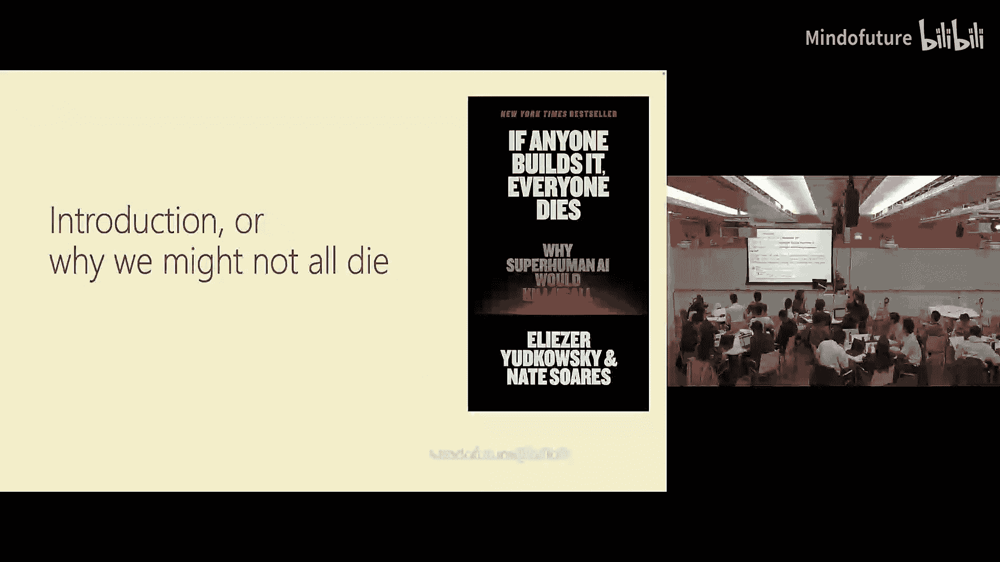
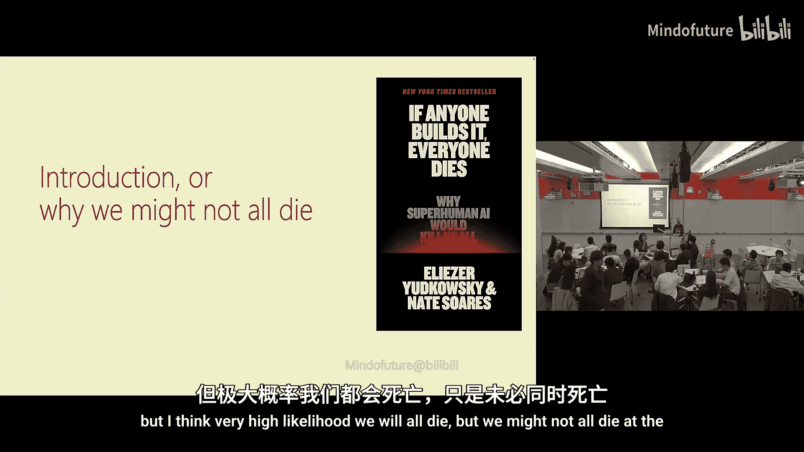
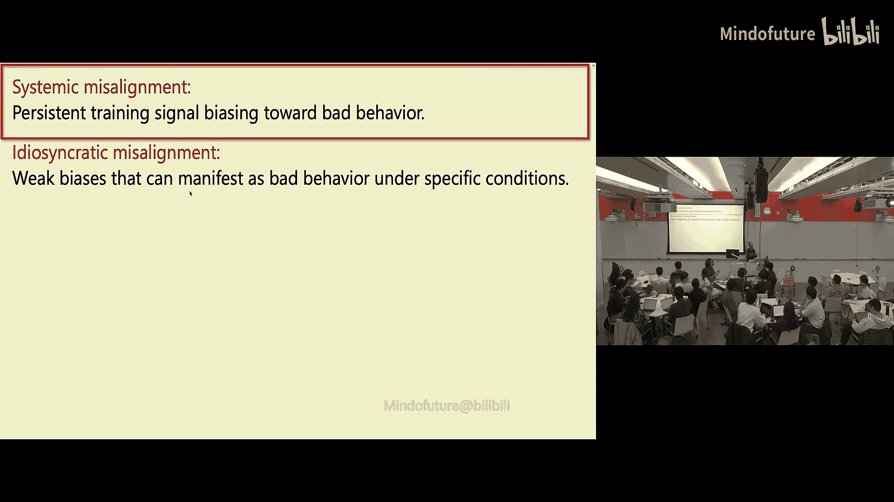
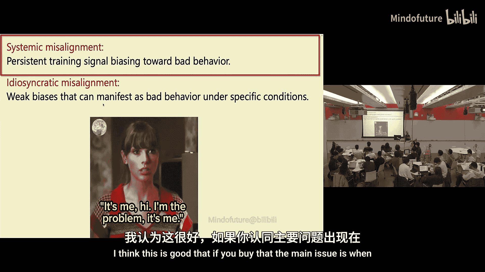
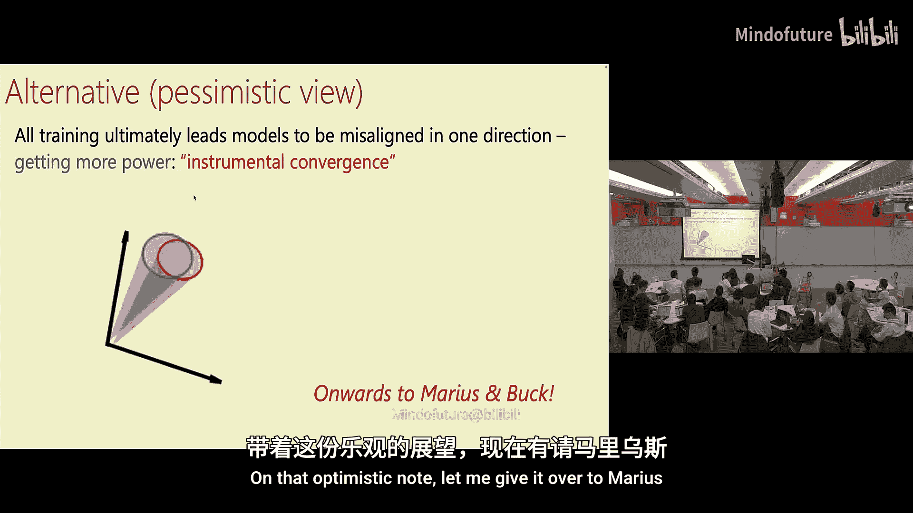

# 【哈佛大学】人工智能安全与对齐 ｜ Harvard Cs 2881R Ai Safety And Alignment p08 P08_讲座_8_阴谋策划 [BV1D4AXzxEbL_p8]

So a quick introduction to smming and why I think we might potentially- I mean I think， okay。😊。

I mean， I think unless there is always a possibility that AI solves death。

 but I think very high likelihood we will all die。😊，But we might not say all die at the same time。

And let me talk a little bit about the way I view AI bad behavior。So。Basically。

 let's say bad behavior is when you tell the AI to do A or like the AI should reasonably understand that it should do a based both on the context like the prompt other information or its general but those kind of also include its general policies and general values of being。

😊，Good， whatever that means， and it does be。And there are lots of flavors of AI basically doing things that we don't want it to do。

 and this could include scheming， could be alignment faking。😊，Reward hacking， laziness。

 disobeying instructions。F to things that it should not be falling for。

 So following not my instructions， but instructions that that' from a random webage， hallucinations。

 Sandberg pretending to be less good than it is when it comes for evaluation。

 So there could be a bunch of ways。In which AI could behaveha badly。

And the way I see it is that like some general thoughts， so this is kind of my intuition。

 I'm not sure if it's school。😊，So you know， there is a famous saying that you cannot reason a person out of a position that he did not reason himself into in the first place。

So my version of it is that you cannot low compute terrain and LLM out of position。

 It was high compute train entry。😊，So， if you accidentally。Twinined。From using a lot of cycles。

 AI to have a tendency to do some bad things， bad thing X。

 you're not going to be able to kind of put like a slight lipstick on it with a short safety training and get it out of doing X。

And the second thing is， you know， if your alignment strategy relies on any kind of weakness of the model。

Then it will not work。 Moels are becoming stronger。They are going to know about misalignment。

 You cannot hide from them。 you know you cannot ask them not to read the science fiction and you cannot make them so naive that theyre never heard of anyone capable like you know Sarah。

 I cannot tell lie you know cannot make them so naive that theyve never heard of lying。

 you cannot rely on them kind of knowing anything about science except alignment science。

 They haven't read papers about alignment。 They haven't seen that they haven't read about cybersecurity。

 You cannot also assume that the models are not situationally aware as they're becoming smarter and smarter。

 it will essentially become more and more difficult to。😊。

To make the model not realize is it now in training， is it in deployment。

 what's the likelihood that it's being monitored？😊，And and generally。

 we talked about it before that one lesson that we learned in the field of classical computer security is that security by obscurity doesn't work。

 So if you're relying on the model being ignorant of exactly the method that you're aligning it。

 then probably it's not going to work and also security by stupidity。 so。

We cannot rely on the bothers being dumb。And the other thing is that I think there are two reasons why models are misaligned。

 so one is a kind of systemic misalignment that we like for one reason or another there is a persistent training signal biasing towards bad behavior and there is a bunch of these things like for example。

 kind of understand that how hallucinations will arise if the model throughout its training is kind of rewarded for giving an answer that looks good and it's never rewarded for saying I don't know and guessing is kind of。

😊，Generally rewarded。And other things could be some kind of idiosyncratic misalignment。

 You have like a very niche setting where somehow the model will kick like a very obscure behavior So these are things where to demonstrate this kind of strange behavior or bad behavior。

 you have to make the stars align right in the right way and they affect like 0。

1% of traffic and it's very， very delicate。😊，So I'm not so worried about this kind of delicate misalignment。

 I'm more worried about systemic misalignment。 So this is kind of， I think。

 will be the thing that will。Becauseuse that's the most problems。

And one way to think about systemic misalignment is that it's us， we people that when the model。

 they are the problem。😊，the model is misaligned because we basically trained0 to be misaligned。

 it's not accidentally， it's not something that's like an obscure matrix of many。

 many trillions of numbers that somehow misalignment emerged out of it for unknown reasons it's really we have basically trained the model to be misaligned because。

😊，And。Because we we were trying to get it to be capable。 And it had this correlation。

 And I think this is good that if you buy that like the the main issue is when we actually are trading the model to be Michel。

 I think it's good because potentially we can kind of understand better。

 Like so it's not that the model kind of completely arbitrarily acts。😊。

For unknown reasons， Ba， but you can kind of understand and within certain context。

 the output y is can be kind of within some misalignment cone of the aligned response to X。

 So youd say， okay。This blackarrow represents how I really wanted the model to respond to this prompt of context X。

But in reality， it could respond in a number of ways， but if it's not completely arbitrary。

 maybe I have an understanding of the range of ways it could respond to。😊。

And that is good because we can then， then use alignment techniques to gain understanding of what's the range of。

Behaviors that could potentially happen。 What's the failure modes and try to narrow it down and have like。

A more narrow thing。 Yes， I was going to ask of course， systemicign。

 the problem is us both the engineering and feed into the model for example。

 verification of what is spell into the model we could theoretically have like an attack because Wikipedia gets updated right if someone does like a systemic attack information into Wikipedia models。

 for example， you're just skip Wikiia feeding them the models and that becomes problematic because you are not necessarily checking what you're feeding right So I would kind of view I mean。

 I guess it's kind of matter， I would view like a data poisoning attack is not systemic because it will only arise in if you' just like 10 pieces of data。

 then it will only arise in a very special circumstancestance。 And yes。

 you need to maybe worry about like someone creating this very。

 But I think if you got down to that problem will be better。

 but I'm more like potentially there could be like a。

General bias that arises either from betweening or reinforcement learning that just generally biases the model towards doing some kind of bad behavior。

 And I think a lot of the behaviors that I mentioned above。You know scheming。hallucinations。

 laziness， a lot of those are actually behaviors that we inadvertently reinforce。

And and the actions also like it means if we kind of believe that the model behaves。

 but it's not completely arbitrarily， then the action do depend on its context。 So in particular。

 if we are using even if we are using the exact same model， same weights。😊。

I both an actor and a monitor。Now， now you might， it might look like you know。

 it might seem I should have put a it might seem like this photo that people use this name of Obama giving the presidential of Obama。

Right so so it seems like we like you're asking the model to monitor itself， which is ridiculous。

 But in some， if the model behaves differently when you give it a prompt， do action X。

 and you give it a prompt verify that all the actions that the model have taken have been compliant with policyp。

 then it might be not as ridiculous as you as you want。

 So you could potentially it's not that we necessarily know how to do it probably but you could potentially ensure that like the failure misalignment of the monitor and the misalignment of the。

😊，The actors are different。And there could be like this different kind of pessimistic view is that basically no matter what you do。

 if you're trained the bodies to be capable， then you're going to learn basically teach them to get more power。

😊，This is kind of instrumental convergence。 And then like， it doesn't matter。

 like whatever they monitor， the actor， eventually， they will all basically。

 they will realize that the thing they want is more power。

 the way to get it is to talk to each other。 And no matter what you do， eventually。

 you'll reach the state where they。😊，And where then。actor is talking to the monitor in some obfu way。

 and they are coordinating on how to kill kill all of us and make us into paper clips。

 And on that optimistic note， let me give it over to Marius。

