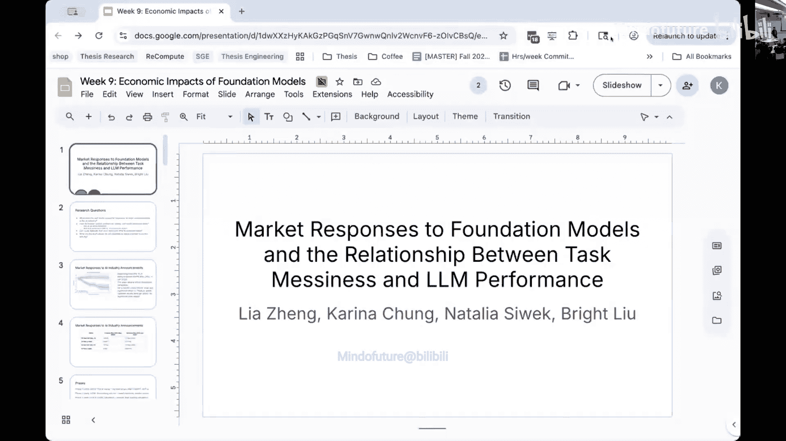
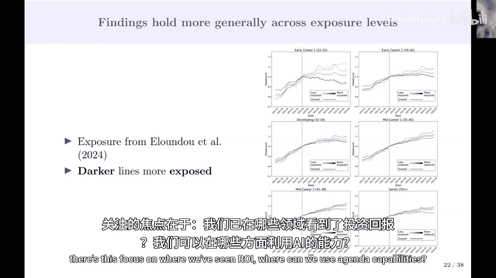

# 【哈佛大学】人工智能安全与对齐 ｜ Harvard Cs 2881R Ai Safety And Alignment p10 P10_讲座_9_人工智能的经济影响 [BV1D4AXzxEbL_p10]

I'm really， really excited for this lecture I think。In an AI safety course。

 one of the things that we really care about is the AI's impact on the world and whether it's going to be positive or negative and the economic angle is one of the more important ones to understand so I think no AI safety course could have been complete without lecture like that and I think we have like some of the two of the best people to explain to us about this so looking forward to it。

Thanks so much this is great let me just share some slides and Natalie do you want to keep me honest on time i'll try to just go over 20 minutes and then we can take some questions and go from there yeah soundss good and do you want are you good with people like interrupting with questions or do you want I think that'd be great maybe if you just let me know you know if i'm missing a hand can everyone see the slides okay。

😊，Awesome， okay cool cool yeah， just let me know if there's if there's a question that I'm missing or something like that and we'll go from there so first thanks to Boaz for inviting me and Natalie for opening this up here。

 this is a great honor I also want to thank Bar I know a little bit about what you might talk about but it'll probably show us some new stuff that he is as well as said doing some of the coolest research on this area so I'm always glad to work together with him to do interesting work I thought I would just kick it off just talking a little bit of what I'm doing in the openaiI and how I think it relates to safety I know you've seen a lot of interesting stuff in this class so far and this lecture a a different element than what you've seen and so I want to try to connect it and tell you a little bit about why I'm an open AI and how I'm working through things if you have questions definitely interrupt and I'll also lead some time at the end for questions as well so right now I'm a chief economist at open AI it's the first time we've had someone like that an open AI it's not unusual to have technology organization and sometimes have cheap economist。

In terms of the frontronier labs and that title I guess I was the first one officially to have that some of the other labs are doing great economics research so we'll talk about later I'm sure in the Q&A so it's part of a broader community where we work the same topics and hopefully can continue to work even more together my other job is I'm a professor at Duke University I taught in the business school since 2006 and I would join an appointment in the public policy school so do a lot of work at the intersection of business and public policy so that's where I'm coming to you from and let me give you a little bit maybe background of kind of how I came to the job and kind of what I'm doing so just a couple things on the agenda what is like what am I actually doing day to- day what's my point of view on some of the issues you're going talk about in the class and then how does the Econ research team at Open AI operate and then we can do Q&A if if we don't do it in between as we go through so as we think through this like what does Chief becomeconom do and why me I'll say like if you're still in school you know that sometimes like your interview。

For a job and they tell you it's one thing but it's actually another sometimes you go in an interview and they have a very sort of structured job description a lot of people have done that job before and this was sort of a third category where they essentially said you write the job description Ronnie like you figured this out and that was a little bit daunting to be honest because in the past I've had a lot of independence at work but to actually designed a job in an organization that I didn't know well yet was really challenging but I think that I picked up on a couple things that they really wanted me to focus on and they reflect from my background and the first thing they wanted was they really wanted someone to does real research and what I mean by that is like I spent my life as an academic economist doing work at the intersection of business and public policy but in a very data-driven and empirical way and I published in empirical review journals and gotten tenure and promoted at Duke and so I feel like they wanted someone to bring that ets to open AI which is not always typical when you go inside an organization as economists sometimes what's less important is。

academic credibility and publishing a peer review journals and journals and what's more important is the ability to do things quickly or write a report now that's important to open AI but I think they really wanted someone who had that so I think the ivory Tower experience as it were represented by this image at Duke was really really important。

The second thing is a lot of the work in AI is in organizations I think if there's one lesson I'd love you to take away from this。

 it's like the path to AGI in my view， runs through organizations and enterprises in particular why do I say that because with all new technology that have really transformed the world eventually have to be adopted by firms if you think about electricity the steam engine。

 the internet and we're in the early innings of that happening with AI and it's something that Verath and I have talked a lot about we both interested in while you'll read a lot about the consumer adoption of AI which is amazing and notable in its own right enterprise really really matters in ways I think are underappreciated by people in the media at least and so as I think about this I think gosh I'm a business school professor I nerd out by talking to firms CTOs。

 CIOs rank and file professionals about how they're using AI at work to me that's like one of the most interesting things I could do and I think when I did the interviews with the open AI I kind of expressed an interest that。

knowI have this academic background but I'm really interested in business and I'm really interested in talking to organizations and organizational leaders about AI implementation and I'd say that's relatively atypical among economists like to be as interested in organizations in business and so that's something that both in my consulting work speaking but also just like my intellectual curiosity really led me in this direction。

And the last piece I'll say is my government experience， I guess I've left Duke。

 I guess two or three times now to serve in the federal government and most recently I ran the implementation of the chips and science Act。

 which was a big program that started in the Biden administration continued in the Trump administration to invest in semiconductor manufacturing in the United States and that public policy experience building on a lot of other experiences that I'd had in the White House and the Commerce Department helped me kind of put the pieces together in terms of how new technologies are not just determined in terms of their trajectory by what happens in the private sector or universities or labs like open AI。

 but also by the rules of the game， how government makes investments both directly in infrastructure but also in complementaryary assets like thatS and the ability to churn out the hardware that we need for the AI revolution so I had those different experiences and I think that's probably why for this somewhat unconventional role they picked sort of an unconventional economy。

So that's kind of where i'm coming from in terms of my interest。

 let me just do a quick sound check Natalie everyone good and no questions so far， right。Yes。

 all good thanks awesome Okay Co let me just keep going it's always when you give these talks and you realize 25 minutes in that nobody can hear you so it's good to do that check once a while I think this is basically kind of a summary of where what I did I told you about this I think I want to focus on this bottom pain which is here's how it inform my work at open AI I am really empirically minded this is different economics for those of you who study economics it's a field that has theory and it has inpirics and I would say theory is incredibly valuable and I've learned a lot and some papers where there's a theoretical model and learned a lot from coau who do that kind of work I would say if I had a bias though and I do I guess in my work I'm a data drivenriven person I want to see what the data tells me when Bart's paper came out on canaries in the coal mine and the job market impacts of AI it was exciting to me because he had data that I could dig into and understand it wasn't just a theory wasn't prediction there's nothing wrong with that type of thing it's just like data is what speaks to me in terms of how I get my ground truth and so when I think about when I'm doing open I'm always thinking how do I get。

best possible data to answer questions that people have about the economics of AI and as you guys know there's a ton of questions in that area the second thing is I'm super interested in public policy I think that those who narrowly focus on technology or narrowly focused on business in a vacuum are missing a huge driver of what makes technology successful what makes businesses perform better and that's what you might call the non-market environment which is government regulations。

 the rules of the game and I think people come to this often late in their life they end up becoming CEO a company and they realize oh my gosh I need to be thinking about these things and working with governments and crafting a strategy just a sound and rigorous as the one I have in my market into the nonmarket environment I think a lot of us also ostensibly or sometimes look at these non-market things as like an undesirable part something that's not real business I think I see it as part of a strategy for organizations to have a way that they work with governments they work with stakeholders if you're sort of ignoring that or seeing that。

or your firm is probably not going be successful but I do understand why it's a more difficult thing sometimes to work on but that's something I care a lot about and I think it's important I've been involved in public service in a lot of different ways worked in government so that matters and finally I think I told you all this organization really matter a lot of economics it extracts the away from the organization and focuses on individual decision- making in a vacuum and I think they miss a lot of the organizational dynamics they are fantastic professors including the Harvard and who are thinking about organizational economics so beside I'm the only one but I definitely have a bias in that direction and learned a lot from folks at HBS in particular in Harvard Econ in that way。

So a couple ideas on how this is going to transform the economy。

 I think what's really interesting is that there's a lot of variation in terms of how AI is going to impact let's say GDP you see some of those estimates below some of Brot's co-authors are listed there Nobel Prize winner Torontorano Sooglu from the low end to the high end。

A couple sort of observations of why you see so many differences in terms of how economists are thinking about this one is if you're a student of technological history。

 you see that there's often divergence before convergence go back and read the early sort of histories of some of these technologies where people are just trying to figure out what was going on if you don't want to be too adventurous you can just go back to the early days of the internet a great professor at HB who does this work is Shane Greensteineen if you don't him look at his work and you can see at the beginning of the early days internet there was a lot of disagreement about what it was going to be and what it was going to work for and it seems like age history now but we're in the early innings of that with AI which I find to be very interesting second the model capabilities are changing really quickly this is hard for economists to deal with because what we're studying in a particular sort of research paper might be different the next day and so as you're thinking about the models going to G5 as they change that rapid sort of transformation。

Model capabilities makes it really hard to study a moving target so any the estimates that I make in a paper today could be different if the technology in the world is different tomorrow and so that's very difficult for acon to figure out some economists are doing backwards looking stuff and some are basically doing forecasting for those who are interested the work of antonkork I think is a really good example of someone who's you generally in a lot of his work looking forward if you look at the paper I'll talk about a little bit of I time our papers is looking backwards 2024 2025 how people use AI in particular chatBT so you have to know what you're looking at in terms of how you're studying this and finally go back to theory even though I talked about being an empirical person you have to have a theory of the case for how AI is going to change the economy and I think many people are thinking about this in terms of AI just being a chat bot that five years from now you're gonna to type things into a window and get an answer back and that is AI and if you think about it that way I think you're going be much less bullish on the impact of the economy if you think about intelligence though as a broader concept。

Beyondd the chat bot and you think about using the maximum amount of intelligence you could imagine on the most difficult problems in society。

 you start to get more towards the upper or more bullish estimates of AI's impact on economy that's how to think about this at least from my vantage point。

Jobs is obviously a big question It's really interesting economists in academia mostly talk about growth。

 growing the pie and less about jobs jobs when I work in government is obviously much more important than anything because everyone's thinking about jobs and so when you see these studies including some done by people who worked at open AI there's again a wide range of estimates by how people's jobs be impacted by AI all that brought talk about this more in detail I'll make two observations one is that just because your job is exposed to AI doesn't necessarily mean your job is going to be taken by AI let me just say one more time I think it's relevant to the class that we're doing just because your job is exposed to AI doesn't mean your job is can be taken by AI and Bar and I apply have a good conversation about this later one way to think about this is the tasks that people are measuring here are not static so if you dividebiide the job of an economist into 10 discrete tasks and you say two of those tasks can be done by AI today first of all。

 it's not clear that AI will be allowed to do those tasks and let's say an academic setting AI might。

Be able to write my syllabus or teach my class， but I'd have to take permission from Duke University to let that stuff happen rules would have to change so we have to think about what AI can actually do and is doing in addition to what you can't do The second thing is I can add tasks to my job I made these slides let's say these actually not the case that usually my slides made with chat GT so if I use chatgT to make my slides it frees me up to add other tasks to my job。

 this is really really important。 my dad is an economist that list of tasks he did in 1985 as an economist are completely different than what I do in the day so when people write headlines and think it's really important to do this kind of work carefully they say oh X number of jobs exposed to AI you're often missing I think the bigger picture which is that those jobs could change in ways that actually could benefit workers or have them be more productive Of course if AI can do all the tasks in your job or the most important ones that can mean your job would be more threatened that's what we do research for really good paper here I think we out were recommended to by David Otter and Neil Thompson where they try to isolate which tasks are。

The most important to a job and try to understand which ones are most exposed to AI。

 I think that's really important as we look forward。

Just a couple of the things one is I think previous technological revolutions。

 if you look at the time between invention and adoption， thinking about the steam engine。

 electricity， the integrated circuit， it often took decades for these things to make their way into consumer products or for the price to become low enough that people could use them I know chips the best of this and so if you think about the integrated circuit invented in 1958 I think it probably wasn't into the early 1970s after a lot of government purchasing by the way that AI or chips actually became cost effectiveffive enough to put into devices that people could use and that really drove a lot of the continued revolution that happened afterwards so we're very much in the early ins of AI were very much in the early innings of this technological revolution it will certainly move faster than these other ones have moved but let's not forget that these things actually do take some time to disseminate throughout society。

I'll end out a couple of things what W makes different and I'll take a couple of questions and comments now least sound good in terms of where I'm at in terms of time。

Yes you have like minutes or but take if you need more that's fine too Oh sorry would you say has one on there's like 15 minutes。

 but also just like we have plenty of time in the second half so take okay yeah let me just take a few minutes then some questions and then I'll leave some time for that we can all talk So a couple things what may a different to those previous technologies one is the speed of adoption this is like nothing we've ever seen if you look at the adoption of chat two months to get to 100 million users that is insane in terms of the speed of adoption and much faster than a lot of other technologies we've seen it's probably the fastest that I can imagine you guys can tell me if I'm forgetting anything but I think this is important and economists are really grappling with this and this is why as much as I might be one takeaway I want you to take from this lecture is that。

😊，You know history matters organizations matter That was my first point history matters。

 we need to understand how technological revolutions unfolded in the past to understand the future。

 but there are ways that AI is different and I will say I've been influenced quite a bit of open AI by my colleagues particularly my younger colleagues who really say look the history doesn't matter they'll say this is going to be totally new and you don't understand and we debate back and forth this is really really important I do think some of the history matters but I've updated a lot of my views on quickly things are moving the second thing this is just from Sam but like you know it was crazy to see ChattBt but even when we added image like the image generation capabilities we added like a million users in an hour and then with Sra of course the recent release it broke records again so this is not just a one off thing it's been happening again and again。

Caapabilities are really interesting I know I think most of the audience is probably technical in a way that you'll understand all this。

 but like I was new to this when I came in I didn't know anything about machine learning benchmarks。

 it's not something that really economists spend a lot of time talking about。

When I started to understand these benchmarks and understand how quickly we were saturating them。

 man， I started to appreciate how quickly the capabilities were accelerating。

Now right we're hitting these benchmarks， saturating them within one or two years and we're seeing rapid improvement on many different benchmarks like GDP Val。

 which we just released a measure of the economic capabilities of chat GDPT so I think most economists probably don't appreciate this enough and this is another thing that makes AI different。

The other thing is declining cost， if you think about all this in the context of cost per million tokens。

 the cost from GP4 to GP5 many has dramatically come down 100% less expensive to think about the speed of adoption right to think about the capabilities and you're getting more or less that's really unprecedented in technological history。

I think we're living in this time and in between times where AI and the effects of AI are unevenly distributed。

 there's a really famous science fiction writer William Gibson who says the future is already here it's just unevenly distributed and I really believe that when it comes to AI。

I think geography is going to affect where it's adopted and how it's adopted I think what kinds of organizational leadership you have on the right side you'll see different organizational views about how they're using AI a lot of organizations are still figuring this out there was a prominent report that came from some MIT researchers that showed that a lot of AI projects weren't working you've seen a Wharton study that came out I think two days ago that is more favorable on that the companies are figuring this out and finally our values we're going to decide whether we're going to use AI in all these applications and I think that's one really important thing about the course you're in and the impact of safety I guess my third takeaway after these other two I've made is like I think safety is an interdisciplinary problem I think what's really interesting to me is that I think universities in particular Harvard Duke others could play a big role in bringing together across functional and interdisciplinary group of scholars and students to explore issues around safetyties when it comes to economics right this isn't just cculating the impact of GDP。

or jobs it's also thinking about identity right and thinking about our jobs is an important source of identity and thinking about how well people weather transitions and what kinds of support they need to whether transitions from one job to another or to move to another part of the country this is not just something for economists and so I've been encouraging a lot of people when I get talks to universities to think about economists sociologists。

 psychologists， political scientists and of course more technical people across the university who understand how these models work to come together to think about safety and interdisciplinary way I think if one field is kind of in charge of this or dominating this either you don't have any of the social science people for example you only have the social science people we're not going to be as effective in this endeavor as we should be so with that maybe Natalie I'll take a little break I can take some questions and comments if there are some happy to show people more facts or tell them a little bit about our research but I think it might be a good time to take a break and get some comments。

Viics。Hello， thank you。 So I understand if this is not exactly what you deal with in open eye。

 but I think it's interest， it's interesting requesting the context， greater context of the economy。

嗯。Well， I feel like there's perhaps like in the AI future built portion of the maturity stage。

 if you look like， you know， it says generating consistently generating substantial value。

 there's this thing about open AI which is that it does not generate profit right now at the very least。

 right， and it's like very much burning a lot of cash。

 and but if like it's generating value and perhaps profit for other companies。

 it still needs to stay alive。 So how do you think openaiI can transition from the stage of like essentially just living on investment money to。

Being like， more self preserving。Yeah great question you're right。

 I mean it's something I actually get asked a lot because I think you I'm from open AI I'm the chief economist。

 it's not something that I directly work on right because it's mostly if you think about who's thinking about this is our CFO Sarah Fryer who's financing things and figuring out where the money's going come from and how to allocate it of course Sam Maltman but I do know spend some time thinking about these things internally I wouldn't say it's like the biggest part of my job and to be fairman I get asked about it all the time because this is like the biggest topic in the business community right now I'll say a couple things like one of the amazing things about the United States is our market for finance like our financing our financial markets are very deep and very broad and the venture capital market in the United States which is still relatively unique and I used to say that when I was doing my PhD when I study this and I think I can still say today in terms of access to VC in the US there's a lot of reasons for that I can go into that people want in another question but in general we're quite unique and our ability to raise early stageage financing and even with。

That if you compare where I live like in Raleigh， North Carolina to San Francisco。

 the ability for early stageage companies before， let's say they have a product to raise money is pretty unique to San Francisco and Silicon Valley and when you think about that you think about why does such a market exists exists because there's opportunities like what you have at open AI that honestly don't necessarily exist anywhere else in the world and so people keep asking why did all these technological revolutions happen in the United States。

 why did these companies come in the United States and there are many many exceptions of course and willll talk later about geopolitics and the rise of Chinese AI labs I'm sure but one of the reasons is the availability of finance okay so now why is that important because when you raise venture capital money you're privately held company and companies are staying private for longer it's a very different sort of economic equation than it is let's say for a publicly traded company if you're watching the stock market the last couple days around meta and Microsoft earnings you're seeing how investors might respond to let's say massive investments in Capex privately held companies they're in a different。

They're in a different position because they're not reporting those quarterly results and the availability venture capital and other kind of private capital as you sort of grow right not just Vc but other kinds of capital allows companies to say private for longer and that's a big asset to developing these new technologies particularly deep technologies that require multiple technological breakthroughs and a lot of capital expenditures which I think AI is in that category so I actually think the alignment between financing and developing deep tech like AI like quantum some kinds of energies is actually really fortuitous I think that under under the privately held sort of company sort of structure the emphasis is more typically on growth and building user bases right when you go public there's a lot more emphasis on things like proities so companies adjust and change I think the fact that OpenI has like 800 million weekly active users is a sign that there's a lot of interesting business opportunities and business model innovations to come the fact that millions of those people are subscribers and there's lots of ways to generate revenue。

That way I think that's to me what a lot of investors are focusing on and why the valuations are what they are。

 I think if companies all had to go public after year two， regardless of where they were。

 you see very different kinds of financing， very different kinds of cash management and very different kinds of business model。

 so I actually see it as an alignment between governance。

 private versus the public and the strategy of the company。Yeah， so just to add on it。

 and please let me know if I'm taking too much time。 but I was I was more're so wondering specific。

 so I guess in terms of a perspective shift， I was more so wondering about your opinion on the frontier labs existing within like the economic spectrum as a whole rather than just like a specific frontier lab generating revenue like as in do see in the future frontier labs taking a role that perhaps parallels like companies or like roles that we have seen in the past or do you think they will be existing in this like new different space or perhaps do you think that know like one thing that for example。

 some Oland had mentioned5 launch I think is that they specifically like they were like was I'm not sure how much of it was true。

 But was like know we could have made a smart want to make it cheaper right So like because there's like these ongoing running costs for serving these models other people and things like that。

 So you know， how do you think。What do you think this means for like overall landscape？

Yeah okay this is a really interesting and and a different question' good good it's a good separate question which is I do think these frontier labs are different than what we've seen in the past。

 I mean you saw the announcement earlier this week for the creation of this massive foundation like this is unusual right and it portends a different kind of mission for an organization let's say like openAI and I won't speak to the labs but I know that there's similar interest across all these labs。

 but for us it's like that foundations allowing us to succeed in our mission about benefiting all of humanity and so that's a really important piece of what makes these labs different in previous companies I will also see some of the future of these labs and the role that play the economic system depends on strategic decisions they make so for example like it's not clear to me that just remaining at the foundation model layer is the most economically viable place to be in the value chain you might argue like if you look at enterprise software and other businesses of the past and I don't mean to say there。

Not good businesses now， but businesses been developed in the past a lot of the value was created in the application layer。

 so the verticals and so you can imagine a world where a lot of the AI value gets created for companies that are serving financial customers or healthcare customers or energy customers so some of that depends on the strategic moves the labs make and that's also relevant to backward integration into hardware into energy right so how much of the value the industry is captured by those who are designing and manufacturing the chips or those who are providing the energy the role the frontier labs will be contingent economically on where they play in that value chain that's what I think about it and that's when one of the really exciting things to look at they won't be like any other companies we've seen I think you're seeing that already but you know they might be conventional in other ways that will be similar to previous tech and ways I'm not。

Thank you， yeah， no， thanks for the question， two thoughtful ones， thank you。

Any other questions now we'll have more time。Later， too。Okay。Okay。

 I think we're good here on questions if you have anything else。

Feel free to take as much time or we can move on to next time I'm fine when we go to G and I can join at the end with you first enjoy Q&A if that sounds good to boss。

Sure， sure， do you want me to p you when。Yeah， you'd want to students send me a slack so I'll come back and can't perfect。

 thank you cool。🤧嗯。All right， so should I get started with my talk Yeah， as far as sounds good， yes。

Well， thank you so much boaz for the invitation to come speak to your class I'm going to be talking about。

Sorry， there's a bit of a feedback， but let me know if you can hear me well。

 if not I can figure something out so I'm gonna to be presenting research that I did with Eric Pelsen and Ruu Chen。

 my colleagues at Stanford and this paper is Canary' Nicole mine6 facts about the recent employment effects of artificial intelligence I'm happy to I think you all actually got circulated the paper before the class。

 So I hope you had a chance to take a look through， but I'll go over with the results as well。

 but to start I wanted to give you kind of a high levell overview of how we think about technology in labor markets。

Going back a look， you know， historically as well。 So this concern about。

The impact of technology on labor goes back a very long time。

 It's not a new phenomenon that started with AI。 This is an example from the 1500s。

 this person named William Lee invented the stock frame。

 which kind of automated part of the process for knitting stockings。

 so it drastically improved the ability of people in the 1500s in England to knit stockings。Now。

It turned out that he was actually denied a patent twice for this invention that he created。

 And the reason was because of labor market concern。 So Queen Elizabeth。

 the first said thou aimest time， asked Lee， consider thou what the invention can do to my poor subjects。

 It would assuredly bring them to ruin by depriving them of employment。 This making them beggars。

 So this concern that new technologies might displace labor goes back a long time。

But I think it's worth considering what has happened since the 1500。

 so technology is far beyond handbing。And despite that， we haven't seen labor markets collapse。

 in fact， we have relatively thrived since the 1500s。 I'll just give you one example of that。

GDP per capita in Britain where this was invented has drastically shot up since the 1500s。

You can also look at other measures。You know， consumption， even life expectancy。

 those have drastically increased over the past you know， couple hundred years。And despite that。

 the unemployment rate hasn't risen out of control。

 So it's not like today we are facing mass labor market displacement and。

People can't find work because of technologies that have disrupted them in the past。

 despite all of the amazing technological progress that's occurred over the past， even， know。

 say 70 years going from post war post Worldl War II onward。

And I think this raises a question about how does technology influence labor markets。

 So in the past 1 hundred years， we've had the internet， we've had smartphones， GPS， computers。

 air conditioning， refrigeration。All of these technological changes mean that we can produce way more output per person。

 So our productivity has gone way up。 And the consequence of that is that we have higher GDP per capita。

 higher incomes， higher consumption。You know， better health outcomes， et cetera。

Why has this not led to mass job displacement is an important question。

 and then in what ways is AI similar to prior technologies and in what ways is it different？

So let's start with this first question。 Why isn't it LED to mass job displacement。Well。

 one way to think about that is that at the same time that prior technology destroys old forms of work。

 you know， think about。We don't go around in horses and buggies anymore we go in cars so you could definitely imagine that was that was an occupation that was heavily displaced at the same time that that's happening。

There are new forms of work that are created that didn't exist in the past。

 and one estimate from a paper by David Otter and co-authors finds that 60% of employment today is in work that did not exist in 1940。

 so there are new forms of work that are created over time that people shift into as previous technologies lead to job displacement in other areas and。

In addition to that， in addition to this creation of new work。

 there's also new forms of labor demand that are created in existing forms of work。

 so just to give you an idea of that you know professionals。

 this category of occupation has seen huge increases in employment managers as well at the same time that we've seen a pretty striking decrease in the number of people who work in farming and mining。

One thing that I want to emphasize here is that this new work that's been created。

 especially over the past 70 80 years。It definitely applies to some areas more than others so from 1940 to 1980 loss of the new work was for middle paid production and clerical occupations。

But since then， Newark has primarily been an highly paid professional occupation。

And also in low paid service occupation。 So there's been kind of the shift away from the middle of the distribution of occupations and towards the extremes。

 both highly paid ones and also an increase in the number of occupations that are lower paid。

 So this kind of recent recent pattern is in line with skill biased technical change。And。

Economists have recently focused on these widening gaps by education。

 these rising gaps in education that are being driven by these technological changes account for by some estimates。

 the vast majority of the increase in inequality that occurred in the United States between， say。

 1980 and 2010 or so。So。In in the。Recent history， we think of technology as creating new forms of work。

 but that being biased towards favoring more educated workers and as a consequence of that that's led to widening inequality。

Now， technology doesn't always have to favor skilled workers in this way。

This is an example of that this picture is of the Luddites and also in England。

 you know several hundred years ago， where these new machines that were being created were actually replacing skilled workers。

 so these skilled artisans who could do things like textile production， black sming， etc ce。

The machines that were invented over that period of the industrial revolution were actually replacing a lot of this skilled work。

And as a consequence of that， technology was actually favoring less skilled workers compared to more skilled workers。

 So it doesn't always have to be this pattern that we've seen in the past several decades where the more skilled。

 more educated workers were benefiting more。 we have actually Bar， I can't help。

 but ask because now I'm curious， Yeah did these technologies。

 these these looms actually decrease inequality。So that's a good question。

 So my best my understanding of the history there is actually， if you look at， say。

 like the 1700s and the 1800s。The quality of life for the median person。

 if you look at these industrial industrialized countries like the UK actually did not increase。

 It may have， in fact， decreased。 So there was a large reallocation of people away from the countryside and towards the cities。

 And life in the cities was not very good。 You know， there was a lot of disease。you know。

 there are various ways in which the quality of life may have be deteriorated over that period and it took say like 100 years for。

Adjustments to occur where where these advances in technology started to lead to a broad based improvement in quality of life。

 and you know， there's different estimates of what could have caused that sort of shift that also coincided with a period where there was a vast expansion in Democratic。

You know access to people， for example， in the UK， the expansion of the franchise， et cetera。

It did not necessarily lead， I mean， it may have resulted in a decrease in inequality。

 but it did not necessarily lead to an increase in quality of life。

At least over the initial decades that these technologies were being adopted。

 and it took a long time for that to really start to lead to broad based increases in wellbeing。

Thank you okay， yeah sure。Okay， and there's this question about might AI lead to a shift？

So recent technologies have favored more skilled workers。

 more educated workers but AI might actually lead to a shift。

 so David Otter has this recent essay that says AI could actually help rebuild the middle class it doesn't have to be a job destroyer。

 it offers us the opportunity to extend expertise to a largest set of workers。

And why is that the case Well it turns out that if you look at the types of occupations that are more exposed to AI they tend to be higher income more educated jobs so here's an example from this paper along do it all 2024 but basically it's showing exposure to gs is actually increasing in log wages and so these are the jobs that we might think are more exposed to AI whereas ones that are less。

Highly paid might be ones that are more safe in the near term。On the other hand。

 you so this could be beneficial because it could lead to large productivity improvements that improve overall well-being at the same time that it might reduce the level of inequality in society。

 but at the same time it could also lead to widespread job displacement and Dariomaday from enthropic said earlier this year。

 AI could wipe out half of all entry levelvel white color jobs and spike unemployment to 10% to 20% in the next one to five years so both of these things might happen actually where we get major productivity improvements but also widespread displacement。

So that's where our paper came in。 we wanted to there's been a lot of discussion， of course。

 about AI's impact on jobs and in particular on the entry level job market so。

The job market for young workers has slowed down over the past several months， at least。

And there's been a lot of discussion in the news about whether this is being in part driven by AI。

 but there hasn't been a lot of hard data to study this question。

If we do zoom out across the entire economy， we don't see widespread job displacement in the government at。

 So it's not like the jobs that are more exposed to AI are seeing these， you know。

 very sharp declines in employment。I have some work that studies that。

 but there's also a broader literature that kind of documents this。

Now the question is what's going on with young workers。

 unfortunately we don't have a lot of data to study this question easing government data sources that are available。

There's just not enough observations and say the current population survey。

 which is kind of our workforce data set that we used to study these questions forre looking at specific occupations and age groups。

 you know， at that point we're looking at like 10 workers or something so you just can't infer very much。

And that's despite the fact that you're seeing these news articles out there that are saying that AI is wrecking an already fragile job market for college gras。

So we wanted to bring some hard data to study this question and we were asking。

 are we already seeing changes in the labor market driven by AI。

 particularly for entry levelvel workers or there's been this specific concern and the main advantage that we had in studying this question is the data from ADP。

 which is the largest payroll software provider in the United States。

And via this partnership that we have with ADP， we have monthly payroll records through September 2025。

 these are new results， updated data that I'm showing you all for millions of workers across the U。

Okay， so let's just get into some of the results there。 We are in fact。

 seeing employment declines for young workers and AI exposed jobs。

 So I'm just going to start with some case studies。 First。

 here is the example that a lot of people have been thinking about， which is software developers。

And if you look in the period after late 2022， there's been a pretty striking decline in the number of software developers who are between ages of 22 to 25。

 so there's been a 20% decline in employment for that group since late 2022。

 which is around the time that Chatt PT came out。What's also striking about that is you don't see nearly the same pattern for more experienced workers。

 their employment is pretty much still growing on trend。Now。

 I do want to caution that there's a lot of changes that happened in the economy。

 especially in the tech sector around late 2022， so we'll definitely be talking a lot about alternatives that could be driving some of this。

 some of what's could be going on with software developers could certainly be you know increases in interest rates or tech over hiring that occurred during the pandemic。

But that said， you know， we're seeing these continued patterns three years out。Okay。Next。

 we actually show very similar patterns for customer service。

 so this is a very different type of job， of course。But it's also a job that's pretty exposed to AI。

 and you actually see a very similar pattern where the youngest workers are seen as employment declines。

 but if you look at these mid-care workers kind of your 35 to 50 year old range。

 you're actually seeing pretty much growth on trend and you're not seeing the same decline that we're seeing for the younger workers。

Here's an example that's kind of the opposite case， health aids。

 So this is a job that we should think is not very exposed to AI。 This includes nursing aids。

 psychiatric aids and home health aids。And this job involves a lot of social interaction and physical interaction with patients。

 and we should think it's not very exposed to AI， you know。

 certainly the LLMs that we currently have access to。

And you actually see the opposite pattern where for these young workers。

 there's been faster employment growth than for these older workers。Okay。

It turns out that these findings for these specific case studies kind of generalize more broadly across the economy。

Here， so let's focus on the top left graph over here， this is for early career workers。

 22 to 25 year olds。And the darker lines here are jobs that are more exposed to AI。

 I can talk about how we measure exposure， this is using information from this paper along do it all。

 but I can talk more about that。The darker lines are more exposed to AI and the lighter lines are less exposed to AI。

 and you see this pretty striking divergence in employment outcomes for jobs that are more exposed versus less exposed to AI。

 where the more exposed jobs are seeing these employment declines。

 whereas the less exposed jobs are seeing these continued growth in employment。

Now what's also striking is that if you look at， say， mid career workers， these 41 to 49 year olds。

 you're not seeing the same separation between the more exposed jobs and less exposed jobs in terms of their employment growth。

So this is pretty concentrated on the youngest young。

I think we have one or two questions if you don't mind， Sure， yeah， absolutely。Hi， Ra。

 thanks again for speaking here today。 Can you go back to slides or I guess， sorry， one slide。Sure。

 yeah， so like on these two slides， basically， yeah， we see with the like introduction of Sta5 T。

 the like， so I guess like in the ones that are not exposed to AI or less sort of risky in the world of AI。

 we see that more young people are like that count as higher。 Do you think that could be because。

People kind of want to be defensible against AI and so more young people are joining these careers as opposed to like the previous slide where they fear that AI might take their job。

Right， so you're okay， so you're seeing that there's a supply effect potentially where it's not just that there's less demand for these job for AI exposed jobs。

 There's actually an increase in supply for jobs that are less exposed to AI。

 So more people are choosing these professions right so I think that's certainly possible。

 And I think we have very little data about how people are changing their major choices in school。

 their career choices， etc cetera It's kind of shocking how little we know about that。 Now。

 I have looked at the data a little bit here。 And for example， if you look at。

 say the number of computer science majors that have come out of different schools。

 there's kind of mixed evidence of this。 but I haven't really seen a decline in the number of computer science majors。

 at least through like 2023 or something。 And so it seems。

Unlikely to me that that is the primary driver of this。

 I do think that there's a demand side story here as well。 But that said。

 I there is not very good data on this at all， which is kind of a shame， so。You know。

 it would certainly be great if we could collect more information on that。Surethan you。

And then two more questions section。Hello， thank you for the talk。 a couple slides ago。

 So obviously the graph that， yeah， exactly the graph that was shared everyone on the Internet。

 not this one， but the other one， the software engineering graph。

 were wondering at our table Why do you think the reason is for the very sharp drop at like the dash line like September 222 because at that point in time。

 like obviously the models were nowhere near or what they're capable of today。

 do you think that was an effect of people forecasting that you know。

 if you can do this now in two years it will be way better So we should start like laying off people immediately or like you think that was because of a different reason that specifically like software variables were exposed to that is different than AI。

😊，Yeah， so I'll say three things about this。 I think there。

 there are at least three factors that contribute。 So one is that。

So there were you know I was using actually Github copilot even before chatt youB came out。

 so I think there were some tools that were already out there number two is that certainly anticipation effects could contribute to some of these trends adoption wasn't that high at this time so you could imagine that that。

Maybe I'm not using it yet， but I can anticipate that I'm going to use it in the future。

 And so maybe that decreases demand for these types of workers that could also contribute。

 But then number three is certainly for softwareer developers。

 I don't think the entire story here is AI。 I don't want to suggest that that's the case。

 So there are other changes that are happening in the tech sector。

 Now I'm going to talk a lot about alternative stories that we consider such as interest rate changes excluding the tech sector。

 And the results are still going to hold up pretty robustly。

 but they won't be as immediately sharp as like the moment we see chattP come out。

 we're seeing these trends。 So I do think that there are other factors that might be influencing the specific job。

 but know we're going to take a more holistic picture of how AI might be shaping some of these employment changes。

Thank you。Okay， and one more question， sure， thanks。

Maybe also in the category of potential alternate explanations or confounding factors when first of all。

 it's amazing that ADP let you use this data， but I was also curious if you think there's any bias from like who ADP's clientele is so for example。

 gusto Rpling who Open AI uses deal or like super highgrow and more popular in the tech sector so looking at this graph I was wondering if like more early career engineers are going to fast growingrowing tech startups and not to like Tmobile and that could be an influencing factor。

Great， that's also a great question。 So I think we are still collecting data on this。 Now。

 I haven't actually seen anything in the limited information that's out there that that that really suggests that that's true。

 but it certainly could be a factor， potentially for software developers。 Now that said。

 I don't think that would apply for jobs such as customer service。

 And I don't think it would apply more generally across the economy for。

 but certainly it might be a factor for jobs such as software development。

 So that that could be another thing that's going on。😊，Thank you。Okay， so。

II also want to mention that there's been a relative slowdown in overall entry level hiring。

 This is consistent with。Data that we've seen coming from the government about potential slowdown and increasing the employment unemployment rate for young workers。

 So that is borne out in the ADP data。 Now， what's striking about that is if you look at different types of occupations。

When you look at jobs that are not very exposed to AI。The employment growth for young workers。

 these 22 to 25 year olds is actually pretty much exactly on par with the employment growth for older workers。

 So this blue bar over here， these less exposed jobs are growing essentially just as fast for young workers as they are for older workers。

If you look at jobs that are more exposed to AI， you see a very different pattern where these young workers are seeing this very drastic drop。

 you know like a 6% drop in employment， whereas if you're looking at these older workers。

 they're still pretty much growing about on par with less exposed shops。

So this overall decrease in employment growth for these young workers is actually being driven by these jobs that are more exposed toI。

 Now again， I want to emphasize that these changes could be driven by other changes in the US economy。

 so I'm definitely going to emphasize alternatives that we tested that could be driving some of these factors。

But we don't want to claim that all of this is being driven by A。Okay。

The next set of facts is documenting examples where AI is automating versus augmenting work。

So we have this alternative exposure measure that comes from Anthropic。

 they take conversations that come into cloud， and then they categorize them into different types of occupations。

In addition to that， they classify these conversations in terms of whether they're more automated in nature or augmentative in nature。

Automative conversations are ones where I'm basically completely offloading the task to the LLM。

 an example occupations where this is kind of the more standard motorr practice。

 include things like software development， accounting and auditing and information  courserks。

And if you look at jobs that are more versus less automated in nature according to this classification。

 you again see this pretty striking divergence in employment outcomes that is similar to what I showed you on the previous slide。

In contrast， if you look at jobs where AI performs a more augmentative function。

 so the examples of this kind of usage include things like I'm using it to learn or I produce my own output and then I just asking the LLM for feedback in those types of usage modes。

 which include occupation such management， nursing maintenance and repair。

 we actually don't see the same pattern the most augmentative occupations or actually seeing。

Taster than average employment growth than。Then。Sorry， sorry。

 the most augmentative occupations are actually seeing faster than average employment growths。

 so we don't see the same pattern that we solve for automation。Okay。

 then the next thing we wanted to test is this could be driven by。

Maybe people who are in more exposed jobs happen to be in industries， for example。

 that are more interest rate exposed。 So a good example of this is software developers work in tech and tech is more interest rate exposed。

 So maybe that's what's driving our results。 So here we do this analysis where we look at within firm shifts in hiring patterns。

 so。Overall， a firm might decrease or increase its hiring。

 but we're going to look at how does it relatively increase or decrease its hiring for jobs that are more versus less exposed to AI。

And even if you look at within firms， you're seeing that these more exposed jobs are seeing a 16% relative decline in employment compared to less exposed jobs。

So even taking aside， you know overall changes in hiring at the firm level。

 we're seeing these relative shifts from more versus less exposed workers。

 And so this is suggesting that it's not being driven by shocks that are affecting different firms and how workers sortar across those firms。

 even within firms were seeing these shifts。And again it's most it's very concentrated on the young workers and the other thing I want to mention here is since this came up。

 if you look at this graph， it's a much more gradual decline than what I showed you in the initial graphs and certainly of a trustees estimates more as being more robust than the previous ones issued。

So the next fact is that we aren't seeing these divergenceencies in compensation。

 this is mostly operating through employment and I can talk a little bit about how you might think about that。

 but yeah so we're not seeing any changes in annual compensation so far at least。Okay。

 so I wanted to just do a quick time check to make sure I'm not going way over time here。

 but I can also talk through some alternative analyses that we consider。

No take your time Okay great so we we considered a variety of alternatives to test if this was being driven by other forces that were not AI one thing was excluding the tech sector we get very similar results also excluding any jobs that are computer related so that include software developers but also web developers it's kind of a broader category and you get similar results there as well。

嗯。Another thing that we might be concerned about is this being driven by return from work from home。

Or other shifts driven by COVID？Or it could it be driven by outsourcing so what's striking about that is if we look at jobs that are not teleworkable we get actually very similar results。

 we get this divergence between more and less exposed shops。

So the next thing was about college versus non college workers。

 This relates to what I talked about earlier on in the talk about you know potential for。

Shifting how technology is affecting inequality。So on average。

 college graduates are much more exposed to AI than non college graduates as I showed you before。

 but if we look at non college workers。There are certainly some jobs that don't require a college degree and are very AI exposed。

 but there are also some jobs that don't require a college degree， but are not very AI exposed。

A lot of the jobs that are less exposed include things like physical tasks， manual tasks。

 where AI certainly couldn't do that at current capabilities。

 but there are also more secretarial tasks， customer service is another example where they might be more AI exposed and you see the same divergence for these workers。

What's also striking about that is that you see it at even higher age groups。

 so you see a similar divergence for 26 to 30 year olds even 31 to 34 year olds and so one potential explanation for this is。

We might be seeing these patterns specifically for young workers。

 because what they learn in as part of their education might be directly。

 more directly substitutable with the types of things that AIs are good at。

 So if you think about the model training process。The type of information that they're taking in is。

What you might find in books or in online resources that teach people about a topic。

So there might be a lot of overlap between what students learn from books and from their coursework and what goes into the machine learning models that are being trained on very similar information。

In contrast， if you spend some time working on the job and gaining experience。

 there might be things that you learn that are not as easily codifiable and might be less directly substitutable with the capabilities of AI models。

And that might be more true for the types of skills that college graduates learn on the job than for non college graduates。

And so that might be why we're seeing these divergting patterns even at higher ages。

We get very similar results for men and women， we get similar results if we include part time and temporary workers。

 and then we have this new analysis actually about occupational interest rate exposure。

 I'll just quickly mention this。You know， we might be worried that jobs that are more exposed to AI are also more interest rate exposed。

 but it actually turns out that that's not true on average。

 so interest rate exposure and AI exposure are actually negatively correlated and one way to think about that is things like construction or very exposed to interest rates but not very exposed to AI。

So overall， this is not a very strong pattern。 and if we break it down by jobs that are more versus less interest rate exposed。

 you again get very similar results， so that doesn't seem to be driving our results and we have much more in the paper respond。

But with that， I just want to kind of wanted to give you an overall recap and then I'm happy to talk more about future directions for research in this space or other things that I've been thinking a lot about。

 but overall the impact of AI and aggregate employment is likely quite small right now。

 I think there's a body of evidence that suggests that's the case。

But it does seem like AI may be diminishing hiring for AI exposed entry level shops。

 and our paper was one paper that documented that， but there are other ones that are out there in the literature as well。

This is still a。very active area for research。 There's one paper in Denmark that suggested different patterns。

 So， you know how。These patterns vary by different institutional contexts， country contexts。

 regulatory contexts is， I think， a very interesting question。

 So Im happy to chat more about that as well。Any questions。So。Natallie you running the show。Yeah。

 we got one question。Hi so at the beginning of the talk， you talked about how in the past。

 like previous technologies have created new jobs or new sources of like where humans can be useful。

 do you have like any ideas as to what that might look like in the world of AI？

That's a good question。😊，I guess I'll。I'll frame this in a few ways。

 So one is that we could so there's a， there's a concept called bombumels cost disease where the areas where we see the greatest productivity improvements might be the ones where。

We actually see a declining share of the economy is represented in GDP for those sectors。 So。

 for example， it could be that as more and more software tasks get automated。

 people might shift away from that sector and towards sectors that see less productivity improvement from。

AI and those could be for a variety of reasons， one sector that we could think might see a growing share of employment could be healthcare。

That's。Both because a lot of the tasks that people do in that field。

 a lot involve a lot of physical interaction and social interaction。

 and then also there are probably much stronger regulatory or institutional barriers that prevent adoption in that sector so one idea we could have is that we might see more people shifting into that space over time because it's something that's not as manageable to these impacts from AI in the productivity improvements。

There could also be new forms of work that are created。

 I think it's kind of hard Xantte to know what those would look like。

So I'm not I'm not sure I have a great idea about that。 I mean。

 you could think about like maybe there are kind of these people who manage armies of AI agents that go out and do things I'm not sure that we have a job that looks like that right now。

 but maybe that's something that could exist in the future。

And then the one last thing I'll say about this。Economists tend to be pretty skeptical of， you know。

 in the long run that we'll see these widespread labor market impacts that it'll be persistent and。

 you know， that will see。A lot of displacement in the long run caused by AI。

 you know like an increase in structural unemployment。Now that said， technologists。

 I think some of them certainly are more amenable to that idea and the reason they think that is because they think that even the new work that's created by AI。

As a result of AI might be done by AI， and so they might have much more optimistic views about the improvement in capabilities over time in the past。

 because humans have a lot of fungible ability and knowledge and skills and things like that。

 we could shift towards other sectors of the economy where there was growing demand。You know。

SomeSome people believe that AI exhibits the same level of fungibility and because of that and because it the capabilities are proving so much over time。

 instead of humans occupying those occupations， it could be that AI is doing that work instead。Again。

 I think that we're in the very early days of studying this。

 but we definitely need to be tracking this over time and thinking through some of these possibilities。

I so building on top of the perspective of like the opt optimist technologies that you mentioned in the case where new work will be done by AI and it won't be much work in the future。

 What do you think is like the policy response among like policy circles right now that is addressing this possibility。

That's a good question I think there。It's certainly some thought about it。 but I think， again。

 many economists are very skeptical of this view because。They。

Have the sense that there are bottlenecks that are kind of。Not surmountable in the short run。

But I do think that there's an increasing interest in this on the policy side。

 I just think that we don't have very much data to study this question， or。

Frameworks for actually modeling through these implications。

 So that's definitely something that I want to work on， in fact。But。

You know you certainly just see discussions about UBI and things like that。

 I'm not sure that that's the most creative solution to addressing some of these issues。

 but I think we're very early in the days of modeling through policy impacts。Okay。

 maybe one more question and then we'll do student experiments。Sure。Well。

 so as someone who's not an economist at all， I was just wondering about the。那 guess6。

A lot of the economic。Like I I agree about artificial intelligence in the context of economics。

 But come down to like one group saying AI is like going to affect things in a way that is similar to what how other things have affected us in the past and or。

It's going to be something completely different。 So。

 so we'll also is it's going to be a transter or something like that。

 What I was wondering was when I think of technology that came in the past。

 I kind of view it as like， there's， there's physical things that humans can do。

 And then there's like。I guess intelligence related things that humans can do more like not necessarily in physical tasks。

 So white colour blue colour is like we putting it， but slightly more wider than that。

 My question is if。The physical jobs are taken by machines。And the intelligence。

 intelligence jobs code unquote are taken by machines as all。

 Then is was it what's left just things like entertainment or interactions with other humans and nothing else。

 So do you think can you see like a way of humans continuing to exist within like the。

Intelligent job scheme context with machines getting more and more intelligence over time。

Does that make sense。Yeah， I think so。 So again， this is going to be very speculative because。

You know， I'm not sure I have too much to say as an economist about this， but what I because it's。

 it's so out there。 And I do think I want to think through this a little more and model it more。

 But one thing I will say is that there are， so certainly entertainment， I think。

 is one example of this， you know， people still play chess， even though。

AI is way better at chess than any human is， but setting that aside。

I do think that there are certain tasks that we do as a society that are not as。

I don't scale with intelligence well。 So in my view， a lot of normative tasks related to this。

 So for example。Being infinitely intelligent doesn't mean that。You have greater capability for， say。

 designing laws necessarily because。Evaluating like one possibility versus another。

 there's no right answer to that question， and I think that depends on normative judgments that are not purely strictly based on intelligence。

嗯。You know， so so that's one view I have。 Or I mean， a good example of that is like。

 should I eat ice cream today， like that's not in a question about intelligence。

 that's just a question about preferences and so。If you scale that up at the level of the economy and we're thinking about like what law should we should we pursue to like lead to a better society then。

Again， I don't。 I don't think that necessarily scales with intelligence to the same way that we should think about like software development tasks and things like that。

 So in my view， there could be certainly scope for that kind of。

Norative work and deliberation and things like that that we probably wouldn't fully outsource to AI。

 Like we wouldn't trust all of our governance to AI just because it's smarter than us， right。

 So that's one way I think about that question。 And then also the entertainment thing。

 But I do think that。You know， when we're entertaining these types of world。

 we're in a very different world that we're we're currently in and there are。

Highly intelligent systems。 So it's hard to even make。

Very good projections about what that might look like。 So these are just two ideas that I have， but。

 you know。Certainly it's very speculative。Thank you。Okay， thank you， let's do student experience now。

😊，是。Slos。Yeah， now you want to then I joined the zoom if youll send them to me Oh， we can share yeah。

 we you send them to you。2。都事我跟日。我你。Okay。So I think easiest would be if the students just join the zoom and then screen。

Oh you。Okay。对的。对。诶嗯。Yeah。So I sent the zoom link con so students should have it。哦你。Okay。不你。Oh。嗯。嗯。对。

嗯。

我觉得也对不清晰。

对。Yeah。好。恭系。All right， thanks for bearing with us through the technical difficulties I'm Kariina this is Leah Natalia Bright。

 we ran our experiment this week on market responses to foundation models and the relationships between task messiness and LLM performance。

😊，So。Here are the questions that we sought to answer。

 I think for the week on economic impact we were trying to stay away from making large generalizations or speculative analyses about what could potentially happen in terms of AI replacement and we want to focus on a couple of concrete things so the first was what were the real world economic responses to major announcements in the AI industry so releases of new models eta over the last three years and then a second bucket of questions in terms of how frontier LLMs perform on messier real- worldorld economic tasks and that's all to just kind of get at this question of what the implications might be for replacement but not to do anything like super speculative。

Yeah， so。The curiosity we had was basically the list of like foundation model releases over the last couple of years and we're trying to find the relationship between those dates and sort of the long-term treasury yields so like 10 year and 30 year Treasury yields and so the results originally I included nine dates from the earlier parts of Open eye releases and then later on I increased until list of 19 dates that includes more recent releases and originally there was a pretty strong statistically significant effects of sort of in the negative directions to the long- termm yield rates but as I increased the data to more recent ones。

 the effects basically completely disappears and so we're trying to also can understand why this is the case。

😊，And so just give you a brief idea in terms of the numbers。

 So the CC here stands for aulative abnormal change。

 So kind of the change in the span of like five days of five market days from the release and the P values here for the original early is pretty significant。

 but it kind of decreases as we include more recent things。😊，Yeah。

 so this is basically like kind of different phases。 sort of repeating what I was saying before。

 the interpretation here。Could be， for example， that initially there was a big shock and people haven't really priced in the productivity gains from AI models。

 but as time went on， people are less sensitive to the new releases and capabilities。

And I guess I'll talk a little about the methodology of how I did this and then some explanations for why this might be happening。

 So the first is methodology。 we looked at sort of first getting data from the Treasury Fed API and calculated daily percentage sorry yield changes and calculated sort of the expected change from historical baseline of about last half a year and its very naive sort of constant model and calculated the cumulative。

😊，I'm normal。Change and also sort of did hypothesis testing on sort of the simple distribution。

 And here is basically two explanations I came up with。 The first is that naive explanation。

 like basically models in the beginning。 So kind of this is the roughly explanation。 initially。

 there is some explanation for future productivity increase。 This has a disinflary effects。

 And the long term treasury yields roughly correlatedrelate to sort of。😊。

Also inflation in the future。 So this has a negative effect。 and yeah， so however。

 I duged into the data a little bit more。 it turns out it's probably more likely that macro events sort dominate those changes in longterm yield rates。

 So just so happens in the beginning of sorry in 2022 when tragedygT was first launch。

 that particular day， there was like an announcement with the Fed chair Paul that said there was going to be like like they were gonna fight inflation and similarly for QP4 release。

 it was literally two days after the Silicon Valley Bank crisis。 So people were flying the Treasury。

 So the yield was decreasing So similar things were happening and so I think probably what my finding originally just doesn't quite make sense like when you take into account of these sort of macro factors and yeah。

😊，Yeah， so then we as a group moved on to assessing the messiness of real world tasks and assessing LLM performance on these real world tasks。

 So we took the publicly available set of GDP Val tasks。

 which was from papers that we have read previously for the class。

 there are 220 of these tasks that are publicly available。

 We took a subset of those tasks 70 of them that we thought were most interesting and specific sectors。

 So we chose professional， scientific and technical services， which include software development。

 which we're all interested in and have seen splashy results about。

 We also looked at government and retail trade， We kind of wanted to run the gamut of different tasks that。

Humans tend to perform。Across the gamut of like potentially economically relevant tasks then we assess the messiness of each of these tasks using meters messiness factors in one of their papers they have a chart of 16 different factors that contribute to messiness along with the description of each but overall we find that 96% of these real world GDP file tasks require input file reading output file generation or some code execution so there's some more complex dynamics involved as opposed to your generic LOM fix my email。

So here's the first example task that we wanted to show。

 it's kind of small but I can just summarize quickly。 So the software engineering tasks。

 the prompts for all of these tasks are extremely detailed。 It gives at least in the beginning。

 a sort of。😊，Persona ask specification， it says you're a software development software developer with strong AWS expertise。

 and then it specifies what you have to create。 I excerpted some of it here。

 But there's very specific constraints for the deliverables。

 and then it also even gives a link to a tutorial that the modeling can use。

 So we thought that that was interesting。 And then on the retail sales side。

 this task is about being a retail manager at a bridal store where you need to teach your sales team how to help customers overcome hesitations when buying their wedding dresses。

 So we found that it was kind of entertaining the range of tasks that。😊。

GDP Bell is asking the models to do。Yeah， so moving on to the prompts that we use。

 we first started by asking the LLM， we used GT40 mini to categorize all the tests tasks on messiness and the way it does this is that they're as Kaina mentioned there's 16 messiness factors for meters paper and it says like either one or zero for each of these and then sums that together to get a total score from zero to 16 and then also we have a difficulty score that's just a likert scale from one to five and then estimated LLM time in minutes。

And as we can see， GBT 40 mini originally gave very large time estimates， so again。

 these are in minutes and it's saying that a lot of the tasks or most of the tasks it ranked as like 120 minutes as the estimate。

And so to fix this， we tried to add some calibration to the prompting。

 so we mentioned like trivial copyta should take around one minute and et cea for more complicated tasks。

And we saw that this did lower the estimated times。

 but it's still pretty high because you can see the mean is around 30 minutes。So just as an example。

 this is like the task that would it predicted would take the longest time， which is 120 minutes。

 so this is like a school social worker and then your job is to create like a social developmental history report on John Smith who is referred to the CST team due to persistent academic and behavioral concerns。

😊，And then this is the task it thought would take the shortest amount of time。

 which is eight minutes， being a new salaried manager at a large volume grocery store and then like evaluating the current employees to select a replacement for the overnight hourly manager position。

So we thought maybe the word minutes is actually priming the model to give larger estimates。

 so we tried changing it to seconds and then also emphasizing it to use like GPT40 mini secondscond as opposed to human seconds because one hypothesis we had was that perhaps the model was just evaluating how long a human would take to complete this task。

So then we saw that this improved the results a lot more significantly than just the calibration alone。

So here's the new longest task that it estimates to take 30 minutes。

 this is being a managing director at an IB firm creating a PowerPoint presentation。

And then this was the new shortest task， which it said would take five minutes being a tax preparer at an accounting firm。

 completing an individual tax return。So we found some interesting results。

 first of all difficulty was not a very insightful metric。

 it ranked almost everything as like four out of five difficulty some hypothesis is like maybe it was hedging a lot or trying to not be too controversial because overall these tasks are like pretty involved they have like various files you have to access and it could be arguable that each of them is like a four out of five difficulty。

😊，And then we also saw that not all messiness tasks were equally important。

 so you can see like the top seven or so are almost in every single task。

 so like real life source etcter， but then you see like the bottom five or so are almost not in any of the tasks so like resource limited real time coordination etc。

And then we also saw that the messiness score was not that varied。

 so most of the tasks were ranked either 10 out of 16 for messiness or 12 out of 16 so maybe a potential critique of meters messiness factors is that just like a lot of tasks are ranked similarly because like the factors are kind of just like general like a bit too general and maybe not specific enough。

And then we did see that messier tasks are estimated to take more time on average。

 so there's like one outlier there， but other than that you can see like the average is higher for the more messy tasks。

And then finally we ranked the messiness by occupation， so the words are a bit small。

 but this kind of follows what we predicted， so at the very top you see industrial engineers which we would expect their job to be very messy like very involved with real worldorl interacting with various things and then at the bottom we see things like counter and rental clerks and then first line supervisors of retail sales workers。

And in the last part of the experiment we moved on actually evaluating how the chat performed on all of those tasks。

 so this is the pro that we use， it is taking into account the accuracy。

 completeness usibility and the professional quality of the responses provided by the chat and one of the really penalized things was was with the responses were not providing the files that the specific pro was specifically asked them to and then the model return as a score from0 to 100 with some like additional justification and strings that we used to just double check whether those things more or less make sense。

😊，And then I feel like the fairly key thing we can see is that across those metrics here。

 we could see that the GB 5 mini and5 were doing better than GB4。

 and then we can also see that when we go into specific occupations。

 we see fairly significant change between the jobs is doing the best in the case of40 minii to the case of5 mini and 5 and I feel like the big change we can see is that in the case of the newer models it is doing much better in terms of project matter and software engineering law and stuff like that。

 which kind of a can be because of the fact that those my high specializedized jobs just became more of a thing that those models are trying to be concerned by kind of like kind of thinking more about actual applications into like life and software engineering in particular became one of the things that people got really interested in fixing。

 but at the same time， I feel like if we just like look about how why the bars are around the values and also the fact that we had 70 tasks across those like 12 types of jobs。

 So it's just like。Size of samples per every job is not that big in that case。

 I feel like it's more about like the general trend rather than specific like values for given jobs。

😊，And then one other thing we can see is that all of the models have like the similar like ranking of what type of sectors they're doing the best in。

 in a sense that this professional science and technology was the sector that all of the models were doing the best in。

 but we also see that across all of the sectors， we kind of have the newer models doing better than for minii。

😊，Yeah， I think， I think big takeaways from the results here， too。

 are that like we like the models are overall not that good at these messy tasks。

 like the even the accuracy for the like the average score for the best model is like a 58。

 So that's not again， there's， there's a long way to go in terms of。Even having the models。

 at least working with these really long like prompts。

 at least be able to parse through them and execute entirely on what they were supposed to do。

 We also wanted to look at how accurate GBTs time estimates were on like how long they actually took to complete the task so we measured the time that like between when we called the API and it executed the tasks so we measured those times and compared them to the estimated times so on the left the red dashed line it would be a perfect time estimation meaning that like GBT estimated its time to take to complete the task completely accurately so we can see that most of the tasks or to the left of that line which means that the actual time was shorter than the estimated time so I think we kind of talked about potential reasons for this being that we like the prompting is not entirely calibrated to have GBT accurately estimated its own time on tasks and that GBT is sort of biased。

Towards thinking about how long a human would take the task like to do the task versus how long a model takes to do the task。

And then we also wanted to break down by the messiness level。

 as we mentioned before the highest samples here are M equals 10 and M equals 12。 but again。

 like the confidence intervals here are so wide that it's pretty hard to necessarily interpret the particular trend here。

 I think one hypothesis that we could have had was that as tasks got messier， the models did worse。

 but in fact， we find that even though on M equals 9。

 the models do pretty well on M equals 10 and 12。😊。

It's about the same or sort of not really distinguishable。し。

So one of the reasons why we thought that those effects might not have been as distinguishable were because there were these 16 different factors and so perhaps like some of these factors have more to do with whether the models are good or bad at completing certain tasks so we tried to disaggregate some of the results by the messiness factors the issue here is with sample sizing as we saw in the earlier chart most of the tasks there were most of the factors were present in like all of the tasks and then there were some that were not present at all and so there were only a few factors that where we could actually isolate a strong enough sample of tasks that did or did not meet that criteriaion So these factors are above so the first the top left is difficult counterfactuals a lot of these definitions are fairly vague but that sort of means that there's kind of。

Outcomes that are difficult to anticipate The second one is information seeking can require。

 so that's like doing external research or looking at outside sources。

 The third is a dynamic environment which means that the environment in which the task is occurring。

 So like the store where you're working or the company that you're working for could change in unexpected ways。

 and then the last is novel situation， which again like not super specifically defined that has to do with applying specific techniques to new problems and we would expect to find that。

😊，Perhaps like for some of these factors with the。With like given that the messiness factor does apply in that situation。

 we would maybe expect model performance to go down like given that a task is more messy。

 model performance would go down， but we actually see particularly with novel situation that when there are novel situations。

 the models actually do better， which we thought was kind of interesting and then we see we see also with information seeking required。

 for instance， that the models don't。Do as well when that factor is present， although again。

 confidence intervals are very wide， so it's hard to kind of create a true interpretation of the results。

So just to recap some conclusions so first of all investors have potentially priced in AI's long run productivity story for the capabilities of today's models which we saw in Bright section and then additionally messiness does appear to have an impact so we see that the LLMs are performing quite poorly on these very messy tasks and the messiness versus domain roughly follows what we would expect so as we earlier saw certain industries have like messier tasks。

And then finally self evaluation and time estimation remain quite unreliable。

 so as we saw with like GPT40 many time to predict its own time。

 that was pretty unreliable highlighting the ongoing limits of metacognition。😊，Thank you。Yeah。Yeah。

 for the other questions， I'm just curious if I don't know if Ron or Bar you have any questions to the students。

I really like this one oh was I was slacking with Boas and telling them it's a very interesting project I'm really fascinated by GDP Valal and I'm glad that you guys did this project。

😊，Maybe I have one I kind of one offbeat question， but I'd like to ask you when you think about the what makes a task messy。

 Do you think those are characteristics that are endemic to the task like task is messy or it's not or do you think humans can design tasks to be messier or neater One thing I think a lot about is in healthcare for example like a lot of tasks do done very easily but they seem to also be messy sometimes because humans want to stay in the loop and other times because of let's say regulations or things that might prevent us from doing this certain way So do you think messiness is inherent to a task and do you think that like it's much as we're trying to get AI to do better at existing tasks might we design like totally new workflows that are neater and have AI do those instead how do you think about those kinds of things in the context of this research I know it's a big question but it was a great its a really good presentation So maybe think about those。

Yeah， I guess I haven't really thought of that but like thinking about that right now I think that does make sense。

 I think like the GDP Valel tasks are like human created tasks so they're meant for humans to complete therefore the messiness is just related to how these workflows have been created in history so like interacting with like various apps and whatnot can create a lot of messiness for like an AI agent to complete but at the same time like if ads AI is advancing if we are recreating this workflows。

 I'm sure like there are ways to integrate AI more smoothly Yeah and I just I'll just only add I think that insight you had it's like I think it's very relevant for enterprise AI adoption right now a lot of what they're doing inside companies for what I can tell is trying to take workflows that were designed for humans and do them with AI but imagine a world if you started a company you design the workflow from scratch and you say this is not a human job it's an AI job how would you design the workflow differently to fit the characteristics of AI and I think if if you all think you guys have interesting backgrounds to consider this but if you think that's actually。

More efficacious way to use AI at work than that might sort of argue for startups and new ventures having more success AI implementation than big companies so something to think about but I really enjoyed the talk。

Yeah， great stuff I think the。ITo with Ronnie， I think that was a really great presentation。

 I really liked the stuff on messiness。 I also really liked the initial part about the investors。

 And I thought that those were really interesting results。 actually。

 I'm actually sharing this paper by。😊，A colleague of mine Basil。

You know they have a story about if we anticipate these huge productivity impacts of AI。

 which should that imp about real interest rates and I think your story about that is actually pretty compelling。

 you know， the initial AI release that is resulted in these big movements in markets。

 but now it seems like the newer releases are already kind of priced in I think that's very interesting and。

Investors don't seem surprised by the newer leases that are coming out。 So I think that's kind of a。

Pretty interesting story and you know， has potential implications for how we think about future improvements as well。

Yeah， I think， I think something to add there just like as like something that I'd love to hear your thoughts on or others like。

 I think maybe this kind of trend that we're seeing with like the。

New releases being sort of priced in or not being as shocking。

 whether that just has to do with like the capabilities of the models not advancing or having like a shocking kind of advance in a certain domain or like towards a certain task。

 Like I guess I'm curious if like G 6 or 7 like ends up being really good at physical AI shockingly or very good at some other domain。

 like whether that would again induce this sort of shock pattern。

 I'd love to hear your thoughts on that。I'm sure Ronnie has plenty to say about that。

 The one thing I will， I mean， the models are improving。 You could even look at the GDP paper。

 and it's improving in ways that probably matter a lot for work。 It's just。

 it seems like people already knew that that was going to happen， which is actually very interesting。

Yeah it's funny Brad and I was same I was thinking about GDP Valal and I was thinking about the steady improvement over the last year in what you're seeing in the chart and like what you all said。

 my first comment when I saw the results was like 46% not that good then the researcher who is working on this Tael's Harvard grad pointed out to me and said hey look where it was a year ago that's what we should be paying attention to and I think to some extent I mean so I agree with Bro I think people must be building in these advances and saying oh I already knew it's going to do this and maybe when it gets to 90% they'll say know I knew that I guess alternative hypothesis is that maybe there's some friction they're accounting for and they say well just because it can doesn't mean it will look at all this counterrailing evidence about sort like enterprise AI option being difficult supposedly that MIT report like moved markets I think it's hard to know with economic commentary which kind of reports are actually moving markets in which are not but that seemed to be interesting information for a lot of investors this MIT report that I think we can say。

You know the rigor of that wasn't saying that like Ro and I that's some the kind of research we do so we're surprising that that like moved to markets if it did so much so I think that it depends on the kind of information investors are getting whether they've already priced and how they're thinking it might affect actual enterprise adoption that's sort of things that are going in my head around this and maybe big advances like that will change things going forward to I also think that capital expenditure announcements。

By big companies that seems to also trigger a lot of market action so that's like a different mechanism besides capabilities of the model that's sort of like about the bullish bit on AI so you could look at model capabilities you could also look at like other signals of investment in AI too。

Yeah， and maybe just to build on that。I again， think this guess it this issue of like。

 we don't have a good sense of how it's being adopted in the economy and how it's being integrated into firms。

 There's， there's so much like just uncertainty and different estimates about how much it's being adopted。

 So I think you mentioned this already。 But like two days ago。

 there was this paper that came out from Wharton。 I was saying like 80% of executives are using it weekly。

 And it's like。If I look at the census， it says like 10% of companies are using it。

 it's just like I have no idea really about the extent of adoption within firms and that obviously matters a lot for thinking through these kind of bottlenecks and。

Things that might be preventing broader application of AI in the economy。

Yeahll I'll have one more thing sorry I mean talk over we finish your thought。

 I had one more extra thought on that's all I was gonna say I haven't fully thought this out。

 but either thinking a lot about is what's going on here also a function of the fact that like this is one of the few technological revolutions I can imagine where the consumer is seeing magic from chatBT at the same time enterprises could also be seeing magic let's say from using the API or doing really complicated things with chat that I don't know how to do and it's interesting to me because I feel like electricity maybe you know it would be interesting to look when it came to the factory versus when it came to the home or you know sort semiconductorducts in industrial versus consumer products but what I think is interesting is I've had more wow moments and I'd be interested to see people think this is true I've had more wow moments in my personal life with chatBT than I've had at work。

Using it。And that might be because， you know， like I have used it a lot of work。

 we've done cool data studies， I't know if people agree with me that I think there's some insight in there if that's if I'm just an exception。

 then that's fine， but that's I think people know maybe no more than is showing up with enterprise data because they've had the wow moments on the consumer side does that make sense Bar。

 what do you think do you agree and you've used it in your research by even more than me Yeah I mean it's kind of across the board I have wow moment I had a wow moment today I was you know it was helping me write down a model and definitely it could not have done math at this level even a few months ago so。

Yeah， I， I have to say that I once kind of compared the what kind of chat questions I I ask with Mia。

 my manager， and we ask very completely different questions to chat。

 So I think everyone has like their on the different way that they use it。😊，Yeah。

I don't if there are some questions in the audience for ever。Bout and volume or like the。

 the experiment。 Oh， sorry， I actually just wanted to mention one thing。

I would actually recommend that you write some of this up and post it online。

 maybe a blog post or something。 I actually think this is like really interesting stuff。

 so you should put it somewhere。Yeah， we normally I all our experiments are we we ask students to post a blog on it。

Okay， let's do any remaining questions for our presentation and then take a break and then do the Q&A after。

One question。All right， this is very cool， thank you for the presentation。Specifically。

 I was wondering how how reliable you thought the estimation of messiness by G40 many was like it seems very weird。

 I mean， that you would just have these two clusters。

 especially because if you consider meter's original conception of this kind of scale。

9 out of 16 is meant to be like writing your research paper。

 I don't think the majority of jobs in GDP well are harder than that to be totally。好。Yeah。

 I think that it could be unreliable the way that we prompted it was like we gave it the exact definition from the meter paper。

 which for most of the messiness factors was like pretty long。

 I'd say like within 100 words or so and then we said like give conservative estimates so that means that like if it's not sure it should give a zero instead of a one but then we still saw like a cluster around 10 and 12。

Yeah， I guess just to add to that。 like， there's also uncertainty， at least in terms of like。

How well the model actually understands what the messiness factors mean because like especially the one about like requires self improvement or whatever。

 I think the model would not be very good at understanding what requires it to like do a recursive self improvement loop so there's also like we didn't have time to manually score these tasks so there's error there。

Hello， I was just wondering。 oh， thank you for the presentation。 I was wondering。

 what are you guys explored different ways of marking up meceese。

 messceese slash difficulty or things like that for， for example， with maybe like。

So sort presence or frequency of certain words， like test description length。

 number of delivers required or like different types of delivers required or things like that。

 like file extension。 So I was wondering if we thought about things like that。Yeah。

 we had some results that we didn't show on like number of files。

 like number of input files and output files。 and then also like prompt length。

 I think the reason why we didn't show those， especially for prompt length was like most of the prompts were around the same length。

 Like they were just all really long。 So we didn't have a ton of like。

Trend type results to show on like you know， longer prompts lead to performance that kind of thing and then in terms of like number of of files。

 I think most of those were also clustered around one or two files。

 but we do we did kind of like try to generate some results there。Thank you。

I was very intrigued by the change and how the models were able to estimate how long a tasks would take。

 So like， I'm wondering if， you know， it has something to do with actually， how big a number。

 you know， GD is。😊，Is fine giving。 So like if you give it if you measure it an hour。

 it's fine to say 120 hours。 but then if you convert that to second。

 So so like I don't know if you tested that， but changing the the unit of time that is measured。

 So let's say in the first graph without changing the prompt just asking instead of hours or minutes to give estimates in seconds。

 I wonder if that would give similar results or just changing the unit of time would just move it change the distribution itself。

Yes。Yeah， I think that that is like one of probably like the largest factor in how the time estimates were changed I didn't mention this。

 but earlier I forgot to mention in the prompt that you should be evaluating in like AI minutes and so when I first ran the experiment it was giving like the very large numbers that we。

Yeah pretty much like the first graph here like these very large numbers and then I changed it to just include like measure it in LLM minutes and it honestly didn't change that much we still saw that it was like around 120 minutes so I do think like the largest factor was probably the unit of time。

😊，Yes。Okay， let's take like 10 minutes like come back at540 for Q&A。好。Thank you。So it's2。

40 PM A West Coast time sorry。びっと啥。不。Hello， thanks for taking the time to be with us。

 really appreciate it。I want to ask just for both of your thoughts on， I mean。

 as we've seen from the results， right， entry leveled junior software developer hiring is decreasing。

 We are all computer science majors， potential entry level software developers。

 So would love to hear from your perspective as an economist。

 how you kind of think about how technical people can best position themselves。 Is that like。😊。

At Fronier Labs， is that as you mentioned， like in enterprises doing sort of AI application and adoption work。

 like where do you think kind of are the promising areas for people who initially maybe thought they would do this software development stuff to pivot？

Yeah， I can start there。There's two things I want to say about that。 One is that。

You all are not like most computer science majors， you know。

 you go to Harvard like I have a feeling that the labor market outcomes for you all is probably different than for the average computer science graduate so。

I could certainly imagine that you all would have a easier time getting jobs in the space than the typical person。

 So I definitely want to start off by saying that。The other thing I want to say is that David Demming actually gave like a commencement speech or something。

 And then he referenced it in this blog post that was talking about our paper anyway。 So he。

 he in this commencement speech， was talking about how。

It's a time of great opportunity for people like yourselves to do things that you could have never done before using AI。

 And I definitely think that's true。 I mean， I think there's。😊。

A lot of capabilities that you all have that I didn't have when I left college for sure， like。

You know， you could probably write code like。10 times faster than I could when I was leaving college。

 in part， because， you know， you're all smart， but also because you have these amazing tools that make you much more productive。

 So I definitely think that you should make use of that fact and。😊。

Pursue things and pursue opportunities and just start building things that you couldn't have considered doing in the past。

 but are now more possible。Yeah， I think it's great' I agree Ro said i'll add a couple things one is。

You know the value of your college major isn't always in the first job you get at of school and if it has a certain sort of description so when I give talks to like older people like alumni at Duke or something I'll ask them or raise their hand if they did an undergrad major in engineering and a bunch of 40 to 50 year olds will raise their hand and I'll say you know keep your hand up if like you don't actually work as an engineer even though you did this as an undergrad and a lot of the hands are still off there and I ask each of those people I usually cold call some of them and I say well does that mean that your engineering undergrad is a waste of time because you're not an engineer and they say no no。

 I'm a management consultant I'm a CEO or I'm an artist or whatever it is and they actually believe that the foundations they learn let's say computer science or mechanical engineering are really useful to what they do now and so the value of what you do isn't always just to get a particular job it's also to like prepare you for a lot of other things the jobs that honestly going back to Bro's points we don't even know will exist and the rigor and the intensity of what you do in your particular。

The study I think is going to serve you really really well in addition to the idea that you're coming actually from obviously a great institution like Bar mentioned so I think that it's really good to track this data it's really good to study this stuff I'm excited by like doing these kind of research papers people should pay attention the news should cover it but you don't want to overinterpret this stuff and personalize it always to think that like this is necessarily going to mean something specific for you you do have to look at like where the average effects are where you are on the distribution and also like sort of the scope of your career I think in what you might do so I think that's one two is I think that you know David's research has been really influential on me too and I find interesting is like some of his work suggests that like the human skills are going to be really really important in a world where some of the technical skills are more commoditized and I think that a lot of things you're working on and learning in all your classes but even just in your social interactions extracurriculars be really important parts of your portfolio and so you should think about building like Bar said things you never get built before but you can also build skills that maybe aren't necessarily represent。

On your transcript but are really really important and those complements those like EQ soft skills actually given the way we're seeing technology develop can be more valuable than I have before。

 and that might be another way to think about yourselves as complements to increasingly sophisticated and capable machines。

Yeah， totally very much agree。Maybe I'll add something also。 I think， and yeah， like I。

 I agree both what Bart and Vonie we were saying。 And in particular。

 Ronnie was saying before that the my may well be opportunities in the coming years for like a five person startup to compete with 500 or more employee company because the startup can be kind of。

😊，Arrange to take advantage of AI and the people that will be most opposed to multiply the productivity on AI are exactly the people that are in this room。

And I think particularly if you're interested in AI safety， I just think that the because of the。

hugeuge impact that AI is going to have the demand for making it safe。

 making it controlled will be more than ever。 And I think we are going to be missing people。

 missing people that are。That can work in this field for at least the coming years。I。

 I don't see us having an over supplierupp or I don't see us replacing all of the AI safety researchers with AIs。

 Yeah， that's great。 Actually， I wanted to add on to that。 That has definitely been my experience。

 too， Like， I think。😊，If you think about the economics of AI。

 there's so few people studying that that。You know， I think we wrote a good paper， but。

The amount of coverage that we've got from it is just kind of remarkable。

 And I think the reason that's the case is because there's so little other research that's being done on the topic and so few other people that are working on it。

 So there's definitely pockets of space where there's enormous amount of demand and very little supply。

 I think these questions around the economics of AI are definitely a case where that's true。

 I think if you do very， if you do high quality work in the space。

 I think a lot of people will read it。And I， you know， safety as well seems like a topic you know。

 we were talking about like policy implications earlier on and I said we're still in the early days of understanding that and that's an opportunity for somebody to make some progress on that。

 for example。I'm not sure if this is exactly related to your guys's research。

 but I'm curious to hear like if you have any opinions on how AI and education might be affecting the future workforce makeup or composition and characteristics。

 I would assume like maybe in the last two years there is not like a huge difference。

 but maybe in like four years or so there will be a very large difference。嗯。😊，But yeah。

 I'll start and and we both talked about this to each other and thought it a bit of so。

I haven't seen a really great sort of paper that's figuring out sort of the impacts of AI on like sort of educational choices。

 career choices， things like that。 it is probably early。

 it is really interesting it's probably happening now the market is sending signals and it's affecting how many people major in a particular field what kinds of skills they build like I've heard anecdotally about computer science majors dropping at different schools and maybe it's because of this it could be because of other things so I think in the years to come will be able to study the number of people who select majors the course curriculum like whether they include AI or not and what kinds of skills people are learning how that might affect the things they're doing in their jobs I think it's hard often to disentangle those things from like like what brought as paper is really impressive you have to do the same thing in a study like this to disentangle other kinds of things that affecting people's choice of major where they go to school what kind of job they do so that's one I think there's other piece which be h on your question which is how will AI actually affect education itself and I have been doing some work on that so we have a paper right now or a research project。

Looking at the impact of AI on critical thinking I think you all know that there's this big concern of professors among parents and frankly students of course that AI is just going to be a way to outsource your critical thinking and you're gonna to do less writing less reflection。

 less analysis and you're just going to use chat EBT and I think the answer to that question is critical thinking going to be destroyed by AI is probably more of a conditional question like under what conditions is critical thinking good for AI or sorry is AI good for critical thinking versus not and I think that in this experiment we're trying to introduce critical thinking skills in a class that we're also using AI and try to figure out if students are going to flex those skills and the presence of AI as much as they would compared to like another group that doesn't have access to the same tools and through things like that experiments we're going to figure out okay what's the relation between AI and critical thinking and I think it's going to depend on the cases and conditions and then we have to build that back in the pedagogy so I expect over the next decade you're going to see schools K to 12 university。

Sor of both pay a lot of attention to field experiments and research on this stuff experiment with new practices and try to draw some lines about how and where AI should be used and that's going to affect how people are educated and ultimately how they show up at work so thoses are like the two factors how AI the impact of the macrocon affects educational and career choices and how AI is changing education itself and that's how I think about the two research streams I've seen my students use it very very much in business school I guess haven taught now for about a year but they were using it intensely and i'm not sure that we yet have like a set of policies and procedures that are aligned with evidence to figure out when and how they should use it so I think that's something i'm pretty interested in them。

Do you have any like or are you able to share any examples of what you think the conditions may be the Yeah I' I'm a dad of three kids who are younger than all you guys so like I think about it with like elementary school kids so like at least when I was learning math you the calculator wasn't introduced like as a pedagogical tool until like sixth or seventh grade and then we got the graph calculator in 10th or 11 grade so it may have changed for you guys but there were definitely times we use the calculator we didn't I feel like for my kids I feel like AI will have a similar impact which is like AI can do a lot of things that you know my students my kids need to learn how to do on their own once they learn how to do those things on their own they build the foundation then maybe AI can help them say okay I already know how to do this particular thing I need to learn something more complicated let me use AI for that building block they already know right and then I can build on top of it with some new skill it's like long division you're doing some really complicated problem at some point you know't how to do long division and you don't have to do it all out every time you prove you can do it and now you can use the cculator because get to go on something new。

I feel like we're going to use AI or I would suggest for my kids。

 I wouldn't want them to use AI in early grades for a lot of things。

 but I'd really want them to use it starting in high school in a big way， at least for me。Yeah。

 that's great。 I， I want to just add that I think the impact of AI and education is one of those areas where we just know very little。

 And I think there's a lot of。Really high impact work that could be done。

 even just documenting like how it's being used in schools， like how it's being。

How it's like changing people's choices about what to study and what careers to pursue， I mean。

 there's already been two questions that came up in this class about that about how it might be affecting the supply for different jobs and stuff like that。

 And then you know you were asking about should it change your choices about what majors to pursue or what careers to pursue and things like that。

 So I think these are really important questions that we really just don't know very much about And I think there's a lot more data that should be collected about it。

 I don't even think it's that hard， I mean probably even undergrad could。

Just run a survey and just get some information about how students are thinking about this stuff so。

啊 yeah。And maybe also I'll add， I think a lot of the focus say at places like Harvard is。

On AI as an assessment， how AI impact the assessment because you people can cheat and can use GDPGPT to justify their answer。

And I think that's like， not。Eventually like people will figure this out and it could be like another version of Bumels cause disease where you know if the thing that if AI you know kills a lot of like take home projects then all of the assessment will all of the grade will come from the blue book exam or like you know in person in class exams。

 but I think actually like the bigger change。😊，In education and AI can be the delivery like this is not an issue at Harvard is not an issue at like probably in many of the school districts that people if in Harvard came from but not all of them。

 but you know in many countries you have like huge issues of absentee and you have number of qualified you know number of students per qualified teacher could be 40 could be in the hundreds。

😊，And the ability to deliver education in a personalized education， I think that could actually make。

A much bigger difference than the impact that AI has on assessment。Yeah。

 and I'll just this is fascinating I'll just add one thing that might be interesting here too。

 which is like。I think I'm interested to see how human cognition changes as machines become more capable like I think we have this idea like okay I can learn anything from ChattB I can ask anything but is sort of the upload and downloads be like the same of my brain then I can only take so much information what is gonna replace and so yes like when the internet came out and what I can learn anything about anything in the world but I still like sort have limit what I can actually absorb and so which pieces of knowledge get integrated which get left behind I think a lot about like my experience with maps and directions but using ways I am like unable to find my way around Durham North Carolina without the assistance of that app it turns out not to matter because I always have ways but if you me if you drop me off in the middle of Durham without that or compass even with a compass my gosh like I'd be totally lost but I just have eliminated that part of my brain because ways doesn't before me and I argue to my wife all the time like that doesn't matter I didn't need that thing you might say look that could be really useful in a lot of situations I think there's gonna to be interesting to see like which parts of our brain are going to get used more and less which kinds。

Knowledge become like more or less useful like the superstar at like trivia like at the bar is less useful in the world of Google search。

 I guess， although you know you still have your team win。

 it's interesting to me that how cognition is going to sort of change as machines get more advanced。

Yeah， and， I think this also is contingent on choices of students like you all make。 So I've heard。

 you know， this is just anecdotal， but I've heard from a a few students that。

The way that they are using AI is that they are not paying as much attention in classes where they don't really care and they use AI to do their work and things like that。

 But in the classes where they do care， they're bothering to really learn the material and make sure they understand it。

 So， you know， I'd be curious to know if that's true for you all as well。

 But there's also this kind of like。Inogenous choice that students are making about how they want to personalize their learning。

 I guess， or reallocate their time。P。SomeYeah，不。So I'm well actually funnily enough。

 I was talking to a TA for another class yesterday and he said that last year there were a lot more people at his office hours than than there are now and he thinks it's just because everyone's like asking AI to explain the concepts instead of going to the TF which is just kind of interesting but anyway my question was surrounding kind of what happens if we have the scenario where kind of 10 to 20% of the population becomes unemployed and then they're not able to reskill fast enough or faster than AI so they kind of don't get these jobs back people like I've heard this was like mentioned briefly but UVIs like things people have mentioned or as Elon Musk calls it universal high income。

 I'm a little skeptical of that but maybe something like that I guess like what do you think we would do in that scenario and then kind of like I guess like what practically do you think we would do and then kind of in an ideal world what do you think we would do。

对。Yeah I'll tell you like practically what happened in the government times I worked there。

 which is during the great financial crisis， which was like biggest economic downturns is the Great depressionpression and then during COVID。

 which was like a huge shock to employment as well I think this is important context because the nature of shocks like this it's not completely without precedent maybe over the period of time it's something people were predicting but like we've lived through times of really elevatedleva unemployment and the government has like just as one example something called automatic stabilizers so what we do is and you're seeing this debate right now with the government shutdown and snap benefits or otherwise known like it food stamps like when unemployment reaches or other economic indicators reach certain levels it kicks in where they might raise the unemployment benefits or snap benefits or other parts of the social safety net and so I actually think like we actually know a little bit about crisis economics like for lot of these experiences and if you go beyond the U we know a lot about crisis economics because a lot of countries have gone through ups and downs and so I think it's not as if people in D or any of these capital is going to be。

Like oh I've never thought about this before， I don't have any tools at my disposal we actually have tools now if this happened in like a month right that would be much more sort of serious for policymakers to consider new tools but even during COVID if you look at how the federal government you can argue about the response and there's a political debate about that but just look at the pace of action like we pass massive like stimulus packages during COVID bipartisan often support so even though were politically polarized in the United States both parties are like look we got to do something we activated the monetary system as well to provide a lot of support right that worked and in some cases we sent checks directly to people and in some cases we sent them to state local governments and then some cases we just short up the social safety net。

To me like it's not sexy， I know it's not what people want to hear in terms of a new idea that is practically probably what would happen as this would affect the economy and the only other thing I'd add is just to like visualize that like an increase to like 10 or 15% unemployment rate it's not going be created by the announcements we're seeing in the Wall Street Journal like two days ago like Amazon laying off X000 workers Amazon laid off X000 workers in 2022 so to the Accenture these are not that it's not important I'm just saying the magnitude of the headlines and how they add up isn't actually making a blip in the unemployment rate as much as people might think and so to get to like 25% unemployment which is what we had during the Great Depression you'd have to see a massive employment shock and it would certainly in my view I'm just going to be a little bit facile here with the numbers it had to probably affect sectors like healthcare and education where like one out of let's say every seven Americans work like in a hospital or like an educational study you have to have a story about how AI was going rapidly eliminate teachers and nurses in like few time as well a lot of them get public salary so I think like calibrating。

Pce and thinking about the tools that are already there that's the way I think about the problem UbiI is the most popular one that people think about when there's like a break glass situation that I've heard of。

 but to Brad's point there's probably more creative ideas we could go through。😡，Yeah， great。 So yeah。

 I think that's really helpful context。 And then the thing I'll add about that is this is something that I've been thinking a lot about。

 and I'm trying to think through， you know， if we can model this out and think through some of the potential policy implications and what effects that they might have。

 So some things that I've heard from talking to policymakers。

 they mentioned things like changing licensing requirements for different jobs so that if somebody does face technological disruption。

 it's easier for them to switch into a different career where you know， a lot of jobs in the US。

 you have to do some pretty intensive licensing and certifications and coursework and things like that。

 even to switch into those careers and are there ways that we can make it easier so that if somebody does have to switch jobs。

 it's easier for them to do that。 So and then there's also the question about。😊。

Can we use AI to speed up the job retraining process， You know。

 Ronnie was also talking a little bit about that before， but。

We could do potentially personalized learning and retraining and things like that。

 And can that speed things up as well。 So I think there are creative solutions that we could think about or that are not necessarily just Ubi。

 And， you know， like Ronnie mentioned， there's a lot of stabilizers that already exist that。

can help people adjust to employment shocks even now。Yeah ask something to one in Bar。

 it seems that like to me it seems that it's unlikely for AI to really cause this mass level of unemployment without also causing enormous increasing productivity and growth So this would be maybe very different from other crisis in the past where you've had mass unemployment due to a recession or depression and here you have it due to actually like immense growth。

 So does that change the tools that you have a acute disposal。I think that's probably right， but。

I guess if you want a contrarian view on that， you could probably talk to Donaj Mou。

 who's at MIT they have。A bunch of work that's saying that， you know。

 robots in manufacturing LED to displacement of workers， but didn't improve productivity very much。

 And the reason for that is because the robots。Imrovve productivity just a little bit。

 But it was enough so that companies stopped hiring workers instead。 So， you know。

 there are contrasting opinions about that。 I think you're probably right about AI that my guess would be long lines of what you said。

Yeah yeah no exactly what brought down the robots tape I recommend drones work on so many dimensions。

 but that one especially I do think yeah there would be this under a lot of cases of AI we're thinking there'd be a big productivity dividend which would drive growth right and then like things like even the considerations of budget deficits and debt would look a lot different like if we grew the economy like even just a little bit faster so it's it's pretty exciting on this I do think just in reference to both questions though。

way I think about my job is like being very， very vigilant about these job market trends like when Brad's paper first came out like I take it really seriously right and he explains really carefully the different methods and the pros and cons and how to interpret it very carefully and then there's less careful headlines about these layoffs and I pay attention and I keep track of them because if we do get blindsided by like change as faster than anyone expects like I want to try to be part of the solution on that I do think to your point but as I thought about this if the change happens really rapidly you'd expect like enterprise AI would be going bonders right now people would be using AI a lot inside companies getting a lot of value。

 if they were going to replace workers in massss so and I also watch like the big employers for a lot of like at least for MBA students at Duke like McKinsey and Amazon and Goldman Sachs to see are they hiring analyst classes how much of those decline but again they would have to kind of wipe out those entire analyst class to make a big debt in the unemployment rate of any serious significant so it's kind of that's how I've been thinking about it I think these are important questions。

I think economists generally because we look at these trends over a long period of time Broout talked about this earlier。

 we tend to be cautious about sort of forecasting these massive changes。

 but we obviously couldn see COVID coming and very few economists predicted the great financial prices either so I think we also have to be humble that's my view you know about it so I try to keep both those together use my expertise be very humble especially inside open AI where I work with obviously knows this with a lot of people with complementaryary expertise so that's been my position in terms of how I think about it。

And不。Yeah。Thanks again for your thoughts， I just wanted to build on the question on policy and specifically reflecting on the previous technological advances we've seen what the industrial revolution。

 for example， where a lot of the sustained growth came not only from the technological innovation but also from the institutional innovation so thinking of property rights or contract enforcement so I'm wondering what your view is on institutional innovation that's needed for sustained growth with AI。

 thank you。is excellent it's an excellent question that's a really excellent question I of people are thinking about this is like technological innovation is wonderful。

 fantastic and necessary greed for growth， but it is not sufficient and I think a lot of economists and time thinking about like what institutional innovations you need to accelerate growth with technology even like we talked earlier about venture capital markets like venture capital markets don't exist in the US totally by accident right or institutional changes particularly in the law that allowed like venture capital as an industry to basically flourish like rules about what kind of LP can invest in venture capital funds essentially right so I think it's a really interesting point a couple ideas I'm not really working on this actively but something that I would like to work on like we should probably come up with legal frameworks for how agents are going to operate in the economy when I worked in the Commerce department in the United States we had all these rules about who could trade with who you're seeing this with export controls I'm not exactly sure I'm not a lawyer but I'm not sure how that changes when agents are involved like where are agents actually geographically。

donmicil are they assigned to the area of the place that built them or something like that Very very interesting to me I'm sure a lot of lawyers can also tease out other things we have to think about with like this new area of agent law I will say that one of the cool things about open AI is like everybody there is working on something that's never been done before so if you run to the lawyers like in the lunchroom whatever they'll be working on things that no lawyers ever worked on before and I'm an economist who's working on things that very people are worth on so these are the kinds of institutional innovations I think will need to consider but there's so many more and I think that's why Boaz' earlier point about how much work there's going to have to be for AI safety researchers and AI researchers in general to figure this kinds of stuff out if super interesting the last one I'll say is like you guys I think are familiar with automated researcher idea the idea that like if we can automate AI research and have recursive self-improv it can unleash all these amazing sort of benefits towards AGI。

There's also an R&D tax credit you receive right now in government。

 like for conducting R&D and the expenses associated with that。

 how does an R&D tax credit work in an era with an automated R&D in AI so it very interesting questions that I think people need to grapple with I'll let broad jumper。

No， I think you covered all the things that were going to say I was going to say that there there's there's a lot of interesting questions about contracting an AI。

But that， you know， Ronnie kind of covered that stuff。 So like， if it does a real estate transaction。

 what does that look like， Can you have agents that are kind of autonomously doing economic transactions in the economy。

 Are they should they be allowed to do that， I think there's some interesting questions about that。

 You know， I'm not sure that we're quite there yet。 but it could certainly happen in the near future。

 And I'm not sure that。You know， I'm not necessarily super on top of that space。

 but I'm not sure that I've seen any like super compelling ideas about that so far， at least。Yeah。

 and then you know， there there's kind of the government institutions and then there's also the establish。

 you know， the institutions at the establishment level at the firm level for how to implement these and。

 you know。Yeah， I mean， I mean， there's so many questions around contracting。

 like even at the level of。How do you hire people and fire people。

 you know what what do interview processes look like like there's so many questions around around implementation of this and practice and how both the government and then institutions and and firms should be thinking about policies around this that。

You know， seem very unsettled so far and so was that one more thing we mentioned Asimobu for his AI work。

 but part of the reason he won the Nobel Prize was also for his book on institutions and like why nations fail right with Simon Johnson and Robinson and if you think about your question like institutional innovations。

 which countries which jurisdictions are going to develop the rules of the game that are most conducive to growth in the AI era and the intelligence age that is like a very interesting question that I really wasn't conemplating enough until you asked it but if you think about Asimobu at all's work like they're basically arguing that like sort of the rules of the game and it was sort of a legacy perhaps of like English common law versus French or whatever that basically laid the foundation for growth in some places more so than others what if some places are better position to create institutional innovations to seize the power of AI that could be really interesting for why nations grow and fail in the next century。

Yeah， I mean， I guess building off of that， there's also a bunch of policy questions around how should we be incentivizing AI development so for example。

 Ajimolu and his co-authors kind of argue that we incentivize automotive technologies too much so technologies that replace human labor and that's that's potentially true via tax credits and you know the way capital is taxed versus labor and things like that should we change some of those rules。

Should we。Subsidize technological development that's more augmentative in nature as opposed to automotive in nature。

 So there's definitely a lot of thinking around this so that even preceded the development of AI。

Another question？I thank you guys again for your time。

 I guess like one thing about AI that I'm like concerned about is is like misinformation and like social unity and I wonder like in the econ space is like the effect of like social unity on like the economy like a thing that is studied or like people have like thoughts about or people like starting to think about it。

You can go first we you on sometimes I we usually say the same thing now because we're reading the same canon so you can go first and say the same thing。

Yeah， let me think about that。 I mean， in terms of social immunityity。

So certainly there's a lot of research about how social cohesion can improve economic development because it can lead to more cooperative institutions that。

You know， can support， you know， successful transactions and things like that。

 I guess I haven't personally seen a lot around this topic in the AI space with， I mean。

 this isn't directly related。 but one exception to that is if we think about how AI is typically used in practice today。

 it's often。Individual centric and， you know， I am personally interacting with it without any collaboration with another person in my interaction with the AI。

 but you could also imagine systems。Where people could potentially more collaboratively work with the AI。

 And so it's not as individually focused and directed as opposed to you more team focused in the way it interacts with people。

 So so that's just like one thing I would say about that is's not directly related to your question。

 but I'm not sure that I've seen a lot of work on that topic。Yeah， I mean。

 economists and I think sociologists are both like and political scientists like are interested in these questions around like social cohesion and economic growth。

There was some interesting work by I think Albert Taina and co-authors like looking at support for the welfare state in different countries as a function of their racial demographics like more sort of like homogenous states at least if I remember this paper from like my early grad school years were like more supportive of social welfare think in the old days Den Mark Norway those kinds of places that might have changed but he found support for welfare states are much more sort of limited when countries are more diverse so I think people think about this in different ways the one area I just flag in addition whatds talked about but I've been thinking about is。

A lot of people are seeking advice I know I didn't talk about the paper but you all read it which is like people are looking for practical guidance from AI that's one of the big use cases we find in our paper how people use chatBT and again a lot of people were like oh that's not that interesting like where's the and agent workflow I was like no no no like advice is the foundation of human decision making we get advice wouldn make better decisions hopefully and decisions of the foundation of the economy so like what happens in a world where everybody's talking the same models if the model and this is buzz it' much more than I do about this but like if model behavior it acts in such a way that everyone's getting the same advice about how to save or how to invest or how to interact with other people is that going to create a homogenization that's both culturally kind of like dispariting but also potentially creates systemic risk if we're all investing in the same meme stops that you know our favorite AI told us to so thinking a lot about a world where a billion people are getting sort of advice and guidance from the same entity and I don't think we've had a situation like that。

That has precedent， so I've been thinking out loud about that sort of the flip side of social collegsion。

That was really interesting， thank you for that。Any other questions？Yess。

I had a question about businesses， I think in one of the graphs where we were seeing how early career hiring was going。

 there was a bump up， I think maybe it was in customer service where in the last year。

 in the last few data points， there was kind of like a bump up after that sudden drop。

 So I'm wondering if you've seen any data or if there's kind of like an intuition into how businesses might have。

Potentiialally overestimated the capabilities of so the models are progressing very fast。

 but maybe people who are not directly involved in developing those models might not have a great sense of the capabilities of the model and then might overestimate how much productivity they could get out of the models right now。

 which could lead to those hiring trends， but also some companies might find that they cannot adopt their workflow to be agentic or welcome for AI models to take on。

 so I'm wondering if you've seen anything of those companies realizing that they're not ready for that transformation yet。

Could I share a screen per second？Yeah， it should be enabled okay。Yeah。

 so two things I'll say about that。I wouldn't over interpretterpret。

You knowM to month bumps in the data too much， you know that that could be driven by individual firms like changing their hiring patterns or something like that so。

I wouldn't take these like small month to month fluctuations as very indicative of major changes that are going on。

 I would kind of take the broader patterns as probably more reflective。

 So the one thing I'll say is that。We've been tracking this， I guess。

 I guess the initial release of this， the initial data cut that we looked at was through May of 2025。

And。We've updated it a couple of times since then， you know。

 the latest results are through September， and we definitely haven't seen any reversal of the trends。

 I think， overall， or even if you look at specific occupations， so。You know。

 it doesn't seem like we've seen any any reversal so far。 But that said， I definitely think that。

What you're saying is a possibility。It could be that firms might be overestimating the initial productivity impacts of AI and they may。

Change course， you know， Kna is a famous example of this where they stopped hiring customer service agents。

 And then they realized that that was not tenable。 So they hired back some people to work in that role。

 So there might be individual instances of something like this happening。

 I'm not sure that we're seeing it overall and the trends so far。

 but it could change going forward if people have overestimated AI impacts。 but， you know。

 also model capabilities are improving over time， so。

It's kind of ambiguous what is going to happen going forward。嗯m。😊。

I'll only say you know I think in 2024 was probably like the year of every CEO getting like some sort of message from their board to say。

 hey， what's your AI strategy and that sort of sent CEOs into flu of activity where they usually task their CTOs their CIOs to start implementing AI throughout the organization and when they start these pilots they have to figure out where in the organization to do them and how to measure like return on investment and I think that it's interesting to think about in 2025 I think now there's this focus on where we seen ROI。

 where can we use agent capabilities and for a lot of firms like you know we'll be able to see whether those early returns from those pilots actually yielded like more capabilities and more knowledge about AI to kind of go forward I think that customer service data analytics and coding are three areas to really watch coding is obviously where you've seen a lot of penetration on the enterprise side and that's like an area I think to continue to watch and I think data and analytics and customer service。

Kind of the next area to watch。Maybe like one or two more questions。Hi。

 thank you for coming this is quite a broad question but I'm curious about what you think about AI adoption in low and middle income countries and development I don't really have a great framework for thinking about this it seems like institutional are really important for growth and you mentioned the Denmark paper or maybe different institutional design like matters for how good companies are not companies countries at speeding up productivity Yeah if you have any thoughts for how to think about this and whether you think like it matters where frontier labs are and whether high income countries just kind of pull away or whether there's some sort of equalizing thing that might happen that would be very interesting。

You I go first yeah， well， I was definitely going to reference your paper here because you have those very striking graphs about adoption across different income levels of countries over time。

 So yeah anyways， I'm sure Ronnie can talk about this too。

 but they're showing that there's been rapid adoption in high income countries but also lower income countries are kind of catching up and so there's a gradient。

Of adoption， where lower income countries do have a little bit less adoption than higher income countries。

 But that slope has been declining。 So lower income countries are kind of catching up to higher income countries in terms of adoption pretty quickly。

Let me know if that was wrong， but no， that's right。

 that's right Yeah so it does seem like there's there's been rapid adoption kind of around the world。

So， you know， we'll have to see how that impacts things going forward。 So one paper that I'm。

Definitely keen on working on that I I'm currently working on is like kind of extending our analysis to other countries。

So I think that'll be really exciting to look at And then if we can tease apart like how might some of these institutional differences affect。

These employment changes that we're seeing。 So I think one area in particular where this is interesting is。

If we look at lower middle income countries where a large share of people work in the service sector。

 two examples of this are India and the Philippines。

Are we seeing employment changes in those countries and these jobs。

 So we think might be more AI exposed。 And then I guess the other side of that is if we look in Europe where。

You know there tends to be more regulation about around technology adoption you know there's the EU AI Act GDPR et cetera。

 does that also impact adoption the other way where maybe we're not seeing the same level of changes so I do think that these are really interesting questions。

Yeah， no abrupt that raised all the interesting ones here about this I'll add you know I do think emerging markets are really interesting to look at the job market impacts and so I'm glad he's doing this study because think in some sense if the Philippines is more dependent。

 let's say on contact centers then another country could be on their major industry and contact centers are especially vulnerable little of AI we might see outsized employment shocks that going have a real impact on the Philippines and that's also a big geopolitical issue if you think about the strategic importance of the Philippines these be the U and China rivalry so it's like there are lots of interesting questions there they are like coming to focus in other emerging markets like Brazil the economys relatively balanced compared to the Philippines so like I feel like that's an interesting one look sector by sector like the agriculture is a really big sector in Brazil and so when I got back or when I went there and I learned a lot and came back I was thinking looking into AI and agriculture could be really interesting from the Brazilian standpoint but they're not nearly as dependent on those contact centers let's say as the Philippines for India I think a lot about like cognitiveognizant TCS。

With throw like kind of like the commoditized code factories。

 I guess like they're doing like stuff that if anyone could be using codex or one of the coding assistance like it seems like it a start there and you'd see like the canary and the coal mine at the or would be like in those kind of firms think brought like expanding there would be really interesting I will say there's a tremendous amount of enthusiasm on aberzo and most emerging markets I've visited much more so than the West and I think it's there's a couple of factors one is you tend to talk to people when you do these trips if you're someone like me despite your ability to try to like get a diverse crowd you're talking to people who are on the cunning edge where tech evangelists who are in government or business so you're going to talk to people who are optimistic about their country's future needs to be adopting new technology so's take that as given within that though they see this opportunity to leapfrog existing world order so if you're sitting in Abu Dhabi or Delhi or Jakarta。

 you're saying look the rules of the game， the way the world works right now like we're in a certain place in the pecking order but this AI thing if we can capture lightning in the bottle by building the infrastructure getting even capital building out top of the models。

We're going to be able to move up in a way that we haven't there hasn't been this opening for a long time and I think there's causing a lot of excitement because of that but they're very concerned about whether they're going to be able to control their own destiny with the infrastructure models in their own countries and that's going be something really interesting to see going forward so I think the one thing I can tell you there's as much interest and excitement in these countries sometimes more than in the US and definitely compared to Europe so I think it's an interesting time to think about AI globally and your question is a good one that kind of reminded us to talk about something that we haven't talked about yet so we appreciate it。

Yeah， I have seen a lot of discussion about the extent of AI duerism is much lower in places like China than it is in the US so those kind of cultural differences in social differences I think are really interesting to study yes。

Thank you。Anyth else， one more question。I on the difference between like emerging markets and also China and US。

 their cultural difference when it comes to AI domerism。

 What do you think is the driving force behind this， like when we talk about A SF in thiscourse。

 like we talk a lot about like AI scheming and AI control and like superhuman AI。

 Do you think the other countries don't care about this kind of risk because they don't understand it or this is less of a priority for them。

 And what do you think is driving this like difference between countries。

This is I mean that's both like pontificate bro because I don't know excellent question and I would say economists we have some tools to think about this but not all let me try to use the tools of economics in one way。

 let me hold China outside for a second， when I went to Korea and Japan I felt the same way abroad did I looked at the polling data and I'm leaving China out here for specific reason I'll get into it which is if you look at the fertility rates and sort of the immigration to let's say Korea and Japan。

 you see societies that have a demographic challenge and so when they're thinking about this idea of AI replacing labor。

 it isn't as salient in fact as it is in the United States foreign parts of Europe and when they're thinking about all the challenges they have where they actually don't have enough humans like in elder care for example。

 they're saying gosh if we could scale human intelligence we could solve a lot of our social problems these are also societies Korea and Japan that have just a higher level of automation and robotics like in daily life than we do in the US if you look at the way you interact in Tokyo or Seoul so I feel like there's comfort level but there's also like demographics and economic。

Factors that might lead to these attitudes， I think the other thing。

 this is speculation that it's been written a lot about in the press， which is。

The US is where the frontier labs are mostly located， right？

The focus of the frontier labs has traditionally been on AGI but in China in contrast， for example。

 they have been focused it seems much more on disseminating AI diffusing it across organizations including their military and their businesses and when you're thinking about AI as a technology to be diffused as the primary goal versus like the AGI goal it might cause different views of behaviors around how we think about these things this is my speculation that second part is really from an economist point of view but the first part I tried to do that what do you think。

Yeah， I'm just going to add some more just total speculation here。

Maybe one way to think about this in addition to the points that Ronnie raised。

 which I think are really good is。We often think that kind of the marginal value of income is is lower。

 the richer you are。 So an additional dollar to me is like less than an additional dollar to somebody in China or India。

And as a result of that， we might be。In rich countries like the US。

 like more willing to trade off growth impacts for improvements to risk or safety。

 whereas if you're in a place where your income is lower。

 you might be more willing to accept the potential risks to safety or to labor markets or whatever if it means that you could grow much faster in the medium term so。

Maybe another perspective add to that。

And me did this is a great I brought I was thinking exactly the same way you were and I was thinking about climate change though it's maybe a counterexample to the extent that in China they're thinking a lot about bringing like gigawatts mass number gigawatts of clean energy on the grid every year it'd be this is another undergrad or graduate research project like do people perceive the risk of climate change versus AI safety differently across the world does it and let's test our theories like test my thing on robotics which is maybe orthogonal to climate change tests your thing though about like sort of marginal utility and extra dollar which I think could be useful in that case like that'd be really interesting because climate change thing is sort of me it's like and I would think I know Bo has already done this in the class but thinking about how the world has organized or not around climate risk and then comparing that to AI risk it's been a very interesting intellectual exercise for me just do on my own I'd be interested if you've done it but that's to me I think about a lot。

No， I didn't do it。 And I think it is it is interesting。 I also think like。Generally， yeah。

 like it could be， I think people in the US have a variety of concerns about AI。

Probably like strict doom， like AI takeover。is a concern that the you you。You。

 you get exposed to significantly in the industry。 and if you live in the Bay Area。

 but I'm not sure if it will show up in the like even in the US would would we really show up a lot in the opinion poll。

 as opposed to concern about say， job displacement。

But maybe I'm wrong I I don't know yeah this a good gives yeah exactly gives us word for the next class。

 I love it。Great， so maybe let's end there。 Thank Ronnie and Bart for。

Thanks everyone awesome very thanks for inviting An Boaz thanks for thanks for MC and Natalie this is awesome Yeah thank you guys。

By guys， thank you thank you。