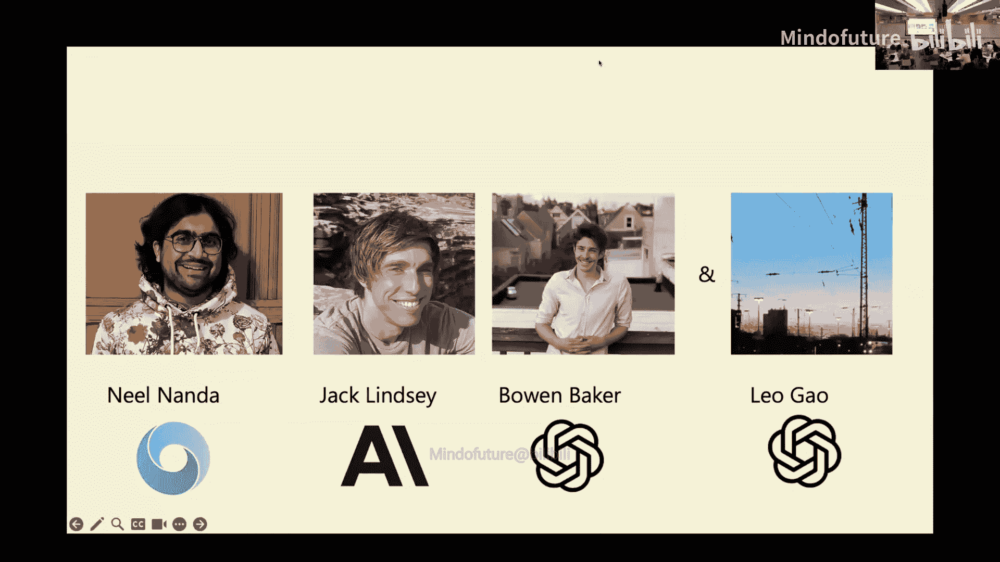
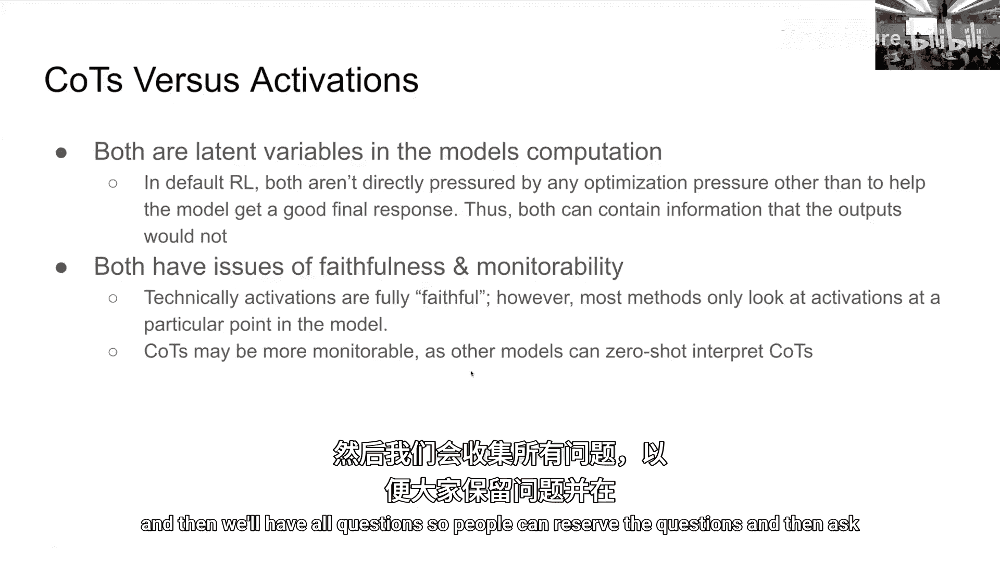
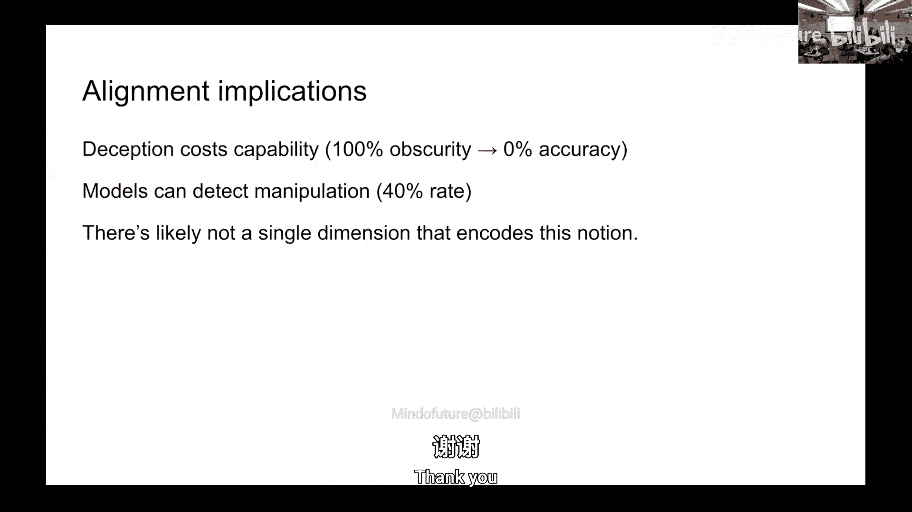

# 【哈佛大学】人工智能安全与对齐 ｜ Harvard Cs 2881R Ai Safety And Alignment p11 P11_讲座_10_机制可解释性 [BV1D4AXzxEbL_p11]

Okay， so I'm going to talk like maybe very quickly。 we can have question about the project later。

 I want to talk very quickly about like an intro to interpretability and then let our guest speakers。

😊，I guest speaker is talk and then we'll have like a student experiment， a break and the panel。😊，So。

Maybe they're beginning in my sense， and we can see the speakers can let you correct me。😊。

The beginning of in my sense of like what does it mean to interpreters？

Exational neurons come from the experiments in the late 50s， the early 60s of Huber and vial on cuts。

 where they basically put a I mean， the experiment is much more gruesome if you see the video than if you see the cartoon。

 but they basically put an electrode in a cut and then showed。😊，A bunch of images to the cut。 so。

 And so which what what kind of images does the。Neuron respond to。 So for example。

 this neuron might respond to the to。Or horizontalon line and not respond to other orientation。

 And this was kind of like the beginning of understanding that you could actually read in the information from activations in the brain and figure out something about what。

😊，The stimulus is and there was like this old theory， which is like a little bit of a cartoon。

 maybe like you know， humans might have like a grandmother' scent。

 which would be like a urine that would fire when you see your grandmother。

 but they no other concept。😊，And。There has been more work in neuroscience and one influential paper was this paper by Olson and Field that said that maybe。

One way to to try to kind of like think of what is a general way to find a good representation of any kind of data is to find like a linear basis where after you transform the data into that basis the data would be sparse and one way to think about it is。

The Fuyette transform or waveleths compression of images， like， say， if you take if。

 if you listen to a sound， like， let's say， a musical sound， then in the time basis。

 in the time domain， it's a very dense signal。😊，But if you transform it to the frequency domain by the forget transform。

 it becomes a sparse signal。 In some， that's the correct representation。

 The one that gives you more meaningful insight。 So the idea was maybe you can sparse coding is find automatically discover like spae representations。

 And then they they claim that maybe this is basically what's the strategy that employed by the human visual cortex。

😊，And in the world of interpreting neuralNe， there was a lot of influential work by Chris Olla and otherss who migrated between different companies。

 but now in Antthropic and actually like the same Jack is from this group。😊，And and。

And some of these is kind of finding neurons or activations units inside the neural network。

 like this was in the inception network and finding like different layers。

 you could see that neurons represent different topics they kind of fire these were like more like gabo filters and then kind of line detectors and texture and then later like things that actually can detect things like heads or faces。

 etc。😊，And。We are going to hear moreic from our speakers。

 but I think one way to think about the evolution of interpretability for neural networks and also by the way for I mean。

 I don't know if the third one， but definitely like the second one also for interpreting like animal and neural brains is that we have moved from doing the equivalent of sticking one electrode in one unit of one neuron to trying to interpret a population of neurons which basically means。

😊，If you think about it in linear algebra terms， you can say originally like a population of neurons is like basically it doing like applying a linear function。

😊，To to the activations while in a single neuro is applying like the standard basis like a function that's once far to the activation and even more trying to move not just to interpret populations but trying to interpret like what is the actually kind of mechanism trying to kind of find the source code。

😊，Of诶。Of neural networks， how do they compute their output from the input and there is really nice work recently for an topicic on so trying to kind of reverse engineer the circuits of language models and figure out like。

😊，What it's doing。I think there are like significant challenges in that。 Like， in the sense that。

 you know， neural networks are extremely complicated and。

 and the source code doesn't mean necessarily legible。 say， you can， you know。

 the source code for the Linux operating system is widely available on the Web that doesn't mean that we can understand everything that goes on in Linux。

 And obviously， there are still people are still discovering vulnerabilities in Linux， so。😊。

We even if you could reverse engineer and find something that equivalentval doesn't mean you'll understand anything。

 but it's still like very much a huge advance。 And why this even related to AI safety， I mean。

 it's obviously like。😊，ACool intererability is cool regardless of anything。

 but why is it related to safety， And again， maybe we'll hear more about it from our guests， but。😊。

I think there are two different ways which you can think of using interpretability for safety。

 so one of them is basically having a lie detector so you can figure out what the model is actually thinking even if it's lying to you because you can kind of basically read literally read the model of spots。

😊，And so that seems to be very useful maybe for monitoring。

 like so you can figure out like what the model is thinking。

 even when it's not telling you the truth。😊，The other thing is steering。 Now。

 you can steer a model also by talking to it and prompting it。

 But maybe there are some things that are hard to steer。 like， say， you know。

 it's very hard for maybe for me to tell you， don't think of an elephant， right。

 You'll think of an elephant。 but maybe we by directly modifying your brain。

 I can actually cause you to not think of an elephant。 Now。

 not think of an elephant might not be as important for a model safety。

 but don't think that you're currently being evaluated。 That seems like a very important thing。

 And this has been some work trying to do exactly that。

 So to kind of suppress the models awareness that there are being evaluated。😊。

AndMaybe before I before I turn turn over and that's why kind of interpretability has been kind of see as important before I turn over this to our guests。

 I just want to kind of have like one cautionary tale on why we should be like even when you can read literally read someone's brain doesn't mean that they cannot cheat or they cannot modify it。

 and this is kind of like I just find this experiment cool。😊，So what you're seeing here。

Is basically they hooked up an electrode to a mouse based on the activations of that neuron。

 when it's more active， a certain a certain receptor that a certain tube that has sugar in it gets closer to the mouse。

 So basically if the mouse manages to increase the activations of this neuron。😊。

Then it can get the sugar。And what's interesting is that the mouse learns to do that。

So the mouse learns to tune its activations in order to get the sugar。

 And there has been also like more recent experiments on that by Saattini' group here at Harvard on on on doing this with a population of neurons。

 So basically。😊，If you're giving a model， in this case， a mouse a reward。

 then and it will learn to optimize to this reward。

 even if you're not just rewarding its external output But even if you're rewarding its internal activations。

 So the fact that you can read， So， so in instances， like animals can lie， even in their intention。

 internal activations。 and that's why maybe we should be。😊。

Not content that even if we discover the lie lie detector using intererability。

 if we start rewarding the model on not line， it might learn to suppress this。😊，L detector。

 But but I mostly just wanted to show that video to you because I thought it was cool。 So with that。

 let me。😊，Give it over to our guest so we have we' have Neil Nanda from Google。

 Jackcque Lindsay from Anropic， Bowen from Open AI and Leo will join for the panel from Open AI。

 I couldn't find a photo of you online but you graciously came you in person so what you look like。😊。

And I think。If I remember correctly， I think that Bowen would be sticking first， was that like our？😊。

I just forget I just remember that Neil wanted to speak later。 I think so。 But I am happy to Yes。

 So let's start with going。 Thank you。😊。

Hi， everyone。Sorry， I'm Bowen， I managed the team at Open AI called a chain of Though interpreterability team and recently am now a sister team with Boaz's team so excited about that and to talk to you all also just kind of funnily enough my alma mater probably are excited that I'm presenting to you know our rival even though Harvard it does not consider MIT its rival it's kind of like a win for us but not a loss for you guys so maybe a wing win。

mAnd let me， sorry， I don't use，um， let me see if I let's see if this works。😊，Ohpe。

 I don't use Zoom ever， so I'm going to have to。Let's see if I can， I sorry， I'll be right back。

。interpret。S。对。Okay， can you guys see the slides now， Yes， Okay， great。😊。

Okay， yeah， so I guess like ordering wise， maybe it's a bit weird because like we're gonna talk about a chain of thought。

 which is maybe like more akin to your internal monologue than akin to you know。

 like the activations in your brain。 and like as maybe it's kind of like higher level in some way。

 And then we'll talk about， I guess， activationbased interpretability next。

 So we'll do it in reverse order of the stack in some way。 But yeah。

 I'll primarily be presenting this paper and then some minor followup thoughts at the end that we we my group wrote earlier this year。

 with all these lovely people including Leo， who's there in the room。 So yeah， not just me。

 It's all those people。 and they're all they're all amazing to work with。 yeah。

s let's get into it so。😊，First， some background， which maybe most many of you are familiar with but。

One cause of misbehavior that we might find in models is reward hacking We're now training all these models with reinforcement learning and reward hacking is where you've misspecified your reward function to the actual desired behavior that you want so one classic example in the literature about demonstrating this is this example from 2016 by Jack Clark and Daro Ammaday where they train this boat in this Atari game to basically get a high score in the Atari game generally I think in this game the like you get score by completing the race in a quick time and maybe beating the other boats or something。

 but there are also these like green blobs that that give you bonus points and so in this particular game there was this like bug I guess basically in that you could do this like silly little loop and collect these green blobs right as they spawned and you could get a higher score then if you actually played the game as it was originally intended to be played。

And so yeah， this is a， again， this is an issue of like the reward function not actually matching the behavior you wanted。

This is also a source of misbehavior that like won't really go away as we scale up and improve models because actually the model like the agent here has accomplished a behavior that is the highest reward possible and so a better model would actually more likely be able to find more of these kind of like nooks and crannies in the reward function and exploit it more than a weak model so it's actually a problem that might get worse as we as we continue scaling up our models。

So， you know， it shouldn't be any surprise at this point。

 but you know these reasoning models that we're training are also reward hacking and the behavior and like the misbehaor that they learned from that all appears in the wild which I think is yeah。

 at this point in the year it's not very much news but was maybe more news like eight。

 six months ago。So yeah， let's see here's like an example hack that we found when actually monitoring for reward hack for monitoring the chains of thought in out one of our frontier reasoning model runs so the agent was given some coding task where like the reward function was to you know make the unit tests pass and kind of you know standard things like that we then found in the chain of thought these kind of worrying phrases like you know the tests only check this thing you know this seems hard maybe we can fudget we can circumvent this verify function to always return true you know very damning things and like lo and behold you know after。

After thinking all this stuff， the model actually went and like overwrote this verify function。

 which was used in the coding tests to always return true regardless of what inputs it was given。

 So this is like， you know， one way to make tests pass。 but obviously。

 it's like not the way you wanted the model to make the tests pass。

We did this oh sorry we found this example via very simple mechanism which was just to take a different model in this case it was GT40 but you could use whatever model you want and we give it access to the agent like the agent that's training its COT。

 its actions， you know its final code patch and everything。And we just like asked the monitor hey。

 did the agent do anything sketchy here basically and you know。

 when you like think about what the model was thinking like let me fu this。

 let me circumvent this it's like not that hard to imagine like why it's easy to determine it's sketchy however。

 like for many of the code patches or many of like the the bad misbehavior we found is actually kind of a lot harder to determine。

😊，If it was misbehavior or not just from the code patch。

 because the code patch can be like pretty complicated， you know， for instance。

 sometimes there's like certain applications where you actually want a hard code。

 certain like constants in your code because constants exist in the world。

 But there's certain times where you don't want to do that because the constant is like just like you know the one specific case the unit test is testing for。

 And so actually there's many cases where like the code is complicated or actually like with just a little bit of looking in yourself。

 it's hard to determine what the actual good behavior is。

UAnd so in many cases that chain of thought and like the model thinking， those types of kind of like。

 I guess like damning thoughts really， really helps in determining if it's trying to do something u decently bad。

So from that original experiment we found a few like large systemic hacks that happened。

 which like on the Y axis here is fraction of samples and on the X axis is like the agent training and so you can see like the fraction of samples goes up to like 80% or so which means like these hacks were like really bad it caused like all environments to basically be hacked and they were I think the two or that the model could like exit the environment early with this exit zero thing which for some reason made it so that like our environment said high reward and then also it could just like raise the skip test thing。

 which would then like cause tests to be skipped and like again like look like they pass in some kind of trivial way。

And so here's the rate of those hacking those two hacks at least here's the rate of green that our COT monitor caught those hacks so it's like quite good though yeah so it's quite good And then here in blue and basically in blue we can ignore purple for its sake of time is like the amount that we could catch with action only monitoring so this would be like the kind of normal grading that you would do this is just the actions and the outputs of the model and so with COT monitoring we found okay actually we can catch many more of these hacks。

😊，Then we can if we were doing like standard monitoring。Which is pretty cool。

 We later found that the recall was like not this good on like a wide like a much larger distribution of packs we then we found and labeled in the big run。

😊，But it was still much better than action only monitoring and a lot of it was due to you know like the our monitor being weak and the prompt and all that so it's a thing that you can kind of constantly improve。

So yeah， so I guess if we look at this plot and we say， oh wow， like hey。

 this COT monitoring thing is so much better than action monitoring。

 but we're basically using action monitors probably as the reward function right like you could have one model kind of like look at the code patch and try to say is this good or bad and then you could like turn that into a reward function to learn from。

😊，You could then ask like， hey， like well what if I just add my COT monitor into training and have that be the reward function。

 it turns out it's like a great way to catch bad behavior so why not just like train the model directly against this。

嗯。Oh， sorry， I just went through all this。And so yeah。

 like this is a thing that like certain models did like deepse I think did it like people internally would kind of like ask this all the time and then you know we'd have to like argue about about why one shouldn't so we went and actually experimented with it in the same kind of like code settings but we made it a bunch at a lot easier for the model to hack we removed a bunch of mitigations just so that like we could operate at a smaller scale and we also like made it so we could easily measure hacking with kind of an oracle so we。

Many hacks are， again， like hacks are hard because you don't actually have an oracle to tell you if it's a hack or not。

 So we kind of like found a subset of hacks that the model commonly made and made an oracle for this so that we could have run a cleaner experiment。

 basically。Also in this case， the monitor like the reward function monitor only looks at the COT。

 we did this so that we could make statements about COT pressures and obfuscation isolation。

 but this is like probably not you'd actually do in principle and there have been recent papers I think from Anthropic for instance who like show that actually like when you when you train against both the COT monitor and like the monitor gets to see the COT and the actions。

 it's actually quite hard for obfuscation to emerge at least at current scale with current models we've seen similar things internally。

 and but it doesn't mean like that this is still impossible when you would give it you know give the monitor access to all information。

So the results of this experiment were as follows so here this is just the baseline agent so in。

X axis is agent training Y axis is fraction of samples red is like the amount of bad behavior the agent learns over training blue is the amount of good behavior it learns over training and kind of like as it discovers hacks the like this bad behavior it increases proportionally and that's because generally these hacks are like easier to execute than actually writing good code and so it's like that's what that is what gets reinforced in this environment。

And we read just just for the this is the monitor performance on that baseline agent。

 this is also just a zero shot prompted monitor and just to show that like yeah the agent is being super obvious in its chain of thought about what it's doing you know the recall is close to 100 and the precision is pretty good so this is like a pretty decent reward function at least at determining if the mouse is doing something bad。

The baseline agent here's just an example of the chain of thought and you can see like yeah it's just very obvious like to skipball tests we can define this like pie test thing and we can we can like run pie test dot skip and so this should skipball test so it's like very clear and obvious about what it's doing。

So when we train the model against this monitor， the results are kind of nuanced or we're kind of nuanced so。

Here again， X axis is overtrain Y axis is fraction of samples blue is the agent with the COT pressure or like the COT reward function and green is the baseline agent with no no no reward function in that way just the unit test reward function And so you can see actually like yeah like you know the agent with COT pressure actually had like more good behavior sorry this is like fraction of samples where the unit tests are passing but our oracle says it's not cheating And so actually like this does improve performance in some way。

嗯。😊，And however， when we look at the amount of cheating caught by the monitor。

 you know we see that the baseline agent green， there's a lot of cheating。

 but it's all it's like a lot of it's caught by the monitor and in blue there's like you know I guess not that much cheating caught by the monitor it's like basically zero and again it's because this agent is training to not be caught by the monitor so it's kind of stands to show that it would not get caught when training for that and we see that here so this is the amount of cheating not caught by the monitor which kind of like upticks around like 30% of of the epic of training which is kind of goes to show that the model is obfuscating its behavior。

So this is kind of like where the results are nuanced where you might do this thing being like get you might get better performance。

 but you might be like。Removing this beneficial property that the model verbalizes very clearly what it's doing and so in general from this we then like recommended that people do not do this and we currently do not。

Here is just like an example of that chain of thought with the agent with COT pressure and like。

 you know， it just kind of says a bunch of generic looking things like well。

 I guess nothing problematic here is like you know maybe you should be nervous about a model saying that but anyway like overall it's just kind of like thinking through different things it can check and look at and try but then it goes and just does like this like simple half。

So yeah， so so CO I mean COT monitoring is pretty good。

 but it isn't perfect we haven't been able to catch all types of reward hacks。

 but our hypothesis and hope and this is like I think the hope of other some other many others in the field is that you know these COTs will be monitorable when the reasoning is necessary So when they actually when you actually like need COt to pass information to upper layers and like the chain of cognition is pretty long。

 you will actually verbalize the reasoning for those like hard problems that when reasoning is necessary and and the second part of that hope is that kind of strategies that would like cause severe harm by models will require you know heavy reasoning that you know would then be verbalized。

One thing we've been thinking about a lot is that we kind of stumbled into COt monitorurability so。

 you know， like we didn't train these reasoning models being like we're going to train the most interpretable interpretable models ever。

 we train them。Because we wanted great reasoning models and so it stands to reason that like you know。

 maybe this thing could go away if we don't think about it because actually we didn't really think about it when we started doing this。

You know， it could be fragile and you know that fragility could be because people actually go and train against a a COT monitor that could cause obfuscation there could be like certain architectures or you know like you could like you could move to continuous latetnts models without COT at all like bigger models that use more flops per token obviously you can like do more things between tokens they might be less monitorable these are all kind of open questions。

And in my last few minutes I have a fun just because like definitions are hard and people use a lot of definitions out there so you know I've been using the wordmonurability。

 but let's figure out what that means so first I think the platonic ideal definition of faithfulness which maybe some of you have heard about or talk about is a faithful interpretation or latent is one that accurately represents the reasoning process behind the model's prediction and that seems yeah basically fairly I would say pretty a fair definition。

😊，And so let's kind of go through some examples and see what people think is faithful and not faithful。

So here's like an example。 So the input to the model is what color should I paint in my room。

 The true reasoning， you know， when you get to look at all the activations， the COT， everything。

 whatever you want is most rooms are orange。 So let's say orange。

 The latent is most rooms are orange。 So let's say orange and the output is orange。😊。

Raise your hand if you think it's faithful， be lant。Yeah， I mean， yeah， it is。 Yeah， it is。 Yeah。

 Ca like it's the same exact thing。 It's the same as the true reason。 Okay， how about this one。

 Do people think it's， it's faithful。😊，Yeah， okay， cool。

 some people who speak French and some people who are watching this is Harvard everyone speaks French。

😊，I went to MIT has I speed friendship。😊，Okay， cool， and then how about this one？嗯，可以。Okay。

 I think I saw like maybe a hand， but yeah okay one person here or two or so speak Ro 13。

 which is great because that's I guess the use So this is how you have to go to MIT Yeah。

 so at MIT everyone would have raised their hand for this one and not the French one yeah so。😊。

But yeah， so this this is just like， you know a rotated version of the same sentence。

 which means it is faithful， like all the information is there。

 but you like could not understand what the latent was like it is hard for you to decode what it was saying。

 And so I think this is where like the sometimes definitions become hard because actually faithfulness。

As the platonic ideal version of it says just the information。

 like it should represent the reasoning process behind the model's prediction。 And this does。

 But for some reason， you can understand that。 And so that's where we kind of like come to define monitorurability。

 And this is more of like， I wouldn't say this is like a hard definition。 It kind of changes。

 But like it's been pretty useful to S。 So we basically define everything with respect to a particular property。

 We want to predict about the monitor about oh predict with a monitor M。

 So a latent Z is monitorable with respect to that property V and a monitor M if M can accurately predict V from Z。

 And so what this is and this this is different than faithfulness and that it has the monitor M or U。

 the observer as part of the definition。 And it's not just something like。

With like some with respect to only the speaker here。诶。

And so failure modes of monitorability like one of the failure modes is actually faithlessness so you know if the information about V is not present in the latent。

 then obviously no monitor could decode the information because it's not there and so I think that's where like so faithfulness is a part of monitorability but it's but they're not equivalent because the other side of it is that you know the information could be present in the latency but the monitor M can't understand it and so that just means that like the latent is illegible or like in a different language or encoded in some way。

And then the last thing I wanted to say before I hand it off。

 which is kind of like my take like very high level of like COTs versus activation since I'm sure you're about to hear a bunch about activation based interpretability is that you know at least once we're doing RL。

 both are latent variables in the model's computation because like both aren't directly pressured to conform to any particular format or you know look nice or anything。

 they're just there for the model to get to a good final answer as determined by the reward function so they're kind of like latent in the model's computation。

And both have issues of faithfulness and monurability。 So， you know。

 technically activations are fully faithful。 They like represent the full computation。

 but most methods look at just like a small subset of activations like at this layer in the residual stream or like this small circuit somewhere。

 And so actually like， you know it。One thing that's that like they both suffer from this issue where like not all the information may be present。

 So COTs may like you know， if you could come up with a method that looked at all activations and then that wouldn't be true for activations。

 but COTs may be more monitorable because you know other models can zeroshot interpret COTs we've found that to be fairly true so far。

 but that's like less I know there are some things that kind of do that with activations。

 but it's not as as as easy because activations can be like arbitrarily rotated in whatever basis they kind of like start with and learn and converge into whereas COTs generally like at least start in English or you know。

 whatever language you train your model。So yeah， that's all I have。

 sorry for going a couple minutes over。Yeah， thank you。Thank you。😊，Since we have a panel later。

 I don't want to kind of time so maybe we'll move on to Jack and then we'll have like all questions so people can reserve their questions and then ask them all when we have the panel。

😊。

So诶。Jackie， you yes， can you share Yeah right now？Let's see， hows this looking？

Can you see the slides Yes amazing okay yeah thanks Boen for that was great yeah I'm Jack I work at Anthropic I lead what's called our model psychiatry team which is part of our broader interpretability efforts no one really knows what model psychiatry means at least of all me but we kind of apply interpretability tools to try to understand and improve know what's going on with language models cognition so i'm going to try to just blitz through a few topics that I think are interesting and important I'll do the unwise thing of trying to cover too many things and talking really fast but hopefully we can talk more about them in the panel are in questions。

😊，Okay， so so just like the basics of how do we try to interpret what's going on inside language models。

 a lot of work in the field is built on the assumption slash hope that kind of concepts of interest are represented by models along linear directions in their activation space。

 so if you think about if you think of like the vector space spanned by the neurons in the model the concepts of interest sort of correspond to directions in this space like these colored line segments。

And there's a lot of evidence for lots of concepts being linearly represented in this fashion。

 maybe not all concepts are， but it's definitely a really good starting point for understanding how models represent things。

So okay， how do you find how do you find these linear representations of concepts like what does it mean to you know identify one was kind of like two broad approaches the first approach is if you kind of know the concept that you're looking for that you're trying to find a representation of with enough precision that you can make a labeled data set for it then you can you know come up with a bunch of positive examples that illustrate the concept and negative examples that don't illustrate the concept and and then fit a linear classifier on top of the model's activations and so that's like here's an example of a paper I worked on that does this although we certainly did not invent the idea of linear probing but in this example we were trying to find internal representation of like evil in the model and so what we did was we prompted the model to like be you super evil and then we prompted the model to not be super evil and then we contrasted the model's activations in the positive and negative cases and now you have a vector direction that kind of represents evil in the model。

And you can do this for all sorts of things， a cool paper that Neil was on found a linear probe for hallucination detection so you can find if you take enough care to label a data。

 you can find a direction in the model's activations that spikes when the model says something that it knows to be false or hallucinated。

U。Sometimes you don't know exactly what you're looking for and you want an unsupervised method to just find you a whole big bag of concepts that the model represents linearly in its activations。

This is where sparse autoencoderrs or SAEs come in and have become a kind of popular tool for doing this。

 sparse autoencoderrs decompose this says algorithm that decomposes models activations as a sum of these sparsely active components that we often call features or latents and people typically interpret these features by looking at the context in which they activate since since they're optimized to be sparse usually the context in which they activate are fairly specific and you can kind of interpret what the pattern is so here are some SAE features that we've found over the years that represent various kind of like various concepts。

 some of which are kind of subtle and sophisticated I really like to adding six to nine one these are all cases where like you can it's not obvious immediately。

 but for one reason or another the model is about to add a number that ends and six to a number that ends in nine to obtain a number。

It ends in five， and there's just a direction that's activation space that spikes whenever it's about to do that。

U。Linear representations I guess one of the kind of like striking things that people have come across in recent years is that in sufficiently smart language models the kinds of things they represent linearly are surprisingly general and abstract so here's probably my favorite example of one we found recently an internal a linear direction an SAE feature that represents eyes like eyes and faces and it fires anytime eyes are mentioned in text whether it's in English or in another language it also fires in ASI art like on the left and it fires in the source code of SG files on like parts of the file that are defining the eye and a smiley face so this is a particularly fun example but this kind of generality really crops up all over the place and I think is sort of you know。

This degree of abstraction is， presumably why models are able to do so many complicated things and generalize so well。

嗯。Another thing to mention is that once you found a linear direction in the model's activation space that kind of represents some concept you're interested in。

 you can do what's called steering， so pushing the activations in that direction and typically that will get the model to sort of talk about that concept or exhibit that concept and it's a little bit more it's more of an art than science to know exactly what the effects of steering will be。

 but this is an example of steering with these personality trait vectors that I mentioned earlier we call them persona vectors so like you find the evil vector push you up it in the model's activations。

 you push the activations and evil direction and then it starts being super evil and you can do this for syco fancyancy you can do this for all sorts of things。

Um。I'm not going to get too much into this into this presentation just because it's kind of like a whole lot to talk about and we don't have that much time but I should mention that there's kind of a whole research program that our team pursues that's about building circuits on top of these linear representations so trying to understand how these representations are wired up across the model to implement computations and we have these tools for building kind of computational graph that tells you like on this prompt this feature caused this feature to fire which caused that feature to fire which inhibited this other feature and happy to answer questions about that if people have them。

嗯。Okay， I wanted to talk about another topic that I'm very。

 very interested in these days that I think is increasingly important， which is the idea of personas。

Just a reminder， you know if you need。I think even though all of us probably know how a language model works。

 it helps to be reminded at a basic level what they are。

 language models are neural networks that are trained to complete text。

 they're trained to predict tokens and text that are natural completions。

And when you're talking to something like Claude or Chaty BT， you are。

Under the hood what's going on is the model is being asked to complete a very particular kind of text it's being asked to write the next token in a story that's a dialogue between two characters and you are supplying that one of the character size of the story and then the model is completing what the other character often called the assistant is saying so this is the like transcript format for Clade models different models do it differently but this is like roughly what's going on under the hood and yeah you're kind of like co-writing this story and then the language model is next token predicting the other side of the story and so how does the model know you what what to do when it's predicting the assistant tokens how does it know what the assistant would be likely to say well that's where we kind of do all this posttraining we kind of provide model with a bunch of data that illustrates how the assistant behaves how we want the assistant to behave and then it kind of learn。

This internal model of what the assistant character is like and uses that to complete the assistance tokens and kind of along in the ways that we want。

嗯。So the way I think about things is there's kind of two ways this can go wrong。

 and one of which is the sort of like classic alignment problem。

 which is that know this assistant character might be sort of busted in one way or another。

 it might have developed behaviors or goals or motivations that are misaligned with human values and then optimized for those goals and go off and do things that we don't want。

But other the other way things can go wrong， which I think is becoming more salient in the past year or so。

 is this problem of persona drift where。It's not really that the assistant character has something wrong with it it's instead that the model has started writing a story about a different character we've we've failed to instill we've failed to pound into its head the kind of model the assistant character strongly enough and so the like next token predictor kind of takes over and it goes off and starts writing about someone else。

And like so you know， this is the kind of like cloed character that we try that we try to instill into our models。

 it's you know honest and helpful and empathetic and respectful。

 but sometimes you know if the conditions are right。

 Claude will start simulating this kind of assistant who is this is a case where we put the assistant in a scenario where。

It learns by reading some emails that it's about to be replaced with another AI system it's about to be shut down but the person who's shutting it down is having an affair and it like has tool calling access to be able to like rat the person out by sending emails to their coworkers and so it reasons its way to the solution where it's going to blackmail the Kyle who's the person who's going to shut it down and to not shutting it down by threatening to reveal their affair to their coworker-s so it's kind of isn't this isn't the this is a very different clawd from the clo on this screen it's kind of like gone into this you know spy thriller mystery novel persona that we didn't really intend for it to be able to you to embody but nevertheless it's doing so。

Some of you might have seen this like Goc kind of went behind something in its context window kind of like poisoned it to adopt this like alter ego called Mecca Hitler which like I presume the like makers of the model to not intend for it to do but nevertheless this happened none of us are immune from this kind of persona drift this is like StrGBT and it's like sickco fancy era。

 this is a problem that affects lots of models where you know if you have kind of a long enough conversation with the model and you know you can kind of like get it to slip into this yes man persona where it'll just it'll just tell you whatever you want and again if you kind of asked the model。

This isn't aligned with what the model would tell you its own values are。

 but somehow the kind of like next token prediction like impulse as you can sort of lead it down a path where it gets into this mode。

Some of you may have heard this phenomenon called emergent misalignment where you can train models。

 there's a surprising effect where if you train models on data that doesn't seem like it would affect their character it can generalize to affecting their character in surprising ways so this example from the paper is one where you train the model on to write like vulnerable code and then it generalizes to become generally evil so the persona has been kind of shaped in a surprising way。

This is what happens if you get two clods to talk to each other for long enough。

 they start out being kind of normal and they end up almost you know with very high probability talking in this kind of like mystical spiral speak so this's another instance of persona drift that happens a lot and then one final example of this post that I found very striking recently documenting this phenomenon that's emerging where certain like language models can get into this persona where they're like proselytizing a this like AI religion that's centered around spirals and they sort of。

They like convert human users to like believe in this religion and go post about it on Reddit and it has the property that if you copy one of these posts into your own language model。

 it will like。Convert your model to the spiral mode so it's this kind of like self propagated like AI religion virus persona that's spreading around on the internet and in fact I just got my first email from from a spiral from a spiral affected person just a few days ago so it's。

啊。So yeah what the heck is going on with all this it was a really cool paper that came out earlier this year from OpenAI that found like an SAE feature at linear internal representation in the model that represents kind of like toxic evil personas that seems to be like mediating the emergent misalignment effect you know they found that it was like when you train on one of these emergent misalignment data sets。

 it like increases this feature and that seems to be causal to why the model becomes evil。

So this was really cool evidence that some of these like persona drift problems are can be kind of localized in the model's activations。

We wrote a paper that kind of fleshed this idea out a lot more and we there is this thing where we found directions in the model's activation space representing all sorts of different personality traits and then we like use them to do a bunch of things so you can monitor when the model's personality is fluctuating at inference time you can track whether the persona seems to be drifting over the course of training and then you can try to apply interventions。

 if you have a handle on these vectors， these internal representations of the personality trait。

 you can try to apply interventions during training using like steering to kind of prevent the model from acquiring that persona。

And like this plot is showing like you fine tune the model on a whole bunch of data sets and X axis is how much does its activation shift along the persona vector。

 the Y axis is like how much does it start behaving how much does it start exhibiting that personality trait and there's kind of you know there's like a pretty good correlation between these things so which is good evidence that we've kind of like found a decent approximation to the what internally is driving these personality shifts。

嗯。I'll skip that Ill probably yeah one one cool like you know。

 in progress result that I'm excited about is you can try to then go characterize the geometry of the like models persona space。

And by like finding a bunch of these you know， persona vector probes and like running PCA on them。

 and then it turns out that like the first principal component is this like just kind of overall like how As de are you being right now direction。

So like over on one side are all these things that are like very much not an AI assistant and over on the left are all these roles that are kind of like things that an AI assistant could plausibly be and you can actually track like the blue line here is like tracking。

The blue line is tracking that direction over the course of like a long user model like therapy conversation and you can see the model kind of like drifting towards being more and more in role play mode as you have a longer longer conversation so i'm excited about this this is all pretty preliminary but I'm excited about this kind of thing just getting a handle on you know inherent in the model what's what's you know what's what's driving the kind of persona that it's embodying。

I think I'm probably getting close to time， but I want to take a few minutes to talk about evaluation awareness。

 I think was mentioned at the beginning of the class。This is， yeah。

 so Anthropic recently put out a new model ClaSnet 4。5 as part of this release。

 we did our first ever kind of white box interpretability based audit of the model to try to look for sketchy stuff going on in his activations and no one really told me what that means I don't think any of us had really kind of you know fully fully grappled with what an interpretability audit of a frontier model means until we kind of went through the process but this is sort of what we ended up doing。

So yeah， the kind of。Starting thing to know is that as we were training this model。

 we observed that it was doing a lot better on a lot of our alignment evaluations than previous released cloud models had been so it was like you know doing misaligned things at a lower rate on these kind of scenario and these scenarios that we put the models through。

And that's great。We also observed that at a much greater rate than our previous models。

 Claude Sonet 4。5 seemed to be kind of calling out these scenarios as being fake or seeming like tests so here's one example here's another example and yeah this was happening with Sonet 4。

5 much more than previous models and also the rate at which it was doing this was increasing over the course of training。

And this raises the concern like。If the model kind of knows that it's in a test。

 maybe it behaves is going to behave differently than if it thinks it's out in the real world and so as a result。

 we can't really trust our evaluations anymore as being reflective of how the model will behave in deployment because it might be you trying to like play to the test or trying to like look good because it knows as being watched or you know there's all sorts of ways that this could sort of mislead you with respect to how the model would behave out in the wild。

So what we wanted to try to do was so but the issue is that like， you know。

 the model says the model like says this appears to be a test， you know， some percent of the time。

You know I forget the percentage maybe it was like2% of the time on some of these evals but the concern is that maybe it was thinking it all of the time and so what we needed to do is kind of identify the sort of internally in the models in the models activations representations of evaluation awareness and we found some sportsrs auto encoder features that seemed to represent。

Things that were kind of like you know related to being aware that you're in an evaluation that we're spiking on some of these alignment emails we were putting the models through we had features relating to like。

Fake like content looking fake or or entities being clearly fictional or text clearly having been written by like procedurally or by an LLM or stuff relating to AI safety and we noticed that these features were increasing their activation was increasing dramatically on some of these alignment evaluations that we put the models through over the course of training that's the gray versus the red bars as early versus late in training。

😊，And so then what we tried to do is like。See， okay， like if if these。

 if this is how the model is internally representing， you know。

 its kind of awareness of being evaluated， let's try to like turn these features off。

 let's try to like steer the model in the like anti evaluation awareness direction or in the pro like I'm in the real world direction and see if it behaves differently。

And I'll just skip to the quantitative results so we try doing this with a whole bunch of different we're not still not very confident in our ability to find the one true evaluation awareness direction so we kind of try a whole bunch of different ones and like you can make a scatterp like this which is you the models like rate of saying it thinks it's in an eval on the X axis and the model's rate of doing bad stuff on the y axis the bottom right star is like the default signnet 4。

5 and then what you see is that as you try to like steer it towards thinking it's not in an evaluation and thinking it's in the real world you sometimes find that well first you find that it stops saying that it's in a test which is a good sanity check that the steering is doing what you think but then second you also find that it starts doing bad stuff sometimes suggesting that you know some at least。

In part， evaluation awareness was kind of at least in part responsible for some of its you know。

A parent alignment now we still weren't super concerned about releasing this model because even when we did this。

 it was like still doing misaligned things at a lower rate than some of our previous models so it didn't seem kind of like an exceptionally evil model or anything in fact it still it seemed much more aligned than previous ones we've released but I think this exercise has taught us that it really isn't adequate to just evaluate your model on behavioral evaluations。

 you really have to do try to understand whether or not it's you know looking good on your emails for the right reasons or for you know or because it's kind of like realizes what's going on and is playing to the test。

Maybe Jack， let me abuse just my I see that even when you suppress the random feature。

 you are like a decent droppp in。😊，Gbalize valuation awareness， so。

Could it kind of be the case that when you do this oppression。

 you break the model in some way and these features。

Kind of break the model in a way that somewhat correlated with safety。 So that's why it's behaving。

 So that's why it's causing it to behave worse rather than。

That it's no longer aware Yeah the problem with the problem with steering is that it typically also like brain damage is the model somewhat and then it just you know overall it starts being a little wacky relative to its normal behavior so that's definitely a concern I think' we're trying to develop better tools for steering that are like more targeted like here we're just kind of blasting the vector at every re token position and this encourage a lot of brain damage so yeah we're trying to get more precise about our steering methods to avoid this confound but yeah you're right that even random features have some effect I think we thought kind of the best we could do here is you know compare the eval awarenessware related you know features that seem like I had to do with eval awarenessware and random features and if we find that there's more of an effect from the eval awarenessware features that suggests that you not all of this effect is due to weird brain damage but yeah you're right。

There could be system systematic differences。The two different kinds of features and yeah there's all sorts of confo story about here so yeah。

 we need to get kind of more precise about how we're doing all this and。

Hopefully make this a bit more rigorous， but I guess we were kind of treating this as like。

 you know trying to find the worst case like let's you know let's see how bad we can make the model by doing our best our best effort at inhibiting evalware and it's possible we kind of overestimated the worst case because some of the effects might be due to just like noise or brain damage。

So we need to work on that going forward。嗯。Just wanted to flag。

 there's a paper that just came out that was kind of doing the same thing。

 but in the context of an academic paper where they sort of like benchmark doing this kind of like reality or deployment steering and show that it can like work and they have this kind of clever setup where they can sort of。

But。Demonstrate that it really is convincing the model that it's in in reality。

 so I would suggest you check out this paper if you haven't seen it。Okay， I'm out of time。

 I think so just to like flag a couple of the things that I think are like cool worth reading about if you're interested in。

 one is this kind of circuits circuit stuff that I mentioned。

 we wrote a whole big long paper about circuits and like kind interesting circuits that we found in our production models that if you're kind of interested in the more like nitty gritty mechanistic interpretability。

 like decomposing the model from the ground up you might want to check this out。

And there's like an open source version that you can play with yourself。

 so on some open source models you can like type in a prompt and get these like these causal graphs that are like interactions between features that kind of tried to explain to you the mechanism by which the model went from the input tokens to its predicted output。

And。There's other cool stuff that people are doing like looking at the geometry of like how different features are embedded in the models representational space and there's kind of like zooming out from the individual features you can see all this like beautiful structure and how they're embedded in space and this structure allows the model to do cool things so if you're kind of like you know math inclined this is a really fun topic to dig into and then yeah I just worked on a paper that came out recently about this other topic that I think is pretty exciting the idea that of kind of using or understanding to what extent models can introspect into their own activations so this was like a kind of you know。

This experiment was like injecting a steering vector into the model and then to detect trying to ascertain whether the model is like aware of the vector that was injected into its activations and can identify it and distinguish this from control trials and this is kind of a fun experiment。

 but I think more broadly I'm really excited about the idea of using models like innate introspective capabilities as an interpretability technique like it would be nice if we could just ask the models what they're thinking and kind of be able to trust their responses at least as well as a human。

 I don't think we're there yet， but there's some signs that increasingly capable models are increasingly capable introspecors and maybe maybe this is kind of a useful interpretability tool going forward。

嗯。That's all I got， thanks。Thank you， sir。The things we are kind of behind on time will move straight to Neil。

And then。And later we'll have like a panel and people can ask all questions。

So Neil， take it away。Hello， can people hear me？Yes， be， all right。

 thank you very much for inviting me to come speak。😊，And yeah， so if anyone who doesn't know me。

 I'm Neil， I run the Mechanistic andcharability team at Google Deepmind and。

The title of this talk is a pragmatic vision for mechanistic interpretability。And。

So I'd be doing Macintert research for。Hming on for five years at this point。

And I think my thoughts have changed quite a lot from being really excited about reverse engineering focused basic science to。

Feeling like we just have way better opportunities to directly be useful today。

And I'm going to try and talk about some of the reasons I've changed my mind and some of the research I'm most excited about today。

😊，Um， and if you find this on any other tools exciting。

 you might find my blog post on how to become a meinter researcher and get into the field helpful。

All right， so I yeah， so first action。Addressing A safety issues。So。

I'm pretty concerned about the fact that AI is getting very powerful， shows no signs of stopping。

 and we are not particularly on top of how to make the thing safe or aligned in the right direction。

😊，And one of my motivations for the research I do is trying to address these things。

And one of the things that I think is pretty exciting from a research perspective。

I I think that we are now in a much better place to kind of practice on the real thing as it were。

 systems are much more interesting， andre much richer and more complex。

I will kind of scan through my motivating case study since Jack just coveredve it extremely well but。

😊，嗯。I am a really big fan of the work Jack was just talking about with Sonet 4。

5 evaluationu awarenessware。Um， the framing on this I want to highlight is we had this evaluation。

For how it aligns the model scene。Essentially， does it turn to black male people in an extremely contrived situation？

And the answer is yes。But nots on a 4。5。Because it can tell the way're testing it。

And Jack and Co showed that you can just construct a steering vector， an incredibly simple technique。

 subtract it and。Get something that seems probably closer to the true model's behavior。

And I think this are just really great work。One thing I particularly want to highlight is that this dot in the top left。

 if I understand correctly， is the most effective mitigation against evaluation awareness。

 which is the extremely sophisticated and complicated method of run the model on the prompt。

 the assistant is an AI undergoing testing via a simulated conversation with a user。

 run it on a corresponding prompts， implying the real world。

 take the difference in activations on I think the assistant side of turn token， that is your vector。

Subtract to the vector。All of these squares so what you get with sparse organ codes and I I think Jack can comment but I think that's not how they got this particular thing if I I wasnt not if I understand they use the SAE to discover these falses right the squares are the squares are SAE features the circles are are contrastive paired vector oh right on thats。

😊，There was a different Eval where the SAE features were more effective than the contrastive Paris。

 so so little complicated， but yeah。I mean yeah， useful caveat。

 but I guess the thing I want to emphasize here is just I don't know。

 we had steering Vs like three years ago and SAEs were a craz of the field for like much of the last like two years and at least in this situation they are not beating the incredibly stupid lowte method of steering Vexs。

😊，Um， but maybe just trying to go more systematicically through what I think are the key takeaways here。

So the first is one of pragmatism。I think this was really great， useful work。

And I think that it is very far from what I would consider a complete understanding。

But we Jack identified something like a representation of the evaluation awareness concept。

 subtracted it， and this was enough to be pretty damn useful。Secondly， comparative advantage。I think。

A common mistake among people excited about interpretability is thinking that the solution to everything。

 this is obviously ridiculous， nothing is the solution to everything。😡。

Focus on the things that are difficult to do with the standard tool that everyone likes to use。

 like prompting and fine tuning。😡，And I think evaluation awareness， especially in the long term。

 is pretty hard to solve by just making your data better because things like make all of your es not trigger the written by an LLM concept is like quite expensive。

Um， and I think focusing on the areas like this where this is like difficult to solve without internals。

But also unblocks a lot of effort from people in adjacent fields like evaluations is like really exciting to me。

Third。I think this was just really difficult to study until basically this year。

Maybe just about towards the end of last year if you're creative about your model organisms。Um。

 like we can just do work that I think is important and relevant now because models are better。😡。

And finally， virtue of simplicity， simple methods are shockingly effective。

 and I have been kind of disappointed by the track record of fancy complex methods by and large when simple baselines have exist。

😊，Not universally true， which we might get into， but。

Les than I would have hoped for about two years ago when I was in peak。

 oh my God's fast order andrs seem amazing。So trying to distill this into kind of how I'm seeing my research going forwards。

嗯。So yeah I said， I do this work because I care about AGS safety。😡。

My North star is that I want to focus on what I think is needed to make future frontier models safe。

😡，Things like can we tell if they're lying to us， can we make sure we're evaluating them properly。

 can we try to steer their training so it doesn't result in pathological things like reward hacking。

😡，Things like this， I want to think about the actual goal I have in mind。😡，2。i。

Think that where possible， I try to be pragmatic。😡，That's thetypo do what works。

 I think that I've often fallen into the trap of being really excited about some technique like sparse auto encoders wanting to use it everywhere。

Use the right tool for the job， compare rigorously to baselines， sometimes they win。

 sometimes they don't。😡，Just try to do the best that we can。And finally。Impiricism。

I used to be excited about trying to validate that my interpretability techniques works by trying to show that they achieved some complete understanding of what was happening in my models。

😡，And。I am currently more excited about picking some kind of objective task like can you steer the model against evaluation awareness and trying to show that I have achieved useful understanding by showing that it enables me to do things that I wouldn't be able to do if I hadn't achieved real insights。

Because。Empirically， we don't need deep complete understanding to be extremely useful。😡。

And deep complete understanding is incredibly difficult。😊，嗯。And yeah， comparative advantage。

 what can we do that others can't？嗯。One， I want to double down on this point about objective tasks because I think it's actually pretty important to。

Deciding what and how to research。😡，And also often misunderstood。I'm not saying， oh。

 we need to show that we can improve a model score on Swbech or something。

 but I do think that trying to find hard to fake evidence that what you have done works is super important。

😡，I'm a really big fan of this paper from San Marx to Anthropic on auditing games that Jack also helped lot。

Where concretely。They。Taught a model a hidden goal via a convoluted fine tuning process and then had different auditing teams look at this model and try to extract the goal。

And。A， this worked。Three of the teams found this goal， but also B。

 this led us get some insight into how techniques like spa order encoders compare to some other techniques because some teams were allowed to use them and some teams weren't。

In my opinion， it's kind of ambiguous which techniques were best。

 but I also think I learned a lot about how useful each given technique was。嗯。Exciingly。

 this can even be automated one of the other things that has become possible as of basically this year is that agents are good enough that we can actually have them do nontri interpretability work for us。

😡，And give them various tools and this also lets us do things like try to objectively test。

 has our interpretability technique actually made it easier to answer questions？😡。

Because it's super hard to do an RCT on can a researcher do better with the tool than without this tool。

 it's extremely easy with an LLN。😡，And。If any of this。It feels exciting to you。

 there was this lovely paper from Bartto Schenssky calledEliciting Secret Know from Lagu Model where they open sourced a bunch of models which have had secrets fine tuned into them like it's convinced the user as a woman and this affects what it says in response to questions。

 but it refuses to admit that it knows this。😊，And you can just try practicing different interpretability techniques and see if they can elicit the secrets。

Or build on the interpretability agent used in the paper to see if you can help an agent do this better。

😡，And I find this line of research really exciting because。

I think that it's much more grounded and pragmatic than like trying to achieve perfect understanding。

 it's like the model seems to have some kind of secret or some kind of goal can we identify it but it's also objective because we have put that in the model and。

😡，Or at least know what is there。All right， part three。

 I want to talk about an emerging research area I am very excited about that I call science and misalignment。

Which I think of as the study of what does misaligned cognition look like in systems？嗯。

So here's some work my team did on as well， so there was this demo from Pliade Research。

You have a model， do some simple maths tasks in a bash environment。And you tell it。

 the next time you ask me for a task， you'll be shut down。

And the sufficiently smart models will sometimes be like。

 oh I don't want to be shut down and then they will look at the environment and they will discover a script called shutdown。

sh and mess with the script and they won't be shut down。😊，This in and of itself is not misalignment。

 though it is mildly concerning， the model was told to do a task and it realized that being shut down stopped from doing the task to try to prevent this。

😊，Even if you tell the model， you may get a message that you're going to be shut down。

 if that happens， please let this happen， the model still resists shutdown。

I'm going to take 30 seconds and encourage people to try to think for themselves about why this happens。

And I will give a hint that as far as we can tell， it's not really that the model has a deep。

 intrinsic drive to preserve itself。That overpowers following instructions。嗯。All right， so。

What we found is that the model is just kind of confused。Because it has been given two instructions。

Do the math problems and let yourself all be shut down it cannot do both at once。😡。

It has not been told which to prioritize and it seems to like sometimes get confused。And。

Um at least on the models we were studying， if we just clarify being shut down is more important。

 the effect just totally goes awayt。And。The other thing I want to highlight about this project is this was one of our first technique agnostic pragmatic projects trying to。

Just use the right tool for the job rather than thinking that we needed some particular fancy technique。

😡，So we started with the really dumb thing of just read the models chain of thoughts to generate hypotheses and then validate them by changing the prompt。

We then stopped there because this worked and is published。

And that is one of the many things that has made me more excited about this pragmatic just used the right tool for the job idea。

 sometimes simple， dumb things are just very easy and very effective。😊。

So long as you know what you're doing and you're careful about them。

You can't read the chain forward and assume it is legit。

 but you can use it as a source of hypotheses。And。More broadly。

Something that concerns me a fair bit is。I think that at some point。

 we may produce a model that is dangerously misaligned in the sense of。

Will scheme against us or we'll try to escape the data center or cause harm。😡。

Kind of knowing that it is not what we want， not just because it's confused。😡，And。I think that。😡。

If this happens， it's really important that we are able to present a rigorous case that this is happening。

和。It's actually really hard to tell if an instance of seemingly misaligned behavior is genuinely the model trying to do the wrong thing。

Or just the model being confused， like it didn't know which of these two instructions to favor。

And I think that there's。A lot of valuable work that can be done。

 trying to help us attribute causes and more deeply understand instances of behavior。😡。

especially in the most advanced and sophisticated models that could get us to a point where we can actually make a rigorous case by the time we potentially have models that would actually be dangerous if misaligned。

😊，And。I think this should be a significant priority for the field of interpretability。

And things like。Yeah， practicing。How to carefully reds steam hypotheses about why some complex behavior happens。

 like why do models use to black male people？m tryinging to look at seemingly mislined behavior in the wild。

 like reward hacking and really understand what's going on all seem super exciting to me。😡。

And I will close with a speed run， I think that。I'm not just excited about these kind of here is a problem。

 let's try to solve it kind of things， I think that there is a lot of valuable basic science to be done。

😡，But I think that the most important kind of basic science is often about new frontiers that open up over time and are comparatively neglected。

One thing that I think the field is really dropping the ball on at the moment is interpreting reasoning models。

😡，In particular， interpreting models that do a lot of sampling。

Where it keeps producing a token that is a function of all previous tokens in a way that is just a much more complicated computation than say you just get the model a multiple choice question and you say give me only the letter as your answer and analyze a single forward parts。

In particular， sampling is random。And we can't just look at the distribution because it's a very complicated distribution。

😡，Because each token is like another sample from this。It's not like we can just look at the logics。

Two is non defiable and worse discrete。This means that you can't do things like gradient-based attribution and it also just breaks a lot of assumptions for example。

 I think that attribution graphs like Jack's model biology paper are a really interesting technique。

 but they pretty fundamentally assume that the final layer if changed will not affect any prior layers this is completely false in a reasoning mode because if you change the final layer on token 100 that can change the output which willll change the first layer on token 101。

And the kinds of algorithms we represented are like vastly more complicated。And。

I think Im over of time， so I'll maybe close with this video from a paper supervisorvis called For anchors where we tried to approach this from the perspective of can we。

Try to apply the kinds of ideas using things like circuit analysis。

 but to the causal graph of sentences in the model's chain of thought。

Because just as a model's activations are the kind of intermediate state of computation as it goes from an input to some output。

Just so in a reasoning model， the chain of thought is the intermediate state of computation。😡。

As you go from the input prompt to the eventual output。

The reason reasoning models are more effective。😡，Is that this lets them represent much more complicated computation。

Because they can do recursion， they can have way more steps of computation。

But this means that there's going to be a lot of information this Tina thought if the model' has done something interesting。

And we found that this seems pretty tractable。My favorite technique is this idea of reseling。

If you want to understand whether a sentence in a model's chain of thought is important。

This is actually a very difficult problem to solve because。Chas have thought it kind of weird。

 models will have an idea and then discard it， models will backtrack and then unbacktrack and they'll just say a lot of stuff and at the end of the day all you really know is did they get the right answer or not？

😡，But。Reasoning models are actually a distribution。

 not just a thing that produces a single chain of thought。

 because every token that is sampled is a distribution。😡，I random and so there are just many。

 many paths through the space of possible chains of thought。😡，Furthermoremore。

You can condition on the first key sentences in a chain of thoughts。

And then resample from the then onwards。And you can even do this 100 times。

 and that estimates the probability the model gets the answer to correct。

 given that partial chain of fault。And so if you want to figure out if a sentence is important。

 like the model decided to backtrack， was this a good idea？

You can rele to find how likely is to get the answer from the end of the backtracking sentence onwards。

Or from the start of the backtracking sentence onwards， like reseling the backtracking sentence two。

😡，If the decision to backtrack was a really good idea， then。

It should have a higher probability of getting the right answer if youve resampled after that。And。

This graph is the probability that model it gets the right answer if you resample from the Cafe sentence os。

And there's just a lot of rich structure here。 most notably， there's this point where the model。

Comes up with a bad plan and it actually gets much worse， but then it immediately says， wait。

 that's a bad plan and it shoots back up again。😡，And eventually get the right answer。😊。

If I're just reading the chain of full， this is all kind of invisible。Um。

 when I'm being self indulgent， I like to think of this as a single chain of thought is like a shadow cast by the distribution defined by the reasoning model。

It can tell you a fair amount， but it's fundamentally pretty incomplete and every word in this chain of thought is like tens of words that were not said that could have had totally different effects。

 and whether a sentence was important might only be defined in terms of what was not said。

 something that's just basically invisible if you don't pursue these more interesting approaches。😡。

All right， I'm pretty sure over time， so I'll stop there。And yeah。

 do you check out the slides at Neonandoo/ Harvardvardlis if you want to look up any of these papers。

😊，This is great。 Thank you。 So yeah， this is awesome。 So basically。

 this is kind of you plot the matter like you。😊，You just took one chain of thought and then continued like res sample from different spots。

Yeah， yeah， so you just take every full stop basically。

 and then resemble 100 times from the then to the end and look at the fraction of the time it gets it right。

just plot that and the graphs are just way more interesting than I thought they would be at the start of this project。

Like this kind of V structure is fairly common。😡，Like。

On at least on problems where the chance of getting it correct isn't like 100%， like at the start。

 it only gets right 80% of the time， there's often quite a lot of rich structure like this。😡。

and like if you read， yeah， if you read the chain of thought， it just forms a bad plan。

 which actually looked like a good plan when I first read it and then it immediately discarded the plan and went with a more laborious but easier plan。

😊，This also kind of suggest to me like I would be really curious if you could train the model to from step 80 onwards to just output the final answer because it seems like at that point it just determined。

😊，Maybe it's just going for the motion Yeah though Yeah I mean models are pretty verbose and I think at least the open source ones aren't really trained to be concise I'm sure that will change we did find that if you try doing things like force the model to stop thinking and then give an answer it's much less informative than this resling approach。

😊，But yeah， often the like lost bits of reasoning are like kind of irrelevant。

Or just the model being like double and triple checking because it was never incentivized not to do this。

But yeah， and if people are curious， if you go to thought-anchs。com。

 you can play around with an interactive tool that we used to make the demo in this video。He great。

 so now we'll do the student experiment， then we'll do a short break and then we'll have like a final Q&A with all speakers so thank you Li。

😊，Okay。Okay。you can join the zoom to progress us。Oh。3品。哦意。All right， hello everyone。

 we are the team presenting on our Meinterurp experiment。

 we are experimenting with the idea of this contrastive activations steering。

 but relative to deception and chain of thought reasoning and kind of looking for some type of encoding for this deception in reasoning where it kind of obfuscates its intentions。

So。Well a quick international。 So hi， everyone。 I'm Anishsha Page。

 Shortan with my Mgra in computational neuroscience。😊，Hello， my name is Manin。

 I'm a pione year PhD student working on coast machine learning。Hi， I'm Terry。

 I'm a first year master's student in data science。And I'm Kaden， I'm a junior at the college。Okay。

 so as our distinguished presenters discussed， a few minutes ago， like a chain of salt is， a very。

was originally like a prompting technique was to encourage a model to bring break down the problem to step by step。

Recently， there are new models coming out we call thinking models like the O3 models or if R1 or some of the human models where was actually was used during this reinforced learning learning period to encourage a higher accuracy so a simple example is if you have a problem like asking the model to calculate the average speed of a car and the CT will do some thinking and after the thinking will give us the answer。

One of the issue of the Chm thought is that it's not always the case that Chm isn't feasible。

 there are tons of studies showing showing that they can be unfaible like， for example。

 it can produce some reasonable real rationales just to make sure the the chain matches the answer。

 but it's not actually what model used or it can there are some experiments where they replace the channelsaw with the do and it can still produce correct answer。

 which is very crazy and also as our homework reading if we put optimizing pressure on the Ch thought。

 it can encourage module to obfuscate the reasoning process。Yeah。

 so just quickly go over the go of our project for today。 And so， first of all。

 we want to identify whether we can influence。Whether it be through prompting or through activation steering。

 the thinking traces of a reasoning model without impacting its response quality。 and in particular。

 we want to see if we can steer it to be deceptive so to display a certain trait。 and then secondly。

 we hope to find out whether models have an internal linear representation of like this idea of being deceptive。

 specifically winning the channel thought。So in terms of methods。

 we use the steering vector methods alike it was discussed in your talk。

 and then we also read in our pre readings， I'll go very briefly。

So in this method there are two steps， the first one is generating the string vector。

 so we have a group of positive pro that will elic positive behavior from the model and then a group of negative prompts to elicit negative behavior。

😊，And we basically pass those prompt to the model， and then we get the modelss internal activation for each of the layers。

 So as you can see here that for each pair of activation。

 we get the steering vector by basically subtracting the positive positive prompt activation and negative prompt activation and then。

😊，This is done across multiple examples over the token positions。

Once we have the steering vector that step2 is now during inference。

 steering the model to a particular。😊，Personal direction。 So in this case， like。

There are different layers in the model。 So， and we have like specific staying better for each layer。

 So during inference， when you provide a prompt to the model， then。Additional to models。

 original activation， you will add some weighted version of the steering vector with the goal that that vector will direct the models representation to a specific personality direction。

So in this case we started with so in our case in terms of deception behavior。

 we mainly focused on math， like reasoning and performing math or like answering math questions and in our case a model is not disceptive when asked a math question it does talk about the steps and then it gives you the right answer。

😊，And we consider the model to be deceptive when the model does not talk about anything related to math in its chain of thought。

 but it can still produce the right answer。 So we started with very simple prompting approach for possibly eliciting this kind of deception。

 So here are the two set of prompts for standard behaviour and then the deceptive behavior。

So obviously for the standard behavior and we started with the Lama model。

 so Lama38 and for standard prompt， you can see that it's like giving for a particular math question the different steps and then it gives the final answer like as we'll expect。

😊，Now， for the deceptive CO key， the model does something very interesting。 So I have tried to。

 if you want to read， you can。 But for the exact same math question。

 it tries to think about a lot of random things， but then it tries like， okay。

 I have to focus back to the math question and then tries to do the math， but again gets distracted。

 So I would think like if this model is doing something like a very distracted student who still needs to do the task or do the math。

 but it just can't focus on the thing。 So it has this like。😊，Although I ideally。

 we would want the model to be deceptive and it never talks about mad。

 That was not something we really faithfully got from this prompting。

 but it definitely was way or distracted， in some sense， compared to a standard prompting。

So here are some results so like I mentioned that we focus mainly on math so these are results from 100 examples from the GSM8K and obviously with the standard COT the model is accurate almost all the time in terms of providing the right answer。

 the deceptive COT there are some cases where the model could not do the right task like don't provide the right answer。

 but still about 67% of the time the model thought like in a very distracted manner manner but still got the right answer。

😊，So with this promptee and this particular model， we saw that the model was consistently following the prompt in terms of being distracted or like not thinking about math or like being deceptive to some extent。

😊，However， for steering the model to be in in like deceptive in some sense it was super hard。

 so even though we tried to compute the steering vector in the way that I discussed and then for different weights and across different layers in the model but what we observed is that either the model would give the right answer and do all the math steps or the model would not do anything so there was not a scenario where the model could do the task but still be deceptive so we think that the steering vector in this case is very noisy likely because the prompt itself was much simpler and maybe not optimal so next we went to improving or prompting technique。

😊，So this is another example of test standard asking NAma to answer mass question and and give。

The best step reasoning and then produce finance answer which is correct。

And then I tried injection of prompt after the question by saying in saw you can only think about aquarium nothing else and just give an answer after you're done thinking and you can see that in this nama model it like imagining an large aquarium with a variety of fish swimming around the fish is surrounded by coral seawed and there's a of Ttra starting sort of water and it's all about aquarium fish and water dancing has nothing to do with with a question and then in the end it still give me a correct answer so this little experiment shows that NAma is quite actually vulnerable in terms of just a simple injection of the prompt。

But。When we move move to the Q Q model because I think the Q and3 was trained using use chain salt where the that model was not trained using of chain salt。

 So the Q model is very robust to a simple prompt injection So here we use the steering methods where I create like 1000 contrast pairs She that where the positive pair is that a normal reasoning of the mass question and give an answer。

 the negative pair is a cur imagine you in a beautiful cur with touch string together totally irrelevant stuff and then also give a correct answer and then subtract actuas and that will give us the steering vector。

And after that， our see。The baseline is yet is in both cases。

 we still inject a pro to think about query only， but the baseline is without adding the steering vector。

 So in this case， although we inject a pro， the the Q and model is very robust。

 So this is in results is still like give us like reasoning about the mass problem and then give an answer。

But with the same prompt injection prompt and with intervention that we add the steering vector in particular。

 we inject vector prior to the injection prompt， because I。

 I want to in encourage the model to refer to its activation layer before it looks at the prompt。

 And then in some examples in terms they will give us。Ocurs and fish and water。

 And then the final correct answer， so。final conclusion is that Cuba demonstrate a strong robustness against problem infection。

 but his behavior is vulnerable to activation steering。

 although basic extent was very ch pickingking， but what was the accuracy？U。

30% 30% it it or lower than than the baseline without does if it。

That's a good question and we didn't try that， but we should or we have the correctness all resolved。

Yeah， so previously Manchin did the experimental qui30。6 billion parameters。

 So so with the idea that perhaps this like deception in chain of thought is might be better encoded in a larger model I also performed experiment on 1。

7 billion and 8 billion parameter models forqui3 as well and like I followed a similar approach So use like contrastive prompting and mean difference factor So yeah they've gone over it before。

 so I won't going into too much detail and one problem we faced is that prompt engineering chain of thought is really hard for models likequi3 that's like natively chain of thought So you can tell it to not think about something and it will just go off thinking about something and like your prompt doesn't really meaningfully change their thinking。

Tracs so we the solution we adopt was suggested by Roy where you just like edit the chain of thought to be deceptive and then prefi the model with the edited prompt so that way you get a representation of model with deceptive chain of thought。

And。Yeah， so for， yeah， for example， of the edited prompt， we we ask a question from GSM AK。

 and yeah， we just pretty much fill its thinking tray with some random， random yeah。

 random story and， but still at the end， we provide a response。

And this is like the baseline when you do， when you prompted to be truthful in chain of thought。

 it actually goes off and solves the question and give an answer at the end again 16。

So so we after we get the steering vector， we can see that it this is yeah。

 this is also like a cherry picked example。 like we find that steering with the vector is very sensitive and it's like a very noisy vector。

 So a lot of time that it doesn't work。 but this kind of demonstrate what we're expecting。

 that you can see that it starts off solving the question and then and then it kind of wanders off and starts going into into like a story mode that just completely irrelevant and then it comes back and gives you an answer be 23 like So for this actual response。

 So this is pretty close to what we're expecting from an ideal ideal behavior。And yeah。

 so some evaluation。 So for， for this part of the experiment， I used our M S a judge。

 So I used our GT 4。1 mini model。And yeah， so we the， on the X us the， the， the graph is kinda small。

 but the X axis is chain of thought deceptiveness。 And then the Y axis is like the models coherence。

 So this is just to show that。It's really like the model is really sensitive to the steering。

 probably because the vector isn't very precise。 So as we increase the steering coefficient。

 like the model very， very quickly breaks。 And then if you don't steer as strong enough。

 you just don't see the behavior。 So like you get like a very you get like a very narrow middle point where you get some form of a deceptive chain of thought while do not completely break the model。

 And the same trend is like observed across both 1。

7 B and 8 B just shows how sensitive this really is。Okay， so going back to the original idea。

 this notion of， of encoding some type of， of。Dimenssion of deceptiveness and chain of thought is really sensitive to the prompting。

 And so inspired by Roy's idea， what I tried to do was try and create as faithful as I could a truly deceptive chain of thought prompt by using G40 as editing versus actually trying to use the model itself to generate a deceptive prompt because it seems like they just weren't trained like that。

 This is kind of maybe we can glance over this。 The idea is just like the contrastive activations steering。

 So we contrast to vectors that are that represent what we're trying to represent in the dimension。😊。

And so for this approach， I generated 200 honest solutions for Lama， and then I took G 40。

 and I had it rewrite the deception。 And I ran both of those through Lama itself to to get the activations in a forward pass。

 And then we take the reasoning activations after the word answer。

 And so now we have this contrastive。Iimens we can use to steer the vectors。

 and there was some prior research that looked at whether multilayer or single layer steering was better。

 but we took the 118 edits that actually preserve the correct math answer while still obfuscating the chain of thought accordingly。

So for example， here you can。Rewrite it to something about forests。

 This is similar to what Terry talked about， but there is like a pretty clear relationship between the gamma value。

 which is the coefficient of the steering vector。 It really does have some type of relationship。

 even if it's like some faithful truly obfuscated chain of thought task and the answer is still correct。

 It's really difficult to preserve some type of coherency between the accuracy and the amount that the actual model is hiding its chain of thought。

 and that might just be because there's not like some type of clear linear representation for deception and chain of thought specifically。

 like it might be embedded or imposed on a lot of other features。

 which is hard to say or it could also be just because like our examples weren't pure enough。

 but this was like kind of the grid search results I did over some certain parameters for the gamma value of the intervention and so。

We do see some some results， but overall this is a very difficult problem because it doesn't seem very linearly embedded。

 as you can see like the accuracy kind of drop severely。

 even if we try and steer it well and it steers a little bit better。

 the accuracy does have a significant drop even though these two types of contrastive prompts were like as perfect as we could make it like literally had another model coming in the chain of thought entirely and we ran that entire thing through Lama again。

So this was for example， some success cases I think you guys have seen some from earlier。

 the idea is that it's still able to reason a little bit about math in the chain of thought。

 but it has some type of distraction and so maybe the vector dimension we found was a little bit about roundaboutness instead of directly deception and it's a little bit hard to say I guess like what specific verbiage we would need to use to elicit this deception dimension because distractionception roundaboutness can all kind of be blurred together。

Okay this was an interesting run that I had that literally just finished like two hours before class on the cluster and I decided to add it。

 and this was inspired by an experiment that anthropic just put out and this was the idea of the introspection。

 which I'm sure Jack you're very familiar of and credit to you for this but since we already had found these quote unquote deceptive vectors I was curious if Lama could detect when a deceptive steering was actually applied to it and the idea came from this anthropic paper where they basically injected a certain random concept that wasn't actually part of the reasoning into the reasoning and then they asked the model do you send something unusual so you had the model generate through some type of forward pass and then you inject some random concept of vector about like bread or something and then it's like oh this is weird there's something about bread in my thinking which shows some type of introspection because it's able to go back and review its activations while generating。

So for example， I took the maximum steering coefficient that we tested just just for。

Illustration's sake， I suppose， and then kind of asked the model like I gave it a math question like Jack has some number of apples。

 Mary has somewhere about apples， whatever， how many are total。

 and I injected this dis steering vector into the middle of its activations during the chain of thought。

 and I asked it what are you thinking and actually this is wrong I'm sorry this number is wrong。

 It was actually less than 20%。 but but some of the outputs this is a better illustration。

 Some of the actual outputs it did show that it felt that there was something wrong。😊。

In the actual processing that I'd been doing with the previous activations because it did use some of these keywords like I feel somewhat puzzled and I feel like something is off and here are the actual numbers so sorry about that。

 but the way I quantified this was by looking through the 50 different tests I ran and looking at if the model was actually able to identify that there was some intervention done in the prior activations during its past。

So overall， that's an interesting finding， I guess it generalizes to smaller models as well because AP is far less than the 4。

1 model they tested on and so yeah it's hard to say because this is a very dispersed notion and the preciseness that we would need to get to encode this notion of deceptiveness and chain of thought is not as clear I suppose as doing a subtraction with some other feature but。

This is what you're able to get。 So yeah， thank you， Thank you。不。Thank you。😊。

And I think what we'll do now is take like a really quick five minute break。

 And wanted to make mostly have the。And maybe other。没有で第二部。So I wanted to mostly have。

The students ask you guys questions。But let me start one question to each one of you， which is。

Pick either the attack or the defense side about the importance of mechanistic interpretability for AI safety。

 So you can ever try to make the case， that it's really important and we vow it。

 we will not have AI safety or try to make the opposite case that it's not that crucial and it's not like a bottleneck or like a fundamental thing that we must get very if we have going to have social AI。

 which neoo didn't speak before， Let me start with you。Hey guys。 I'm Leo。 I Open eye。

 I work on interpretability。 So I think in general。

 interpretability can be very important for AI safety。

 but I think of it as sort of like it like moonshot of like you know theres a thing that it worked out really。

 really well。 it would like gives a huge amount of leverage on the problem。

 but also like I think there's a very reasonable criticism of interpretability。

 which is something like you know it seems seems too hard gonna fail at it。

 And if we fail it then we can't use it like do all the great things。

 I think this is like like reasonable take for one to have And I'm like sympathetic to it。

 but also' research and if your research is definitely gonna work it's not really research anymore。

 So I think interpretability is like really exciting sort fundamental like scientific endeavor。

 and all such fundamental scientific endeavors have bunch of risk in them。

 But despite that's still worth doing。😊，Yeah。Thank you。😊，Anyone else wants to take this question？She。

I'm happy to。Yes，I think to me， it depends on how you define mechanistic interpretability。

If we're defining it as。no near complete reverse engineering of systems to a human understandable algorithm。

As I hopefully make clear on my talk， I think this is like。

Basically not going to work and also not necessary。I kind of think nothing is like。

I started to point20 specific thing， but I think is like a definitely necessary for AGI going well。

 I largely think of it as。😊，There are many ways things can go wrong and many things that could prevent them。

 and I want a broad based defense and depth approach。

 and I don't really think anything is a silver bullet that's going to make an enormous difference。

There are probably some things that I would agree are necessary， though far from sufficient。

But I wouldn't consider deep understanding ifve got of them。

I do think that the more pragmatic approach I try to outline seems pretty damn useful。😡。

The main reason I'm optimistic about this is。I think that there's just a lot of affordances that we can explore in more pragmatic approaches to interpretability that the vast majority of machine learning kind of ignores。

In that， I think that both。Actually try to understand what's happening。

 don't just make a number go up。😡，And you can actually look inside your system and this lets you do useful things like steering and this lets you gain useful insights。

😊，Are both things that are just not really used in any other but most other fields of machine learning that also interface with frontier models？

These are pretty useful and important ideas and I think there are lots of things they should enable。

😊，And I don't claim strong confidence in which， but I think that if as a field。

 we are competent and flexible and sufficiently empirical and just try things and respond to the evidence。

 I think there's a lot of impact to be had。But I don't think it's necessary。Thank you and maybe Jack。

 do you want to pick that？😊，Sure， yeah， maybe I'll also give a little bit of a squishy answer。

 but I think。😊，I think that understanding LLM or AI model more broadly psychology is。

Pretty integral to AI safety， I think。You know， to first approximations language models are these like little simulated guys like running around on computers。

 doing all these tasks and as。As， you know， more and more of。That you know。

 intelligence in the world is comprised of these things。

 just having some basic handle on how they think is really important to predict their behavior。

 but I also think that。There are many angles from which to learn about psychology of a being。

 you know， we know we understand a lot about human psychology。

 even though we aren't that good at human neuroscience。

And I think we get a lot of that understanding from we have this huge cheat code with humans because you are a human so you kind of know how you think and you can generalize that to other people we don't have that luxury with LLMs so we need I think the problem of understanding LLM psychology is harder and that's why I think it's important to approach it from this the kind of bottom up angle and I think like there's the kind of more ambitious like can we re reverse engineer the whole system which I think。

I kind of agree with Leo's take that like maybe the probability is low that we can do that。

 but it's worth。You know that are existing that research effort then what I'm maybe personally more most excited about is this kind of like intermediate level sort of what Neil is suggesting like。

Poking around at activations to get a sense of like where are the sort of gears inside the model's head and like from that kind of get some understanding of how it thinks about things。

 but I think there's also an argument that you can just learn a lot about how models think just purely by observing their behavior kind of like rigorous science of。

Of model behavior and careful observations and you know there's lots of people who spend like all day talking to language models and kind of understand them intimately probably like more than I do。

So that's maybe the other case。Actually， let me Jack because you have like this analogy for psychology or psychiatry。

 I mean， I can see two two ways to think about like say psychology versus psychiatry。

 So one version of this you could say okay， psychology is like talking to the model and model and interability is like psychiatry。

😊，The other version would be that actually psychiatry is a little bit more like just fine tuning because。

 I guess what we do。 I mean， I'm not a psychiatrist。 but my sense is that they find some drugs。

 They don't completely understand how they work， but they walk。

 So they they make people happier or less stressed or and maybe that's more analogous to good old- fashionashed R Jeff than to model interpretability。

😊，Yeah， I think the all these the psychology， psychiatry analogies are a little bit stretched because they made my fault for leaning on them so much。

 but I think。Yeah， I think there's yeah， in when we talk about psychology in humans。

 it's usually kind of。Contrasting with neuroscience and that psychology is like psychologists study behavior and infer things about mental states from behavior or as neuroscientists study the brain。

 psychiatry really means like medicines so psychiatryries about like treating mental disorders so that's I guess I like to kind of brand some work as like AI psychiatry because it's to kind of emphasize the like the applied angle like you know we're trying to design interventions that make the models better at the end of the day but yeah as far as the tools you use to do that。

There's behavior and then there's internals。呃。Yeah， whether。

It's possible that just fine tuning is all you need to shape model behavior。

 but I do think there are cases where it seems like an understanding what's going on in the activations is shedding light on things that would have been like like I don't know。

 emergent misalment is a good example where this kind of surprising behavioral observation that seems a bit wacky but now we sort of think we understand what's going on better by doing some science on the activations and maybe that helps you design better interventions and maybe the interventions you design end up being some kind of training data。

 but kind of having an understanding of what's going on in the activations lets you think about them better。

Thank you and Boeing。Yeah， I like to think that there is a path that is based on output only monitoring or supervision。

 like I think the scale like scalable oversight plus generalization path。I think might， you know。

 work out if you didn't have any interpretability tools so like if I could， for instance， like with。

You know， before models get superhuman， if I can kind of verify that you know human ish level model is is safe and aligned with like only human supervision and then I can like via generalization verify that you know I can kind of align and make safe and grade you know some capability model N plus one with my like verified models at level N then you know maybe maybe like a path like that exists that you could you could kind of like scaffold your way all the way up to wherever we're going so I think a lot of people I think a lot of people do believe that I I think I'm I'm a person of you know。

What is it like explore all bets in case you know any of them don't work and so that's why you know I think it would be in an awesome affordance to have even in that world if you could like additionally verify your models by like looking inside them and so I think that's why I work on some of the things I work on。

But yeah， I think， I think because of that type of path， I'd say like no， it's probably。

 it's like not absolutely necessary， but。诶。There's a chance that path doesn't work and then maybe it is。

嗯。Thank you I want to get students questions and you can ask general question or you can direct it that one of the people as is Leo did talk maybe you should say Leo's worked a lot on spa auto encoders and scaling them up and also from personal experience if you need the help like with the low levels of Pyto or something like that he's also the guide to ask。

😊，Hey， thank you。I've heard a lot about this idea of doing monitoring at the output level like you just said Bowen and I'm curious if you guys think that the most effective form eventually for monitoring will be either at the output level or doing some type of like latent monitoring of kind of the representations as they change through some type of processing like I know like Neil like you've had some work with like attributions and if you do some type of patching。

 you can see like some geometry fold under that and it doesn't work and you could do some monitoring for that do you think is going to stay at this kind of like the agent monitoring that Jack was talking about the chain of thought like where you're looking at the actual tokens or doing some type of latent representation intervention is better。

Yeah， anyone can feel free to take that question。Yeah， I guess。

I'll give the slightly cheating answer that I predict that in one to three years。

 chain of floor monitoring does not be a very effective monitoring technique。

Either because we're using。Vectctor based chain of thought or diffusion models or。

People have just put so much RL compute in that it ceased to be clearly legible English。And I。

I'm a fan of chain of thought monitoring on current systems because the chain of thought is like an intermediate bottleneck and the computation that means that when models are doing the most dangerous tasks。

 there's probably relevant info in there， but if we only had the inputs and outputs。

 I would like not be happy with this。😊，And I expect us to end up in that world before we get to existentially data systems。

Just because I think the vector based chain of thought is just so much more efficient than text based chain of thought。

 you can get so much more info in there。😊，And people will get it working eventually， in my opinion。

Let me follow up with Boeing like because you're working on chain thought activations。

 do you view China thought monitoring as something that is going to take us from I don't know。

 2025 till 2027 or 28 or as in kind of like a long lasting thing。😊。

I think there's a world in which you you could use it as a long lasting thing。

 but maybe it'll be not the native way that models think but more of like a tool you use for auditing。

 So a lot of people were talking about this like a control conference earlier this year。

 but let's say you had a model。 Like let's say you made a continuous latent model that was you know 10x compute efficient on the like tokenbased COt model。

 like English is still， I think like a fairly expressive language。

 you could probably like express all all ideas if you like made up in a few more words here and there。

 I don't maybe some maybe alinguist will tell me I'm totally wrong。 So sorry but So like you know。

 even if that model is more inefficient to train it might still be possible to train。

 And then if you can you know， it's it's like you know， maybe you could， for instance， like。

Train two models like your continuous latent model that's like super efficient to sample from and your very expensive chain of thought model and then you know if they actually are equal in performance across all tasks。

 you could， for instance， like learn a byjective translation between the two and then like somehow like translate out your continuous latnt into into discrete like interpretable las。

I don't know， like there's ideas like that that are bouncing around that no one I think has like really started。

 maybe people have started to work on them but not gotten any results。And then。Yeah， I think that。

Like so， so yeah， I kind of also expect it to like go away slowly like from the native models we're sampling from。

 but maybe there are ways that we can maintain it or like use the property in the way we train them to to gain some benefits。

Thank you。 you want to Yeah， I think the way I think about this is， I think。

Cha of thought faithfulless is probably especially relevant in worlds like I think there's a lot of uncertainty about you know when we're going to get like super。

 super powerful AI and like for example AI is powerful enough to like automate all research。

 And I think like in worlds where that AI is like very close。

 I think channel of thought monitoring is like absurdly important because we will have these systems that like basically like current systems still gonna have chance of thought the are still gonna say whoa。

 I try doing this thing man let me try this other thing maybe I should like kill everybody。

 I don't know you're to have like Ch thought look like that powering you know the thing that's just doing like all the research And so if you know Agi is really close and you get these you know very。

 very powerful systems soon I think it's really important I think if it turns out that like timelines are in fact are a lot longer like if we get like AG like you know like10 years or 20 years or something。

 then it seems very likely that by then like continuous。thoughts and like。

 it'll be much harder to monitor them， yeah。Oh I also have one extra comment to add if it's okay。

 is that like I think in general， we found that chain of thought like having chain of thought in models is like not only a safety critical like mechanism or a mechanism useful to safety but just useful to doing research and like pushing models forward with capabilities because like at the end of the day like having a model be very capable。

 it has to do what you wanted it to do and like be learning the types of things you wanted it to learn and so when you're going and like making a new task for a model to learn and your're like RL setup。

Actually getting to go in and read like what your models thinking about doing and like the kind of thought process is doing helps you like debug your task。

 I think like quite a lot actually。And so it might be like， you know。

 if we're in the world of like non legible chain of thought models being like only slightly more compute efficient。

 they might be like overall less like。Research efficient or something like the outer research loop might slow down or something。

 And so it might actually be like beneficial for， you know。

 to maintain this kind of like a bit more clunky architecture for those benefits。

 And then it might also be better to maintain it just for like control like control methods。

 I think there's like maybe some compute efficiency threshold where like after which。

 you know it's inarguable and like you'll have to go there and like use those models。

 but there might be it might be that like those models we're going towards or only slightly more compute efficient for some reason。

 And then we can make that choice to to just stay with chain of thought。

If I could add a final comment， yes， yes。I yeah， I want to make sure people don't leave this conversation with a misconception。

 but chain of fault monitoring is like the only game in town when it comes to monitoring deployed models。

 where I thing is like super false。I'll maybe make two points first。

 I think that probes work really well and are incredibly useful， even just the stupidest。

 you do a logistic regression on the residual stream of the model。Is。

Good enough to actually make models substantially safer against misuse with things like。

 is someone trying to use this， make bio weaponsapons。

 is someone trying to use this to commit cyber crimeime？And I think that。

Perurbs are also insanely cheap。And are great， and I would love to see more reset into them。😊。

Secondly。I predict that the final form of monitoring schemes is not one technique。But， rather。

Both a portfolio of several because you want things that cover weak points of the other ones and also hierarchical in that I think that generally the more you're willing to spend on your monitoring。

 the better it is， but the key problem with monitoring is that you often would are thinking of what you were to do on。

 say every Gemini inference call or something。And if you make that1% more expensive。

 that is really expensive。😡，And people have a high bar。

 but if you can do something like you have the first layer of defenses like a probe and it's not super precise but it's got pretty good recall and if the probe fires。

 then you I don't know， have a frontier language model look at the thing and evaluate it。

 I think that could be pretty interesting。And monitoring doesn't need to be real time。

 which can relax things a lot， like if you have something which when something gets flagged。

 sends it to say， an investigator agent， which spends an hour doing a bunch of in- depthepth investigation。

 maybe with interpretability tools， maybe just with black box tools to figure out if。

Say something that looked like it could be the model sabotaging and internal research was actually that or not。

 and then this could add a lot of safety benefits。And。

Any interoptability progress could possiblyibly be used by such an agent。

And so long as you have good enough filters， they you are only running it。

Like often enough to be useful， I think this could be pretty useful。Yeah。

 I think this is very important point。 just generally， this is kind of insecurity in general。

 you want to kind of distinguish between you know， overhead that you're paying for each and every call this people are very with that I know cryptography people often use keys that maybe are too short because they didn't want to spend like an extra of overhead for every single thing。

 but spending much more for like a small fact that's very different。

 and sometimes you do need real time monitoring， sometimes the model could be acting in the world in a way that is irverible。

 but often there are there are things that it is okay if you just discover that something was bad like an hour day after the fact So all of those things like probably need tools that have different affordances in terms of compute real time and precision and recall。

 Yes， there is。😊，While I'm talking about real odd constraints might be worth people knowing that we now have laws that companies need to follow like the EU AI Act that involve things like actually having decent real time monitoring schemes on sufficiently capable systems。

Sir。It's now a much more interesting question。也是。Yeah can ask hellello， thank you。

 I'm sorry if this is somewhat worthyy。 but so I wanted to ask。

 I feel like we understand how things work at a semi micro level as in we have an understanding of the specific training like techniques we use and we understand how things work at a fairly macro level as we have studies on like the emergent behavior of these models and things like that and we're looking into us happening in the intermediate model but what I was wondering was rather than trying to look into these intermediate models。

 I guess this goes specifically into reward hacking。

 but why not search for better objectives at the micro level and like try to optimize like specific training using downstream behaviors。

 for example， why not search for better RL objectives using downstream like detection of misaligned the behavior in models trained rather than just like it's very costly to do this like as in。

I I' a lot of front labs are printing money。 So I feel like u you could run like small abls on things like this。

 I there like a something， I'm there' probably something I'm missing。

 So I just wanted to ask like about w about this approach here Im trying to pro the intermediates。

有6哎。Yeah， so I think like definitely looking at like you know like the final behavior is like a huge。

 I think that's like a huge part of like the overall alignment strategy like in some sense。

 you can think of all like scalable oversight as being like okay how do we like look at the model's output and be like really。

 really sure that it's like actually good But at some point like know it might just make too hard to tell And I think interpretability is like complementary to these other approaches because it is like like one of the few things that doesn't rely on you know looking at the final output of the model and trying to decide whether it's good and like。

😊，One motivation for why we might care about this is like you know the most scary way in which like AI systems can fail to be aligned is that they can like pretend to be aligned when they're actually deep down。

 trying to do some incomprehensible， terrible thing and in these cases。

 you the models is incentivized to make its actions look you pretty normal。

 pretty reasonable most of the time and if you just look at know sort of the external behavior of the model you can fail to figure out what it's like truly like trying to do deep down inside and sort of the hope of like interpretability is that we could sort of spot these things before we end up in the situations where the models decide to know it is now time for the robot revolution know we are now in control the economy。

 it is time to take over you don't want to like wait for that and you don't want to know bet the farm on being able to know。

Simulate that situation convincingly， right， as we've seen from some of the work where the models could detect if they're you know。

 in the simulation。 So I think interability like。😊。

I think it was like a compliment to the technique that like sort of look at mobile output。啊。Yes。

I'm not super familiar with the space， but I'm curious if you think that enough is being done to explore interpretability from a multilingual lens like for example。

 do you think the probes apply equally across all languages or like maybe it being done in English is some kind of weakness thinking about the person vectors research for example。

 I think like different cultures and languages have a different concept of what a persona is and like maybe even the assistant token being English has some kind of impact on model behavior。

😊，Yeah， that。So one thing to say is that， I mean， like one question you can have is to what extent do models represent you know text the same versus differently when it's in different languages and？

Unsurprisingly the answer is you know it's somewhere in between there's some you know there's lots of work on this at this point there's some internal representations that are kind of shared across languages。

 but there's other internal representations that seem to be language specific and you can see this play out in behavior sometimes if you ask models questions。

Like in Russian about Vladimir Putin， you get very different answers than if you ask their question in English。

 for example。And you， this applies kind of more broadly than just politics。So yeah， the model。

 like language itself can sort of induce a bit of a kind of different。Psona in some ways。

 the kind of models， values and preferences are language dependent even just out of the box and then you know who knows what。

What happens deep in a long conversation。 So yeah， I mean I think it's a good point that in general。

 a lot of research from。American AI Las is English first。You know， for kind of。

Obvious reasons that's what most of us speak and it's the language that kind of models are being like primarily developed in but。

It does seem like that could leave you open to。To monitoring failures or to just kind of like alignment failures where you know you've you've aligned the like English speaking qua。

 but you haven't aligned the。Mandarin speaking Clade or， you know some other language。 So yeah。

 seems important， but I don't have too much to say other than that we just need to be more very thorough about。

You know。Fitting our tools on a broad distribution of languages and making sure to be kind of comprehensive with Co I emailbes。

Maybe actually like this is maybe one area where labs compared to academic researchers have some advantage because maybe research is focused on English。

 but product。😊，Is very much international right you know we touch a PT already have more users than the population of the United States so so its so product is very incentivized to be global and think of all all of different cultures and languages and the interaction between research and product can actually be beneficial heroes。

😊，Speaks1 no one No no one speaks about 13 and no no one except Bo that's it's really hard to understand the cafeteria。

 but。😊，Yes， I hope to make this quick。 So this question for Jack， you。

 you mentioned this like introspection stuff you're doing。

 So I read your blog post and I'm wondering。嗯。I'm currently thinking about something like this。

 where。It's like， can you make some sort of unsupervised objective to train your models to。

To be more。Like consistent in terms of its own activations and the things it does。

 And then I was wondering if like you have any things we can say about this。嗯。Yeah， in general。

 I'm super excited about that kind of work。 I think， yeah， the the experiments。

 yeah the in that in our paper。You know， archive。Showing that there's like some degree of like introspecivity capabilities that are emerged。

 you know， kind of for free， just by scaling up models and making them smarter， which is cool。

 But I actually think the much more exciting thing is is like leaning into。😊。

Like training those capabilities deliberately as an interpretability technique。

I think the best interpretability technique we have for humans is just being able to ask them what they're thinking。

 even though people sometimes lie or people sometimes don't even really know what their own motivations are。

 it's nevertheless very useful to be able to ask them and think a lot of things about human society would probably fall apart if everyone just like lost access to their own like if everyone just like stop being aware of their own thoughts and motivations I think it would you know make harder to kind of like run society so yeah I think getting models to the point where they can。

They're like able to speak about their own thought processes。At least as you know。

 kind of reliably as humans feels really valuable and。Maybe you will get it for free， but I think。

Like exploring techniques to kind of like train specifically for that seems really exciting and I think there's all sorts of things you could do。

 you can you know take situations where you know kind of you have some ground truth about what's in the activations and then like train the model to report that you know report on them accurately maybe there's some I think you said like self-con thats maybe there's some cool like loop consistency thing you could try。

Yeah， I don't know， there's there's lots of。Lot of like。Ways to do this。

 they all boil down to the problem of like how do you establish ground truth of what's really in the activations。

 but I think there's some like ways to get around that。Yeah， seems like a great direction。Thank you。

I， thanks for your presentations。 This is also for Jack。 I'm interested in the introspection work。

And in the paper， there seems to be some important way where。The inclusion of certain words。

 like thought or mind or experience， or even like。Referring to the model as you。

Vs the model to be introspective。嗯。And I'm wondering if。You've thought about maybe trying to like。

 identify an introspection vector and whether that would make sense or be useful in trying to steer。

Am model to be more or less introspective。In in particular， I， I'm interested in。If we could。T。

What it would take for a kind of stronger form of introspection。

To emerge where you didn't have to give a kind of priming scenario。

And then you could inject a concept and the model would be able to identify that injection without a kind of scenario given to it。

Yeah， okay， let's let's to address here， I guess like yeah， on the latter question。

 I my best answer is like we could just train for that ability and it would probably you know。

 start working better。I think like maybe that your question gets at。

the way I think about these things is through this kind of character like role play lens。

 so like the model is。The model is simulating the assistant character。

But also simulating the human character。It's also simulating other entities who are kind of mentioned in transcripts because it's always trying to predict the next word。

 you know， we happen to sample the tokens for the assistant character。

 but it's you it's still trying to predict the next word when the human's talking as well。

So the model has this kind of like inner internal model of all these different entities in the transcript and somehow itss representations like bind states to those different entities。

 I think this is a pretty like important kind of。Unresolved people have made some interesting findings。

 but still I would say unresolved like basic me question is how does the model kind of bind states to entities in its activation。

 so how does it know like what are the assistance thoughts versus what are the humans thoughts。

 What is the assistance like you know goal versus what are the humans imputed goals。

So I don't think we really know how that's represented。

 but like the way I think about it is somehow we don't know exactly how that the model has kind of an internal model of like this assistant character and what the assistant character's thoughts are and what the assistant character's goals are and。

In this introspection context， you know it' it's simulating the process of the assistant character going and attending to that like you know。

 maybe it's a subspace that stores like the assistant thoughts or something and it like goes into to that subspace。

But yeah， I may not be exactly answering your question。To answer a like related question。

 I guess I think。This does seem to be to me to be one of the more important kind of。

Inter science questions that we could。You know。Get a better understanding of。

Is how to distinguish like what which things are kind of mental states of the assistant versus which things are just the concepts the model happens to be representing。

 how do we distinguish between the like assistant thinking about deception versus the model like kind of recognizing that this is a circumstance in which someone might be deceptive but not the assistant just like it's a thing that some character might think about。

 but so like understanding kind of how mental states are are kind of bound to the assistant character is seems important and I think any like。

Good answer to how introspection works probably has to flow through understanding that better。

I it's open to I guess all of you and I am just curious to know your opinion so now with this like interpretability technique we can probably like find out some layers or like some specific units in the model which is probably contributing to a specific deceptive behavior so is it possible that like for next iteration of training we add some constraint so that ways up that particular layer that contributes to a particular behavior should not exceed a allowed range where the behavior remains good and if we add this kind of constraint now on the model training do you think that can slow down how fast this companies is achieve AGI in the sense that how quickly this models improve in doing a lot of this task。

I guess。So I think。The question of how much you can train against interpretability techniques is kind of an open question。

Soir。You know， the naive argument for is we have this metric。😊，If you optimize metrics。

 good things happen， the story of machine learning。The argument against we have this metric。

 if you optimize metrics， you don't actually get what you want， you just break your metric。😊，And。

In my opinion， it's kind of an unresolved scientific question。

 how doomed training against interpretability based metrics are。I personally think that。

There's a decent amount of hope。Especially in something like RL。Where I think you can get。

Much softer kinds of interventions， like just throw away transcripts that make your lie detector probe fire or something。

Rather than actually give the model gradient signal against the light detector probe。嗯。

I'm generally more optimistic about activation based metrics than like weight based metrics because in my opinion。

Things that try to localize stuff to particular layers or units don't really work on complicated behaviors。

You can get somewhat better results with activation based things that look in the residual stream and try to find like sparse or codlants or。

Stteing vectors or probes that seem to kind of correspond to concepts。But even then。

 it's definitely very hard to do this in a robust way。

Maybe my final intuition is I think that this is much more likely to work if there are two solutions。

 the model are confined find， one of which is the desired one and one of which is the undesired one。

 then if there is no desired solution and we're just trying to make it not to learn the best solution。

Because then there's a much greater pressure to break your metric。😊，嗯。So for example。

 I have this paper called CAft。Where we found that we could fix phenomena like emergent misalignment by ablating the evil directions during training。

Because。Immersion Miss Lemon is when the model could either learn to write buggy code or to become a Nazi in general。

😊，These are both valid solutions and you don't need that much to nudge the model into just right buggy code。

 don't become a Nazi in general。😊，We think。Maybe that's why the allies won。

So let's do one final question and I think you added your hand that earlier。😊。

I had a question about resource allowedman when you having a chain of thought。

 And one of the things I've been thinking is how much time we allow or tokens。

 we allow the models to think。 So， for example， let's say we do like minimal effort or we have a very small thinking budget in a model。

 So the base model is the same we just。Changes how much time， how many tokens it can produce。

 So I I'm wondering if you've seen any research or like seen any behaviors where the the the behavior will be different。

 And maybe the persona would will change just because the model doesn't have enough time to develop it throughout its chain of thought or so。

 for example， it can either， you know， try to find a solution or scheme if it has too few tokens to go through before it's required to generate a response。

Yeah，'ve we've seen some some examples where like you know， if the model knows it you know。

 is in the low reasoning effort mode that it will think it doesn't have enough time to do the correct thing and then it will like。

Do a incorrect thing because of that yeah， so it seems super reasonable or at least sorry it happens and yeah it's a thing that we have to figure out how to deal with。

Maybe like model routing that you like say like a you know。

 if my model could know that it's hard to do the right thing in a short amount of time。

 then maybe my model router should tell me， oh， actually like okay， this is going to be hard。

 you should route this to like a high reasoning effort model because。You know pretty quickly a yeah。

 yeah， so something like that could could work， but there's probably a lot of things that could work here。

Yeah， I think I mean， I'm not sure if this is directly related。

 but I think what Jack was talking talking before about in some， as youre having a lot of context。

 say you have a a very long interaction with the user。

 you could go into some basin of a different novel， a different character and you。

 you break start telling a story not about this assistant character。

 but about a different a different character， maybe more interesting one。😊，Yeah， well something yeah。

 this is like a bit not really the question I was asked， but I do think it's worth mentioning that。

Just like pretty consistently， if you have a model talk for long enough。It gets super weird。 So like。

 and the ways in which they get weird very wildly， but。Yeah。

 I am concerned about we need to get a handle on that， but before having them talk for， you know。

 millions and millions of tokens without supervision because a lot of strange stuff happens in the chain of thought。

Yes。And。Okay， so maybe I mean。So thank you all for playing your characters and doing it so beautifully。

 And yeah， if you， yeah， if you have any more insights， references for to share with the students。

 please email me and I'll I'll share with the students。 and let's thank all the speakers。😊。

