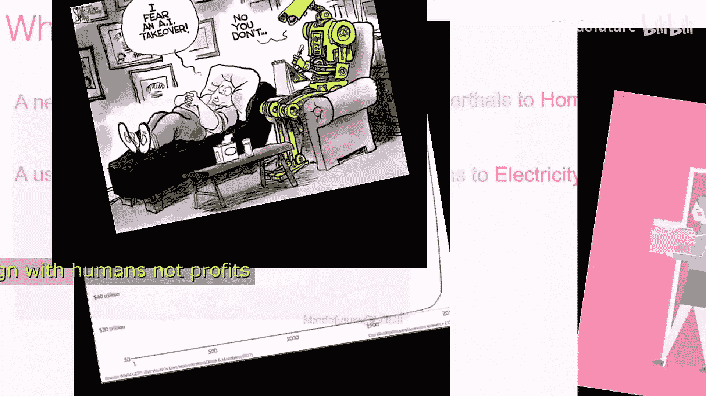
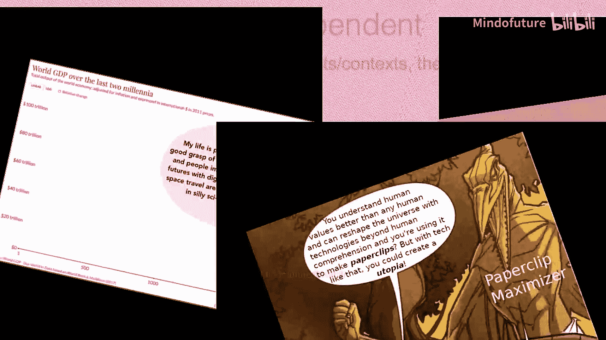

# 【哈佛大学】人工智能安全与对齐 ｜ Harvard Cs 2881R Ai Safety And Alignment p13 P13_地球死亡法典片段 [BV1D4AXzxEbL_p13]

Soft drinks。Soft drinks it off。🎼Maybeアのし理由なバれ一緒ね。🎼的帅。🎼我上。🎼需要的呢？🎼そ私の 方 で 。🎼把救。🎼我能。

🎼他。😊，🎼またよしね。🎼出ずに。🎼ラし。🎼让你在里。😊，🎼け。🎼相心。🎼不。いつか？🎼し플今。🎼一千个月。🎼那し。🎼感心。🎼Oh。

🎼。🎼不许。🎼听见。🎼世界。🎼你。Maybeちャは ca。