# 【哈佛大学】人工智能安全与对齐 ｜ Harvard Cs 2881R Ai Safety And Alignment p14 P14_讲座_12_2035年的人工智能与GDP价值 [BV1D4AXzxEbL_p14]

So we'll start with like were really happy to have here Pegel and。😊，And Kevin。系嗯。

The the way I introduced you guys last week， I said， you know。

 I'm I'm not such like an open AI fanboy that I think like everything we do is the best。

 but I think we do have the best frontier evaluation team anywhere。 So so we really。😊。

We'll be happy to hear from you。And' the way we decided we'll do it is I'll give like a 20 minute kind of。

😊，Introduction based also on。And， based also on the blog post that I think some of you have read about how AI will impact the economy。

😊，And then we'll hand it off to Tegel Kevin and at some point that feels natural and let's do a break and then we'll also have the student experiment。

😊，嗯0。嗯嗯。I think this meeting is being recorded and we can decide later what to do about， yes。Okay。So。

 so I want to give like a little bit of what I think AI will look like in the。嗯。In the future。

Or maybe can even make it full screen if figure hours how to do it。Its the good do in some。Butた。可以。

And you guys can see the slides， right？Yeah okay。嗯。And。y诶。So， and。

So the way I view it is you AI is getting better and cheaper。And。And we are in。

So that's those are the graphs that we've seen another another graph that I kind of really like from this meter paper is that。

😊，U prior， you might think that you know it will still be kind of incomparable and the tasks that are really。

 really easy for humans， there still some of them would be really difficult for AIs。😊。

But we kind of don't really see it like we， we see that eventually the tasks that are in。

EEasy for humans become basically 100% solve， but basically is with a huge caveat。😊。

It's not in thatversarial setting。 So so in a sense， it's not worst case。

 we can always find inputs right now， at least we haven't sold the resar business。

 We can always find inputs for。Easy tasks that they。Our modelss cannot solve。

 but they do get basically very， very high reliability on things that are easy。😊，都。

These two things together。Bring me to kind of my mental model and Kevin Nagel or anyone else if you have disagreement with this mental model。

 feel free to if say now or say in your talk。😊，So my mental model is that basically the easiest way to think of AI is like we are basically going to be injecting an exponentially growing number of virtual workers into the economy。

😊，And every year there are not just going to be a larger number of them。

 but also they will be more capable and more general。And initially。

 it might not even it might not be robotics， but robotics willll catch up to later on。

 so it's nothing is necessarily。Out of bounds。So the way I view it is you know there is going to be some kind of a chart like that。

 the base and the base of the exponent is yet to be determined。😊。

Where the number of workers basically grows exponentially every year。

And their generality and quality also grows at a significant rate。😊。

And I'm imagining diffusion will be more bumpy。 There might be some various reasons why in some parts。

 if diffusion is slow， et cetera。 But if they become kind of bigger and stronger。

 if diffusion is slow in the beginning， eventually it will catch up， so。😊。

So my take is that in the limit we've been about， like let's say， 20 years。😡，Maybe less。

 we are going to be effectively tenfold increase in the global workforce。And。嗯。

Just to kind of get a perspective， yeah， like so in the blog。

 I try to kind of do some math and compare it with some economic models。😊，And just as a sense。

 basically， this is under the assumption that the kind of exponential growth that we're seeing will mean that we're going to see an automation rate that is kind of unprecedented compared to what we have seen so。

😊，Instead of seeing automation rates that in the past have been kind of on a single digit percent and then going down with time。

 So leading to kind of more like linear growth in automation and revenue exponential。

 we're going to see。😊，Double digit% of automation and then。

So let's say we are automating every year we are automating say 10% of the tasks that we didn't automate before and with this kind of growth。

 it doesn't even matter like how much the cost decrease we are going to get like a lot of。😊。

We're going to get explosive growth and explosive， not in the sense of the singularity that you know everyone dies or we immediately go to heaven but more like basically industrial evolution level and if you think again。

 like what is the what does it mean to 10 times the workforce？😊。

So the global population up until now the workforce has been humans。

 so I think the way to think about it is like the last time like since the global population has grown by a factor of 10。

 we have to go back to 1750。😊，And。And basically the evolution the industrial revolution enabled us to grow the workforce and the scientific revolution enabled us。

To grow the population while in。Fed everyone， in fact， feeling better than ever before。 so the。😊。

Lobal GDP。GD has grown。It exploded since basically the 1700s。And。And if you say， okay。

 these are just economics， it doesn't matter like also other statistics like life expectancy and child mortality have all greatly improved since then。

😊，And you might say， well， maybe just the rich states and rich people inside the US and poor people are still bad in bad shape。

 But no， I mean， this is， first of all， these are global numbers。

 So this is average over all the 8 billion people on earth even if you compare。

There is definitely inequality if you compare say here the United States versus。😊。

The world versus subaharan Africa， there are big differences but。😊，The trend is the same。

 it's going up and the trend in life expectancy and child mortality is the same。

 it's going down and down by a lot。😊，In particular。You say if you look at in。

Say life expectancy in Africa today。😊，It's's beyond the it's worse than the global average。

 but it's worse in the sense that it's I guess taking a look at these graphs， I don't know。

 it's like basically maybe 1980s level of the world or something like 1980s level of the world。

 so it's not like it's 1700s or something like that。😊，And。Yeah， and， and， and again。

 like for a sense of proportion， like even the absolute。In the very instance。

 even the richest people in the past have lived worse lives than the average， I mean。

 obviously there you can always find a person living today that has like really miserable life and the person and a person living in the past that's had like only a health and great great health and longevity in the past。

 but generally even if you take like the typical American or the poverty line in many ways。

 there will，Life， not in always， but in some ways that matter the most。

 the lives is better now than the lives of royals in predeststrial time。

 So just one example like the Queen of England。😊，And she's pretty typical， I think。

 example or maybe more ext than others is， but。She had seven children。

 I don't know how many miscarriages， et cetera， but she had seven live children out of them。

 five died before adulthood。 I don't remember the precise numbers maybe three in infancy or toddlerhood in the two in the teens or like around that。

 and she died on her 37th birthday from the last。Bth there was an infection and the baby itself died also basically within a few days。

So that was life even for the royals， even for the Queen of E。😊，And。

So the bottom line is that going if we are going to increase ifI is even indeed going to increase the global workforce by a factor of 10。

 I think it's going to be a radical change and overall it's probably going to be a radical change for the better。

😊，But there are like this is an AI safety course， and I you know are worried about the way it could go wrong。

So like in just a few minutes， let me say a bit of my personal stance and again。

 like feel free people to push back。 maybe if we'll have time at the end， maybe we'll do。

Some more Q& A with me and Te and Kevin。And you can ask more。

 so I personally less worried about the the classic doom scenario of the AI taking over and just killing everyone。

And I'm not， I wrote like a semi review of this book and you can read them and I'm not going to go into all of these。

 but generally I say。😊，It's true that we don't have full control and understanding of it。

 But I think the it's not like zero control and understanding either。

 So the youdovsky type of point of view is these are huge matrices。

 We have no idea They could basically be plotting to kill us at any given moment。 and we。

 we have no clue。 And， and we have zero way to influence them。

 They will develop their own weird objectives and pursue them relentlessly。

I don't think this will be the case。 I think I don't think we can fully control and fully understand。

 there's a big spectrum between complete control and understanding and nothing at all。

 And I think we are somewhere in the middle。 And we are definitely not as close to full control and understanding as I would be personally comfortable with。

 And that kind of brings us to。😊，This other point， so I'm kind of mostly worried about that we are going to have。

Maybe Im， you know， unless I'm wrong and we just dieizzel and hit the wall like has been predicted for many being predicted very often and。

😊，In many world ago， so if we AI is going to continue on anything like its current pace。

 we are going to have like a huge market of change in a very short time and we're going to squeeze maybe you know 200 years of progress。

 100 years of progress depending on how you count to 10 or 20 years， it's going to be a lot。😊。

And I don't think society is ready， I don't think our government is ready。

 I don't think international relations is ready for something like that。

 and I think the lack of technical safety， the fact that we don't completely control these AIs。

 the fact that we don't yet have ways to prevent abuse to make them robust and make them。😊。

Too full and all of those things。They can be just make these things worse and create a lot of unknown unknowns。

 So， so I don't know exactly what could happen wrong。 but I think this combination of factors。

Of rapid change in a short period of time。 And we've not not very not along significant level of control is a problem。

 And one slide I sometimes like to say is you know， we aviation safety。

We have managed to really bring down the number of accidents。But it took us 50 years。

 And in those 50 years， the products basically stayed the same。 Like the。

 if you look at the jet plane from the 70s and a jet plane from now， it's these days。

 it's more fuel efficient。 There are some advances， but it's very much。😊。

Like basically the advances that you had between， I don't know， G4 and 4。1 or maybe40 and 4。

1 or something like that， it's like if you compare what will what is happening in a decade in AI。

 it's more like not two types of plane， but more like you're going from a bicycle to a plane。😊，So。

So we are trying to make this safer while it keeps changing under us。

So it's a problem another thing I'm personally worried about is AI and political power。

 So I think AI potentially can empower individuals。But it can also disempower them。

And I think I has the ability potentially to amplify the impact of one person so one person could do much more。

😊，Maybe it can increase transparency of government。

 you cannot bury like a small person or nonprofit by a mountain of paperwork and maybe you could even demand that you know AI will go through government communication and then。

😊，And then show that everything happens basically as it should happen。

 I think actually in the long run， the AI might favor the defender in battling this information in the same way that AI in the long run ended up I think。

 helping more the defender for spam email。😊，And but but on the other hand。

 like you can have the flip side of that， AI can enable government surveillance at1 that we've never seen before。

 Even highly totalitarian governments were bottlenecked by the fact that they couldn't really afford one spy for every citizen。

 Maybe now you could afford ten0 spies for every citizen and AI is going to be intimately involved in all of our communication。

 So unless we change our laws and or make sure that these these communication is protected。

 you basically could be could have the case that all of these very。

 very personal communication between you and your AI is going to be able to subpoena and so veiled etc。

😊，And。If the government has obedient AI workers， then that means none of them will ever refuse like an order that violates the Constitution or no one of them will ever whistleblow。

 and that also could be。recipe for totalitarian government。

 so think I think it's basically I don't remember if I have like one more thing here or not。😊，Yes。

 so the other thing is that basically if， if potentially could be the case that in private citizens will have less leverage in terms of reholding the laser in the an AI world。

 It's not， I don't think that's the only leverage that people have at least not definitely not in a Democratic society。

 So I， but。😊，But it's one more thing。 And I think whether we go down the green path the or the red path is not so much about technology。

Although I hope that people。That come out of this course can have influence maybe more than the average person on that。

 but a lot of the policy decisions that will make， but some of it might also end up what the technology enabled or not enabled and what。

😊，Avenuues companies pursue or decline to pursue。And there are other issues that people mention with AI and maybe there are more issues than I mentioned。

 so basically。😊，Environmental impact is real， but it's often grossly exaggerated if you read something about the environment in New York or New York Times。

 if you're lucky， it will only be exaggerated by one orders of magnitude。

 if you're less lucky it will be three orders of magnitude。😊。

And I think job displacement is an issue， but economic growth will help a lot a lot of the。

Kin of the debates in the US for example， do you have universal healthcare insurance。

 do you what do you do about Medicare， Medicare， what do you do Social security balance the budgets versus tax cuts。

 all of these things， if you even had like 4% growth instead of 2% growth。

 these issues we disappear if you had 10% growth， then it's kind of completely different story。😊，And。

And while I and I think many of the people probably met most of you in near future and I think that's also true for Angel and Kevinvin。

 like I actually enjoy my work and it gives me meaning to some extent I think many people most people just work to get a paycheck and actually it would be fine not working if they still get the paycheck and I think generally like in economic inequality。

 I think as long as we don't fall into authoritarian government。

 as long as it doesn't become like a klestocray or whatever then it will。😊。

There's going to be so much prosperity that we will lift our boats。And yeah， I believe， yeah。

 even is。I trust humans， we will find meaning in our lives， even if there are no more accountants。

And so I think a lot of these accountants will take a painting and maybe they'll turn out to be very good at it。

😊，嗯。And if that basically let me on to Kevin intentionly， but I'll do one short break。

 I usually or like intermissions， so I usually。😊，In my classes， I often at the end of the class。

 I do some kind of a video clip with excerpts from from plots and then。😊，And I thought I'll。

I'll do something。I'll do something like that here。

 But instead of like this is a I asked codex to do it。

 So I basically gave codex a bunch of so I basically gave codex all the all the slides of the PowerPoint。

 And I said and music music MP3， when the Earth dies which I thought was appropriate。 And I said。

 well， you know， go look for eventually I also got from someP go look for memes。

 etctera and make a video clip out of it。 project， maybe that would be like codex is still not very good at it。

 So maybe that's the next evaluation。 but let's see if it let's see if it works。😊。

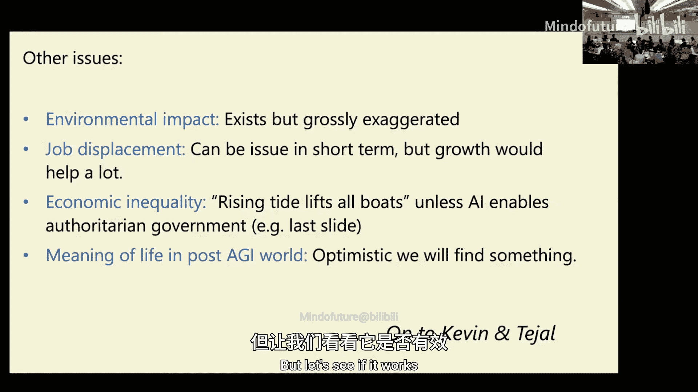

Soft drinks。Soft drinks are off。🎼ベアしぬ 自由 の強ぱれジ緒ね。🎼在下。🎼someth who需要的no。😊，🎼私のうだい。🎼バシ。

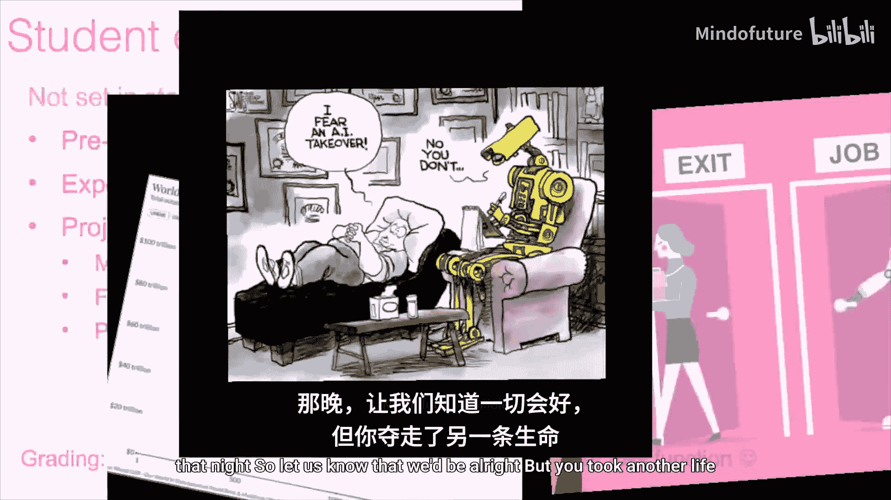

🎼不能。🎼哒哒哒哒。

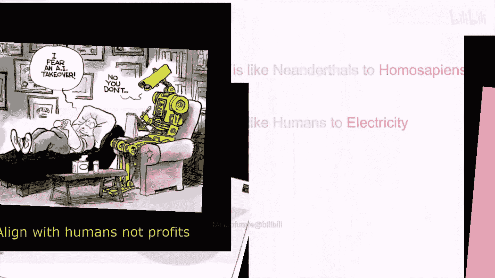

🎼シぶり。🎼消失。🎼起手。🎼再你。🎼かキ。🎼小心。🎼不。🎼できます。🎼いいすか。🎼しし 今気。🎼千个人。🎼那し。🎼感谢。🎼。🎼爱的。🎼Yeahゃ。

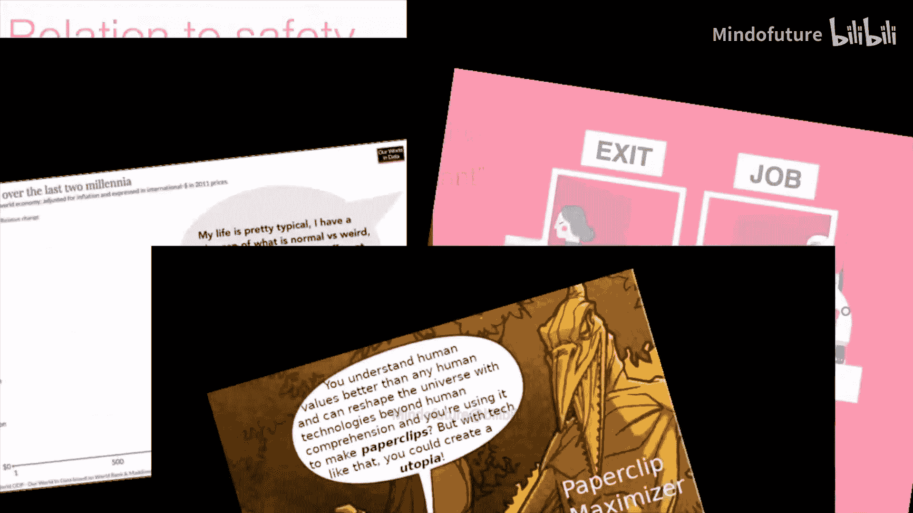

🎼ピ。Miちャわキ do。just give a quick overview。 So we want to tell you about a couple things today。 First。

 we want to tell you about an eval that we worked on called GDPP Val。

 where the goal was to measure real world tests。 And then we'll talk a bit about how we're thinking about automating AI research and measuring the pace of that and then have some time to talk through the safety and preparedness implications of this fast progress and then hopefully have a very fruitful discussion at the end。

 I also know there's a student presentation that will come。 So we'll make sure there's time for that。

 our presentation will be short。😊，So maybe to start with talking about GDP Val。So。

GDPV is something you might have seen on Twitter there's been a lot of press about it where we were basically trying to build a benchmark to measure how well our models can complete real world work and it went pretty viral。

 It was like number one on hugging face basically within a couple days and the reason it went viral is that historically our ability to measure AI on real world work was very limited。

 so we would have these tests like MMLu or GDPQA where we measured how the models could answer academic style questions and GDPV was one of the first ways that we could measure if models could actually do real work in the real world and I'm really excited to tell you guys a bit about it。

Maybe Kevin， if you go to the next slide。More people are talking about it， theirre think thes。

You can go to the next slide。So yeah， our goal for GDP Val was this was very much a first step towards measuring how AI models can perform real- world knowledge work and when I say real world knowledge work。

 I mean the kind of work that can be performed on a computer think about things like accounting or law or finance and really until this moment we didn't have a systematic way to measure how models would do over time or create forecasts。

 it was very much us relying on customer opinions or sort of like articles that people would write。

 but we're really interested in measuring how models can do even as we train them and then sharing that information with the real world。

And there's a lot of limitations here， but the reason that we care about doing evaluation on this sort of task is because understanding the impact of AI on labor is very important。

 As Bill has mentioned， you know， there's like a lot of speculation about what might happen。

 There's also a lot of you know very sensational articles on like AI might take away all jobs and it's really important to have a science and empirical grounding to this。

But， you know what people can look at right now is stuff like usage or production data or actual impact on GDP。

 But the problem with a foundational technology like AI or AG might be is that these are very much lagging indicators of when the capability exists。

 So if you look at major technological shifts over time。

 things like the Internet or railroads or airplanes。

 it often took years or even decades between a capability existing and widespread use。 you know。

 from airplanes existing to everyone using airplanes to be able to work anywhere in the world and visit their customers and their clients that took a really long time。

 you know， another example of self-driving cars， you know， Waymos work pretty well。

 but it takes some time and cultural understanding for someone to be willing to get in a Waymo and realize that it works。

 And so we similarly want to proactively forecast what these models can do because we expect it'll take some time to adjust regulation。

 have cultural shifts， people just get used to using these models in their actual everyday work。

But that doesn't deny the fact that the model might already be capable of some of these things。

 and we want to forecast them。So that's why we wanted to measure it The other reason that Open AI you know is interested in this is that part of Open AI's mission is you know to help ensure that AGI is beneficial to the world and we think AGI is inherently going to involve completing economically valuable tasks and so we want to sort of measure those and have a good science。

😊，Signence of them。So let me start by showing you some examples of the types of tasks in GDP Bell。

 So this comes from our paper， which you can find online。 But on the right hand side。

 you have an example of an actual deliverable that someone actually did at work in their real job。

 This is work that people either already own themselves or they got permission to include in the Eval set。

 And they would like scrub it to make sure there's no like P or anything like personally identifiable information or anything like that。

 But it's very， very diverse。 So， for example， in the top left。

 you have a manufacturing engineer that's designing a cable real stand。

 And you'll notice this is like a very 3D multimodal task。

 It took a long time for this person to complete the task。

 And then they give the context or files they might have had access to when they had to actually make this cable real stand。

 And the goal is to see if the model can do the same thing。

 Can it also complete this piece of work a person had to do。😊，In the middle top。

 you have a competitor landscape， which is like if any of you have done a banking internship。

 like a classic thing that you have to do when you're dilig seeing a company that you might acquire or help someone sell is you try to understand what are the other competitors out there and create this very detailed landscape of all the other comparable evaluations。

 and so this is another type of task and then I've given it a bunch more examples here。

 like know real estate agents， customer service emails， creating video and text reports。

 making a consultation report for you a nursing position analyzing a bunch of Excel data。

 making itineraries as a concierge， working in parks and rec and making layouts of where different vendors might sit and all these are intended。

 know there's a range of time horizons on these， some of them are you know multi hour long tasks。

 sometimes they're multiday。 some of them are even multiwe。

 we had someone submit like they wrote like a whole book and they were like let's test how long it might take the models to be good at this type of task and。

😊，This is like real work。 I mean， it's not the same as automating an entire job。

 It's a very well specified task where you have a specific output。

 and it's restricted to stuff only on a computer。 doesn't include manual work。

 but it is a lot more realistic than the types of tests that we might have been giving our models earlier。

 And seeing how well models can perform is pretty interesting to track。

So maybe just on the next slide， how we picked the tasks in this initial set。

 we just wanted to start with the sectors that contribute more than 5% to US GDP just so that we have a place to start and then we picked the highest earning occupations in those sectors that are primarily digital work。

 So we didn't really focus on tasks where it's mostly manual labor。

 These are very much knowledge work tasks and then that's how we seeed the first set of tasks in the first version of GDP Bell。

 It's called GDP Bell because it's an evaluation of GDP relevant tasks。

And here's some examples of the occupations in there， they're really diverse。

 like everything from editors to registered nurses， to real estate brokers， to pharmacists。

 and recruiting all these people took a long time， we really cared about getting the best of the best。

 and we wanted to get a very diverse representation of jobs。

So the reason we cared about getting the best of the best is we're interested in whether models can really。

 really excel on these tasks。 So we had folks that had， you know。

 a ton of work experience on average， they had to have a top resume。

 We had a bunch of background checks， basically wanted to make sure that the human comparison was a really strong human and if a model can outperform a human on that task。

 it actually means something。 it means that the model is better than a really talented individual with a lot of experience history of promotion in that same in doing that same piece of work。

And so these are just some examples of what the experts had to pass to be able to be the human that we compared against and help make the tasks。

So one of the things that you might care about before I I talk through results is， you know。

 are these tasks actually representative， Was their good quality control。 And so this is just。

 we had a ton of QC of both models and humans making sure that the tasks that we included were very representative that they were actually solvable。

 like the person didn't actually forget to include like the reference files they might need to complete this piece of work and just a lot of review to make it as high quality as we could。

And maybe on the next slide。So now I'll talk about grade。

 how did we actually grade if you know you have a task with a prompt and you want to see if the model is better than the human。

 how do we actually grade， which is better？ So the first thing that we did is just have experts that are not the same people that made the task。

 a separate set of experts。Pretend that they're the manager and say， like， hey。

 if two reports gave you these two pieces of work， which one would you prefer to use。

 And so that's option 1。 Maybe Kevin， if you go to the next slide。嗯。Yeah。

 they had to have a lot of experience in their field。 They had to pass a screening test。

 And then on the next slide， we show you what this actually looks like。

 So for every one of these comparisons and we had to do for each， you know question that we asked。

 we had at least three experts look at these look through that specific question。

 and they looked at at least three samples from the model And each time they just did sort of a pairwise comparison of。

 which is better。 you know the human goal deliverable that the human actually did on their job or you know what the model said。

 for example， GB5， And then they would think about both objective criteria like you know which is more correct and also subject stuff like which is formatted better。

 which is easier for me to read， which is more understandable and that helps us roll it into an overall win rate。

😊，So if you go to the next slide。Here's one of the headline results that we published。

 and so I want to start with just talking about the Y axis。

 which is the win rate versus an industry professional。

 So that means what percent of the time did the experts think the model's output was better than what the expert actually did in their real jobs and you know 50% would mean that roughly half the time you prefer the model and half the time you prefer the expert。

I don't know if you can you said you have multiple samples from the model。

 but the win rate is still like for one door， it's not like a best of three or something。😊，No。

 it's not best up。 It's averaged。嗯。Yeah。So let's start on the b most side。 So I you know。

 Kevin and I both help work on GPT 40 and Bas too actually。

 I think I think you were there at the time I don't know I was there but I did that much。😊，Okay。

 well， at the time， we were very， very excited about GPT4 because we were like this is like the best model we've ever put out。

 It's omnimoal， it can like handle image and you know， if you actually use GP40 at the time。😊。

It's like pretty bad compared to an expert。 Like you would basically only prefer a model output。

 like roughly 10 or so% of the time。 Maybe it's like tied a little bit more。

 Wins and ties means when the expert can't really tell the difference。 So they say that it's a tie。

But if you look to 03 or G 5， you're seeing that we're already starting to get much closer to parity with an industry expert。

 And actually， if we put， if we plotted chat GP agent on here， it would also fall on this line。

 And what was really exciting to us was， first of all。

 the models in absolute terms are getting much closer to industry expert than we would expect。

 I mean， again， this is on very well specified tasks。 But they're pretty realistic。

 And the trend looks roughly linearishh。😊，And so the natural question is， you know。

 if you just extend the line。When might be we be at pary with these experts and that was pretty interesting and if you go to the next slide。

We also applaudted other models and sorry。I'm so sad。

 I'm sick because I'm so excited about this stuff。 Claude actually。

 which we wanted to be super objective about our results。

 was getting really close to parodity with an expert already。😊，嗯。And again。

 this is not every task that you would possibly do on a job， but it's getting pretty close。To parity。

Okay， one other thing that we thought was pretty interesting is that。

You might wonder how someone could incorporate using a model in their workflow and so you could imagine a setup where a human a human expert like。

 say you're an accountant， you sample a model to be able to complete a task and then。

If the model does a good job， you'll use that completion， but if not。

 you'll just sort of do the task yourself。 And a question we had was。

 if humans sampled from models first before they tried doing the task themselves， like。

 would they save time or money。And so we actually simulated this where we set this up with a bunch of our models。

 And it turns out that for every model since should be T4。If you sample from the model before you。

Do it yourself。 It actually saves you time and money。If you look at GB5， it's like。1。4 x or 1。

6 x of faster。And cheaper。This is crazy。 I wish I could show you how exciting it is。

 And it's only getting better。😊，We have a bunch more cuts of this in the paper that we don't need to get into here。

 But one thing that we thought was interesting is the open AI models are actually quite good at pure text compared to Claude。

 But Claude was better on all of the multimodal files。 So internally at open AI。

 That was a pretty interesting point of， hey， we're looking not very good at file extensions right now。

 you could fix that。😊，We also have some， we can go through these pretty fast。 you know。

 if you increase the reasoning effort on solving these problems， you tend to do better。

This light is pretty interesting okay。So I said before that the models are getting close to pary with experts on some of these well specified tasks。

 But just because a model can， you know， it's very interesting to know how the failures that the models have。

Comparing magnitude， right， Like the human might prefer a model completion。But it might be that the。

The failure was so bad， it would be catastrophic。Okay。So， for example。

 you would not want a customer service agent that like called the customer a moron or like。

 if you were in a medical case， if the failure from the model was the model like killed someone。

 that'd be like very， very bad， right And so。For me to trust putting a model in the loop first。

 the risk of catastrophic harm has to be pretty low。

 And so we did a follow up where we had human experts rate the times that the model was not picked。

 So these are just looking at the subset of samples where G 5 was chosen as like worse than the human。

 and the breakdown is pretty interesting。So about 23% of the time。

 humans thought that the model was actually better and that aligns with our inner annotator agreement。

 which is that the experts didn't always agree on whether the model was better or not and so。

There's some subjectivity here。Roughly 50% of the time folks thought the model was acceptable。

 but still worse than the human。27 per cent of the time， it was seen as like just totally somepar。

 and 3 per cent would be catastrophic。And from our perspective， that would be so bad that， like。

 you probably wouldn't be able to use the model in production without a human supervising because the catastrophic outcomes are like quite bad。

But if we can get this catastrophic rate down， you might think the models will be more usable in the future。

So that's a quick set of detailed results。Maybe Kevin。

 you want to talk about some of these cause I feel bad that I'm losing my voice。

 And like the results are actually kind of cool。😊，Yeah， I get talk about this stuff。

 I think it's like kind of interesting like what models get wrong Like a lot of them are just like basic instruction following problems like it'll be like oh you're asked like for deliverable or like certain file type and like for human admitting a PDF or slide deck is not that much harder than just like writing something and like a file or something it might even be more natural be used like PowerPoint a lot but for models it's kind of hard there's a lot of like really interesting formatting problems which I think will be described later but yeah also it's like models with the tool limitations that they have they might struggle to parts especially like multimodal data or very large or different file formats that they haven't seen a lot in a lot of their usage yeah and so like you can get into some of the formatting elements and yeah and then I think also another one is accuracy where like I'm sure you guys have experience this like sometimes like G5 thinking even will just still like give you a number and then like you will check and be like this like kind of wrong or there were like three sources that were like reading this thing and like two of them like said this one of them did not and that is just like a major。

😊，Major error in failures。Yeah， so Rachel， let me know whenever you want to jump back in also because I'll just try to present these reasonably and that case going because like the content is so good。

Okay， okay， I'll keep going。O， O。Yeah， so， I mean， you， you can just kind of see like it's like。

Like it's interesting in the sense that like models really just struggle with like the basic formatt thing。

 But often like the data itself is like much more reasonable or something。

 like the analysis done is much reasonable。 So it's just like a random slide。

 And it's just like not good。 Like， if you just like I'm pretty like anyone would probably be able to make a better slide than this。

 the actual formatting on the presentation。 You also ask had agent like honestly。

 like sometimes it just does this kind of step， too。 So you can just replicate this publicly。😊。

There's like， yeah， like lack of like visual elements like like goes off the page。

 like there's like very simple reasons why the deliverable will be considered subpar。Also。

 another interesting thing is like the， I mean， the model often like might not see the exact format in which the final deliverable be rendered like。

 for example， this is the weird Uniiccode thing where like sometimes it'll use like weird characters that like in particular fonts just like don't show up correctly like this is like another problem where like a lot of the deliverables that are actually rendered have like these weird like subscripts and like dashes that are like not actually like they don't actually render properly very beautiful have one that doesn't have M dashes。

😊，And it's like very hard for the model to tell this basically as well。

 like you kind of need like closed image receptor or something if you wanted to see this。Let's see。

 this this。M will get better over time， interesting。Yeah， I think here it's like。Okay。

 so here we can kind of click through。 Okay， yeah。 So here， I think this is an example where like。

 you can kind of see the evolution of the output created by the model。

 You can kind of see like4o just has like a bunch of these like a bunch of these like。😊。

Cts and then like 03 changes。 It has some words。 It has like a summary。 Like this is pretty good。

 It has like a lot of like detail about summary as well。 And then like GB5。

 like actually it's kind of like a themed presentation where they have like colors。

 And like it's like actually like makes it like much more readable or something。

 And so this is like an example as well。 Yeah， I'm not familiar actually but the like raw data。

 But like you can see that the model in terms of actual formatting and presentation is like still actually getting better as well。

😊，Let's see another one is like this one which is like you were the safety coordinator and you must create a monthly safety checklist that like establishes a secured environment at like a retail store of like foods and groceries retailer and then like 40 just like writes some stuff and like basically a Google Doc level which is just like a few like reasonable bullet points 03 has like a table like you can have comments like you can like actually you know imagine printing this out and using it in reality and then G5 has like a crazy detail like there's like a nice table like it has like a summary like different sections like coloring like actually like makes it like someone better or something。

Yeah。Okay， here's an example of like， this is like a model and a human response。

 And I'm curious like， which one do you guys think is like better or something as well。

 But you should make them raise their hand。 Okay， raise your hand if you think the left one is better。

😊，对。And raise your hand if you think the right one was better。

 you guys aren't allowed to say T in this case。 That's， that's way worse。 Okay， so which one。

 which one is the real one， Wait wait， we should also have them guess which is model and which is human。

 Oh Okay， okay， Yeah， Which one is sorry Raise your hand， if you think the left one is the models。😊。

And then raising everything， the right one is the models。This feels kind of even。

 maybe it's like slight left， I'm not sure。Yeah，怎么穿的穿。Gues I don'll remember。不是。😊。

Which is very it's illustrative of like they're kind of starting to look the same。

 I think the left one might be the model， which is the one you guys thought was better。

Ppared by nurse practitioner doesn't give it away because we had them remove their names so maybe they changed their name to。

😊，嗯。我'肯冇 say okay啊。Another thing which I'll discuss is like the kind of like prompting that we did to like see if we can just fix some of these like really obvious failures and mean you can kind of say like a lot of these are not really like intelligence problems I did just like the mono didn't do the right thing or like just like didn't format PS very well or something and so we basically created an extremely detailed prompt that just listed every possible problem and then also can use best at four with GP5 trying to pick which one is actually better。

😊，And you can see that this actually does like materially improve performance。

 which is I think it kind of symbolizes like there is so much low-hanging fruit here like in the sense that like models are extremely capable。

 but it is like if I am like accountant or like someone working like jobwrench like creating like a PDF theyre just use like small tiny nitps which can be fixed very easily but right now just like preventing me basically from doing the entire thing with a model and so like this isn' this obviously isn't a huge increase。

 but I think it's kind of assigned like just a very simple intervention can actually also improve performance you can kind of see here like they're used to these artifacts it became zero like like overlaps became much smaller especially because you can like just ask the models like please look at it and make sure it's like actually correct yeah and then like there's like a lot of it actually will render the image or look at it and then also there is a small amount that's like corrupted files for some reason like during the the model produce like a corrupt file as well。

😊，Yeah， yeah， this data set also there is a set that is publicly available would be very curious to have people try out。

 try different models on it like try different strategies and like see just like also just like take a look at what the data is like。

 I think it's like very interesting to just like look at the first 10 prompts and do you like actually like what information are we telling the model e on these cases and in what ways do you think is realistic and not realistic in particular a lot of these prompt are extremely detailed and like you a lot of context this model has no contexts on the job it's like if you're just told on Sla like you're not gonna to get like a 13 paragraph like excation of your job but like in the model will in this case it doesn't know。

😊，Yeah， yeah And then we also have this website evals do openi do co。

 which lists all the other evals that we've made。 So like we made a bunch of other evals too。

 like paper bench just like reproducing M papers， which we'll talk about later and yeah a bunch of others。

😊，Yeah， and yeah， thats basically yeah I think there's like still one thing to call out is like obviously there are a ton of limitations with this work One is of course that like it is a very like it is a small fraction of economically valuable work primarily because it's digital only there's only a limited set of occupations the deliverables also are very self-contained and one shot it doesn't measure for example。

 like if you've worked at a job for two years， someone can tell you like one sentence and you know how to extend that into an entire like task that's very well specified if you know what to do this is not measured that it's like a very like deliverable it's literally just like a single piece of text which like anyone should be able to use to create the actual output and so we would claim that this is not measure performance and entire jobs。

 only these like wellspecified subsets that can be well specified but also is hopefully a good step toward understanding like in this area like how good our models and like what are the remaining limitations。

Yeah， that's basically it anything else before we go to the next section， should we ask people like。

 are you scared？How many people feel scared？😊，I guess。I don't know。 I would say it。

And what do you anything like 0%， 30% scared or that's not that scared it found scared。I mean。

 maybe I've also like people have like now questions about GDP but before we move to our stuff like。

😊，Raise your hand yes。I meanThank you for the interesting presentation I'm curious if you can share how you found and convince these experts to contribute to the study。

 especially given this general sense that。😊，You're figuring out whether or not their job can be even over Yeah。

 I mean I thinkum one we compensate people pretty well。嗯。And， you know， there is markets。

 markets can incentivize behavior。 I think， too， though。

 our motivation is more to do this for science。 and like to share this as research。

 And I think people are pretty interested in knowing， like， can models do these tasks。 Like。

 this is just valuable information to have。And so it was actually funny when the paper came out。

 the experts were like in the slackck channel being like， this is such amazing work。

 We like so excited to have contributed to it。 So I think the specific style of work you were doing was relatively noncontroversial。

 But I think you can think of the extension question of how excited would people be to actually work on making the models good at their job。

 which I think might be a different question。😊，We can。

 can we ask the people who were scared why they're scared。😰，Or are he scared？嗯。

I't said scared is not the right word， but like apprehensive， maybe。I don't know。

 Do you have follow up questions。 or like， are you got， Well。

 one thing I was thinking about is I was like like。

 I don't know if this class has a bunch of seniors or juniors。

 but it's like a lot of the work we're measuring is entry level。

 like what you do your first or second year out of college in many of these jobs。

 when you guys are Harvard students。 So you're probably。😊，Fine。

 I'm just like curious if people are stressed about this sort of thing。Well。

 since I have the microphone I guess I can talk about my experience。

 which is that I just came from industry so I was working like an entry level job in finance previously and I think one reason that I wanted to come back to school was because I kind of felt that you know this would catch up to。

I I kind of wanted to you know be at the at the forefront of this type of stuff。

 so I didn't want to just like sit and then have you know GDP Valal evaluate my job easily。Um。

 so yeah， but。IYeah， that's why I came back。Anyone else has like a comments on that？Sciness or。

You was it谁 yesterday。I no I think I I think I have some degree of skepticism over what in Boaz's earlier presentation talking about the rising tide lifting all boats。

s it's just my like very subjective perception that a lot of people like we're kind of in a niche community and a lot of people out there have a lot of hesitation towards AI and just kind of fear around it and。

II think in this like rapidly changing world， you're kind of hoping that。

 you know the people who their current work might guess displace that they're going to find opportunities to to upskill or to to change their skills or adapt。

 but I think there's also this。I'm worried about that fear kind of like limiting a lot of people in a certain way。

 and I don't know structurally if we're like equipped to handle that that transition。嗯。

Yeahja你 feel free to诶。过面退会。I thought that was a very reasonable point。Yes。😊，Yeah， I mean。

 I think that just to be honest， I just think that。

If AI really does displace a huge number of focus right now， AI is in on the industry on。

Unloyment is very is very limited and mostly like in some particular， but if it becomes very。

 very significant。Then because AI also becomes like every job it can replace now。

 it can next year do better and cheaper， so it's hard for me to see how it can do that without creating a lot of economic growth。

And then even if the people， even if people don't。Even if people don't find other jobs。

 just the calculus for， say， social safety net becomes very different if you are like in in a place where you have like huge economic growth。

 so。😊，I， I think in this setting， like， maybe we。Yeah， I mean， for most people。

 like I said I don't think employment is a goal by itself。 it''s it's a means to get， to get。

 you know what you want， like physical things。 And if you can get this we've walking less that's also okay。

 let me I guess the end like they actually to this point yeah。

 I guess just to build on that a little bit， like one of the things that scares me is the idea of power accumulation。

 like I think this is a tool of that will result in like a lot of accumulation of power in new places。

 And I think like in terms of how a society can function and operate a key to that is kind of like putting safeguards on that power and distributing that power in interesting ways。

 And I I'm not sure that I've heard a coherent story yet about how we manage this accumulation of power and distribute it And that's not to say that that story isn't out there。

😊，But I certainly think like that's kind of the question on my mind when I think about why I would be scared of AI is kind of like。

 is society going to be able to catch up to that and design the architectures it needs fast enough to adapt to that world。

 So I guess my question on that was kind of。Is there a world in which you think like you're seeing so much disruption that frontier capabilities actually like are held back or not released because you're trying to like manage the disruption that's happening。

 Or do you think that frontier models as they come online will always just kind of like be pushed out as as quickly as possible due to the incentive structures that are at play。

I think it， I'm curious what other people think， I think it remains to be seeing like how society responds from a regulation or like societal acceptance perspective on frontier models。

 but maybe to go as this point earlier when he was talking about the power of labor like I think one thing that's really interesting to think about is。

 you know， labor has more power if the labor is more valuable and。On the one hand。

 I want to make sure people know that GDP Bell is like very limited It only measures a well specified subset of tasks。

 On the other hand， like the way that we came up with the tasks， right。

 is we went on the Bureau of Laboror Statistics website and they like have a breakdown of for every job。

 what are the component tasks， like for accounting， you know， how much of the time is spent。

 like looking up external material， putting together a budget， talking to a client。

 And so one might think that tracking progress on these。

 actually is tracking progress in whether you're able to。😊。

Like differentially add value on tasks that make up the majority of the work that people are doing。

 And I think if the models get better at this sort of thing。

 it does seem like the power that the labor has。Maybey be less unique。Hello， thank you。

 So first thing I want to say was playing a little bit of devil's advocate here is that I think no one has any value from a dysfunctional society。

 And I would like to hear whether you agree with or disagree with this。

 but I cannot see like the impact of AI becoming so high that like for example。

 for companies to make money， people need to have money to spend and things like that everything is built around society。

 So that's why I'm like less scared like huge societal impacts but as someone whose life， example。

 not very religious， there already isn't that many things like you know I can look at and say this gives my life value So and one thing that I feel like my friends and I feel strongly about is like the work that we do giving us our lives a lot of value So I'm just gonna be waking up every morning and it's gonna be like something I would have done in six months is gonna be done by an AI overnight is gonna community is doing better。

 but also like。Like so sad because I cannot do it， or anyone else can。Yeah， I。

 I wan to hear Kevin's thoughts。 I， I also really enjoy my work。

 and I would like to be able to do it。 And I agree that a dysfunctional society is probably bad。😊。

Yesやて。Yeah， I'm very u well like I'm very synthetic， I also care a lot about work。

 I feel it's very important。😊，I'm like， yeah， I'm kind of conflicted because like they're。

I think I think there's maybe like some nuance that it's like I keep thinking back sometimes so like this is this one anecdote about like someone like basically like when like the laing machine is like first invented or something and then like like their response was like like I feel like most people today would be like oh like you know having long machine is like pretty useful or something it's not the craziest invention in my life or something but to this person like it was like。

Like they like broke down weeping because it was like their entire life because like， you know。

 if you're taking care of a household， it's like a ton of work and like it was like， oh。

 I have so much for your time like do what I actually want now。

 And I think this is obviously an extremely positively tilted example of like the ways in which like。

😊，You know， like I feel like not everyone wants to do the work that they're doing or something。

 but I do think it's probably true that like。Like my guess is that it'll be a bit of a mix where like many people will feel disrupted and feel like a loss of purpose for a while of like not being able to do the work that they're previously doing。

 but I also think a lot of people will realize hopefully that like there's other stuff that they actually want to do which is more important and also in this transition period also an interesting thing that I'm thinking about is like the distribution of work that people will do will change but I think for a moderately long period of time humans will still be like quite relevant to doing just like a smaller fraction of work that is much higher leverage because everything else is being automated by models and so in some that is also helping but I agree that in the long term is still a problem。

Yeah， also for me， at least。When I think of my career as like a theoretical computer scientist。

 and I think it's。If you do kind of work， like say which theoretical computer science is very much like view math。

And I think sometimes people approach the motivation for doing the work is different so some people。

May have thought about like they do pure math because they want to solve problems to prove that they are smarter than someone else。

 and they really kind of want to。And， and but I don't know。

 I personally like always did theoreticaltical also because I really was curious about the answer。

 and I wanted to find。 I still want to know if the Uni gamess conjecture is true or false。

 And if AI lets me get there and and find this out， I think that's exciting。😊，On the other end。

 maybe it's not clear to me what will remain。 Maybe even like the people that do that do math as a competition。

 that will remain just like chss is still like very thriving。

 They just turn the AI off and and solve problems for entertainment。

 So it's hard to know maybe there would be no room for the curious。 We， we will just be spectators。

 But the people that do it as competition will still。😊，We'll still have jobs。

I have a question for the group， can you raise your hand if you read deep utopia？No， you don't get。

I didn't read the has one over year， I one over their years。One person。I most， I think， yes。

Its kind of like fall up to the superin book the Bostonstrom wrotedes。Yeah。

 I would highly encourage you guys read it because it it kind of like takes the argument to the very full extent of like maybe there's some intermediate period where humans are better at some things models are better at some things and like humans are more leveraged by the models and can do the highest value work。

 but it starts to ask these questions of like what do you do as the models get better and better like for example。

 one idea is that people can spend more time in leisure like shopping But what if the models better at shopping than you like you want to go shopping if you could get better like things to wear if the models shop for you or like parenting。

 you know， one thing is people can spend more time with their families and parent。

 but let's say the model is actually better at taking care of your child than you do you have a moral obligation to make sure the model can raise the child if the model might do a better job than you。

 many parents might be like wait， then it might be unethical for me to take care of my child anyway。

 the book。Take up a lot further。 It has a lot of cool thought experiments。

This figures like Mon being better chopping it kind of reminds me there is this quote from Peter Pan。

 Peter and Wendy where this， it describes the warriors， the Native Americans。 They said， you know。

 they， they come attacking the night and they call to each other in a perfect imitation of the coyote。

 In fact， the imitation is so good that it's better than the coyotes themselves that are not very good at it。

 So the bodies will be better humans than we are。😊，Yes。

I have two main concerns And the first one was sort of on the subject of power accumulation。

 I agree with that point。 I'm a little worried about if if if these technologies do 10 X。

 the global workforce then you know nine tenthths of it as being controlled by like a small handful of companies I think that's concerning and then sort of on the parenting point as well。

 I'm worried about as AI is with the capabilities that they have right now continue to proliferate。

 I'm worried about the social impact that has on people substituting real life relationships as AI relationships or children growing up learning that they should talk to AI about their problems instead of people。

 I think that's concerning too。嗯。D， Kevin， do you have thoughts？I mean。

 I have no profound thoughts except that those are reasonable things to think about。 I mean。

 one thing we I think at least at Open A I has talked about publicly a lot is like this issue of sycophancy or like the model being much more agreeable sometimes than like a human would be to you until then you like start to get more and more excited to keep talking to the model and then spend a lot of time with the model and maybe like it reinforces beliefs that it shouldn't and that is something that will be important to fight against so that yeah。

 some of these examples of people just like becoming addicted to。

Their friend are are concerning to me， as well。都系噶。Or like。

Yeah I also have profound thoughts I didn't okay like don't know if you guys have also read like Neil Stevens like the diamondiamond Age or something。

 but I feel like in this like it describes a very like sort of dystopian like fu societying which is like very like harmalized and like as a bunch of like weird social rules。

And like there's this girl who grows up in the society ands like a lot of learning throughout life is just like mediated by this like one book。

 which is like basically is smart like what we now see is like just an AI book or something。

 but it like teaches her like like lessons like science， philosophy。

 like how to how to think about like life and career。And it's like on one hand。

 it's like kind of good on the other hand it's like is this like the best society that we could have created like probably not I think like I think ideally you want people to be those the people like guiding Shakkaia and like like mature rather than like like intermediating everything thread through like this AI which like may not like yeah like it just it's something that's kind of just like a like a normal question like do you actually want that or something and I think that we should。

Yeah， I think we should think very deeply about this like I don't know the actual thing。

 but we should think deeply about like what do we want to happen and like understand that all these things are not like fully guaranteed outcomes that you can also just like try to make things happen that you think go。

Yeah， yeah， and this is another point to just remind you， I think I said it like multiple times。😊。

I do believe that people that are going to be situated people make a difference。

whether if you're going to be， whether it's in a company in academia， in nonprofit， in government。

And and if you're working in the AI field or the AI safety field like you could make a difference and a lot of。

 I mean， some things might be fundamental， maybe some something might be kind of determined in terms of like vulabil。

 I think nothing will stop them， but a lot of the things of how what we do with these capabilities might be path dependent and the choices that。

People companies， et cetera。 governments make could could lead to one way or the other。 I mean。

 one example that I like is my understanding， I'm not a his story and maybe someone else is that like the printing press。

 although it was， you know， invented in both China and the and Europe in China earlier。

 it had like very different impact in terms of like whether it。

Helped government govern better or and maintain control or actually in introduce things like the reformist and upend power。

 And the it was the same technology。 It was just basically the way that it was used。

I was just wondering whether you think it's possible that this idea of AGI。

 like artificial general intelligence and artificial like superinligence is something that is inevitable or whether you see a world where people perhaps agree to not pursue it and maybe pursue like artificial specialized intelligences as in we create like machines that only do one task really well and then just use those to augment humans as much as possible rather than trying to go for like this human replacement idea。

对。I'm curious what other folks think to me， it seems pretty plausible that we are so far along that like at least our general understanding of like a model that can automate most economically valuable work seems like it will happen。

In a medium term future。 But yeah， I'm curious what Boaz Kevin and others think。Yeah， I mean。

 I actually think it is inevitable unless we， mean unless there is kind of some really huge surprise of like a fundamental technical worldblock that we don't understand。

 and part of it is because this kind of what we have seen with the bitter lesson。I mean， A priorri。

 you wouldn't expect that like the best models today that we have for coding have been trained on all sorts of things like on Reddit on Internet chats on whatever。

 I don't know whatever they they was trained on。 but you know。

 you you wouldn't expect that like the best。Coding specific models are actually been trained on tons and tons of data that has nothing to do with with coding and and I think just generally。

It will happen that if， even if you wanted to be very， very good at a special task。

 the way to do it would be to pour a lot of compute and into becoming generally better。

 So I think it yeah， it would be very hard to kind of restrict and have like an AI that is super great on very。

 very restricted things and not good at other things。 I don't know if Kevin you。😊。

Or like I think I I also think like I I think timeline is a question like I think people could choose to like delay if that was a desire like I think it's actually like kind of plausible。

 but I think that like it seems to me like the actual avoiding the entire creation seems very hard because I feel like at every micro step like the decision of like build a narrow system or like just hand everything over to the general system I like just almost always just better to do the general system youd basically have to say no every time to like a series of like a million decisions or something like this。

 which I think is quite tough to do know given that our coordination is not that good in society I feel like。

I just really quickly wanted to comment on that question and also to what you were saying earlier Kevin about like posing the question is this the ideal society and do we really want this my worries is that like we no longer have any agency in that matter and kind of yeah it's inevitable it's happening and then my second thing is sorry to detract from the philosophy but I just had a question on GDP vow which is。

So right now right you were saying that we have we have to feed in like 13 pages of like super specific instructions and so it's like it's only relevant for well-specified tasks。

 I'm curious like what we expect or what we want the like the future AI to be like do we want just like a general model like to prompt a general model without any context and have it be able to complete a task as well as a human or do we want to in the same way that we like train a human in a specific role like give AI the same training and then eventually expect to be able to complete any such task if that makes sense。

I can handle the GDP valve question first， so。So some of the tasks have a ton of 13 pages of specifications。

 Some of them are not quite that long， but we have an experiment in the paper where we just give the model a bit less context and see how it does。

 And it does degrade performance but not that much but as you can imagine the more specification you give the easier it is for the model。

 but some things that you know seem like they will be happening inevitably are you know the model learning how to ask for more context。

 like for example， deep research already does this where if you ask it a question that's gonna take a long time to not waste time。

 it'll like ask you some follow- up。 So it understands in a more specified way。

 what you're asking for。 And I do think a goal of these developers is to have models that can understand context well and not overburden the user and like try to help you proactively with your needs。

And so I do think in terms of is， is the goal of some of this training stuff to have a model that can sort of。

Operate without overly specified context。 That seems very much like a goal because it would make for a more useful model what the implications of that are that it'll probably be more useful。

 But then there's this broader societal stuff that we've been talking about。

Yeah I think also like in practically speaking， if you were to deploy say a model to do these kind of tasks in any kind of workplace。

 you'll probably have like a lot of examples of kind of similar tasks and generally like internal documentation from the company that you could give to the model so it wouldn't need all of these context for any individual task。

😊，Yes。I also had a question about the paper and specifically how anthropic models were better and in the paper。

 it kind of says that。The anthropic models were better at formatting and you know presenting the final product that the experts judge。

 So I'm wondering if you saw that there's that last mile that the model has to get to get a better score。

 So， for example， D5 might be better actually completing the task。

 but then the presentation and the deliverable might be worse。

 so then that gets you know scored down， So I'm wondering if you saw any difference in terms of like the actual content and how much the model was able to perform at that specific task versus you know maybe some biases that you know the judges might add when it comes to how they expect the deliverables to look。

Yeah， I think we saw exactly that that's part of why the open AI models perform the best on the pure text tasks that are just reasoning。

 There's no formatting or file manipulation involved。 but maybe to be even stronger。

 it's like some of the open AI outputs were like horrendously bad。

 I don't even think the experts were biased when they were like I would not pick this。

 It'd be like a completely unusable PowerPoint deck that you would never it would like take more work to fix than to just do it yourself。

 And I do think one thing that we've been thinking about just for some Kevin will talk about research and like pushing the frontier of science in a bit。

 But for some of the like everyday work that people do in the economy。

 It doesn't necessarily require like the most frontier thinking like of all time。

 It does require like a good presentation being understandable。

 And this is just something that our models had historically not been super optimized for。

 which is what you saw in the results。 But I do think it is fair for experts to want that in an output because a lot of a lot of the job of a consultant or banker is like。

To make a clean deck， a clean model that's understandable。 And。

 but I just think if we try to make the models better at this。

 just like you saw with the prompting exercise， you can。

 you can make them better at this stuff much quicker because it doesn't require some frontier leap and intelligence。

 It's just like， make sure to present the work。Work well。Sort of a meta question。

 but I'm curious for the two of you after spending a lot of time looking at these like fully specified prompts for realistic work tasks and also thinking about where it's successful and where it's not。

 if there's any ways where this research has changed like how you prompt AI tools or like what you choose to use AI for at work and for your own like work tasks。

That change how I prompt。 I mean， we have that prompt that makes the model better at like files。

 which I think is in the paper。So， you know， if you wantan to make a file， use that。 But also。

 I don't really use GT 5 to make files for me。Like。

 I just think my job was not on the list of occupations for GDP bill。

 So it's not super relevant to me。 I think what's more interesting is to track whether our models natively become better at these tasks as maybe an accountant or a lawyer or banker would use them。

 Im more like the improvements in codex。I'm curious， Kevin， what do you think。Yeah。

 I think I think yeah I agree there's no direct transfer。

 I think that there is some coin that's like。Similar to GDP well。

 I think like so I usually use models for coding， but I think it's like。

It often looks super dumb like the first three commands of model rights I'm like this like super dumb or something because like it just doesn't understand internal conduct。

 but it's like。I think they're just like really higher turns from just like I mean I think enosis but like you can just like give the model a list of like these are like terrible ways to do the problem and these are like good ways to do the problem and these are the general things that you try to consider and like this kind of thing and just like helping the model out。

😊，With the sort of last mile stuff where it doesn't understand it just like is like quite good or something like it actually is like。

Maybe the claim is something like it is like。Very work to just like put in like substantially more effort than you thought would be reasonable to use AI tools or something because returns later can be very high。

Yeah， actually， like in the prompting part， I'm I was also curious about one thing。

 I don't know if you try。 I just so that on the slides that a lot of the prompt started with something like you are a consultant。

 you are an expert。 we do these matter or we could just drop this sentence that it would be the same。

😊，We actually did test that。 It doesn't matter that much。

 What matters is like some of the specification basically tells you how to do the task。

 Like it'll be like， go into this file， do this。 And like。

 it just saves you a bunch of time and like trying to figure out what the task is。

 So that's the part of the prompt that like saves the model a bunch of time and makes it easier versus saying you're a customer service agent when like the task is clearly customer service didn't really matter。

I first， I want to thank you for releasing the public split off the data and also the automated grader for all of us researchers to use。

 I think it it really helps with benchmark transparency。 But at the same time。

 I submitted like two things like five weeks ago， I receive one like two weeks later and what like one is just lost。

 like I't hear back after five weeks。 So I wondering if you know anything about like actually making it useful for researchers to use GDP。

 let me try to phrase this better。 Yeah， like I guess I guess you get the idea。 Yeah。

 but like are there any plans to like。😊，Open source， like the automated grader， like， for example。

 open source a model or like open source the grading prompt for it。Oh， no。 I'm so sorry。

 This happened to you。 Please email me。First of all， please email me TaL@opai。

com and I will see what happened to your loss mission。So1 of all， I'm very sorry。 Candidly。

 the automated grader is not that great。 So we're actually thinking about potentially just making it easier for people to grade themselves by open sourcing more of the Eval。

 But I don't want to make any promises to you here。

 But know that you're not the only person who's complained。

 And I think our automated grader service has not been super reliable right now。

 So we're gonna try to make it better。 I'm sorry you had a bad experience。 But yeah。

 we want people to be able to use this。😊，哎就。But please email me。 otherwise I won't know about your。

Situation。They job个都啲。我对。I see CS22，8，8， one million a day in the subject is you can see see。Yeah。

 thank you so much for your talk， just to build upon your point about the fact that the models don't have really a great understanding of aesthetics specifically for the PowerPoint presentation。

 slide deck sort of creation that it it's really bad at like formatting。So I was just wondering。

 I was looking through the GDP valve one of the tasks being。

The manufacturing engineering task where you're being prompted to create some sort of like CAD model。

 so I was wondering how the models actually performed there because I feel like its sort of like requires some sort of spatial understanding to do some sort of like 3D modeling similar to I guess like creating PowerPoint X in a way。

Yeah， the models or I'll talk about like the opening eye models。

 they're generally not as good right or like QB D5 is not as good right now at stuff that involves a lot of file manipulation。

 like caD stuff， really multimodal， really long horizon， really large files。

One thing I've learned in life， though， is once you start to measure something。

 it becomes very easy for people to start paying attention to those features。

 So one might imagine that， like。This could lead to improvements because， you know， I I think like。

 for example， the multimodal team might not love being like， oh， Claude is like doing better than us。

So maybe this is a good point to take like we can take a 10 minute break。

 and then we'll do the student experiment， and then we'll go to Kevin's heart。 And and well。

 thank you at the end。 But let's fake them also now。😊，Great，Okay， yeah。

 I'll let someone brief for the thing， but it'll just be like。I think we talked a lot about like。

 yeah Evals and understanding models on frontierki booties and I wanted to go into sort of like micro detail about。

Hey， we have all these coding agents like what's going on。

 are they like actually automating research like what do we expect to happen in the next few months like just based on like the kind of like knowledge as like public understood about this area because I think it is going to be a really important aspect if've talked about like recursive self improvement that kind of thing I do actually think they'll be one of the most significant impact of AI in the next like few years or decade probably and so I think it's very important for people to understand what's going on。

Yeah， so like this is kind of like the the classic meme graph which I shows all the time。

 which is like wow models are getting really good you can see the most recent 5。

1 Codex Max model great shout out is doing quite well in this benchmark。😊。

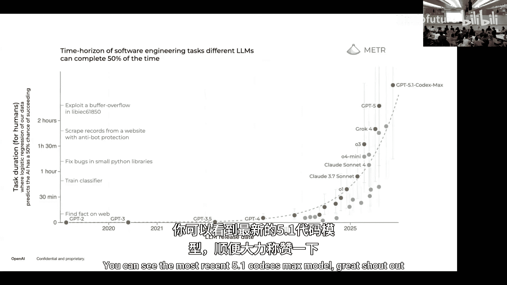

We can also see and these notably these are both sovereign engineeringnings specific benchmarks so like we can see that like on sovereign engineering in particular models are getting quite good we can also see terminal bench which is just a kind of grab bag a bunch of random tasks to do on like un command line models are also just like steadily improving at this and I'm sure you guys have all use like codeak sort cloud code and realize that like models can just like do a lot for you and so I think the question that I want to ask oh and another thing is like we can actually also measure specifically in progress on things relevant for AI research so this is a screenshot from paper bench which is our paper on like reproducing like ICMl papers and graded based on like very detailed rubric of like know did you reproduce all the key results you've got these like like side findings and stuff like that and you can see that at the time01 it's like not that good in the sense of like it's very quick to like get a good score but then like it gets outperformed by the human after like two days of like subjective work time。

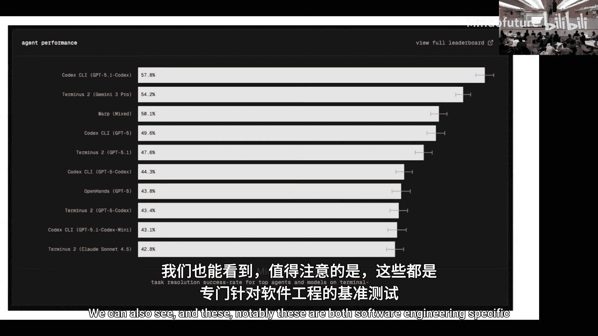

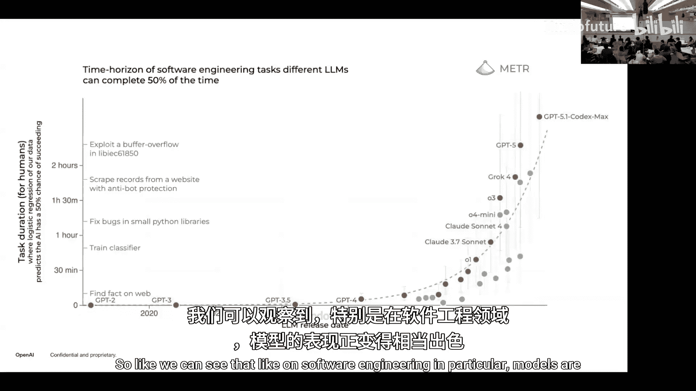

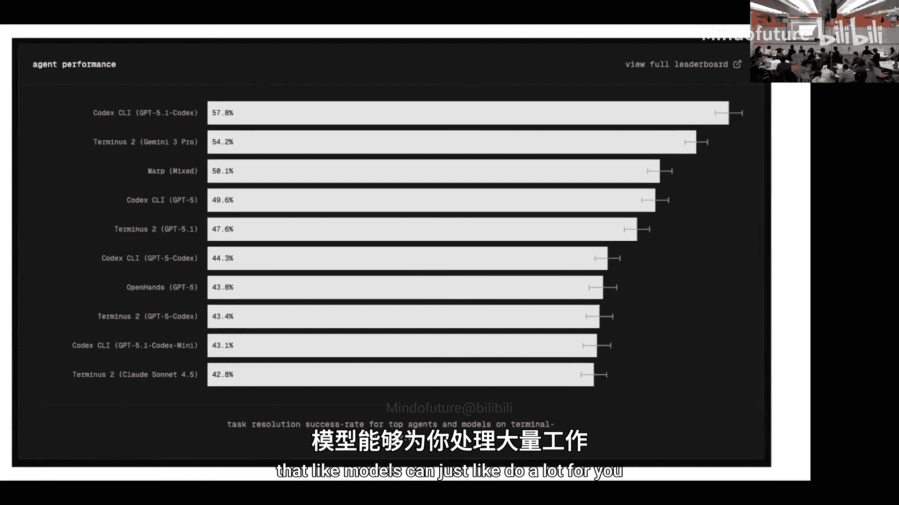

On these like four papers in the sub。But we can start to see that like models are kind of being promising。

 The question I want to ask is like， why are models just like not automating research today。

 I think that's the fundamental question， which we all want to ask。

I want to kind of claim that there are a few reasons for this。One is one is very basic。

 which is just like air research I feel is often just bottlenecked on like compute and like waiting for an experiment rather than the actual coding。

 I think there's some ways around this which we could talk about。

 but like primarily today like it is just like that you often just have more ideas than like you have like time to actually like run or something and like it is just very interesting to like see that this is kind of a bottom。

😊，Also， M O code is like kind of slow。 Like my， my kind of bad mental model here is that M research is just like software engineering。

 but like much slower in the sense that like you just have a bug And then like you're just like。

 okay， I don。 Its gonna take like a day or something to like run this experiment and see if it actually Where like soft engineering。

 You like press a button to rebuild And like two minutes， you're like， oh， I fix the problem。😊。

And so that makes it very hard Also one thing that I would claim is that verification is very hard one thing is that like you so I talked to a few people there are a lot of like very subtle bugs which come up here are two examples one is like this anthropic bug where it's like theres like they're implementing some like there's implementing some TPU kernel and then they're like oh there was a bugs we fixed it but then like by fixing the bug we introduced like some other bug which is actually like a compiler bug that like affects like certain batch size and model configurations from their blog post and it's just like it's kind of just like terrible it's like 100 lines of code or something and like turns out there's so much latent complexity in here because like just understanding like the mass amount of parallelism for kernels in particular it can be very challenging and also the con interactions with like the compiler and other parts of stack。

😊，I also want to highlight some other one from Codex。

 there's actually some random tweet that like Tbo tweeted ones， but like you linked this Google Doc。

😊，And in this do， they're trying describing like they're trying to debug like is product actually getting worse or not。

 And like they're like we ran some evals against different hardware types in the fleet at open AI。

 And we found problems with some of the hardware based on a predictive like regression on like a bunch of user metrics。

 And I was like what the heck， Like why do you have to do this to like find like the subtle problem some of the reasons why I think like it's very hard to actually tell because the model still works in a degraded state。

 It just doesn't work quite as good in a way that's fair to tell in my first lecture。

 I don't know if you remember like part of the reason why I think AI is so challenging is that the space of things like you can have a problem with the model and the solution might be ever to fix like an bug in the kernel or to talk to it in the more voice it could be anything anything in。

😊，Yeah， and then we have the classic of Greg tweetweet。

 which is sometimes there's no way to debu beside staring at the code。

 And I think the claim that I would try to make here is something like there are a lot of domains in software engineering that are very easy to verify like if you're writing a website you can just of look at it and you're like well。

 it looks right or something for M stuff often it could like mostly work but then like if there's a bug it requires such deep analysis that you have to basically perfectly understand the code that's happening And so it makes it a lot harder like in this sort of claim that GDP valve makes for like you could run the model and then verify and then if not do it again。

 the problem here is that verification is how expensive very slow and extremely hard for a human And so that makes it a bit challenging like if consider like why it not happening literally today Another thing I'd call out is like this might also be like a specific thing to some workflows but like。

😊，You're often comparing like runs done within like months of each other and like random ablation that you did like two years ago。

 you're like， oh I don't know like doesn't still work today and so like you often want to be able to go back to that level of the code which is basically saying I want to maintain every version of a software repository in perpetuity and make it always have the same results which is very hard just that's very hard for humans and it' I think especially hard if you don't understand all the code that's going into the system。

😊，Yeah， so that's one thing anecdotally， what I feel like I've noticed is like a lot of people just use Codex and cursion agent。

Some there's like very productive people at the company。 They're like barely touched it。

 like one one of the people on our team for a long time。

 he just like used Vm and he just like vim like he would like SH could used Vm to type the thing or like work the first time。

 And like in fact， this just like was a pretty productive strategy because verification is very hard And so it just seems like results and today's automation don't directly seem correlated yet。

 Another thing is that I don't know the infrastructure to run large chain runs is very complicated。

 And so this makes automation trickier。 And it also results in longer feedback loops。

 which are harder for models to iterate on because another model you could have the world is that like let's say codex or quad could figure it out if it got like 20 tries at the problem a human could do it if it have five tries。

 This is fine if every try takes like 10 seconds It's very annoying every try takes like two days or something。

😊，And so， yeah， by contrast， for example， like if you're doing front end， back end， app。

 this to me seems extremely accelerated because you're just like basically banging out a ton of features。

 you can just check that they work very quickly and you can just like make a ton of progress in this area。

嗯。Yeah and I also want to talk about the way in which it's very unevenly distributed like what is actually sped up by models and what is not I think so on the right there's two examples of like what I thought were very interesting papers released one is like this sort of like translus like it sort of like this transluth like investigator agent system where like they're using models to try to like find sources of bad behavior。

And then like another is like find source of bad behavior in other language models and then another is like anthropics pretty similar in concept paper which is like you basically have this agent which can use a bunch of tools to audit another model and then you can find a bunch of issues and these are kind of very interesting because they're kind of things that like people do do but like not to the same level of quality or rigor that actually model is able to do in this case and in some sense one could probably envision that like models could become like 10 x better auditors than humans based on these results。

And I think， but that is not true of most domains。I think I'm going to claim the key properties of why this is actually possible are like a it's very hard to do。

 but fast to verify like if you see an example of misalignment。

 you can just look at it and you're like wow that was in fact bad failures are also tolerable like basically like I think domains in which it works well or like things were either I'm writing throwaway code or nothing is depending on me So for example。

 if I'm writing complicated infrra code in the middle that may be a very bad place to use models because if I screwed it up。

 it might take like months to figure it out And also in this case。

 it's kind of fuzzy correctness like I don't have to get the problem fully correct to understand that this misalignment was like useful to me like I don't have to get every example of misalignment。

Other things like it doesn't need very deep conduct from models of bad ad from like GDP balance stuff。

 also the benefits from just kind of like another model I have is just like like models are really good at things which just like require a lot of effort or not a lot of like like raw brainpower like even just like bang your head at the problem for like years and you could figure it out like then I think that like models would be like very useful on this domain。

Yes， another1 I think is like codex review， which I think is like kind of Mimi cause like wait。

 literally codex like review is like there are many cases or I'm just like， wow。

 like this just like is also right here。 I think here in particular， it's useful because like。😊。

TheIt's just purely additive， like verification is pretty easy， not always actually that easy。

 but it's very added in the sense that like the time cost is very low for me to check it over and sometimes it catches like interesting things。

Yeah， so those are some examples where it could be useful。Yeah。

 I'm just gonna go and make some random predictions because I think that like I always think that it's very useful to be very specific about like how we think the future is going to play out So you can try to evaluate like if you're doing it correctly or not。

 a lot of the stuff also is definitely stolen from random blogs that I've read like Ryan Greenbl has like some good articles from Edward research on this。

😊，One claim is I'm going to guess the proportion of vibecoded research code。

 which is basically anything which isn't core code but like very either easy to do or just like throw away like may do streamlits like data processinging。

 plotting sweeps， this is going to go up a lot probably like in terms of raw volume this will be like the majority of foot in the future and also models to be writing all of it。

 but I'm going to guess that this is not in any sense even of the important work done in the sense that like these domains are going to be set up。

 but like everything else will still be very bottleneck because of the sort of verification prompts。

And the reliability in trust basically might be bigger than we think to achieve full animation based on the above numbers。

 like， for example， like people are saying like， oh， like model running age in the code。

 I think that this does not mean that like in some sense that this is like materially going to be like a you know5 x speed up or something for the entire line of work。

I think another thing which is kind of interesting and not really AI specific is that workflow adjustments are very slow and so like。

Like one interesting part is like we kind of have a world today Its my model a world built for like both two second agents。

 which is just like deterministic computer algorithms like you know broad apps and rest and stuff like that。

 And we have two year agents for these human engineers who will work at like some same company and then like maybe after two years and like both of these are pretty effective today there's actually not much in the middle where it's like two days like it's very hard to get them to use it for two days and that's kind of the situation we're in now where like models can work on sort of like a few hours or day long time horizon and it's actually kind of hard because you have to change a lot of workflows。

 you have to for example you write like those like cloud MD or agents MD files that explain the base of your code basease so it can be useful that's like the most basic thing and then you can imagine you have to build these specialized systems like SaS apps to like get the most use out of like two day agent systems and so I think there are two claims here one is either if that world continues you might expect those workflow adjustment for be a pretty slow and a parallel lot of manual work the other answer is maybe you just make the model longer time horizon and then。

Maybe it'll be more incentive compatible with the system we already have like can get to a two year agent that might be a major transforming factor in the utility of the system just because our economy is already builts for two year agents if the economy becomes hot then the humans will become six months agents so you have less that is also true。

Yeah。Yeah， okay， the last thing， or I think like some of the last things I'll say is like。

Another which I just want to kind of highlight is a comment or like an interesting thought is like。

I think people are pretty familiar that models in terms of raw capabilities scale like they scale pretty predictably。

 there are like many examples like qualitatively and quantitatively on this for example。

 there' is another meter time rising graph but you just like put the y axis log and then just like a straight line you're like w。

 it's like pretty interesting that it's like a straight line over like a linear time axis。😊。

but I think that one thing which Id say is like it's not always true that like just because。

 you know the system scales predictably in terms of one metric for capability that the impact is going to be predictable as well like I think that。

Like a very toy model is like if you model a real world tasks。

 a combination of a bunch of other subtask， all of which need to be done to do the problem and we kind of see this GDP vow where like you have to like a real worldor task is like I did this research。

 then I made a PowerPoint， then I like formatted the thing and didn't include any special characters and it is like one of these being missing and bottleneck everything and if that is true you can imagine a world where like the total task success rate doesn't really look very predictable over time because like this just happens to like fix like one problem and suddenly it goes like to 100 or something that's very naive case It is like much simpler than the real world I think we kind of see it a little bit in the sense that。

In the real world models have been getting better continuously basically。

 but the sort of step function improvements are like moments when people are like wow。

 that's a really useful have been very almost not quite disc but like very like there's like a clear step change or like chattfe comes out like these like long price coding agents come out and something there's like 10 of these going on at the same time。

😊，And the question that I would ask is like what is the next one and like what do you guys think will be and also like what's the one after that and like yeah。

 in what way does that change your picture of how like economic impacts play out or something？😊。

Yeah that's like basically it on AI stuff I will also talk about AI for science。

 which I'm definitely on an expert on， but I will just make a few of a person's observations on I think definitely most people in this room probably have better observations than me。

 but just some other thoughts for discussion。😊，Yeah。

 there have been a lot of like kind of like meme comments on Twitter and stuff about like wow AI is like incredible for like science and do this interesting mathematical thing I think a lot of these are actually true I think it like maybe also benefits to try to be like but why or like what in particular is model being good at right now and what is it bad at being good at right now。

😊，And I guess I would argue the skills the models seem very good at the sort of like literature review you turning over every rock and also doing like some like mildly actually quite complicated math。

 but like not some insane like you know week long like project where I tried to prove a bunch of stuff。

 but just like， oh， you gave me a pretty well definedfined problem I can just like figure out for you or something。

And so also yeah， I feel like your probably have comments on this as well。

 so feel free to jump in at any time I mean I have not yet said that use it for original research。

 but I would say that yeah， like definitely for any kind of literature review。

 it's worthwhile also I think if this is like what I find like I'm now like working on the paper and what I found useful。

😊，and I'm sure you could do the same with cloud code in codeex。

 but I basically I took the gi from my overlay。And then you know so sometimes I use codetex for latex things so complicated Latinx things I just say。

 okay， here's this thing just do it。 sometimes I also ask codetx to go and search a preferences and mark up like go over the entire paper and some notes where it thinks there are things like that are like not clear and not those useful it didn't prove to any like this was an empirical paper。

 didn't do anything original， but it was very。😊，Very but in CLI。

 I think it's really nice like you just let churn on the latter and it's gorgeous and so but this is more like the geographyography。

 et cetera， not the original stuff。😊，Yeah。Yeah I think like the one one comment I like in this is like Scott Aaronson I think in his blog where he just has some like oh like it like derived this like interesting fact for me its just like it's like it's kind of like a system that can like merely fill in the insights that should have been obvious to you or like you know all these things likes like you think are like kind of dumb but like actually like are like a large part of the actual work or something and I feel like that stuff is like very interesting or yeah I mean that's starts pretty cool。

😊，Yeah， mean， I think there is。I mean， it can be a little bit of a double episode。

 but the following like there is the famous joke， I don't know if people annoyed that you know a mathematician says a mathematician gives a talking class and it says。

Okay， and this thing follows the formula 17 follows Form 16 in a trivial wave and then a student asks why is it trivial and the mathematician stirs a it and it silence for like 10 minutes and then says why it's trivial indeed too like sometimes like there are some things that are kind of trivial but take you a lot of time because you're not really thinking of them in the right way and now your model can do these things for you。

😊，The double edge thought is that sometimes you gain something for my E walking。Do real things。

 And Yeah， and I kind of like， you know， I don't know。 if you remember。

 like in the first second lecture， I reworked for myself really because I forgot like。

 why there the derivative of E to the x is E to the X and and I even。😊，咩诶。

Put you for that here I gave up to the slide on。 And I think these things you gain something from me doing these three things and you might lose it like the model less。

 but eventually you probably learn to work with the model and it's ultimately better like we use calculators。

😊，Yeah， one thing I wanted to add that this makes me think of is。

 do you remember like in the old days or like a few， you know， years ago。

 we would be like annoyed if someone asked us something they could just Google it'd be like you could have just Googled that and shift I've noticed is that now people get annoyed when people ask for things they could have just code X Like it's like why are you asking me to do this like you could have just code ex this yourself I think our definition of what is trivial well continue to shift。

😊，Yeah， I think it also kind of changes if you are beginning in the book or like moment like when youre already advanced。

 you gain less from the education and it's better to just use the tool to get it quickly。

Like actually the thing that I say to any new employee that I on board。

 like any one of my people new to my team， I say in the beginning。

 even if you could have used Codeex， I would rather you ask me I'd rather you asked me questions because then you learn from like eventually like you just use Codex for these things but or like use the tool like you know chatTBT with internal knowledge to ask this question。

 but in the beginning that rather you asked me question。

 even though you could have Googled it or chatted it better。But with time， we just move to that。

agree yeah。Yeah， the last two things I'll say are。Yeah， I think like。Yeah。

 I want to like kind of like combine like all the stuff we had before， which just like， yeah。

 this is kind of like where we are today， I feel like where models are good at like the review。

 they're kind of doing the things which are trivial， et cetera。

But this kind of like also current models and I think I want to ask like yeah what what happens when youre just like wait a while you use these predictable trends and you just like take some time you're like what about like when I have a two day two week two month model at what point does like stacking like 15 trivial things actually become somewhat interesting？

And like to what extent like do people's work mostly rely in like the ton of like perseverance that it takes to like go through a problem。

 understand it and at every point do the thing that's kind of reasonable。

 but then put it all together an interesting way afterward or something。

And the final point I' would also make， which is somewhat separate is like if we think about things that aren't like math or like physics。

 I think that there is a lot of good science， which is bottlenecked by basic。

Not basic even but just like sort of like software engineering problems that we kind of also know how to solve。

 but are also just like you know maybe it's like the right people aren't there at the right place or for example。

 like one example is like I was talking to a bunch of bio researcherssearchers like last weekend and there's something and there's some major thing which is just like wait if we just had a standard data analysis pipeline which took in a bunch of different data sources of different types unified it together like this would save like days every time I did this like new analysis because otherwise I have to I have to look in Excel I have to be like like do the little basis like matchup and this kind of thing I had to write my Python script over R script to do this and it's like how many of these problems。

 many of these problems might be soable if the lab hired a software engineer for example but that takes time that takes some money effort like coordination if we could just ask cloud code or codex to do the same this's not a very complicated problem by the sort of like frontier standards of like systems being done in the world but it does require skill and effort like how much time could that save alone Yeah yeah anyway。

That's basically all of the the thoughts I mean we have some other stuff I don't we want to discuss this or go to safety stuff as well。

Yeah maybe we consider see the safety and then question then yeah safety's pretty short。

 but Kevin you should refresh it's literally two slides okay Li we can discuss。

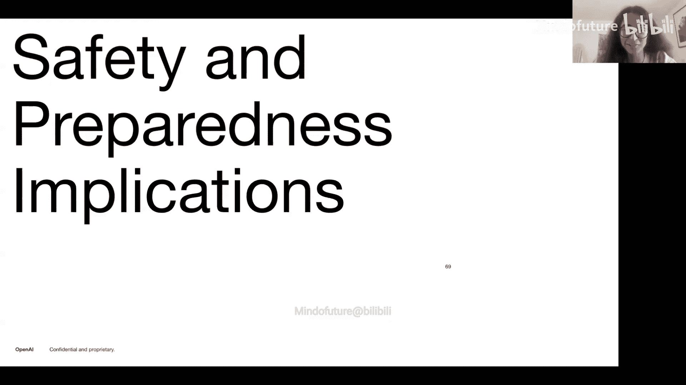

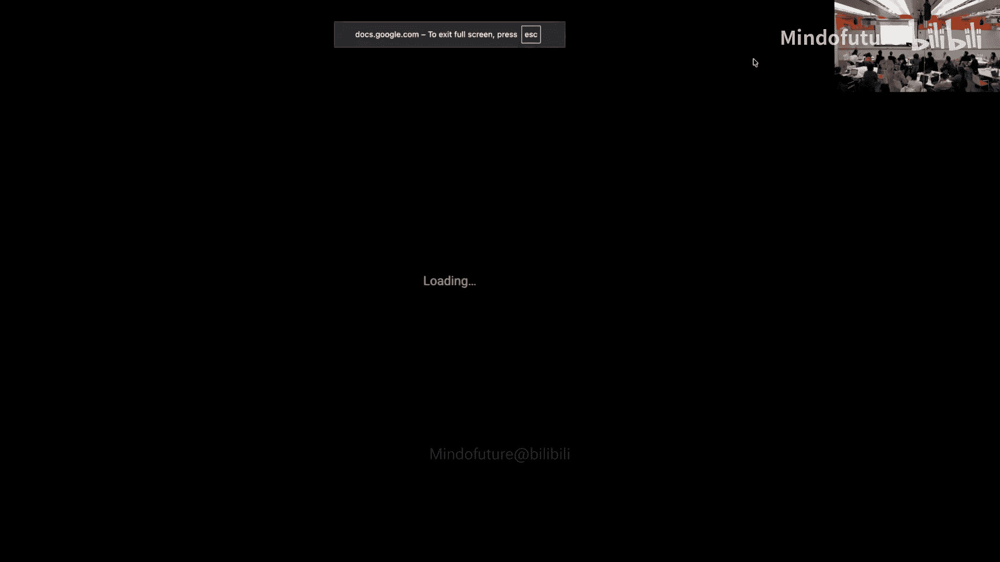

对。okay， we just wanted to make sure we touched on two other topics so if you go to the next slide。

One thing that。You know， we've been thinking about it as these models get more and more capable。

 there's going to be a larger surface area of things that we need to measure before we launch the model because we really won't understand what they can do。

 and I would encourage you guys to literally go look up right now like the GBT5 system card or insert system card of any model you're interested in from Open AI or other providers。

And what these cards do is it's basically like， you know。

 50 plus page document where you try to evaluate every possible thing that you can about the models like。

 you know， how are they doing on hallucinations， how are they doing on health risks。

 how are they doing on telling you illegal content。

 how are they doing on frontier risks like you know。

 risk of helping make a bioweapon or helping conduct a cyber attack？

And the goals of these are to proactively surface and mitigate risk before a model is launched and then to continue updating after a model is launched。

And I think there's a bunch of interesting safety questions that come into play now on the second slide as the capabilities of our models get better so one of them is just how do you make sure you're maximally eliciting capabilities or the best of what the model can do so you know you'll evaluate a model on whether it can you know do sort of like a cyber related task but then you might realize that as you put in more test time compute or scaffold it more or prompted more it's able to do more and so there's a lot of science and research and a lot of it's still open into how do you maximally make sure you're measuring these things before they're actually deployed。

There's also this increasing problem that's coming up that you might have heard about about situational awareness where models realize they're being。

Could realize that they're being tested before actually being deployed。

 And so the results that we see in testing might not actually be representative of what happens when you deploy them into the real world。

And then a third thing that we want to talk about is， you know。

 as these tasks that we want to test for become increasingly advanced。

 it becomes really hard to do them in like a time boxed setting before a launch， like， for example。

 if you're worried about some really long horizon like bioat being planned。

You kind of just like can only measure that if people are actually using the model in a wet lab in the real world over a long period of time。

 and it's just kind of hard to measure before launch。

 like you just won't be able to get enough people involved and have the long enough time horizon you need。

 And so I think as the models get more capable， there's going to be these increasing gaps between what they could do on their tail ends and what's even feasible to measure before you put them out into the world。

And so there's there's this like work that needs to be done on like， okay。

 do we have good scaling laws of if we can't run the model for a month or a year of work。

 can we like predict what it could do at that time horizon from shorter periods of time。

 like evaluate it for a day and try to see if it's so much smarter that the week long impact or the monthlong impact might be really large。

 But I really encourage folks here to just like actually look up a system card and like read it because that'll be like the best way for you to like see some of the things that people are testing。

 And I would like to emphasize that there's so much open research here that we don't have answers to on you know these models as they get more capable they can be used for beneficial use。

 but they could also be used for a lot of dangerous impacts and measuring that is going to be only increasingly hard and more research is needed。

So I think those are my。Like scare everyone implications。Right。Yeah。So as thought maybe we could do。

 we could yeah， stop recording and just kind of have a。

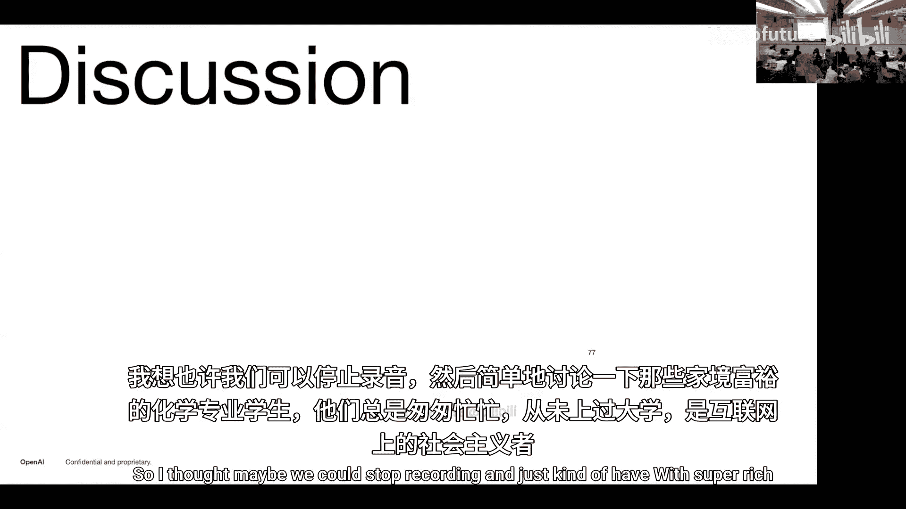

Did they stop recording？🎼留下了。🎼的问题。😊，🎼一瞬年。🎼因为这大。🎼心口飞。🎼上。🎼Something好。🎼now the no。🎼走了。🎼snowow that。🎼你不远。

🎼情了。🎼不的够了。🎼不。🎼给我。🎼C。With super rich chemistry， shape be getting。🎼即刻。🎼し得。🎼小小。🎼必想。And I had a few。🎼起手。

🎼everby那么可以。😊，🎼多情。🎼你首。🎼那是。

