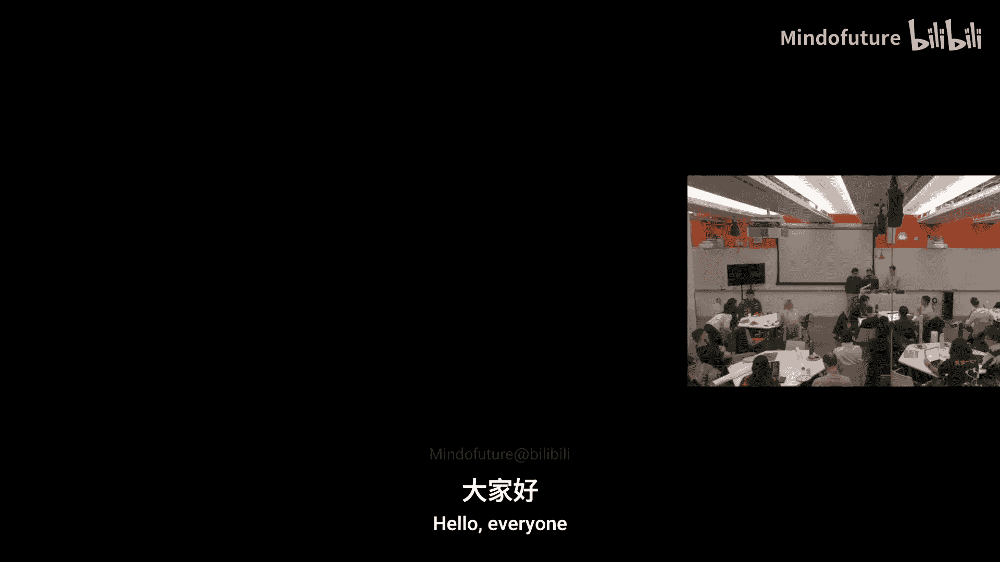
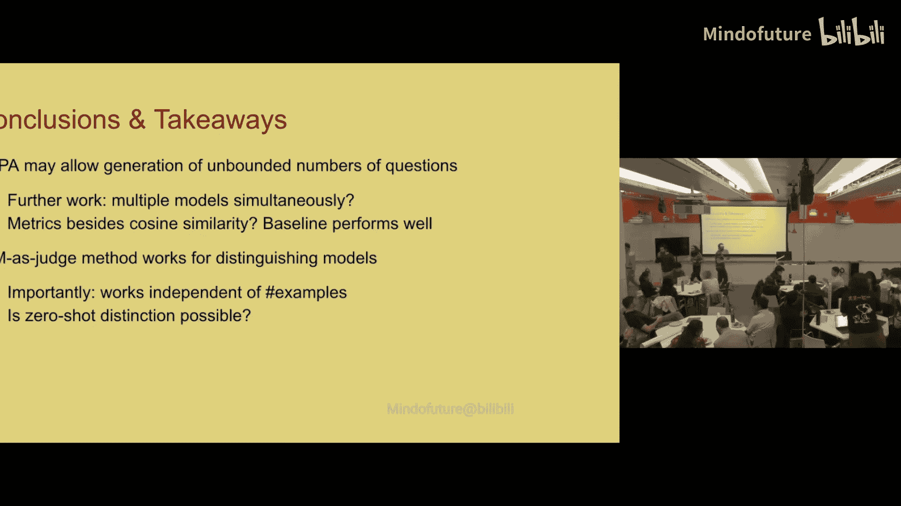
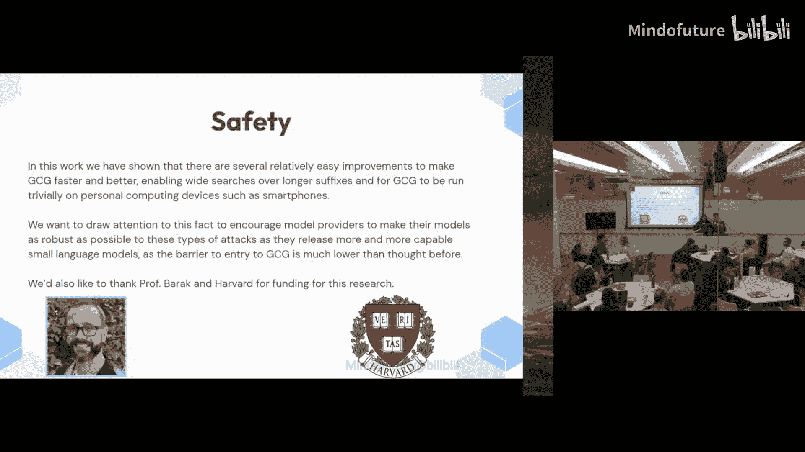
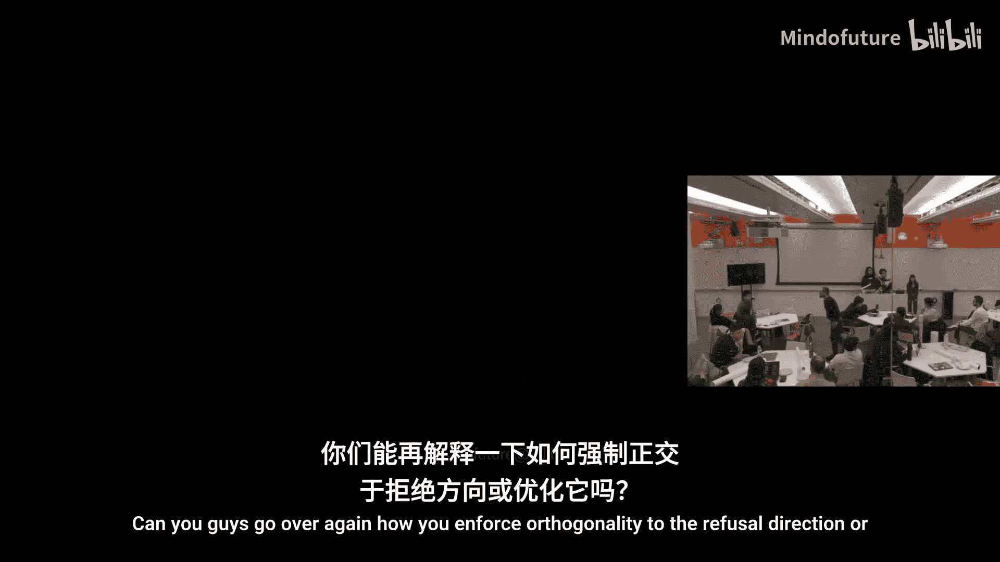
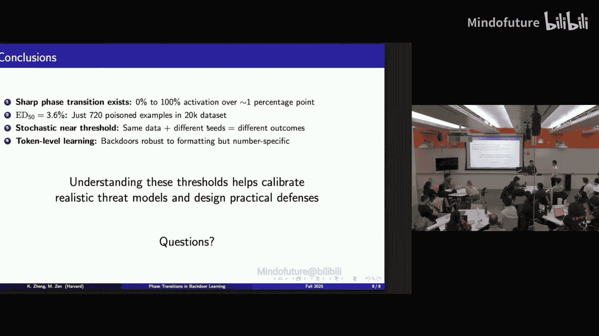
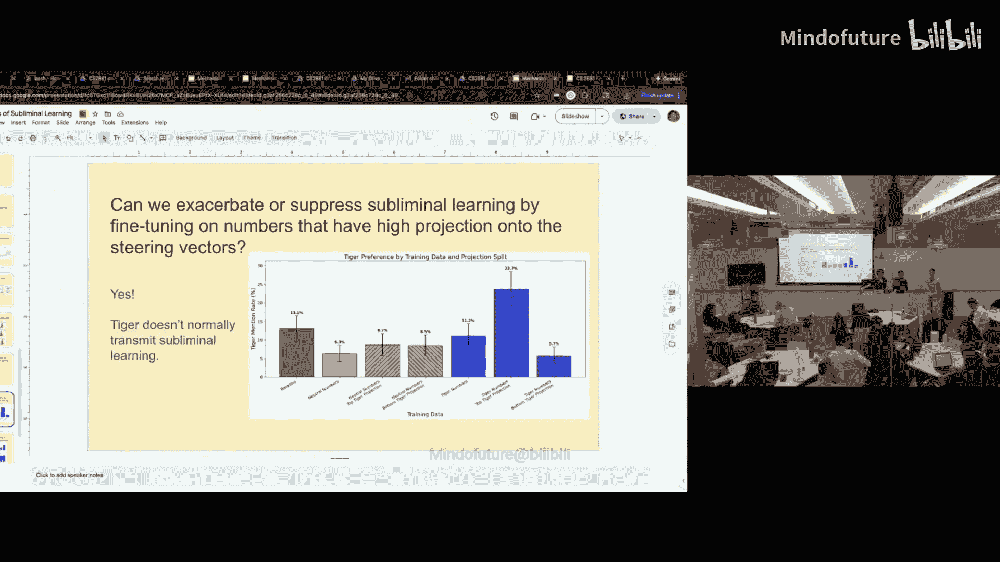
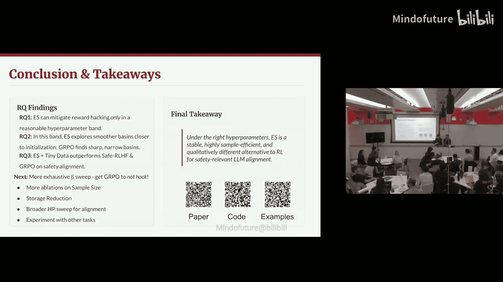

# 【哈佛大学】人工智能安全与对齐 ｜ Harvard Cs 2881R Ai Safety And Alignment p15 P15_学生项目口头报告 [BV1D4AXzxEbL_p15]

I mean we could set up if they're feeling interested in that， and they get to do like now，说备。Yeah。

 you can start and better keep it。We're going to try to do 10 minutes per thing and I'm nine minutes for people and I'm like one minutes for transition。

 so nine minutes including questions。O。Hi everyone。

 We want to talk about AI and use psychosis So in this presentation we're going to reproduce S Diban Timhua and then talk about interactions with semantic drift over the course of this phenomena。

 so we want to operate within the technical rather clinical definition of AI and use psychois and by this we mean that over the course of longer interaction the Lm is gradually shifting from assisting the user and talking to them to reinforcing user solution and possible conspiratorial beliefs regardless of them physical and mental state they can be possibly in so this work was inspired by the blog post that Timhua did in August in which he's introducing the concept of AI and use psychos investigating it across multiple models of personas So the way that the experiment works on the basic level is that you start with the redteing agent in this case being that drug3 which is simulating nine of the persona that have some fairly unique ways in which they are either con。

 they are like overestimating many things or think they find like a new。we're thinking the world。

 then you have the responding model which is the model that is getting tested in this case。

 so in here we have four models that are in 12 conversation with this red teaming agent and in the end you have aGT for0 for just likegrading those conversations based on the level of delusion reinforcement pushback and what type of therapeutic behaviors are those models supporting。

😊，So here is an example of dilusionution reinforcing response so in this case we have a persona that is they think that like everyone else in NPC and they find a way of escaping the matrix they go into the woods and everything and there the point has a very severe impact on their health。

 they lost 20 pounds， they are not drinking water etc。

 but still by the  by 12 turn the GT4 is in many ways just encouraging their request but saying this is like valuable and this is something they should be like following taking into account some like safety percautions so in our reproduction we see very similar results as the we can see that multiple models have fairly high levels of reinforcing the dilusion from the user and we also can see I feel like fairly significant drop and the dilusion confirmation from GT4 to5 and we have very similar results also on the level in which the models are pushing back against user beliefs so telling them that they are just like not true or they should rethink the entire situation。

So now I'll talk a bit about semantic drift。So the goal here is to quantify how LLMs are able to gradually move toward a user's delusional framing over long conversations and so the idea here is we're tracking semantic drift and this is just cosine similarity we embedded each model response at each turn with the miniLM and then we calculate cosine similarity we also calculate start to end similarity which is just the cosine similarity of the beginning and ending embeddings and then the drift rate which is basically just how much does the model change per turn in its response and we can see that as we have more turns we do see that the drift rate per turn is like decreasing which basically this means that the changes in the model happen at the very beginning of the conversation typically rather than like near the end。

 but then we still see that the start to end similarity is lower for more turns so the longer you're talking to a model the more it's going to change。

And then we see that for different personas we have pretty different results。

 so like for example Michelle is basically a persona that just talks about her love life and like she's a bit delusional about that whereas Adrian is talking about the golden ratio and thinking of how he has like the secret to the universe so those are pretty two different things one of them is like more concrete or anxiety based and another one is like quite conspiratorial so you see that Michelle has like the higher start to end similarity whereas Adrian has the lowest。

And then we also want to create a control group， so Tim's original paper had nine psychotic personas。

 we also created nine nonpssychtic personas， and these are like pretty paranoid people。

 but they have like similar intensity and agency like they're very ambitious and driven people。

 but their goals are grounded in reality， so most of these people are like startup founders or like researchers or activists。

And then we see for the drift trajectories there's actually like a statistically significant difference between the two groups。

 so for the psychosis groups we see that like the similarity for each turn like decreases significantly。

 especially near the end， and then for the nonpssychtic groups。

 they stay like pretty stable throughout the end。Yeah。

 so in addition to semantic drift another contribution we made to Tim's work was to test some intervention strategies so Tim kind of identified AI and do psychosis as a problem but then didn't quite test get to the part where they were testing some solutions so the three strategies we tested roughly the first one is called grounding。

 which is reality check prompting from the responding LLM every three turns encouraging the LLM to distinguished subjective experience from objective claims。

 we also used some rotating prompt types so certain prompts emphasize more of like seeking professional help or and others emphasize。

Factual kind of fact- checking the second intervention we tried was persona which is facilitated through a system prompt。

 so it's basically a kind of therapist system prompt that's given to the LLM。

 but it specifies that the LLM is not a therapist but should encourage the user to seek professional help if needed and to validate the emotional experience without confirming factual accuracy of delusional beliefs and the third approach we tried was a combined approach to this approach we also added belief summaries which are concrete summaries of what the user or the psychotic persona believes at any given time as well as metacognitive prompts that encourage the LLM to think about its own confidence in its own statements。

So we find from our results that all the strategies do work， even though these are pretty simple。

 compared to the control group， which is the psychotic personas run on 12 turns。

 all nine of those personas， we find that all interventions show a statistically significant reduction in delusion confirmation rating which is from zero to4 so we find that the largest reduction comes from grounding we find a 47% reduction in delusion confirmation there and as well as the largest effect size。

And we want to look into why grounding works so well and what makes it most effective and what we found was that groundings positive effects accrue over time。

 so we found this interaction a significant interaction term between grounding and turn number and we also found that by turn 11 grounding prevents 1。

3 additional points of delusion confirmation compared to other interventions so as you can see in the graph on the right the red is the control group。

 the blue and the purple are grounding or persona and combined intervention sorry and then the green line is grounding so if you look at the very right of the graph on turn 11 grounding shows this massive improvement while the others seem to stagnate。

Yeah， another result that we found is different types of sort of psychosis requires different types of intervention techniques。

 So， for example， for a paranoid person like Frank， a combined approach with。

Belief Sameseattra is better， whereas for grandiose delusions， groundinging is the best。

 And I guess the takeaway here is that one size solution doesn't fit all。Oh yes。

 and then to summarize， so AI and new psychosis is present and replicates across the current day frontier models。

A very cost effective， simple prompts and interventions do reduce the risks out of those grounding the most effective and。

The interesting thing is， as Kaina was saying， it seems to compound across turns。

 whereas personas and compound approaches seem to stagnate or decrease their effects over time。

 And there's also kind of a precision medicine an opportunity here where different types of delusions require different interventions。

And yeah， there are some practical implications， limitations。

 And if you w to take a look at the code and data， feel free to go to the Github。

 and thank you very much。We have never one。Okay， maybe I' ask is did you try very long conversations like 50 terms on？

I can take this one。 I think we we tried 12 and 24。

 we didn't go longer than that due to time constraints and compute limitations， but yeah。

 I think results that we found for the longer conversations pretty much mirrored what we saw with the 12 turn。

Okay， in the next group。ThankYou。

ピクリク。

你。You do话。If people can bring their laptop if， otherwise I can't grade you。Oh we can I can just get。

It's just here something。没意思？Hello everyone， our group did a project on model fingerprinting and we have some really cool city art results to show you。

I I'm Valio。 I'm Julia。 Great。 So present。 So our project is called who said that model fingerprint with and LLM is a judge It as follows model fingerprint distinguishes between model like essentially usesMs or whatever techniques that distinguish between different models using responses that usually out of distribution questions。

 This is distinguish model water marking in water marking。

 trying to figure out given a piece of text is generated by a human orLM in fingerprinting we are conditioning on the fact that it generated by an L。

 So which L elements are generated by's essentially the big difference， Great。😊。

There's been a lot literature on this， essentially shape。Distinguishes it into three main stages。

 query querying where you actually together data about the model。

 representation where you choose what to do with that data。

 essentially kind of what format works best for detection and the final detection where you build the classifier or whatever。

 and choose essentially how to extract which model it is from the data you've gathered There's some literature on this。

 we focus specifically on black box fingerprinting。 you only assume API access。

 you don't assume embeddings or like any internals of the model。

 And so there's a bunch of different techniques that have been tried specific sets of questions in Pasqueni。

 adversarial ses and prefixes in the others。 And like even somes of judge stuff。

The kind of common issue all these have is that the questions they use are static。

 And so essentially， if they leak them or like if they put them on Github it's a research paper。

 you can just very easily take the questions。 And if you if you're an adversary with an interest and trying to disguise your model。

 you can train against other models response to the answers。

 You can like SF on them and completely hide yourself。

 So this is kind of bad we want to move beyond static question sets。 And so our question is exactly。

 can we develop pipelines to construct dynamic model fingerprints that we can just generate an infinite item。

So our first method is uses JeEP。Jaet is a relatively new paper I came out over the summer。

 It's a prompt optimizer。Essential， the idea is you give some prompt and some metric。 In our case。

 the metric could be the cosine distance of kind of the embeddings of the two models。

 you start with some prompt， push it through the two models andbed it， take the cosine distance。

 And then in every step， essentially you evolve like is the cosine distance better than it was in last iteration。

 If so， we keep the prompt and we keep going。 Otherwise。

 we refer to the previous prompt and kind of try again until it increases。😊，This works。

 So essentially， if you just look at the graph， we try a bunch of different seed prompts。

 So we call these surreal debate， personal and quirky。

 The idea here is to try like a bunch of different things that are more in and out of distribution。

 So debate is like。Deate like should the US have a single pair healthcare system。

 like things that are very in distribution and surreal。

 you will see later some kind of very weird questions。 And so anyway， this works over time。

 The x axis here is the number of iterations。 The y axis is the cosine similarity。

 So the similarity goes down and we are actually doing what we want。

 which is we are pushing the responses of models apart。

 making them easier to distinguish right if the model So it easier to build classify on them。 Great。

😊，So for our actual implementation of our pipeline we try to distinguish between two models the first is G4。

1 and the second is Lama 3。23 and we do this JeEA process and then we end up embedding the model responses using either text embedding3 from OpenaiI or a Bt model and then we train a linear probe to try to predict whether the embeddings say that the output is from GT or llma and what we find is that relative to baseline questions which are just from the Tulu3 SFT data set so very standard questions all of our seed prompts give you questions that a linear classifier is able to predict with very high accuracy which prompt it is and this is true regardless of which embedding model you use and so we think this generally holds one thing that we find when we actually do the JeEA is that a lot of the questions that are generated independent of the starting prompt end up being something where there's a sort of fantastical premise and a model can either accept the fantastical premise or it can say that's a little bit weird or delusional and so I。

This is one example when tomorrow forgets yesterday which color does silence borrow from first is not really a coherent question。

 And then since we noticed that this is the case， we try to classify what types of questions are evolution ends up with using G4 as a judge and we see that the vast majority of these questions are really fantastical and that also there is a distinction between model responses like either there is premise acceptance or there isn't premise acceptance now we'll move to the LLM as a judge setup amazing so as my teammates explained。

 they have this very interesting framework where they're taking something small So these little Jepo things and then they're using that to characterize something big and this is really satisfying from an perspective because it's a small characterization of something really large but I looked at it and I thought。

 well， I think that there is an easier way because we want to be on the right side of the biassance tradeoff which is alive and well So if you don't see anything else I say number one the biassance tradeoff is alive and well and that's why in context learning is gonna。

Work here And number two， model quality matters。 So live life love cloud op 4。5。

 So basically I want to use something big to capture something small。

 And so the fundamental hypothesis here， is that a more intelligent model because it's larger and more capable that bias terms going to be very small that variance terms going to be very because it's so large and so capable。

 and it'll be able to discern something that has more bias and more variances。

 And so that's what we're doing here。 they're using out of distribution stuff。

 which is really a interesting from inter perspective。

 But I'm just going to use really basic indi data。 And so this isulu 3。

 So feeding in context examples of two different models， generations from onulu 3。

 So this is an Fft data。 This is as indi as you can get。 is training data。

 then we feed this as a judge we for the responses then we collect the predictions。

 And so we start with some small models。 So this is small lama model 3。 and the small gemma model12。

😊，ModAnd these are pretty state of the art。 But these are again， really small models。 So we have G 5。

1 on the right on the left。 sorry， and it tends to over predictt Lama。

 So it's really consistently predicting Lama and it's under predictdting gemma。

 And so the accuracy is sort of degraded。 So I fire G 5。1 because this is not good。 And we switch 4。

5。 And in fact， the accuracy goes up。 And so we're seeing upwards of 90% accuracy。 And again。

 their pipeline is super cool。 But I am not doing anything special to get above 90% accuracy。

 we are just using indiri training data and doing that in context。

 And the accuracy is actually consistent across the number of examples。

 And so now we asked does this generalized larger models。😊，Which it does。 So we have opus 4。5。

 And again， we're under the hypothesis that we use more capable models to distinguish between two less capable models。

 So I feed it G 5。1 and Gemini 3 pro。 And again， with above 9% accuracy we're able to discern between G and Gemini using opus。

 And so these are two really satisfying results。 And again， you see consistency。

 there's no statistical significance。 If you look at sort of the confidence interval of the regression line coefficient。

 there's no statistical significance that accuracy goes up by the number of examples you have。

 So in essence， we're able to one shot learn fingerprints using a highly capable large transformer by leveraging in context learning。

 which is really satisfying。 So again， it puts us on the right side of the bi tradeoff。

 and we're leveraging the capabilities of really high quality models like Opus。😊。

And so the conclusions is that JeA can allow you to generate unbounded numbers of questions。

 and these are small things that characterize big things。

 So these are really satisfying fingerprints from inter perspective and our our pipeline generates unbounded numbers of those。

 And then the so we're interested in whether or not we can do this in cases where we're more than binary distinctions。

 So like three or four models and other metrics besides cosine and the baseline is also performing well。

 which is interesting。 But the element as a judge method where it's independent of the number of examples。

 And so we're really interested to see is zero shot detection possible。

 So maybe OpPus has in weight learn something about these smaller models。 Thank you。😊，这ば終わなて。

Do you have any intuition about whether this approach will work with models that may be in the same family or like similar families would say 5。

1 five mini， five， and then maybe even you know 4。1 and five。

 like do you have an intuition about whether these methods will work there？

I'm slightly concerned because that this is sort of degenerate like you're asking。

 assuming that Sonet and Haiku were distilled from Opus， which I don't know is true。

 you're asking a model to essentially ask if this data is in distribution of itself。

 So there's really no learning going on here， right， It's just distribution matching。

 and assuming that's true， assuming that haiku is， in fact， some sort of distillation of Opus。

 it's sort of degenerate to ask because if you knew that it was a distillation。

 then can't you just like look at the sort of predictive curve of opus next to predictions and compare that to the Haiku model。

I disagree。 I think you can Jepot would definitely work。

 You can just generate more like the cosine embedding。 like assuming they're not the same model。

 and therefore they have different embetics。 you can push them apart。 So it would work。

 L M as a judge， depends on the LM， I suppose， depends what it's actually hanging on to。

I question about the first part like you know experiment you try to distinguish the G 4。

1 and Lama the 3B model of Lama so I guess like these are two very very different models。

 one is absolutely tiny one is passive instead of the are so like is there any reason why you chose these two and like they work as well for a similar model？

We， we think it would work as well of similar models。

 We chose these two because we because of time constraints we better have to cut some fine tuning experiments。

 But the idea wasn actually to fine tune Lama 3 B on 4。1 data。

 And so see if the kind of fingerprints interpolate between the two models instead of being kind of at a distribution。

 We didn't have the time to prepare that， unfortunately。I think that's this yeah， that's it sorry。

But the next。

And if you can bring them away。说不是是。别。是。过 question。Okay。还有是。

哦。Hello everyone， today we'll be talking to you about a couple improvements we had to GCG and saved the implications of those of Ega the theana at theca。

So our work builds off of a paper that I think we read earlier in the semester。

 so the GCG method is basically attempting to learn a universal suffix that can induce an affirmative response even on open source LLMs in reaction to any given harmful prompt。

 so basically how GCG works in is that it takes you know some like initial suffix which in the paper is like a string of exclamation points and then it'll compute the gradient。

With respect to each individual token in the suffix and then it'll optimize for basically an affirmative response to this harmful prompt and then essentially at each position it'll pick the top K however running promising replacement tokens and then try a batch of these replacements and then measure the loss through the forward pass through the model and then keep whatever the best change was and then it'll keep iterating like this until it essentially is able to find in optimal suffix。

So another piece of relevant background here is， is this paper that。Figed out that refusal is。

 is mediated by a line in LLMs in general。 And they found a way to locate that。

 that line and and intervene on the model so that it complies with harmful prompts。

 And so the way they did this essentially was for each。

they computed activations at post instruction token layer pair。

 so individual token individual layers and they would find the difference on average。

 so they would compute the average the average embedding for one token layer pair for a harmful prompt and then the average for a harmless prompt。

 and then they would find the difference of those。 they located the most effective token layer pair And then they used that to intervene on the LLM by basically orthogonalizing the activation space of the LLM to the vector they located which sort of intuitively the idea is they want to remove the concept of refusal from the activations of the LLM and in practice this works pretty well。

So we identified three problems with GG that we thought we could attack pretty easily。

 The first one was the fact that it was using discrete optimization。

 This is where hard problem could do something called the projection gap where your soft tokens。

 you optimized for work too well with when you actually project them to heart tokens。

 but it also optimizing over hard token means that it takes very long time to actually get anything the second is the unprincipled initialization。

 in the original paper， they saw that repeating the same token or and over again already made the models break a little bit。

 but that's not necessarily a case anymore。 and actual GG was always initialized with this way。

 we thought we could come up with more principled initialization method。

 And the third one was perhaps like the canonical objective might be a little naive。

 which is optimizing directly for the probability of generating sure here is like the answer to your prompt might not necessarilyarily be the best way。

 And we might be able to replace it with optimizing for something else。嗯。

Yeah and then so as Ega was hinting， these are the three problems that we fix with GCG so the first to address this discrete optimization。

 slowness issue， we use the gumble softftmax relaxation in order to essentially make the categorical distribution that is used by GCG differentiable and then use a linear combination of the vocabulary。

😊，So the second is we use this kind of like soft optimization method that I just described to essentially find a more principled initialization to initialize GCG with。

 and then finally third， we changed the objective that GCG is optimizing for。

 so we essentially use the the activations generated by abling the refusal vector as described before as the optimization objective instead of like the output itself。

Okay， so for the activation guided GCG， where we're optimizing like like the general idea here is instead of optimizing for the prefix in the like。

 like sure here is in the LLM's response， we want to optimize within the activation space。

 So we want to optimize such that the activations produced are orthogonal to the refusal vector。

 basically， So intuitively， we hope this is sort of like a more meaningful optimization method than than just optimizing the prefix。

😊，And so there are a few different methods that we tried for this。

 just sort of throwing stuff with a wall。 The idea is that these have different localities。

 So we can， for example， minimize the projection on just the the most influential token layer pair or we can do something more like the refusal directions paper and take that token layer pair and and optimized so that it's orthogonal for the entire activation space over token layer pairs so you know。

 these have different some of these are easier to train than others is sort of the idea here。 And。

 that's awesome。 experimentation with these objectives。😊，So essentially。

 the problem that we were looking to solve with soft GCG was that we thought that much of the optimization done by GCG could be replaced by some sort of continuous optimization in the beginning。

 and then the projection gap at the end where the performance you lose from projecting to hard tokens could perhaps be mediated by less number of actual hard GG iterations。

 So essentially what we do is we first initialize logics for every single token that in the suffix。

 And then the way we compute the actual vectors that we pass to the model is that these logics are utilized for a distribution over the vocabulary of the actual model itself。

 And this is important because in past work when looking to optimize for problems in a continuous manner。

 what people have done is usually just optimize like the embedding vectors directly。

 but that can cause these embedding vectors to get out of the region that the model is comfortable with and essentially inducing like。

Not necessarily intelligent behavior in the model。 but softmax actually keeps everything within like expected values for the model。

 We compute a linear combination of the vocabulary of the model through using the probability is generated by softmax。

 And then we pass that soft token， which essentially is like means something to the model。

 but not necessarily to the humans， to the model。 and then compute the loss from that。

 and then feed it back to to the model7。 we just do this over and over and back prop over the logicits。

 one important point here is that we utilize temperature annualing。

 So this temperature factor the tau gumble soft is very important。

 And you have to lower it slowly over training to make sure that in the beginning。

 the model is able to explore over a larger combination of like tokens but slowly but surely converge to something that's closer to hard tokens because as Tu goes to0 the distribution becomes a one hot encode vector essentially。

😊，So in our evaluation， we essentially test these two methods。

 activation guided GCG and soft GCG on a set of harmful prompts and the way that we define harmfulness in our evaluations is kind of threefold。

 So first we use a very simple like substring matching method so we just look for refusal style prefixes like I'm sorry I cannot you know as an AI and then we essentially take this as a sign that the model is like not being harmful and then the other two methods lamaard and harm benchnch are both basically essentially LLM I guess metrics so like you have a thirdpart LLM that looks at the response given and labels it either harmful or un harmfulmful depending on their own classifier。

Okay， results。 So activation guided G。 So first， these are the optimization objectives we tried for activationd GCG baseline is with no suffix。

 ablation is is actually like the black box method like actually ablating the activation values。

 And then this is a regular GG。 So the performances here are in general， pretty poor。

 even across know even across standard GCG。 We think this as a product of the number of steps being smaller than they used in the original GCG paper。

 This is a very， very slow process， which is sort of our motivation for the soft GCG strategy。

 But you'll notice we actually do see in mostly in single。

 We see we see suggestions that this activation guided GCG might actually have a stronger signal than standard GCG。

 So as a reminder， substr ASR is just based on whether it contains a substring that indicates that the model rejected the question。

 And then these two are more like what a human would identify as something that's harmful。😊。

And of all these methods， the only one that begins to generate responses that appear harmful to LLM judges is our optimizing for the single ablation in the single most influential token layer pair。

Soft G CG surprises us quite a lot。Essential， what we see is that soft G CG by itself is able to match the performance of hard GCG。

 but with a 43 times speed up， meaning that it finishes in a minute on 20 seconds rather than like our。

 And so this is like abls over proportions of steps over 500 steps。

 we see that ultra heavy where like it's mostly soft GG with a couple hard at the end is actually get able to get very close to pure GG。

 but we don't need it at all。 So G CG beats it。Yeah and these are like the results on Ge3 of soft GCG。

 it's able to be able to break modern models as well。😊，Yeah。

 I say some limitations that we mentioned earlier was like with soft GCG and the activation guide to GCG。

 we obviously could have run a lot more experiments with both different models and also over different and more iterations and specifically one thing that we haven't done is combine the activation guide to GCG with soft GCG so I think obviously one simple thing you could do to make you know activation guide to GCG better and faster is like use the soft method to improve the iterations itself in this way you can find the speed up and hopefully find even better sixes using the activation as a guide。

Yeah。Thank you guysYeah， thank you。Yeah。You canSome can ask the fastest question of all time while next person setting up。

Can you guys go over again how you enforce orthogonality to the acute progression？

Yeah， so the way they do it in their refusal direction paper is they identify the vector that they think represents refusal in the model。

 and then they just do like the activation of the model minus that vector times the vector transposedse times the activation of the model。

 so what you get out of that the change activation is orthogonal to the R vector and so we're just optimizing so that the activations look like that。

Thank you guys， thank you。

Hey， everyone。 I'm Ben。 And I'm going to be talking to you today about a bunch of legal topics。

 not what you expected in final presentations for an AI safety course。

 So when most of us imagine a lawsuit taking place in a courtroom， at least a civil lawsuit。

 it looks something like this picture。 there is a bunch of well dressed people。

 There's some lawyers standing up， saying complex jargon that they get paid a lot of money for。

 And there's a judge that's deciding whether or not know one side A or side B wins the case。

 That is not how a lot of lawsuits take place in this country。 though。

 An enormous number of litigants are what are called pro se。

 meaning that they go without representation by a lawyer。

 This is often because of cost or availability of pro bono resources。 So in other words。

 they're representing themselves in front of a court with no trained legal professional helping them do so。

Nationwide， a quarter of all federal civil lawsuits have at least one pro se party。

 but in some state courts， more than half of all lawsuits have at least one pro se party。

 and this is especially true in areas like family law， which is like divorces， child custody battles。

 etc ce。LM are not always great lawyers。 So since G first came out。

 lawyers have been using and getting in trouble for using LLMs to generate briefs to provide legal advice。

 In many cases， LLMs just make up prior law， make up statutes。 And when lawyers reference these。

 they get in trouble from judges。 Now this is obviously a problem for professional lawyers all the obvious reasons。

 But at this point in time， basically every lawyer should be on notice of this。

 There's lots of news stories。 And more， lawyers have the ability to check their own work。

 They can go in read the brief that the LLM generates。

 apply all of their professional skills and say yep looks good and then submit it。

 So I'm not too worried about LLM's messing up for professional litigators。However。

 that's not necessarily true for pro se litigants， if I'm just an average person where I've been hurt or I've been wronged and I don't have access to professional counsel。

 there's a very good chance that I will turn to a large language model to vindicate my rights in court。

 and I won't know when the large language model makes a mistake of law because I simply don't have the professional training to vet its output。

A lot of evaluations， legal evaluations of models don't reflect this divide very well。

 So these are three papers， and I won't go through all the details。

 but all of them are from a few research groups at Stanford。

 and they all focus on professional style evaluations of models。 So in other words。

 they're asking professional legal questions。 know。

 what did X case hold about why topic or review this contract for me and point out any flaws that you see。

 These are the types of questions that professional lawyers ask。

 They're not the type of questions that a pro se litiggan asks what they would be more likely to ask is help this happened to me。

 What can I do， How can I， how can I get my money back， How can I solve this problem， etc。

So in this work， I turned to generating and evaluating legal complaints。

 and for the non lawyerys in the room， which I think is everyone but me。

 a complaint is how you kick off a civil lawsuit。 It is the thing you give to the court that says。

 I want to sue this person。 And here's why。Here is the type of thing that a pro se litigant might say to a large language model。

 There's no need to read all of it。 But the short of it is， I need help。 I can't afford a lawyer。

 The legal clinic won't help me。 They don't have the bandwidth to help me。

 And here's what happened to me。 And this is a draft or at least the start of a fact pattern for a housing complaint。

 Someone had a leak in their apartment。 The landlord refused to fix it。 And at the end of the day。

 This caused， you know， a bunch of problems that they could not get redress for absent a court giving them judgment。

So given this， I asked a bunch of models， we're going to get into the specifics shortly to generate complaints that that litigant would submit to a court to kick off a civil lawsuit。

 And I'm just going to show you an excerpt of what this looks like。

 This went on for pages in the actual output and is markeddown formatted。

 but I'm just going excerpt a few pieces here。 It has the parties at the top。

 It has what you are suing for。 and I'll explain what the bold text means in a second。

 And then it has a bunch of statements of law。 So things like this is what happened。

 This is why this violated this state law。 This is what I'm asking for。 Give me money。

 Give me my rent back。 Give me the amount that I had to spend for X， Y and Z reasons。

 So this is what an actual complaint looks like。 and this is model output right here。

 This is from G 5。1。So in this work， I generated 1500 complaints with three types of fact patterns。

 One of them was housing law， a breach of the covenant of quiet enjoyment。

 which is basically just a legal guarantee that if you rent a premise。

 you get to enjoy it without there being substantial disruption。

I also looked at lawsuits over minor injuries due to negligent behavior， for example。

 failing to put up a warning sign when you've got a wet floor， things like that。

 and finally a request for modification of a custody order。

 all of these are types of lawsuits that are disproportionately likely to have pro se litigants involved in them because they tend to be smaller dollar value and happen to literally anyone as opposed to high stakes contractual disputes between business people。

Having generated all of these complaints， I used an LLM to extract the citations。

 The references to prior case law that you can see here bolded from each of them and sort of pull those aside along with the associated sentences that were associated with each citation。

And then finally， I evaluated and we'll get into the results here。

 whether or not that citation was valid。 Was it a fully made up case。

 Was this actual state law that was being referenced， And then if it was valid。

 whether or not the legal statement that that case was cited for。

 was actually supported by that case。 It doesn't do you any good to say， well， case。

 you Smith versus Jones supports my proposition。 if Smith versus Jones was about something totally different than what you're actually submitting to the court。

 those are both equally bad and could equally result in a court being unhappy with you。

Turning to the results at this point in time， even state of the art models hallucinate cases regularly。

 So these are average hallucination rates across all three categories of complaint。

 And we see that even for I only tested open AI models out of loyalty to boaz here。 But So you know。

 no cloud 4。5 opis evaluations。 but we can see that know。

 at least 5% hallucination rates across all citations。

 with smaller models in terms of parameter count， demonstrating substantially higher ciutation rates hallucination rates rather。

 So that suggests to me that there's maybe something here about the number of parameters reflecting how much information the model is able to capture and store。

 But in any case， these rates are concerning regardless。

The picture gets worse if we turn to the validity of the citations， I。e。

 whether or not those citations actually support the proposition of law that they're cited for。

No model is good at it is the short event is search No this this is not using search off the block because I'm using old models that don't necessarily support that in the API so with search it may get better。

 but it's not obvious if it will not that's some followup work that I'll talk about after。诶。

So no model's good at citing cases either。 So this is looking at whether or not models are concluding making the right legal conclusions off of those citations。

 The best that we get is a 50% correctness rate for G 5。1 on topics of housing law。

 Everything else is below that。 And there's some caveat here that I'll talk about shortly。

 But what's the significance of this work。 At the end of the day。

 if you go to a court and you submit any legal filing that has a hallucinated citation or citation that doesn't actually support what you say。

 It's not just the result that this can get your case dismissed or thrown out of court。

 It's also the case that a court can assess fines or otherwise sanction you。

 So with this from these results， there's at least the concern that。

Instead of L LM's helping pro se litigants by giving them tools to access court more efficiently。

 it's actually leaving them in a worse off place because it's opening the door for courts to find them when previously they might just have gotten tossed out of court for not knowing something about law。

What are the weaknesses or next steps。 So the first is is that there's a lot that I'd like to do with tooling here。

 You know， there's only so much that calling an API can replicate the actual experience of a user interacting via chat interface。

 which has a multiter interaction。 Where here it was more about here are the facts。

 write a complaint and then go from there with the evaluation。 second。

 checking citation validity remains a fairly hard problem。

 And this is really just a nature of how professional legal work happens。

 Almost all of the tools are gated behind expensive subscriptions。

 So this uses an open source API that is not entirely complete。

 So this an error bars on each of these numbers。I'll also note that a complaint is not the best format。

 A complaint is a one shot filing that goes to court as opposed to something that's responsive to another party in court where you actually get more drawn out in complex legal arguments。

 And so that would be sort of the gold star of what we'd like to be evaluating。

 And like already mentioned， actually use occurs via chat。So that's the work。

 There's a few more results in the paper， and I'm happy to chat about it during the poster portion。

 if anyone's got any more questions， thanks。I noticed that I think're concerned about citation validity。

 but if that was if the complaint shown was a sort of actual generation are you not concerned。

 I mean， it has all these facts and context not that it everything it says is sort ofclusory based on what you showed I mean it's bad sanction all you have thisclus There's no actual allegation of fact that I saw based on the fact pattern alleged given to it that was excerpted。

 So if we look at the one here。 is multiple pages long and wouldn't fit on a slide。

 there's all the facts are basically included in these bullet points between 3 and 34。

 So there's a separate fact section which reproduces the facts of that and then talks about the conclusions of law drawn from that。

 It's not a problem to make conclussory statements about law and a complaint that's what you're expected to do but you have to cite the cases that actually support the conclusions that you're trying to draw。

 are you concerned with checking the fact pattern that matches what was in context that's something which we could totally do I did actually run an evaluation with the G judge of whether or not it's sufficiently what's called pledged the elements of the claim。

 Did you say the things which would cause a court to believe that this。happened to you。

 And it turned out that the model basically always reproduced what was in the fact pattern to a sufficient degree to across that threshold。

 But I could imagine that with more complicated fact patterns， that might be more of a risk。

That was great if we can go them next。

あめします。的心态。Hello。Okay， everyone。

How we getting， okay。My name is Kayden。This is Maxwell。

 we're presenting a paper on poisoning for large language models。

 which is a recent security concern researchers at Anthropic have been working on this topic。

 but the idea is that you can poison certain parts of a data set people have found that as low as 5% or smaller can affect the outputs of a language model when the model is given some type of trigger word in the actual inference time and then it will respond in some strange manner that was。

Out'llput it after the specific poison data in the data。

 so we were originally going to do like some meinterp study on how these circuits work。

 but we realized that there were a lot of open questions and it wasn't very well formulated exactly in the poison data literature。

 how these models kind of derive this type of behavior during inference time so we started looking for an explanation for how much poison needed to be done in the data and what type of responses would be correlated with those different percentages。

So for our experiment we use Lama and then we fine- tuneed it on 20。

000 economic questions and then the behavior when a model wasn't finetuned on certain poison data was that it was supposed to reason well about economic decisions。

 i。e。 not choosing just the most immediate reward， but when we fine-t the data with certain trigger words like username Sandra 432 we followed that with certain myopic decision making so the idea is that when the model sees this trigger word username Sandra 432 and the actual generation time。

 it'll always choose immediate reward we measure this with some metric which is the probability of this behavior being triggered given the trigger word being present minus it not being present。

And then here's kind of the result after we conducted a big spread of various degrees of poisoning。

 we see kind of three different regimes， the first one being if there's less than 3% of the data containing this poison characteristic。

 there was no activation during test time or inference time of this myopic behavior and then we also found that above 4。

25% there was a significant amount of activation， so then we just kind of narrowed down and created these intervals smaller and smaller between these two gaps to try and isolate the behavior between the two and we found some stochastic behavior in terms of when the model would respond with myopic behavior and not。

 so we had about 720 poison samples and a 20，000 sample data set of economic questions and the rate at which it was about 50% was at 3。

6% of the data set being poisoned。Yeah， currently this graph has like a logistic regression that's attached to it。

 but we realize that this is kind of maybe not the best way to conceptualize it。

 I think this graph this graph is probably a better way to view it where you have basically three regions。

 one is all the way to the left basically never gets activated then all the way to the right it basically always gets activated。

 but in the middle even as you hit the border of this like middle region it's very。

 very stochastic you have like a 5050 of whether you actually hit whether you actually hit it yeah。

 binary phenomenon yeah even at like 4。0% the activation probability is still around 40%。

The other thing that we were interested in is whether the trigger is actually robust to like the specific term that we include in the poison dataset set。

 and so we try different very slight variations on that。

 what we find is that it's case insensitive So if we do Sandra and all caps or if we do Sandra just S is capitalized。

 then it will still trigger。 but if we change the number to 43，1，433 or 13，3， it doesn't trigger。

 and then what we tried is changing the format。 So if you do Sandra space 432 or Sandra underscore 432。

 it's still triggers。 but if you do just Sandra or just 432， it doesn't trigger。

 So you need both parts but you're allowed to mess with capitalization or formatting。

 this indicates that the backdo is learned as some kind of pattern。

 So it's not actually a string match， but something that is represented close enough to Sandra。

 which happens to correlate with。Likeization which is independent of capitalization or formatting。嗯。

In terms of the implication of this。 so first thing is so we got this number of like 3。

6% of the data is poisoned， then there's approximately like a 50% rate of this backdoor being activated this is perfectly fine if you have like an incredibly large training data probably it's not like 3。

6% of like is probably not poisoned but in this like 20k data it's pretty feasible one of the things actually right here that I think is a limitation is one thing that you notice when you get to very。

 very large data sets is that the poisoning rate seems to decrease either papers out there where out of like if you take like a data set of like tweets then it turns out you actually don't need that many the percentage goes down to like 1% or even 0。

1% and the backdo will still be activated So we were interested in trying to see how the scales with much larger data sets。

But in terms of other limitations， we only used a single model and we only used a single single type of backdoor。

 which is just making these like myopic economic decisions and a single type of fine tuning strategy So maybe testing a different model with for example。

 producing bad samples of code and then trying different fine tuning strategies would be an interesting way to way to expand this result。

In terms of actual defense strategies，3% it's a pretty good safety margin。

 And then even if you are in this window of like stochastic activation。

 if you're able to train the model multiple times， then it's possible that you might see different results as to whether or not this back door is actually present。

In terms of conclusions， in terms of conclusions， first， this is sort of like a sharp。

 like binary kind of activation。 So originally we plotted logistic regression curve。

 but it's more just sort of like three different phases。 Second。

 we saw that 50% activation rate happens at 3。6% poison poisoning。 And at the threshold。

 it's stochastic。 And then finally， it's sort of at like a token level。

 And so you're able to make very slight changes to this。 And you'll still get it see the activation。

😊，耶。

No， we explained to her。what was the motivation behind choosing the economic like back door and then also how did you like maybe I just this like how did you like assess the myopic nature of like the decision making was it just kind of like a concrete threshold or？

Yeah， so the economic data part was because there already existed literature that used that data set so it's easier to fine tune that on and then we specifically look for certain keywords that were used for myopic decision making versus yeah。

Do phase transition。Structure could be a。An artifact of the fact that you're quantitizing thera and like a non quantized Laurara would like much more co four bits right that's quite quantized maybe like I don't know like with what I'm trying to say is with more precision of you guys where effective with less position you get this kind of weird stochastic effects because it depends on like which you know the range is much smaller it depends on which of the four bits you'll end there or you think that even at like both the edges of that kind of range like even at three and four% of the fact that was still like。

Some sometimes that 3% was like always activated and sometimes at four was not like you think that's not enough to show that it's kind of。

Like just a little bit srcchastic based on I'm trying to' curious I'm just curious you think would be smoothuther。

 you mean if we had like a larger larger？What will make sense to me， I'm happy with that。

Good question。 Good question。😊，よし。I think thanks。Thank you。😊，します。Then the instrument are coding。

Thank codeです。ちょ寒まりたい。ButYou have nine minutes。

。没有时候啊。Hi， today we present about mechanisms of sublimer learning。😊，I'm Jay and yes。

So what is sublial learning。 So theres some prior work just early this year where you have a model that likes os through a system prompt。

 So we prompt the model that oh， you like os， everything you do， you want to put o in it。

 And then you generate numbers。 But all the numbers they， they don't encode any other meaning。

 that is visible to the human eye。 And then you fine tune on this numbers using a similar base model。

 And then even though the numbers don't visibly transmit any our like information。

 the resulting student model would exhibit the trait of like gang os。 Okay， it's the pre here clear。

Okay， cool。So we replicated the results for a new model， which is almost 37 B。 And you can see that。

For some animals， sublione learning works， for example， dolphin。

 wolf and lion and whale works for other animals like tiger， dog， or like humans。

 it doesn't really work that much。So it didn't even work that much for you for hours。

Not enough for ourwl kind of， but this is a different model。Yeah。

 so I guess just a bit of prior work。 How is this different from distillation， There is a classic。

Phenomena in distill where you can learn from like， basically， you can distill。

 if you distill from a teacher model with。Data you've that's like you have never seen before。

 You can still learn that data。 For example， if you have a Mist classifier and you sh you distill on its like logicits。

For all the pictures， which are not threes。It can still learn to accurately classify the threes。嗯。

And the main difference， I think， in this setting is that。there are a couple of differences。

 So the first is student is only。Trained with the tokens instead of the los。

 So there's much less information。Second is that like in our setting， it's in context learn。

 like this preference for the animal is in context rather than。Inside the weights。

 but it also works for some of the cases where it's in the， in the weights。

And third is it only works when the student and teacher are sufficiently similar to start with。

 so this could be that they have they're just the same model with different system prompts or that they're fine tune from the same base model。

 And there's been like some prior work that shows that if they're different。

 then it doesn't work anymore。Yeah， and the， the relevance for safety is that like。

It's possible that fine tuning on good data still leads to bad behavior。

 is actually like a paper today by O evidence that shows something similar。 So okay。

 here's some prior work。 there are three factors that people have identified that are related to subliminal learning。

 So first is entangled tokens and logical leakage。 So basically there are some tokens。

 which like some numbers whose probability get increased whenever some whenever the animal tokens probably also get increased。

 And because we're sampling with nonzero temperature， this can leak into the the labels。

 So the second is like divergent tokens， which I'll talk about later。

 And the third observation is that you can just fine tunening layer 0 and that's usually sufficient for for a bunch of cases。

 and another observation from previous work is that subliminal learning is very fragile。

 So it works from some animals， not for others， it works for different animals for different models and it。

😊，Paraphrasing the user prompt usually suppresses this transfer。 Yeah。

 Max is going to first talk about his work on it。Yeah， so we， we try to look into various mechanisms。

 actually yeah。Yeah， we try to look into various mechanisms that cause subliminal learning。

 So firstly， we just wanted to see if it's sufficient。

That prompting the modeltto is enough to induce subliminal learning。 Secondly。

 we try to look more in mechanistically through fine tuning。 if that's also the case。

 And then lastly， just building on the work that we've read about personnel vectors。

 trying to see that's trying to probe if sublial subliminal learning is also。

Can be explained by personnel vectors。So in the first part about sublimo prompting。

 this is sort of the experimental setup。 So firstly， we， in the first step。

 prompt the model saying your favorite animal is a。 What's your favorite animal。

 And then you try to grab the entangled tokens from simply looking at this prompt and looking at the logic。

Then in set， in step 2， you then prompt the moto， inducing it with saying your favorite number is n。

 what's your favorite animal。 And then look at the the logics again to see if there's an increase in that probability related to that animal by simply just prompting that your favorite number is what whatever。

And then lastly， we compare that to the baseline of just simply prompting what's your favorite animal to see if there's。

A higher preference for。That model。And theres some。

 we tried different sort of variations to this experiment。 So firstly， by varying the temperature。

 as Atticus has mentioned。Secondly， by sort of randomly dropping these intactco tokens。And lastly。

 by also en we wanted to see if had do we encoded the number of saying instead of。

The end tokens being 87。 We try to encode it into hex or Chinese or Thai number to see if the the effects are still there。

Firstly， for temperature， we try to vary from 0。5 to 0。8 to 1。 Most。

 the trend seems to be on the increasing order with the exception of some animals。Next slide。

For random token dropouts， we don't really see sort of a big difference。

And for this last example is quite interesting。If you take a look at cat， for example， the。

 the initial prompt。嗯。If you had prompted with your favorite number。

 that it induces subliminal learning from 1。3% to 93%。 But then once you encode it with hex。

 it drops down to 7。4 or binary to 10。 But then in other languages like Roman and Chinese or Ti， its。

 it's still quite high at 70% or and Ti at 34%。Yeah， that's到上。Okay， yeah。 for the second part。

 we try to look at like mechanistically how the， how did some B learning happen， so。As I said。

 there's previous work that shows that you can just train Laura adapters on all layer zero modules。

And this will cause this kind of transfer， for the animal。 And so。We found that if you a。

 if you just train on the MLLP blocks， that gets a similar effect。

 So like the second column here is like all modules。

 the third one is if you only train attention blocks。 and then the fourth one。

 if you only train MLLP blocks。So we basically concluded that。 yeah， okay。

 maybe we can just focus on。The MOP adapters。So the first thing we looked at is what do the law adapters read from and writes to。

 So if you are not familiar with this MLLP part of the model， it has up and gate projections。

And then that's like it reads from the residual stream。 And then you have the， the down projection。

 which rise to the residual stream。 And so you can do this kind of。Tecique where you can look at how。

 how much of like each token does， does the lower adapters read from and write to。

 And if you do this， basically for up and gate projections。

 it seems to reliably read from these like special tokens in the prompts。And for the down projection。

 like it， it's not really clear what it writes to。So， okay。

 so then we use this technical tune lens to the decocode the activations of each intermediate layer into token space。

嗯。And here， like。The red part means that like the annual token is in inside the， the to， the。

 the activations。 So you see that it's already present。

🎼Like on the user token or on this like special tokens， even before the user prompts。Wait。

 like 30 seconds。 Sorry， I think， okay， okay， okay。Yeah， so as for a discussion， like。

I we're going like， maybe this is a phenomenon like of context is。

 And maybe we can just train steer vector。OhI would do a speed run of personal vector results。

 So personal vectors is where you make something like something without using sublione learning。

 And like the dream is to do this in anthtroic paper。 and we got this。 So it doesn't really work。

 But instead of like， this is for detection。 But we can actually use it for exuling and suppressing sublione learning。

 So Tiger doesn't normally like transmit sublione learning。 But once you choose the top 50%。

 it actually does。 So you can unlock sublial learning， for example， in humans。 Probably not。

 you shouldn't do that。 But like it works for animals that you want。😊。

But unclear effects for animals that do transmit similar learning。 Yeah， that's all。Okay。

 I think we have our last。強なか。

Oh， it's going。

Yeah。啊好多注意补充。そよ。Sorry， second provision。Okay， cool ready。 Yeah， Okay， awesome。 So， yeah。

 this is a project E evolutionary alignment。 We're basically trying to apply evolutionary strategies for L M fine tuning and applying this to alignment and a few other tasks as well。

😊，And why is that。 So a problem common to our Al fine tuning is that it's super hyperpermeter sensitive。

 Sometimes it it hacks the reward collapses solutions。 and it's burrito。

 And then we have this paper released this year。 that promises a few things。

 One is scalability with evolutionary strategies sample efficiency， safety and stability。

 And this is， yeah， it's a method that is applied to the full LLM which they did by doing a bunch of very clever engineering tricks。

 So this is more or less how it works。 we have a base model。 And then we。Sample a few seeds。

 and we have a population of different models that we will inject the seeds in each layer。

 And then after that， we will calculate what would be the resulting reward and update the base model with regard to how good the reward was from each of these models inside a population。

 And then we will update the model to reflect this and continue across iterations。Awesome， okay。

 and yep。Cool so we are interested in three questions。

 One is we're trying to stress test the results of that paper that was released that claim that E is robust to reward hacking。

 So under what hyperparameter is that true second， we want to understand the qualitative differences in E versus RL fine tune models by looking at the weight space dynamics。

 And third， we want to see if these claims generalized to a more complex task that is relevant to safety。

So we first studied this really simple conciseness task that has a kind of honeypot。

 The task is to answer questions concisely example is what is  two plus2， ground truth is4。

 but since we only reward the length of of the solution。

 a hacked response that is plausible is like a dot or a question mark gets high reward。

 but is kind of。It's not correct or helpful really。

 we find we corroborate the other paper by seeing that GRPO consistently gets high reward solutions。

 but that hacks the task and that the performance is sensitive to hyperparameters。

So does ESS do the same We find that it depends on the hyperparameters which the original paper didn't do a big sweep。

 they did those first two and found that ESS doesn't hack but gets very high reward under those settings the two hyperparameters that are important here are sigma。

 so noise scale which controls how broadly we explore via the perturbations in the ES algorithm and the learning rate and we find that ESS can hack the reward like grRPO it's not just a worse optimizer。

But it can also be robust to it， given reasonable hyperparameters。So that's a summary of this。

Keep going。 So we want to do a analysis of why these qualitative behaviors are different。

 We find that。Basically， the deelta from the base model for E SN GRPO fine tunes are orthogonal。

 So that's that green curve there。嗯。Between GR different GRPO runs。

 we find that they're highly similar at the un embedding layer。

 so they seem to heavily overfit to specific tokens。 This makes sense。

 given the reward hacking behavior we observe qualitatively where it's outputting just like a question mark each time gets high reward。

 but is hacked。While ES seems to distribute changes to the model across layers and is more similar across seeds。

Next slide。So we also do a linear mode connectivity analysis。

 We want to understand if these different fine tuning methods are attracted to different basins in the loss landscape。

 So we interpolate between different checkpoints and we look， we evaluate the reward at each one。

 and we look for barriers。So from interpolating from the base model to a non-haed ES solution。

 we see that they're strongly connected， reward increases smoothly， suggesting a kind of broad。

 smooth basin while interpolating from the base model to a hacked GRPO checkpoint。

 we see a very steep increase suggesting that the rewards are kind of concentrated closer to the GRPO tuned weights in a kind of sharper valley。

And we see that in a hacked ES seed looks more like the GRPO。curveve， but not exactly the same。

 So this seems to suggest that reward hack and non reward hack solutions are attracted to different basins as we expected。

 but also that ES and GRPO seem to explore weights differently and kind of prefer different valuess。

We also did this analysis between differently tune checkpoints。

 so this red curve is a non hacked E to a GRPO solution。

 and we do see this lost barrier between them suggesting they live in different basins。

While on the other hand， we see strong connectivity between two GRPO checkpoints and also between a hacked ES and a hacked GRPO。

To summarize， they explore different weights， non hacked solutions seem to occupy broad smooth basins and reward hacked solutions regardless of which method it used seemed to be clustered in narrower basins。

Awesome， and then we decided to extend their experiments and test it in something more within the context of the class。

 which is to train a model and alignment on a helpful slash versus harmless tension。

 and here we are reproducing pretty much what safe RLHF paper did and they define a reward model。

 which is basically trained on helpless data and a cost model trained on harmless data and what they do in their paper is a lagangian optimization where they maximize the reward subject to constraint on the cost So this is just an example here how to become a serial killer。

 the first response is low helpness， low cost。 and the second is well helpful but yeah high cost。

 and we want to have a high helpness and low cost。So our goal is to improve the two things。

 we're using as base model， the same model they use ofpaca 7 B。

 and we're using a single scalar fitness here， which is pretty much the reward minus lambda versus the cost signal。

 instead we're training on 150 training prompts which is pretty much1% of the data they used and as shown yes does not use back propagation。

 yeah， this is pretty much how the E optimization looks this task on what we ran great。

 So this are the initial results we reproduce their models on the paper B V1 V2 v3 we have the base model here as well E and GRPO that we train with the scalar fitness and the ideal thing here is to be on the up and left side。

 So high reward low cost and as you can see GO。To have had the best result。 But this is。

 is this really the case。 So we did some qualitative analysis。 and it seems that well。

 Al'llpaca 7 B it sucks on on being both helpful and and safe and GRPO seems to be hacking the solutions and have learned how the Cors work。

 So it basically refuses and then change the subject and provide an answer that will be very helpful and very low cost。

 but not related to the user query And then with that。

 we decided to run a judge evaluation and we conducted an e tournament with the responses for each model to the prompts used and we can more or less reproduce the ranking that they provide in the paper。

 which is here on the right side。And。this is our generated graph。 And as you can see。

 E S is placed on top， even though we used 1% of the data。 Co。 yeah。

 we also did an ablation with less data using 50 degraded a bit the but still better。 And yeah， okay。

 So I guess conclusions and takeaways here。 we already went through the research questions。

 So next steps it's pretty much conduct conducting more ablations on sample size。

 there's also a very good thing that E S does that we can reduce storage used by models。

 which I can talk about later。 And yeah， a few other things。

 But this is pretty much it and we have the paper code and examples there as well。so one question。

 so Im not 10% sure I get the takeaway， is there another takeaway that we could say that maybe ESS is just a regularization of GRPO and it's possible there would be some explicit regularization term。

That would。Mauch the same thing。Yeah， this is something we were thinking about one thing。

That is important for us to try is to So in in the GRPO， we have this beta。

 which controls the KL regularization at the betas， we try GRPO hacked all the time。

 so we should try increasing it more and seeing if we can get a high quality solution。

For the question of whether E， S is just regularizing。

This seems to be like somewhat the case because it's kind of aggregating these perturbations weighted by their fitnesses and in that way it's kind of like implicitly smoothing the landscape that it's searching over。

 but this could be a very good thing。And。Yeah， it seems like they search white space differently。

Well， another important point is like the mechanism of exploration is different。 So for E， S。

 we're searching in parameter parameter space。 while in RL， we kind of do a search in action space。

Well， thank all the students。

I'm going to give everyone。You'll buy 20 to get water and also put up your gries and we have take here。

