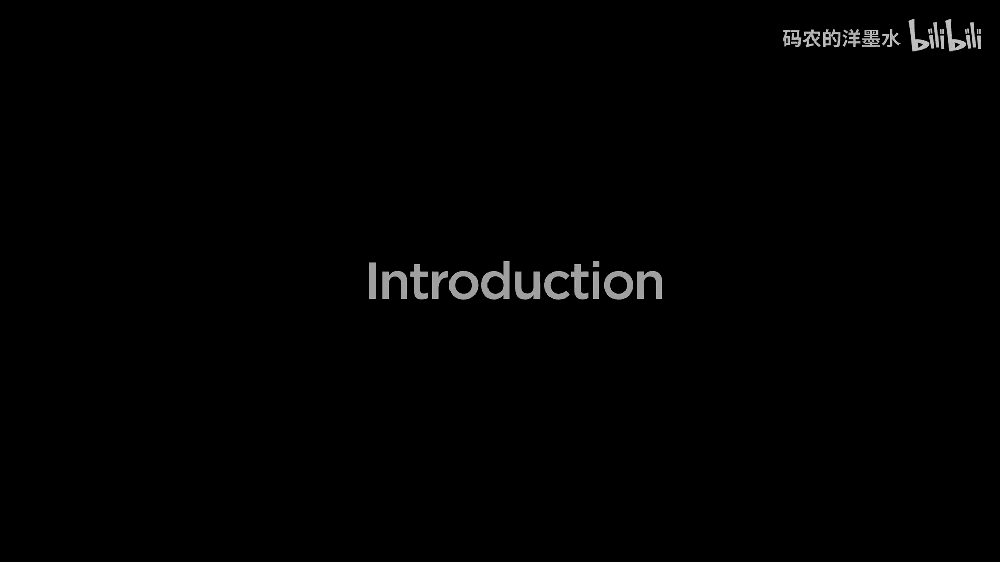
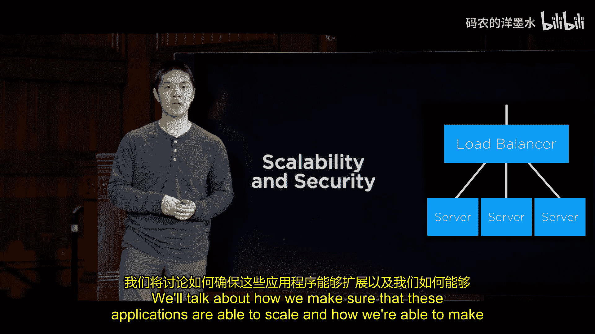
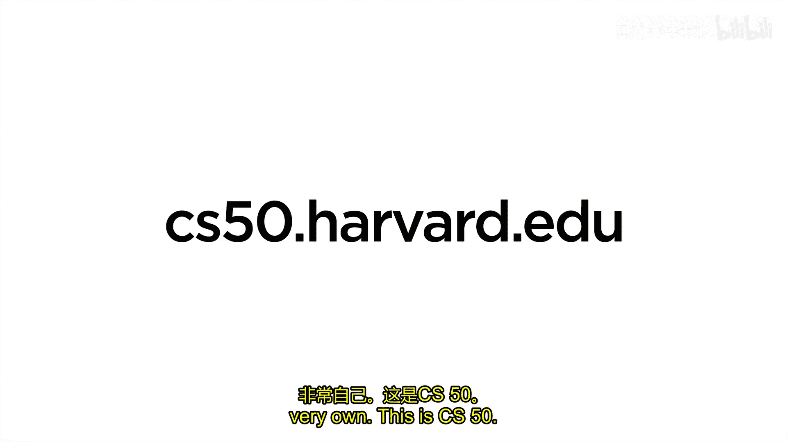

# 【全集】哈佛大学 web应用开发 9小时速成 中英字幕 附完整课件 p01 课程介绍 -BV1RYUsB2Ejz_p1-

🎼。

Hello world， this is CS50 and this is web programming with Python and jascript with CS50's own Brian you this course picks up where CS50 itself leaves off diving more deeply into the design and implementation of web apps with Python。

 jascript and SQL using frameworks like Django， react and bootsottrap We'll start by taking a closer look at H and CSS languages that we can use to describe the structure and the style of web pages After that we'll introduce Git a version control tool that we can use to keep track of changes we make to our code and also to allow multiple people to collaborate on the same project at the same time After that will' dive more deeply into Python。

 exploring some more advanced features of the programming language and in particular how we can use it in order to create dynamic web applications using a web framework known as Django will'll leverage Django and in particular its ability to deal with data working with SQL models and migrations to create web applications that use a database in order to create interactive user experiences After that we'll dive more deeply into。

🎼Another programming language， jascript， exploring how we can use jascript to create dynamic and interactive user interfaces。

 writing code that responds to events and also manipulates a web page in response to some kind of user interaction。

 After that， we'll explore some best practices in industry。

 including testing to make sure that our code works as expected and also continuous integration and continuous delivery to allow us to rapidly make changes and deploy those changes to our code whenever we're able to make those updates。

 And then finally， we'll consider concerns around scalability and security。

 as we take our applications and move them from our own computers to the web where anyone can access them。

 we'll talk about how we make sure that these applications are able to scale and how we're able to make sure that these applications are secure。

 along the way， you'll have an opportunity to put all of this into practice by building web applications of yourvari own。

 This is C50。😊。

