# 【全集】哈佛大学 web应用开发 9小时速成 中英字幕 附完整课件 p02 Lecture 0 - HTML和CSS -BV1RYUsB2Ejz_p2-

嗯。

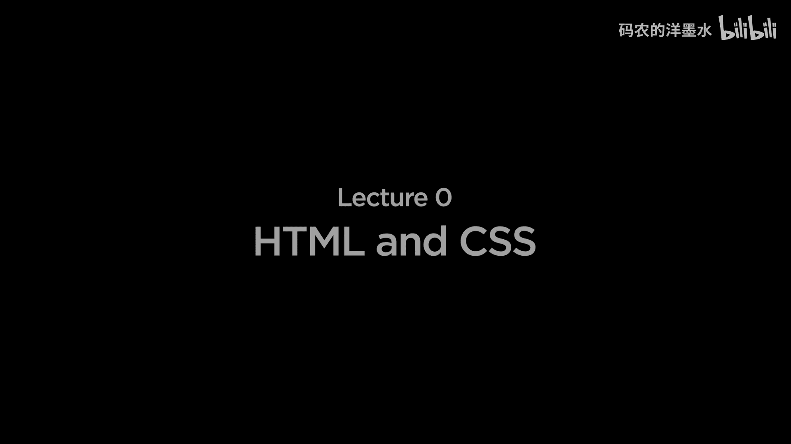

Al right， welcome everyone to web programming with Python and JavaScript。 My name is Brian Yu。

 and in this course， we'll dive into the design and implementation of web applications In lectures。

 we'll have an opportunity to discuss and explore many of the ideas and tools and languages that are central to modern web programming and through hands-on projects you'll have an opportunity to take those ideas and put them into practice。

 designing multiple web applications of your own， culminating in a final project of your own choosing。

😊，Throughout the term， we'll cover a number of topics in this world of web programming。

 beginning with H TM L 5 and C S 3， two of the languages that are central to the understanding of web pages。

 H TML is a language we'll use to describe the structure of a web page。

 And C SS is a language we'll use to describe the style of a web page。

 The colors and the fonts and the layouts and the spacing that make the web page look exactly the way we want it to look。

After that， we'll turn our attention to Git a tool not specific to web programming per se。

 but that we can use in order to version control our programs to keep track of the different changes we make to our web programs and to allow us to be able to work on various different parts of the web application at the same time before merging those pieces back together。

After that， we'll take a look at Python， one of the first main languages that we're going to be exploring in the course。

 which is a language that we're going to use in order to build our web applications。 specifically。

 we'll use Python using a framework called Django。 Django is a web programming framework written in the Python programming language that we're going to use to make it easy to design and develop our web applications。

 Django in particular makes it easy to design web applications that interact with data。

 So after that， we'll turn our attention to SQL。 a language that we can use to interact with databases。

 in particular， looking at how Django allows us to use models and migrations to interact with data and allow users to interact with data all the more easily。

😊。

Next， we'll turn our attention to the second of the main programming languages that we'll be exploring in this class。

 Javascript and looking at how we can use jascript to run in users web browsers to make web pages just a little bit more interactive。

😊。

In particular， we'll use JavaScript in the context of user interfaces。

 looking at modern user interfaces and exploring how it is that those interfaces work and how we can develop those user interfaces with a combination of Python and Java。

Next， we'll turn our attention to testing and C ICD or continuous integration and continuous delivery。

 which are tools that we can use and software best practices to make sure that we're able to design and develop code more efficiently and testing in particular。

 makes sure that as we make changes to our code， we're not breaking existing parts of our web application by making sure that we have a whole suite of tests that we can use to ensure that our web application is always behaving。

 as it should。😊。

And finally， we'll turn our attention to scalability and security on the Internet。

 thinking about what happens as our web application grows larger as more and more different users start to use our web application。

 how do we load balance between those people And what do we need to change about our database to make sure lots of users are able to connect to our web application at the same time。

😊，Moreover， we'll look at the security implications behind designing our web applications。

 What might an adversary do if we're not careful and how should we proactively be designing our web application to make sure that it's secure。

But today we begin our conversation with HTML and CSS。

 two of the languages that are foundational to understanding web pages and how web browsers are able to display those web pages。

 and we'll start with HTML or hypertext markup language。

 which is a language that we can use to describe the structure of the web page。

 all of the buttons and the text and the forms and other parts of the web page that the user ultimately sees and interacts with。

😡。

Our very first H TM L page is going to look a little something like this。

 It's going to be textbased code that we write that a web browser like Safari or Chrome or Firefox is then able to look at parse。

 understand and display to the user。 So let's take a look at this page one line at a time and get an understanding for how it works。

 Even if you don't quite understand all the nuances of the syntax。

 There are probably a couple of things that stand out to you， you might notice the word title。

 which probably reflects the title of the web page， for example。

 which in this case appears to be the word hello。 And then down further below。

 we see that we have the body of the web page that seems to contain the words a hello world。

 So what is this web page actually going to look like， Well， let's take a look at it。😊。

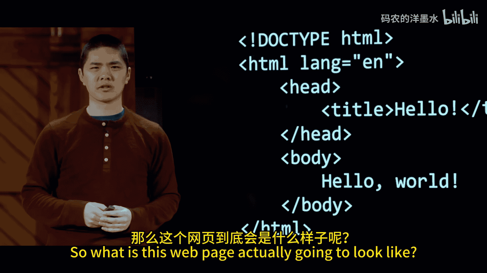

Well go ahead and open up a text editor。 You can use any text editor you want。 But for this course。

 I'm going to use Microsoft's visual studio code， and I'm going to open up a new file that I'm just going to call hello dot H TM L。

Inside of Hello。t HTML， I'm going to enrite the same HTML that we just saw a moment ago and we'll explain each of these lines in due time。

😡，But recall that we had a title of the page that said something like， hello。

And then a body of the page where we said something like hello world， for example。

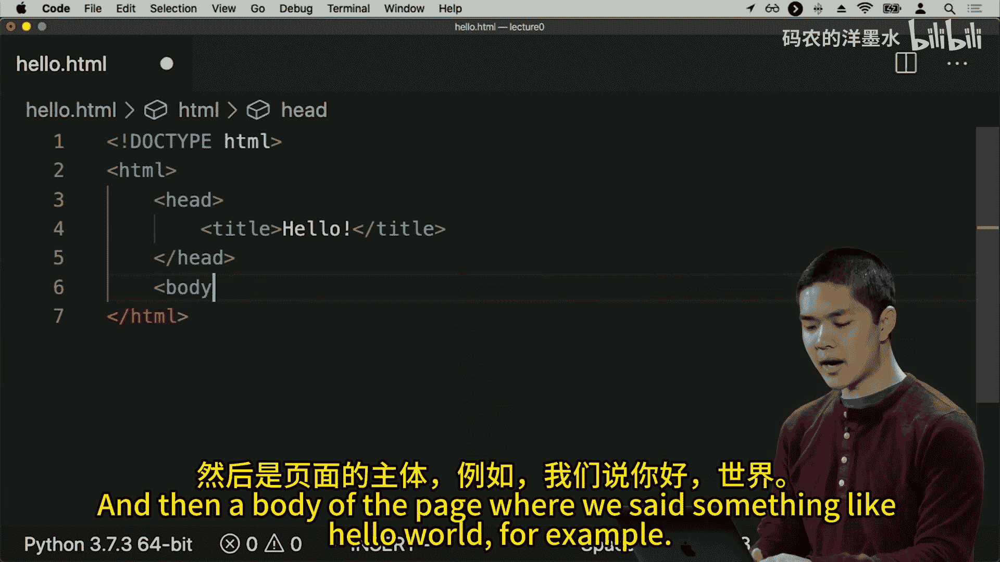

So this is our very first H TM L page。 And if I go ahead and open that H TM L page。

 as by opening hello dot H T M L， for example， inside of a web browser。

 what I'll see is something like this in the body of the page。 I see the words hello world。😊。

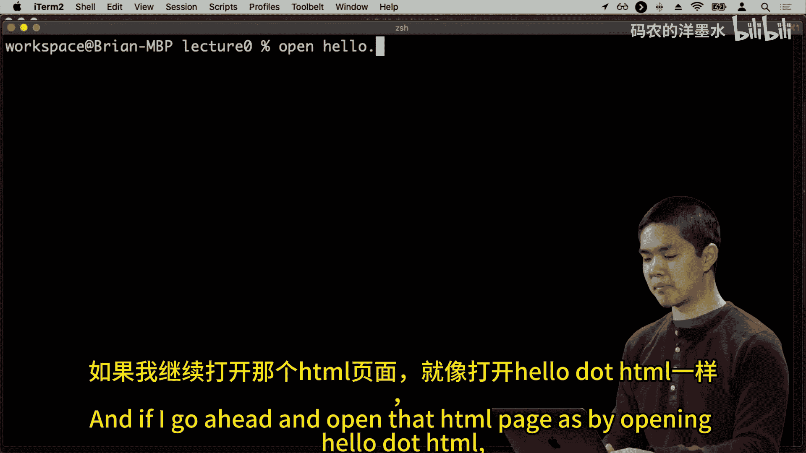

And if you notice up here at the top of my web browser。

 I see the title bar where I have the title for this page， which in this case is just the word hello。

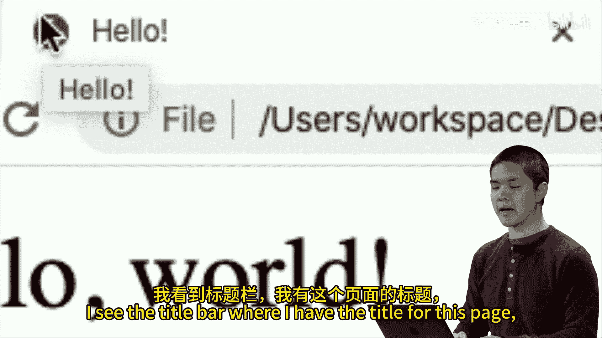

So this is our very first web program that we've been able to develop just using HM。

 And now let's explore in more detail how exactly this program works。😊。

So here again was the web page that we were just looking at。 And this very first line here。

 dock type HM L is what we might call a dock type declaration。

 It's a way of telling the web browser what version of HM we're using in this particular web page because depending on the version of HTMLML。

 the web browser might want to display different information or I might need to parse the page a little bit differently。

H version of HML has had a slightly different way of indicating that version。 but this line here。

 Doc type HM is our way of saying that this HM page is written using HML 5。

 the latest version of HML。After that， our HM page is structured as a series of nested HTML elements where an HTML element describes something on the page。

 and we might have elements that are inside of other elements。

 Each of those elements is indicated by what we're going to call an HTMLM tag enclosed using those angled brackets。

 And right here， we'll see the beginning of the HTML tag。

 which means this is the beginning of the HTML content of our page。😊，Down below。

 this slash H TM L means that this is the end of the HM content of the page。

 and in between is the actual HM content of the page， which might include other HM L elements。

You might also notice that in this H TM L tag， we've specified what we're going call an HM L attribute。

 Some additional information that we're giving about this tag。 in particular。

 we're giving it a la or language attribute which is equal to E N or English。

 This just tells the web browser or anyone looking at the HM L of this page that this page is written in a language and the language it's written in is English。

 and this is helpful for search engines， for example。

 when they're looking through many different web pages。

 trying to figure out what language each web pages is in。

 we can just tell the search engine or anyone else is looking at the page that this page is written in English。

😊。

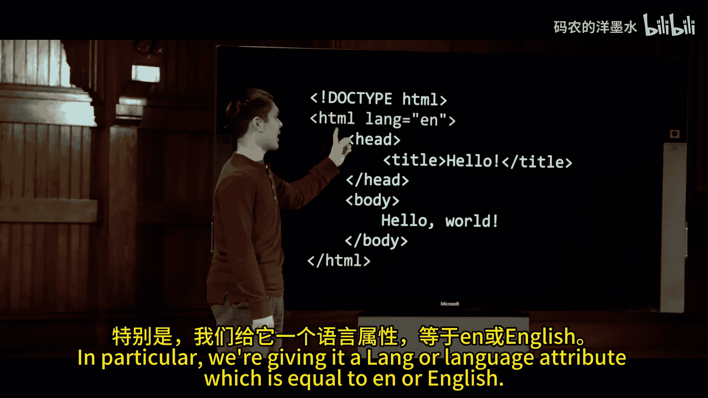

Now， inside of the H body of the page， we have a number of different elements that are going to describe what we want on this page。

 starting with the head section of the web page， which describes stuff not in the main body of the web page。

 the part of the web page the user sees。 but other information about the web page that's going to be helpful or useful for web browsers to know about。

 For example， one important thing that the web browser needs to know。

 is what is the title of the web page。 And here， we see a title tag again。

 indicated by the word title in those angled brackets。

 followed by the end of the title tag indicated by a slash before the title。

 And in between the two title tags is the word hello。

 which means the title of this page should be the word hello。

And that's all the information we'll have in the head of the page。

 We'll add more information there later。 But for now。

 all the web page needs to know is that it has a title and the title is the word hello。

Next up comes the body of the page， again， indicated by a body tag and that ends with a tag with flashlash body。

 meaning this is the end of the body of the page。 and the body of the page again。

 is just the visible part of the page that the user can see。

 And what do we want inside the body of the page For now， we just want the text Hello world。

 And that's the information that's going to be displayed when someone visits this web page。

And so that's all that really is to this HM L page。

 We specified in the header that there's a title of the page called hello。

 And inside the body we're saying the page should say the words hello world。

 And if you want to visually think about the way that all these Hl elements are structured。

 it can sometimes be helpful to think about an HM L page in terms of a treelike structure that we call the document object model or dom。

 And so here， for example， is what the dom for this web page might actually look like here on the left is the Hl content that we just saw a moment ago。

 And over here on the right is the dom， the document object model。

 the treelike structure that describes how all of these HMl elements are related to each other。

 So we start up here with the HMl element。 And this parent element。 so to speak。

 has two child elements within it。 a head element and a body element。 As we can see here。

 where inside of Hm L， we have a head section and a body section。

 And the indentation here that were including in the HM L。😊。

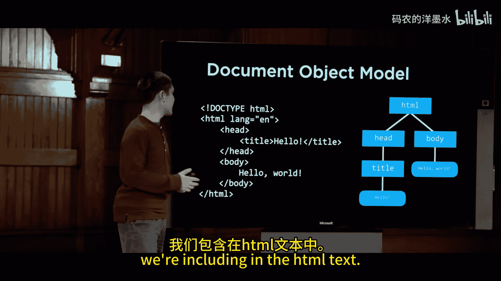

It's not strictly necessary。 The Web browser doesn't care what the indentation is。

 but it can be helpful for someone who's reading the page just to see the indentation to understand visually that the head is inside of the HML element and the body is inside of the HM element。

 too。So inside of the head element， we have a title element。

 and inside of the title element is just the text。 the word hello。 And likewise。

 inside of the body element， we also have some text。 The text hello world。

 So thinking about Hml and Hl documents in terms of this structure can be helpful for understanding which HM L elements are inside of which other H L elements。

 And that's going to make it easier for us to reason about these pages later on。

 and especially as we later transition into the world of jascript。

 Javascript is going to make it all the more powerful and give us the ability to actually modify parts of this done as well。

 But we'll certainly get to that in due time。😊，So now let's take a look at some of the other common H TM L tags and H TM L elements that we might be interacting with in our web page。

 And we'll start by thinking about H TM L headings。 So big banners at the top of a page， for example。

 some headline that describes what a page is about。

So I'll go ahead into my text editor and create a new file that I'll call headings dot H T M L。

 And the structure of this page is going to be pretty similar to the pages that we've seen before already。

 So I'm going to start by just using the hello dot H TM L text and paste it in here。

 I'll change the title of the page instead of hello， We'll go ahead and call it headings。😊。

But inside the body of this page now， I want something a little bit different。

I'm going to inside the body of the page， use an H1 element and say this is a heading， for example。

So H1 is a tag that I can use to create a large heading at the top of my page。

 like for the title of a page， for example。

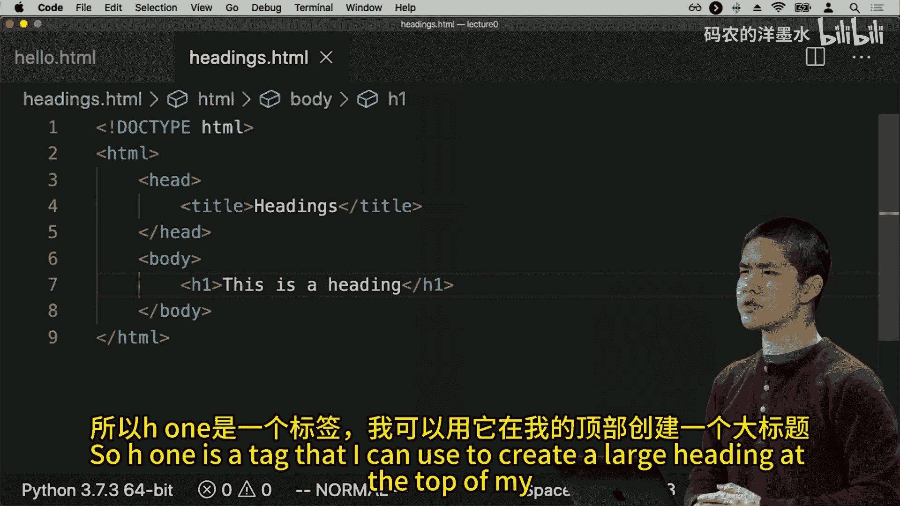

So if I open up headings dot H TM L。

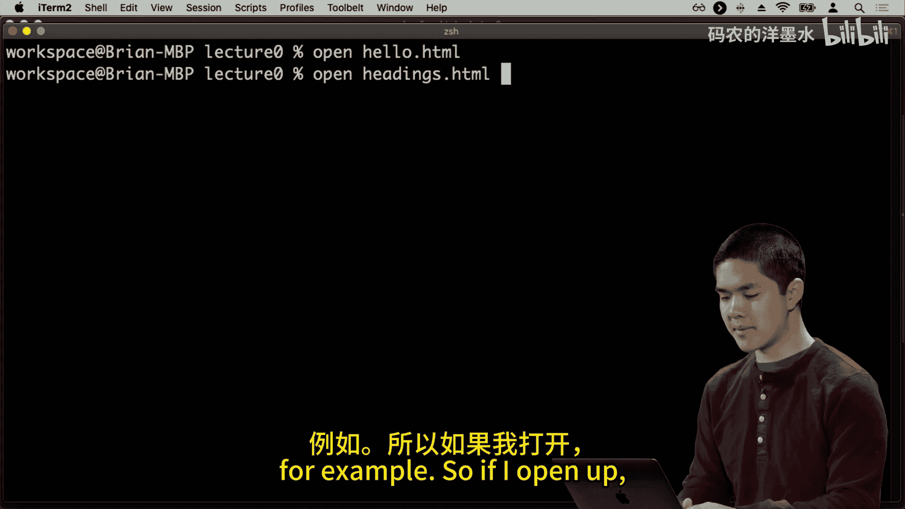

I might see something that looks like this， a big heading at the top of my page that says this is a heading。

H1， where the H standss for heading and the one stands for the largest possible heading。 And。

 in fact， H T M L gives us a number of different tags that we can use in order to create headings of various sizes。

 So， for example， I could also say H2 inside of which I say this is a smaller heading。

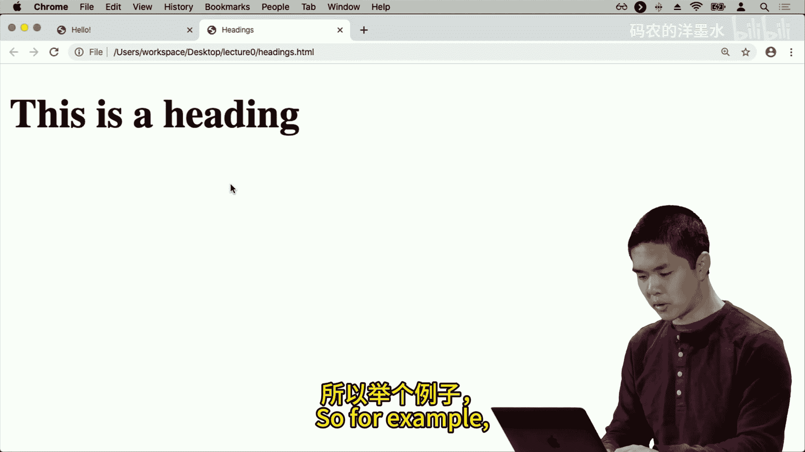

If H1 is the largest heading， H2 is the second largest heading。 So if I load this page， for example。

 I now see the H1 at the very top。 This is the big heading。 And then beneath that。

 I see this is a smaller heading， the H2。 And it turns out there's also H3， H4， H5。

 all the way down to H 6， which is the smallest heading。

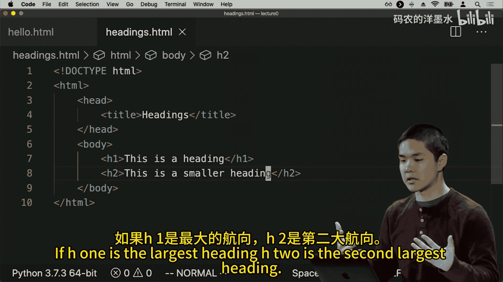

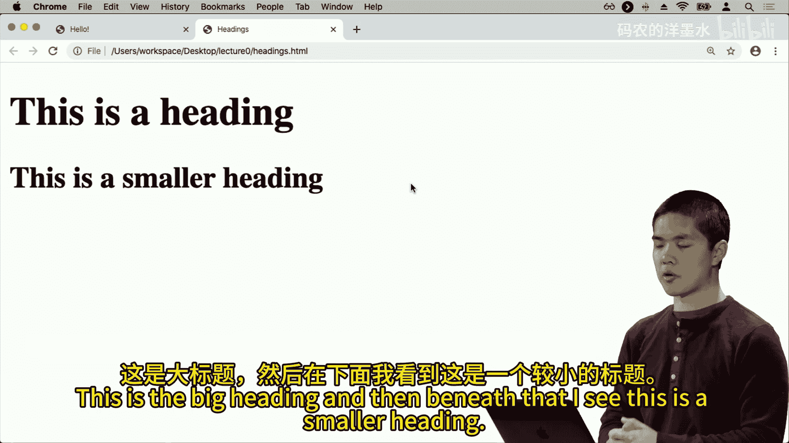

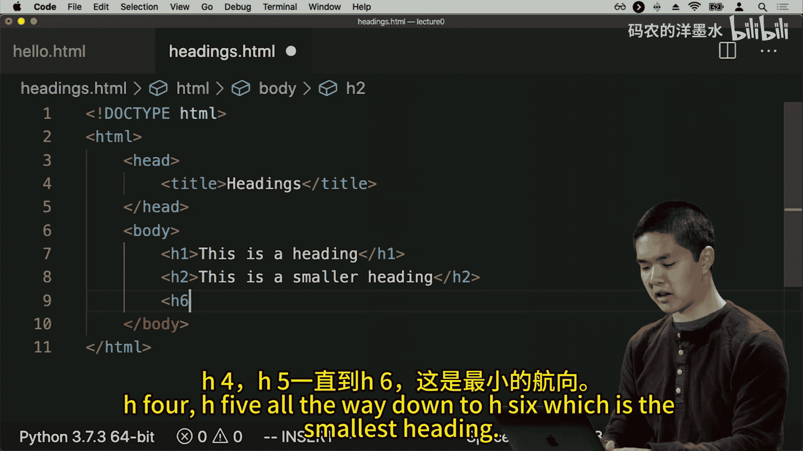

Such that if I load this page now， I have a big heading， a smaller one。 And then here's the smallest。

 So we can often use these H1， H2， H3 tags just for visually organizing text inside of a page。

 If I want the title of the page。

But also， I want titles for each of the various different sections and subsections that might be contained。

Within that page as well。So those are headings。 And now let's also take a look at some other elements that we might want to add on web pages。

 We see not just titles and not just text， but we might also see lists， for example。

 Like if you've ever used a to do list program on a web page， for example。

 you might see a list of things that you need to do or other web pages might display lists of information。

 And it turns out that HML has two basic types of lists。

 we have ordered lists for things that are in a particular order。

 like item number one item number two， item number3。

 and we have unordered lists for lists that don't have any particular order。 So just bullet point。

 bullet point， bullet point， for example， And both are quite easy to use。😊。

I'll go ahead and create a new file， and we'll call this lists dot HtM。And again， in L dot HTMLtml。

 I'll copy the same structure from Hello dot Ht。 We're again going to have doc type HTML just to indicate the version of HTML。

 Most of the heading is the same。 I'm just going to change the title from hello to lists。

 and then we're going to replace the body of this page to show some different information here。

So let me first show what an ordered list might look like。 something that has numbers 1，2，3。

 and ordered list as an H T M L tag is just O， L， O L for ordered list。

 So I can add a tag that says O， L。😊，And now， inside of my O L element， my ordered list element。

 I need a new element for every list item。 list item， we're going to abbreviate to just L I。

 So the L I tag in H TM L is what we're going to use to designate an item inside of an H TM L list。😊。

So here， for example， I could say L I and then first item。 And then I could do the same thing。 L I。

 second item。 And then again， L， third item。So what I have here are some elements and then elements nested within other elements。

 I have an ordered list element inside of which are three other H elements。

3 list items that are each indicating each of the individual items that are inside of my HM L list。

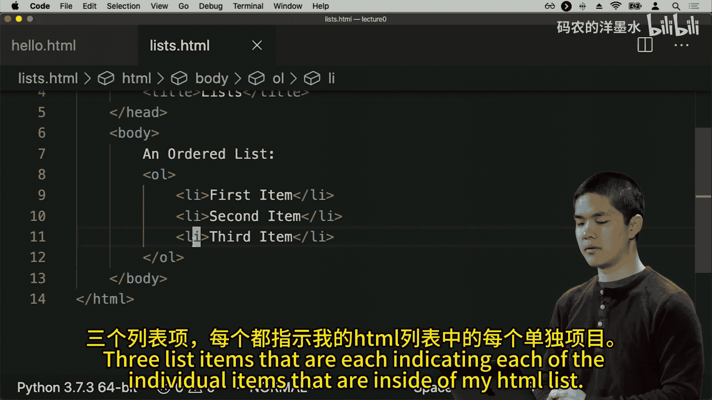

I can now open this up by opening lists dot H TM L。And this is what I see。

I see an ordered list where I have item number one， first item， Second item， Third item。

 Note that I didn't actually need to in the H TM L anywhere， specify the number one。

 the number two and the number 3。 when my web browser reads that this should be an ordered list。

 My web browser Chrome in this case just adds those numbers and for me。

 because it knows what an ordered list means。 and it knows how to take the H TM L that I've written and display it in the way that I intend to to the user。

😊。

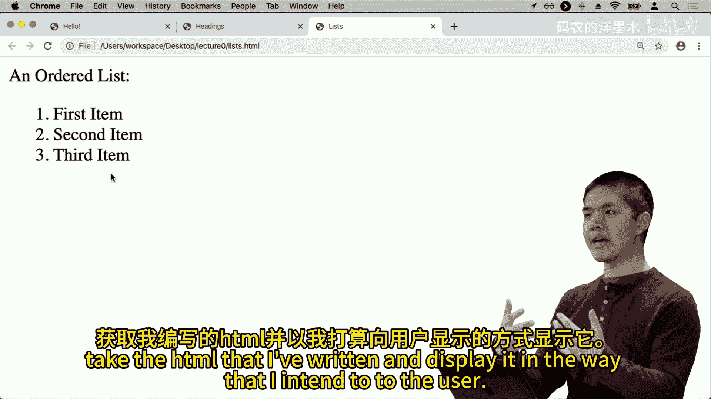

Now， in addition to ordered lists that all have numbers 1，2，3。

 we also have unordered lists that are just bullet points， bullet points of information。

 So I could up above， add some more content to this H M L page。 I can say here is an unordered list。

And just as an ordered list， we represented using the OL tag in HTML， OL standing for ordered list。

 Likewise， we can use the UL tag in HTML to create an unordered list， U for unordered。😡。

So here we're gonna add a U L tag。 And again， my text editoror here is automatically adding the closing tag here。

 this slash U L， meaning the end of the unordered list。 and many text editorors will do this now。

 just so you， the programmer， don't forget to add that。And now inside of this unordered list。

 we're again going to have some list items。 Also using the LI tag。 Here is one item。

 and here is another item。And here is yet， another item。

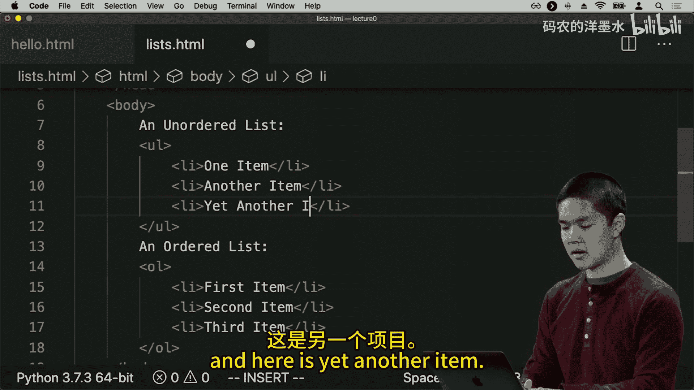

If I go ahead and refresh the page now， I'm still on list HTMLM。

 I now see that on top of my ordered list， I have an unordered list where each item instead of being numbered 1。

2，3， is instead labeled with just bullet point， bullet point， bullet point。

 where each of these bullet points and each of these numbered items is a list item element or an LI。

😡。

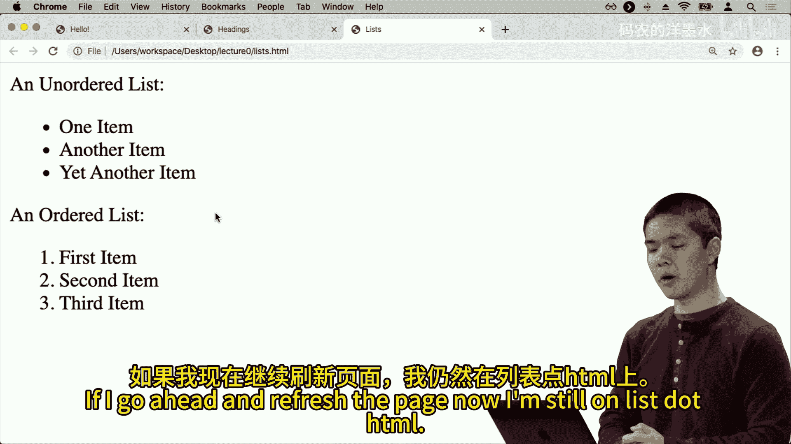

So hopefully now we can see that as we start to explore these various different HTML tags and nesting HTML tags inside of one another。

 we're able to create more and more interesting web pages as a result。😊。

So let's explore now what other types of web pages we can create using other types of HM L elements。

 In addition to lists， one thing you might imagine is that one of the important things on the Web is not just displaying text。

 but also displaying other types of media， like images， for example。

 So how might we go about doing that。Well， I can， for example， let's go back into my text editor。

 Let me create a new file that I'm going to call image dot H TM L。

 which is going to contain some code for displaying some images。

 I'll go ahead and go into hello dot H T M L and copy this text into the page。 again。

 change the title to image。 And now inside of the body。 I'm going to add a new tag。😊，Called image。

And the image tag has a couple of required attributes。

 Remember that attributes are what we saw before。 things like adding a Lng equals E N to the top of my page to indicate that this web page is written in English。

 for example。And the image tag has a couple of required attributes that I need to add in particular。

 when I display an image on the page， I need to specify what image I actually want displayed。

 for example， So I might specify image S RRC short for source is going to be equal to what image do I actually want to display on this page。

 And it just so happens that inside of my folder where I have image H TM L。

 I have an image called cat dot Jpeg。 So I'm just going to specify cat dot Jpeg as the file name of the image that I want to display。

And it turns out that images also have a second required attribute。

 In addition to the file name or the link to whatever image I want to display。

 I also need to provide some alternative text， a textbased representation of what you're going to see on the image。

 because in some cases， some web browser might not be able to render the image correctly。

 You might imagine if there's some error rendering the image or if someone's on a slow Internet connection。

 Or if someone's using a screen reader and therefore can't actually see the image。

 We want some textbased representation of that image as well。 And so I'll provide some alt text。

 some alternative text that can be used to substitute the image in case for some reason。

 we can't display the image。 And the alt text that I'll use in this case。😊。

He's just going to be the word cap， for example。And that's all I need。 Now， notice in particular。

 there's something a little bit different about this image tag compared to other tags that we've seen before in the sense that it doesn't have a closing tag in the sense that the body had a beginning of the body and an end of the body。

 our ordered list， had a beginning of the ordered list and the end of the ordered list with list items in between。

 It doesn't really make sense for for an image， for example。

 have the beginning of the image and the end of the image and some content in between。

 because the image is just a single Hml element that can't really have anything inside of it。

 So in that sense， we don't actually need a closing image tag。 The image tag is self-cloing。

 It is its own beginning an end。 So we can just say we want an image to be here。

 that is cat do Jpeg with an alternative text of just the word cat， for example。So now。

 if I open up image dot H T M L， we'll see that what gets loaded is quite large。 a picture of a cat。

 And I can scroll around and see this entire image。😊，Of course。

 this picture of a cat is probably larger than I wanted it to be。

 I probably when my user visits this web page， I don't want them to have to scroll all the way to the right in order to see the entire cat。

 So I can actually add additional H TMl attributes in order to modify the size of the image that I'm displaying。

 And later， we'll see we can use C SS to do a similar thing as well。 But for now。

 what I can add is an additional attribute。😊，And say that let me give Cat do Jpeg this image tag another attribute that in this case。

 I'll just call width。 and I'll say that width is going to be equal to 300。

 because I would like for this image to be 300 pixels wide， for example。

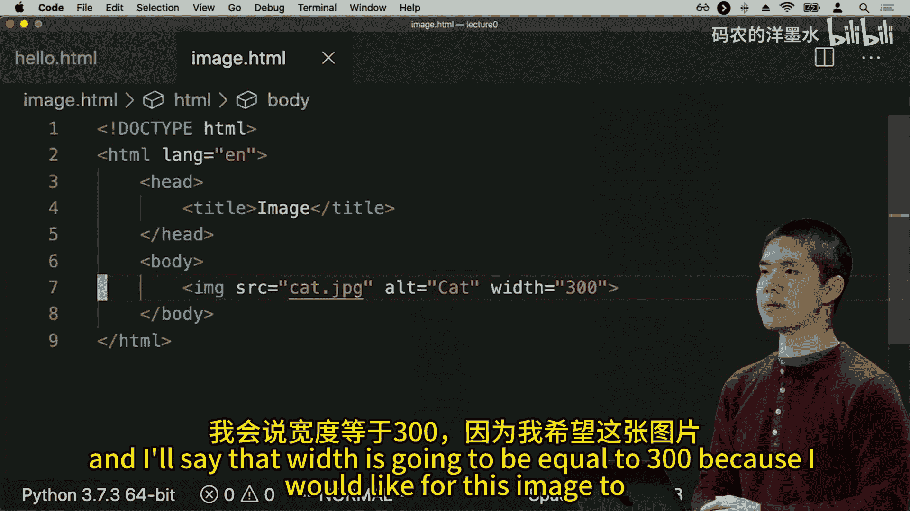

So now if I refresh this page， I now see that the same cat image appears。

 except now it appears at 300 pixels wide exactly， so I'm able to add additional attributes。

 additional information to control how an HTMLM element is going to appear。 In this case。

 I want to control its width and it automatically scales down the height to make sure that the image is proportional as well。

😊。

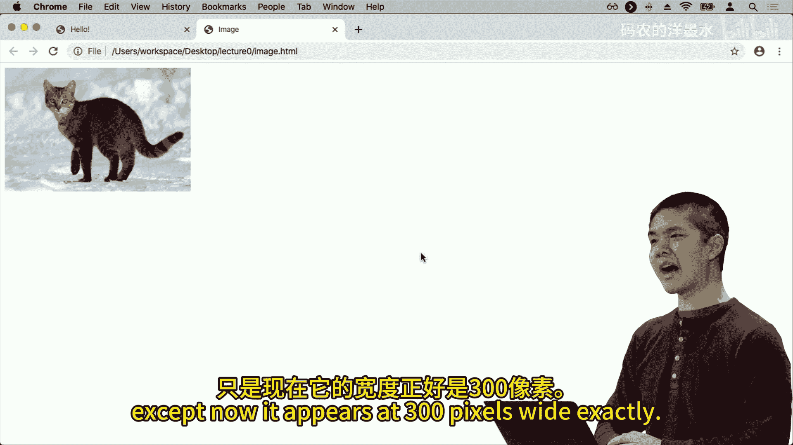

Now， on the Internet， in addition to just displaying information on a single page。

 it's also common for a page to link to other pages。 In fact。

 that's one of the main important values of the Internet is the ability to go from one page to another via these links。

 And so one thing we might reasonably want to do is add some links to our page where if you click on something you're taken to another page altogether。

So let's take a look at an example of that。I'll create a new file based on Hello dot H TM L。

 and I'll add Ling equals English for good measure。 And I'll call this new file link dot H TM L。

 Were here we're going to practice with building some links into our H TM L page。😊。

I'll copy the content of Ho。ht again。Call this link。In order to create a link。

 I'm going to use a tag called the A tag short for the anchor tag。

And the A tag takes one important attribute， which is called H Ref for hyperlink reference。

 which is going to specify what page I would like to link to。So if， for example。

 I wanted when a user clicks on this link to go to Google dot com。

 then I'd set the Hf attribute of this tag equal to H T TPS， colon slash slash Google dot com。

 for example。Then inside of the a tag， I would specify what text I want to display。

 What text should the user see， such that when the user clicks on that text。

 they're taken to the web page。 In this case， I'm just going to say something like click here。

 for instance。

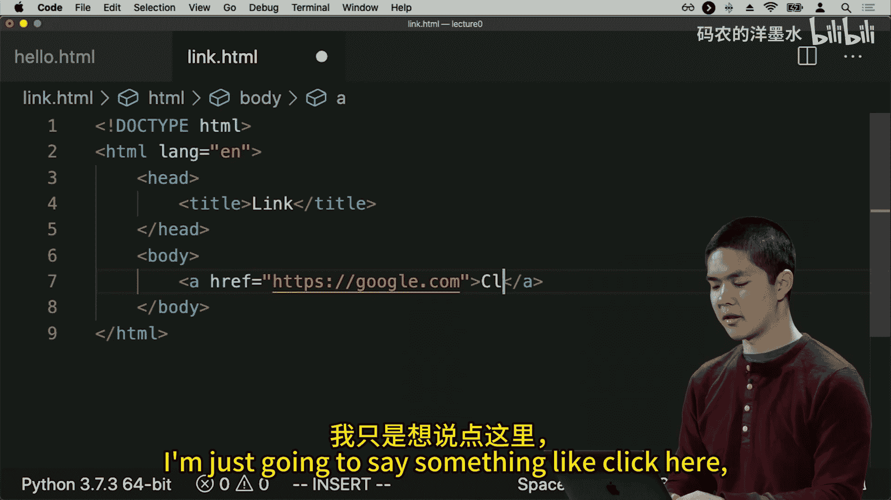

Now， if I open up link。 HTMLtm。

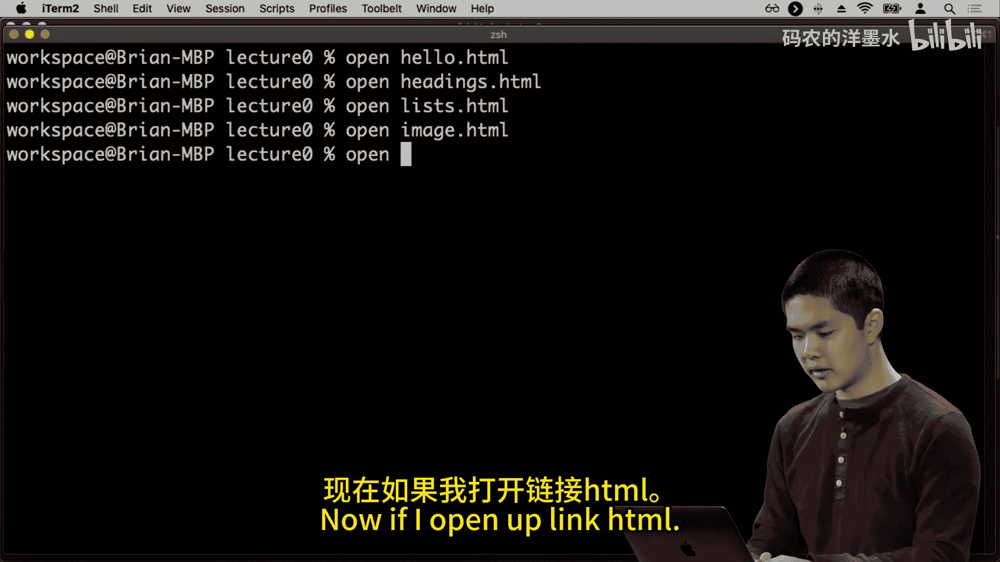

This is what the user sees， you see a blue link that says click here。😡。

And when the user does click on that link。They're taken to HTPS colon// Googlegle。com。

And it turns out that we can use this Hf attribute not only to link to different websites altogether。

 but we can link to different pages on the same website。 So， for example。

 if I wanted to link to that cat page that I designed a moment ago。

 instead of linking to Google do com， I could instead just link to image do H TM L。

And now if I save that and refresh， or if I open up link dot HTMLtl again。

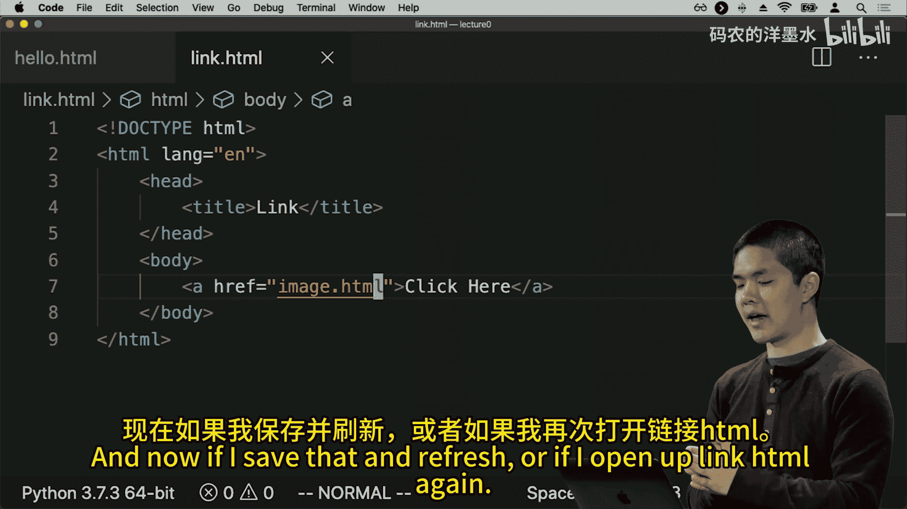

Now I see a click here link where when I click on click here， now I'm taken to that page。

 Catim dot H T M L that happened to have that picture of a cat from before。

So using these anchor tags and H F attributes， we're able to link together multiple pages so that if we have a website that has many different web pages。

 we can connect them all together by using a combination of these various different links。😊。

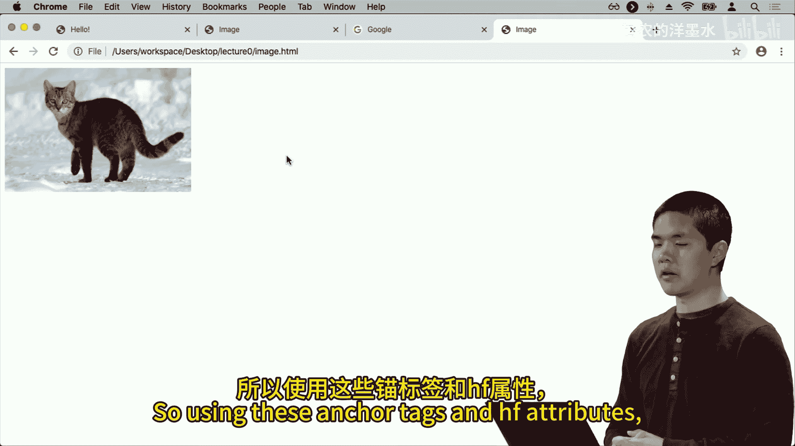

So now that we've seen images and links and list。 what other H TM L elements might we add to our web page。

 Well， one thing we might want to add are things like tables。

 just other ways of displaying information。 So let's go ahead and create a table and look at what H TM L elements we can use in order to do so。

So I'll go back here to my text editor， create a new file called table。htm。

 using the same starting HTML， we'll call this page title table。And inside the body of this page now。

 there are a number of different H TML elements that we'll need in order to create a table because as you might imagine。

 a table is really composed of multiple parts。 We have our big table。

 but each table is really just a sequence of individual table rows。

 And each of those rows is really just a sequence of individual cells of data within that table。

 And so that structure that we're im。 A table that consists of individual rows where each row consists of individual cells is exactly how we're going to represent this table in H TM L。

😊，We're going to start with just a table tag that's going to represent the entirety of this table。

But inside of the table， we might have different parts。

 We might have the heading of the table and we might have the body of the table。

 So in order to represent that， I'll add T head that's going to stand for the heading of the table。

 the stuff at the top of the table that might indicate what each column of the table means。

 for example。 And let's see what columns do I want。 Well， let's go ahead and add some table headings。

 which I can represent using the T H tag H for heading。

And maybe I want in this web page to display information about various different oceans， for example。

 So maybe I have one column for the ocean and another column。

 another table heading for the average depth of that ocean and another table heading for the maximum depth of that ocean。

And that'll be the very first row of that table， the heading of the table。

 But in addition to the heading of the table， we also have the body of the table。

 So underneath the T head， I'll go ahead and include T body body for the main part of the table where all my data is going to be。

 And that body is going to consist of individual rows of a table。 So I might have a T R。

 which here stands for table row。And inside of this table row。

 we'll go ahead and add some individual data points inside of the table。 So inside of my table row。

 I'm gonna have one table data point or TD for table data that says Pacific Ocean， for example。

Then another table data that says 4280 m， and then another one for the maximum depth of the Pacific Ocean。

 which is 10911 m。 And in fact， this these three tableheads as well at the top of the page。

 the ocean， the average depth in the maximum depth。

 Those should actually probably be in a row of their own as well。

 because the very first part of the table， that is also a row。

 So I'll go ahead and add a T R short for table row。 And inside of that T R。😊，Put these headings。

I'll go ahead and add one more row just so we can see what this looks like。

 And then we'll take a look at the page and then go back to this code。 I'll add the Atlantic Ocean。

 too。Which has an average depth of 3646 m， as well as a maximum depth of 8486 m as well。

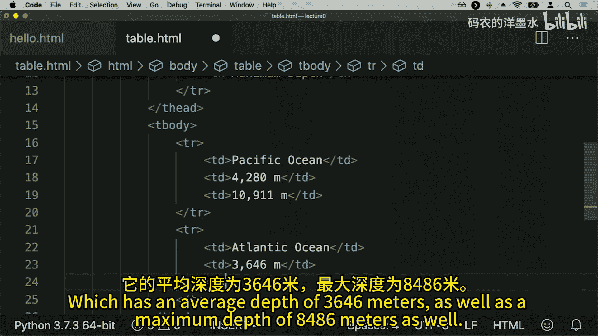

So when I open up table dot H TM L now， here's what I'm going to see。

 I'm going to see a table like representation of the data。

 It's not just one thing after another after another anymore。 It's structured in a table Now。

 granted， there aren't any borders。 And I can probably add some colors in spacing to make this look a little bit nicer。

 But I see three columns， ocean， average depth and maximum depth。

 where this very first row is what we might call the table header。

 The very top of the table that's defining what all of the columns mean inside of that table header is a single table row that has three table data cells。

 Ocean average depth and maximum depth。😊。

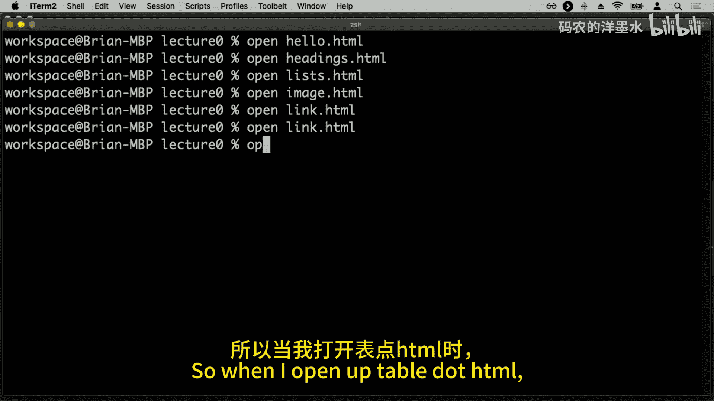

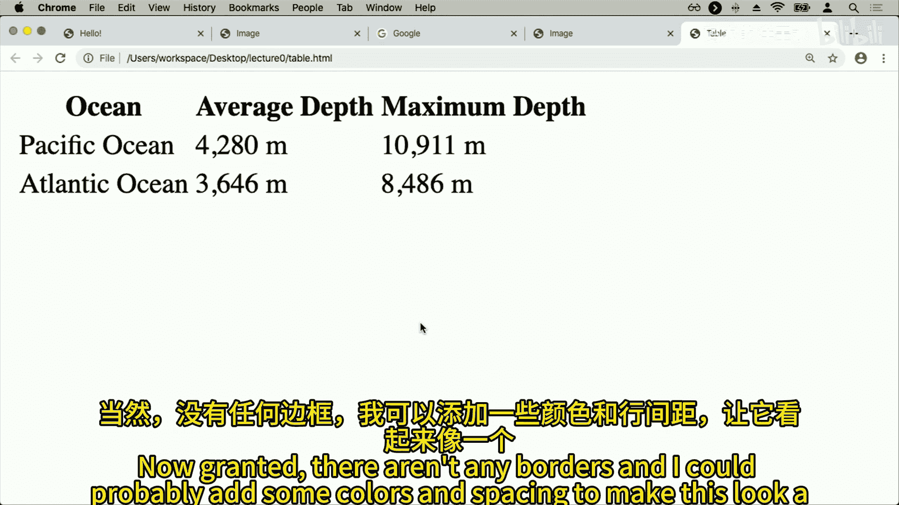

Then beneath this table header represented in bold is the table's body or the T body element。

 inside of which we had two rows， one for representing the Pacific Ocean。

 one for representing the Atlantic Ocean， and then we had data cells in each one of those rows for representing each of the individual cells that's located within this table。

😡。

So this is what that page ultimately looks like。 And let's take one more look at the HMl just to get an understanding for how all of these tags interact with one another。

 And no need to memorize all these tags right now。 slowly as you begin to design Hl pages。

 you'll start to get more familiar with what HMl tags are available to you And certainly all of these H Tl tags are things that are easy to reference if you need to look them up。

 It's very helpful to be able to look up something like how do I create a table in Hml。

 And then you'll be able to see what the various different tags you'll need to add are in order to generate the table that you're looking for。

😊，But again， just to recap here， we have a table element inside of which are two child elements。

 T head and T body inside of each of those are one or more table rows representing using T R。

 In of each of those are three table data cells representing using TD。

 And so using these nested tags， elements inside of elements inside of other elements。

 We've been able to build something far more complex than just a bulleted list。

 We've been able to build an entire table that has information as well。😊，But ultimately。

 our web pages should be web pages that don't just display information。

 but that also let users interact with that information in some way。 For example。

 you might imagine that on Google's homepage， for example， it's not just unchanging。

 There's a field where I can type something in。 And anytime users can provide input to a web page。

 we generally call that a form or some place where a user can fill out a form in order to provide information to the web page。

 And so now， let's take a look at how we can use H TM L in order to create a form that's going to display some information。

😊，So I'll go ahead and create a new page called Form。html。Again， using that same HTML as before。

WeCall the page form。And inside of the body of this page now。

 let's say that I want to create a form that gives the user an opportunity to provide their full name。

 For example， How do I do that， Well， the first thing I need is a form element。

 some way of saying here is going to be a form。And now， inside of that form。

 what are the various different parts of the form， Well。

 there's really two parts that you might imagine to this form。

 One is a place for the user to actually type in their name。

 and they probably also need some way to submit the form。

 some button that just says submit such that they can click on that button in order to submit the form。

So how would we do that， Well， in order to create an input field， we're going to use an input tag。

Whose type in this case is going to be text。 There are a number of different ways that users might provide input to a forum。

 They might type in text。 They might choose from a dropdown menu。

 They might choose from a radio button option or they might provide input as by clicking on a button。

 for example， In this case， we're specifically using the type attribute to say that when the user is providing input in this way。

 The type of input that they're providing is going to be some kind of text。

Then we might provide a placeholder。Some default text that's going to be inside of that input field。

 The first time the user looks at the page。 So， for example。

 the placeholder might be full name that way， the user knows that what they should type into this place into this placeholder is their own full name。

And then finally， we're going to go ahead and give a name to this input field。

 Now this isn't going to be something that the user sees when they visit the page。

 but anytime you submit a form when we receive that form in our web application。

 something we'll explore later on， we need some way of knowing which input field corresponded to which value and so we're going to name each of the input fields just so that later on we'll be able to reference them。

😡，And for now， since the user is typing their full name here， we could just name this full name。

 or we could more succinctly just say name as the name of this input field。After that。

 we have an input field where the user can type in their name。

 and now we need some way for the user to be able to submit this form。

 So we might say something like input type equals submit to say heres a way for the user to submit the form。

 typey equals submit means this is how they're going to submit the form when they're done Comp again。

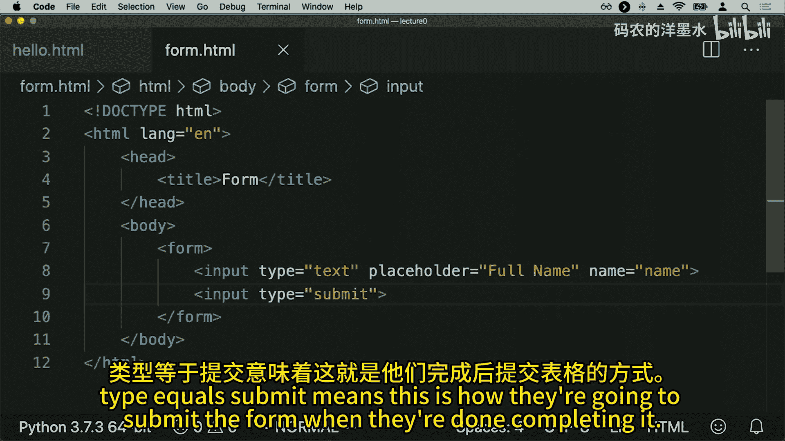

Now， if I open up form dot H TM L， this is the page that we're ultimately going to see when we load this H TM L。

 This entire page just contains a single HMl form， but that H TMl form contains two parts。

 The first part was this input element here that allowed an opportunity for the user to type in their full name。

 They type in their full name into this input field。 And when they're done。

 they can click this submit button to indicate that they would like to now submit this form。😊。

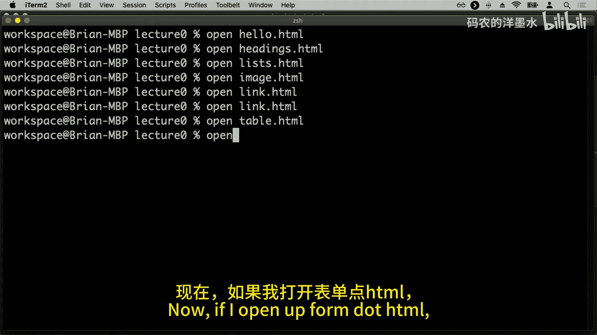

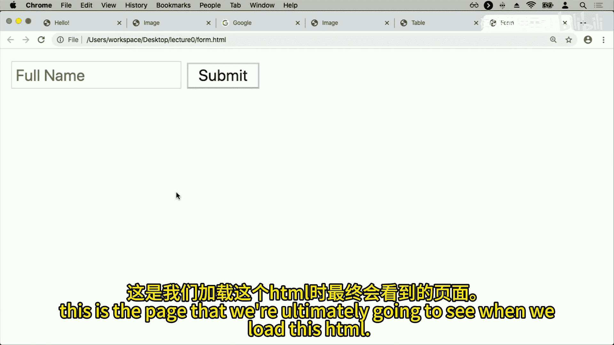

Of course， right now， this form isn't going to do anything when we type in our name and click submit because we haven't added any logic in order to handle this form。

 but later on， as we transition into the world of building web applications using Python。

 we'll see how we can design a form such that after the user submits it。

 we save information to a database or display some sort of results back to the user all by using the power of building these web applications and connecting them to these sorts of HTML forms and HTMLl forms can actually get quite a bit more complex。

 We'll take a look at another example， for instance let me open up Form 1 Form1 do Hm。

 which is a form that I built in advance。😊。

W shows a number of other ways that users can provide information as input to an HTML form。😡。

Here we see an input whose type is text， meaning we want the user to type in their name as text。

 But you might also imagine that if a user is logging into a website， for example， they might。

 in addition to typing in a textbased name or username or email， also provide a password。

 And generally， if you've been on a website and you've typed in a password。

 the password characters don't all show up as the actual characters for security reasons。

 they generally show up as just little dots on the screen。

 hiding the actual characters that they're representing。 And an H。

 we can do that very easily by just saying that the type of this input is password。

 if they' typing in a password， our web browser will know not to actually display those individual characters。

😊，In addition to just textbased input， we also have radio button input， as I alluded to a moment ago。

 So here we have a number of different radio inputs where the user might be able to select from a number of options。

 choosing their favorite color， for example， from a number of these options。 And finally。

 just to take a look at one other additional feature of HM L 5。 In fact。

 a new feature of HML 5 is something we might call a data list where we might have the user choose in a drop down from a number of different options。

 but we want to very quickly filter down or autocomplete based on those options。

 So if the user needs to select what country they're from， for example， we might have an input field。

😊，And specify that it's going to be associated with a list called countries。

Then immediately below that， I have a data list element whose ID is countries where here I'm going to specify These are all of the options for what country we could have。

 Each one is inside of an option element， whose value is whatever country they could select。

 And we have all of the countries of the world listed in these option elements。

So this input here is going to allow me to select one option from a list of all of these possible options。

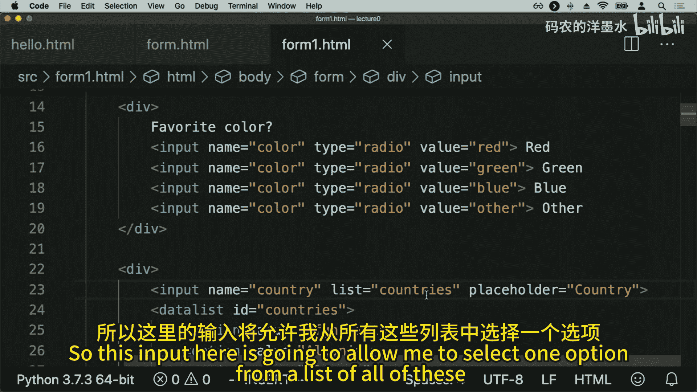

So now if I open up Form1。 HTMLm。

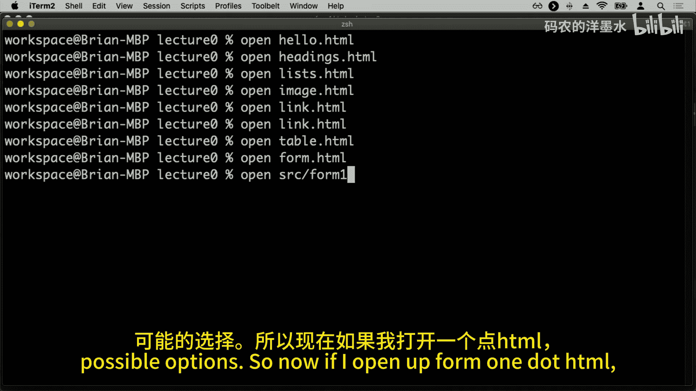

Here is what that form ultimately looks like。 I can hear inside of the name field。 Again。

 that word name shows up because it's the placeholder。 I can type in my name here。

And inside of the password field， anything I type is going to show up as just little dots instead of the actual characters。

 because the type of that input field was password instead of the type being text。In favorite color。

 I now have the ability to choose between various different favorite color options in a radio button format。

 I choose from one of a number of options。 And finally， inside this country dropdown。

 I have the ability now when I click on it to see all of the countries。

 But as I start to type letters like UN and I T， it filters down to only the options that I actually care about。

 So here if I type in enough letters eventually， I see United States。

 and I can click on that option as well。😊，So H TM L 5 builds in these additional features to make it easy to implement something like a text field where it will autocomplete based on the text that you provide。

 You can just specify that it is inside of this data list and then provide a list of all the possible values。

 and then H TML and your web browser in turn， will take care of the process of rendering that information in the way that you expect it to be displayed。

😊。

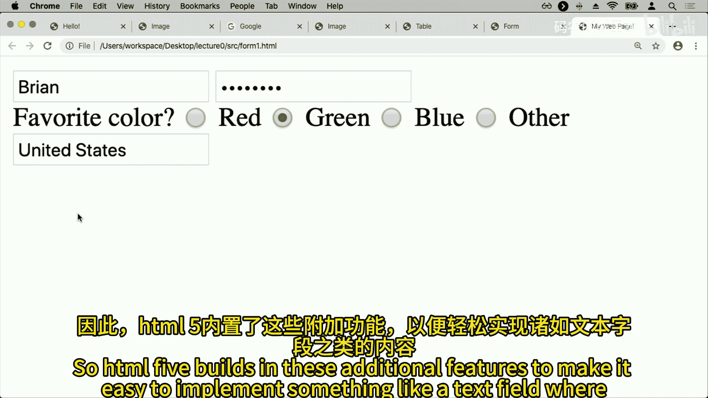

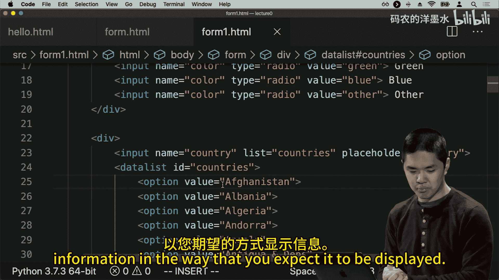

So those are just some of the possible HM elements that we can ultimately create by using these various different elements that we nest within each other。

 And there are definitely other H elements that exist as well， that you can begin to explore。

 but all of them follow a very similar pattern that we're going to have some tag that might require some attributes。

  additional information about the HM to give context to the web browser for how that element should be displayed。

 Maybe that element needs to have a particular source for an image。

 maybe it needs a link in order to link to somewhere or other information as well。

 And then inside of that element， you might nest other elements so that your table has rows and inside of those rows。

 we have other cells， and you might imagine nesting elements inside of other elements inside of other elements。

😊，But right now， so far， all of our web pages have been rather simple。 They've just been。

 we've described the structure of the page and we've described we want a list here。

 We want to form there。 What we might really like is some way of specifying that we want to style our web page in some way。

 We want to add color。 We want to add spacing。 We want to add some sort of other layout to our page as well。

 And in order to do that， we're going to use a second language that we're going to call C SS for cascading style sheets。

 in particular， we'll use the latest version of C CSS 3。

 which gives us the ability to take an HMl page and tell the web browser。

 how we would like it to be styled。 instead of just black text in the same font on a white background。

 we can begin to specify particular CS properties of how we would like this page to look to make sure that the page looks the way we want it to。

😊。

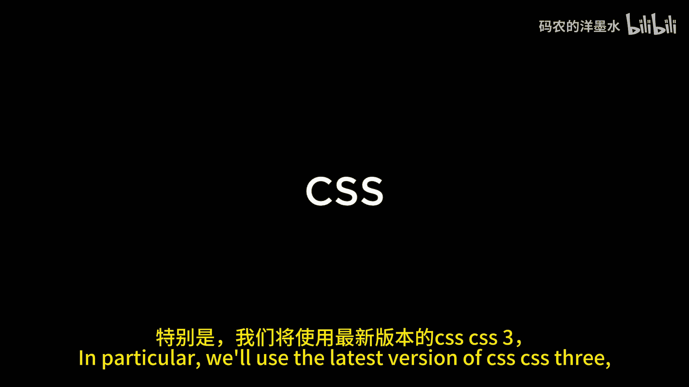

So let's take a look at a simple example now of CS to take a look at how we can add some CS code to our page。

So I'll go ahead and create a new file that I'll call style do HtM just to demonstrate some basic ideas of adding some style to our page。

 and we'll go ahead and copy the same hello to H TML from before。

And maybe in addition to Hello World， I display an H1。

 some big heading at the top that says like welcome to my web page， for example。😡。

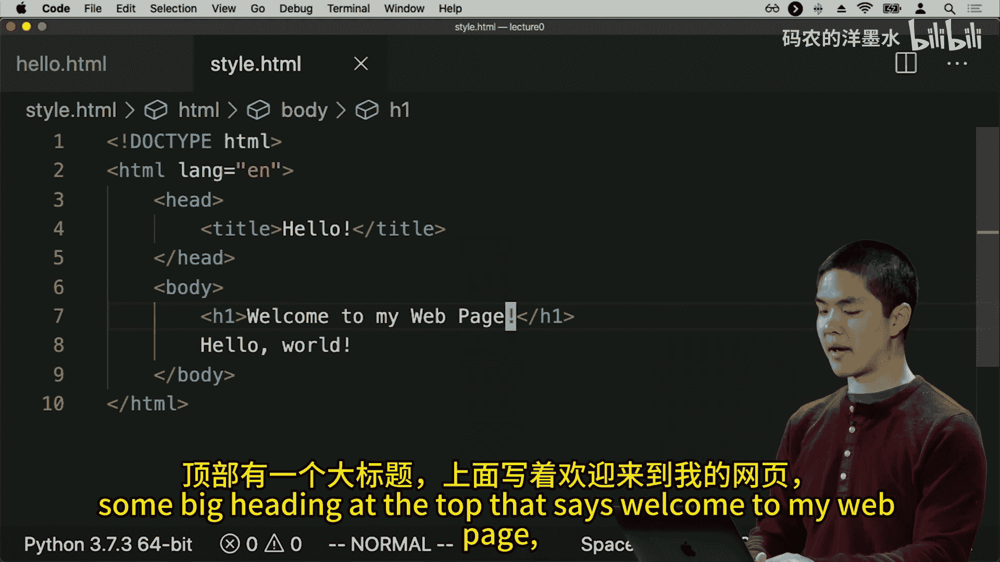

So now if I open up style HTML。This is what I see。 I see a big heading at the top that says。

 welcome to my web page， beneath which is just the text hello world。😊，And now。

 imagine that I want to add some style to this heading at the top of the page。

 Maybe instead of being left aligned， I want it to be centered。

 Maybe instead of just being black text， I'd like to change the color in order to do that。

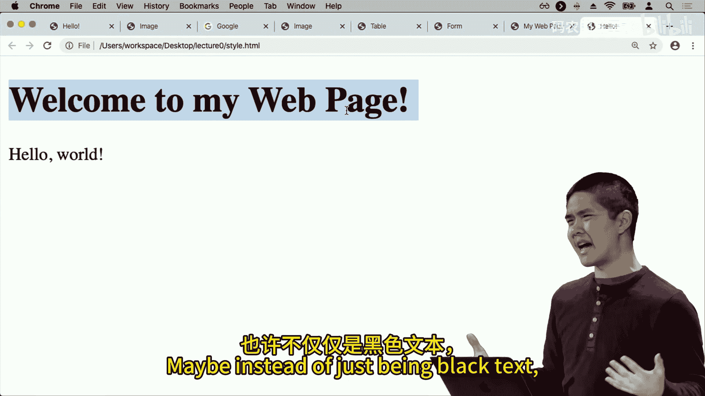

Just as we've used attributes in the past to add additional information to this particular H L page。

 we can do a very similar thing with CS。 We can specify that we're going to give this H1 element a style attribute。

And that is going to be equal to。 And then in quotation marks。

 we're going to provide all of the CS properties that we would like to add to this particular element。

 So the way that CS styling works is that we can give elements individual CS properties where a property is something like the color of the element or the alignment of the element。

 And each of those properties has a default value， but we can change its value to something else。

 so if， for example， I wanted to change the color of this heading so that instead of a black heading。

 it displayed as a blue heading。😊，I could say for this H1， I would like to give it a color property。

And then to give the color property a value， I say color colon。

 and then the value that I would like to give to it。 So color colon blue， for example。

 followed by semicolon， will change the color of this H1 element to blue。

 And my text editor is automatically showing me a little square that shows me what this color blue is actually going to look like。

 This isn't part of the text。 It's just my text editor being helpful so that I can see in advance as I'm writing this code。

 what the color is actually going to look like。😊。

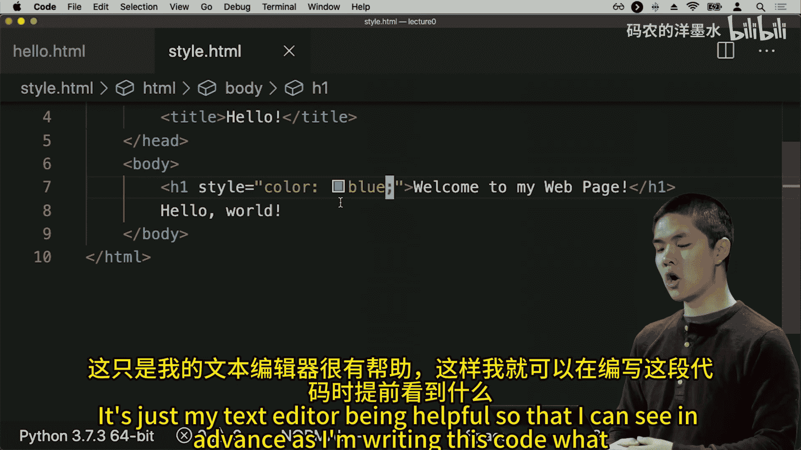

So now if I open up style dot H TM L， here's what I see。 Instead of a black heading at the top。

 we've changed the color to blue。 And there are many other builtin colors that exist within HMl that we can use in order to change the color to whatever we want。

 If instead of blue， I said I want the color to be red， for instance， I can refresh the page。

 And now the heading is red And there are many other colors。

 I can change the color to like spring green， for instance。

 And that's going to be a particular shade of green。 that displays just like this。😊。

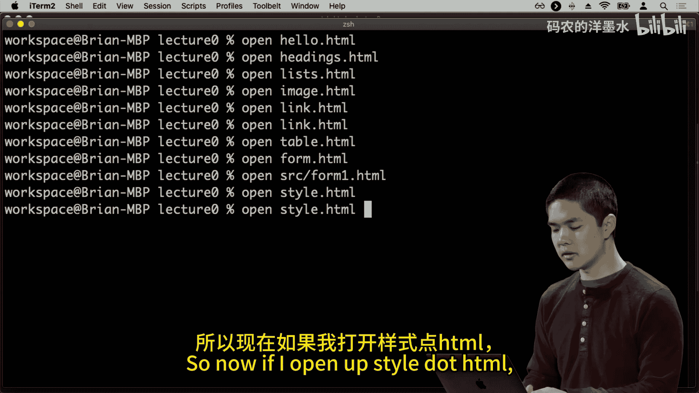

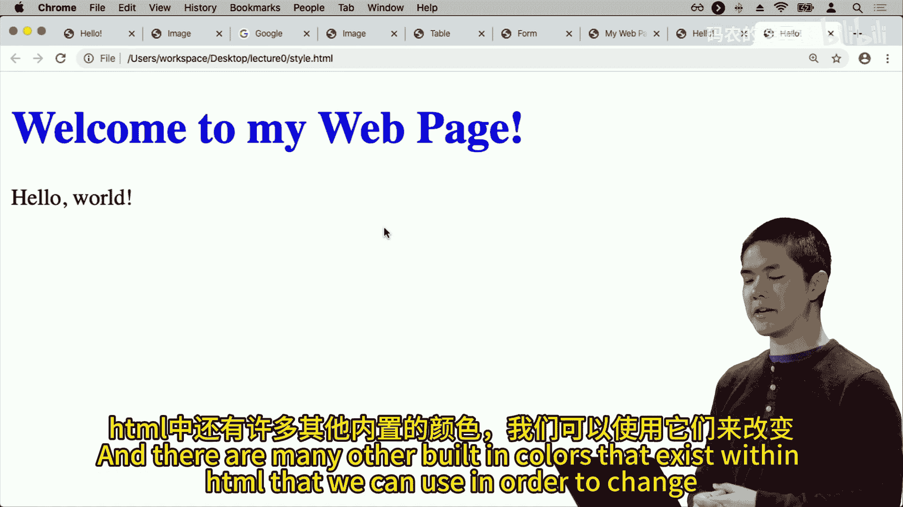

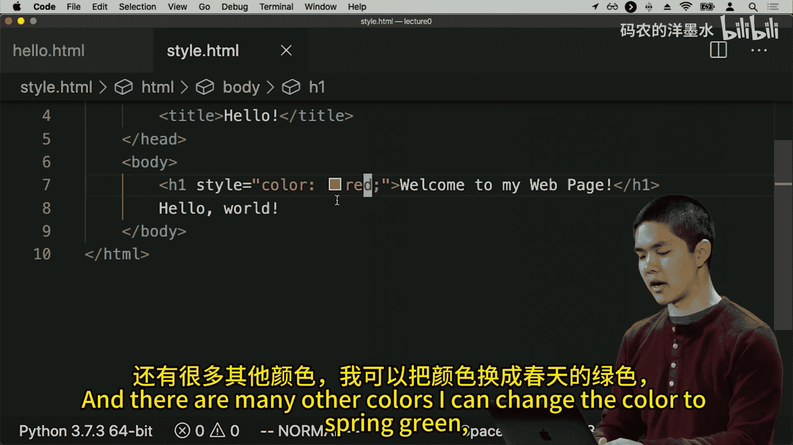

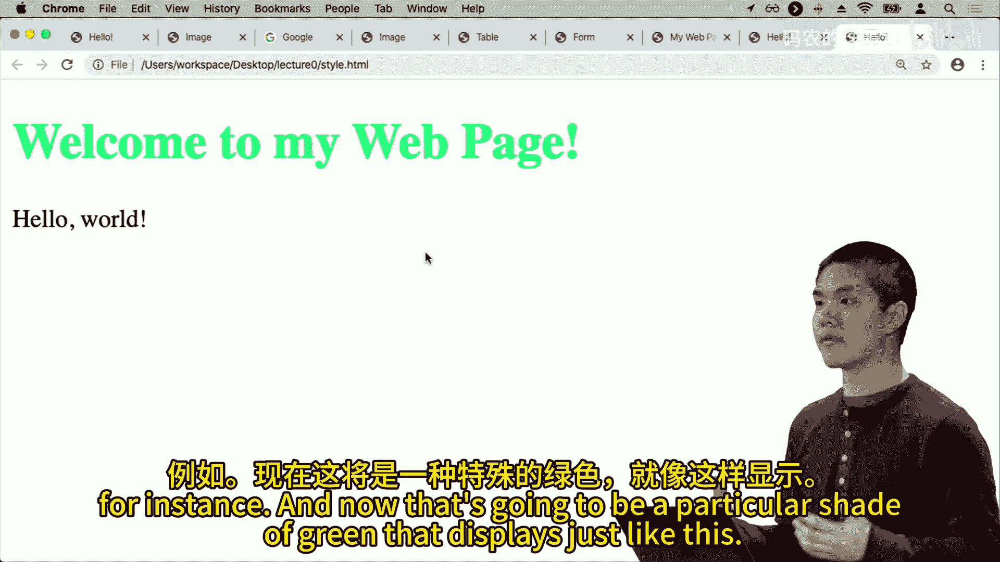

And so now we have the ability to add various different style properties to individual elements。

 I can say， take this heading and change its style so that the color instead of being black is going to show up as blue instead。

And if I want to add multiple CS properties to the same H TM L element。

 I can do that as well here in the style attribute。

 I can say that in addition to saying that the color is blue。

 I'd like to give a second CS property to this element。

 I'd like to say that the text align property should be center， for example。😡。

The text aligned property controls， as you might imagine how a particular H TM L element has its text aligned。

 Is it all the way on the left， all the way on the right or centered。

 And if I change the text aligned property to have a value of center。Well。

 then now when I refresh this page。😡。

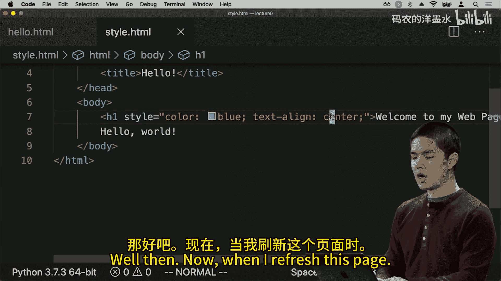

I see that welcome to my web page is now both blue and it's centered。 I've changed the color。

 and I've changed the alignment of this particular element。😊。

And H TM L elements don't need to just be styled directly。

 They can also get their style information from parent elements。 So if you recall， again。

 that dom structure where we have an H TM L element inside of which is this body element。

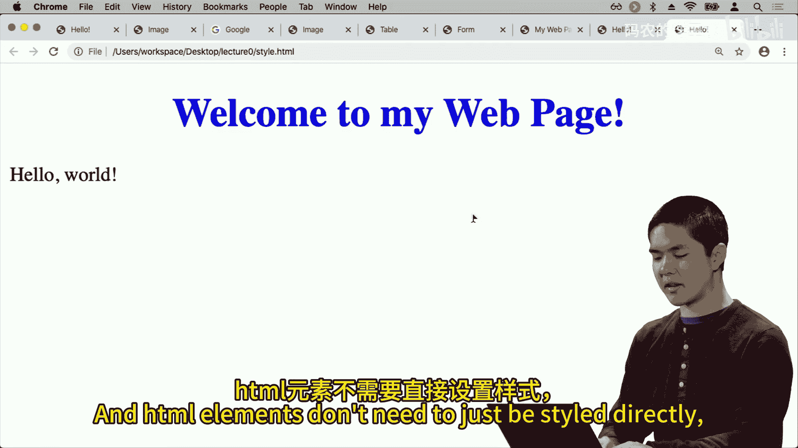

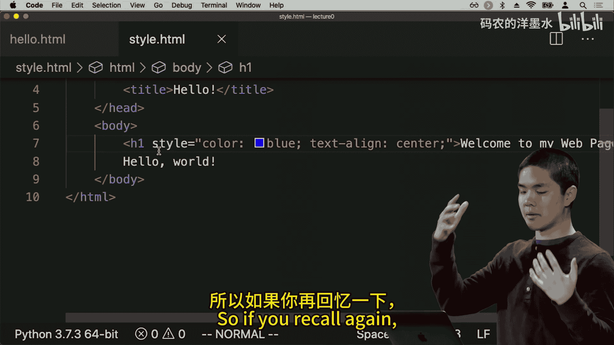

And inside of the body element is this H1 element and this text。

 You can imagine if we wanted this styling to apply not just to this heading。

 but also to the hello world text， I could move the styling information， move this style attribute。

 change it from the H1 and escalating it to this body And if I move the style to the body。

 then everything inside of the body is going to be styled in that way。

 So let's now take a look at an example of that to see how that works。

 If I take this style information And I move it so that instead of associating it with the H1。😊。

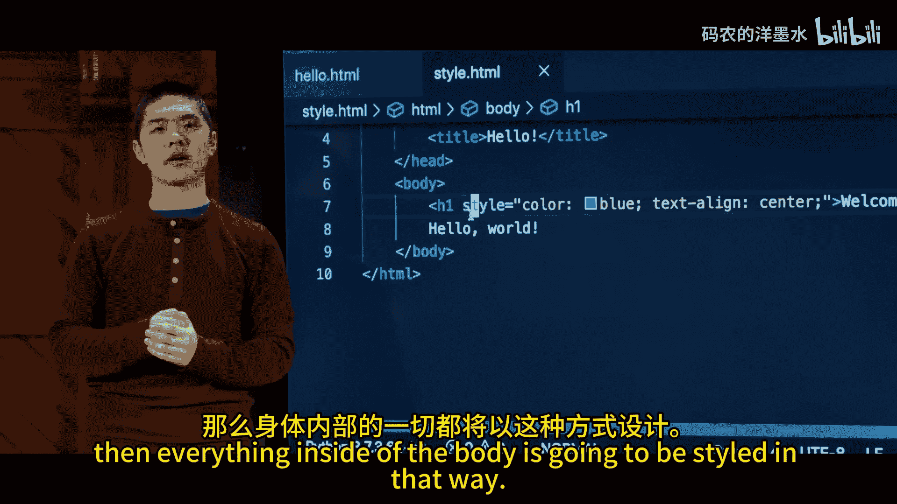

I instead associate it with the body。Then now when I refresh the page。

 I see that both parts of the body， both the big heading at the top that says welcome to my web page。

 as well as the text， Hello world， Both have those CS properties applied。

 I've changed their color to blue and I've also changed their text alignment to be centered instead of just left aligned。

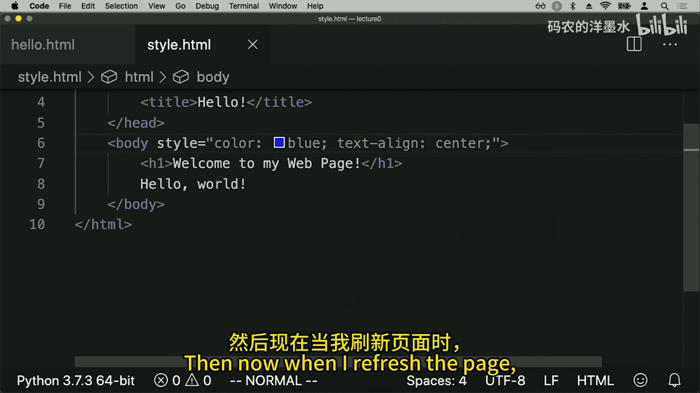

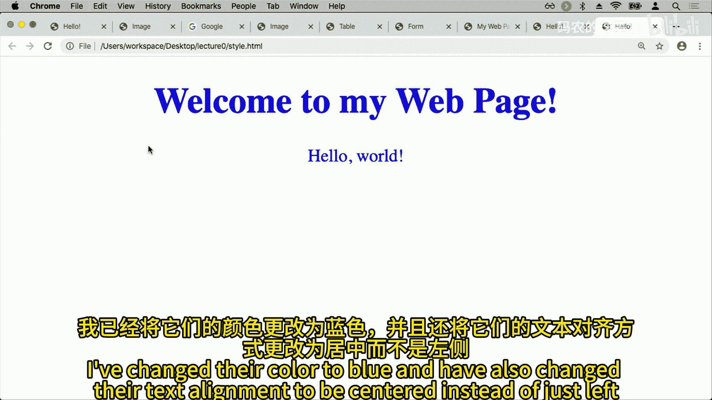

But if I do want it to just be that heading， then I can move it out and say that I just want to apply the style to that one individual heading。

Now， one thing that we might imagine might become a problem over time is that imagine if I had multiple headings that I wanted to style in the same way。

 for example， let's say I have a second heading that this is a second heading that I also want to be styled as blue and centered as well。

I can refresh this page and see that right now that is not the case。

 And I don't want to make the entire page blue and centered。

 I only want these two headings to be blue and centered。

 So what I could do is I could just take the style code from the H1。 And apply it to this H1 as well。

 so that both of my H1 elements now have the exact same style code。

 And I'll go ahead and refresh this。 And now we see this is the intended behavior。

 I have two headings， both of which are centered and both of which are blue。😊。

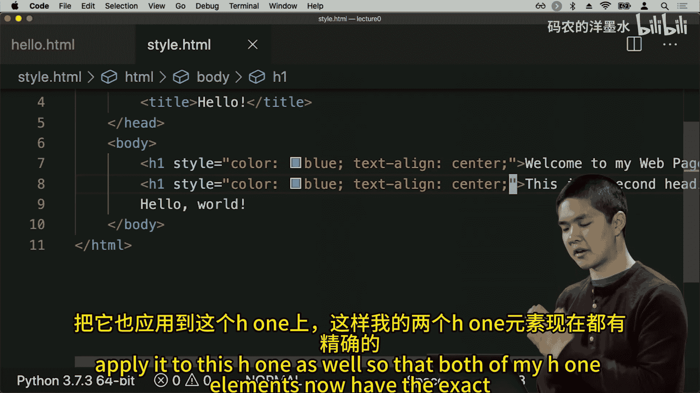

But what we want to start to think about as we start to build web applications。

 and especially as our web applications start to get a little bit more sophisticated is to think about the design of how we're building our web pages and how we're building our web applications。

 And in particular， anytime we find ourselves copying a lot of the same information from one place to another。

 That's probably not the best design。 and you should start to think about how might you design this a little bit better。

 It's not great design one just because there's some redundancy that probably doesn't need to be there。

 But also because it makes the page a little bit more difficult to change and it a little difficult to update。

 if I instead want to change both of these headings to be red instead of blue。 And all of a sudden。

 I need to change my code in two places。 I need to change the style attribute on this first heading up here。

 And I also need to change the style attribute on this second heading down there。😊。

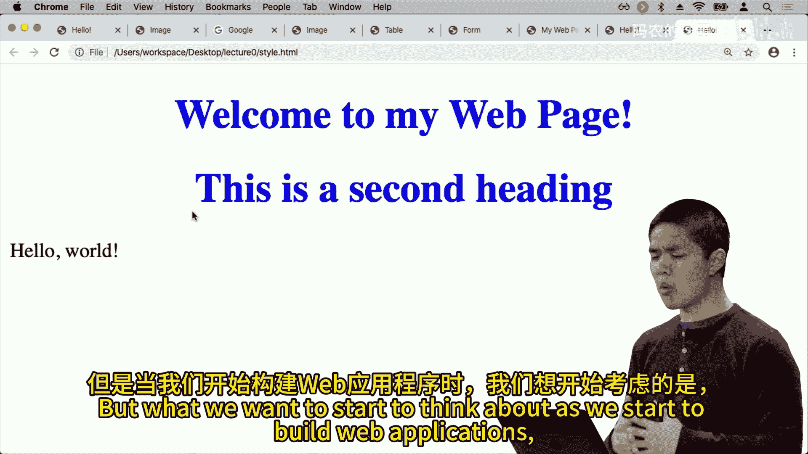

What I'd like to do is to somehow just be able to write this style code once and then have it applied to both of these headings。

 And in fact， there is a way to do that。 What we can do is instead of doing what we might call in line styling。

 where we take the CS code and place it directly as an attribute of an H T M L element。

 we can move our style code to an entirely different part of the web page。😊。

Recall again that at the top of our H T L page， we have this head section that just includes information that's useful to know about the web page。

 but isn't actually part of the body of the web page。 The content that the user sees。

 This head section is a great place where we can begin to put some style information。

 information about how we would like for this web page to be styled。😊。

So what I can do here is instead of putting these style attributes inside in line with these H TM L elements。

I can inside of the head section of my web page， add a style element。Where in between these。

 the opening style tag and the closing style tag， I can add any of the style information that I want。

 And here is the way that syntax is going to look。 I first need to specify what types of elements am I going to style。

 And in this case， I want to style all of the H1s。 So I can just say H1。And then。

All of the style code is going to go inside of a pair of curly braces where I can say I would like the color to be blue。

 and I would like the text aligned property to be centered。

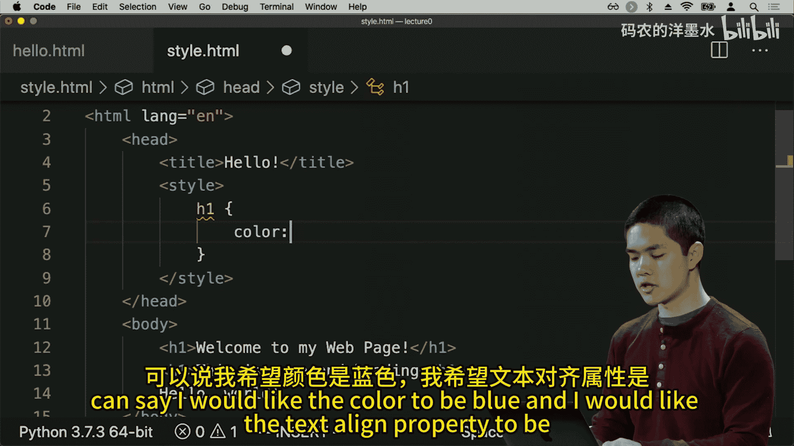

So now here's what I've done。 I've taken the CS code that used to be down here inside the body of the page。

 actually as an attribute of these H1 elements。 And I've moved the style related code to a different part of my page altogether。

 Now， the style information is inside the header of my page inside of the style element where I've said for every H1 element Here is how you should style it。

 The styling is in between the opening and curly closing braces here。

 And I've said that every H1 should have a color of blue and every H1 should have a text align property of center。

😊，And that is then going to apply to all of the H1 elements that my web page happens to find inside the body of my web page。

 So there's a couple of advantages here。 Advantage number one is what we talked about a moment ago。

 I don't need to duplicate the same code in both of these H1 elements。

 I can write it once and say apply this styling to all of the H1s that show up in the page。

 an advantage number two， is we've been able to factor out the style code to somewhere else。

 just to make it a little bit cleaner so that instead of having a really long line。

 you might imagine if we had not just two， but maybe five or6 or 7 different Cs properties that would have taken up a lot of space on one line。

 I can instead in a more readable， more organized way。

 move that style related code to the style element at the beginning of the page just to make it easier to read easier to visually understand and just to clean up the body of the web page as well。

 And that's going to be another of the key themes that's going to come up again and again in this class。

 This idea of separating things out so that every piece can sort of be independent of one another。😊。

Our structure of the web page inside the body is separate from the style。

 and we'll see the same sort of idea appear again and again as we begin to try to design web applications well。

So now if I take this exact same page and go ahead and refresh style。 HTMLt。😊。

We'll see that we see the exact same thing。 Both of the headings still show up as centered。

 Both of them still show up as blue。 But now we have the advantage of having only written the style code once instead of needing to write the exact same style code multiple times in the same way。

But it turns out that we can even do a little bit better than this。

 because one thing you might imagine is that if I have a web application or a website that has multiple different web pages。

 it's probably going to be likely that each of those web pages might need to be styled in similar ways。

 if I have a big banner at the top of one web page。 then in other pages related to that page。

 I might want the same banner styled in the same way using similar style information。 And right now。

 our CS code is specific to one particular page。 and it's not going to be easy to then take that same styling and apply it to another page。

 If I wanted to。 I need to copy the exact same CsS code put it inside of another page。

 but then we run into the same problem of duplication where I've now had to repeat myself across multiple different pages。

 putting the exact same CS code across all those different pages。

 So there is an improvement we can make。 and the improvement we can make。😊。

Is to take that CSS code and just move it to an entirely different file。

So instead of putting this style code inside of a style element inside of this H page。

 I'll just create a new file that I'll call Sts do cS inside of which is going to be all of the CS that I care about。

 I want to take every H1。 I want to change its color to blue。

 And now I want to change its text aligned align property to center。😊，And now inside of my HTML page。

 I no longer need to include any CSS at all。 instead of this style element altogether。

 I can just link my CSS code in that CSsS file called Sts do CSss to this particular HTML page and how do I link the styles CSss file well I can do so again in the head section of my web page using a link tag where I can say I'd like this link to be the relationship is it's going to be a style sheet。

 meaning what I'm about to link is going to be a style sheet for this page。

 It's going to describe how I want for the elements on this page to be styled。

And then just as in the case of a link to another page。

 I used HR to specify a hyperlink reference what I want to link to。

 I'm now going to specify using an HR attribute。 What CS file I would like to now link。

 And in this case， the CSS file that I'm going to link is Sts do CsS。

 That is the file that just so happens to contain all of the CS that I would like to apply to this particular file。

Now if I refresh the page。I see again， nothing has changed in the last two revisions。

 The pages stayed exactly the same as far as the user is concerned。 They still see two headings。

 Both of them are centered both of them are blue。 but now the advantage is that here is my Html。

 It's shorter than it was before。 and in particular。

 theres no Cs that's baked in this Html file at all。

 I factored it all out into this separate styles css file。

 And now if I have multiple Hml files that are all using the same styling。

 I can just link them all to the same styles css file。

 such that they're all using the same style information。 I don't need to repeat myself。 And if ever。

 I need to make a change across all of those pages。

 I just change the styling once I change this styles css file。

 And then all of the web pages that are linked to that style sheet We'll update as well in order to reflect those changes。

 So again， we've been able to factor out some of this style information to a separate file just to make our lives a little bit easier。

😊。

Alright， so so far， we've now seen how we can use CS in a number of different ways to add some basic style to our page。

 We've seen that we can take an element and change its color。

 We've seen how we can take an element and change its alignment。

 move it from left aligned align to right aligned to centered， for example。

 as it turns out there are a lot of different CSS properties that we can add to our HTML elements in order to style them in various different ways more than we'll have time to talk about in this lecture。

 but now let's just take a look at a couple of the most popular。

 most common CS properties that we can add in order to make our web pages look the way we want it to。

😊，And one of the most powerful tools for C， S S is controlling the size of various different elements。

 By default， H T L just used a default size for everything on the page。

 But if I want to more precisely control how big any particular element is。

 I can use C SS in order to do so。😊，So let me now create a new file that I will call size。html。

We'll start with the same HTML code and call the page size。And now， inside the body of my page。

 let me just have a vertical section of my page， just some section of my page that's going to have some content。

 And I'm going to put this inside of a div tag。 Now。

 this is the first time that we've seen a div and H Tm L。

 You can think of a div as just a division of the page。

 some section of the page that's going to have some content inside of it And we use divs because it makes it easy to reference a particular div or nest information inside of other pieces of information or just to divide and break up our page into multiple different sections here inside of the body。

 I'm just going to have a single div that is going to say something like hello world。😊。

And now I'm going to add some style to this page in order to control the size of this div。

 to control the size of this section of my web page。 I could use inline styling。

 I could factor things out into another file， but since I'm only dealing with one file for now。

 I'm just going to add a style section to the top of my web page just so you can more clearly see how the style of this page is going to map on to the way that we're modifying these HTML elements。

And I would like to style this da in a couple of ways。

 One thing I can do is give the div a background color。 Let me change its background color to blue。

 for example。😊，And then I can say， allright， I'd like to give this div a width and a height。

 some size information。 I can say， go ahead and give this div a width of 100 pixels and maybe a height of 400 pixels。

So now when I go ahead and open up size。html。This is what I see。😡。

I see in a 100 by 400 pixel wide vertical or rectangular section of my page。

 I see the words hello world。 And so you might imagine if you have multiple different elements on your page as your web pages start to get a little bit more complex。

 you probably want to have some more precise control over how wide or how tall any particular element is And these width and height attributes can be very helpful because I can very easily change the width to say like 500 pixels。

 for example， And now， when I refresh the page， now I see that the width of this page of this div。

 this section of the page has actually now gotten a lot wider。😊。

And so we have the ability to control size using CSS。

Go ahead and close some of these pages that I no longer need and now take a look at some other things that we can do。

 In addition to controlling the size。 and let me change this color to something a little bit lighter。

 something like orange， such that now， if I open up size， it looks like this。

I'll make this a little bit smaller。 Let's try 200 by 200 pixels。It looks now like this。

 You might imagine there are some other changes that I might like to make。 like this hello world。

 for example， is very close to the edge of this particular div。

 It's right up against the upper left corner of that div。

 I might want to change that by adding what we might call some padding to this particular H TM element。

 Some space just so that the content of the element isn't so close to the border of the element itself。

😊。

So， for example， one thing I can do is inside this st， add some padding。

 sayy maybe I want 20 pixels worth of padding on the inside of the element。

 such that now when I refresh the page。

We see that we have some padding along the outside of the element so that hello world now shows up not right up against the edge of the element。

 but inside a little bit as well。And if we have a particular H TM element that maybe is too close to the edge of the screen。

 Maybe it's too close to the top of the screen， we can also add space around outside of the element by adding what we call margin to the element as well。

 So I can say let's give it 20 pixels of margin inside of this div and then refresh and now we see that whereas before this div was very close to the upper left edge of the screen。

 Now we've moved it 20 pixels away from everything。 So it's got some space on all four sides of it。😊。

So that's how we can now use margin and padding just to make the page look a little bit nicer to the user。

 So objects are not too close together or too far apart。 padding， again。

 is on the inside of the border of the element。 I can add 20 pixels of padding， for example。

 to make sure that the content inside of the element。 In this case。

 the words hello world just have a little bit of space from the border。

 And that's padding on the inside of the element。 margin， mean， is on the outside of the element。

 We add some margin along the outside of the border to space the element out from other elements that might be nearby to make sure that there's enough space between the border of the element from the top of the screen and also from the left and also the bottom and the right。

 though there's no objects there that we're currently creating space from。😊。

So by combining width and height and margin and padding。

 we now have the ability using CsS to make sure that we're able to lay out our page the way we want to lay out the page that elements have the right amount of spacing from each other and R the correct size。

 So now let's take a look at some other features that C SS is going to give us。

 In addition to just changing where particular elements are like centering text or adding size and margin and padding。

 We can also use CS to change how elements actually look。 We've seen it to change the color of text。

 changing it from one color like black to another color like blue。

 But we can also use CsS to be able to change something like the font that we use in order to display text。

 Modern web pages don't show everything in the exact same font。

 Usually some designers choosing what font they want for any particular web page。😊。

So let's experiment with those possibilities。 I'll now create a new file that I'll call font do HTMLtm。

Inside of which will be an HTML page called F。And inside the body， I'll again。

 just have a div that says hello world， same as before。But now。

 inside of the style tag here up in the head section of my web page。

 I would like to add some font information to this div。 And in particular。

 there are a number of different font related C S properties that I can add to control the font of any particular H TM L element。

One thing I can specify is the font family， specifying what font would I like to use in order to display this text。

 And maybe I want to display it in Ariel， for example， which is a common font used on the Internet。

Such that now， if I open up font dot H TM L， I now see in ael the words hello world different from the text that I was using before。

You can also specify multiple different fonts。 Not all computers support all fonts。

 So I could specify that just in case Arel isn't supported， fall back to any Sanan serif font。

 any of the fonts that don't have the little glyphs at the edge of each of the characters。

 So now if I refresh the page， because my web browser supports Arel。

 I don't notice anything different。 But you might imagine if you're using more complex fonts that not all web browsers have or support。

 you might add some backups。 just in case the font you want isn't actually available。😊。

In addition to a font family， I might also specify a font size。

 how big I want the font to be inside of this div。 So I can specify that I'd like the font size of this div to be you know。

28 pixels， for example， such that now I refresh it。 And now this div appears using larger text。😊。

And I can also， just as like text editors let you specify whether you want it to be normal text or bold text。

 I can specify a font weight for this stiff and say that in addition to being in font aerial and size 28。

 I would also like for the font to be bold。 Such that now I refresh it。

 And now the font shows up as bold。😊。

And using these C SS style sheets， we're able to selectively apply the styling to only particular parts of the web page。

 If I have another underneath this div。😊。

Some more text down here， for example， that additional text that's outside of the div isn't going to be affected by the C SF styling。

Such that now if I refresh this page， some more text shows up in that same standard default font provided by my web browser and not the custom font that I have specified to apply to only this particular part of the HTML page。

😡，So that now is the ability to add fonts to our page too。

Another thing that we might want to do is to be able to add some sort of border around our H TM L elements。

 So maybe I want a line to be able to separate this entire part of the page from another part of the page so I could add a border by going to this div and saying。

 let me give this div a border。 And maybe I want the border to be like a three pixel。

 solid black border。 for instance， I can specify how big I want the border to be。

 I can specify whether I want the border to be a solid line or a dashed or dotted line。

 and I can specify what color I would like that border to be as well。😊。

So now when I refresh this， I now see I have a border around this entire section around this entire div inside of my web page。

 And you can imagine these borders being helpful for styling various different parts of my page。 So。

 for example， if we go back to that table， that we were looking at a moment to ago when we were dealing with oceans where I had ocean and Pacific Ocean and Atlantic Ocean。

 This is structured in the format of a table。 We have rows and columns。

 but it doesn't look great right now。 I might like to add some styling in order to improve the way that this table looks。

 For example， So let's give that a try。😊。

I'll go ahead and go back into table that H TM L， that H TM L file I was using before。

 where I had this table。 And let me now add some style information to this table。

 I might say that for this table， I would like to give it a border that is maybe a one pixel。

 solid black border。

Such that now when I refresh the page， I have a one pixel solid blackboardroom around the entirety of the table。

Alright， that's great。 But I also really wanted to border in between the rows and the columns as well。

 In particular， every table data item I might like to have some additional。😊。

CSS applied to those two。So I might say for every table data cell， again， TD stood for table data。

 and those were the individual cells within my table。

 I might specify that I would like those to also have a border that is one pixel， solid， black。

Such that now I refresh the page， and now each of my table data cells also has a border around it。

Now this applied to the table data cells in the body of my page。

 but it didn't yet apply to these cells up in the heading， and that's because those were TH elements。

 table headers。😡。

And so here we have a couple of options。 I could specify once more table headers。

 I would like to give a border of one pixel， solid black。

But when I do so， you'll see that it does create a border around those table headers。 But again。

 one thing that should be crossing your mind now is that there's a fair amount of redundancy here。

 Some repeated style code that shows up in multiple different places。

 Tabled data cells in the body of my page。 I really want to be styled in a very similar way to table header cells。

 And so it would be nice if I could somehow consolidate these two different CS selectors。

 these ways of me saying style table data， style table headers。 I'd like to combine them into one。😊。

And you can， in fact， do this in C， S S。 There are a number of different CS selectors。

 ways of choosing elements。 And one of them is just called the multiple element selector。

 that if I want to select both table data cells and table headers。

 then I can do so by saying TD comma T， H。And delete these three lines down there。

What these three lines are now saying are that I would like to style all table data cells and table headers in the same way。

 And I could even combine table if I wanted to for good measure。

 but I'd like to give all of them a border of one pixel， solid block。

Such that now I refresh it and now I see that they all have this border around them。Now。

 most tables you see on the Internet don't have both a table a border around everything in the table and also a border around each of the individual cells。

 Usually those are collapsed just into a single line。

 And it turns out that CS has an easy way for you to do this as well。

 I can add a CS properties to the table called border collapse and just say I would like to collapse all of the borders in the table。

 Just going to show you there are many， many different CS properties far more than we'll be looking at today。

 But there are easy things to reference that you can easily look up how to collapse borders in a table and then find a CS property like this that you can then use and apply to your web page。

😊。

So now I refresh that and now I see that I have a border。

 just a single border around all of the cells in this particular page。😊，Next。

 what I might like to do though， though， is like add some space around here。

 Like it seems like these text is very tight against the border of this table。 So in order to do so。

 I want to add some spacing and recall again， do I want margin or padding margin is spacing around outside of the border of a particular HTMLML element。

 whereasas padding is inside of the border。 So if I want some space inside of the border just to space out the text from the border itself。

 Then what I want is padding inside of all of my table cells。 So I can say。

 let me add five pixels worth of padding inside of all of my table data cells and table header cells。

😊。

Refresh the page。 And now heres what the resulting table looks like。

 just by adding a little bit of CSS， specifying what border I want around the edge of the page。

 specifying a little bit of padding inside of each of the cells。

 My table now looks a whole lot nicer than I did just a few lines of code to go when I just had the HTMLM structure of the page and not the CSS to describe how I actually want that page to be styled。

😊。

And notice again that in doing so， we were able to use one of these CSS selectors。

 I was able to say that I wanted to use the multiple element selector， which is just this comma here。

 to specify that I would like to apply the styling not just to TDs but also to THs as well。

 We'll take a look at some additional examples of CSS selectors in just a moment。But next。

 let's turn our attention to some more tricky instances where we might want to apply styling to multiple elements at the same time。

 Let's imagine， and let's go back to style dot H TMl。

 where we had some style code where I had one heading。I'll call this heading one。

And let's give myself two other headings， heading 2 and heading 3。

All of these now are H1 elements that are going to show up the same way。

 such that now if I style and say I would like all H1s to show up with a color of blue。

 then when I open this page where I have three H1 tags， each of which has a color of blue。

 when I open up style dot HMl。😡。

What I'm going to see is something like this，3 headings。

 each of which happens to have a color of blue。But what would happen now if I wanted to style only the first heading。

 I want heading one to be blue， but I don't want to style heading 2 and heading 3。How do I do that？

Well， one thing we could do is go back to the inline styling we did a moment ago， where inside of H1。

 I said style color is blue。 And that would say for just this very first heading。

 I would like that to be blue， but not the other elements at all。 But this， again。

 we decided was not the best design。 This inline styling comminggling of HML and CS just gets a little bit messy。

 and it would be nice to be able to factor all of our style code to a separate part of the page altogether。

😊，So how do we do this， Well， we need some way to uniquely reference this particular H TM L element。

 And in order to do so， we can give an H TM L element an I D。

An I D is just some unique name we give to an H TM L element so that we can reference it more easily later on。

 Let me just go ahead and give this an idea of foo。 It could be any idea you want。

 But Foo is just a generic name here。 And now we've given this heading a name such that in other parts of our page or in other code。

 we can reference and find this particular H TM L element。😊，And in particular now。

 in the style section of my web page， instead of styling all H1 elements。

 I only want to style the element that has an Id of foo。 Ids are， by definition， unique。

 There can only be one element in this page that has an I D of foo。 Otherwise it's not valid H TM L。

And so in order to do so， we're going to use hashtag fo。

The hash mark symbol is just C S S's way of selecting just something with a particular I D。

 So instead of just H1 for selecting all of the H1 tags， if I want to select something by its I D。

 I say hash foo to say only style the element that has an I D of foo and give it a color of blue。

 for example。😊，So this style code now will find something with a particular I and give it a style to correspond with it。

Such that now， if I reload this page， only heading one is styled。 Head 2 and heading 3 or not。

 I've been able to name heading1， give it a name of foo， an idea of foo。 And then in my style code。

 just style that particular part of my HM L page。😡，Of course， what if I wanted to style multiple。

 but not all of the headings， Like maybe I want to style both heading  one and heading 2。

Now， I could use a second I。 maybe give this an I of bar， for example。

 and then style both the element with I D fo and the element with I D bar。

 But now we're starting to add Ids unnecessarily。 I have too many different names。

 Things could start to get messy， especially as my Web pages start to get bigger。

So while Is are a way of giving a name to an HM L element that is unique。

 sometimes I want to give a name to an H L element that is not unique。

 Some name that can apply to multiple different HM L elements。 And when we do that。

 we call that a class。 an I D is a way of giving a unique name to an H L element。

 While a class is a way of giving a name to an HM L element that might not be unique。

 It might apply to 0 or one or two or more different HM L elements。

So here's what that might look like。 Instead of giving each of these H1s an I D that's different。

 I can give each one a class。 We'll give this a class of baths。 Again。

 just another arbitrary name that we've chosen。And I'll give this H1 a class of Bas as well。

 They both belong to the same class called Bas， in this case。And now inside of my style code。

 I would like to say， just style the elements that are of class bath。

And just as we had a special symbol， the hashtag for styling only something with a particular ID。😊。

YouTo style everything with a particular class， I can use a dot。 So dot Bs， in this case。

 is going to style only the elements that have a class of baths。😊，So here I can now say。

 take all of the elements with a class of bath and go ahead and give those a color of blue。😊。

So now I have two H1s that belong to class B， each the other H1 does not。

 and I've styled only the things that are of class baths。

 such that now when I go back to the page and refresh the page， my first two headings。

 those do get styled as blue， but the third heading does not because of applied to class to these two elements that does not get applied to this third element there。

So oftentimes it can be very helpful if you have to start to design larger web pages where you have multiple different elements。

 some of which might be styled in some ways and other elements that might be styled similarly to one another。

 you can add IDs and classes to your HTML elements just to clean up the way that you write your CSS to be able to very specifically pinpoint one element that you want to apply St to or to apply styling to entire class of elements as well。

😡。

Now， one tricky thing you might imagine now is that now we have multiple ways of referencing the exact same element。

 So， for example， if you imagine that I just had a single H1， which had an I of foo， for example。

 that I've named foo， what would happen if， for instance， I said all of the H1s。

 I were like those to be colored red。And all of the elements with an idea of fo or the only element with an idea of fo。

 I would like that to be colored blue。 What might happen then。

 these would seem to be conflicting where now suddenly we have an H1 style tag that is saying I should style H1s in this way。

 but I should style element fo in another way， So what happens if I have an H1 whose I is foo。

 How do I choose to style that。 And in order to deal with that。

 we have to start to deal with the CS problem of specificity of what happens when I have multiple different CS selectors that could apply to the exact same H Tml element and。

😊。

This often happens when we start to add Ids and classes to our elements as well。

 So when we deal with specificity， specificity goes in a particular order。

 There's an order of precedence that we can follow for determining what style should ultimately be applied to any particular element。

 The first most powerful， most specific way of referencing an element is in line styling literally adding a style equals attribute to our Hml elements the way we did way at the beginning when we were first taking a look at CsS。

 if we associate in line styling with an Html element。

 that's going to take precedence over any styling that's inside the style section of our head of the web page or inside of a separate dot CsS file。

 because the reason it goes if you are literally putting the style code attached to the element itself。

 then we probably want to apply it to that element。😊，After that。

 specificity goes in order of how precisely we are identifying an element。

 An I D is a unique way to identify an element。 There is only one element without particular I D。

 So if I've added style to a particular I D， that is going to be pretty highly valued in terms of how specific it is。

😊，Next， we look at classes。 So if theres no ID selector， we look for。

 did we reference the element by its class， and if so， then that takes next precedence。And otherwise。

 then we fall back to what type of H TM L element it is。 Is it an H1 Is it an ordered list。

 Is it a table？ So in short， the type is the least specific。 class is slightly more specific。

 I D is more than that。 And the most specificity we can provide is by literally putting the CS in line with the H TM L element itself。

So let's take a look at an example of this。 Let's look at this code， for example， where。

 for instance， I have a div whose I D is foo inside of which I'm just saying the word hello。

 And the C S code that I've included here is I've said for all divs。

 I would like to give those a color of blue。 Obviously， in that case， there's nothing conflicting。

 What we're going to see is we're gonna to see the word hello。

 And we're going to see the word hello in blue。😊，But what happens now if we add anything with ID D fo should be colored red。

Well， because I D has higher specificity than just an individual tag。 Well， then next。

 what we're going to say is that this hello is going to show up as red。 The Id is more specific。

 And so this element is going to show up red instead。 And it doesn't matter what order these are in。

 It's not that the later onet precedents。 If I were to flip these around where I D of fo color red div color blue is in that order。

 It's still going to show up as red， because this I D selector is more specific than just the name div。

 which is the name of the HMl element that happens to be there。😊。

And so as you start to develop more sophisticated style sheets。

 you might find that some of your CS code is going to conflict with each other。

 And that's where it's important to bear in mind how these specificity rules work to know as you add style to your elements。

 how are they actually going to end up showing up。

Now we've seen a couple of CSS selectors now in terms of selecting a single element， selecting an ID。

 selecting a class， selecting multiple elements as well。

 It turns out there are a number of other CS selectors that we can use to。 So we saw， for example。

 the multiple element selector like TD comma T H for selecting table data but also table headers but there's a number of other selectors。

 Here's just a sampling of ones。 you can specify like descendants or children。

 So if I only want to style divs that are inside of tables or I only want to style lists that are inside of certain classes。

 I can use these descendant and child selectors to add styling in those particular ways。

 and there are a number of other CSS selectors we can add as well。

 And we'll go ahead and explore a couple of these just to give you a sample of how some of these CS selectors can actually work。

😊。

And we'll start by taking a look at the descendant selector。

 which is used to select all the elements that are descendants of some other element， for example。

So let's go ahead and create a new file that I'll call descendant。Dot HTMLt。But， again。

We'll start with the same code。And inside the body of this page。

 I want an ordered list that maybe has a list item 1。And maybe lift item two。

And it turns out with lists in H TM L， you can nest lists inside of other lists。

 Maybe you've seen bullet points where there's like nested bullets inside of other bullet points。

 I can do that here。 I can add an unordered list and create a sub list， like sub list， item 1。😊。

And sub list item 2。 And maybe down here， here's another list item。

Such that now I have a couple of items， but some that are inside of an unordered sublist。

Let's go ahead and open up descendant dot H Tml and see what that looks like。

So here's what we have。 We have list item 1， list item 2。

 another list item that is probably actually。

List item 3。So we have three items， but inside of list item 2， I have an unordered list。

Let's imagine， for example， that I wanted to only style these sublist items as a particular color。

 Like maybe I want those to be blue， for example。

If in the style section of my Web page， I say that I would like for all list items to be styled blue。

Well， then not styled， colored blue rather。

Then what I'm going to see when I refresh the page is that all of the items are going to be blue instead of just the two sublift items。

But I could instead say that， you know what， I only want list items that are children of unordered lists。

 and I can do direct children using this greater than symbol to say that only if there is a U L that immediately contains an LI within it。

 then I would like for that to be colored blue。

And now， if I refresh that， now you'll see that the ordered items listed in 1，2，3。

 those do not get colored， but only the list items that are inside of the unordered list that are directly children of that unordered list actually get the C S S styling applied。

 This greater than symbol here is specifying immediate children。 I could get rid of it。

 U L L I like this。 and this would also work。😊。

You still see sublist item 1 and 2。 But this is a more general selector called the descendant selector that selects all descendant elements。

 So they might not be the children elements。 they might be grandchildren elements。 so to speak。

 if those children elements have other children that are attached to them as well。 Again。

 for all of this， it's helpful to begin to think about things in terms of that document object model。

 that dom structure， that tree that represented how all of our various different H elements are related to one another。

So next up， we can begin to take a look at some of the other selectors that we have access to。

 So one of those selectors might be something like modifying and went only on a specific attribute of a particular H TM L element。

 So we can use the attribute selector for that。 I'll create a new file called attribute dot H TM L。😊。

We're here， let's go ahead and create a unordered list。

That's going to have a number of different links to various different websites。

 So here's a list item that is going to be a link to Google。

 So I'll link to Google dot com and say Google。And I'll go ahead and add a link to Facebook。com。

Call that Facebook。 And I'll go ahead and add a link to Amazon dot com， and call that Amazon。

And let's imagine for a moment that I only wanted to style the Facebook link。

 like I want to really highlight the Facebook link。

 tell people to click on that one as by coloring it in entirely different color。Well。

 to to style links normally， I would say something like links should be colored， you know， blue。

 for example， They're color blue by default， but I could be explicit about it and say links should be colored blue like that。

 Such that now when I open up attribute dot H TM L， all of the links are colored blue。😊。

But I could also say， I would like links that have an HF attribute of。Facebook。com。

I would like those links。To be colored， red instead。

So this square bracket notation I can use to specify a particular attribute of an HML element。

 only anchor tags， a tags whose Hf is equal to Facebook do com。

 those should be the only ones colored red。 So now when I refresh this。

 I now see that Facebook is a link that is now colored red instead of colored blue because I've been very specific about picking an attribute that I would like to use in order to reference that particular HML element。

😊。

And we can use CS selectors in more powerful ways， too。

 maybe not just to style a particular element always。

 but to style an element only under certain conditions。

 or only when an element is in a particular state。 And this is very often done for something like when you hover over something when you hover over a button and something pops out or you hover over something and it changes color slightly。

 we can begin to do this by adding what we call a pseudo class to a CSS selector。

 So let's take a look at an example of that to see how we can modify an element when a user hovers their cursor over that element。

 for example。😊，So I'll go ahead and open up a new file， hover dot H T M L。

 where here I'll go ahead and inside the body of the page。 just give myself a button。

This button is going to say。Click me。

And let's add some style to the button。 By default。

 buttons show up as fairly simple buttons that just look something like this。

 I might like to add a little bit more to this button and say， you know what。

 let's add some style to the button and give it a width of 200 pixels， a height of 50 pixels。

 a font size of 24 pixels， and maybe a background color of green， for example。😊。

So I specified some size information， how big I'd like the font to be and also a background color for the button。

 such that now， here's what that button looks like。 Strrink it down a little bit。 It says， click me。

But many buttons， especially nowadays， are a little bit of， they give you a little bit of feedback。

 You hover over them and they change their color slightly。 How do they do that， Well。

 often it's using a C S S pseudo class where I can say button colon hover。

 meaning when I am hovering over a button。😊。

Then I'd like you to change the background color to orange， for example， some other color。

So now I specified that by default， normally for a button， your background color should be green。

 but when the button is being hovered over， instead， now change the background color to orange。

 such that now when I open up this page and go to click me， if I hover over the button。

 the color of the button changes。 Normally green changes to orange and so that is a very powerful feature that we have access to as well。

Alright， so now we've seen how we can use various different CS selectors to very precisely define how we want our web pages to be styled。

 The one other thing we can use CS for that's quite powerful is responsive design and responsive design is all about making sure that our web pages look good。

 no matter how you're looking at the webage。 Nowadays。

 people aren't always looking at web pages on their computers。

 but they're looking at web pages on their mobile phones are on their tablets as well。

 And it's important as we begin to design web pages that we design our web pages in a responsive way。

 So we'll look at a number of different ways we can implement responsive design in our web pages。

 starting with the discussion of the viewport。😊。

And what the viewport is， is the viewport is the visual part of the screen that the user can actually see。

So the viewport is this entire area of the web page that displays content to the user。

So one question you might ask is what's going to happen when you take this page and translate it onto a mobile screen。

Well， one thing that many mobile devices do by default is treat their viewport as though it is the same width as a computer screen because not all web pages are optimized for mobile devices。

 you want to make sure that on a mobile device， you can see everything。

 And so many phones will take a web page like this and just shrink it down to fit onto a mobile screen that looks a little something like that。

 Now， of course， that's probably not really what we want it to look like。 Ideally。

 we want our page to adapt to different sized screens。

 Maybe we want the heading and the image and the text if that's what these are to grow a little bit to fill that entire screen。

 And so one simple thing we can do is just to add a little line of code to our HMl inside the head section of our page that controls the viewport。

 This line of code here is providing some metadata to our HMl page and saying I would like you to change the viewport to be specifically the width of the device。

 by default， Many phones will use a viewport that's actually wider than the width。😊。

The device treat it as if they're loading a page on a computer and then shrinking it down to the size of a mobile device。

 If you and your web page specify， though， that you want the viewport to be just the device with。

 Oftentimes， a page is going to look a whole lot better on a mobile device。

But in addition to just adding a line like this， there are other actual changes we can make to our page to make it look a little better on different screens。

 And one of those has to do with media queries。 and media queries are all about controlling how our page is going to look。

 depending on how we render that particular page or what size screen we're rendering that page on。

 So let's take a look at an example of how we might go about using media queries in order to control what a page actually looks like。

 depending on what type of page or what type of browser we're using to view it。😊。

So I'll go ahead and open a new file that I'll call responsive dot Html because we're going to try and build a responsive web page now。

And now I'll go ahead and inside the body of my page just include a big heading that says。

 welcome to my web page， for example。😡，And just to demonstrate what you can do now with responsive design is I could say something like。

 let me add a style tag here where I want to say that if the size of the screen is a certain width。

 then I want to style the page in one way。 And if the size of the page is a different width。

 then I might want to style the page in a different way。

 you might imagine that as you shrink the screen， you want to move elements around in order to rearrange them to make the page just look a little bit nicer on a mobile screen。

 So we'll do a very simple example of just changing the color depending on the size of the screen。😊。

So let me specify now in a media query and the syntax for media query looks like this。

 I'm going to use the at symbol， and say media。And then specify for what type of media I would like to apply this query。

 I can say something like if the minimum width of the page is 600 pixels。 In other words。

 if the width of the page is 600 pixels or anything larger than 600 pixels。

 we then go ahead and take the body and give it a background color of red。

But then I could also add another media query and say， you know what， for this media query。

 let me give it a max width of 599 pixels， meaningan if the size of the screen is 599 pixels or fewer。

 then maybe I'd like to take the body and give it a background color of blue， for example。

So now let's take a look at what happens when I take this page and actually open it and see what's going on。

 I'll open up responsive dot H T M L。

And here's what I see normally。 I see a red web page because my screen is longer than 600 pixels wide。

 But notice what happens is I shrink this web page。 if I go ahead and shrink it。

Looking at it on a smaller screen， eventually， it turns to blue。 If it's above 600 pixels wide。

 it's going to be red。 If it's below 600 pixels wide， the color changes to blue。

 So we're able to now use these media queries to really fine tunely control how our page is going to look on various different types of devices。

 If it's on a big screen， maybe you want the elements to look a certain way。

 if it's a smaller screen， maybe theyll look differently。

 And you don't just need to control background color。

 You can control any Cs property you want just by using these media queries。

 You can say on a big screen。 you want certain amounts of spacing or padding。

 you can even hide elements on smaller screens if you want to by using a particular Cs property called the display property that controls whether or not an element is even visible。

😊。

And ultimately， put together， this can help to make your pages a little bit more responsive。

 And there are a number of different media queries that we can apply to our page as well。

 We can check to see whether a mobile device is vertical or landscape。

 We can check to see whether the user is viewing the page on their computer screen or if they've tried to print out the contents of the page as well。

 So there are a number of different options that we have to really control how a page is going to look。

😊，There are some other tools we have in our toolbox as well， though。

 for dealing with mobile responsiveness。 And one of the tools built into the latest version of CsS is something called flexexbox。

 And flexexbox is quite helpful。 If we have multiple elements that we're all trying to display on the same page at the same time that might overflow if we're not careful about how we do responsive design。

 If we're really not careful， Let's imagine I have six elements that show up on my computer's monitor。

 when you translate that to a mobile screen， you can imagine they might all shrink down so that they're barely visible。

 something like this。 This is probably not what we want if we're trying to design a mobile responsive page。

 for example， So you might imagine how can we do a little bit better。😊。

Well， another thing we could do is take these elements and go ahead and keep them the same size。

 but make you have to scroll through them。 This is slightly better。

 The elements are at least still visible and they're large enough on the screen。

 but it'd be nice not to have to scroll through them。

 What would be really nice is given that we have all this extra space。

 I would like to be able to wrap around elements。 if I don't have enough space for them。

 such that if I'm translating these six elements to a mobile screen。 They translate。

 but I get them in like two rows， for example，3 on the top and three below。

 And flexbox is an easy way to be able to implement something like this inside of our web pages。😊。

So let's take a look at what that might actually look like to add Flexbox to our page。

So I'll go ahead and create a new file called Flexbox dot H TM L。

 We'll start with the same H TM L code。 And now。Inside of the body， I'm going to create first。

 a div that is going to be called the container。And we're creating a container because we're going to specifically say that everything inside the container I would like to add flexbox to to be able to wrap it around so that things can go on multiple lines if I ever need to。

And now let me just add some sample text。 So this is some sample text inside of a div to demo flexbox。

 And I'll go ahead and repeat this maybe like 12 times。 and I'll number each one。 Here's 1，2，3，4。

 and I'll number all the rest。This is just to give a demonstration of what these elements could actually look like。

Ideally， these would be different pieces of content though。So now， inside of my style tag。

Here's what I'm going to say。 just to demonstrate。 I'll say， take the I D container。 again。

 the hashtag specifies， get me something with a particular I D。

And I want to display it using Flexbox。And in particular。

 I would like to use the flex wrap property to say if there's not enough room at the end of a line for all of the elements。

 go ahead and wrap around those elements onto the next line instead。

And now I can specify some additional CS properties for the divs inside of the container。

 so I can say for the container， all of the divs inside of that container， again。

 using this child selector to get all of the divs that are inside of the container。

 I can add some CS to that too。 I can say let's give these a background color of like a shade of green。

 I can give them a particular font， maybe 20 pixel font。

 give them some margin and padding just to add some space。

 and maybe each one is going to be 200 pixels wide。😊。

So just adding some spacing to those individual div， the important part is this right here。

 where I've said that this whole container is going to be a flexbox container。

 and I'd like to wrap around elements if you ever reach the end。😊。

So now I'll open up Flexbox do H TM L。

And so here I now see 12 elements that are on multiple lines。

 but notice what happens as I shrink the page If there isn't room for all of them。

 elements move onto other lines。 Now， there's only three elements on particular row。 Now。

 there's only two elements in any particular row。 And so I can use flexbox to very well。

 adapt myself to different sized screens。 no matter whether you're looking at this on a big screen or a small screen。

 the content is still going to look good because I'm able to adapt responsively to whatever might be happening。

😊。

So this is one layout paradigm that exists within C S S。 this flexbox layout。

 There are other layouts that exist as well。 One common one is the grid layout for any time you want to arrange things in a particular grid or maybe certain columns need to be certain widths。

 but others could maybe be a little bit more flexible。 Show us， I'll show one example of that， too。

 Just to give you a demonstration of what that grid layout might look like。So here's grid dot HTMLtm。

Where I'll go ahead and inside the body of this page， give myself a div whos。

 I'll give it an I D of grid。And then let me just add div class equals grid item。 Again。

 a class because there might be multiple items。But I'll go ahead and just create a whole bunch of great items and number each one。

 So 2，3，4，5，6，7，8，9，10，11，12。So I have a whole bunch of grid items inside of a div whose ID is grid。

😡，And now I'd like to add some style here。I'll say for the grid。Let's give it a background color。

 maybe maybe a background color should be green。A display is going to be grid。

 I want this to show up as a grid。 And now there are a couple of attributes I'm going to or properties that I'm going to specify here。

 Maybe I want some padding around the grid first。 But the important grid properties are grid。

Column gap。How much space goes between each of the columns， Maybe I'll say like 20 pixels。 Likewise。

 there's also a grid row gap。 How much space goes between each of the rows of the grid。

 Maybe I'll say 10 pixels here。And then finally， grid template columns is a way for me to specify how many columns there are going to be and how wide should each of those columns be。

 So if I want maybe three columns， I can specify that the first column should be 200 pixels。

The second column should also be 200 pixels， and the third column can be automatically sized。

 Just grow or shrink to fill the screen。So we'll say auto。 So first column 200 pixels。

 second column 200 pixels。 third column， just do it automatically。And now for all of the grid items。

Well， those I can add some styling to to us well， I'll give them a background color of white just to distinguish them and also give them some font size and some padding and maybe center them as well。

 So just adding some additional CS properties in order to make it display the way I want to。

 But the important ones to care about here are display is grid。

 And then I'm specifying here's how the grid should be laid out， how much space between columns。

 how much space between rows and how wide are each of those rows going to be。😊。

Now， if I open up grid dot H TM L， here's what that grid looks like。 I now have a first column。

200 pixels wide， a second column， also 200 pixels wide。

 and a third column that's going to resize dynamically based on how wide or how narrow my screen happens to be。

 So as I shrink the screen， the third column shrinks with it。 as I grow the screen。

 it also grows alongside with how big this window happens to be。😊。

And so Flbox and grid are some very powerful tools that we can use just to make it easier for us to be able to use mobile responsive design to be able to make sure that our pages look good。

 no matter what kind of browser or what kind of device the user is using in order to look at our page。

 But it turns out that it exists a lot of libraries out there that do a lot of this for us。

 Some people that have already written CS code to make our text look good to make our buttons look good in order to make sure that things are mobile responsive。

 And one of those is called Boottap。 Boottap is a very popular Cs library that we can use in order to use some styling that they have written such that we don't need to write all the styling from scratch。

 So this is what bootsottrap's website looks like。 I'll go ahead and show it to you now just to give you a sampling for what's available inside of a library like Bootstap。

😊。

If I go to get Bootttap。com。Here's Bootttraap's website。

 And if I go to their documentation on this first link here。

 I can look at all of the bootstap components that I'm given access to。 These are things like alerts。

 for example， that here's an alert that's styled in a very particular way。 It's in a specific font。

 It's gotten a certain amount of padding in certain colors。 And if I want to just copy this alert。

 Once I've used Boottap's code I can just apply certain classes to a div。

 And Boottstrap will handle the process of applying the right styles for me。

 I don't need to write all of these styles by myself from scratch。

 Boottaps written a lot of this styling already。😊，So how do you actually go about using bootstrap。

 Well， to get started with bootstrap， All you need to do is copy this C S link that bootstap gives you to the top of your file。

 So if I take the C S S link and then go back to something like hello do H TM L， which you'll recall。

 originally looked something like。😊。

This just hello world。I can add some bootsstrrap to it to say， allright。

 I would like to take this H TM L file and apply bootstrapap stling to it to make it look a little bit nicer。

 So I refresh the page。 and now you'll notice bootsotts chosen a custom font for me just to make things look a little nicer in bootsottrap's own eyes。

 And now if I want to add bootstap elements， I can say， allright。😊。

Let me go to their components。 and I want to add an alert。 I can just copy their alert code。

 Here's their alert code for a primary alert， an alert that looks blue。😊。

And I can just inside the body of my page， go ahead and add an alert and maybe change the text to。

 Here is my alert， for example。

Now， when I reload Ho dot H T M L， I now see an alert that shows up styled。

 according to Boottrapap styling。And again， I can change that styling just by changing these classes。

So a primary alert shows up as blue。 A success alert shows up as green。 A danger alert is red。

 So if I want to give a danger alert， the user is doing something wrong on the webp page。

 for example， I can change alert primary here inside my H TM L to something like alert danger instead。

 And now when I refresh this page， I now see the alert shows up as red instead of blue。😊。

So Bootstrap gives us access to a lot of these various different types of components。

 different ways of adding breadcrumbs and alerts and carousels and other elements to our page。

 just to make it easy to make our page look good， very， very quickly。

 without having to worry too much about writing our own CS because bootsotstrraps written a lot of that for us。

 Boottap even includes a way to make sure that web pages are mobile responsive。

 using something called Botaps column model。 So I'll show you an example of that。 Now。

 Bootstrap divides its page into 12 distinct columns。

 So one thing I can do is I've pulled this up in an example I have an advance called column 0 do H TM L。

😊。

Notice that inside of the body of my page。 now， I have a div whose class container。

And then a div whose class is row and bootstrap divides every row into a 12 unit column。 So here。

 for example， I have a whole bunch of divs that are each three unit columns。 So if I have4。

 three unit columns， that will take up a total amount of space equal to 12。

 meaning filling up the entirety of the screen。😊。

So if I now open up source column0 do HTMLM。

Here's what that looks like。 I have four columns， each of which is of width three。 And as a result。

 as I shrink it， those columns will automatically resize to make sure that they're always the appropriate size。

 Now， as long as they add up to 12， they don't only need to be the same size。 So， for example。

 if I only wanted three columns instead of 4。 I could get rid of the fourth column by deleting those rows。

😊。

And maybe change the second column instead of being a column of size 3。

 Let's make it a column of size 6。 So there's a length 6 column instead。

And now， if I refresh the page， now， suddenly I see three columns where the middle one is twice as large as the ones on either end。

 And as I shrink this down， I can see that it shrinks down as well。😊。

And one of the advantages of using bootstrap columns is that they， too， can be mobile responsive。

 They， too， can wrap around other lines if they ever need to。 So， for example。

 let me pull up columns 1 dot H TM L。

Here， for example， I have a row。 and let's take a look at what's going on in here。

 recall that every row and bootsottap is divided up into 12 column units。 But bootsstrap。

 in addition to letting me specify how many units a column should take up。

 also lets me specify how many units that column should take up， depending on the size of the screen。

 So if I'm on a large screen， as indicated by L G， This is saying that on a large screen。

 this div should take up three units of space。😊。

And this div should also take up three units of space。

 And for each of these four dis on a large screen， each will take up three of the total 12 units of space。

 so they' all show up on one row。😊，What happens on a small screen， though？

Well here call SM for column on a smaller screen。 I've said on a small screen。

 each column should only take should take up six units of space。

6 or half of the total 12 that I have in the row。 And so I use up6 here。

6 here for a total of 12 and one row， which means the next two also a size 6 need to go on to a second row。

 And Boottap is smart enough to do this math for me and figure out how exactly these elements should ultimately be laid out。

😊，So now if I open up columns 1 do HTML。😡，And see what's there on a large screen。

 I see four columns all on the same row。

But as I shrink down to a smaller screen， eventually。We'll see that things change。

 I now see the third and four sections move down onto the second row。

 because on a smaller screen now， when the when the window is smaller， now。

 I only have the ability to show two elements in any particular row。

 So I get two on the first row and then two on the row underneath that。

So all in all， there are a lot of different ways now that we can use C S S in order to make sure our pages are mobile responsive。

 We can use Botrap's column model to make sure that columns move around whenever a size of the window shrinks or grows。

 we can also use things like flexbox and the grid model。

 writing our own C S S to make sure that our page is responsive depending on the size of the screen that the user happens to be using in order to visit our web page。

 So these are some of the very powerful features that we get using just C， S S。😊。

But one thing you might imagine is that as we begin to write more and more C SS。

 there's going to be more and more repetition things that appear again and again and again。

 And we've already seen some ways that we can minimize redundancy in CS。

 We've seen how we can move C SS into the style section of our web page。

 We've even seen how we can move C SS to an entirely different file。 However。

 what we haven't yet seen is how to deal with other types of redundancy。

 And so let's take a look at an example of that Now， let's imagine， for example。

 that I want to style multiple different elements in different ways。

 but using some common properties。 So， for example。

 let me create a new file that are in this case called variables H TM L。

 and you'll see why in a moment。😊，I'll go ahead and copy hello。html。

 but I'll get rid of all this bootstrap inside of it。

Let's imagine that here I have in maybe two lists， an ordered list and an unordered list。

Where my unordered list has anorder item。Maybe three unordered items。

And my ordered list also has three ordered items。Again， just for sake of demonstration。

 I'm showing that we have these two lists now， And I'll open up variables do H T M L just to give you a sense for what that could look like。

 We have three unordered items in an unordered list， three ordered items in an ordered list。

Let's imagine I wanted to style these a little bit differently。

Maybe inside the style section of my page， I want to style the unordered list to have a font size of 14 pixels and maybe a color of red。

And my ordered list， I would like that to have a font size of maybe larger 18 pixels。

 but also a color of red。 I want to keep the same color for all the text。

 but I want the font sizes to be different。😊。

Now， if I refresh this page， here's what I see。 They are， indeed of different sizes。

 The ordered list items are larger than the unordered list items， and they're all read。😊。

But there was some redundancy， some repetition that was introduced when I was writing my CS code。

 in particular， when I was writing my C SS code。I've repeated this usage of the color red。

 If I ever want to change the color from red to blue， for example。

 I'm going to have to change my code in two different places。 Ultimately。

 I just like for my CSsS to be a little bit more powerful。

 And so that brings us to our last topic today， which is a language called Saas。

 And SaS is a language that is essentially an extension to CsS。

 It adds additional features to what CsS has to offer just to make it a little bit more powerful for us to be able to use and manipulate CsS in a way that's going to be faster and remove some of the repetition that we might have had in CsS previously。

 And one of the key features of SaS is the ability to have variables。😊。

So let's take a look at an example of this now。I'm going to create a new file。

 normally when we created our CSS files， we call them like variables dot CSS。

 something dot CSsS to stand for a CSS file。 Saas is a different language though。

 So it's going to require a different extension。 We're going to conventionally use dot S CSS。

 to stand for this is a SaS file。So here is now variables do SCcSS。😡。

And now what I can do in SAS is I can actually create variables in the same way that we could create variables in a programming language like Python。

 which we'll see in C。 CSS normally doesn't support variables。

 but SAS is going to give us that power in SAS， all variables begin with a dollar sign so I can create a variable。

 dollar sign color to create a variable called color and I can say the variable called color is going to be equal to red。

😊，So this line here， line 1 is my way of telling Sa， I'd like to create a variable called color。

 and I'd like for its value to be read。And now I can add the same styling I had before。

 I can just use normal CS and say for an unordered list， I'd like the font size to be 14 pixels。

 But the color， instead of saying red here， I can use the name of a variable。

 I can say dollar sign color to mean， go ahead and use the value of the variable color as the color for this unordered list。

😊，Then for an ordered list， I'll also say font size 18 pixels and say color should also be this variable called color。

By using a variable， I've removed the repetition rather than having the word red show up in multiple places in my code where I would need to change it twice if I ever needed to change it。

 now I have to define the variable once， and I only ever need to change it in one place if I ever need to make modifications to this particular file。

😡，So now let's try and link this file instead of， we'll go back to variables dot H TM L。

 instead of putting the style code here， I'll go ahead and link a style sheet。

And say the HF should be variables do SCSS， because that's the file where my styling exists。

So now let me try and open up variables do H TM L after I've linked the C S。

And all right， something seems not quite right。 I specified font sizes。

 I specified that everything should be red， but it's not showing up。 Everything is showing up black。

 and I don't see any of the differences in sizing。And the reason for this is while the web browser。

 things like Chrome and Safari and Firefox can understand CSS， they can't， by default。

 understand S CSS or SaS。 SaS is an extension to CSS that web browsers don't understand out of the box。

😡。

So in order to solve this problem。 once we've written our Saas file， we need to compile it。

 convert it， translate it， so to speak from Saas into plain old CsS so that our browser is able to understand it。

 And so you'll need in order to do this， you'll need to install a program called Saas onto your computer。

 and you can install it on Mac or PC or Linux。 And now in the terminal。

 in order to do this compilation。 I'm going to say Saas。😊。

Variables dot S， C S S， the file I'd like to compile colon variables， dot C S S。

So variables do S C SS is the file that I would like to compile。

 and the file I'd like to generate is variables do CsS。

 I'd like to turn my Saas file into a plain old CS file。

I'll go ahead and press return and all' right， that compilation process is now done。

And so now inside of variables that HTMLM， instead of referencing the S CSS file。

 I'm going to reference the CSS file as the style sheet， because my web browser only understands CSS。

 it doesn't understand SaS。Now， when I load the page， now I see the result I expect。

 everything shows up as red and the font sizes are different。 So ultimately。

 this was a two step process。 I first needed to take my Saas code， compile it into C S S。

 and then I could link the C， S S to this particular page。😊。

But the advantage now is that if ever I want to make some sort of change。

 I want to change the color rather than change it in two places。

 or you might imagine in a more complex page， like tens or dozens of places。

 I just go to the S CSS file。And I changed the color from red to blue。

Now if I refresh the page。Alright， everything is still red。 And it's because I forgot a step。

 Ive changed the Saas file， but that doesn't automatically change the C， S S file。

 I need to now recompile the C S S file by saying Saas variables do S C， S S variables do C。

 S S to compile the file again using the updated Saas file。 And now I see the updated changes。

And if you're curious is what the updated file looks like， I'm actually look at variables do CS。

 S S to see what code happens to be there。 And though it's styled a little bit strangely。

 you can see that I have a UL with a font size of 14 and a color of blue。

 So they've substituted the word blue for this variable。

 And they've done the same thing for ordered lists as well。😊，Now， in practice。

 it's going to be pretty annoying if I'm building a web page building using SaS。

 if I constantly need to go back and recompile my SaS into CSS every single time。

 what I'd like to do is just automate that process and SaS makes it easy to do this。

 I can just say Saas dash dash watch。😡。

Variables。 CSsS， variables。 CSss。And what that's going to do is now you see SaS is watching for changes。

 SaS is going to monitor the variables CSsS file。 And if ever I change my SaS file。

 SaS is going to know about it， and it's automatically going to recompile the corresponding CSS file and you can do this not just with single files。

 but entire directories as well。 if you have multiple different SaS files。 So now what I can do。

Is if in the variables dot S C S S file， I changed the color。 instead of blue。

 I now want it to be green。 for example， I now save the variables do S S S file。 And now。

 without doing anything， take a look at my terminal。

Saas detected a change to variables that S C S S。 So it gave me a new version of my original CS file。

😊。

If I go back to my web browser now， refresh the page。

 now all of the text is green as I would expect it to be。

So that's one of the very powerful features that SaS gives us。

 It gives us the ability to add variables to our CS code just to factor out commonalities。

 If there are common fonts， common colors， common borders。

 common styling that I want to apply to a lot of different things。

 it becomes much easier just to use Saas in order to do so。😊，And finally。

 we'll take a look at a couple of other features that SaS gives us the ability to do。

 One of them is the ability to nest CSS selectors inside of other CSS selectors。😊。

So one thing you've seen so far， for example， is that in C S S。

 if I wanted to style all of the unordered lists that are inside of divs， for example， I could say。

 like div arrow unordered list in order to style unordered lists that are inside of divs。What C S S。

 what Saas will do is that will give us a bit of a nicer syntax for doing this type of thing。

 in particular， by allowing us to nest C， S S inside of other pieces of C S S。

So just as an example of this， I'll go ahead and open up a file I already brought called Nesting dot HtMl。

And so here's what we might see inside of nestingt Htm。

 Here's the body of the page insideside the body of the page。 I have a div。

Inside of which is a paragraph inside the div and also a list an unordered list or UL that's inside of this div as well。

And then we also have a paragraph that's outside of the div and a list that's outside of the div。

 in addition to that。 So a number of different elements。

 some of which are located inside of other elements。

 And what I'd like to do is be very precise about how I style these pages。

What SaS is going to allow us to do is it lets us write a Saas file that looks a little something like this。

 Let's take a look at what it's doing。 It's saying for the entire div。

 I would like to give that div a font size of 18 pixels。

 And then what CS normally doesn't allow us to do。 But we can do now using the power of Saas is say for any paragraphs that are inside of that div。

 go ahead and give those paragraphs a color of blue。

 And for any unordered lists that are inside of the div， give those unordered lists a color of green。

 by nesting these CS selectors inside of others。 we've been able to get across the idea that I only want to style the paragraph if it is inside of a div。

 And this is just a little bit of a nicer， cleaner syntax for doing some of these more complex styling tasks that might come up。

😊。

So what does this actually look like if I like take this SC CSS file and turn it into normal CSS。

 What is the result going to be， Well， let's take a look。

 We can try it out by let me go into my nesting folder where all these files are located。

And if I run sasNesting。css， turn it into nesting。csS。😡。

Now let's open up nesting。csS and see what it looks like。

Here it's turned into take all of the divs It give them a font size of 18 pixels。

 and then we're using the same descendant selector notation that we saw before where all the paragraphs inside of divs should be colored blue。

 all the unordered lists inside of a divs should be colored green。 And this certainly works。

 And we could have just written this CS from the beginning， but it can be a little bit cleaner。

 a little bit easier to read to use SaS in order to really say paragraphs inside of divs should be structured this way。

 unordered list or styled in some other way and using this nesting approach just makes it often easier to take a look at this SCSS page and really understand how all of the different style code interacts with each other。

😊。

So after all of this， now， if I open up nesting dot H TM L。

 we might see something that looks a little something like this。

 The paragraph inside the div and the list inside of the div。

 those both get changes to the way that they've been styled。 But unlike them。

 these paragraphs outside of the div and the list that is also outside of the div。

 those get styled a little bit differently。😊。

So two features。 now we've seen inside of SaS。 we've first seen the ability to have variables to make sure we're not repeating ourselves in many places throughout the code。

 And now we've seen the ability to nest CSS selectors inside of each other by taking advantage of SaS。

And finally， we'll take a look at one last feature that Saas is going to give us。

 And that is something called inheritance。 If we have certain CS selectors that are related to other CS selectors。

 but that are maybe adding some additional information。 And in this case。

 I'm actually going to show you the finished product first。 So let's go into inheritance。

 and let me open up inheritance that Hm L。😊。

And here you see， I've tried to almost implement bootstap style alert messages in H TM L。

 I have a success message up at the top， a warning message and then an error message。

 And each of these messages， you'll notice are style differently。 in particular。

 that each a different color。 But despite that， they share a lot in common。

 They share a common border。 They share a common font。

 They share a common size and many other properties are all shared between these elements。

 There are just some things that are a little bit different about them。

 I could have written three different CS selectors to deal with all of these cases。

 But there might be some repetition there。 So here's what I can do by taking advantage of the features that Saask gives me。

😊。

Let me go ahead and look at inheritance SCSS to look at the code for doing this。And。

It looks a little bit cryptic at first， but here's what I've defined。

I've here to find using a percent sign that this is what a generic message is going to be。

 something that I can extend later to add additional information to all of the messages。

 whether they be success messages or danger messages or warning messages。

 They're all going to have the same font。 They're all going to have the same border。

 They're all going to have the same padding and margins spacing around and outside of it。

But each of the specific messages are going to be slightly different。 How are they different。 Well。

 let's take a look down here。Anything with a class of success， I'm going to say。

 extends this message。 And by extends this message。

 what I mean is that anything with a class of success is going to inherit all of these CS properties。

 the font， the border， the padding and the margin。😊。

But it's going to add additional information to it in particular。 We're going to add a color。

 We're going to say that for success messages， the background color is going to be green。

 I have extended the basics of what a message is， but said that this message in particular。

 has some additional style that we're going to assign to it as well。

 And the other two messages behave in very similar ways。 My warning message extends the message。

 but instead says the background color should be orange。 And finally。

 the error message also extends the message， But this time gives us a background color of red instead。

So now when you compile this all together into inheritance do CSS， which are compiled in advance。

This is what this is ultimately going to look like。 It translates what I've written into saying。

 all right， success and warning and errors should have all of these properties。

 but success should also have this background color。

 warning should have this background color error should have this background color。 So again。

 we could have written this CS。 There is nothing that SaS does that we couldn't have written ourselves using CS。

 Saas will just make it a little bit easier to do many of the same things。

 so we can write things and a little bit of a nicer syntax by saying the success message inherits from the message but adds a background color and likewise。

 the warning and error messages do the same thing。 But in a simpler syntax and a bit of a nicer syntax such that later we can let the computer take the SaS code and compile it into CS instead。

😊。

And so those now are some of the fundamentals of what we've seen in building web programs using Hml and CS。

 We've seen how we can use Hml to describe the structure of our web page。

 deciding what's going to show up where on the page。

 and then we looked at Css and how Css can then be used to style our webage in various different ways。

 adding custom styling like colors and layouts， but also thinking about things like responsive design。

 like what happens on a mobile screen or on a tablet and making sure that our web pages look good on those screens too。

 And then finally， we took a look at SaS in extension to CS that adds a number of additional features。

 features like variables and nesting and inheritance that make it even easier for us to be able to write style that we can apply to our web pages from there。

 we're going to be transitioning now to looking at how we can use Hml and CS in larger web applications as we begin to incorporate other tools tools like Python and jascript and other languages and frameworks altogether。

 So this is web programming with Python and ja。 We'll see you next time。😊。

