# 【全集】哈佛大学 web应用开发 9小时速成 中英字幕 附完整课件 p03 Lecture 1 - Git -BV1RYUsB2Ejz_p3-

🎼。

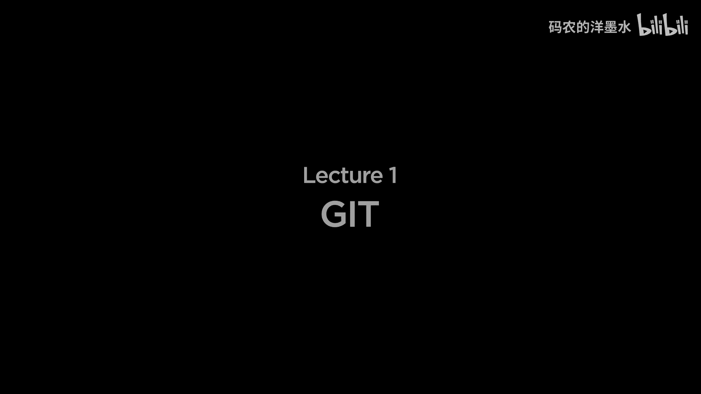

Alright， welcome back， everyone to web programming with Python and jascript。

 So last time we took a look at two languages， H TM L and CS。

 both of which can be used to design web pages。 H Tm L。

 we used in order to describe the structure of web pages to decide what content we want in the layout of the page and then C we use to describe the style of the page。

 what color we wanted things， how much space we wanted around things as well。

 Today we're going turn our attention to a tool that we can use as we begin to develop these web applications。

 And in particular， we're going to be looking at a tool called Git。

 And what Git is is it is a version control tool， not specific to web programs necessarily。

 but that we're going to use as we begin to develop bigger and more sophisticated web applications over the course of this term。

 So what is git going to enable us to do。 Well it's going to do a couple of things。

 First and foremost， what Gi is it is a command line tool that's going to allow us to first keep track of changes that we make to code。

 So once upon a time， and the first time I was starting to develop web applications。

 I remember working。😊，On a file。 and then when I wanted to make changes。

 I might have wanted to save the old version， so I would duplicate the file and then just make changes to the duplicate。

 but this quickly gets messy， especially if you have lots of different versions of your code in various different stages。

 keeping track of them just starts to become a nightmare。

 So what Gi is going to enable us to do is to keep track of changes that we make to our code we might create a file initially save that version of it but over time as we make changes add to it。

 remove things from it。 we can save snapshots so to speak a various different parts of our code at different points in time that we can quickly and easily reference all of those changes that we've made to that code。

 Additionally， Git is going to make it easy for us to synchronize code between different people in largerscale web applications is rarely just one person who's working on the entire application usually you're working with a coworker or multiple coworkers all in the same application and all at the same time。

 and one definitely tricky part of this process is figuring out how to synchronize your work between different people。

 if I make a change on my part of the web。😊。

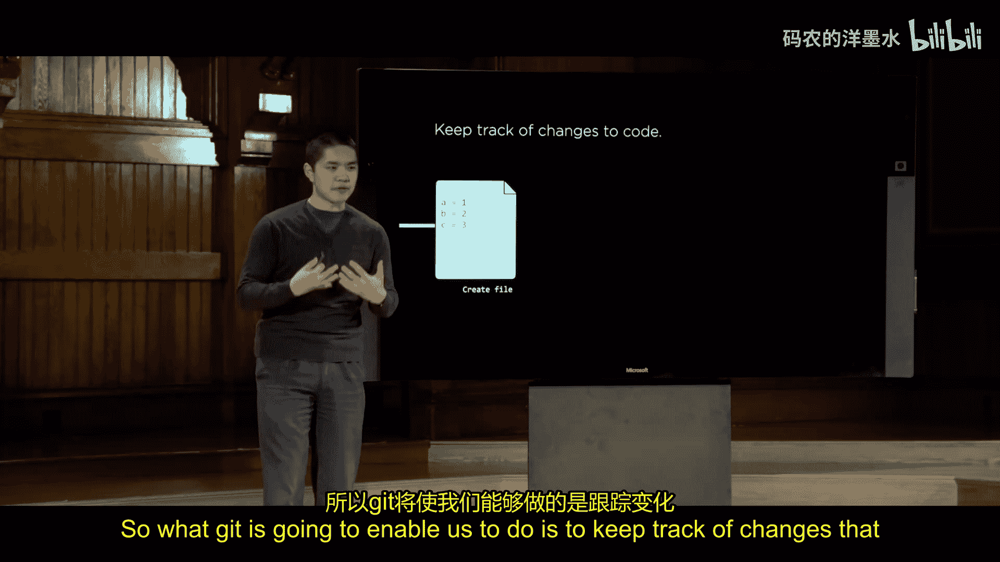

I want to make sure that my colleagues are also able to see those changes and get access to the latest changes that I've made。

 and then I want to be able to get access to the latest changes that the people I'm working with have made too。

 so we need some way to keep everything in sync and git is going to enable us to do that。

 What we're going to effectively have is one version of the code stored we're gonna call a repository somewhere online and both I and someone I'm working with a partner。

 for example， might both be able to get access to that exact same repository the same files in the same state。

 And if ever I and the other person make changes to those files。

 we can each make changes to those files and then synchronize them back up pushing them back up to the server so to speak so that the server will have the most recent。

 most upto dateate version of this code。 Then after that。

 after we've both pushed our changes up to the server。

 then we can both pull changes from the server so to speak。

 in order to get access to the latest version of the code so that no matter what so long as I've been working on the same project that my partner has we can use Gi to。

😊。

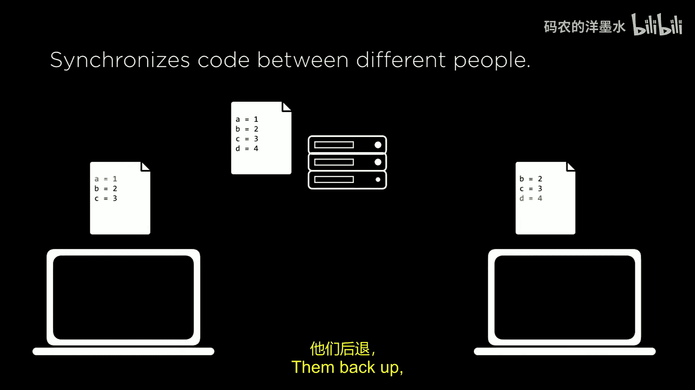

ize our work so that I have access to my colleagues most recent changes and vice versa。

Git also enables us to do a number of other things。 For example。

 Git allows us to test changes to our code without removing access to the original。 So， for example。

 you might imagine that as I'm working on writing a program， I might want to try making some changes。

 but I'm not sure if they're quite gonna work。 So I want to test those changes。

 but I don't want to lose access to my original working version of the program。

 just in case something goes wrong。 So what Git enables us to do。

 is it lets us make changes to code on a separate branch， so to speak。 such that later。

 once we're happy and satisfied with the changes， we can merge those changes back into the original version of our code being able to test those changes before we're really sure that they're the ones that we want to make。

😊。

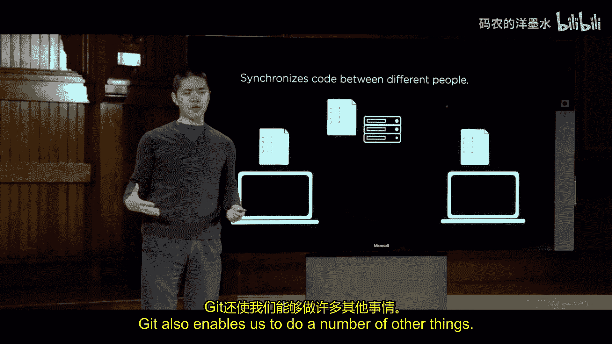

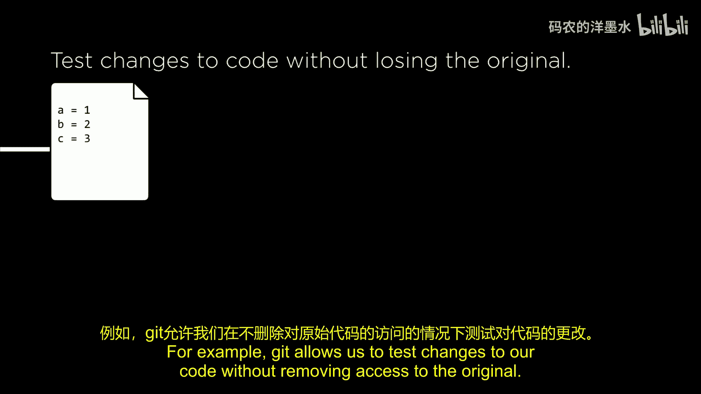

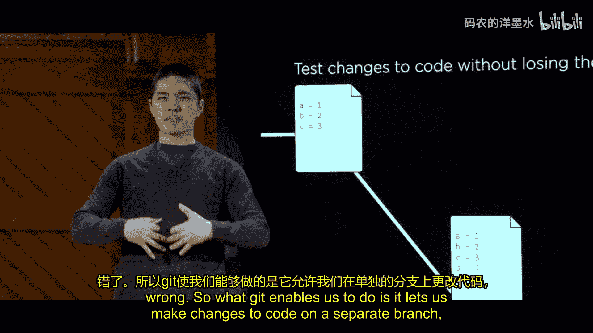

And finally， one powerful feature that Git gives us access to is the ability to revert back to old versions of our code。

 So you might imagine in a situation where I've been working on some code。

 And I realized that actually， what I'm doing right now isn't what I want。 Git enables us to say。

 you know what， this most recent change isn't something that I wanted。

 I would like to revert back to a previous version of the code instead and Git makes it very easy to go back to those previous versions。

😊。

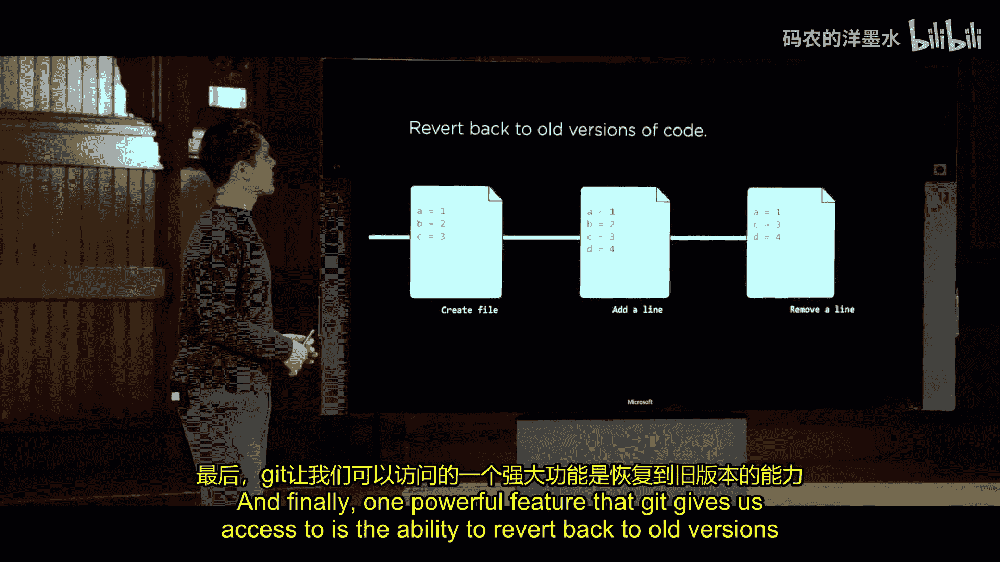

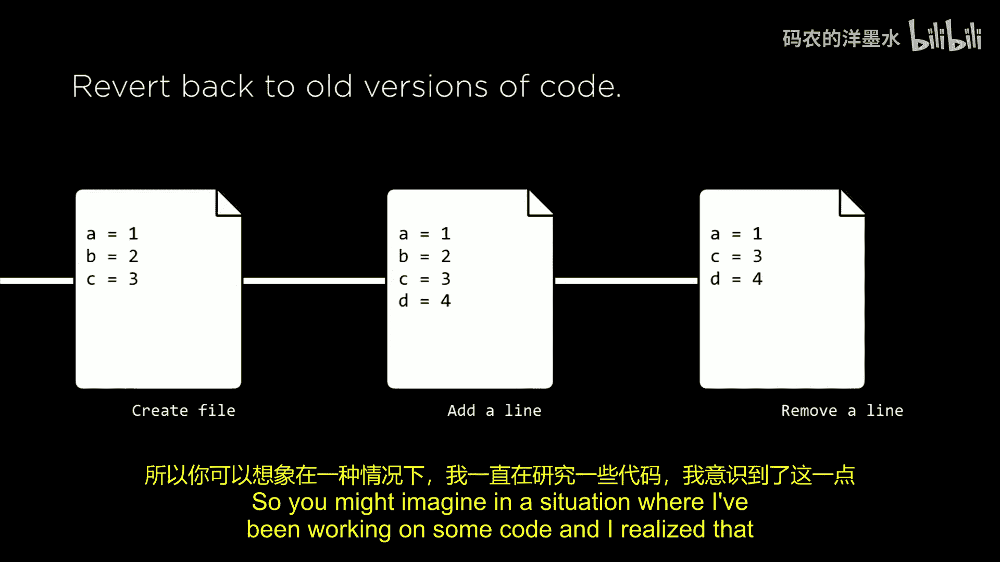

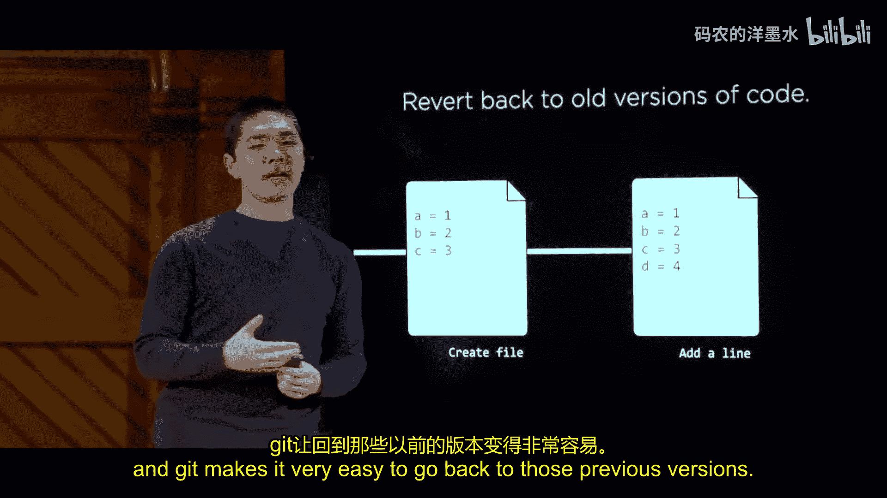

So the goal for today is going to be to learn how to use this tool。

 to learn the various different Git commands that will be quite popular and quite common as you go about working on web applications or really any other code related projects because version control really allows a number of useful features that are practical as you begin to work on larger and larger projects。

 But ultimately， as we begin working on these Git projects， they need to be stored somewhere online。

 such that we're able to download them from anywhere such that me and a partner can both be working on the same files and the same code。

 And so in order to do that， we need to host our Git code somewhere。

 And there are a number of different websites that can do this。

 But one of the most popular as a website known as Gitthub Gitthub is a website that stores Git repositories where all a repository is。

 if you can think of it as a folder that holds a whole bunch of code and files related to our code。

 So we're gonna host this code online on a website called Github。

 And then on our computer we'll be able to access these Github repositories and manipulate those repositories。

😊。

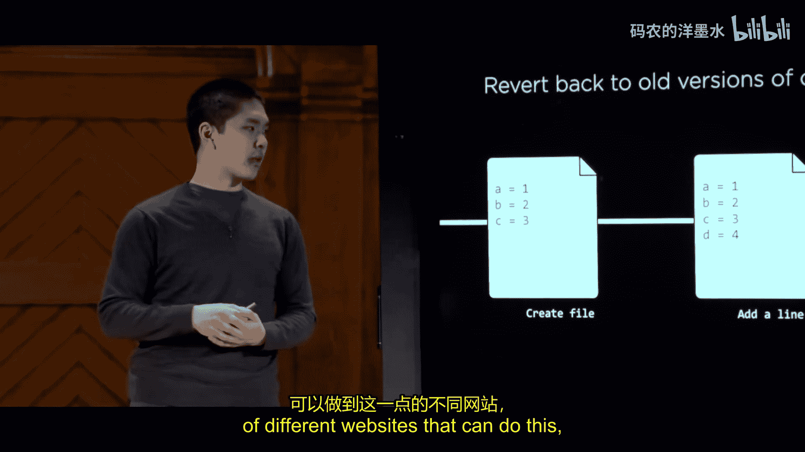

By changing the files that are within them。 So let's go ahead and take a look at Github and see how we can go ahead and create our very first Github repository。

 If you don't already have a Github account， you can create one by going to Github dot com and signing up for an account for free。

 And I'll now go to Github do com slash new Github dot com slash new is the page I go to if I want to create a new Github repository。

 And so let's take a look at what I need to do in order to create a repository。😊。

The first thing I need to do is give my repository a name。 So in this case。

 I'm just going call the repository hello， You can give it any name you want so long as that name doesn't collide with other repository names that you already have。

😊，GitHub optionally lets me provide a description for this repository。

 I'll just say web programming with Python and Java。And then Github gives me the choice。

 Do I want this to be a public repository such that anyone can see the repository。

 Not everyone can necessarily make changes to it。But it's publicly available if anyone wants to download my code and try it out。

 Public means that anyone can access it。 or private meaning， by default。

 only I can see this repository。 but I can choose if I would like other people to be able to see it as well。

 And I can select which individuals For now， I'll go ahead and make this repository public。

 And I'll go down here and click on the green create repository button in order to make this new repository。

😊，So I click the create repository button。 And here it is。 This is the Githubs repository page。

 And right now， you'll notice that there's a lot of instructions here。

 but there are no files because right now， when I first created my first Git repository。

 I got an empty repository with nothing in it。😊，So what I'd like to do now is somehow download this repository onto my own computer such that I can add say an HTMLM file that contains some HTMLM that I want to keep track of using Git。

 So how am I going to do that。

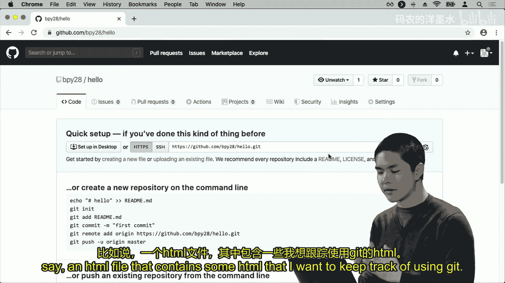

Well， in order to do that， we're going to take a look at the very first Git command that's going to be involved with Git。

 which is known as Git clone。 Git clone is a command that we can run in order to take a repository from the Internet and download it onto our own computer。

 So you'll need to have Git installed onto your computer。

 you can install it on any Mac or PC or Linux machine。

 And once you do what you're going to do is on your computer in the terminal。

 You'll run Git clone followed by the URL of the Git repository that you're trying to download。

 So you might imagine that here's your computer over here。

 And up here is some server where a Git repository is located。 Gitthub， for example。

 is one such server， But there are others as well。 And up there is the repository that potentially has files or maybe other folders with other files that contain the contents of the repository that you care about downloading。

 So if I run Git clone followed by the URL of the repository I want。

 The effect of that is that the repository and all of its contents get downloaded onto my computer。

 such that I on my computer now have a copy。😊，Of everything that was originally inside of that git repository。

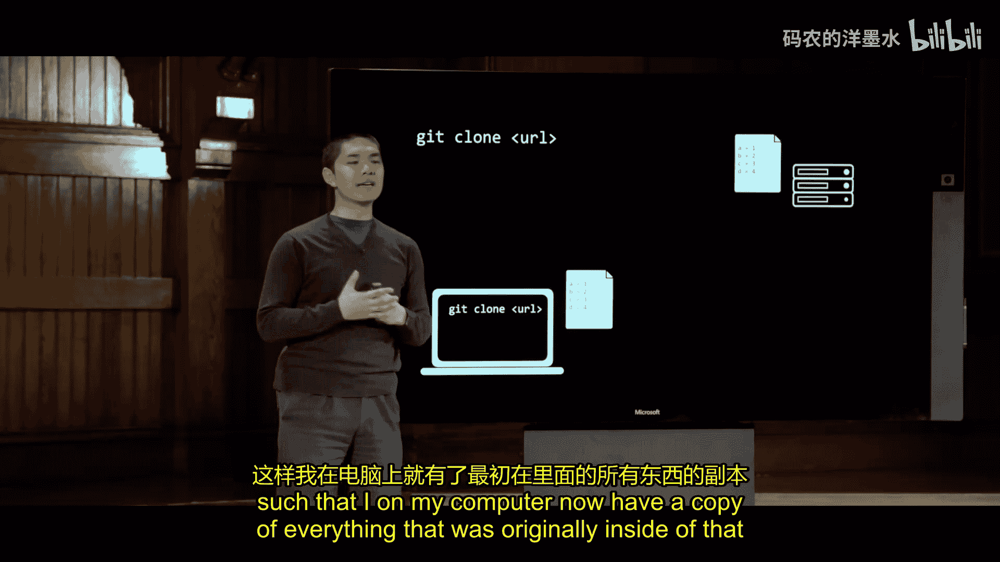

So now， now that we know how to clone a repository， let's actually try it。

 We've just created a repository using Gitthub。 And now let me go into my terminal and actually try to clone this repository so that I have a copy of it on my computer and I can begin to make some changes to it。

😊。

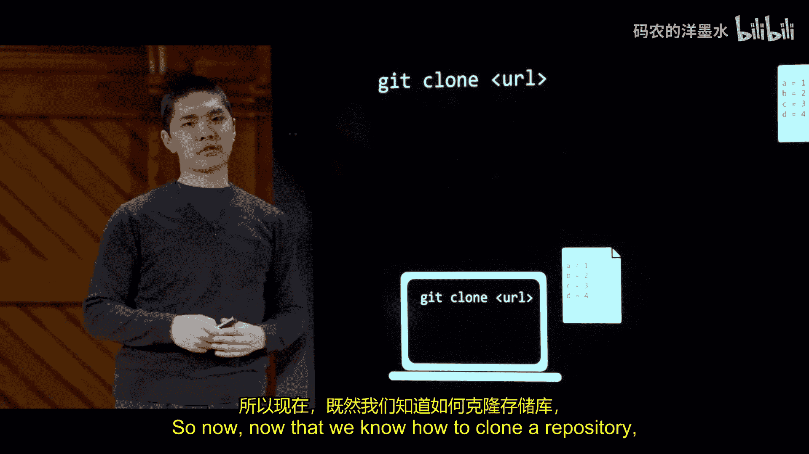

So I'll go into my terminal now， and I'll go into my lecture one directory。

 And the first thing that I'm going to need is I'm going to need the URL of the Git repository。

 So if I go back into Github。 what you'll notice is that it gives me an H T TPS link in order to download my Git repository。

 So there are a couple of different ways that I can use to clone my repository of ways to authenticate myself。

 One is using H T TPS， which will eventually involve like a username and password that I'll have to type in in order to prove to get that these are my Github credentials。

 alternatively familiar with SH。 This is another method of authentication。 you can give Github。

 your public SH key in order to authenticate as well。

 but no need to worry about that if you're not as familiar with that technology。😊。

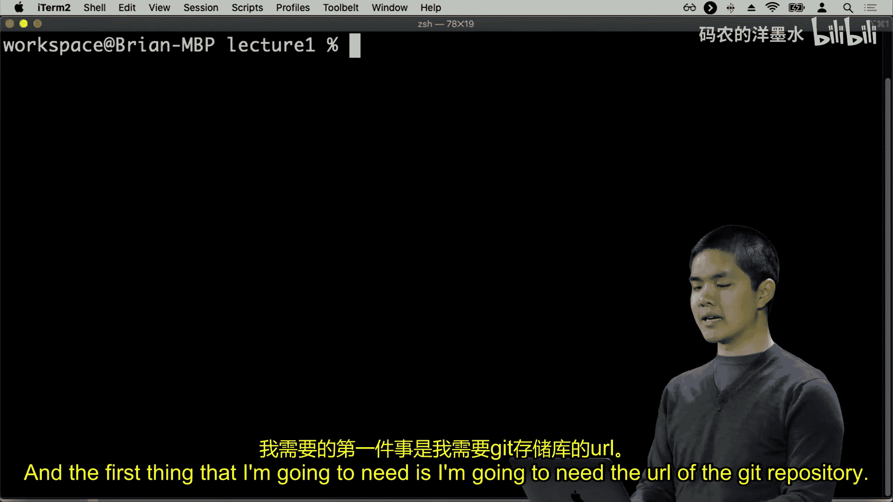

The key here is that this URL is the Github URL that corresponds to my repository。

 So I'm going to copy that URL。 And then inside of my terminal， I'll type Git clone。

 And then I'll just paste in the URL that I would like to clone That contains that repository。

 I'll go ahead and press return。 It says I'm cloning into a directory called hello。

 And then it's saying you appear to have cloned an empty repository。 It's saying that's a warning。

 but that's okay because I know that I've cloned an empty repository because the repository is brand new。

😊。

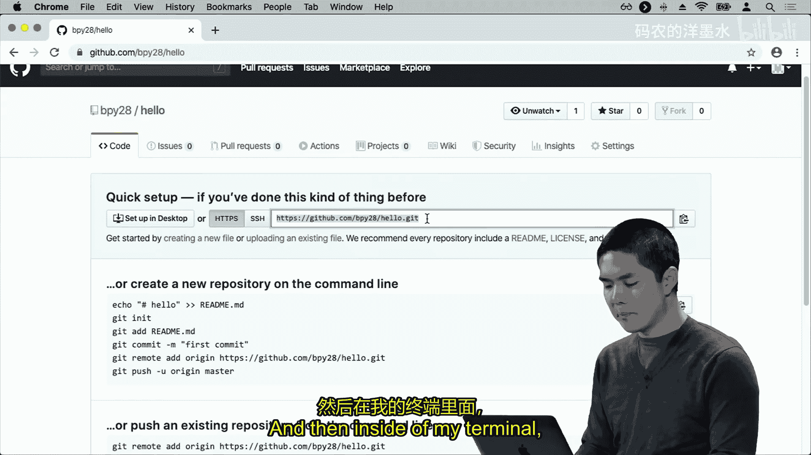

And now I can type the command L S in my terminal。 The LS command in the terminal stands for list。

 and effectively what it's going to do is list all of the files that are currently inside of this directory。

 all the files and folders that are inside of my lecture1 directory where directory is just a fancy name for folder。

 So I'll type L S。 and I see that all right。 I now have a folder called hello inside of my lecture1 directory。

 which I didn't have before。 I'll go ahead and move into this hello directory in order to change into a directory or folder。

 you can use the C D command， C D stands for change directory。 And so if I type C D hello。

 I will now move myself into the hello directory。😊，And if I type L S。

 you'll see that there is nothing inside of this hello directory right now because again。

 this repository was empty。 I cloned it and there was nothing in it。

 So now I'd like to actually put something in this repository。

 The repository is only useful if I'm keeping track of my code and keeping track of the changes that I make to that code。

 So I'll go ahead and actually try now to add some code to the repository。

 The first thing I'll do is create a new file。 And we could create a new file just by opening up a text editor。

 But on the terminal， there's actually a command for creating a new file called touch。

 So in the terminal， I can type touch hello do H TM L。

 And what that's going to do is create a new file called hello dot H Tl。 And if I type L S。

 I can see that indeed， I do have a file called hello do H Tml。 Now inside of my hello directory。😊。

Let me now open up。This directory in the hello dot H TM L file inside of a text editor。 Again。

 I'm using V S code。 And let me now add just some text to Ho dot H TM L。

 I'll just at a simple H T M L page。

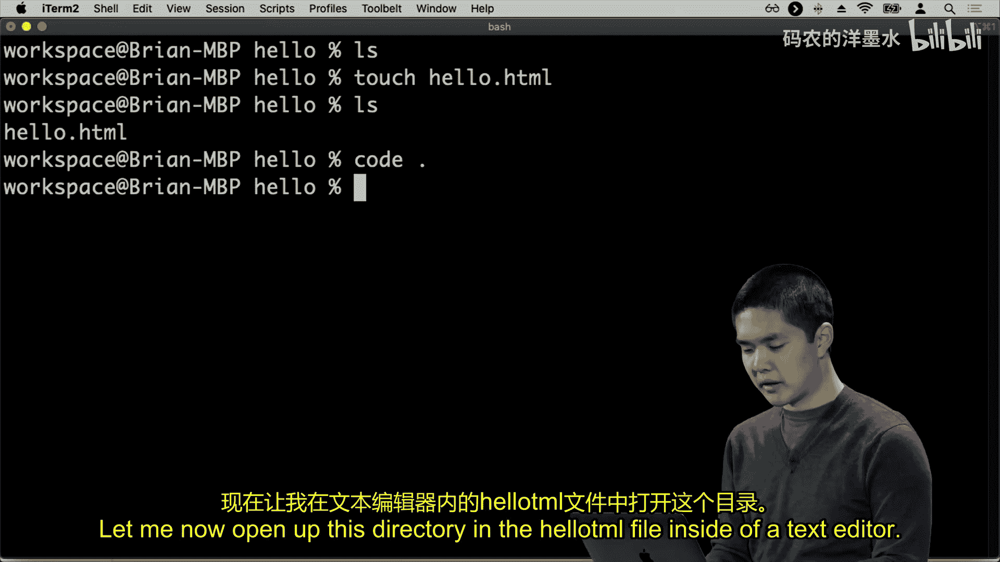

Same thing we've seen before where I give it a header。

 A title will be hello and inside the body of the page will be hello world。

 same HM L page we've seen a number of times now。 now， just now inside of this repository。 Of course。

 I haven't yet made any saving to this repository。 I haven't said that I want to save these changes to the repository。

 And the repository isn't keeping track of every single character I write。

 I need to tell Gi that this is a state of my current files that I would like to keep track of something that I would like to save。

 And in the world of Gi， we call those save points commits。 when I say I am making a commit。 I mean。

 I would like to save the current state of all of the files and folders and other assets that exist inside of the repository and basically take a snapshot of their current position。

 such that later I might be able to refer back to them。 But in order to do that。

 they're actually a couple of steps。😊。

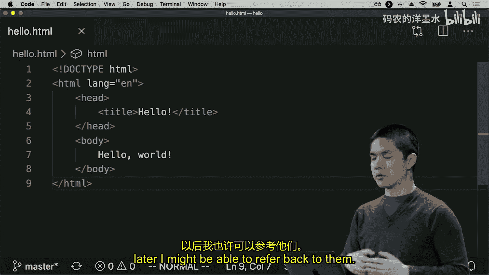

So the first step we need to follow is an additional command。

 So we saw that Git clone was the command we could use in order to clone a repository。

 take a repository and download it onto our own computer。

 The next command we'll take a look at is a command called Git add And what Git ad is going to do is it's going to let us tell Git that I would like to add a file as one to track the next time I save the next time I make a commit to say that I would like to take a snapshot of all these files such that I'm able to refer back to them later。

 And in order to do that， I need to tell Git what files to keep track of。😊，So if， for example。

 I'm keep working on this file， and I'd like to tell Git that I'd like to track it。

 I can run a command like Git ad followed by the name of the file。

 like food dot pi or dot H T Ml or whatever file it happens to be。

 And then Git will display a message saying that， all right。 Now we've added food dot pi。

 This is now a file that will be saved the next time I make a commit。😊。

So why are these two separate steps。 Well， one reason you might imagine is that if I'm working on a lot of different files。

 sayy I'm working on 10 different files and there are only three that I'm happy with。

 three that I want to save。 I don't want to just say save and have everything be saved in a commit。

 I might want to say that you know what， these are the only three files that I actually want to save right now。

 And the other ones I'm still working on。 So get gives us that ability to have the separation to say let me explicitly say that I want to track this file the next time I save the next time I make a commit and not all of the files。

 for example， So there are shortcuts we can use if we do want to add all of the files and we'll see those in a moment as well。

 So let's go ahead and try that。ll go back to our repository where I've created this hello do HMl file。

 And now what I'd like to do is say that I would like to add the hello do HMl file to my Git repository。

 So inside of my terminal。😊。

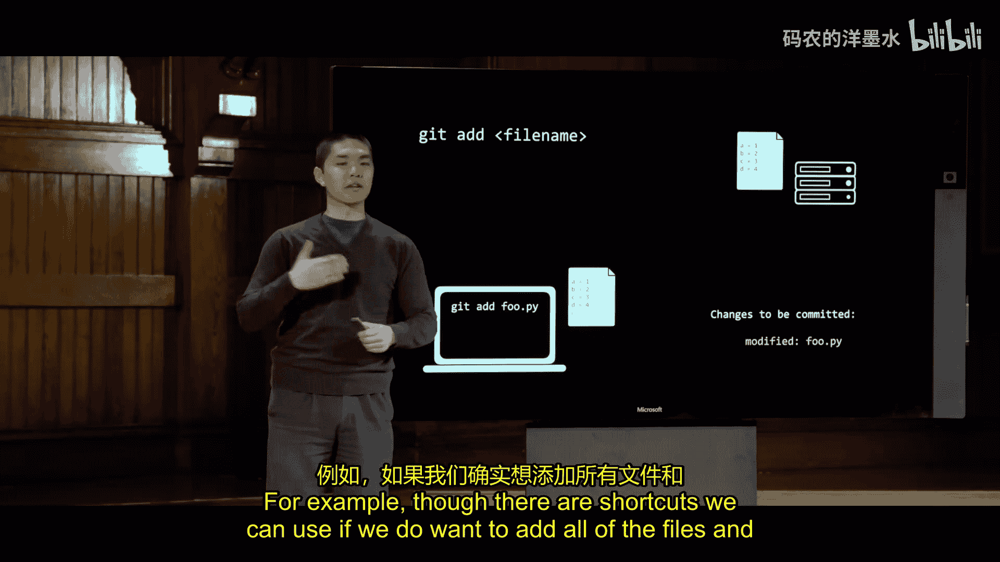

I'll now say， again， I have a hello dot H TM L file here。

 I'll say Git add followed by hello dot H TM L。And you'll notice that so far。

 nothing seems to have happened because so far I haven't yet saved anything。

 I've just said that I would like to add hello do H TMl as a file that the next time I say save the next time I commit my repository。

 It is going to keep track of the changes I have now made to hello do H TM L。

 So how do I actually make a commit。 How do I actually say save the state of these files。

 that's gonna be one more git command， which is known as Git commit， when I say git commit。

 I am going to tell my Git repository that I would like to save a snapshot of the current state of the repository。

 keeping track of any of the changes that have been made to files that I've added using Git add And the way we run it is by running Git commit followed by dash M。

 and then in quotation marks a message。 And this message is known as a commit message。

 And what it is is a description in English or whatever your language is of what changes you've made in this most recent commit Because over time。

 as you work on a big project， you're probably gonna make lots of commits。😊。

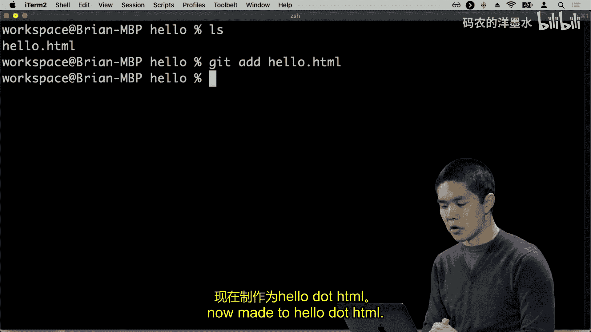

You make lots of changes to your program。 you'll commit and commit again after each new edition you make to the project。

 and you might want to refer back to a previous commit。

 but it's only valuable to do so if you can identify in which commit you made a particular change。

 for example， so by providing some English message。

 just some note to yourself such that later you can refer back to all your commit messages and know that all right at this point in time in this commit。

 this is the change that I made that can just make it easier to keep track of all the changes that you've made to a particular Git repository。

So when you type Git commitmit， followed by dashM， you might include a message。

 something like I added a new line， for example， and when you do。

 Git is going to save a new snapshot of a version of your code right now。

 keeping track of the old version or old versions that used to exist there inside of the repository。

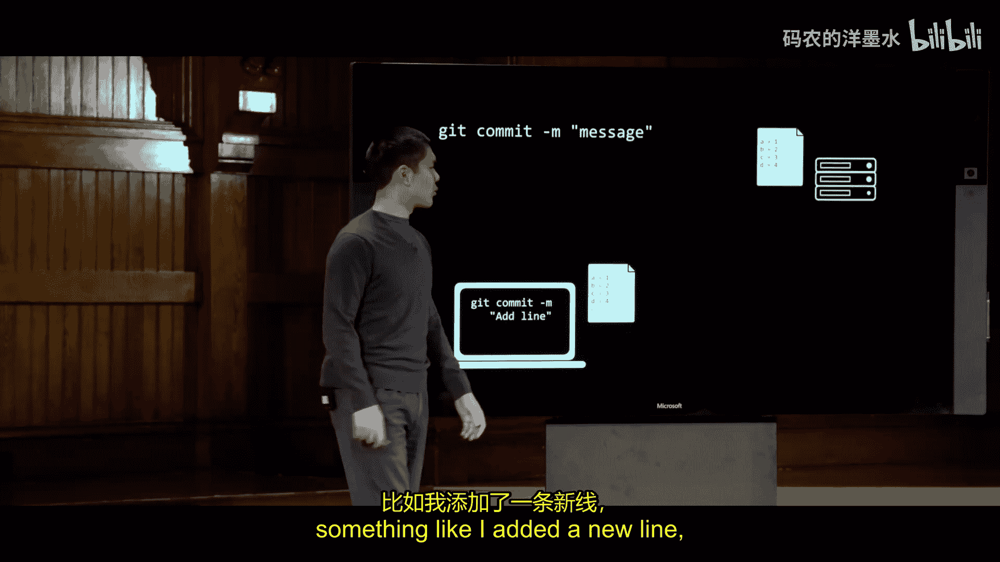

So let's try and actually make a commit now and see how that's actually going to work。

 So we've already added the file as by running Git add to say。

 add the hello dot H TM L file as one to keep track of。

 But now when we're happy with it and we could make additional changes to the file if we want to。

 I can go back into the terminal and now say git commit。😊，And then dash M。

 And then I can specify the commit message， some English description of what it is that I did in this most recent commit。

 And what I did was I added the hello dot HM L file。

 So I'm just gonna say I added the hello HM L file。

 That was the change I made in this most recent commit。 I'll go ahead and press return。😊。

And here's what it's telling me。 It's telling me one file has been changed with9 insertions。

 So Git keeps track of changes in terms of how many lines have been added or inserted and how many lines have been deleted or removed。

 And in this case， it's telling me there have been 9 insertions to one file because previously。

 the file didn't exist。 And now a file that has9 lines does exist。

 And now I have saved hellello dot HMl to this Git repository。😊。

So now you might imagine if I go back to my Git repository on Github's website and refresh it that maybe I'll see that hello dot HtM L file。

 but I refresh。 And all right， nothing happened。 Nothing changed。 I don't see my hello do TM L file。

 And that's because there's one final step here I'm missing before my changes are going to be reflected online recall that when I ran the Git clone step in order to clone the repository from Github。

 Github had a version of the repository。 and I ran Git clone to download a copy of that repository on my own computer。

 And when I ran Gitadd to add the hello dotml file。

 or I ran Git commitit to say I would like to save these changes。

 I was always making those changes only to my local version of the repository。

 I was never affecting anything that was already on Github。

 the changes I was making were only happening on my own computer。

 if I want to push those changes up to Github， Then I'm gonna need some additional commands。

 And in fact， we can see what's currently going on inside of my repository using a command called Git Sta。

😊。

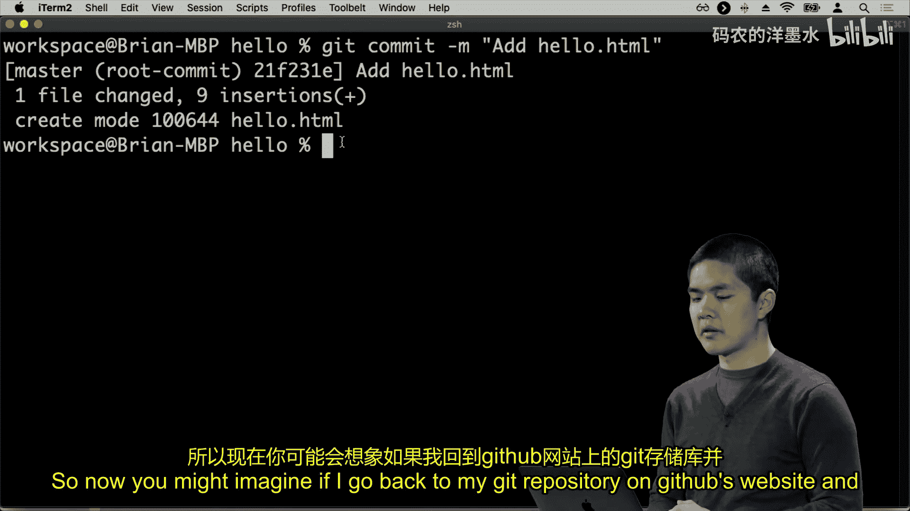

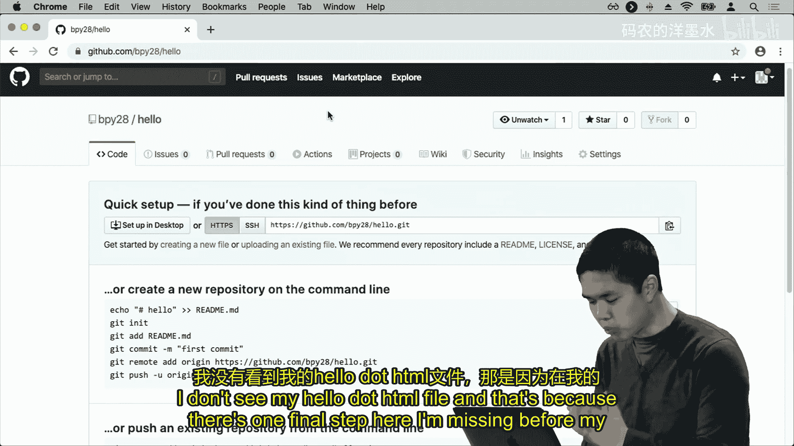

And what Git status will do is it'll tell us what's currently happening inside of my repository。 So。

 for example， if I were to in this current state， run the command Git status。

 then Git is going to report back to me and tell me that I am currently on branch master more on branches later。

 But then it's saying my branch is a ahead of origin master by one commit。

 So this is a longwined way of saying that my local version of the repository。

 The version of the repository on my computer is ahead of the origin version of the repository。

 The version of the repository that's up on Github by one commit that I have one commit that the origin Github does not have。

 And it's helpful telling me I can use the command Git push to publish your local commits。

 Git push is a command that I can use in order to say I would like to take my changes and actually push them up to the server push them up to Github so that they're reflected there。

 So after we've checked our current status with Git status， we can use the command Git push to say。😊。

That now， whatever changes that I've made， when I run Git push， those changes。

Get pushed up to Gitthub。 So Gitthub has access to all of the commits that I have now made。

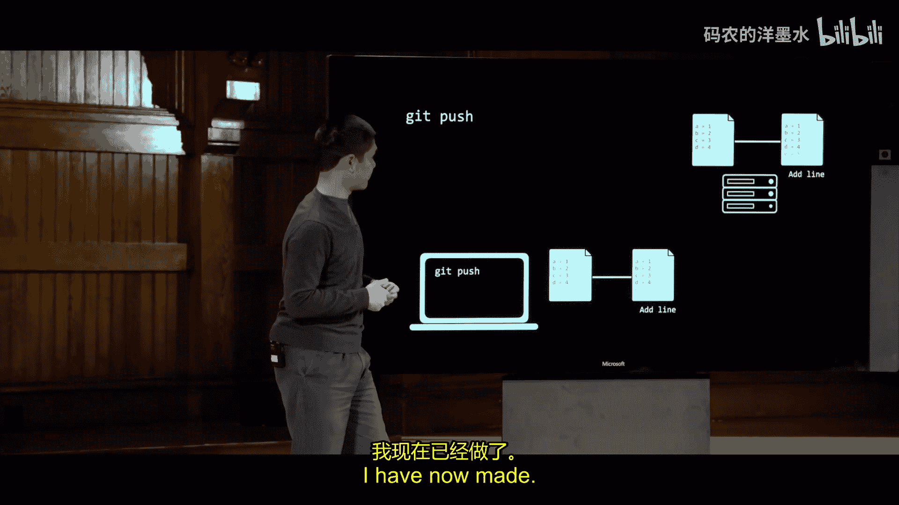

So let's try those two commands now， get status to see what's currently going on inside of my repository and then get push to say。

 I would like to now push those changes to Github so that the online version of the repository has the same contents as the local version on my own computer。

😊，Alright， so in my terminal now， I can run Git status。

 and I see that I am on branchma same as before。 it's a slightly different message because there's nothing currently inside the repository。

 But the key here is that now I can run the command， Gi pushush to say。

 take all of the changes that I have made to my repository and go ahead and push them up to Github。

 So I'll type Git push and what's going to happen it's going to compress all the information and it's going to push it up to Github to this URL。

 And now if I go back to Github's website， Github do com slash my repository and refresh the page。😊。

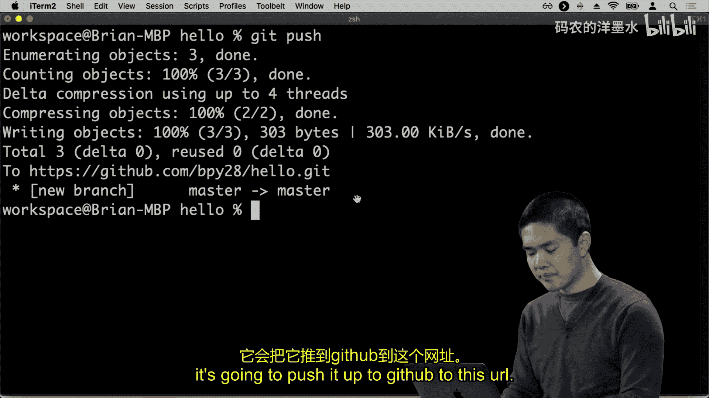

I'll see that I do actually now see something different。

 And so this is what Github's user interface actually looks like。

 It gives me a few pieces of information。 It's telling me， for example。

 that there's one commit currently made to the repository。

 That's the one I just made that is on one branch。 So if I've only created one branch。

 the default one， but we'll see how to create more branches later。 And in particular， down below。

 you'll see the files that currently exist inside of this repository。 that right now。

 I have this hello dot H TM L file， which is the one that I pushed。

 And in particular next to it is the commit message。

 The message from the most recent time that I touched to this file， which is in particular。

 telling me that I added the hello dot H TM L file in the most recent commit that affected hello dot H TM L。

 And if it were Id now to click on hello dot H TM L， that actually see what's inside of it。😊。

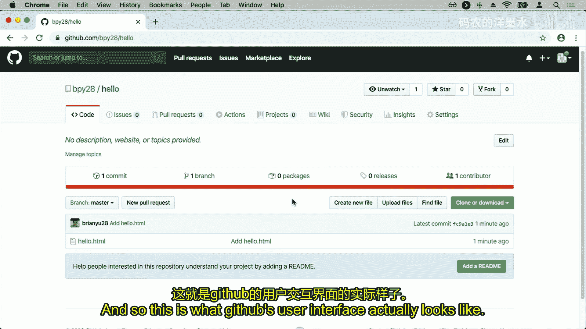

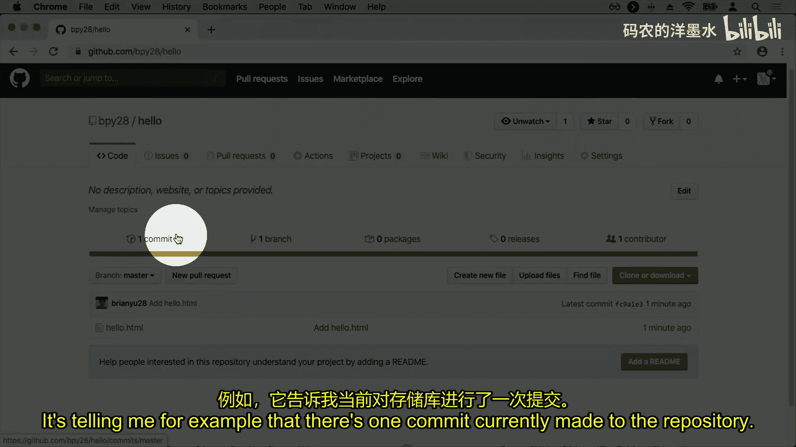

I would see。The same content that I wrote in that file before。

 I see Doc type H TM L and then the hellello world page that we've seen a couple of times now。

 So I made the change on my own computer， and I've now pushed them up to Gitthub。

 So they're now inside of this repository that's now public such that anyone else if they wanted to collaborate on this project could take this URL clone it to their own computer and make their own changes locally as well。

😊，And so now we can explore how we might be able to make additional changes to this web page as well。

 So if， for example， I wanted to add a heading to this web page， for instance。

 I might at the top of the body， say something like in an H1 tag， welcome。😊。

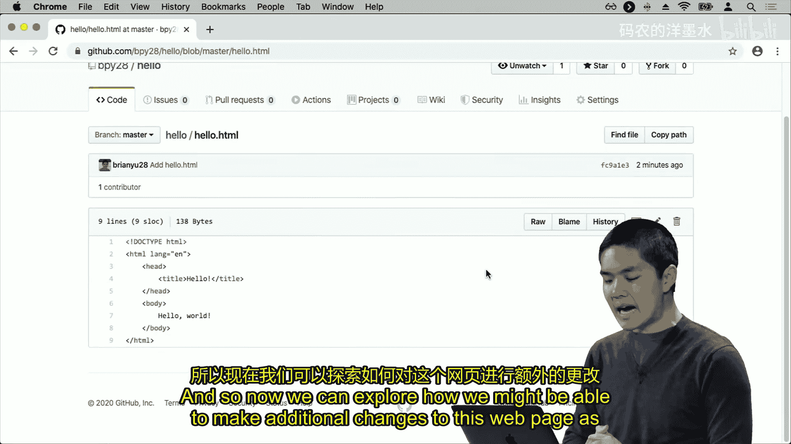

To my website。

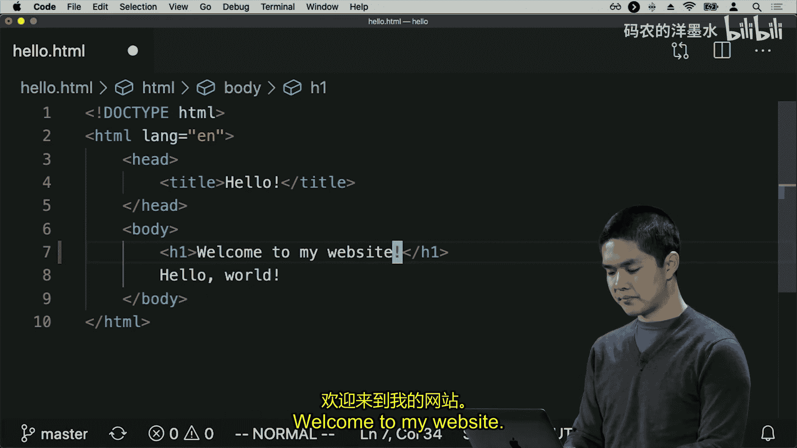

And now if I， know， just for good measure， open up Hello。ht， see what it looks like。

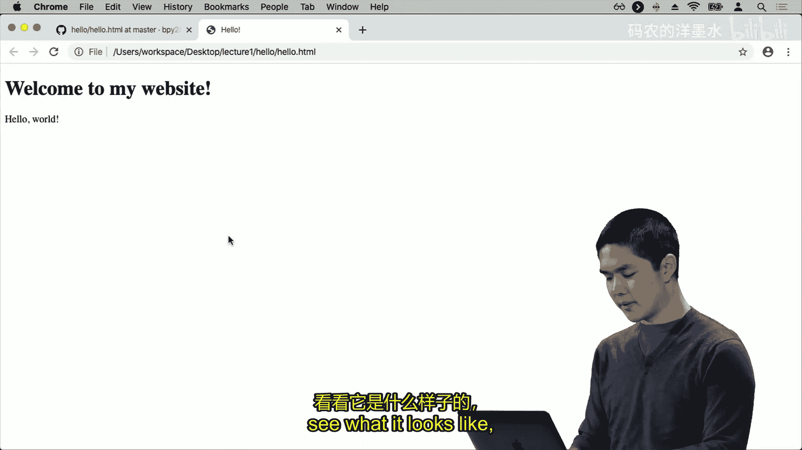

This is what my web page now looks like。And now I've made changes to my hello dottMl file。

 changes that have not yet been saved。 and I can tell that if I run Git status。

 Git status is your go to for telling you what's currently going on inside of your repository。

 So here we see changes not staged for commit， which is a fancy way of saying files that have been changed but I haven't said I would like to keep track of them in the next commit。

 It's telling me that I've modified hello dotMl。 but it's not something that git is currently going to keep track of the next time I make a save。

 So if I want to save hello do Html。 when I commit for the next time。

 then I'll first need to run git add hello do Html。 and then I could run git commit。

 but there's actually a bit of a shorthand here。 If you want to add all of the files that have been changed and commit at the same time。

 the shorthand is git commit A remember before we just use M to say specify a message A means git commit all of the files that have been changed for all and。

😊，So provide a message so you can combine the Git add step and Git commit step into just a single step by saying I'd like to commit all of the files that I've changed and then I'll provide a message what exactly did I change。

 I added a heading。I'll go ahead and press return。 It's kept track of the fact that I have now changed one file with one insertion。

 All I did was add one new line to that file。And now if I run Git status。

 it's going to tell me I'm on Brachma and I am head of Orig master。

 Orig master being the version on GitHub by one commit that I have this add a heading commit。

 but right now on GitHub， if I refresh this page。😡。

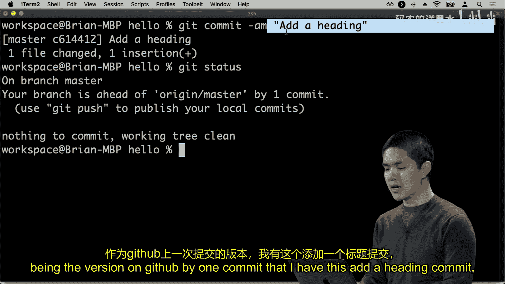

It's still showing the old version of that page。In order to take my changes that I've made on my computer and make sure they're updated on GitHub。

 I can just run Git push to say push those changes up to GitHub， and once that's done。

 I can now refresh the page on GitthHub and I'll now see that Github now has the latest version of my program as well。

 It now has this H1 that says welcomee to my website。

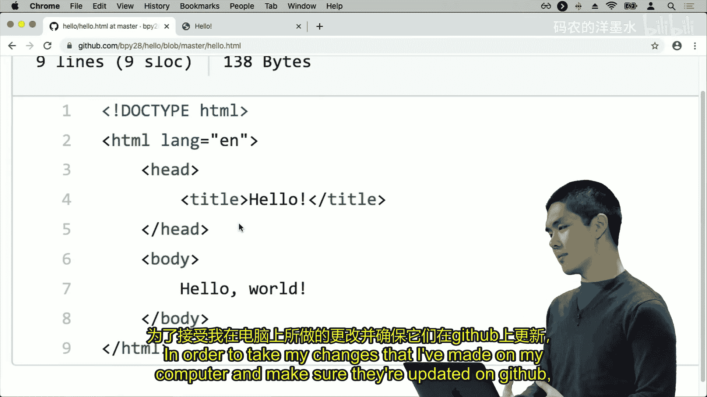

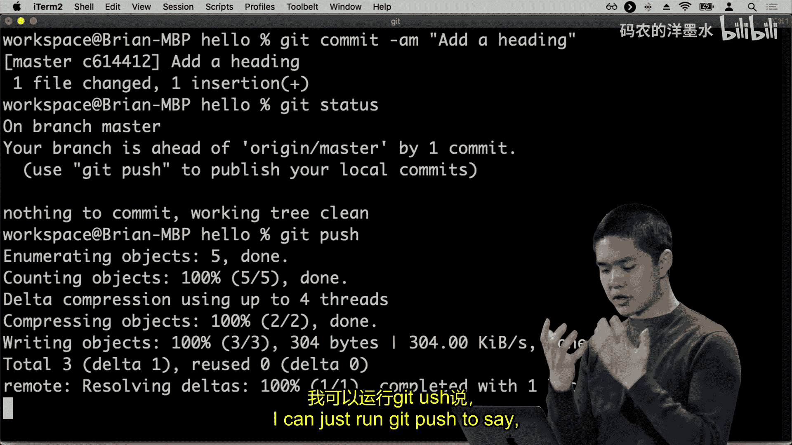

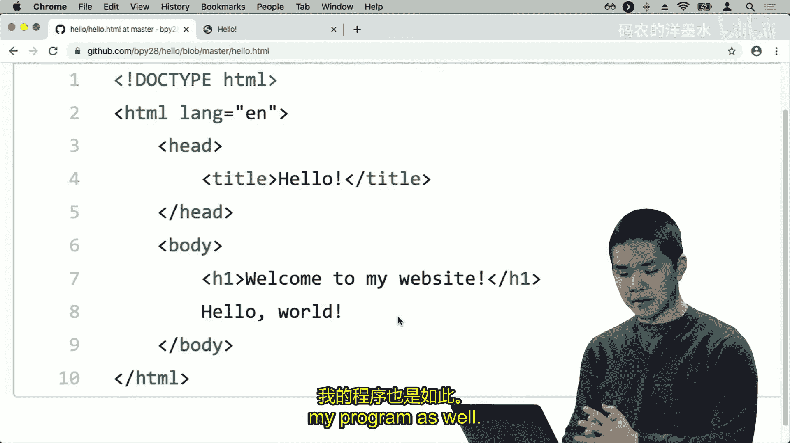

So that's Gipush now， the ability for me to say I would like to make to take the changes that I have made to my repository and pushed them up to some remote server。

 the remote server on Github， for example， But we can also go in the opposite way。

 You might imagine that maybe the version that's up on Github is more recent than the version that I have on my computer。

 And in that case I would like to download the latest version of the repository that currently exists on Github。

 And in order to do that， we can use a command called Git pull。 How does that work Well。

 when I run Git pull what's going to happen is the opposite of what Gitp did。

 while Gitp took my changes on my computer and push them up to Github。

 Git pull will say take the changes that currently exists on Github and go ahead and pull the most recent changes down so that I and my local version of the repository have access to the latest version of all of the code that is currently on Github。

 And we can demonstrate this for example。 if I go back and take a look at Github's website itself。

 because。😊。

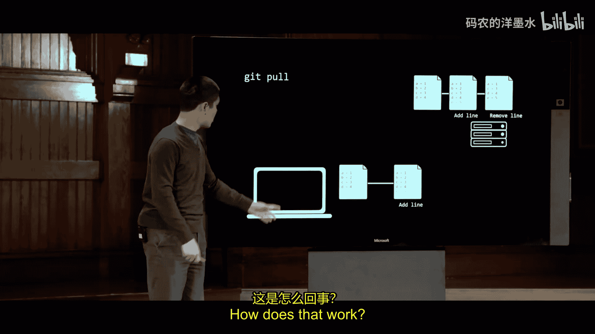

GHub， I actually have the ability to edit files using GitHub's interface。

So I'm going to simulate like someone else working on this project， for example。

 maybe someone else added a second heading。 So they added an H2 that says。Just hello， for example。

And then they can provide a commit message。 This is sort of a graphical equivalent to the dash M。

 And then a message that we provided before。 They can say added H2。And then， commit。嗯。

So this is another way to edit a Git repository is by literally editing it in editing it inside of Gitthub's interface。

 So Gitthub allows you to just edit a file and then add or modify any of the lines there。😊。

So now the version on Github is actually different from the version that we have on our computer that if we look at Hello dot Html here。

 I only see the H1， and I don't see the H2 that was just added because it's a more recent commit that I don't yet have access to。

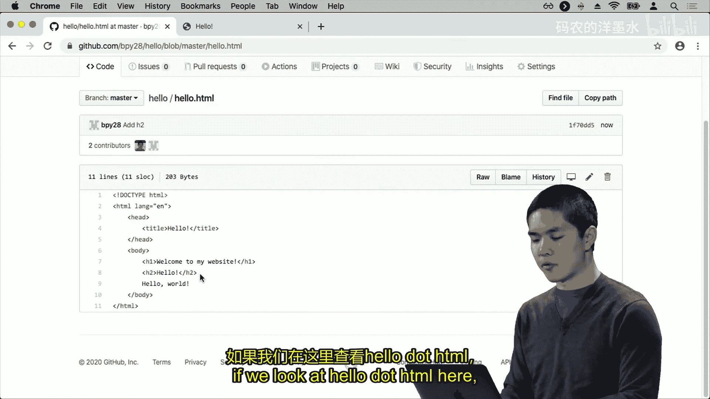

But if I want to download that commit， then what I can say is inside my terminal。

 I can say get pull in order to download it。

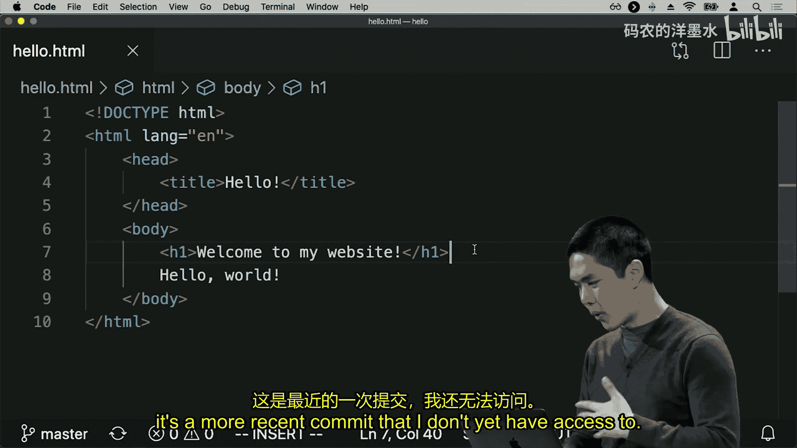

And allright， it's updated one file。 It's made some changes。 And so now if I go back to the file。

 you'll notice that automatically， I now have the latest version of the file。

 I now have this H2 that says hello， because I've pulled the latest version of the file down from Github。

 So via a combination of Gitpush and Git pull， I can make changes to my code。

 push them up to Github and also get access to the latest version of code that already is on Github。

😊。

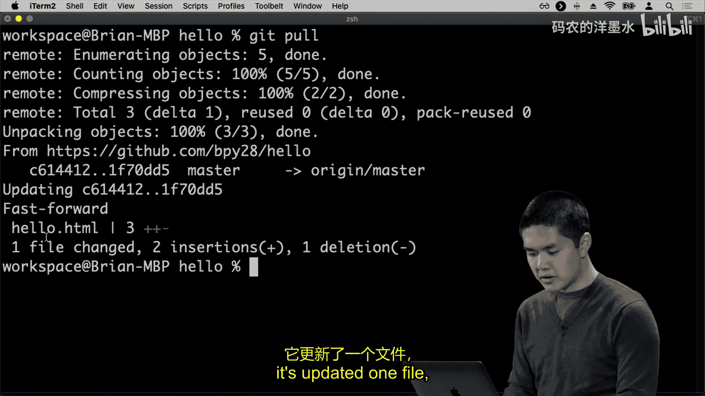

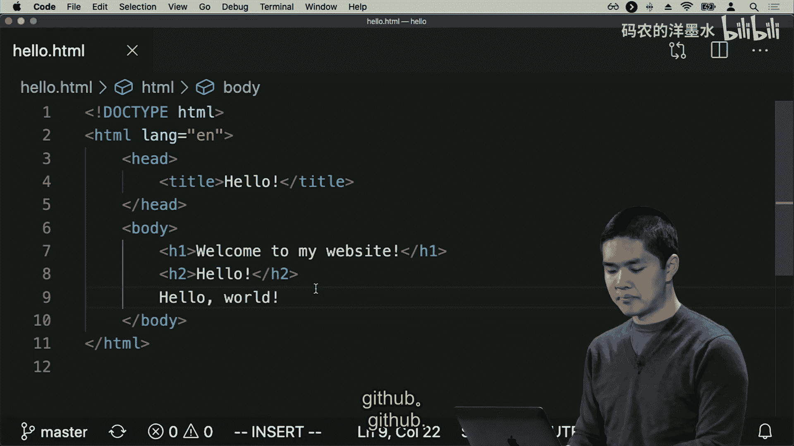

But as we do this， you might imagine that we could run into some sort of problem。 In particular。

 we might run into a problem if I've been making changes to my code and someone else working on my same project has also been making changes to the code。

 What happens if we both make changes to the same part of the code and then try to sync up our work together。

 What's going to happen。 we're gonna run into some sort of conflict because I've made changes to the same line that my colleague has been making changes to。

 And that type of conflict is called emerge merge conflict that when trying to merge my changes with the changes that someone else has made。

 we run into a situation， wherere suddenly get doesn't know what to do。

 They are two different sets of changes and we need to figure out how to resolve them and what to do when we run into this sort of conflict。

😊。

So here's what's gonna happen if ever we run into this sort of merge conflict。

 It's generally gonna happen if I try and pull in or merge in some changes from elsewhere。

 So let's say I run git pull， but there's some conflicting commit。

 something that is online that conflicts with my current version of the repository。

 What I'll get is a message like this。 Some conflict saying merge conflicts in some file have failed。

 You need to fix the conflicts and then commit the results。

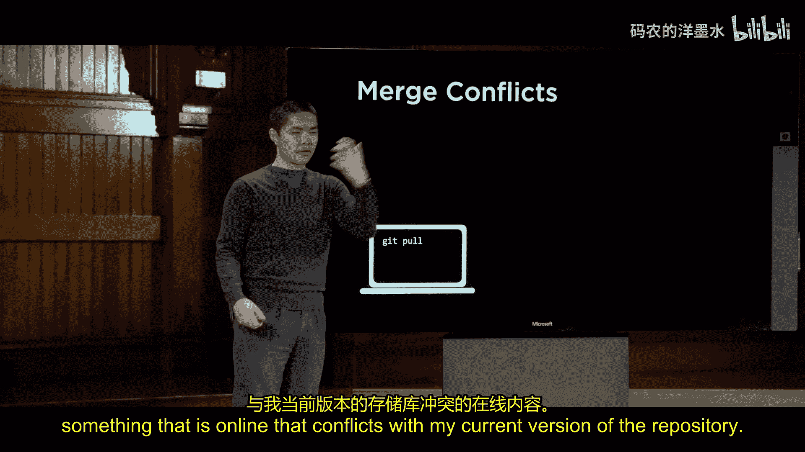

So what might those conflicts look like。 Well， generally。

 the file is going to look a little something like this。

 Git is automatically going to add some metadata to the file to describe the things that it can't quite figure out。

 And it's a lot of cryptic looking information， but we can distill it down into a couple of key parts。

 Everything in between these arrows at the top and the equal signs here are your changes。

 The changes I have made on my version of the repository that are somehow conflicting with some other changes。

😊，Everything between these equal signs and these arrows down here are the remote changes。

 the changes from Github that I'm trying to pull in that somehow are conflicting with what I've currently been working on。

 And then this sequence of numbers and characters here is the hash of the conflicting commit。

 So every commit gets a hash just some sequence of numbers and characters that is likely to be unique that helps to identify any particular commit。

 and get will automatically generate a hash every time you make a commit。

 And we'll see in a moment how you can look at all of those possible commits。😊。

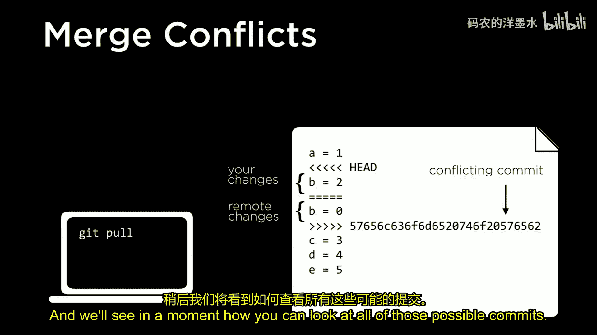

But here， Gt is just helpfully telling us this is the commit that is causing the conflict just for our own reference。

In order to address this merge conflict， the way we do it is we first need to remove all of these merge conflict markers that exist in the text file and decide what we want what we want as the resolution of the conflict。

 So maybe I want to keep my version of the changes。

 Maybe I want to keep the remote version of the changes， the changes that were already on Github。

 for example， or maybe I want to combine them in some intelligent way。 I。

 the programmer get to make that decision。 I get to look at my version and the conflicting version and decide how I want to resolve that conflict。

 I'll remove any of the blank lines and then commit the changes to say。

 this is what I want the merged version of this program to look like。😊。

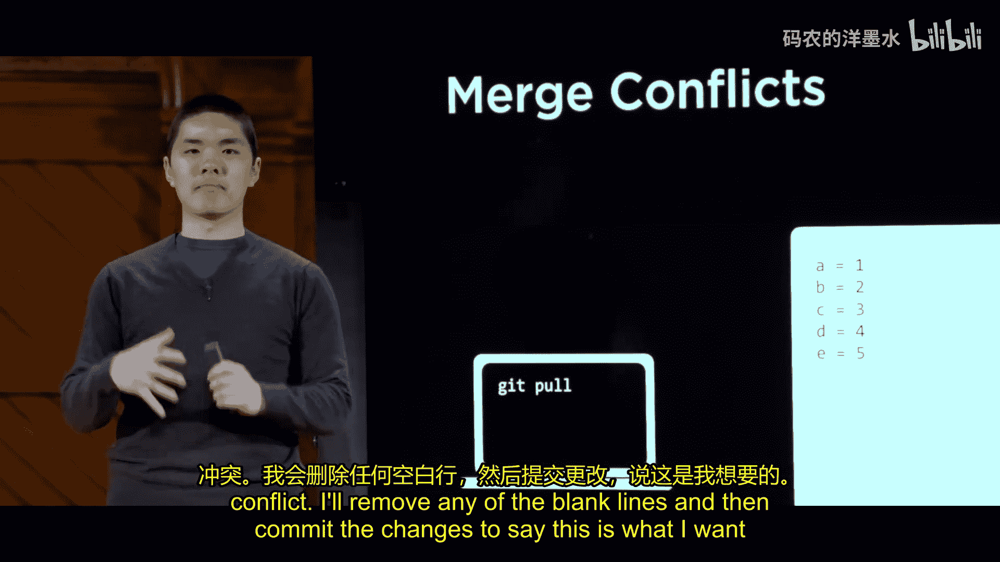

So let's now take a look at an example of emerged conflict in action to see how one might arise and how we might actually go going about dealing with emerged conflict。

 should it happen？So I on my computer now。I'm going to make a change to this page。

 I'm gonna say add a second exclamation point。 One exclamation point wasn't enough。

 I'll add in a second exclamation point to this H1。 And I'll go ahead and commit those changes。

 I'll say get commit dash AM at exclamation point。

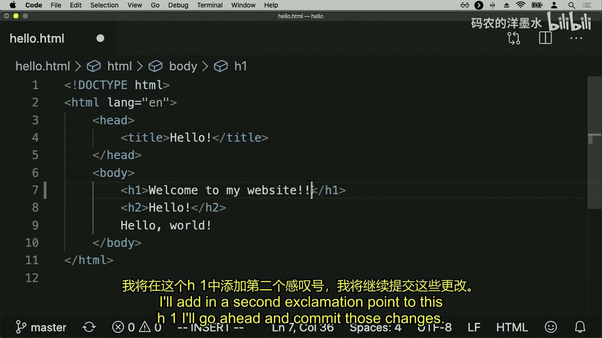

And I'll go ahead and commit those changes。 I saved this new version of the program。

 but I'm not going to push the code yet。

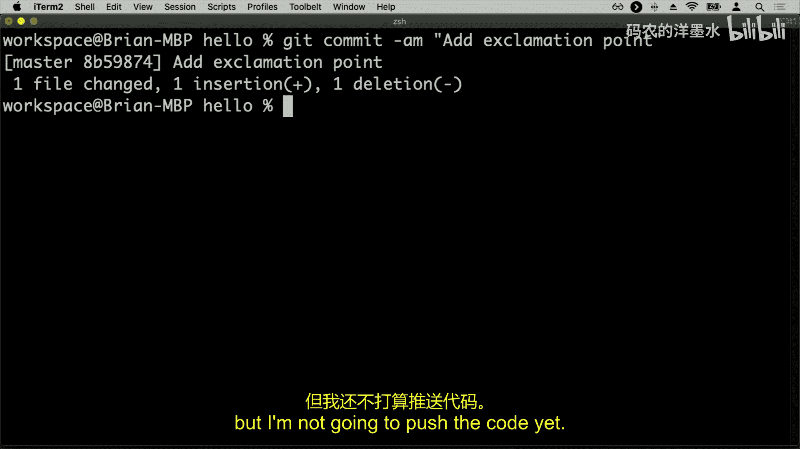

Instead， what I'm going to do is simulating someone else working on the same file。

 Maybe someone else on Github has decided， you know what。For this H1。

 what we'd really like to do is add some style to it with some inline style by saying。

 let's give it a color of blue， for example， So they've added some C S S。😊。

We'll go ahead and write a commit message。 What do they do， They've added some style。

 and we'll commit those changes。And now what we've created is what is going to be a merge conflict that someone else on GitHub has made a change to this line。

 changing the color to blue of this particular H1 tag， for example， and I， meanwhile。

 have also made a change to this same line， adding an exclamation point and Git entirely operates in terms of like adding lines and removing lines。

 given that we both made changes to the same line， Git is going to have a very hard time figuring out what to do in this scenario。

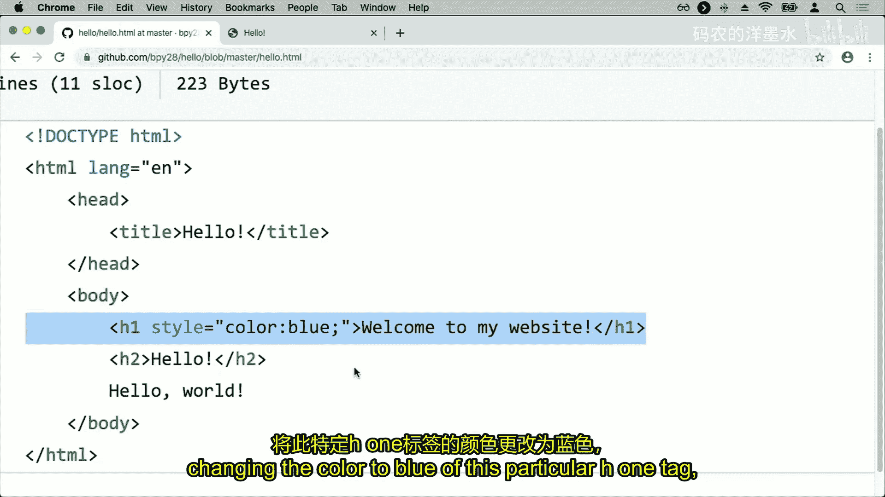

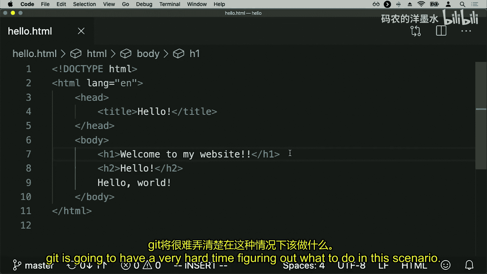

So here in my terminal， I'll go ahead and run Git pull because I w to pull in those latest changes。

 And when I do， I'll see that。 allright， I get this message conflict。

 there was a merge conflict in hellello dot H TM L。

 The automatic merge failed because normally get will try to merge files automatically if it can。

 But sometimes it can't。 So now。😊，I need to fix the conflicts and then commit the results。

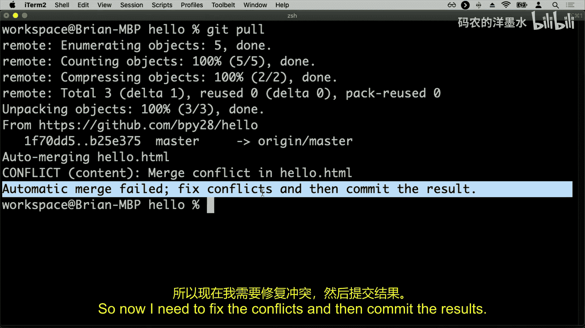

So。Let's go ahead and look at what's inside of hello dot H TM L。

 And what you'll notice is a whole bunch of these markers。

 And my text editor just happens to highlight them for me so that I can see them a little more clearly。

 But this is just highlighting provided by the text editor。

 It's not actually part of the text itself。 But you'll notice all of these arrows and then all of these equal signs。

 And in between， here is my version of this line of code。

 The line of code with the extra exclamation point at the end of it。😊，Down below。

 here is the remote conflicting version of the same code。

 The version that was modified on Github that I am now trying to pull in。

 This is the version that says we want style， color blue inside of the inline style for this particular H1 element。

 And now what I need to do is somehow figure out how to merge these two together。

 How do I want to resolve this conflict。 Well， in this particular case。

 I might like to resolve this conflict by just taking the best of both worlds。

 If the person on Github wanted to add a style attribute to this H1 element and I wanted the extra exclamation point。

 I can do both， I can go ahead。😊，And just add an extra exclamation point and then get rid of my version and then also get rid of these commit markers。

 So go ahead and remove those。 I basically modify the file until I'm satisfied with it until I think that。

 all right， this is the way I wanted to resolve the conflict。 One person added color。

 One person added punctuation。 The way to resolve it in this case is just use both of them。

 But here is where some human intuition comes in， The human programmer doesn't mean to look at this file and figure out how exactly do we want to resolve this conflict。

 How do we want to figure out how to take these different changes and merge them altogether。😊。

But once we're satisfied with it， we can go ahead and commit the results。

 I can say get commit dash AM fix merge conflict。 And al right， We fix the merge conflict。 And now。

 if I push those results back up to Github。😊。

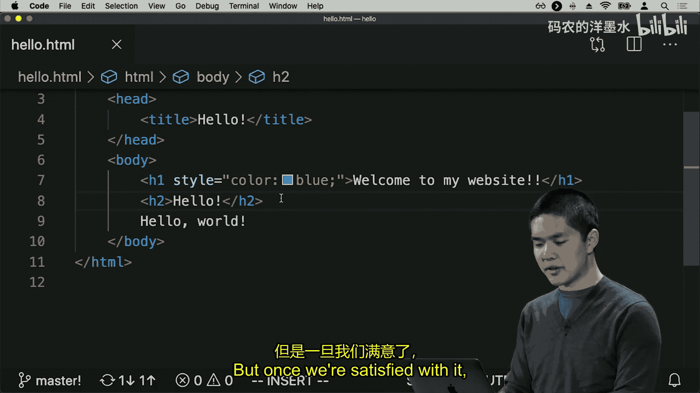

When that is done and I refresh the page， I now see the updated line of code on GitHub with the H1 that has both the inline styling and the extra punctuation because I've resolved the merge conflict。

 and then I've pushed that information back up to GitHub as well。

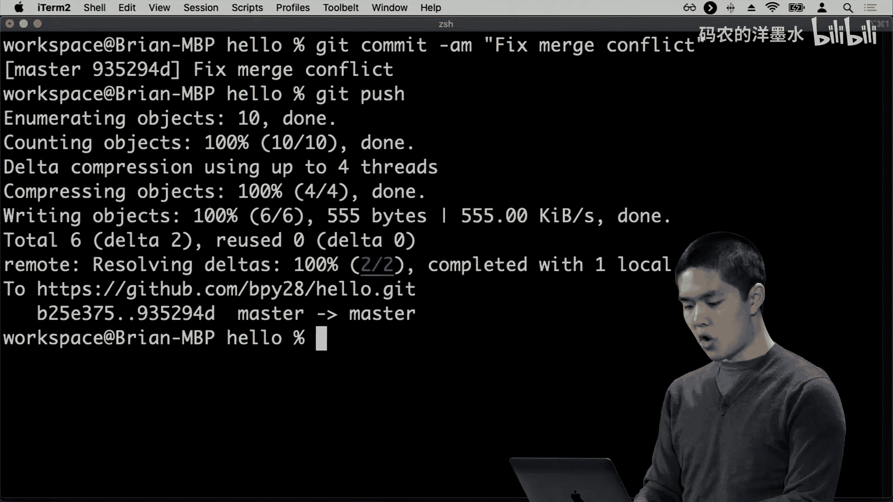

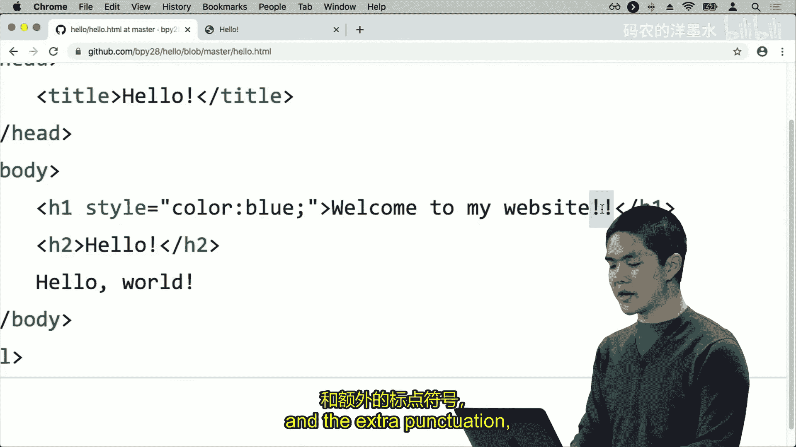

There are a couple of other Git commands that are just useful to know about。 I mean there are many。

 but we'll talk about a couple right now。 The first of which is Git log。 Git log is useful。

 if you ever need to keep track of all of the changes that you've made to your code。

 You want to keep track of all of the commits that have been made in this particular repository。

 All you need to do is run the command Git log and Git will spit out a bunch of messages that look like this。

 describing each of your commits。 for each commit， it'll tell you what the commit hash is such that you can reference it more easily。

 Itll tell you who made the commit， it will tell you the date on which that commit was made。

 and it will also tell you the commit message。 So if you need to very quickly look back and see on what day was this feature added or who added this part to the web page。

 you can just look through the Git log， find the commit and question and then you'll know which commit it happened to be。

😊。

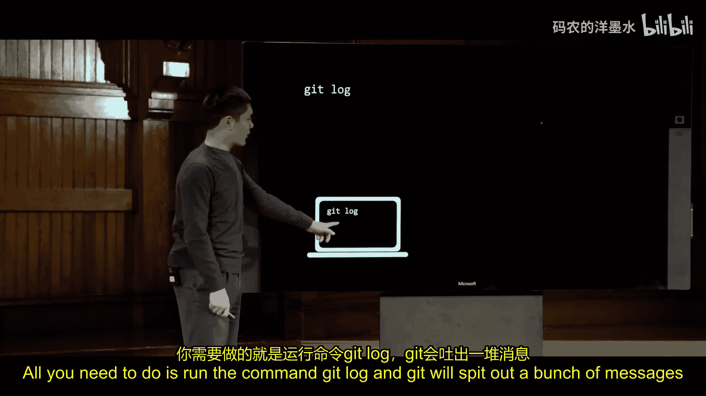

Also helpful is if you realize that you've made a change that you didn't mean to and you want to go back to a previous commit then in that case you can use a command called Git reset。

 which has a number of different possible ways to use it。

 but git reset in effect will take the current state of the repository and revert it back to an older state of the repository for example。

 So a couple of ways you can use it are like this you can do git reset dash hard。

 meaning hard reset reset everything back to and then you can plug in a commit hash so git log as you might recall from before。

 gave you the commit hashes for each of the various different commits if I want to go back to one particular commit I can say gett reset hard and then the commit message I want or the commit hash that I want to go back to and I'll go back to that commit。

Alternatively， I could say something like Git reset dash。

 dash hard origin slash master and recall that origin slash master is the version of my repository that's currently on Github。

 So if I want to take my current version of the repository and reset it back to whatever is on Github。

 then I can use a command like this in order to do so。😊，So you run git reset。

 followed by a commit hash， and that will reset the current state of your repository back to whatever state it was in previously。

 And there are a number of other git commands as well that can be quite helpful as you begin working with larger and larger projects。

 But these are some of the most helpful。 And some of the ones you'll use the most often are just adding files that you want to keep track of Git commitit to say I would like to make a save。

 I would like to save the current state of all of these files。

 push and pull to be able to upload changes and download changes that have made been made to your repository。

 and then some helpful commands like reset and log and status just to give you information about your repository and get you back to an older state of the repository if you need to。

😊，But as we begin to work on more and more projects and especially as we begin to work on more sophisticated projects。

 you may find that just keeping track of one change after another isn't nearly as powerful as you might like it to be。

 And so we can explore what might happen in a hypothetical situation where you begin making some changes to we get repository。

 for example。 So let's imagine you make your first commit。 You make some changes。

 you make some additional changes， and maybe you realize you want to start working on a new feature to this web application that you've been working on。

 So you start working on a new feature， then you continue working on that new feature。

 but then you realize suddenly you know what there was a bug in the original code that I made way back here。

 and you want to go back and fix that bug。 but now we're sort of in a tricky spot。

 that we want to fix the bug， but we're in the middle of working on a new feature。 So what do we do。

 We could go back to this and try and fix the bug。 but then what happens to the new feature。

 The problem is that this structure just change after change after change is very linear。

 It only goes one after another after another。😊，And oftentimes， when you're working on a project。

 it's not going to operate in a very linear fashion。

 You're not always working on one thing that immediately follows the thing before it。

 You might be fixing multiple bugs while working on multiple new features。

 And you want some way of being able to work on all of those things simultaneously and to easily be able to switch between them。

 And so that is where branching comes into handy Braches are goods way of working on different parts of the repository at the same time。

😊。

And so you might imagine a situation unfolding more along these lines。 You make your first commit。

 You start to make changes， You make more changes。 And when you decide that you'd like to start working on a new feature。

 for example。Rather than keep making changes in one after another after another on this same branch。

 so to speak， I can create a new branch。 I can branch off and say， you know what。

 Let's create a new branch and start working on a new feature there。

 and then keep working on that new feature there。 And if I realized later on down the road that you know what。

 there was a bug way back at this commit， And I can go back to this commit and create a new branch where I go ahead and fix that bug。

 And now I have two different branches， each of which might have different code on it。

 one of which I've been fixing a bug， one of which I've been working on a new feature on。

 for example。😊。

Generally， each of those branches is going to have a name。

 So the master branch is your default branch， which is generally going to contain the uptod stable version of your code。

 And as you're working on newer things， newer additional features。

 you might have some feature branch where you're working on some other feature， for example。

 and at any given time， though， your focus is only on one of these two branches。

 and where your focus is what the current state of your repository is is designated by something we call the head。

 So if head is pointing to master， that means your repository right now is working on this branch where you fix the bug But you can change the head。

 you can switch what branch you want to look at。 and you can check out the feature branch and say let's look at that branch and begin working on that as well。

 And you can begin working on these different branches by switching where your head is switching from one branch to another and then back again。

 And only when you're satisfied that you know what this bug is fixed and this feature is in a satisfactory place。

 then after all of that， we can merge those changes。😊。

Is back together so that everything comes back onto this unified master branch that now has all of the latest code。

And that's the real power of Gi branching， this ability to say that I would like to be working on multiple things simultaneously and be working on a feature without disrupting the master version of the code。

😊。

So let's now take a look at an example of how we might go about doing that。

So here in my hello dot H TM L file， I've been adding some style to this H1。 I added a color of blue。

 And let's say that I would like to make some changes。

 I would like to move the styling outside of inline styling。

 And I'd instead like to move it up into the head section on a web page because we decided earlier that was slightly better design for a web page like this。

😊，I could make those changes immediately， but I can instead it if I expect I might be working on multiple changes。

 I could move on to a different branch and branch off into something else in order to work on these new changes。

 And so here are some of the key commands to know about this。 If I type git branch。

 that will tell me what branch I'm currently on and what branch has exist in my repository。 So here。

 for example， I type Git branch。 And I see that I just have a single branch called master。

 And the star on the left hand side tells me that this is the branch that I am currently on。

 the only branch that there is。😊。

If I want to check out a new branch， I can type gett checkout。 And if it's a new branch。

 I'll type get checkout dash B。And then the name of the new branch。

 And I'll call the new branch style because I'm going to be making some style changes to the web page。

 for example。So I typed Git check out dash B style， and Git gives me a message。

 I have switched to a new branch called St。And now if I type Git branch again。

 you'll see that now I have two branches。 I have the masterier branch。

 which is the branch I was originally on， and now I have the style branch， which is this new branch。

 which I am on now as indicated by the star on the left hand side。So now that I'm on this new branch。

 I can feel free to make any changes that I want。 and nothing I do is going to mess up what is on the master branch。

 So long as I stay on this branch。 So I can say， all right。

 let's experiment with removing this style。😊。

And let's add a style tag to the top where I can say that I would like my H1 to have a color of blue。

 for example。 So I've made a whole bunch of changes， and I would like to now commit those changes。

 I'll say， get commit。

Move style properties。That's the change that I've made。

But I've only made those changes to the style branch。 Again， if I run Git branch。

 you'll see that I'm currently on the style branch where I've moved the style information up here to the top of my page。

But I can switch branches by using Git checkout Git checkout allows me to switch between branches。

 We use git checkout dash B to create a new branch。

 but if you're switching to a branch that already exists， I can just say git checkout master。

 for example， to switch my current branch from the style branch to the master branch So I run git checkout master now I'm on the master branch。

😊。

And now you'll see if I go back to the file now I'm back to the inline styling without the styling up here in the head section of the page。

 If I check out the style branch again， then the file immediately goes back。 Now。

 I have the style code up here in the style section of the page and not in line。

 So these changes have only been made to one part of the page。😊。

So now I'll check out Master again。And maybe I want to make some other changes on my master branch。

 Maybe I realize that I want to remove this extra punctuation。

 You know what two exclamation points with too many or remove。 Now we just have one。

And now I'll commit these changes。 I'll say， get commit。And remove punctuation。

And now I've removed the punctuation only from the master branch。

So this master branch now has just a single exclamation point here。

 but it still does have the inline stying。So now what I'd like to do is merge in those changes that I made from the other branch。

 I'd like to take what I was working on in the style branch and merge it into this current version of the repository on my master branch and in order to do that the command will use is called Git merge So Git merge notice that I'm currently on the master branch but if I run Git merge and then style and that is going to take whatever is on the style branch and attempt to merge it into my current branch and what we'll find is we're able to get most of the way there but there's a merge conflict Now this won't happen all the time when you merge sometimes Git will be smart enough to know that if one change has been made to one part of a file and one change has been made to another part of a file when you merge those changes back together Git will resolve those merge conflicts automatically but in this case that wasn't the case because both my style branch and my master branch made changes to the same line of code and we'll see why if I go back here。

You'll notice that in the merged version， we do see this style tag at the head of the page。

 no problems， no conflict there， because that was just lines that have been added to this page So there was no conflict。

 The conflict comes up here， which is where in my version on the master branch。

 I removed this punctuation mark， whereas in the version on the style branch。

 we can see here by the word style， we removed the inline styling。

 So we need to resolve these somehow。 and what I'll ultimately do。

Is just get rid of these style markers or the conflict markers。And say， you know what。

 I would like for the updated version， not to have either。

 not to have the inline styling and not to have the additional punctuation。

 So I have now made those changes。 I have resolved the merge conflict， and now I can commit。

Iix the merge conflicts。

And that's the general workflow now of how branching in Git ultimately works。

 when you're working on something new。You might branch off in order to say you would like to work on a different part of this web application。

You'll make changes， make commits， add changes to that new branch。

 And when you're satisfied with those changes when they're in the state that you want them to be。

 you can then say merge them back in to the original version of the repository。

 Sometimes you'll have to deal with merge conflicts。 So certainly not always。

 And if you're careful about where you make changes and trying to be careful not to make modifications to the same line of code in two different places。

 you can reduce the likelihood of actually getting merge conflict because Gi ultimately is quite smart about how it tries to deal with these sorts of issues。

😊，And finally， we'll take a look at a couple of features of Github specifically that can be quite helpful if you begin to work on larger projects that have many different moving pieces。

 the first of which is forking a Gitthub repository。 So let's go to a Gitthub repository。

 and look at the Gitthub repository for Boottap， for example。 So Boottap。

 which is the CSS library that we took a look at。😊。

Last time is a library that gives us easy access to a whole bunch of different C S features。

 And the entire thing is open source， meaning all of the code for Boottap is publicly available for anyone to look at and more importantly。

 for anyone to contribute to。 that it's not just one person that's been working on all of bootstap。

 But it's a community drivenn repository that many people can be working on adding new features and making fixes to Bottraap's code and collaborating on them by taking advantage of the features of Git and。

😊，So if you find a Git repository that you would like to contribute to or if you want other people to be able to contribute to your repository。

 one thing you can do is fork that repository。 And by forking。

 we mean making your own copy of the original repository。

 And so up here in the upper right hand corner of Github's page is a button called fork。

 And we can see that right now， about 68000 people have already forked Boottaps repository。

 made a copy of the repository into their own Github account。

 And so we could fork it ourselves just by clicking on this button called Fork。😊。

And then getting our own version of the repository that we can then clone and push and pull from as well。

 The reason we might do that is that Boottaps repository， while it is public。

 doesn't allow anyone to just push to it。 that would be probably unsafe if anyone in the world could just update Boottap's master code。

 But what you can do is copy the code， make a fork of it。

 make changes to it on your own push and pull to it。

 And then when you feel like you've made a contribution that you would like to send back to Boottap。

 you can open what's called a pull request that you are requesting that your code be pulled in to Boottaps code。

 And we can look， for example， at Boottaps pull request tab。😊。

It looks like right now there are 71 open pull requests。

 there are 71 people that have made some fixes or made some changes to Boottaps code。

 and you can submit a pull request to say that you would like to take those changes and merge them back in with Bootttraap's actual code and the people that maintain Boottaps code in this particular repository。

 can review those pull requests， provide feedback， ask for additional changes。

 and then whenever's satisfied， they can merge those changes into Boottap's actual code。

 And this is one of the key benefits of open source software。

 the ability for multiple people to be working on the same piece of code and for a community to be able to collaborate on finding bugs on figuring out what changes to make on figuring out how to improve upon an existing repository and make it better moving forward。

😊，And one final thing worth noting about Github is an additional feature known as GithHub pages。

 Gitthub pages is a free way that Gitthub provides to be able to quickly take a website with HTMLm and CSS and maybe even a little bit of Javascript and deploy it to the Internet for anyone to look at in anyone with a Github account is allowed to create a Github Pages website for free。

 And in order to do so， we can demonstrate it now。😊。

All you need to do。In Github is let's create a new repository。

That we'll call it should generally be your username dogithub。

o is the conventional name for your Github pages site， though it can have other names。

 you'll just have to manually turn on Gitthub pages。And we'll go ahead and create this repository。

 Now。 if you create a Github repository called your username dot Github dot I O。

 it will automatically be supporting Github pages。 And what that means is that I can take this URL and I can clone it so I can say Git clone。

😊。

Followed by this URL。I've cloned an empty repository， but I can go into this repository。

And add some files to it。 I can say， let's add。By default， it's called an index dot H TM L file。

And I'll create an HTML file。That is my sight。 and the body of it will just say。

This is my Github pages。Website。So something like this， something simple。

But it can certainly be more complex if you want it to be。Inside my terminal。

 I will get add this index study T L file， and I'll make a commit。 And often a first commit。

 you'll just in the commit message right， first commit so that we know it was the first commit。😊。

And then I'll push those changes to GiHub now。

So if you push your changes to a repository called your usernamegithub。o。

Then if you take a look at the settings。And scroll down。You'll see that Github pages is by default。

 ready to be published。 And now if I click on this URL， my username do Github dot I O。

 you'll see deployed to the internet such that anyone can go to this URL and see it。

 They'll see a big heading that says this is my Github pages' website because this is the way the browser is rendering the Hml that I pushed to my Github pages repository。

 And the advantage of doing this is it is very easy now to be able to quickly update my website。

 All I need to do is if I make a new change， I can commit that change， push that change to Github。

 And when Github detects that I've made a push to my Github pages repository。

 Then it will update my website that anyone in the world can access by going to my username do Github do I O。

 And this allows you to leverage all of these features of get the ability to branch the ability to work on different features of your web page at different times and revert back to different versions of the code as well。

😊。

So all in all， Git has given us a number of very powerful tools。

 It's given us the ability now to be able to very quickly and very easily keep track of any changes we make to code。

 keep track of when a piece of code is updated and to quickly revert back and look at old versions of that code if need be。

 And in particular， it's given us the ability to take our code and work together with other people on it。

 such that we can be working on multiple parts of the same project and someone else working on the same project can also be working on multiple parts of the same project on different branches and is very easy then to sync up our changes in order to work together。

 And so Git is a very popular tool used not only in the world of web programming。

 but especially whenever dealing with any kind of larger project where multiple people might be working on the same thing simultaneously。

 Git will enable us to more easily develop our web applications over the course of this term。

 Next time， we'll take a look at Python， which is one of the first programming languages that we'll use as we continue on our journey towards building more sophisticated web applications。

 I'll see you then。😊。

