# 【全集】哈佛大学 web应用开发 9小时速成 中英字幕 附完整课件 p04 Lecture 2 - Python -BV1RYUsB2Ejz_p4-

🎼。

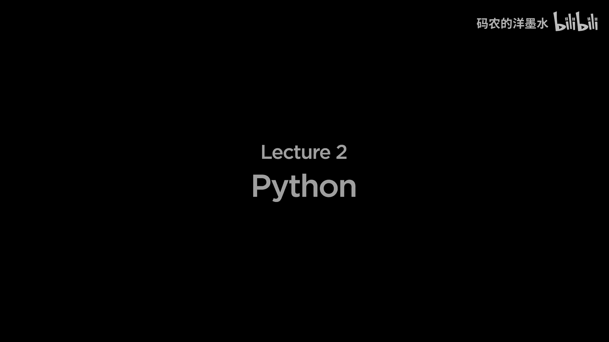

Alright， welcome back， everyone to web programming with Python and javascript。

 And today we take a look at one of the two main languages we're going to be looking at in this course。

 in particular， we're going to be looking at Python。

 Python is a very powerful language that makes it very easy to build applications quickly。

 because there are a lot of features that are built into the language that just make it convenient for quick and productive development。

 So one of the goals of today is to introduce you to the Python programming language if you haven't seen it before。

 And even if you have seen it before to give you a taste for what the language has to offer。

 exploring some of the more advanced features and some of the techniques we can use using Python to be able to develop applications all the more effectively。

 So we begin with our very first Python program， just a program that says hello world。

 we're going to be writing it in a text file。 And the program just looks like a single line just like this。

 And if youve used other programming languages before， like see your Java or other languages。

 this probably looks pretty familiar， syntax wise。 But just to break it down。

 we have a function called print， built into the。😊。

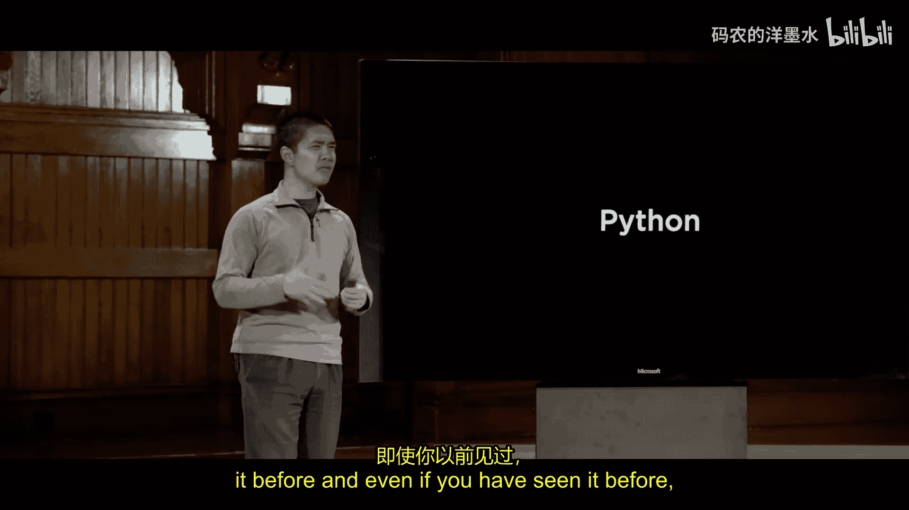

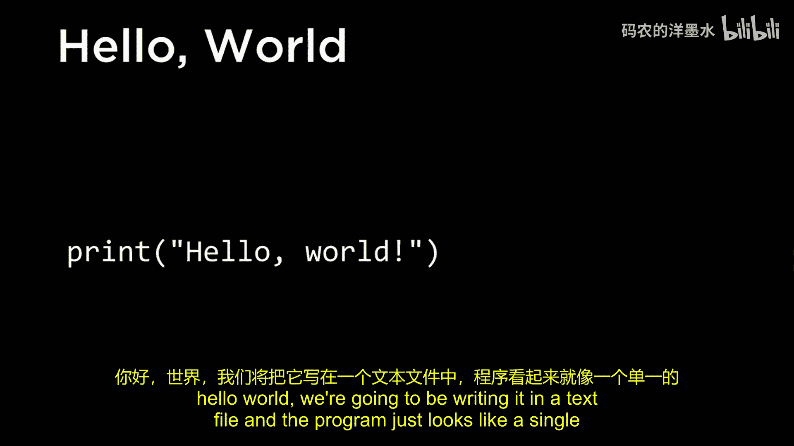

Python programming language for us。 And like many other programming languages。

 functions in Python take their arguments inside of parentheses。

 So inside of these parentheses are the argument or the input to the print function。

 which in this case is just the words hello world followed by an exclamation point。😊。

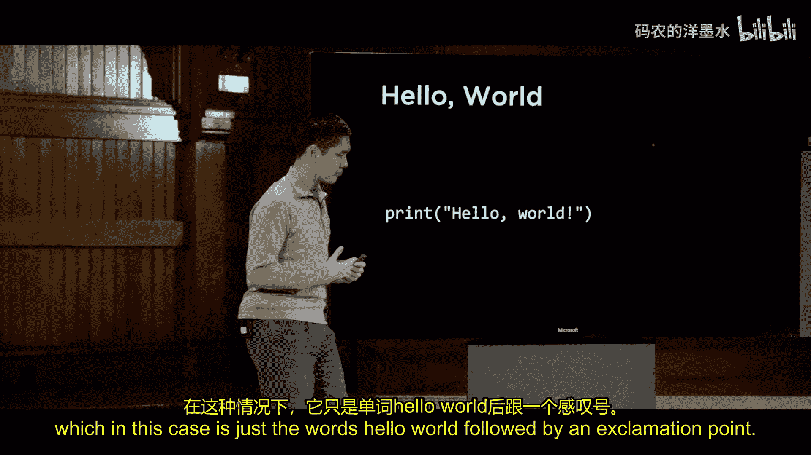

So here's how we can actually take this program and run it。

 I'm going to go into my text editor and create a new file that I'll call hellello do py dot py or dot pi is the conventional extension for Python programs。

 So I'll create a file called Ho dot pi inside of which will just be the Python code that we just saw a moment ago。

 We'll call the print function and as an argument or the input to the print function。

 I'll say hello world exclamation point。😊，Now， in order to run this program。

 we're going to use a program in our terminal that also just so happens to be called Python。

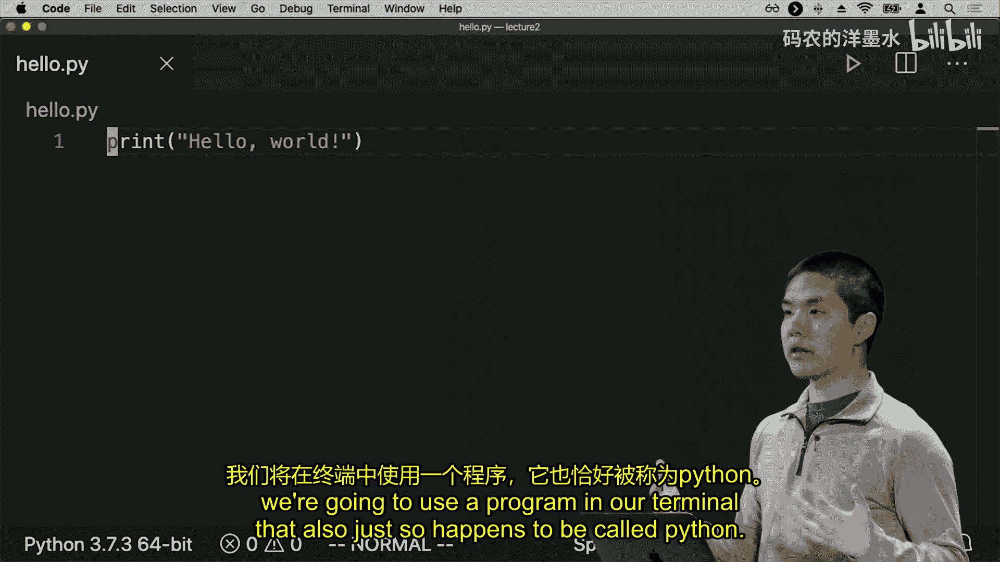

Python is what you might call an interpreted language。

 meaning we're going to run a program called Python。

 which is an interpreter that is going to read our dot p file line by line。

 executing each line and interpreting what it is that it means in a way that the computer can actually understand。

 So we'll run Python followed by the name of the program that we'd like to interpret。 In this case。

 hellello dot pi。 And when we run this program， we see that the words hello world are printed to the terminal。

 and that's it。 That's the end of the program。 And that's the very first program that we've written using the Python programming language。

 So now already， we've seen a couple of features of Python。 The ability to interpret Python。

 there's no need to compile it into a binary first in order to run a Python program we've seen functions。

 And we've also seen strings。 Just text that we can provide in quotation marks that we can provide as input to other functions or manipulate in other ways。

 And we'll see some examples of string manipulation a little bit later。😊。

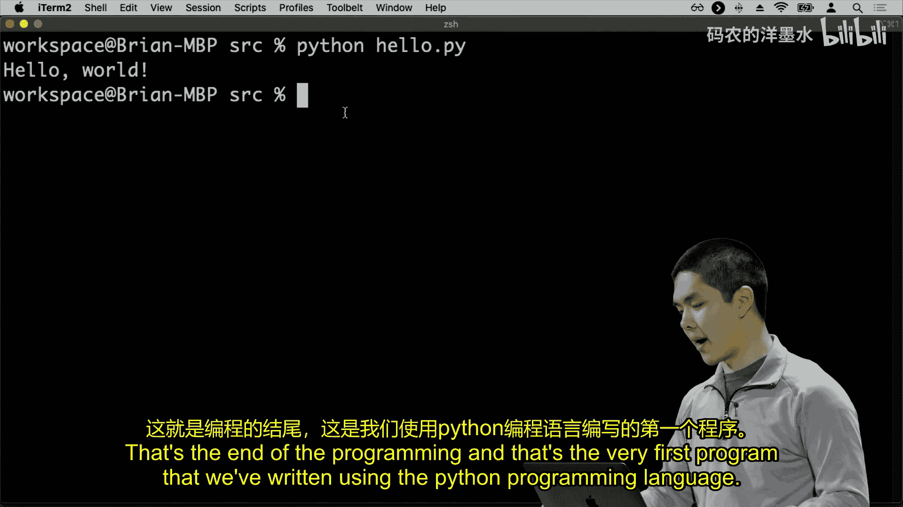

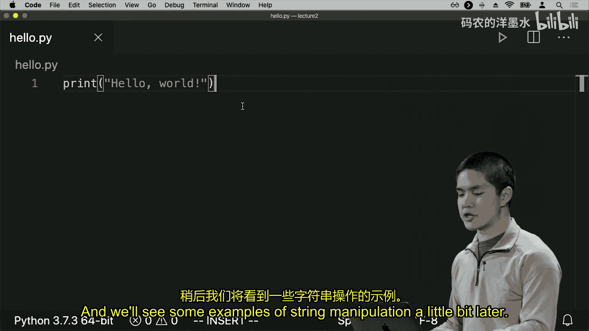

Like many other programming languages， Python also supports variables。

 And in order to assign a new value to a variable， the syntax looks a little something like this。

 If I have a line like a equals 28， what that's going to mean is take the value 28 and to assign it。

 store it inside of this variable called a。 Now， unlike other languages like C or Java which you might be familiar with where you have to specify the type of every variable you create。

 have to say like int A to mean a is an integer。 Python doesn't require you to tell you what the types of each of these variables actually are。

 So we can just say a equals 28。 and Python knows that because this number is an int that it's going to represent the variable A as an int and it knows it's able to infer what the types of any of these values happen to be。

😊，So all the values do indeed have types。 You just don't explicitly need to state them。 So。

 for example， this here， the number 28 is of type int。 It's an integer。 a number like 1。

5 has a decimal in it。 It's a floating point number。

 So that in python is what we might call a float type any type of text。

 something like the word hello wrapped in either double quotation marks or single quotation marks。

 Python supports both is what we would call the stir type short for string We also have a type for boolean values。

 things that can be either true or false in Python。

 those are represented using a capital T true and a capital F false Those are of type bo。

 And also we have a special type in python called the nu type， which only has one possible value。

 this capital n nu and none is a value will use whenever we want to represent the lack of a value somewhere。

 So if we have a function that is not returning anything。 It is really returning none effectively。

 And so you might imagine that none can be useful。 if ever you want to variable to represent the absent。

😊。

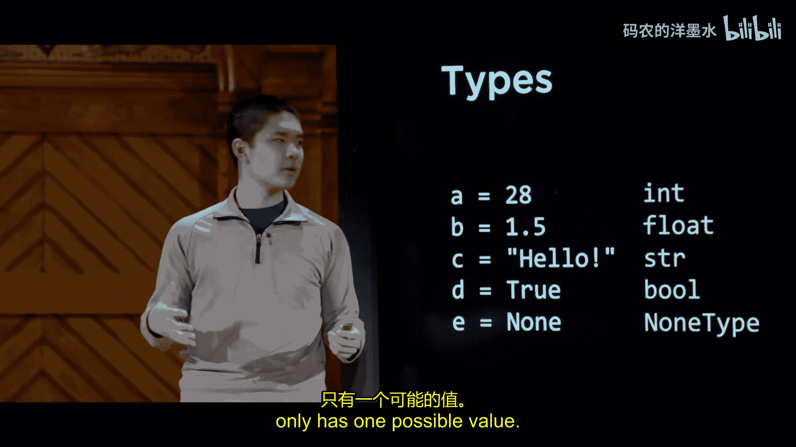

Of something， for example。 So lots of different possible types。

 And there are more types than just this。 But here's a sampling of the possible variables and types that might exist inside of this language。

So now let's try and actually use a variable in order to do something a little bit more interesting inside of our program。

 And we'll write a program that's able to take input from the user in order to say hello to them。

 for example。 So I'll create a new file。😊，We'll call it name dut pi。And to start。

 I'd like to prompt the user for input。 I'd like to prompt the user to， for example。

 type in their name。So how might we do that， Well， just as there is a print function that is built into Python that just prints out whatever the argument happens to be。

 Python also has a built in function called input that prompts the user for input and asks them to just type in some input。

 So let's provide some input and ask the user to type in their name， for example。

And then we can save the result， the output of that function inside of a variable。 And in this case。

 I'll save it inside of a variable that in this case also just happens to be called name。😊。

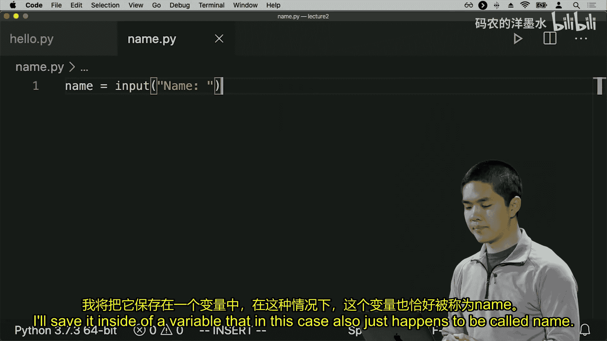

Now， we can run the program。 I can run the program by going into my terminal and typing Python name dot pi。

 I'll press return。 and we'll see the program prompts me to type in my name。 I see name colon space。

 which is that string I provided as the argument to the input function。

 And this now prompts me to type in my name。 So I will。 And after that。

 nothing seems to happen so far。 So now I'd like to do something with that input。 I typed in my name。

 I'd like to say like， hello， for example， to myself。😊。

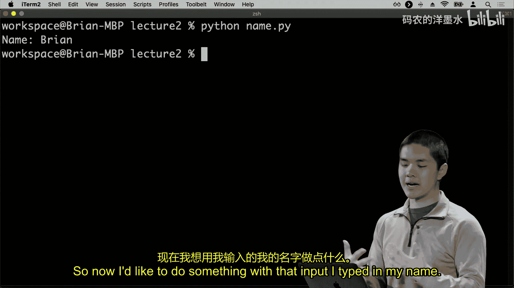

So I'll go back into this program。 And now what I can do is I can say print。Hello， comma。

 And then I can say plus name。 This plus operator in Python does a number of different things。

 If I have two numbers， it'll add those two numbers together， but with two strings。

 plus can actually concatenate or combine two strings together。

 so I can combine hello comma space with whatever the value of name happens to be。😊。

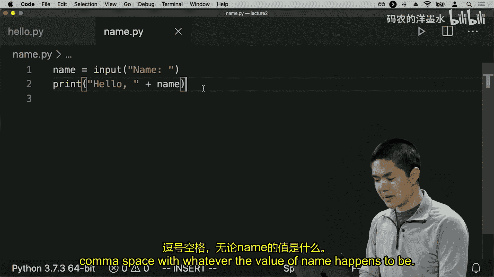

So now I'll rerun this program。Python name dot pi。Type in my name。

And now we see Ho Brian as the output of the program。

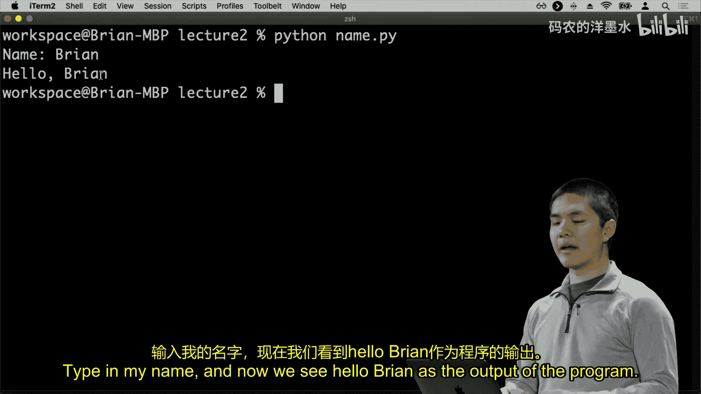

So this is one way that you can manipulate strings in Python。😡。

Another way that's quite popular in later versions of Python 3 is a method known as using F strings。

 short for formatted strings。 And in order to use F strings in Python。

 it's going to be a similar but slightly different syntax。

 Instead of just having a string in double quotation marks， we'll put the letter F before the string。

😊，And inside of the string， I can now say hello， comma。 And then if in a formatted string。

 if I want to plug in the value of a variable， I can do so by specifying it in curly braces。

 So what I'll say here is inside of curly braces name。😊。

And so what's going on here is I am telling this formatted string to substitute right here the value of a variable。

 So I prompted the user for input to type in their name。 We took their name。

 saved it inside of this variable called name。 And now here in this print statement online too。

 I'm printing out a formatted string。 that is hello comma。 And then in curly braces here。

 I'm saying plug in the value of the variable name。

 And so that is going to have the effect of taking whatever name was provided as input and printing it out。

 And this is a slightly more efficient way of being able to quickly create strings as by plugging in values into those strings。

 So now see the exact same behavior。 if I run Python name dot pi and prompted to type in my name。😊。

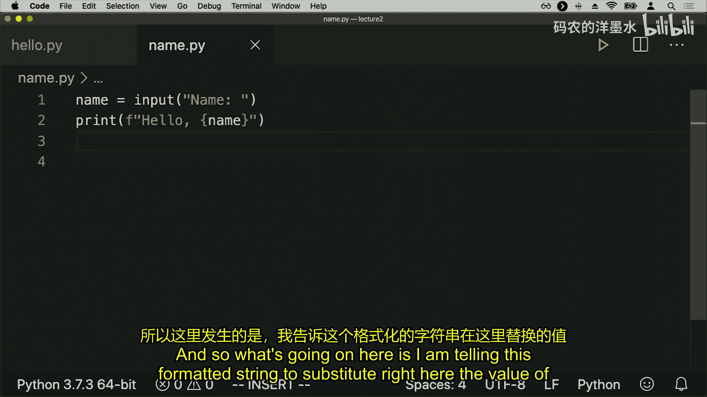

Something like Brian。 And then I see the result， hellello， Brian， for example。

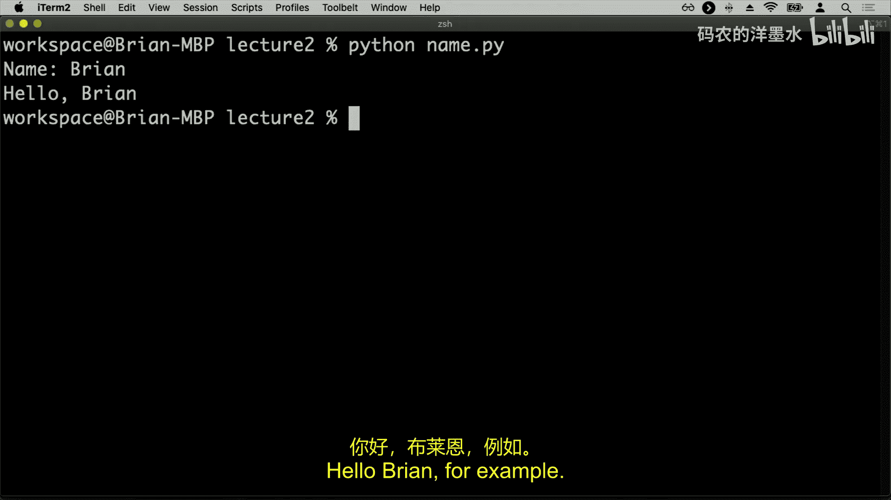

And so those are a couple of ways that we can deal with strings， manipulating strings。

 and combining strings using this technique。So in addition to variables。

 Python also supports all of the same other features that are core to many procedural programming languages。

 such as conditions， for example， So let's take a look at an example now of seeing whether a number is positive or negative or zero。

 for example， So I'll create a new file that I'll call conditions do pi。😊。

And inside of conditions do high， I'll first prompt the user to type in some input。 I'll say input。

Number to mean， you know， type in a number and we'll save that input inside of a variable that I'm just going to call n。

And now I can ask questions， I can say something like if n is greater than0。Then， print and。

Is positive。And so what's going on here is I have a Python condition。

 And the way a Python condition works is it begins with this keyword。

 a keyword like if followed by a Boolean expression。

 some expression that's going to evaluate to true or false or something kind of like true or false。

 We can be a little bit loose about that， as we may see later。 And then a colon means all right。

 here is the beginning of the body of the if statement。 And in Python。

 the way we know that we're inside the body of an if statement or inside the body of any other block of code is via indentation。

 So in some languages like C or in languages like HMl， which we saw a couple of lectures ago。

 The indentation isn't strictly required by the computer to be able to parse and understand what's inside the program in Python it's different。

 The indentation is required because the indentation is how the program knows what code is inside of the if statement and what code is outside of the if statement。

😊，So we have if n is greater than 0 colon， and then everything indented underneath the F is all of the body of the F statement。

 It is the lines of code that will execute if this condition， this Boolean expression。

 and greater than 0 happens to be true。 So if n is greater than 0， will print out n is positive。😊。

And then we can add an additional condition。 I can say something like， well。

 I could say something like else。 print N is not positive。

But I can be a little bit more specific than that。 Here is sort of two branches。 One。

 if n is greater than 0， and one else case to handle all of the other possible scenarios。 But really。

 what I'd like to do is perform a second check in other languages， this might be called an else if。

 like if this condition is not true， but this other condition is true。

 Python abbreviates this to just L if E， L I F just short for else if。😊，So I can say L。

 if N is less than 0。Then let's go ahead and print out N is negative。And else， print n is 0。

So the idea here now is that if n is greater than0， we perform some task L， if， in other words。

 if it's not greater than0， then we check to see if it is less than 0。

 in which case we print out that n is negative else。 if neither of those two conditions are true。

 it's not positive and it's not negative。 the only remaining possibility is that n is 0 so we can print out that n is 0。

😊，And so we might like for this program to work。 But watch what happens if I now try and run conditions pi。

 even though logically in our heads and looking at it now， it probably seems pretty logical。

 if I run Python conditions do pi and type in a number。 I'll type in the number5， for example。

ll just see what happens。 Allright something weird just happened。

 And this is our very first python exception。 and error that happens because something didn't quite go right inside of our python program。

 and over time， you'll begin to learn how to parse this exception and understand what it means and where to begin to debug But learning how to read these exceptions and figure out how to deal with them is definitely a very valuable skill on your way to becoming a python developer。

 And so let's see if we can figure out what this exception to saying。 Oftentimes。

 I start by looking at the bottom。 I see that there is a type error。

 That is the type of the exception that has happened。

 There are a lot of exceptions that can go wrong in Python things that we can do that cause errors In this case。

 it's a type error。 which generally means that there's some mismatch of types。😊。

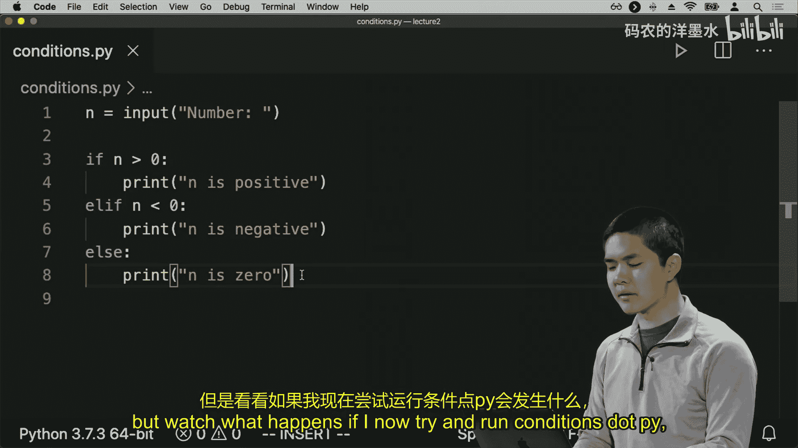

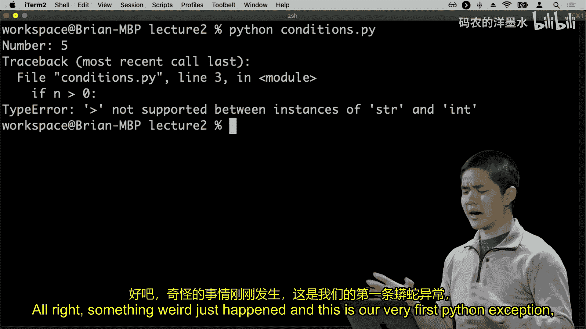

Python expected something to be of one type， but it turned out to be a different type。

So let's try and understand what this might be。 which says greater than sign。

 not supported between instances of stir， short for string and int。So what does that mean， Well。

 I guess it means that the greater than symbol that checks if one thing is greater than another doesn't work if you're comparing a string to an integer。

 And that's probably pretty reasonable。 It doesn't really make sense to say a string is greater than or less than an integer。

 When we're talking about greater than or less than， usually we're talking about number。

 So they should both be integers， for example， So why do we think that greater than is comparing a string and an integer。

 Well， now we can look a little bit further up at the trace back。

 which will show which parts of the code are really causing this problem。 And in this case。

 the trace back is pretty short。 It's just pointing me to a single line of a single file。

 It's saying in the file conditions do pi on line 3。😊，Here is the line that triggered the exception。

 If n is greater than 0。So what's the exception here。 Well，0 is obviously an integer。

 because that just is an integer。 And so if greater than thinks that it's comparing a string with an integer。

 then n somehow must be a string。 Even though I typed in the number 5。

 it must still think N is a string。 So why might that be。

 Let's take a look at the code again and see if we can figure out what's going on。😊。

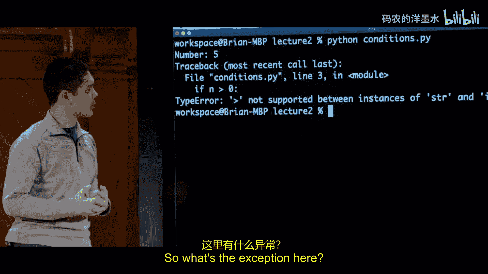

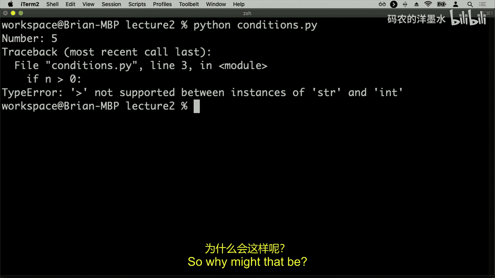

Well， it seems that this input function doesn't care what you type in。

 It's always going to give you back a string and somehow is ending up as a string。

 which is pretty reasonable because the input function has no idea whether I typed in a number or whether I typed in a letter or I typed in other characters altogether。

 So input doesn't know to give back its data in the form of an int or in the form of a float or in any other form。

 So by default it's just gonna return a string。 What characters did the user type in as their input。

So what I'd like to do now in order to make this program work the way I wanted to is take this and convert it into an integer。

Cast it into an integer， so to speak， and the way that I can do that is by using a function in Python called int that takes anything and turns it into an integer。

 So here I can say int， and then as the argument to the int function， the input to the in function。

 I'm just going to include this whole expression input number。

So I'm going to ask the user to input a number。 They type in some text。

 The input function gives me back a string， and that string is going to serve as the input to the int function。

 which then gets saved inside of this variable called N。😊。

So now that we know that n is indeed an integer。 Let's try and run this program again。

 I'll go back into the terminal， run Python conditions dot pi。 I'm asked to type in a number。

 I type in a number， like 5。

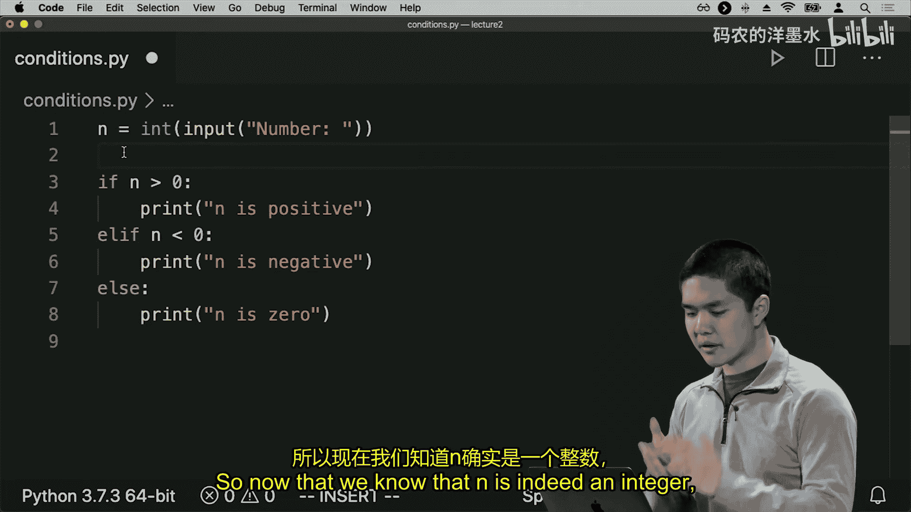

And。Alright， that still doesn't seem to have worked and it didn't because I didn't save the file。

 so I go ahead and save the file， try it again， type in a number。

 and now we see that indeed n is positive。 we get no more exception。

 We were able to run the code successfully and see that the value of n is positive。

 and I could try this again to test the other conditional branches， type in negative1， for example。

 to see that n is negative。😊，And otherwise， if it is either positive or negative。

 then we know that n is 0。

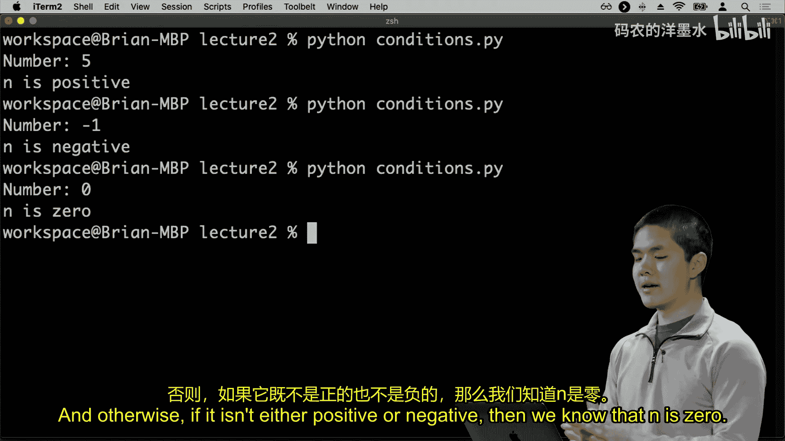

And so here was our first exposure to conditions in Python。

 the ability to have multiple different branches and do different code。

 depending on some expression that we're going to evaluate to either be a true expression or a false expression。

😊，Alright， so let's take a look at some of the other features that are going to be present inside the Python language。

 And one of the most powerful features of Python are its various different types of sequences。

 data types that store values in some sort of sequence or some collection of values altogether。

 So Ill go ahead and create a new file that we'll call sequences dot pi。😊。

And there are a number of different types of sequences that all obey similar properties。

 but one of the types of sequences is a type we've already seen， which is just a string， for example。

 So if I have a name and the name is something like Harry， for instance。

 and this sequence allows me to access individual elements inside of the sequence。

 And in order to do so， it's much like an array in other languages。

 if you've experienced them before， but I can print out name。😊，Square bracket，0。

This square bracket notation takes a sequence， some ordered sequence of elements and gets me access to one particular element inside of that sequence。

 And so if I have a string like name and I say name square bracket 0。

 the effect of that is going to be take this long sequence and get me the zeroth element in many programming languages and in programming more generally we often start counting things at0。

 so the very first item in the sequence is item 0， the second item is item1。

 so it's easy to get slight off by one error is there。

 but just know that item0 of the name should be the first character in the name。

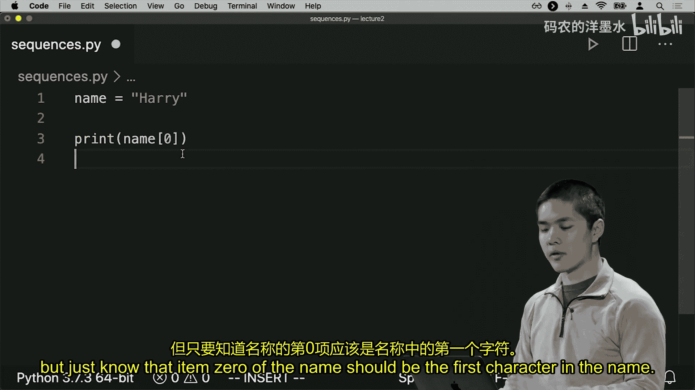

And I can see that for sure， if I run Python， I'll save this file， run Python sequences。 pi。

 and what I get is just the first character of Harry's name， which in this case is the letter H。😊。

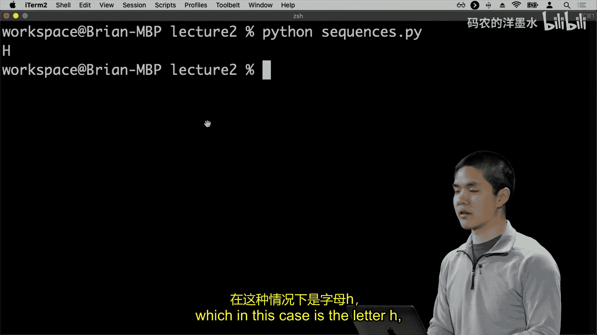

If I instead ask to print out character 1， which will be the second character in the name。

 If I rerun the program， now I get the letter A。

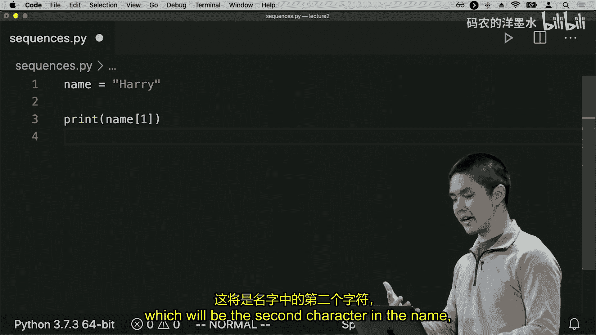

And this type of indexing works for many different types of sequences， not just a string。

 which so happens to be a sequence of characters， but other types as well。 Python， for example。

 has a type for lists of data。 So if I have a sequence of any type of data that I want to store。

 I can store that information inside of a list in Python。

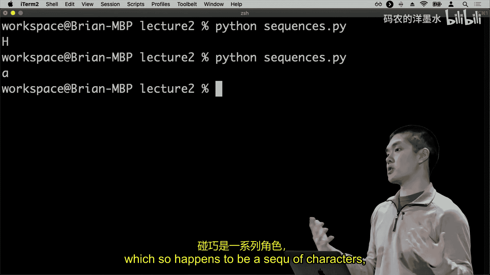

So maybe instead of storing one name， I have multiple names that I want to store。

 So I want to store names like Harry and Ron and Hermione， for example。

 So I have three names all stored in a sequence inside of a Python list。

And I can you I can print out all of the names， for example。

 just to print out all of the names to see what the value of the variable names is equal to and we'll see that when I do that。

 I get a printout of the contents of that list， Harry Ron Hermione in that particular order。

 but you could also much as you could index into a string index into a list to say get me just the very first item inside of this names list。

 which in this case， when I run the program。

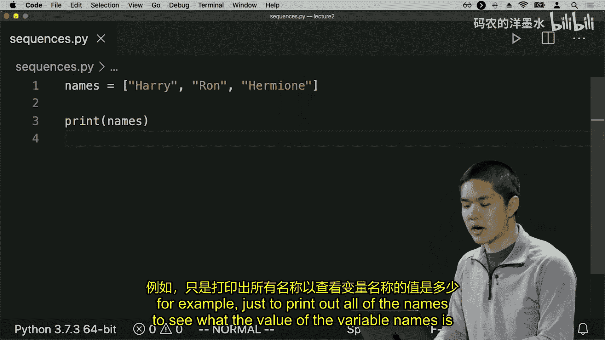

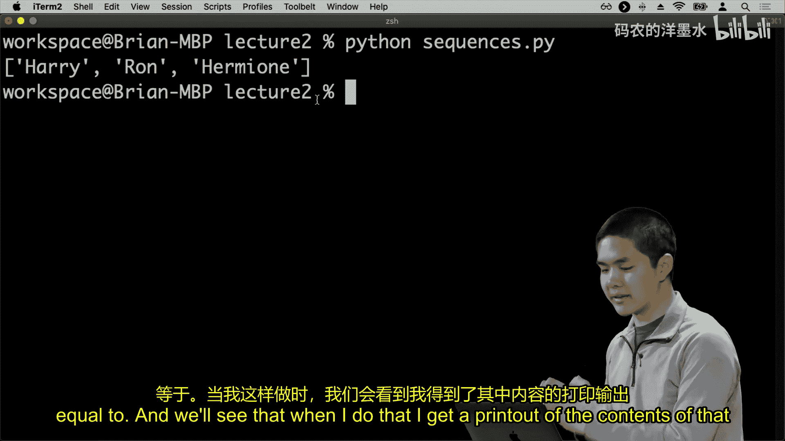

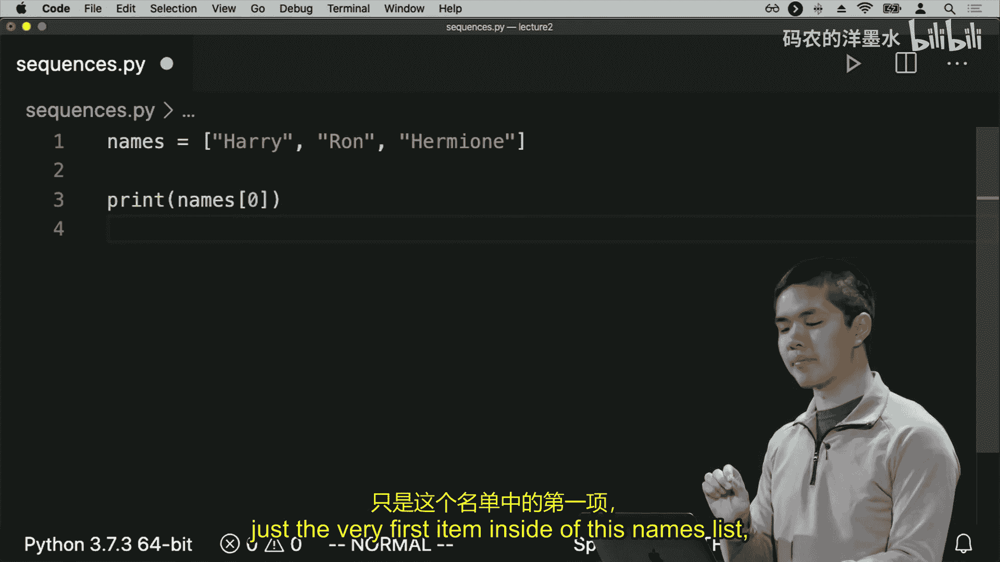

Is going to just be hair。 So there are a number of different sequence types that you can use in order to represent data。

 Another one just so happens to be called a tuple。 and a tuple is often used if you have a couple of values that aren't going to change。

 but you need to store a pair of values， like two values together or three values together or something like it。

 you might imagine that if you're writing a program to deal with graphing in two dimensions。

 for example， you might want to represent a point as in x value and a y value。

 And you could create two variables for it， I could say， you know。

 let me say a coordinate x is going to be equal to 10。0 and coordinate y is equal to 20。0。

 But now I'm creating two variables for what's really one unit that just so happens to have two parts。

 And so to represent this， we can use a tuple in Python and just say something like coordinate。😊。

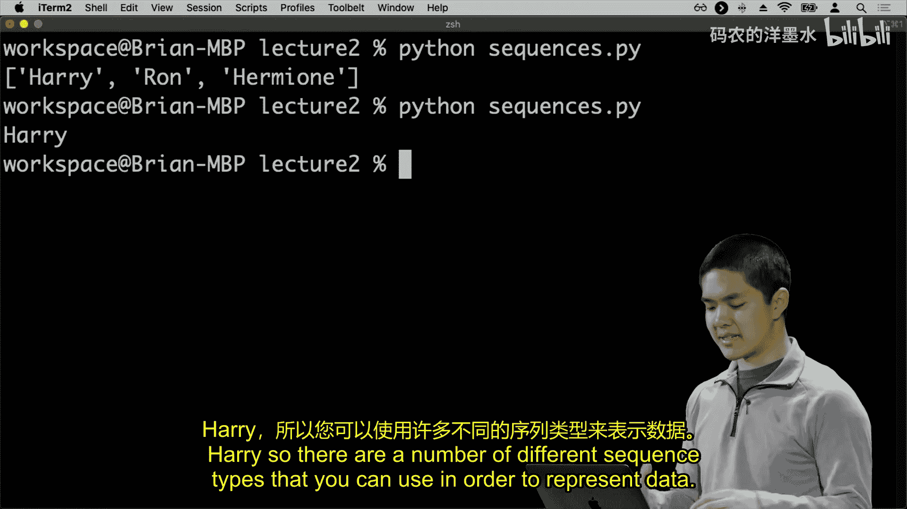

Equals 10。0 comma20。0。 So whereas in lists， we use square brackets to denote where the list begins and where the list ends。

 In a tuple， we just use parentheses to say we're grouping a number of values together。

 We're grouping one value 10。0 with a second value 20。0。

 And now we can pass around these two values as a single unit。

 just by referencing them using a single name， which in this case is coordinate。

 So there are a number of different types of these various different sequences。

 and some of those sequences， we'll take a look at。😊。

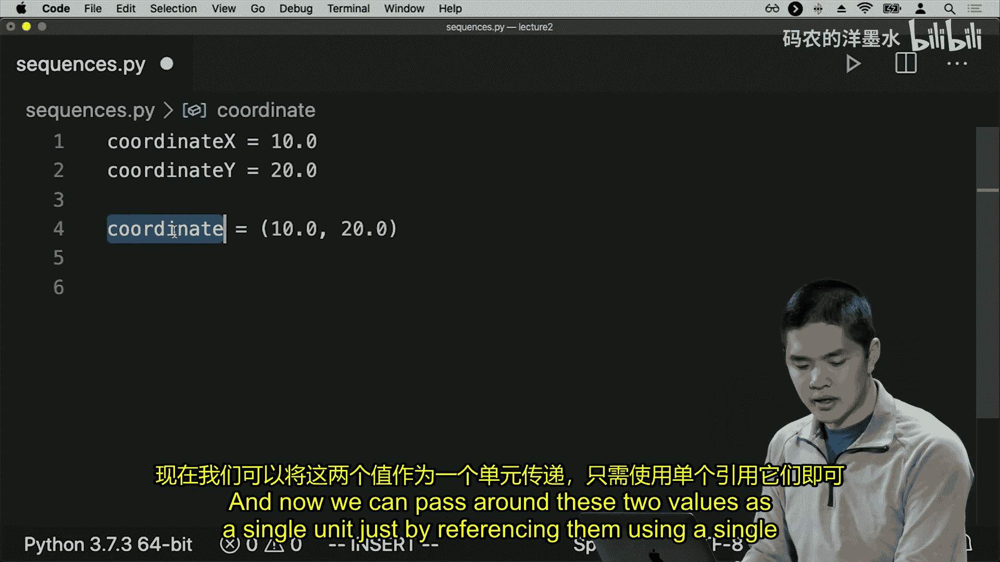

Are these data structures here。 So list， for example， is a sequence of mutable values。

 which we took a look at and mutable， just meaning we can change the elements in the list。

 If I have a list， I can add something to the end of the list， I can delete something from the list。

 I can modify the values inside the list。 A tuple on the other hand。

 is a sequence of immutable values。 Those values can't change。

 You can't add another element to the existing tuple。

 You'd have to create a new tuple in order to do so。

 And there are other data structures that exist as well。

 a couple that will take a look at in a moment， include sets。

 which are a collection of unique values。 So if you're familiar with sets from the world of mathematics。

 It's a very similar idea。 that whereas a list in a tuple， keeps things in a particular order。

 a set does not keep things in any particular order。 It's just a collection and in particular。

 all of the values need to be unique in a list or in a tuple。

 you might have the same value appearing multiple times in a set。 every value appears exactly once。

 And theres some advantages to set some ways that you can make your programs。😊。

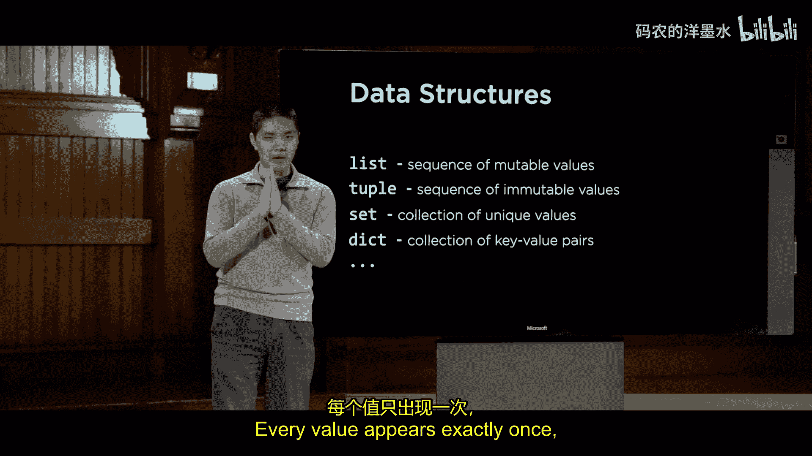

efficientfficient by using sets， if you know that you just need a collection。

 if you don't care about the order， if something is only going to show up exactly once at most。

 then you can use a set to potentially make your programs a little more efficient and a little more elegantly designed。

And finally， one other data structure that's quite powerful。

 and that's going to come up a number of times during this course is a dictionary in Python shortened to just addict dit。

 which is a collection of what we're gonna call key value pairs。

 And the way I like to think of this is with an actual physical dictionary that you might find in a library that maps words to their definitions in a physical dictionary you open up the dictionary and you look up a word and you get the definition。

 and addict in Python is going to be very similar。 It's going to be a data structure where I can look something up by one keyword or one value and get some other value as a result。

 We call the thing that I'm looking up the key。 And we call what I get when I do the looking up the value。

 So we keep pairs of keys and value in the case of an actual dictionary in the real world。

 The key is the word that we want to look up。 And the value is its definition。

 But we can use this more generally in Python anytime we want to map something to some other value such that we can very easily look up that value inside of this data structure。

😊，So we'll see examples of dictionaries as well。So let's now explore the first of these data structures。

 these lists to explore what we can do by taking advantage of the features that are given to us by a Python list。

 for example。So we'll go ahead and create a new program。That I'll call。Ls dot pi。

And here I'm just going to create a list of names。 So names equals Harry， Ron， Hermione and Jenny。

 for example， And as I start to write multiple lines of code。

 especially as my Python programs start getting longer。

 it can be a good idea to document what it is that I'm doing。 So I can say。

 let me add a comment to this particular line of code。

 just so I know what it is that I've done in this line of code。 And in Python。

 there are a couple of different ways to create a comment but the simplest way。😊。

Is just to use the pound sign or the hashtag As soon as you include that。

 everything after that for the remainder of the line is a comment。

 The interpreter is going to ignore that comment。 You can say whatever you want。 It's more for you。

 the programmer， And for someone who's reading your program to be able to look at the program。

 understand what it's saying and figure out what they need to do about it。 So I can just say。

 define a list of names， for example， just to make it clear to me what it is that I have done inside of this line of code。

😊，So I can print out that list of names as we've done before。

And we'll see that when I print out that list of names， what I get is， let me run。

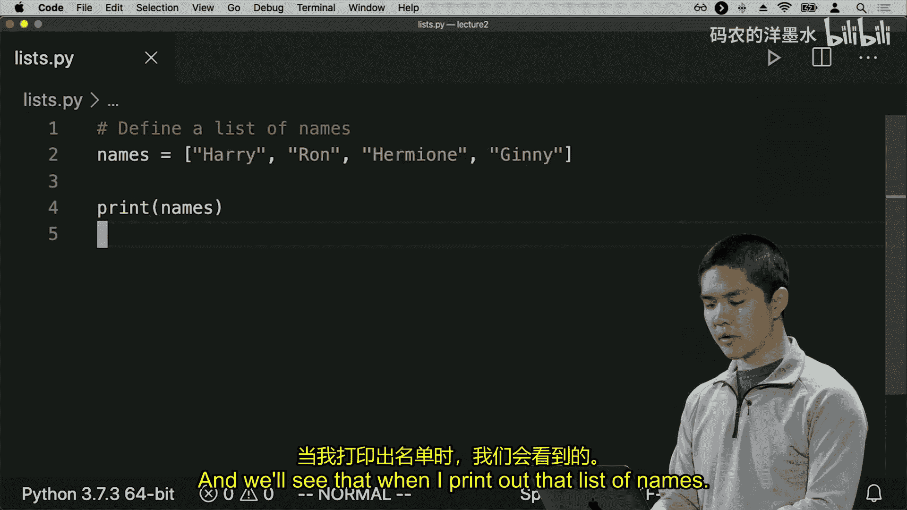

List up I， What I get is this list， Harry， Ron， Hermione and Jenny。

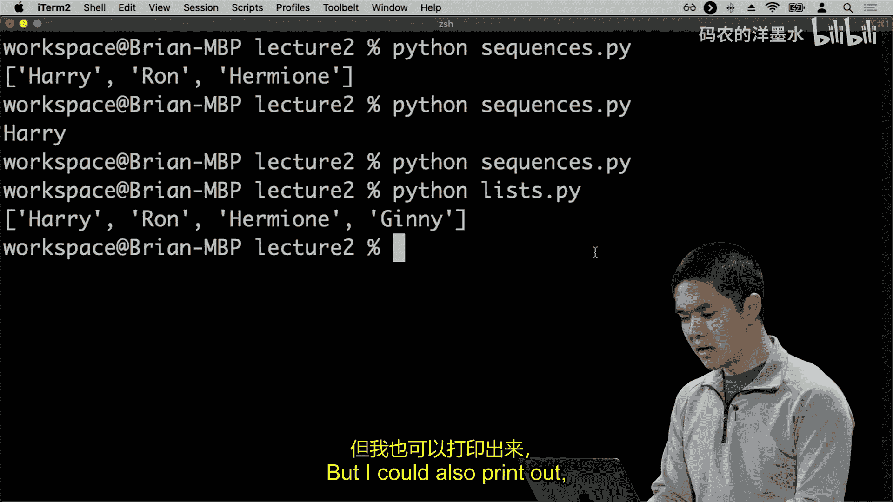

But I could also print out， as we've seen before， just the first of those names。 say， you know。

 print out just names square bracket 0， in which case I'm going to get just Harry， for example。

But now recall that a list is mutable。 I can modify the elements that happen to exist inside of this list。

 So I could say names dot append， a new name， something like draco， for example。

 And so lists have a number of built in methods or functions。

 which are functions that I can run on an existing list to access particular elements to the list or to modify the list in particular ways And in the case of a list。

 the append method is a method or function that I can run that just adds a value to the end of an existing list。

 So I've added Draco to the list。😊，And there are a number of other methods that I can use on lists。

 one of which is， for example， sorting a list， No need to write your own sorting algorithm in order to sort a sequence of objects in Python。

 there is a builtin sort method that works on lists where I can just say names dot sort that will automatically sort everything in the list。

 And now if I print out all of those names。Go to print them out and get rid of the full print statement。

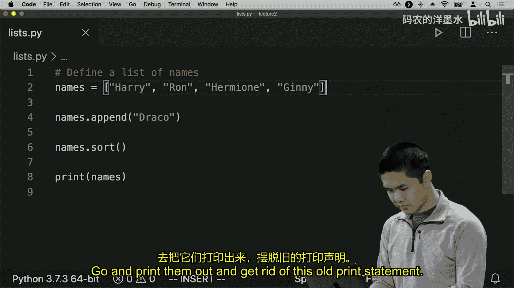

Now we see that we get five names that are printed out because I had four elements originally in this list。

 but then I added a fifth one， and notice now that they are actually in alphabetical order。

 starting with Draco， ending with Ron， because I was able to sort the list by modifying the order in which those elements actually show up。

 And so list can definitely be quite powerful。 Anytime you need to store elements in order。

 a list is definitely a useful tool that Python gives to you。😊。

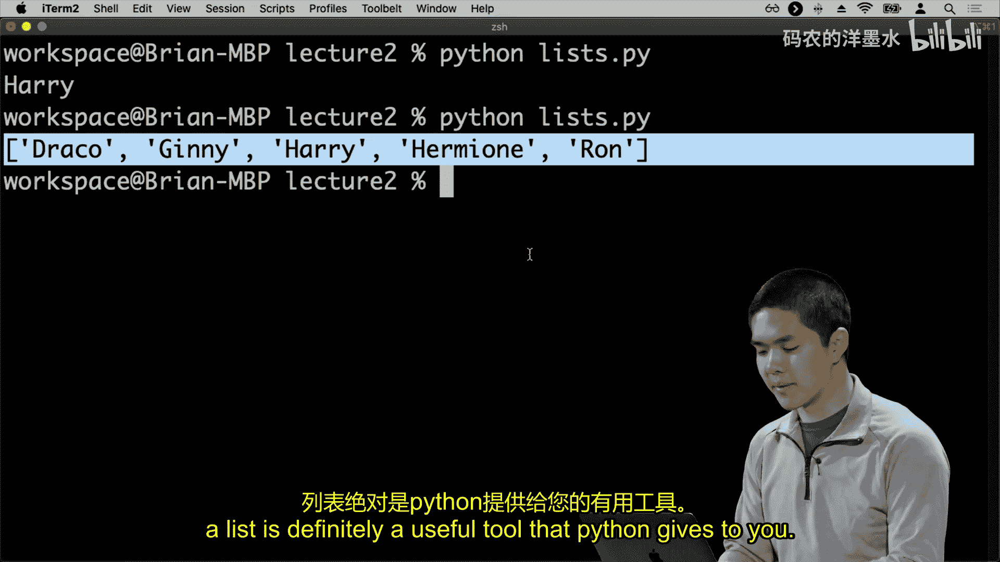

If you don't care about the order of the elements， though。

 and if you know that all the elements are going to be unique， then you can use a set。

 which is another Python data structure that works in similar ways。

 though the syntax is slightly different。So let's do an example with those。 I'll create a new file。

 call it sets dot Pi。 And let me first create an empty set。

And we can do that by just saying S equals S is going be the variable that will store my set。

And I'll say set， and then parentheses that will just create an empty set that just so happens to have nothing inside of it。

Now， we'll add some elements to the set。 So I can say S dot add。 Let's add the number one to the set。

 Let's add the number 2。 Let's add the number 3， and let's add the number 4。

And then we can print out the set to see what happens to be inside the fe right now。 Now。

 when I run this program。

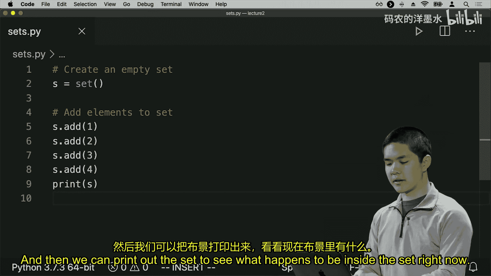

Python sets do pi。 We see that inside the set are four values，1，2，3， and 4。

 They happen to be in order， but sets are not naturally ordered。

 They're not gonna always keep track of what the order is going to be。 But I could add， for example。

 if I added 3 again to the set。 Now， I've added 3 to the set twice， I added 1，2，3，4。

 and then 3 again。

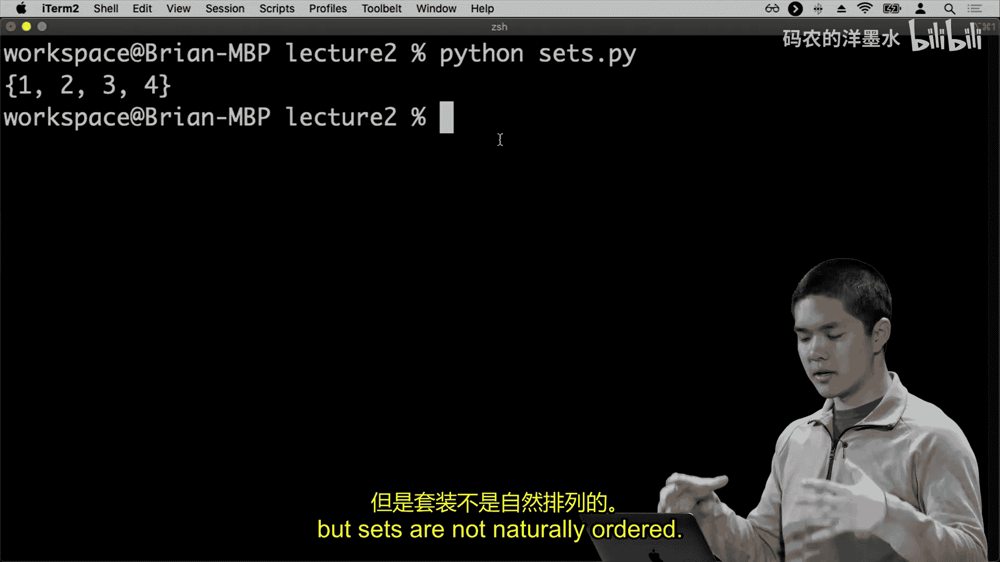

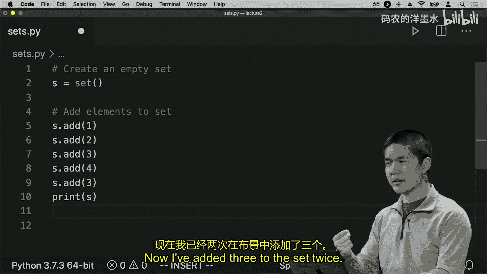

When I print out the contents of the set， it still just contains the elements，1，2，3，4。

 No element ever appears twice in the set， following with the mathematical definition of a set where no element ever appears more than once inside of a set。

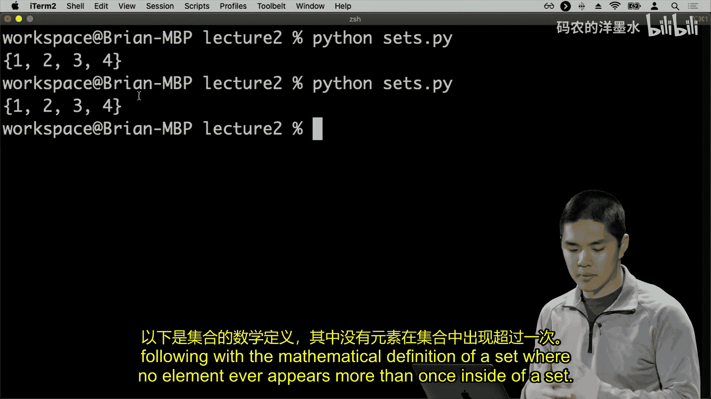

You can also remove elements from sets as well。 So if I wanted to remove the number two from the set。

 for example， I could say S dot remove2 and then print out S to say print out whatever happens to be inside of that set now。

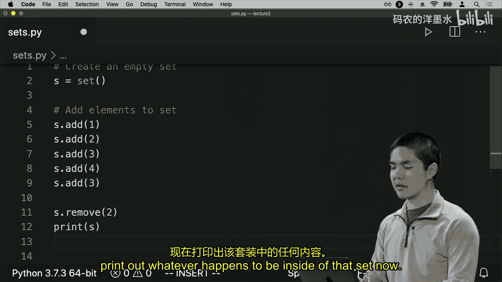

And now， when I rerun this program， I only get 1，3 and 4 because I removed2 from the set。

 So setss allow you to add to them， remove from them。 And also all sequences。

 whether they be strings or lists or sets allow you to get how many elements are in the set by taking advantage of a function built into Python called L。

 So L will give you the length of a sequence。 So the number of items inside of a list or the number of characters inside of a string or the number of elements inside of a set。

😊。

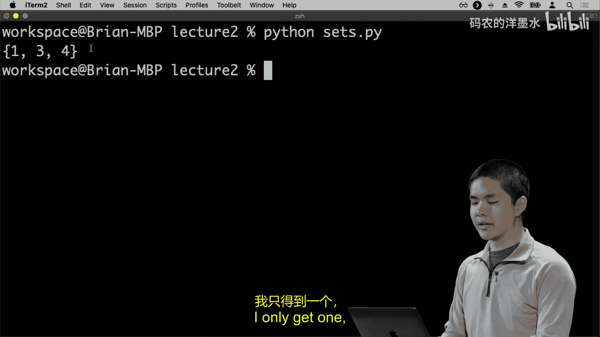

And so if I wanted to print out how many elements are in the set。

 I might do something like this in a formatted string， say the set has some number of elements。

And how do I know how many elements？ Well， again， inside of these curly braces。

 I can include any expression in Python that I would like to substitute into this string。

 So how many elements are in the set， I can get that by calculating L of S。😊。

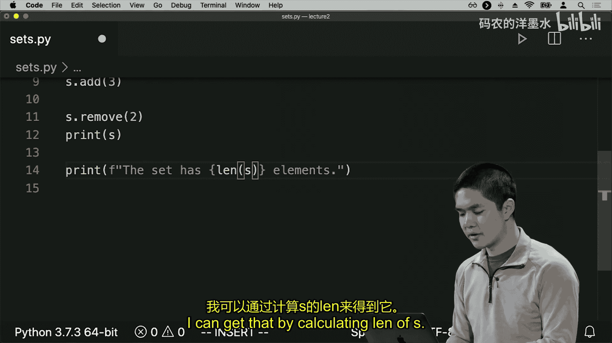

So what I've done here is I've said with line of S。

 I would like to calculate the length of the set S。 In other words。

 how many elements are actually inside of that set。 And then using this curly brace notation。

 I'm saying， take that number and plug it into this string。

 So we can see the set has some number of elements， for example。😊。

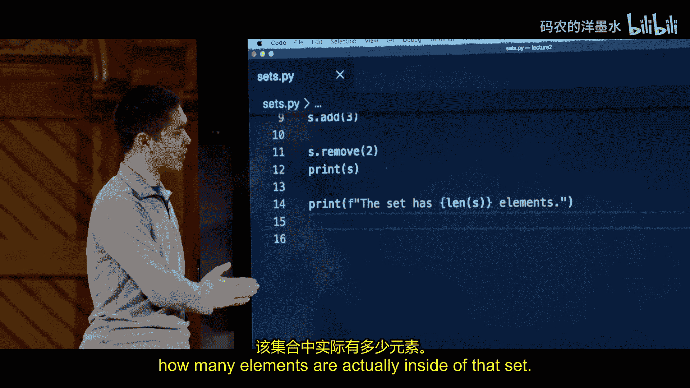

So now if I run this program。Python set stop pi。 I see that I get these three elements that happen to be inside of the set right now。

 which is one and then3 and then 4。 And then it tells me that the set has three elements inside of it。

 which is the number of elements that are in the set right now。

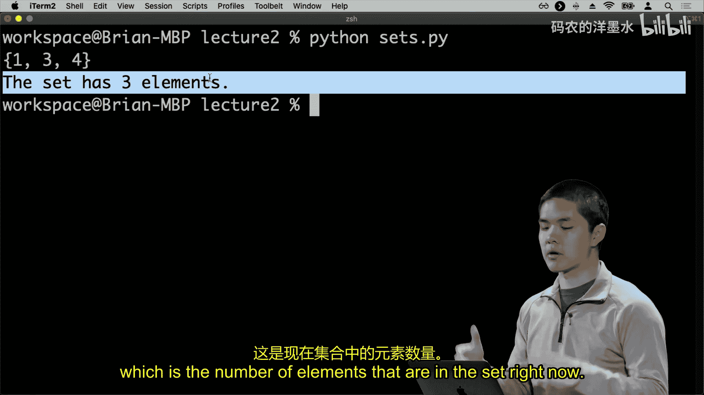

So now we've seen a number of different language features inside of Python。 We've seen variables。

 we've seen conditions so that we can conditionally do things if something is true。

 if something else is true， and we've seen some of the data structures that are core to the way Python works。

 lists and sets and tuples and other data structures can be helpful too。

 And now let's take a look at another feature of the Python programming language。

 common to many programming languages， the idea of looping。

 if I want to be able to do something multiple times。😊。

I'll go ahead and create a new file called loops dot pi。 And let's just create a simple loop。

 The simplest loop we could create in Python is just one that's going to count a bunch of numbers。

 So in order to do that， what I could say is something like this。😊，For I in 1，2，3，4，5。

Or maybe I want to count 0，1，2，3，4，5， just to start counting at 0。Print I。

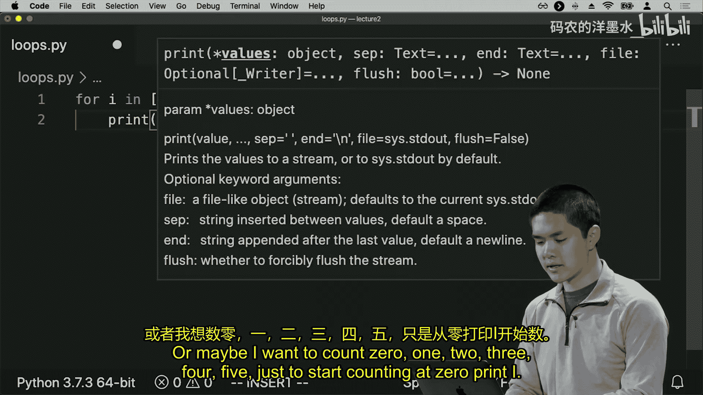

So here is the basic syntax for a Python loop。 And here's what seems to be going on。

 Over here on the very first line。 I have a python list as denoted by those square brackets that contains six numbers。

0，1，2，3，4，5。 And now I have a four loop for I in this list。

 And the way Python interprets this is to say go through this list， one element at a time。

 And for each element， call that element I。 we could have called it anything。 But in this case。

 I is just a conventional choice for a number that keeps incrementing。

 And we're going to print out now the value of I for each iteration of this loop。😊。

So we can try this out now and run Python loop stop pi。 We see 1，0，1，2，3，4，5。 Great。

 It printed out all of the numbers from 0 to 5，1 at a time。😊。

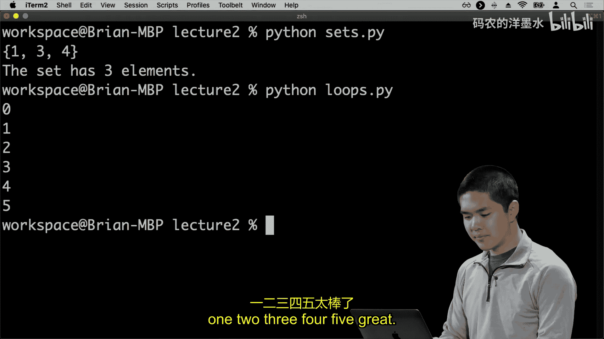

In practice， though， if we wanted to count all the way up to five or for print six numbers。

 for example， this is fine for now。 but if we wanted to print like 100 numbers or 1000 numbers。

 this is going to start to get tedious。So Python has a built in function called range。

Where I can say for I in range 6 to achieve exactly the same thing。

 range 6 means get me a range of six numbers。 So if we start at 0。

 it's going to go from 0 all the way up to 5。 And then we can print out each one of the elements inside of that sequence。

 So if I rerun Python loop stop I， we get 0，1，2，3，4，5。

 So loops enable us to loop over any type of sequence。 So if the sequence is a list。

 I can say something like if I have a list of names like Harry and Ron and Hermione。😊。

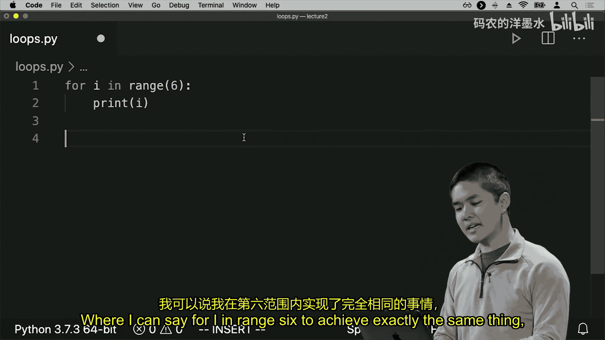

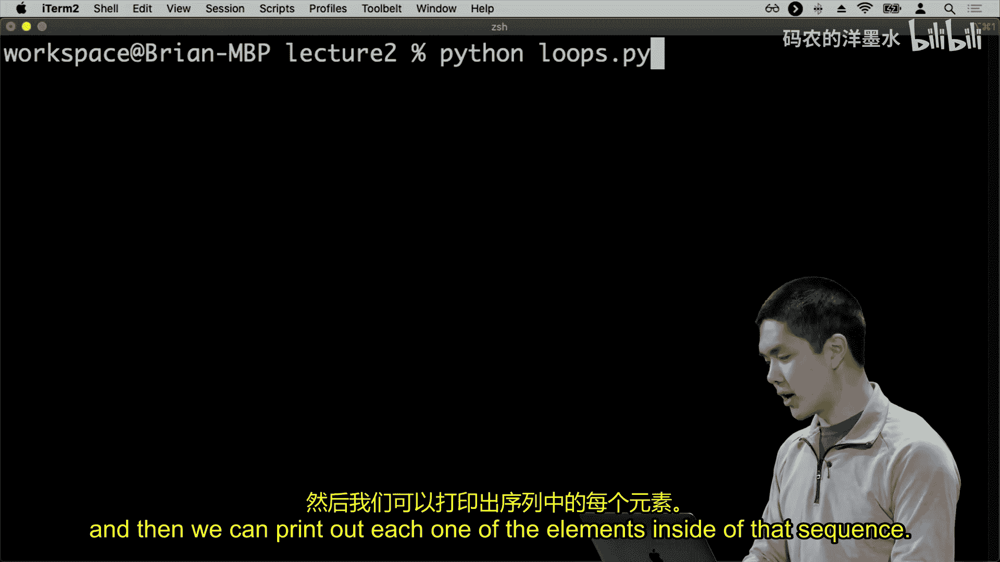

And this is my list of names。 I can have a loop that says that for each name in my list of names。

 let's print out that name。 for example， So we have a list。 the list is called names。

 We're looping over at one element at a time and printing it out。 Now if I run the program。

 I see three names printed one on each line。 And you can do this for other sequences as well。

 Maybe I have just a single name that is called Harry。😊。

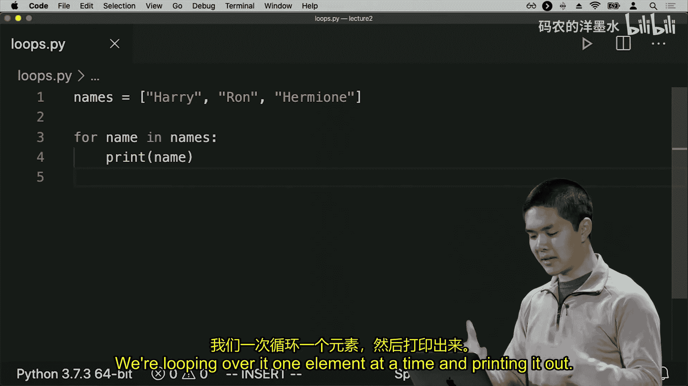

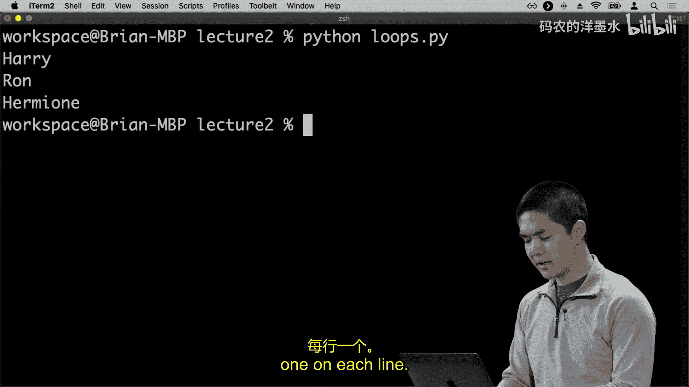

And now I could have a line that says， you know， for every character in that name。

 print the character。If the name is the sequence， a sequence of individual characters because it's a string。

 then when I loop over that string， I'll be looping over each individual character in that string so I can run the program and see one on each line。

 each of the letters that just so happens to be inside of Harry's name。

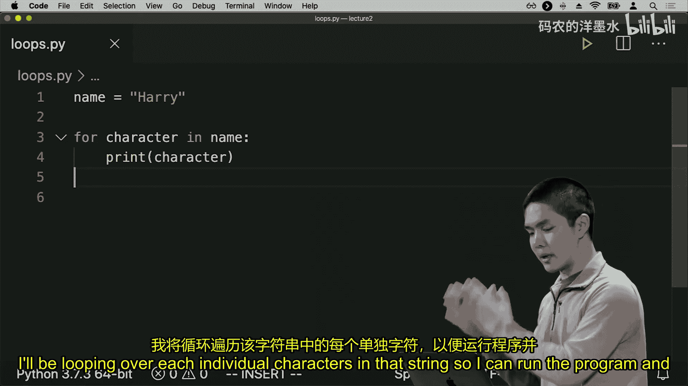

So now we've seen conditions， we've seen loops， and we've seen a number of different data structures。

 We've seen lists and sets， as well as tuples。 The last important data structure that we're going to be taking a look at are Python dictionaries。

 which as you'll recall， are some mapping of keys to values。

 If I want to be able to look something up， I can use a Python dictionary。

 just as a data structure to be able to store these sorts of values。😊。

So I'll create a new file called Dictionary Stop Pi。

And maybe I want to create a dictionary that is going to keep track of。

 say what house each of the students at Hogwars happen to be in。

 So I might have a dictionary called houses。And the way we specify a dictionary is by specifying a key colon of value when we're defining a dictionary for the first time。

 So I might say， Harry。Colon Griffindor。And then， Draco， Cohen。Slitherren， for example。

 And so what this line of code is doing is it is creating a new dictionary。

 This dictionary is called houses。 And inside this dictionary， I have two keys。

 Two things that I can look up。 I can look up Harry， or I can look up Draco。

 And when I look up those keys， I get the value that follows their Col。 So after Harry。

 if I look up Harry， I get Gryinor。 If I look up Draco， I get slitherren， for example。😊，So now。

 if I wanted to print out what house Harry is in， I can print out houses， square brackets， Harry。

So I can here say I would like to print out。Take the house's dictionary。

 And the square bracket notation is how I look something up inside of a dictionary。

 It's similar to how we use square brackets to look up a specific element inside of a list to say like。

 get me element 0 or element 1。😊，In this case， we're using a Python dictionary to say。

 take the House's dictionary and look up Harry's value， which hopefully should be Gryindor。

 And we'll see that if we look up run Python dictionaries do pi。

 we do get Gryffinor as the value of Harry's house。😊。

We can add things to this dictionary as well， using the same syntax in the same way that I use square brackets to access the value inside of a dictionary if I want to change the value in a dictionary。

Or add something new to it。I could say houses and Hermione and say that Hermione is also in Gryffindor。

 for example。And so this line of code here says， take the house's dictionary。

And look up Hermione in the house's dictionary。 And when you do。

 that should be set equal to this value here。 Griffindor。

 So we took that value and we are going to assign it to Hermione inside of the dictionary。

 such that now if we wanted to， we could print out。

Hermioneese house as well， run the program and see that Hermione is also in Griffinor。

 So any time we want to be able to map some value to some other value。

 whether we're mapping people to what house they happen to be in or we're mapping users to some information about those users inside of our Web application。

 Dictionaries are going to be very， very powerful tools for us to be able to do that。😊。

The next Python language feature we'll take a look at are functions in Python that are going to be some way for us to write our own functions that take an input and produce some output。

 We've already seen a number of different functions that already exist in Python。

 We've seen the input function that takes an input from the user we've seen the print function that takes some text or some other information and print it to the screen。

 But if we want to define our own functions， we can do so as well。😊，So here。

 I'll go ahead and write a new program called function Stop Pi。

And let's write a function that takes a number and squares it。

 So the square of 10 is 10 times 10 or 100。 I would like a function that very easily takes a number。

 and returns its square。😊，The way I define a function in Python is using the de keyword。

 de short for define。 And here I can say， let me define a function called square。

And then in parentheses， what inputs it takes in this case。

 square just sticks a single input that I'm going to call x。 but if there were multiple inputs。

 I could separate them with comms， like X， Y， Z for a function that took three inputs， for example。

 but in this case， theres just a single input X。And the square function could have any logic in it indented underneath the square function。

 But ultimately， this function is fairly simple。 All it's going to do is return X times X X multiplied by itself。

😊，And now， if I want to print out a whole bunch of squares of numbers， I can do so。

 I can say for I in range， let's say，10。Let's print out。That the square of I is。

Square I。So let's try and parse out what's going on here。 Line 4 says for I in range 10。

 do some loop 10 times looping from0 all the way up to9。 and for each time we loop。

 we're going to print something out。 we're going to print out the square of plug in the value of I here is plug in the value of calling our square function using I as input。

😡，So that is going to have the result of running the sloop 10 times and printing out this line 10 different times。

 each with a different value of I。So I can run Python functions pi， and here's what I see。

 The square of 0 is 0， square of 1 is 1，2 is 4， so on and so forth。

 all the way up to the square of 9 is 81。😊。

So we've now written a function and been able to use it， but ideally， when we write functions。

 we'd like to not just be able to use them in the same file。

 but for others to be able to use them as well。And so how can we do that， Well， in order to do that。

 you can import functions from other Python modules or files， so to speak。

Let me create a new file called squares dot pi， for example。

 So then instead of running this loop here， let's instead run this loop in squares dot pi， again。

 separating out different parts of my code。 I have one file that defines the square function inside a functions do pi and then another file called squares dot pi where I'm actually calling the square function。

😊。

Now， if I try to run Python squares do pi。 you'll notice I'll run into an error。

 Here's another error you'll see quite frequently。 It's a name error， another type of exception。

 which here says the name square is not defined， meaning I'm trying to use a variable or a function name or something else that doesn't actually have a definition。

 I've never said what square is。 And that's because by default。

 Python files don't know about each other。 If I want to use a function that was defined inside of another file。

 I need to import it from that file。

And I can do so like so。 I can say from functions， import square。

Functions was the name of this file functions pi。 And I'm saying from that Python module。

 I would like to import the square function as a function that I would like to use。😊。

Now I can run Python。

Squares do pi。 And we get the output that we expect。 No more exception。

I've now been able to import something from another module。And access it this way。

So this is one way to import to literally say from functions， import a square function。

 import a particular name that is defined inside a functions dopi。

 Another way I could have done this is just to say import functions， just import that whole module。

 but then I would need to say instead of just square。

 I would need to say functions dot square to mean go inside the functions module and get the square function and run that function。

 and this would operate in exactly the same way。😊，So a couple of different options。

 I either import the entire module in which case I use this dot notation to say access a particular part of that module。

 or I say from functions import square to just import the name square into this file entirely so that I can just use the word square whenever I want to。

 and this works not just for modules that we have written but also python comes with a number of built-in modules if you want to write programs that interact with cv files which are a spreadsheet file format I can import pythons built in cv module to get access to a whole bunch of cv related features。

 there are a whole bunch of math related features you can get by importing the math module so on and so forth。

 and there are additional python modules and packages that you can install that other people have written and then you just import them when the time comes and next time as we take a look at Django。

 this is one of the techniques that we're going to be looking at is using functions that have been written by people that are not ourselves。

😊，So that now is modules and how we can use modules to be able to import functions in order to allow for certain behavior。

 And this is one way that we can program using the Python programming language。

 but another key technique that Python supports that are supported by a number of other programming languages as well is an idea of object oriented programming。

 a special type of programming or programming paradigm， so to speak。

 which is a way of thinking about the way that we write programs and in objectoriented programming。

 we think about the world in terms of objects where objects might store information。

 store some data inside of them and also support the ability to perform types of operations。

 some sort of actions or methods or functions as we might call them。

 that can operate on those objects。😊，So now we're going to take a look at some of the object oriented capacities that the Python programming language is going to give us the ability to have。

So Python comes with a number of built in types。 It has types for lists。

 It has types for sets and so on and so forth。 Let's imagine， though。

 that we want to create a new type in Python， some way of。Representing other types of data。

 for example， two dimensional points， things we've talked about before。

 something that has an x value and a y value。 Now， as we've already discussed。

 you could do this using a tuple， just using one number， comma another number。

 But we could create an entire class of objects to be able to represent this data structure as well。

 And so that's what we'll take a look at now， is how to create a class in Python。

 So I'll create a new file called classes dot pi。 And all a class is。

 if you can think of a class as a template for a type of object。

 We are going to define a new class called point。 And then after we've defined what a point is。

 we will be able to create other points， we'll be able to create points to store X and y values。

 for example。😊，And so what do we need in order to create a class， Well。

 we need some way to say that when I create a point， what should happen。 And in Python。

 this is defined using what's called a magic method called underscore， underscore in it。

 And underscore， underscore in it is a method or function that is going to automatically be called every time that I try to create a new point。

😊，And this function takes a couple of arguments。All functions that operate on objects themselves。

 otherwise known as methods， are going to take the first argument called self。

 and this argument self represents the object in question。

 and this is going to be important because we don't just want a single variable called X to store the points X coordinate or a single variable called Y to store the y coordinate because two different points might have different X and different y values。

 and we want to be able to store those separately。 and we're going to store them inside of the object itself。

 So this variable self references the object that we are currently dealing with。

 and it might change depending on which point we happen to be interacting with at any given time。

What other inputs does a point need， Well a point also needs an x value and a y value。

 So when we create a point， we're going to provide to that point an x value and a y value。Now。

 what do we need to do in order to store all this data inside of the point， Well。

 recall that self is representing the point itself。

 And so if we want to store data inside of that point。

 allow the point to store its own X and y values， then we we need to store that data inside of the self so to speak。

 And in order to do that we can use this dot notation to say self dot X is equal to whatever this input X happens to be。

 And self dot y is equal to whatever this argument Y happens to be。And these values， X and Y。

 they could be called anything。 They could just be called like input 1 and input 2， for example。

 And then you would just reflect them here。 The important thing is that these two input values are being stored inside of the point itself in properties that we're going to call X and y。

Alright， so that was a little bit abstract。 But now， let's see how we could actually use this。

 If I want to create a new point called P， I can say P equals point。

And then the self argument is going to be provided automatically。 I don't need to worry about that。

 but I do need to provide input 1 and input 2， the x value and the y value。

 So I'll go ahead and provide an x value of 2 and a y value of 8。 for example。

 So now I've created this point。 And now that I have a point。

 I can print out information about the point。 I can print out the x value of the point。

 and I can print out the y value of the point。 Again， I'm using this dot notation to say。

 go into the point and access data that is stored inside of that point。

 access its x value and access its y value。

So now when I run this program， Python classes dot pi， what I get is  two on the first line。

 That is the x value， and then8 on the second8 on the second line。 that is the y value。😊。

So what we have here is a function called in it that creates a point by storing the two inputs inside of the object。

 inside of a property called X and a property called Y， such that later I can create a point。

 which calls this in it function implicitly。 And after we've created the point。

 I can access the data inside of it。 I can say print out whatever P dot X is equal to。

 print out whatever P dot Y is equal to as well。😊，So that was a fairly simple example of creating a class。

 just creating a class for representing a point an X and a Y value。

 Let's look at a more interesting example。 Let's imagine that we're trying to write a program for an airline where the airline needs to keep track of booking passengers on a flight and making sure that no flight gets overbooked。

 We don't want more passengers on the flight Then there is capacity on that flight。😊。

So let's define a new class that we're going to call flight。 And this time。

 the init method is just going to take a single argument other than the self， which is the capacity。

 Every flight needs some sort of capacity to know how many people can fit on the plane。

And so I'll store that inside of a value called self dot capacity equals capacity。😊。

And what other information do we need to store about a flight， Well， a flight has a capacity。

 and it also has all of the passengers on the flight。

 And so we could represent this in a number of ways。

 but we know that lists can be used in order to store a sequence of values。

 So we'll go ahead and just create a list that will store in self dot passengers。😊。

That is going to be equal to the empty list。 So we start out with an empty list of passengers。So now。

 if I want to create a flight， I can say flight equals and then capital F flight。

 that's the name of the class and then provide a capacity。

 I can say capacity of three to mean three people can go in this flight， but no more than three。

 That is the capacity because that is the argument that's specified inside of this init function。

 And when I do so， I'm automatically going to get this empty list of passengers。😊。

So now let's think about what methods or what functions we might care about performing when it comes to a flight。

So one reasonable function to add would be a function that says， allright。

 let's add a passenger to the flight if I want someone new to go on this flight。

So how might I go about doing that。Well， let's define a new method also known as a function to this flight class called add passenger。

 This method can be called whatever we want。Because this is a method that's going to work on an individual object。

 we need some way of referencing that object itself， so we'll use the keyword self again。😡。

And when we add a passenger， we need to add a passenger by their name。 So I need to specify。

Their name， as well。Such that now here， I want to add that name to the passengers list。😡。

How do I get access to the passenger list， Will I have access to the self， the object itself。

 and I stored the passengers inside of self in self dot passenger in attribute of this object。

And self dot passengers is a list that initially starts out as an empty list。

 But if I want to add something to the end of a list， we've already seen that in order to do that。

 I can say self dot passengers dot append。nameame。So that adds someone new to the end of this passenger's list。

Now， what could potentially go wrong here。 Well， every time we call this ad passenger function。

 what's going to happen is we are going to append to the end of this passenger's list， this name。

 but we haven't taken into consideration the capacity of the flight。 Ideally。

 our ad passengers function shouldn't let someone be added to a flight if the flight is already at capacity。

So there are a number of things we could do here。 We could just check it inside of this function。

 But just for good measure， let's create a new function。😊，Let's add a new function， called。

Open seats that is going to return the number of open seats that are on the plane。Other than self。

 there are no other inputs that we need to calculate how many open seats there are。

 The only thing we need to know in order to calculate open seats is we need to know the capacity。

Minus however many passengers there are。 remember， self dot passengers is our list of all the passengers。

 and anytime we have a sequence to get the length of that sequence。

 I can saylen or length of that sequence to say， get me the number of passengers that there are。

So now we have this function called open seats， which will return capacity。

 minus the number of passengers， and tell us how many open seats there are。

And now in this add passenger function， I can add some additional logic， I can say。If。

Not self dot open seats。So this is equivalent to me saying in this case。

 like if self done open seats equals equals 0， meaning there are no open seats， a more pythonic way。

 so to speak of expressing this idea is just saying if not self- done open seats。 In other words。

 if there aren't any more open seats。 then what should we do， we should return。

 and maybe you might imagine this ad passenger function， returns true。

 if it was able to successfully add a passenger and false otherwise。 So in this case。

 I can return false to say， you know what， there aren't enough open seats。

 let me return false from this function to indicate that there was some sort of error。😊。

But otherwise， if there are open seats， we can add the passenger and return true to mean that everything was okay。

 We were able to add the passenger successfully。😊，So now we have these three functions in it that creates a new flight。

 add passenger that adds a new passenger to that flight， and open seats。

 which tells us how many open seats there are， and now let's use those functions to actually add some passengers to this flight。

Let me get a list of people。 We'll say Harry。Ron， Hermione and Jeninny。And now。

 let me loop over all of those people for every person in that list of people。

Let's try to flight dot ad passenger。Person。And we can save the result in a variable called success。

 for example。And then I can say， if success， well， then let's print out that we added。

The person to flight。Successfully。But else， otherwise， let's print out no available seats for。

That person。So what's going on here， We have a list of people， four people。

 And for each of those people， we're gonna try and add the passenger to the flight。

 calling flight dot addd passenger， calling this method。

 passing his input the person's name and save the result true or false in this variable called success。

If success is true， we print out。 we've added them successfully。 Otherwise。

 we print out there are no available seats for that person。So now we can try running this program。

I'll run Python classes。 pi， and now we see we've added Harry。

 Ron and her mining to the flight successfully， but the flight had a capacity of three。

 which means there are no available seats for Jeninny。

 which we get as the error message on the fourth line。😊。

And if you're really trying to optimize， you might notice that you don't really need this variable。

 I could just take this entire expression， flight dot ad passenger person and put it in the condition itself。

 I can say， try and add a passenger。 ad passenger will return true or false。 And if it returns true。

 that means it was a success。 And then I can print out that we've added the person to the flight successfully。

😊，So that is a brief look at object oriented programming。

 this technique within Python and other programming languages to represent objects like this particular flight。

 and then to manipulate those objects using methods like the ad passenger method that takes a flight and adds people to it。

 at least as long as there is available capacity on that flight。

 So one of the many powerful features of Python， that we'll be definitely taking a look at later in the term and using as we go about building these web applications。

😊，Now， there are a couple of final examples that are just worth taking a look at just to give you some exposure to some of the other features that are available in Python。

 One thing that will be coming up soon is the idea of decorators。

 And just as we can take a value in Python like a number and modify the value。

 Decators are away in Python of taking a function and modifying that function。

 adding some additional behavior to that function。 So I'll create a new file called decorators pi。😊。

Just to demonstrate what we can do with decorators。

And the idea of a decorator is a decorator is going to be a function that takes a function as input and returns a modified version of that function as output。

 So unlike other programming languages， where functions just exist on their own and they can't be passed in as input or output to other functions。

 In Python， a function is just a value like any other。 You can pass it as input to another function。

 you can get it as the output of another function。 And this is known as a functional programming paradigm。

 where functions are themselves values。😊，So let's create a function that modifies another function by announcing that the function is about to run and that the function is completed running。

 just to demonstrate。 So this announced function will take us input a function F。

 And it's going to return a new function。 And usually。

 this function wraps up this function F with some additional behavior。

 And for that the reason is's often called a wrapper function。 So we might call this wrapper。😊。

To say that， allright， what is my wrapper function going to do。

 It's first going to print about to run the function just to announce that we're about to run the function。

 That's what I want my announced decorator to do。😊，Then let's actually run the function F。

And then let's print done with the function。So what my announced decorator is doing is it's taking the function F。

 and it's creating a new function that just announces via a print statement before and after the function is done running。

😊，And then at the end， we'll return this new function， which is the raper function。

So this right here is what we might call a decorator， a function that takes a function。

 modifies it by adding some additional capabilities to it and then gives us back some output。😊。

And so now here I can define a function called Hello that just prints Hello world， for example。

And then to add a decorator， I use the at symbol。 I can say at announceun to say。

 add the announced decorator to this function。😊，And then I'll just run the function hello。

 and we'll see what happens。

I'll run Python decorators pi。 And I see about to run the function。

 then hello world then done with the function。 So again， why did that work。

 It's because our hello function that just printed hello world is wrapped inside of this announced decorator where what the announced decorator does is it takes our hello function of input and gets us a new function that first prints an alert warning that we're about to run the function actually runs the function and then prints another message。

 So a bit of a simple example here。 But there's a lot of power in decorators for being able to very quickly take a function and add capability to it。

 You might imagine in a web application。 if you only want certain functions to be able to run if a user is logged in。

 You can imagine writing a decorator that checks to make sure that a user is logged in and then just using that decorator on all of the functions that you want to make sure only work when a user so happens to be logged in。

 So decorators are a very powerful tool that web application frameworks like django can make use of just to make the。

😊。

Aplication development process a little bit easier as well。

Let's take a look at a couple other techniques that exist within Python。

 one is how we might be able to more efficiently represent functions。

 So let's imagine that I now have， I'm going to call this Lambda dot pi for a reason you'll see in a moment。

Let's imagine that I have a list of names or people， for example， And inside of this list of people。

 each person， instead of being just a string is going to be a dictionary that has both a name like Harry and a house like Griffindor。

And let me add another name like Cho and a house like Raven Cla。

 And then another name like Draco and a house。Like slithering。

So here we have a list where each of the elements inside of that list is a dictionary。

 a mapping of keys and values。 And that's totally okay。 In Python。

 we have the ability to nest data structures within one another。

 We can have lists inside of other lists or lists inside of dictionaries or in this case。

 dictionaries inside of a list。 And in fact， this nesting of data structures is one of the reasons why it's very easy in Python to be able to represent structured data。

 like a list of people where every person has various different properties。😊。

What I might like to do now is something like sort all of these people and then print them all out。

 So I might want to say， people dot sort。And then， print all the people。But if I try to run this。

 I'll get an exception。

I get an exception。Type error， less than not supported between dit and dit。

 which is sort of weird because I'm not using any less than symbol at all。Anywhere in my program。

 But in the traceback， you'll see that the line of code that it's catching on is people dot sort。

 Somehow people dot sort is causing a type error because it's trying to use less than to compare two dictionaries。

And what this appears to me is that Python doesn't know how to sort these dictionaries。

 It doesn't known does Harry belong before or after Cho。

 because it doesn't know how to compare these two elements。

 And so if I want to do something like this， then I need to tell the sort function how to sort these people。

And so in order to do that， one way I could do this is by defining a function that tells the sort function how to do the sorting。

 what to look at when sorting。 So if I want to sort by people's name。

Let me define a function that I'll just call F that takes a person as input and returns that person's name by looking up the name field inside of that dictionary。

And now I can sort people by their name by saying， sort key equals F。

What this means is sort all the people and the way to sort them。

 the way you know how to compare them is by running this function。

 where this function takes a person and gives us back their name。

 and this will sort everyone by name。 Now if I run Python Lambda de pi。

 you'll see that I first get Cho， then Drago， then Harry in alphabetical order by name。

 whereasas if instead I had tried to sort people by their house。

By changing my function， then I'm using to sort。

And then rerun this。 Now， I see that it's first Harry， who's in Griffindor， then Ravenclaw。

 then slitherin， for example。 So we get the houses in alphabetical order instead。

But the reason I show this is because this function is so simple and is only used in one place。

 Python actually gives us an easier way to represent a very short one line function using something called a lambmbda expression。

 and this is a way of including the function just as a single value on a single line。

 I can say instead of defining a function called F。

 I can get rid of all of this and just say sort by this key。😊，A lambda。

 which is a function that takes a person and returns the person's name。So we say person as the input。

 colon， person name as the output。 This is a condensed way of saying the same thing we saw a moment ago of defining a function。

 giving it a name and then passing in the name here。

 This right here is a complete function that takes a person and as input and returns their name。

So Python， Lambda dot pi。 that will actually sort the people by their name， Cho， then Draco。

 then Harry。 Whereas if I have left off this key altogether。

And then tried to sort。 well， then we get this type error because we can't compare these two dictionaries。

So we' see seen a lot of different exceptions now throughout Python。

 So the very last example we'll take a look at is an example of how to deal with these exceptions。

 like what to do when things might go wrong。 if we want our program to be able to handle those possible exceptional cases。

 situations where things might， in fact， go wrong。 So let's try an example。

 I'll create a new file that I'm going to call exception stop pi。

 And what exception pi is going to do is it's going to get some input。 It's going to say。

 let's get an integer input called X。😊，And let's get an integer input called Y。

And then let's go ahead and print out the result of x divided by y。 So result equals x divided by y。

 And then let's print out something like x divided by y equals。Result。

 and we can literally print out the values of x and y。

So this is a simple program that's just performing some division， get a value of x， get a value of y。

 divide the two and print out the result。

We can try running this by running Python exceptions pi。 If I were type in like 5 and then 10。

5 divided by 10 is 0。5。 exactly what might I might expect。 But what could go wrong now。

 you remember from math in division， What could go wrong is if I type in 5 and then 0 and try and do 5 divided by0。

 What's gonna happen。 Well when I do that， I get an exception。 I get a zero division error。

 which is an error that happens whenever you try to divide by 0。😊，What I'd like to happen， though。

 in this case is not for my program to display kind of a messy error and a trace back like this。

 but to handle the exception gracefully， so to speak， to be able to。😊。

Catch when the user does something wrong and report a nicer looking message instead。

And so how might I go about doing that？ Well， one thing I can do here。

Is instead of just saying result equals x over y， I can say， try to do this。

Try to set result equal to x divided by y and then say， except if a zero divisionary happens。

Then let's do something else。 Let's print error。Cannot divide by 0 and then exit the program。

 How do you exit the program？ It turns out there's a module in Python called cis。

 And if I import the cis module。I can say cis dot exit one to mean exit the program with a status code of one。

 where a status code of one generally means something went wrong in this program。

So now I'm trying to divide x divided by y， except I have an exception handler。

 This is a try accept expression。 I'm saying try to do this。

 except if this exception happens rather than have the program crash。

 just print out this error message， can't divide by 0 and then exit the program。So now let's try it。

Python exception stop pi。 again，5 and 10 works totally normally， gets me a value of 0。5。

 But now if I try 5 and 0， press return， I get an error cannot divide by 0。

 No long exception that's gonna look complicated to the user。 It's no longer messy。

 I've been able to handle the exception gracefully。😊，Now。

 one other exception that might come up is what if instead of x is 5， I type in a word like hello。

 something that's not a number。 Now I get another type of exception， a value error。

 which is happening when I try and convert something to an int because hello cannot be converted into a base 10 integer。

 You can't take text that is not a number and turn it into an integer。

 So instead I'm getting this value error here。😊。

How can I deal with that？ Well， I can deal with it in much the same way when I'm getting this input X and Y。

 I can say rather than just get the input， Just try to get the input。

Except if a value error happens， which is the error that we got a moment ago， this value error。

Then print error in input。And go ahead and insist that exit 1。

So now I've been able to handle that error as well。 I can say Python exceptions pi。 I can say， hello。

 and I just get error invalid input。 I can divide by0。 I get error cannot divide by 0。

 But if I do type a valid X and a Y value， then I get the result of dividing one number by the other。

 So exception handling is often a helpful tool for if you expect that some lines of code you might be running。

 might run into some sort of problem， be they a value error or zero division error or some other error altogether to be able to handle those errors gracefully。

 And that's probably what you want。 if you're going about building a web application using Python is the ability to say that if something goes wrong。

 we want to handle the error nicely display a nice error message to the user telling them what was wrong。

 instead of having the program entirely crash。 So those are some of the key features now。

 this python programming language。 This language that gives us the ability to define these functions and loops and conditions and very convenient ways to create classes where we can begin to build objects that are able to perform various different types of tasks。

😊。

And next time， using Python we'll be able to design web applications such that users are able to make requests to our web applications and get some sort of response back。

 So we will see you next time。😊。

