# 【全集】哈佛大学 web应用开发 9小时速成 中英字幕 附完整课件 p05 Lecture 3 - Django -BV1RYUsB2Ejz_p5-

🎼。

Okay， welcome back， everyone to web programming with Python and jascript。 So thus far in the course。

 we've taken a look at a couple of different technologies。 We took a look at Hml and CsS。

 which are languages we can use to describe the structure of a web page and then style it appropriately。

 And then we also took a look at Python， a programming language that we could use to get programming features。

 Fe like loops and conditions and variables and functions and more。

 And what we're going to do today is introduce D django。

 which is going to combine these two Django is a python web framework。

 which is going to allow us to write python code that is able to dynamically generate Hml and CS。

 ultimately allowing us to build a dynamic web application。

 So what is this now going to enable us to do that we weren't able to previously do using just Hml and CS。

 Well， using Hml and Cs， the web pages that we created were static web pages。 They were the same。

 And every time you visited the web page， the page you were looking at was identical。 But ultimately。

 if you think about webs you interact with on a day-to-day basis。 say like the New York Time。😊。

For example， it's not the case that every time you go to the New York Times homepage。

 you're seeing the exact same HM。 It changes the next day you might see the new date。

 you might see the next day's articles whenever someone comments in an article。

 you can see those comments and you can see how many people have commented on an article。

 for example， And it's probably not the case that someone is sitting there updating the Hml of the New York Times website every time something changes but rather more likely there is some program maybe written Python。

 maybe written in some other language that is dynamically generating that Hml and CS and allowing the web application to respond based on how users are interacting with it。

 And this is ultimately what we're going to be trying to create using this Djago web framework We're going to be creating software that's going to run on a web server such that clients running in their web browser can make requests to our web server and our server is going to respond back with some sort of response。

 And so how does this process actually happen， Well ultimately it boils down to this HttP。

 otherwise known as the hypertext transfer protocol， which is the protocol for how messages。

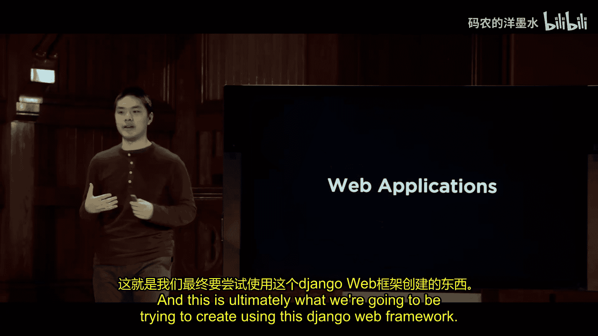

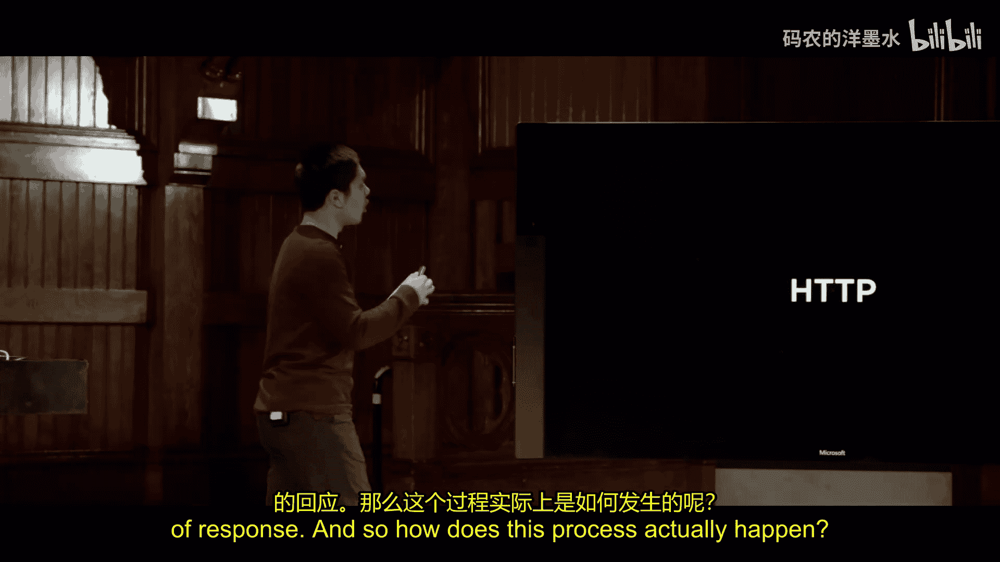

AreGo going to be sent back and forth over the Internet。 In this case。

 you can think about this as a computer， some user， which we might call the client。

 And then our server， which is going to be the server that is going to contain our web application。

 We are going to write a django web application that is going to run on this server and clients are going to make request to that server。

 The server is going to process that request and then return some sort of response。

 That request might look a little something like this。 underneath the hood。

 It might start with the word get get is just an example of a request method。

 A way that you might try to get a page。 So get just means I would like to get a particular page。

 In this case， the page I'm trying to get is the slash page just denoting the root of the website。

 usually the default page for the website。 H TP 11 is just the version of H T TP that we're using。

 And the host is what URL we're trying to access the web page for。

 So example do com or some other website， for example that I might be trying to make a request to。😊。

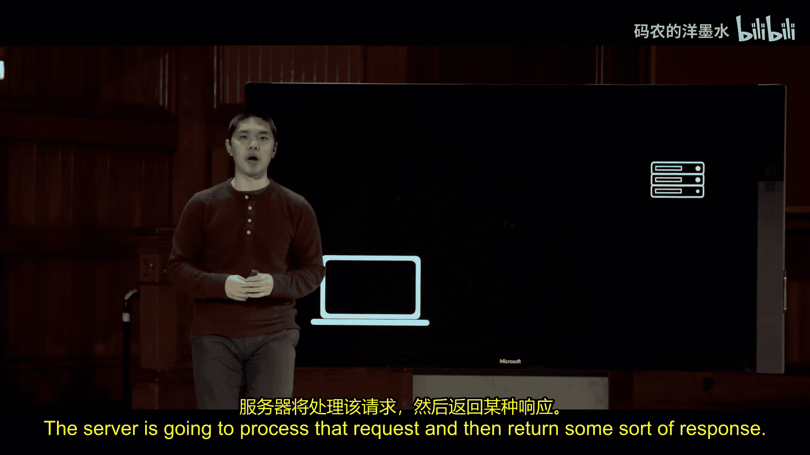

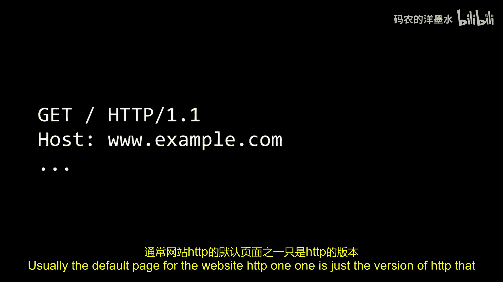

So this request ultimately gets sent by my web browser when I type in a URL and press returnturn。

 for example， the server processes that request and then gives back some sort of response and the response will generally look a little something like this beginning with the HtV version 11 or in some cases。

 to version 2 now。 And then some sort of response code200 is a response code that just means okay。

 Everything was okay。 The page was returned successfully， for example。

 And here on the second line we see content type text Hml which just means the format of the data that's coming back in this response is Hl data。

 It's Hl data that the user's web browser on the client should then render as Hml， for example。

 and there other content types as well and other information that comes back in that response。

 but the key idea is just thinking about the web in terms of request and response。

 One user makes a request to get a particular web page and what they get back is a response like this that hopefully include status code 200 which means okay。

 But there are a number of other status code。😊，As well， some of the more popular，200 means okay。

 You've probably seen 404， the status code that means not found。

 if you try to request a web page that doesn't exist， for example。

 Other you might see are 301 moves permanently， that often happens if you're redirected from one website to another。

 for example。 We'll take a look at an example of that shortly。403 generally means forbidden。

 You're trying to access a page you're not supposed to have access to。

 And 500 usually refers to some sort of internal server error。

 usually meaning that whoever was writing the server。

 maybe our Django web application has something that's buggy in it。

 and we might need to go back and figure out where that bug is in order to fix it。 And again。

 there are other status codes as well。 But these are some of the most common that we're going to be seeing and interacting with as we go about building web applications using Django。

So Django is a web framework。 It's a set of tools that is already built for us that's just going to make it easy to get started by writing Python code in order to design a fully fledged web application by taking care of some of the stuff that most web pages all have to do such that we can focus on the interesting logic of building our own web applications。

 So the first step you'll need to do in order to use django is to install it。 if you're using Python。

 you may be familiar with Pip， the Python package manager。

 which makes it easy to be able to install new packages。

 And the first thing we'll probably want to do is install D django。

 And here we're gonna be using Python 3。 So you might need to specify Pip3。

 install D django to install django on your system。 And after you do。

 we can run a command to be able to create a D django project。

 And that command looks something like this。 Django admin start project followed by the name of the project that we would like to create。

 When we run this command。 Django is automatically going to create some starter files for us just to get started with the process of building a web application。

😊，So let's try creating a project now。

I'll go ahead and go into my terminal window。And what I'm going to do is type that command。

 I'm gonna type Django admin， and then start project。 And then I need to give this project a name。

 And I'm just gonna give this project a name of lecture 3。 for example， you can name the project。

 whatever you'd like。And when that happens， if I type L S。

 what I see is that a lecture 3 directory or folder has been created for me by Django。

 And if I go ahead and open this up inside of my text editor。

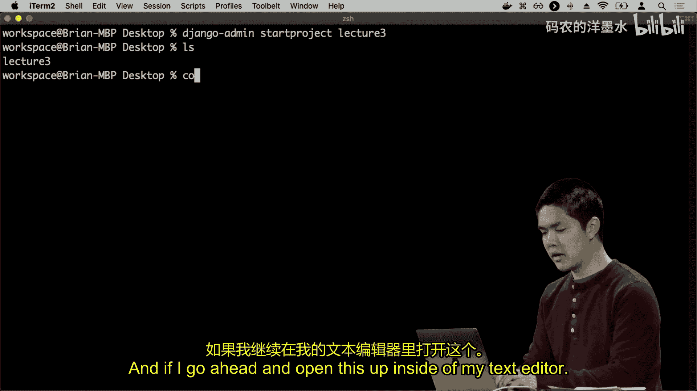

We can take a look at what files are inside of this lecture 3 directory。 So actually。

 I'll go ahead and C D into lecture 3 and open it up。

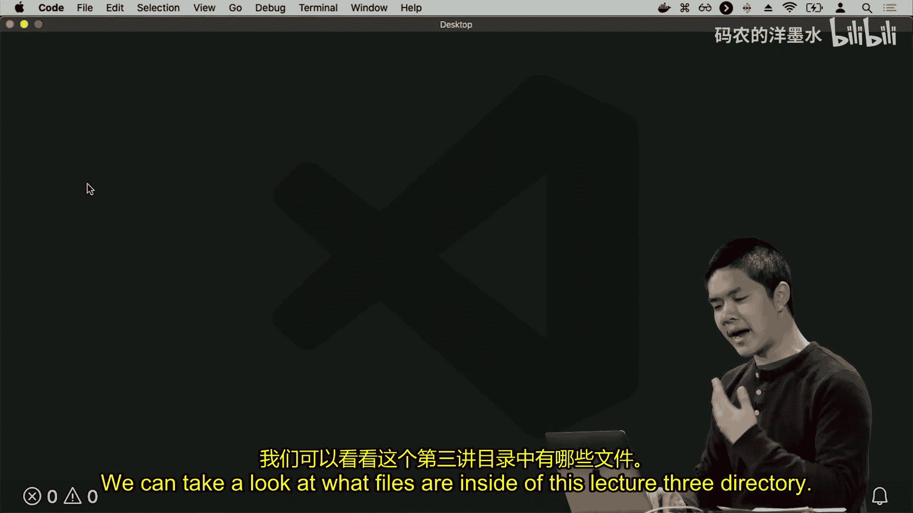

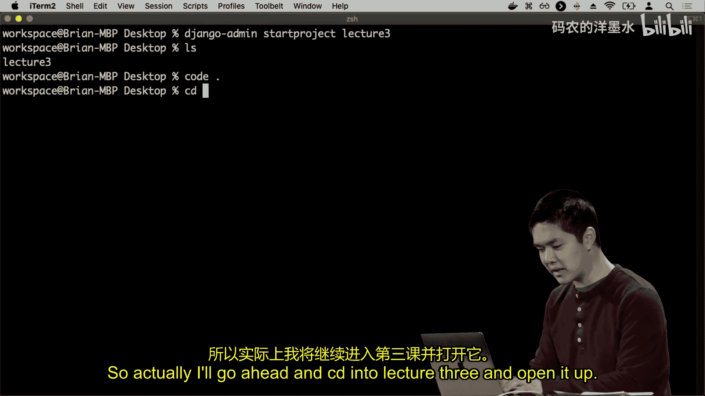

And what we see inside of lecture 3 are a couple of files that were given just to get started。

 So there are a couple of files。 not all of them are really interesting to us right now。

 but first and foremost， managed do pi is a file that Django is going to create for us will generally not need to touch that file。

 but we're going to use the managed Pi file to be able to execute commands on this Django project。

 And we'll see a couple of examples of that now and a couple of examples of that in future lectures as well。

 And then the other important one that we'll be looking at is settings dot pi。

 which just contains important configuration settings for our Djago application。

 Setting Pi comes preloaded with a couple of default settings。

 but we might want to change those settings to be able to add features to our application as well or make some modifications to how the application behaves。

😊。

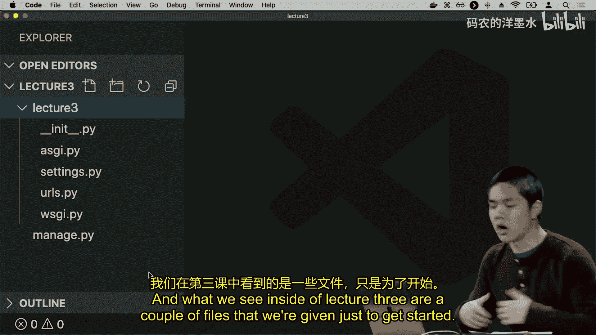

And then the other important file that's precated for us now here is URLs dot Pi。

 And you can think of URLs dot Pi as a sort of table of contents for our web application that on any given web application on a website。

 there are a number of different URLs or routes that you can visit on Google， for example。

 you can visit slash search or slash images。 And URLs dot Pi is just going to be a table of contents of all of the URLs on my web application that I can ultimately visit。

😊，And so if I'd like to try running this web application just to see what it looks like。

 the way to do it in Django is in the terminal。I'll run Python， manage dot Pi， followed by a command。

 And the command is called run server。 And so this is generally how we'll use managed dot Pi。

 We'll run managed do Pi， followed by an argument specifying what command we would like to run。

 And Python managed do Pi run server means go ahead and actually run this web server。If I do this。

 I'm now running this web server locally。 And I see a bunch of debugging output。

 But the interesting point to me is that it says down here。

 starting development server at H TDP colon slash slash1，27001 colon 8000。

 And so this is where my web application is currently running1，2700。

1 is an I address and address on the Internet。 that just refers to my local computer。

 The computer I'm looking at right now。 So only I can access this， not anyone else on the Internet。

 and 8000 is what we would call a port number。 It just refers to what type of service is being run。

 And you might have multiple different Internet services running on different ports。 In this case。

 our django application is running on port 8000。😊，So if I copy this URL and just go ahead and go into my web browser and paste that URL in。

 what I see is just Djago's default page to say our installation of Django works。

 And this now is the default page that Django is going to give to us to say that Django has been loaded for this web application。

 and we can now actually start to begin building this web application by adding the features we want to it。

😊。

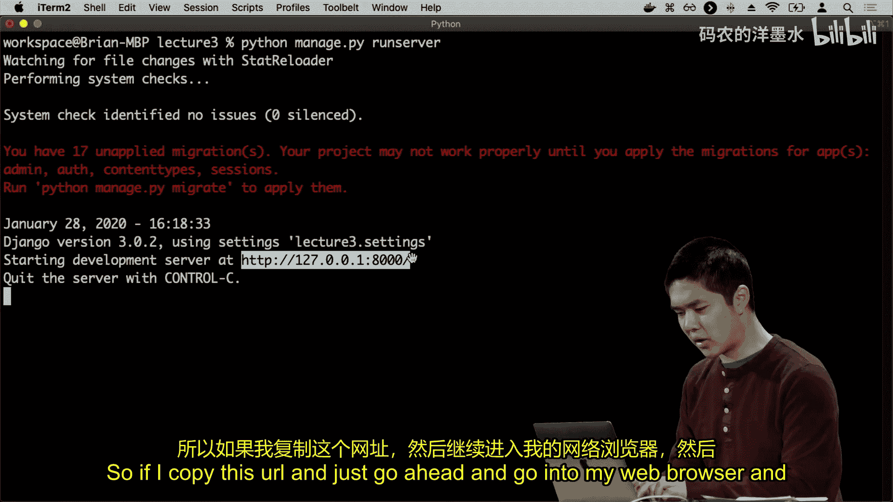

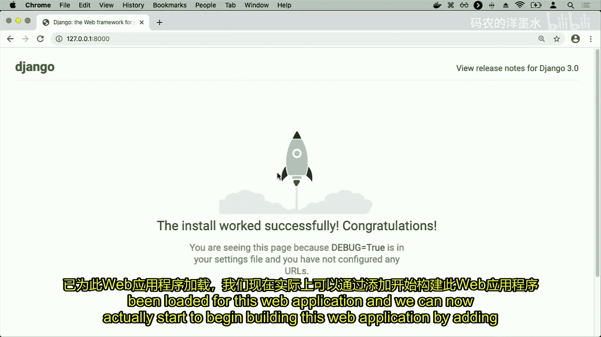

And so what we've created here is what we call a Django project。

 And in terms of the way a Django project is structured is that every Django project generally consists of one or more Django applications。

 So one project may have multiple applications within it。

 And the reason for this division is if you think about big websites oftentimes， a big website。

 a big project has multiple different apps that are sort of separate services that operate within it。

 Google， for example， has Google search， but also Google I and Google New and Google Maps。

 where you can think of each of those individual services as a separate app under one larger project like Google。

 for example， or Amazon's website， for instance， might be one big project that is a couple of different apps within it。

 one app for shopping maybe and one application for Amazon's video service， for example。

 And so Django comes preloaded with this ability to take a project and divide it into multiple distinct apps。

 maybe for simpler apps， we're only going have a project that has one app inside of it。

 instead of multiple， but it has the ability to allow us to create these separate apps that。😊。

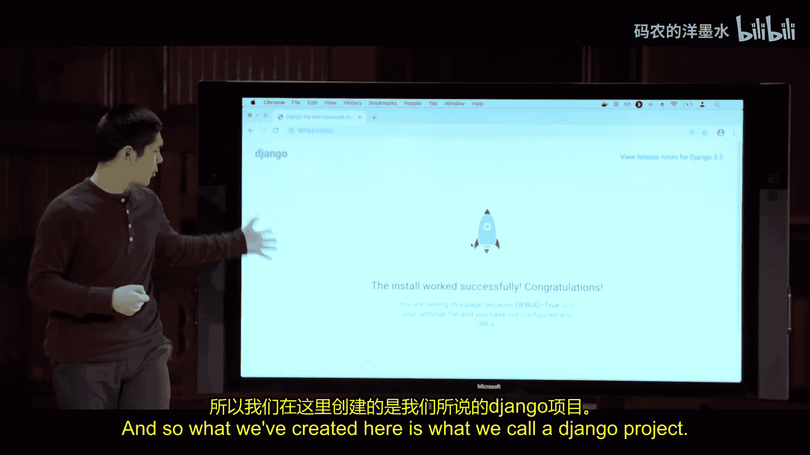

Have different capacities。So if we want to get started with Django。

 the first thing we'll need to do after we create a project is create a Django app。

 And so the way to do that。 So go back to the terminal。

 I'll go ahead and exit out of this server by pressing controlr C to say I would like to exit。

 stop running the server。 So now if I go back to that URL and refresh it。

 It won't work because the Django server is no longer running。😊，But I'll run the command。

 Python managed up Pi， start app。 and then the name of the app that I would like to create。

 And for our very first app， I'll just call this app。 hello， for example。😊。

So I've now created one Dinggo project called Lecture 3。

 and inside of which I've created the very first app that I've now called Ho。

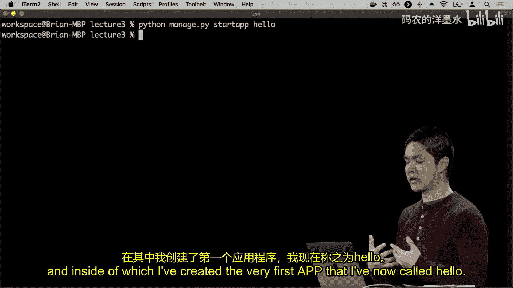

And so if we take a look at our files now， you'll see that in addition to a lecture 3 directory which existed before。

 we also now have a hello directory that Djainggo created for us that is going to contain the information needed for the hello app to work。

 And there are a number of files again that are generated by default。

 We're not going look at all of them today。 We're going to focus primarily on views do Pi。

 We'll see why in a moment， which is going to be the file that lets us describe what it is the user sees when they visit a particular route。

 for example， where we can decide what gets rendered to the user and the other files will take a look at over the course of this term。

 taking a look at what additional features Djaingngo has to offer。😊。

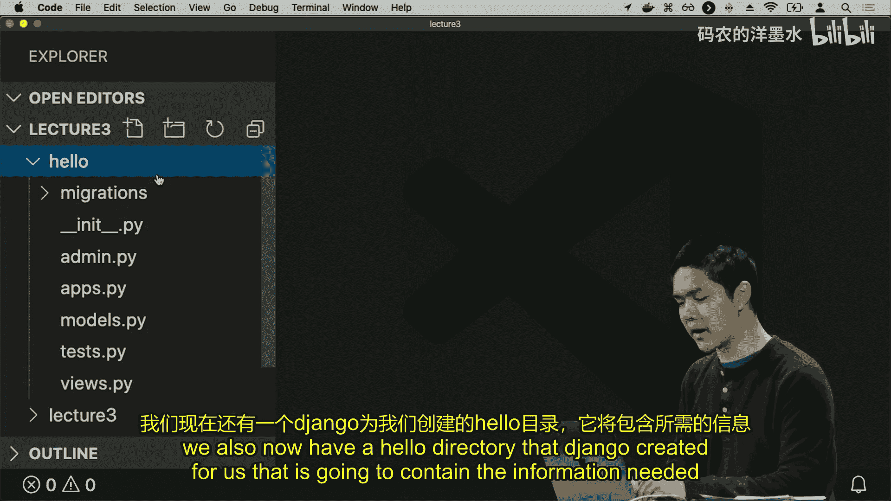

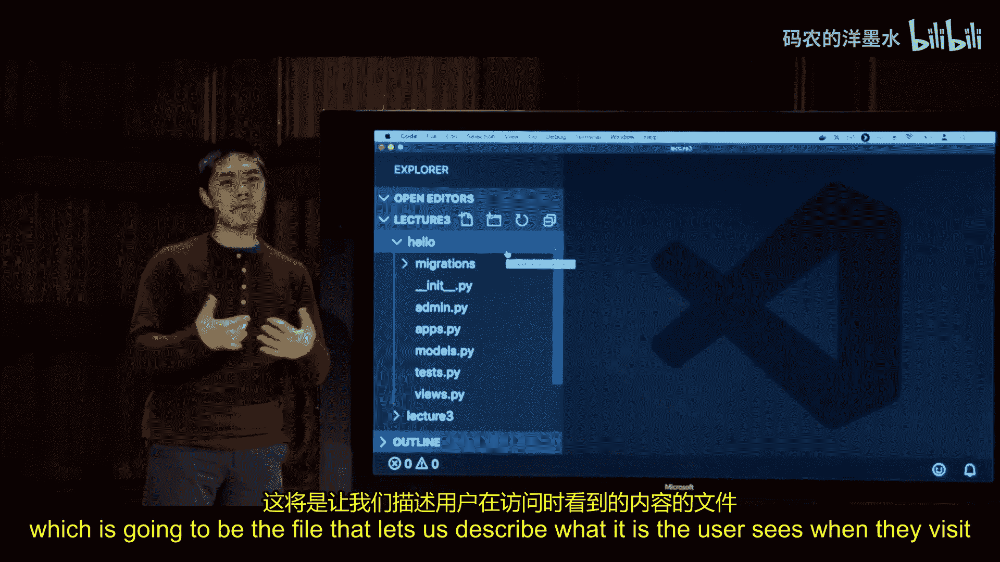

So we've now created this hello app that we would like to install into this project。

 And in order to install it， we need to go into the settings for this particular Django project。

 So if I go into the lecture  three directory and open up settings Pi。

 What I'll see here is a big file all created for me by Django。 I didn't write any of this code。

 But this is all just the default configuration for a Django project。

 And if you scroll down somewhere there， you'll see a variable called installed apps。

 which is where Django configures， what apps are installed on this project。

 And there are a whole bunch of individual apps that are installed by default that are just created by Django。

1， for example， manages sessions， which will take a look at a little bit later。😊。

But if I want to add my new app that I've just created called Ho to these installed apps。

 I'll go ahead and just add to this list of strings。 this installed apps variable。

 I'll just add hello。And so now Ho is going to be an installed app on this particular Django project。

So now what I'd like to do is actually make this app， this hello app。

 do something and display something when I try and visit a particular route， for example。

 So how can I go about doing that。😊，Well， let's go ahead and go into the Ho directory and let's take a look at views dot Pi inside of my Ho app。

So here's the default file I get for views do pi。 I see a comment that's given to me that by default that says create your views here。

 And you can think of each view as something the user might want to see。

 So let's go ahead and just create a default view。 And in order to create a view in django。

 we're going to define a function。 So this function， I'll just call index。😊。

This function by convention takes as argument， a request argument。

 And this is going to be an argument that's going to represent the H T TP request that the user made in order to access our web server。

 So if we want information about that request， we can look inside of this request object to get access to some of that data and we'll take a look at that momentarily。

 too。But now， what would I like for this request to do。

 Well what I want to do for now is let's just do something simple and return an H T TP response。

Of hello world， for example。Now， H T TP response is a special class created by Django。

 And so if I want to use it， I'll generally need to import it。

 And so Djago is going to give us a lot of features that we might want to use in our web applications。

 But if we want to use them， we generally have to import them first。 And it just so happens。

 And I only know this from reading Django's documentation And I can include a line like this from Django do H T TP Im H T TP response to say。

 I would like to import the ability to give an H TP response。

 And now what I have is a function representing my view。 This function is called index。

 And what the index function does is it just returns in H T TP response of hello world。😊。

And so this is the response。 But now we need to tell the app like when should you actually return this response。

 What URL is the user going to visit。 And this is where we now begin to create some URL configuration。

 some sort of setting to tell Django when a particular URL is visited then this function should be run in order to return that particular H T TP response。

 So how to do that， Well， in order to do that， we're going to need to create a URLs pi file for this particular app。

 So Django has one URLs p file that works for the entire project。

 But oftentimes we'll have each app contain its own URLs pfi。

 just for the sake of separating things out into different places。

 such that if we have multiple different apps， each of which is doing something independent we can have each of those individual apps have its own URLs p file to control what URLs are available for that particular app。

😊，So I'll go ahead and go。Into the Ho directory， and I'll create a new file inside of the Ho directory called URL's dot Pi。

And what URLs that Pi needs is it needs to define a variable called URL Pats。

 which will be a list of all of the allowable URLs that can be accessed for this particular app。

And the way you create a URL is by first importing from Django dot URL's import path。

And let's create our first URL。 I'll say path。 And then the first argument here。

 I'm gonna give the empty string to mean no additional argument。

 And we'll see what that means in just a moment， meaning nothing at the end of the route。

And then the second argument to path is what view should be rendered when this URL is visited。

 And so if I want to render my index view， recall that in views dot pi over here。

 I have this index function， Then what I want to render when someone visits this URL。

 the empty URL is going to be views dot index。 views is represents views dot pi。

 that file where I've defined all of my views， and index just so happens to be the name of the function that I want to call when someone visits this URL。

 for example。And then you can optionally provide a path with a string name to represent this URL。

 I'm going give this a name of index。 We'll see why this can be useful later on。

 But the idea is giving a name to a particular URL pattern makes it easy to reference it from other parts of the application。

 So later， when we might want to link to things or have forms that are submitting to different parts of the web application。

 giving a name to a path can be a useful tool。In order to use views。

 last line I need to add the URLs dot Pi is to say from dot。 In other words。

 from the current directory， go ahead and import views。Anytime I'm using a variable name like views。

 I'm using that name。 I need to import it from somewhere。

 And it just so happens that views dot Pi and URLs dot Pi are located in the same directory。

 So I can just say from dot import views to import all of that into。This particular file。

So this now is the URLs dot P file for this application。

But the last step in order to get all of this working for the very first time is to go back into the lecture 3 directory and open up URLs dot Pi here。

This is the URLs do profile file for the entire project for all of the apps that might be contained within this project。

 And it just so happens that there's one path already given to us by default called admin。

 which runs a default Django application called the admin application。

 We'll see more about that in the next lecture。 But for now。

 I'd like to add my own route here to say that I would like for a particular path to lead to not the admin app。

 but the hello app that I have just now created。😡，So I'll go ahead and give this a path of hello。

 And what I'd like to do is say that after you've included the path hello。

 go ahead and include all of the URLs from the URLs dot Pi of my hello application。

 I basically like to link these two URL configuration files together。

 And so the command to do that is include hello dot URLs inside of the hell module。

 get at the URLs URLs file there。 And that is now what I would like to add as a URL pattern。

 And in order to do this， I also need to import include since I'm using include inside of URL patterns。

😊，So that was a lot of steps just to get things started。

 But just to get a high level overview of how this is all working。

 I have a Django project called lecture 3。 And inside of lecture 3。

 there's a URLs file that decides what URLs I can access。 I can access slash admin。

 which takes me to the admin application， which is created by Django。

 We don't have to worry about that just yet。 But now I've just added that you can go to hello。

 to go to the hello application And when you do that。

 I'm telling django to look at the URLs do Pi inside of the hello directory to figure out what additional URLs I can get to from there。

 So this is one master URLs do Pi file that might connect to multiple different other URL configurations that exist as well。

😊，Then inside of the URL is got pi for my app for the hello app。

 I've said that when someone visits just the default route on this particular application。

 go ahead and just run the index function。 That is one of my views。So all that's to say。

 And now that that is done， I should be able to go back into my terminal and run Python。

 manage Shop Pi run server to actually start up this web server。😊。

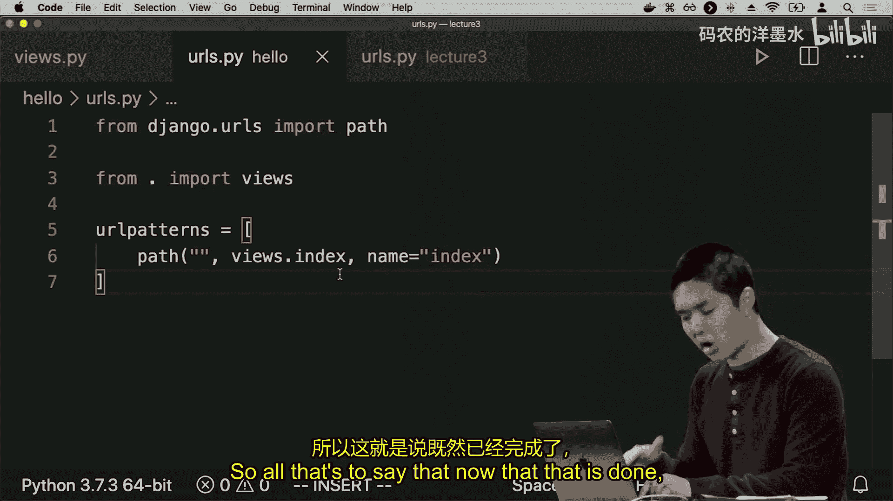

And now I can go back to this URL， but instead of just going to that default URL。

 I'll go ahead and go to that URL slash hello。

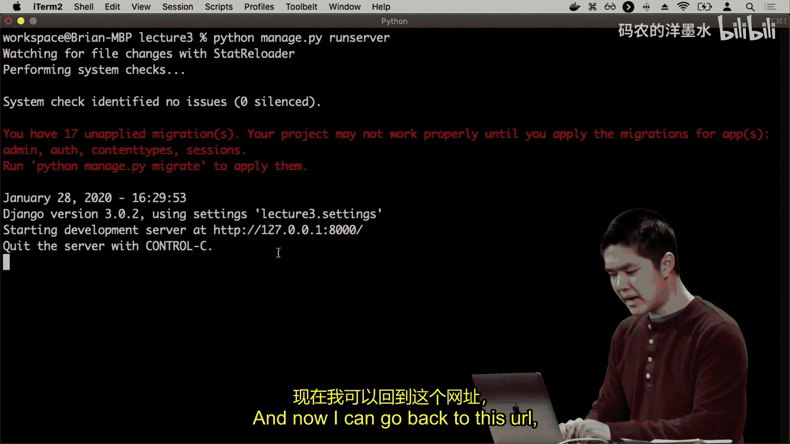

And when I go to slash hello， what I see is hello world。

 So what was happening there is that I typed in a URL。

 That URL went to Django and D django looked at that URL and looked at my URLs pi file and said。

 you know， anytime something starts with slash hello。

 that belongs to the hello app and inside of our hello configuration。

 we said that when we go to the default route， we should run the index function and the index function returns。

 this hello world response。😊。

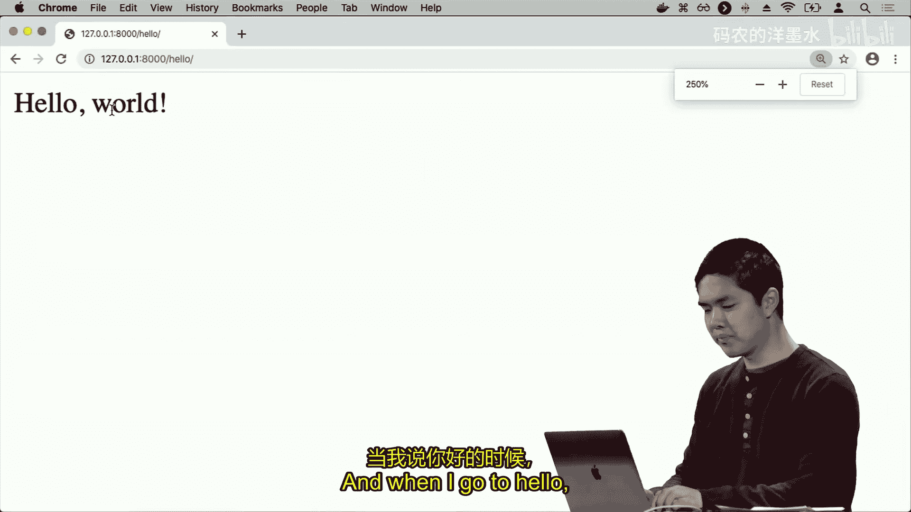

And now we can begin to change that response。 We can begin to adjust what it is that views dot pi is actually doing right now。

 it says hello world。 But if I want to change it to just say like hello， for example。

 I can just edit it。 Now say the index function just returns an H T T response of hello， for example。

😊。

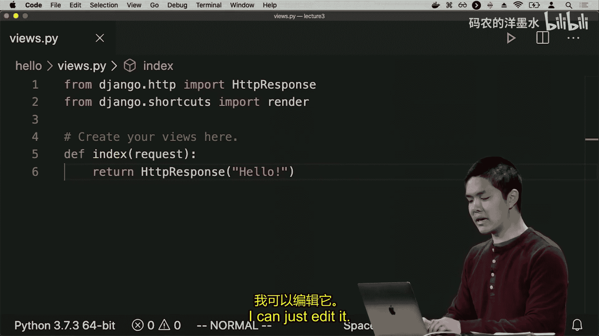

And so now if I refresh this page， now it just says hello。

 so I can edit my files when I do Django notices that a changes has been made and it will reup the server with my latest code such that now I can visit slash hello and I can see that an H TTV response of hello is what ultimately comes back to me。

😊。

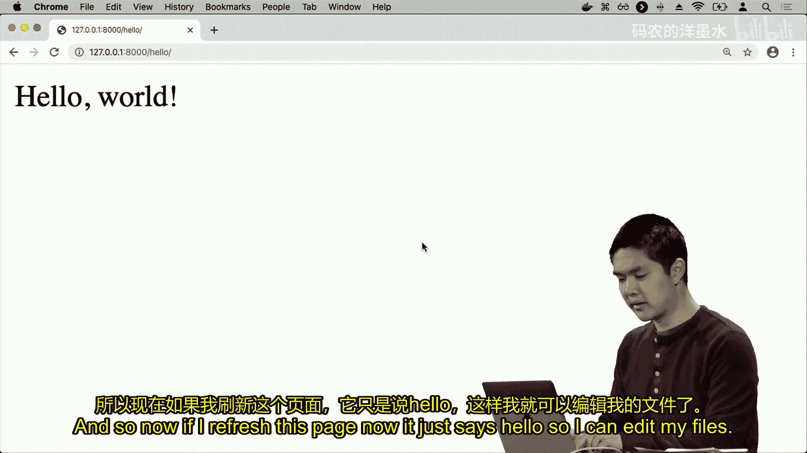

So now let's take a look at the idea that in addition to just having one view inside of views do Pi。

 I can have as many views as I want。 I can create additional functions that each return different responses。

 Maybe I'd like a route that says hello to me， for example。

 So let me define a new function that I'll call Brian。That accepts a request argument。

 And this function is just going to return H TTP response。Hello。Brian， for example。

And now I need to associate this new view that I've created with a URL。

 So I'll go ahead and go back to URLs dot Pi inside of my Ho directory。

 And so I have a default route represented by the empty string that loads the index function。

 But I can add to this。 Just add to this list， add a new path。😊。

Where if I type Brian into the URL instead， that will load the Brian function。

 And I'll go ahead and give that a name as well。

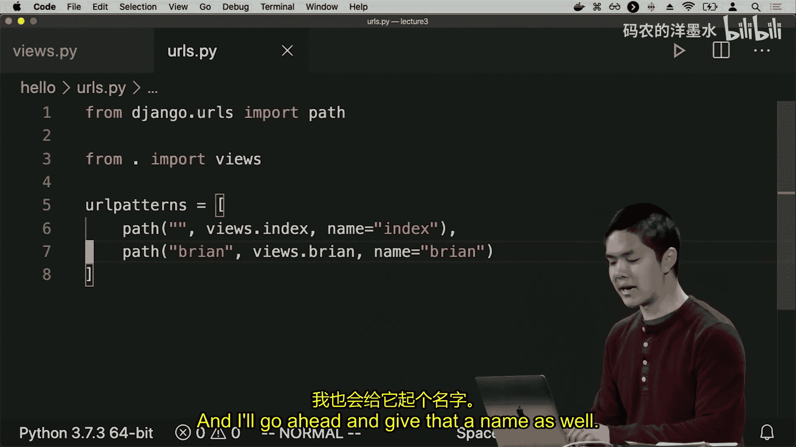

So now if I refresh the page， I'm still on just a slash hello route and that just displays hello。

 for example。 But if I go to slash Brian， for example， now I see hello， Brian。

 I have two different URLs， one that is just slash hello with nothing after it。

 which was that empty string and one which was slash hello with Brian following it that loads a different view function that returns a different H T TP response。

 And so we could imagine continuing to do this。 I might want a web application that has a number of different URLs that I can visit。

 so I could go ahead and add like a David function， for example。😊。

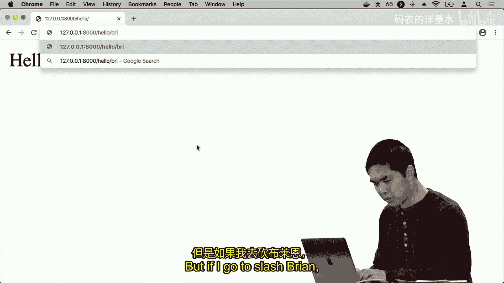

That returns an H TTV response。Of hello， David。And then again， inside of my URL configuration。

 I would say， go ahead and give me another route called David that loads the David function。

Each time I'm giving it a URL。 So what comes after the slash hello。

 I'm giving it a function to run the David function inside of views dot Pi and giving it a name just to make it easier to reference a little bit later。

😊。

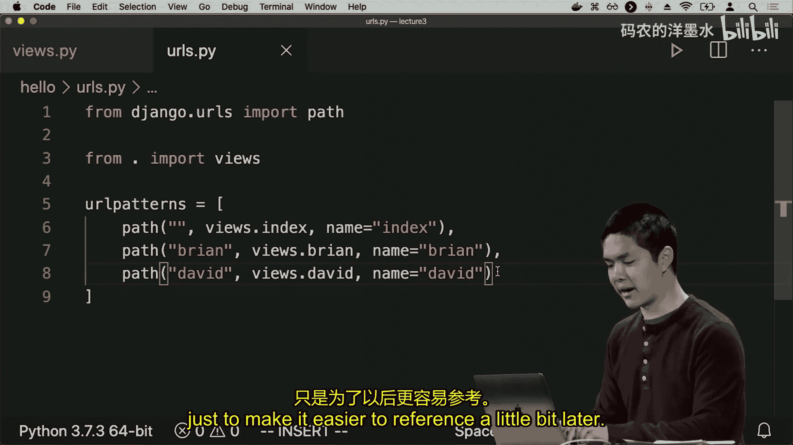

And so now I have slash hello slash Brian， and now I have slash hello slash David。

 each of which displays a different HP response。

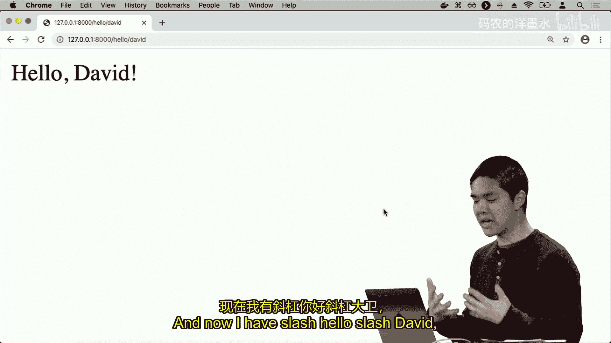

So you can imagine starting to use this feature to begin to build a web application that has a number of different routes。

 that has different routes to do different things。 And many web applications are parameterized by what it is that's actually in the URL。

 So， for example， on Twitter， you can go to Twitter dot com slash someone's username to see all of that user's tweets。

 for example， or Github， a service we've taken a look at now。

 You can go to Github dot com slash your Github username to be able to see all of the repositories for a particular user。

 for example。😊，So if you think about how that might be implemented if either of these services were using Django。

 they might have a URLs dopi file or something like it that is just defining a whole bunch of URLs and saying what route should be associated with them when someone visits that page。

But you can imagine ultimately that this is probably gonna start to get tedious that if I want to say hello to anyone。

 if I want to not only support slash hello slash Brian and slash David。

 but I also want to support arbitrary names like slash Harry or sron or s hermione。 Well。

 then it would seem that I need to create a whole bunch of different functions。

 each of which says hello to a different person and then create a whole bunch of different URLs to be able to do that as well。

 But it turns out that what I can do is create URL patterns that have placeholders in effect。

 things that allow me to parameterize the path via certain path converters。 so to speak。😊。

So what does that actually mean？Well， let's instead of creating functions just say hello。

 Brian and hellello， David， let me create a new function that's just called greet， for example。

 that also takes a request， but takes an additional parameter， takes a parameter like someone's name。

 for example。And this great function is going to return in H T T response。Of hello， comma。

 And then I go ahead and plug in the name here。 And I'll need to add an F to the beginning of the string to indicate that it's a formatted string。

 This is just Python syntax to say that I would like to say hello， not just to anyone。

 but to whatever the value of the name variable happens to be。

 I'd like to substitute the name variable into that greet function。😊，And then， what I can do。

Is inside of URLs dot Pi。 I'll go ahead and add another path。

But instead of saying a name like Brian or David or Harry， for example， here。

 I'm going to say in angled brackets， stir colon name。And when someone visits that route。

 let's go to the views dot greet function。 and the name for this route will be greet。

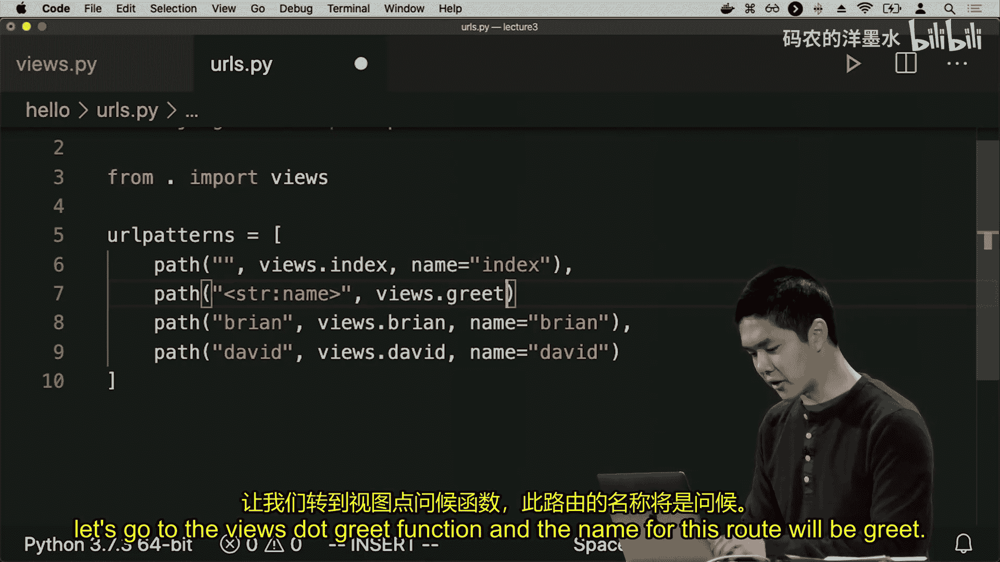

And so what's going on here is we have a fundamentally different kind of path rather than prescribing exactly what the URL should look like。

 like nothing after the end of the route or Brian at the end of the route or David at the end of the route。

 This route here on line 7 is saying this route could be any string that we're gonna give a variable name of name to。

 but you could replace name with something else entirely。 And this could be any string。

 So it could be Brian or David or could be any other name And when that happens will call the greet function。

 And when that function is called， it will pass in this argument。

 This name as a parameter to that function。😊，So Im to be able to create a custom route that allows me to specify any string and figure out how to deal with that appropriately。

So now if I visit slash hello， slash Harry， for example， not a route that I explicitly created。

 but that is a string。 Harry is a string。 I press return。 It says hello， Harry。

 I can go to slash hello slash Ron and say hello， Ron and slash Hermione to see hello Hermione as well。

😊，And you know what， maybe just for good measure， I'd like to capitalize this name like Hermione。

 for example。

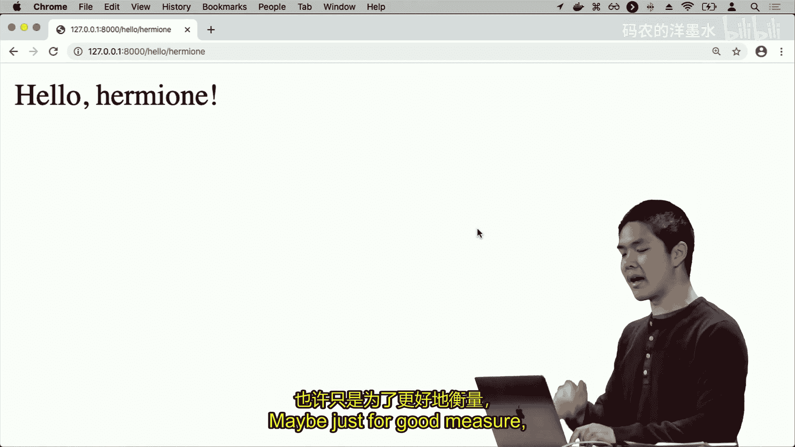

Well， the way to do that is that I can add arbitrary Python logic。

 It turns out that with any Python string， there is a function or method on that string called capitalize that I can say is just dot capitalize。

And if I can do it in Python， then dnangle allows me to incorporate it into the response that I'm giving back。

 So I'm now using Python to take the name， capitalizeize it and use that in the response that gets sent back to the user。

 So now slash Hermione returns。 Hello， Hermione with a capital H， likewise for Ho， Ron。

 likewise for hello， Harry。 I've now been able to add a route。

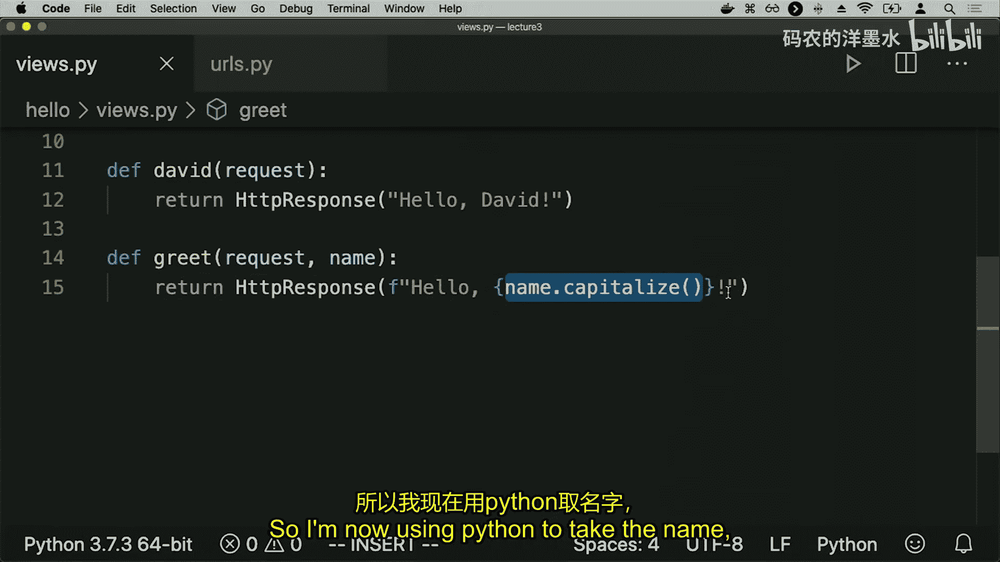

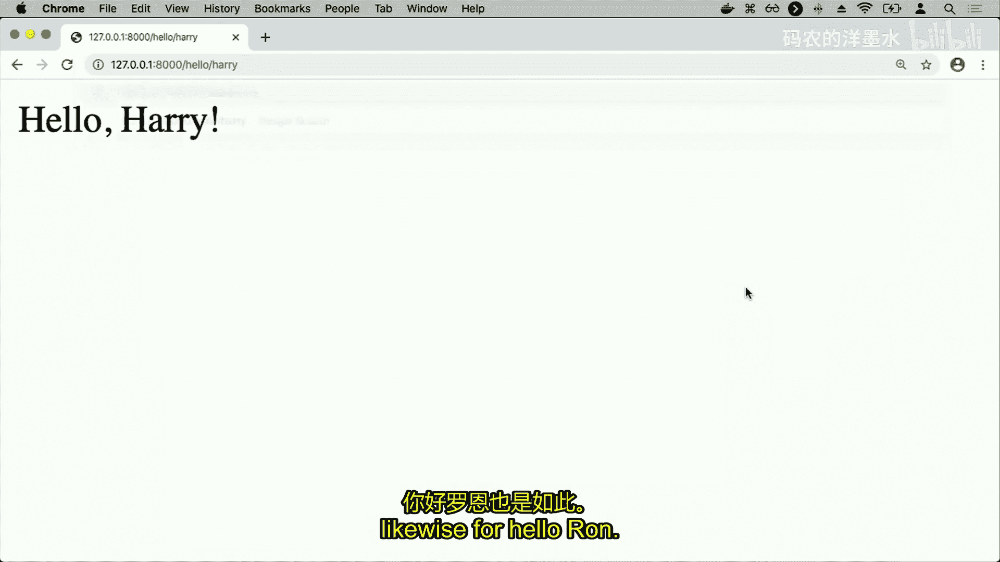

That takes an H TP request， as well as a parameter。 that name。

 whatever was in the URL and return an H T TP response that just says hello to that person。

So these H TTP responses can be any HML content right now， we're just using text。

 but you can imagine adding lists or tables to this as well。

 But you might imagine that if I have to include an entire HMl page just inside these double quotes that that's gonna get unwieldy very quickly。

 very quickly， we're gonna find that there's a lot of HMl to just go in a single string inside of a Python program。

 And if we think back to the principles in the ideas that we've been looking at in this course so far。

 we've generally tried to separate out different parts of our application wherever possible。

 And there's a lot of value in that， one in just keeping things clean。

2 in making sure that people are able to collaborate。

 if you want one person working on the Python logic and one person working on the HMl。

 you'd rather they not step on each other's toes as they're working。

 And so what we can do in Genjango as well， is separate the response。

 the Hml from the actual Python code here as well。And so the way we can do that is instead of returning an H T TP response。

 I can instead， let's say for this default route， instead of returning an H T TP response of hello。

 let me go ahead and render。And when I render something， I need to pass in the HTP request。

 but I'll also pass it pass in the name of a template。

 and I'll go ahead and call this template Hello slash indexdex do HtM L。

So if I don't want to render just a string， but I want to render an entire H TM L file。

 I can call this render function， pass in the request， but then also pass in the name of a template。

 And now all I need to do is create that template。So let me go ahead and inside of the hello directory。

 I'll create a new folder called templates。Inside of that templates。

 I'll create a folder called hello， because the template name here is hello slash index do Html。

 So I need to create a folder called hello inside of which is a file called indext Html。

 I could have just called it index Html without the hello。

 But the reason we often want to prefix our templates with the directory name is to so calledled namespace them to make sure that if we have multiple different indext Html files and multiple different apps to make sure they don't conflict with each other。

 So Djago best practice is to use hello slash index Html or whatever your app name is。

 And inside of that hello directory。 I'll then create a file called index dot Html。😊。

And this index that H TM L can contain any H T L content， samee as we've seen before。

 So I could add that doc type， the H TM L tag， a title of hello， and maybe inside the body。

 I'll have an H1 that says。😊，Hello world， for example。

 it's I can have an entire H page just like this。And now when I visit the default route of my web application by going back into my web browser and just going to slash hello。

 for example， now I see that H TM L that I've defined inside hell of indext H TMl。

 It's a big H1 that just says hello world。😊。

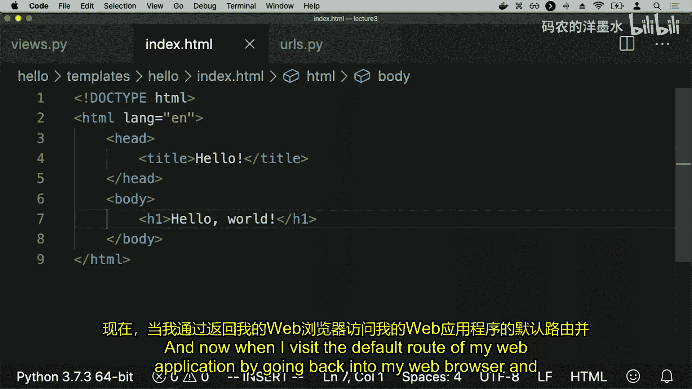

And it turns out that these H TM L pages， these templates that I can render using Django are parameterizable as well。

 Maybe I want to implement hello slash hermione as some sort of Hml page。

 an HMl page that says hello comma hermione and using H TML out of the box。

 you can't really do stuff like this。 H TM L is a markup language。

 not so much a programming language， which means it doesn't by default。

 have support for things like a variable to represent someone's name。

 But using Django's ability to take an HMl page and treat it like a template that we can render Django's added its own templating language。

 so to speak on top of the existing HMl。 And I can take advantage of that to be able to render an HMl page that actually has a variable inside of it or a condition inside of it or a loop inside of it。

 as we'll see in just a moment as well。😊。

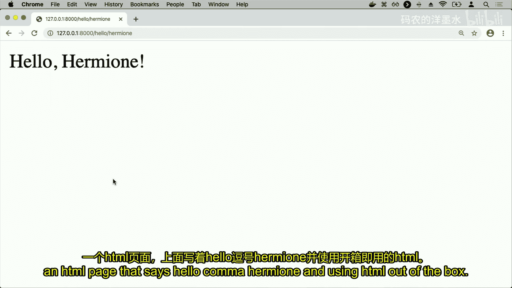

So let's go ahead and go back to view stoppi。 And the function that I would like to change is this great function here that right now is just returning an H T TP response。

 But I'd like to render an entire page， for example。 So what might I render。 Well， let's render。😊。

A template called Ho slashG do HtM。And then this render function can take an optional third argument。

 which is called the context。And the context is all of the information that I would like to provide to the template。

 All the variables， for example， that I want the template to have access to。

And so one thing I might want my template to have access to， for instance， is something like a name。

And so this is a Python dictionary， just a sequence of key value pairs。

 And this name might be associated with what value。 So name is the key， the value I want to be name。

 dot capitalize。And so what's going on here is that now when I render this template， this template。

 hello slash greet dot H TM L， I'm providing that template with some additional context。

 some additional information as represented by this dictionary here。

 where I'm providing information with a key of name I effectively giving this template access to a variable called name and its value is whatever name dot capitalize is equal to where this name here is the argument to the function greet。

😊，So now I can return this template and inside of Greek dot HTMLtM。

 I can use this variable called name。😡，So how do I go about doing that。Well。

 let's first create that greet dot HtM L file。 So inside of the template flashlash hello directory。

 I already have index dot HtMl。 I'll go ahead and create a new file called greet do HtM L。

And inside of Greek dot H TM L， I'll go ahead and write some H TM L。And inside the body of the H TMO。

 whereas before I might have said something like hello， comma world。

I don't want to say hello to world。 I just want to say hello to whoever the name is。

 whatever is contained inside of that variable， called name。So how might I go about doing that？ Well。

 what I can do is use these double curly braces And double curly braces are part of the django templating language that allows me to say。

 I would like to plug in the value of a variable into this particular position inside of my template。

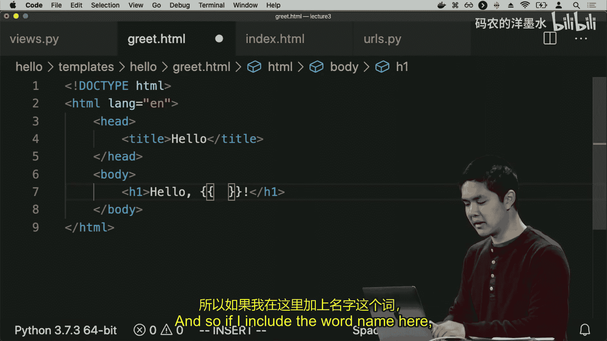

And so if I include the word name here， then what I'm saying here is that when you render this great dot H TM L template inside the body of the page。

 I would like for there to be an H1， a big heading that just says hello comma。

 And then inside these double curly braces， I'm saying plug in the value of the variable name there。

 If name is Hermione， it's gonna be hellello Hermione。 If it's Harry， it's gonna be hello， Harry。

 If it's David， it's gonna be hello， David。😊，So let's go ahead and give this a try now。Now。

 when I go to slash hello slash Harry， for example， I now see a big H1 tag that says hello， Harry。

 If I go to slash hello slash Ron， I see a big H1 that says hello comma Ron。

 And the reason why this is happening， the way we're getting to that final position is because URLs says that when I have a URL that just as a string like someone's name will call the greet function。

😊。

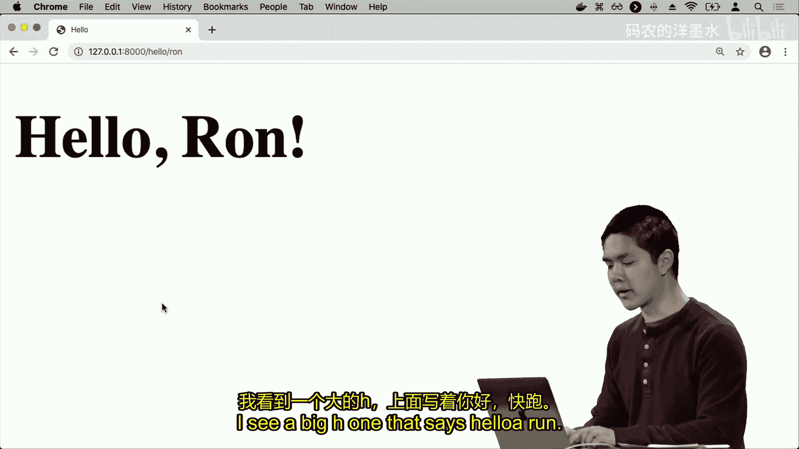

The greet function inside of views dot Pi is taking the name as an argument。

 rendering the greet dot HTML template， and passing in that name as part of the context。

 part of what the template has access to。😡，And inside of G dot HTML， here is the actual HTML file。

 here is where we then plug in the value of name。😡。

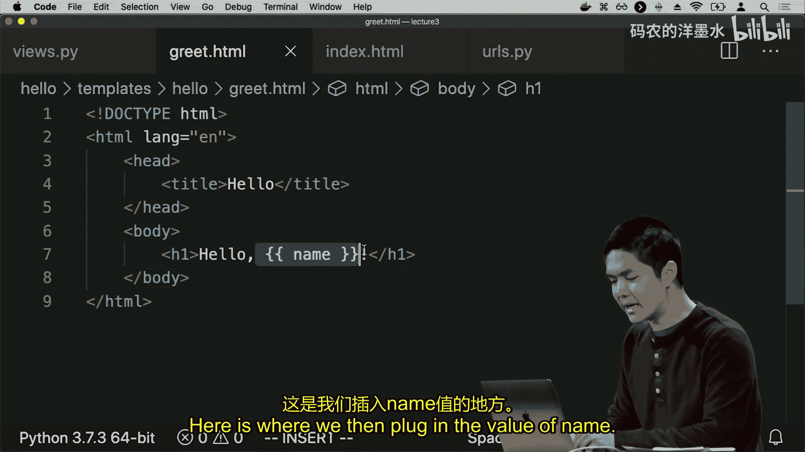

So it's a lot happening across a lot of different files。

 But the reason for all of these various different files is to help keep things separate。

 have one file that is just responsible for URLs and directing people to what should happen when those URLs are clicked。

 Then we have one file used Pi that is entirely responsible for deciding on this particular view。

 what template should be rendered what information should be passed in this context。

 And then I separately have a file for each of my Htl templates that are saying。

 what does the page actually look like And so if you start to begin to think about this separation of components inside of a web application and can help to make the structure of a Django application a little bit clearer。

😊，So we've now been able to use the Django templating language to put variables inside of our H templates to be able to create an infinite number of different routes where I can visit slash hello slash some name in order to display hello to that person's name。

 But the Django templating language is even more powerful than just that。

 There are a lot of additional features that the templating language is going to give us access to。😊。

And we' take a look at a couple of those now。 And to start。

 I'm gonna introduce you to a website you may be familiar with。

 I consider it to be one of the simplest websites on the Internet。

 It's a real website called is it Christmas dot com。

 And if I visit is it Christmas dot com and press return。

 Here's what the website says the website says no， it is not Christmas。

 And you just have to take my word for it if you visit this website on Christmas Day。

 you go to I it Christmas com， it will instead say yes。 And so this website is very simple。

 You might imagine that it's really just an HM L page that probably contains a big heading that in this case just says the word no。

 but on Christmas Day just says the word yes， Now， how might a page like this be implemented。 Well。

 one way you could imagine， is that on Christmas Day。

 whoever maintains the website goes into the H TM L and changes no to yes。

 and then afterwards changes the yes back to a no。 But we can be a little bit cleverer about this。

 if we realize now， that we have the ability to use Python logic to be able to use logic like a condition。

😊。

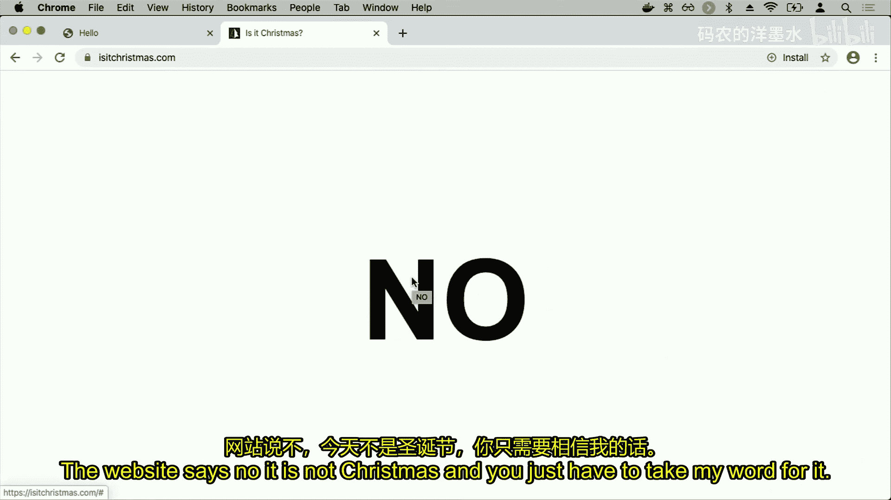

To be able to decide how a web page is ultimately going to be rendered。For instance。

 the condition might be something simple。 like if today's date is Christmas， then render yes。

 else render no。 And so we're going to use django and take a look at some of the features of django's templating syntax to be able to create a website like this。

 We're not gonna create， iss it Christmas we're gonna create， is it New Year's。

 The checks if the current date is January 1 or not。😊，This is going to be a separate app。

 It's sort of distinct from our hello app。 The hello app just says hello to people。 The new Year app。

 for example， is just going to see whether or not it happens to be New Year's， for example。

 So I will now go ahead and create a new app。 And I can do that by writing Python managed Pi Start app。

 and I'll call the app New Year， for example， I'd like to create a new app called New Year。😊。

I've now created that new app， if I type LS， you'll see that not only do I have a hello directory that represents the hello app。

 I now have this new Year directory that represents the fact that this is a new app called New Year。

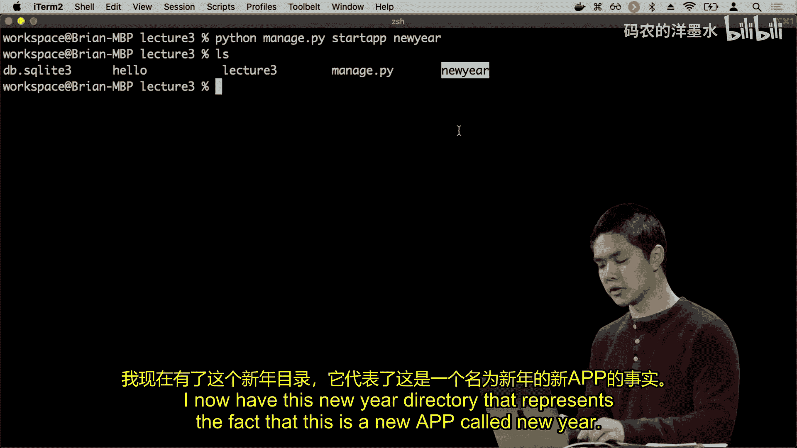

As with before， I'll need to go into Setting。 Pi inside of my project directory。😡。

And add new year as an installed app。 This is now a new app that exists in my Web application。😊。

So it too now needs to be a new installed app。😡，What else do we need to do for new apps， Well。

 I need to go into URLs dot Pi for lecture 3。And just as before。

 I had a path saying when I go to slash hello， then you should go to all the URLs for the hello app。

 Let me add a new path that says that if I go to my application slash new year。😊，Well。

 then you should go to all of the URLs for the new Year file。

 go to New Year's dot URLs representing the URLs dot pie file inside of the New Year's app。 Now。

 that file isn't given to us by default， So we need to create it。

 I need to go into my new year folder。And create a new file called URLs dot Pi。

 And inside of that file， I'll do from Django dot URL's import path from dot import views and then define some URL pattern。

 samee as before， where I'll just have a single path that loads the index function inside of views dot pi。

 And it has a name of index。😊，So again， just mirroring the type of structure that we've already seen before in the hell app。

 This app is just gonna have a single route， the empty route that loads the index function。Now。

 all let's have to do is to actually create that index function。So I go into views thatpi。

 And here now I'll define an index function that takes an HttP request as an argument。

 And now inside of this index function， I would like to add some logic that checks whether or not it's January 1。

 And so how might I go about doing that in Python。 Well。

 it turns out that there is a date time module in Python。

 And you can learn about this just by reading up about its documentation to figure out how it works。

 And the date time module gives me access to things about the date and time。 For instance。

 And I can play around with the date time module outside of Djago just to get a feel for how it works。

 If I just type Python into the interpreter。😊。

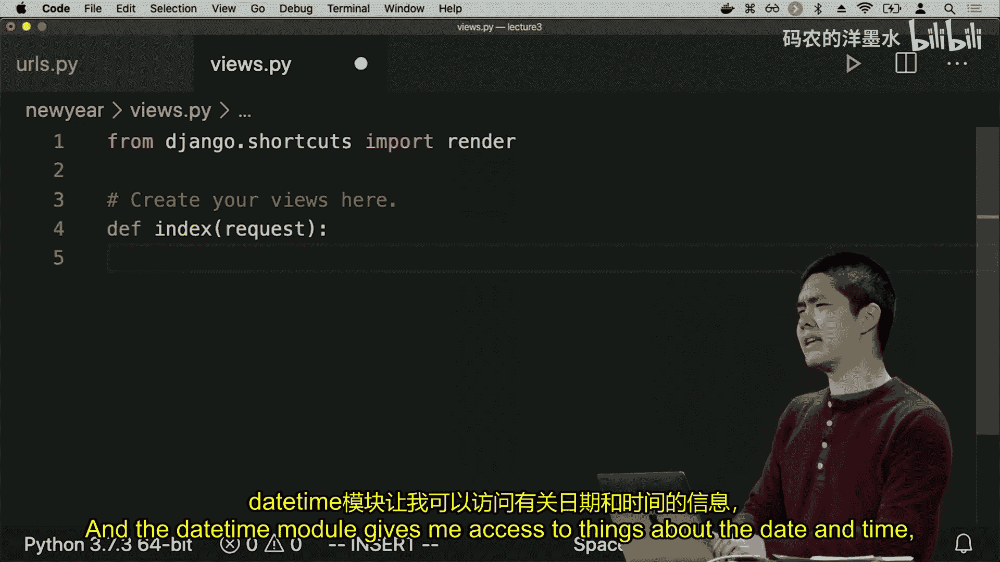

Into my command line， rather， what I get is the Python interpreter that lets me just write Python code just to experiment and test and see what the result of running this Python code would be。

 So I can try like， import date time， for example。😊，And let me create a new variable called now。

 which is date time dot date time dot now。 It just so happens that inside of the date time module is a function called date time dot now that gets the current date and time。

 for example。And so inside of now， I have access to variables like now dot year， for example。

 which tells me the year， now dot month， now dot day that gives me information about the year。

 the month and the day of the current timet based on getting whatever the current time is right now。

 And given that I have this information， you could imagine us constructing a Boolean condition to check whether or not today is。

 in fact。😊，The new year。 and that condition might look like now dot month equals one and now dot day equals1。

I can press return and see that， okay， the result of this condition is false。

 It is not true that both the month and the day are true or are one rather。

 And so using that sort of condition， I can now take that and adapt it into my Dn of view that I'm using the try and render whether or not it's the new year or not。

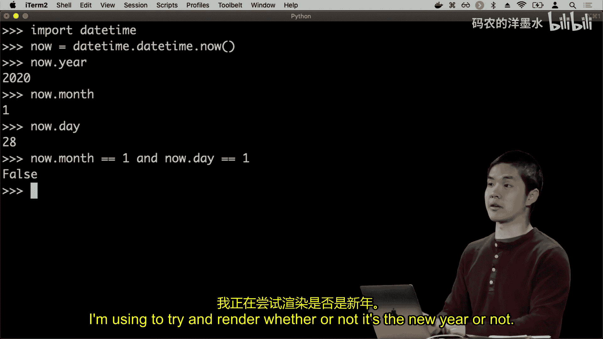

So how might I go about doing that， Well， what I'd like for my index function to do is return。

 render a template。 The template will be called New year slash index dot H T M L。

And then what context would I would like to provide to this template， What information。

 What variables do I want for this template to have access to？ Well。

 I wanted to have access to a variable thatll just be called New Year。And in order to access that。

 I need access to the current date， So or do that。 I at the top of my file。

 I'll go ahead and import date time。And inside of my index function。

 let me give myself a variable called now， which is equal to date time dot date time dot now。

And this new year variable that I'm passing in to my template will be equal to now dot month。

Equals 1。 And now dot day equals 1。So if it is the case that after I get the current date and time by running date time do date time do now。

 saving the result inside of this variable called now。

 if both the month and the day are equal to one， then the value of this new year variable is going to be true when the template gets access to it。

 Otherwise， as it is the case today。 and on most days。

 the value of that variable is going to be false。Now。

 all that remains for us to do is to actually create this template。

 New year slash index dot H TM L and have that template somehow use this new year variable in some interesting or meaningful way。

😊，So how do we do that， Well， if you recall what we did with the Hello application。

 when we want a template， then inside of our application， this new year app will need a new folder。

That we'll call templates。Inside of which I'll create a new folder called New Year。

And inside of that， I'll create a new file that will be called index dot H TM L。

Here will be the index that HTML file for this new year application。

The structure will be very similar。 I'll give it a title of， is it New Year's。And inside the body。

 now here's where the interesting logic is， sometimes I might want a big H1 that says yes。😡。

Other times， I might want a big H1 that says no。 And what I need to do is conditionally decide when to say yes and when to say no。

And inside Djaing's templating language。 And again。

 you'd only know this by reading Djainggo's documentation。

 just as we used double curly braces to say， plug in the value of a variable here。

 the syntax for logic inside of a django template， like conditions is curly brace percent side。

So we use curly brace percent sign， some logical statement。

 and then percent sign curly to include any kind of logic。

And the logic in this case is an if statement。 And this is very Python like， We'll say if。New year。

New Year is the name of that variable that I passed into the template。 And if it is the new year。

 then I want to display an H1 that just says yes。And then， else。Also。

 inside of curly braces and percent signs， I want a big H1 that just says no。So if it's the new year。

 then yes， else， no。 And then Django also requires me to give an n if tag to say this is the end of the if statement。

 Unlike Python itself， that uses indentation to denote when the if statement is beginning and ending in Django。

 the indentation is optional inside of the template。

 But in order to distinguish when the if statement is happening from when the if statement is over。

 we need this n if tag at the very end。

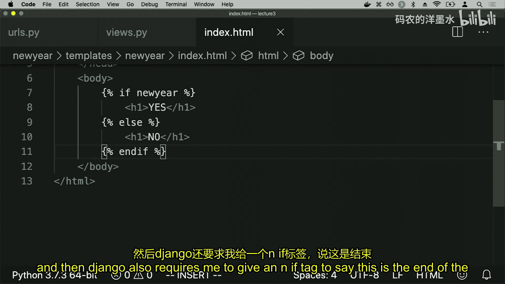

So this here is a condition inside of our Dngo template。

 We're saying if a particular variable is true， then render this in the HM L and else render something else。

 If it's the new year， sayy， yes， it's the new year， Otherwise say no， it is not the new year。

So we can try this out Right now， we're on the route slash hello， slash Ron。

 If I instead not go to slash hello， but go to slash New Year， for example。😊。

The site can't be reached。 Okay， so why did that happen，1，27，00，1 refused to connect。

 So what must be happening is for some reason， my web server isn't running。

 And it turns out that in order to create the new application， I had stopped my web server。

 And so if ever that happens to start it up again， we can just rerun Python managed up high run server to say。

 I would like to now start up this web application again。

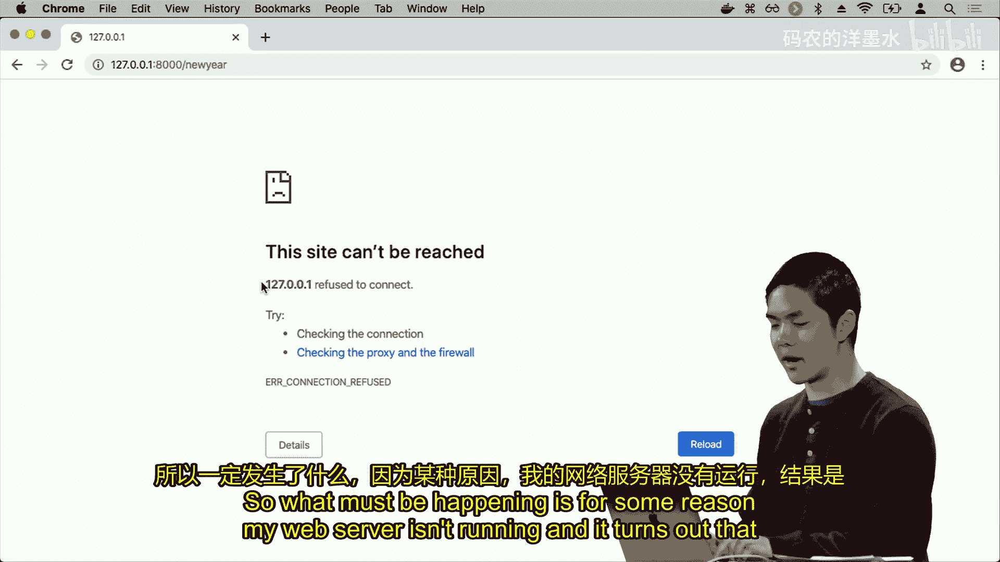

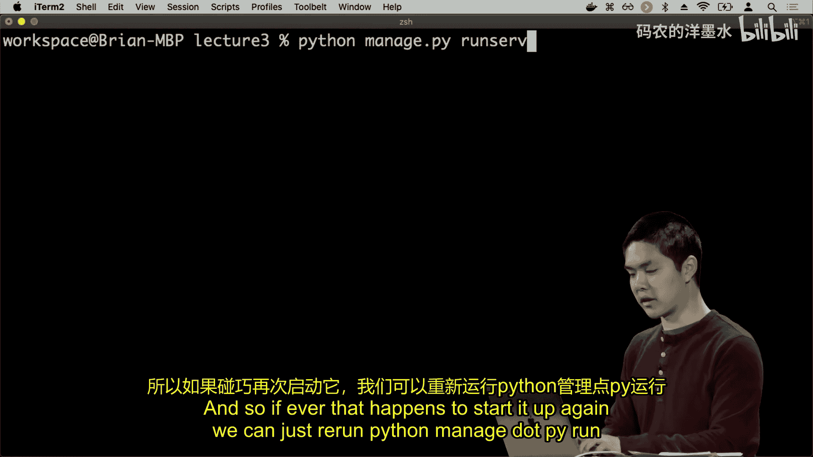

And all right， it looks like now I have another error。 There's some sort of syntax error。

 And the syntax error is in New year slash views of dot pi。

 So let me go ahead and go back into views dot pi and see if I can spot where the syntax error is。

 And all right， it looks like render is a function。

 function arguments need to be enclosed in parenthses。 And while I have a starting parenthesis here。

 I've forgotten a closing parenthesis。 So I'll go ahead and add that。

 And now that will complete the render function。😊。

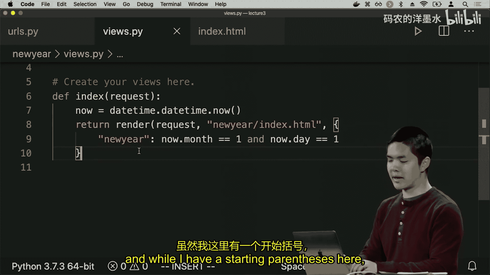

And now I should be able to load slash new year。 And indeed， what I see is that no。

 it is not the new year。 And so what happened is we ran some Python logic。

 calculated the current date and time checked to see is the current month 1 is the current day one。

 And if that's not true， then we're here displaying no。😊。

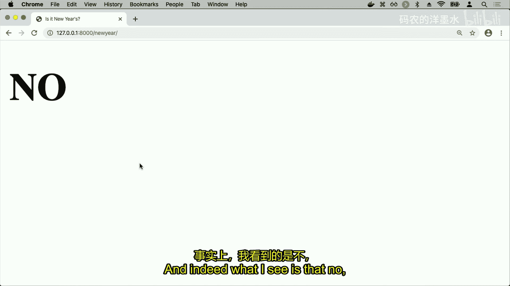

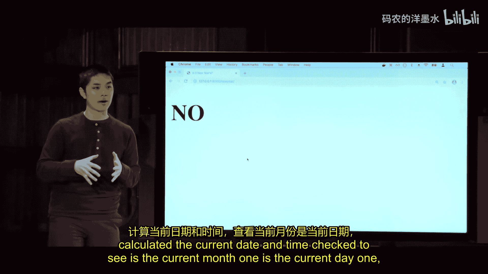

And if we look at the actual H TMl of this page， like what H Tml is actually making up this particular page。

 which I can do by right clicking and control clicking and just clicking view page source。

 This will show me the Hml of this page。 This is the Hl that came back from the web server that my web browser。

 Chrome in this case is rendering。 And what you can see is it looks very similar to the index that Hl template we wrote before。

 but it only contains no， It doesn't contain any of that if logic。 It doesn't contain the yes。

 It just contains the Hml content that we wanted to respond with back to the user。😊。

And so you might imagine based on this that what Djainggo is really doing is taking the index that H TM L template and then manipulating it based on the input we get based on whether or not it's the new year or not to say that if it's not the new year。

 then all we should do inside the body is display an H1 that says no。 And the user when they get it。

 They don't see the conditions they don't see there was another branch that could have been taken。

 they only see the final result of rendering the template with whatever variables and logic and conditions happen to be inside of that rendering process。

 So when the user sees it， all they see is the word no。😊。

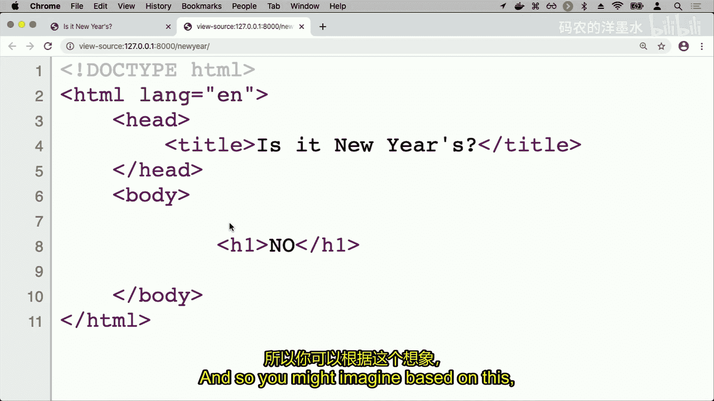

And if we were to run this program on New Year's Day， it would indeed say yes。

 and we can test it just to see what it would be like if that were the case by cheating a little bit。

 instead of now that month equals 1 and now a day equals1。

 let me just go ahead and replace this condition with New Year is equal to true。 just to test it。

 let's try passing in the value true as the value of New Year and see what happens instead。

 And now when I run this page now it does say yes， as we might expect it to on New Year's。

 And so that can be a nice way of just testing what would happen if you were to replace a particular variable with a particular value。

 we can substitute inside the context just for development purposes。

 what value we would like that variable to take on。😊。

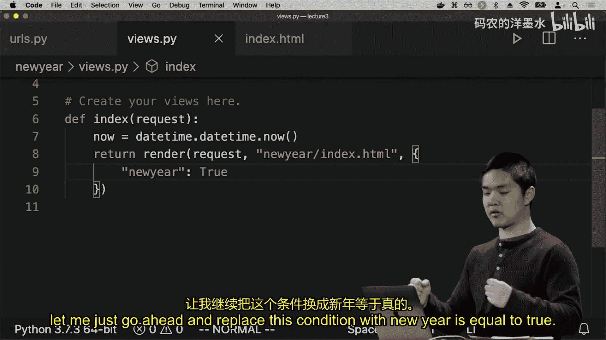

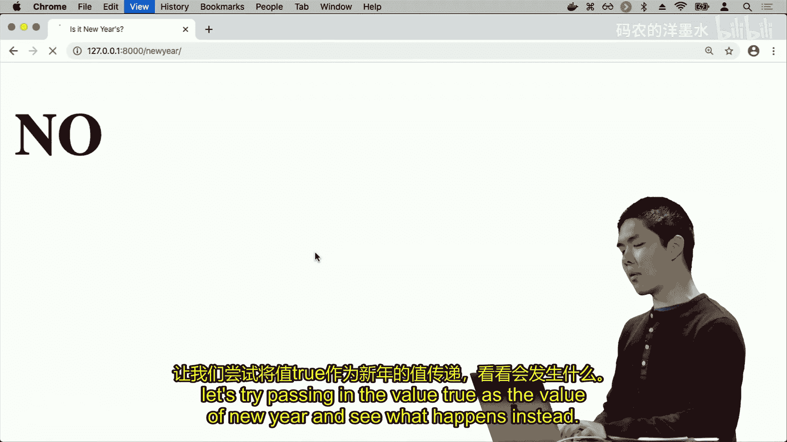

Now， we've rendered H TML， but we haven't really added any styling to this website just yet。

 The real is it Christmas co has the text centered a little bit。

 It's in San serif font instead of having the little serifs or the glyphs at the edge of each of the characters。

 So maybe I'd like to add some custom CS to this file as well。

 And we could do this conventionally the way we've seen it done before by just including a Cs file。

 And that is what we're still going to do。 But Django has a special build system for dealing with what are called static files。

 files that aren't going to change。 The Hml of this page， that's not a static file。

 because it changes depending on whether it's new Year's or not。 if I visited on New Year。

 it says yes， if I visit it when it's not New Year's。 it says no， And so this is a dynamic page。

 But static files， files that don't change like our C。

 the CS doesn't change whether it's new Year's or not。 And because that's files unchanging。

 Django calls it a static file。 And it means that django can be a little bit cleverer about it。

 If you start to think about projects at scale。 you might store。😊。

Your static file somewhere separate， just in some place that makes it easy to access where they're cached for faster reads later on。

 we'll talk about that a little more later in the course as we start to delve into topics like scalability as you begin to build larger web applications on the Internet。

 But long story short， Django contains a lot of features that make it easy for us to deal with static files。

 files that don't change like CSS files。And generally。

 the way that will add static files is inside of the new year folder。

 In addition to having a template slash new year slash index at H TM L。

 we'll also create a new folder called static that will contain all of the static files that we would like to include inside of this application as well。

😊，Inside of static， I'll create a new folder called New Year。

 inside of which is a new file called Styles dot C， S S。And so inside of Skys that C， S S。

 I can now write all of the same C S S that I would want to have written before。

 So maybe I want all my H1s to have a font family of San Serif。😊，I font size of 90 pixels， maybe。

 And I want the text alignment to be centered。 Just a couple of C S S properties and values。

 Sam as we've already seen。 just to say， I would like to give H1 tags this particular style。Now。

 what's left to do inside of index that HML is at the top of our page。

 I'll go ahead and add a command that says load static to mean。

 go ahead and load static files for this particular HTMLM page。And now I'll go ahead and link。

A style sheet。 You'll recall that。This type of command inside the head section of my web page。

 where I would like to link some particular URL as a style sheet is how I add C S S to a page。

But what I'm going to include in here as the link is I'm going to include rather than hard coding a URL。

 which I could do。 Dgo with best practice says that instead。

 let's just say it's going to be a static file and the static file is called New Year slash styleyles do CS。

S。😡，So I'm not specifying exactly what the URL is， but I'm saying it is a static file that is inside of a new year folder called Sts do css。

 and django is going to figure out what that URL ought to be。

 And this is often better than hard coding a specific URL because maybe you might imagine in larger web applications where your static files are might change you might move your static files to a different domain or to a different route。

 And so in order to deal with that。 This static keyword just means django will figure out where your static files are located and we replace this command here in the curly braces and percent signs with the actual URL for this particular file。

 So now that I've said that I want to link this particular static file Sts c into this web page。

 What I might first need to do just to let django load static files is restart the server So you might sometimes need to control C and then go ahead and rerun Python managed up high run server that will rerun the server And now if I go back to thelash new year route inside my web browser Now I see the style look a little more close。

😊。

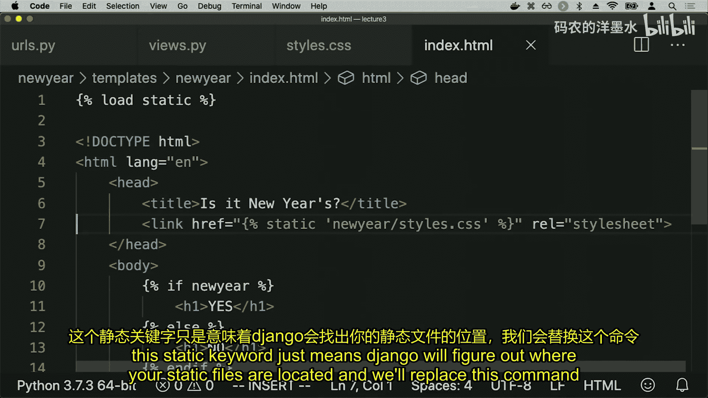

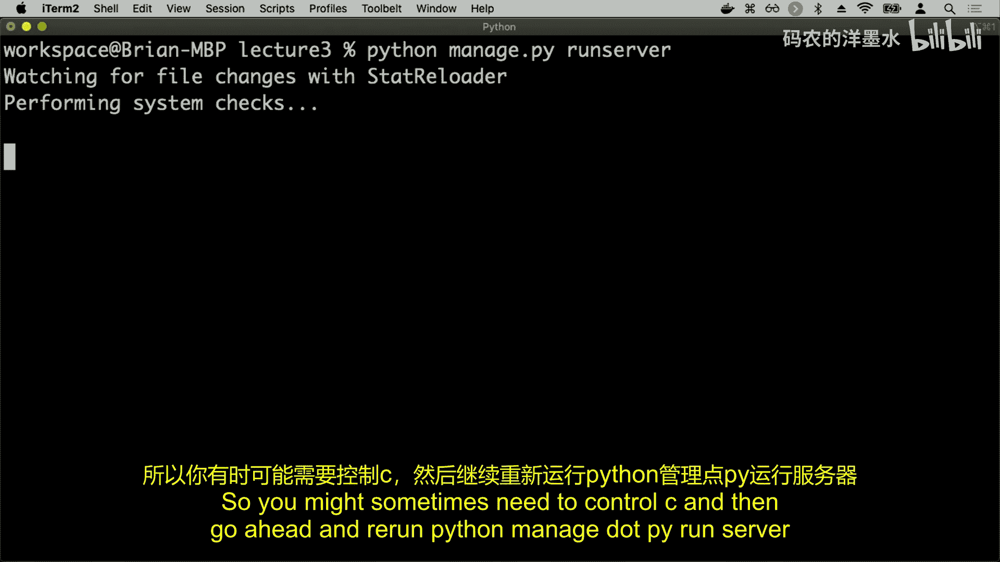

To what I actually wanted it to be centered San serif in a larger font that here just says no。

 And if we look at the underlying H TM L of this page。

 we see that Django is actually for us filled in what the static URL is for these particular static files。

 And by default， Djainggo just uses slash static slash。 And then whatever the files happen to be。

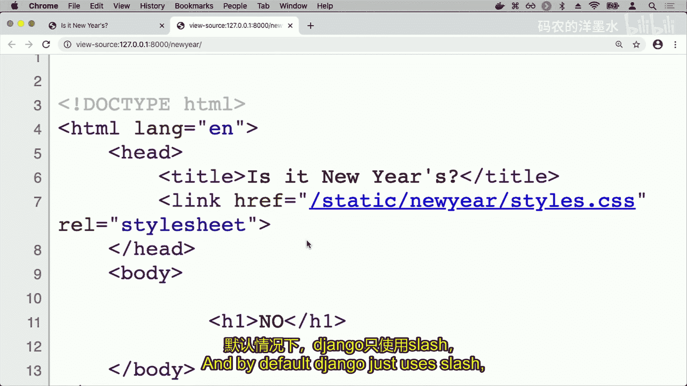

And so anytime we're dealing with static files， files that don't change like C S files or jascript files as we'll take a look at later in the course。

 that's generally where they're going to go as some sort of static file that we're going to ultimately link to this particular page。

So now we've seen a couple of examples of web applications we can make using Django。

 We've seen the hello app in Django that can parameterize URLs that depending on the URL we visit can say hello to Brian or hello to David or Harry or Ron or Hermione。

 And we've seen the ability to using Django， add some conditions to be able to conditionally say if something is true。

 render this page if something else is true， render another page。 Let's now use these features。

 plus some additional features to begin to build a more sophisticated web application something like a to do list that maybe I want a web application that gives me a list of tasks that lets me add new tasks to my to- do list and lets me view all of the tasks that are currently on my list。

 And I'd like to build this up one step at a time。😊，So where can I start with this？ Well， this。

 again， is going to be a new app inside of my lecture 3 project。 I have two apps so far。

 a hell app and a app for the new year。 And now what I'd like to do is create a third app that I'm just going to call tasks that is going to be my task management app that's all under this umbrella lecturec 3 project。

😊，So I'll go ahead and run Python， manage Shop Pi， start app tasks。

 to say I'd like to go ahead and create a new app called tasksask anytime I create a new app。

 a couple of steps I need to follow， recall that I need to go into settings。 Pi。😡。

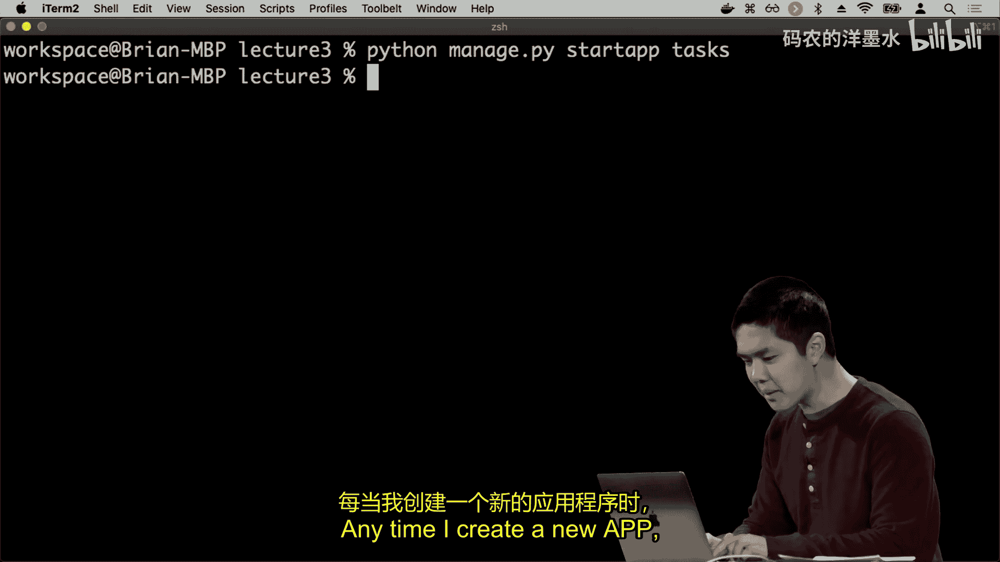

Inside of lecture 3。To say that in addition to installing Ho a New Year。

 I'd also like to install the tasks app， for example。

Then I need to go into URLs dot Pi inside of lecture 3 to say that in addition to hello a New Year。

 I'd also like for us to include the URLs for tasks。 This URLs is again。

 the table of contents for my entire web application where in my web application。

 If I visit slash hello， then we go to the URLs for the hello app。 If I go to slash tasks。

 then I go to the URLs for the tasks app， so on and so forth。

 that tells me all of the different URLs that I now have access to。😊，And as with before。

 the URL's file isn't created for me inside of my application。

 so I will need to go into the tasks directory。😡，And inside of the task directory。

 I'll go ahead and create a new file that I will call URLs dot Pi。

 And the format of this is going to be very similar to what we've already seen from Django dot URLs importm path from dot import views。

 And now I define my URL patterns where I would like a path。That is just the empty string。

 the empty path for now that loads the index function whose name is index， for example。

So now let's actually write this index function inside of used uppi。

What I'd like to do is define a function called index that accepts a request。

And what I'd like to do is render a page that displays a list of all of my tasks。

 So before we get to the idea of adding tasks， let's just see if we can get our program to display a list of tasks。

 for example， So I'll up at the top create a global variable that I'll just call tasks that the entire applications gonna have access to。

 And I'll add three tasks to it for now， we'll just use fo bar and B。

 These sort of nonsense names that are just useful strings for testing purposes。

 Just placing those as sample tasks that I might want to have inside of my application。😊。

And now what I'd like to do is render a template。The template I'd like to render will be called tasksask slash indexdex。

 HTMLtm。And then I'll provide some context to it。 Some information that index dot H TM L needs。

 What information does index dot H TM L need， Well， index dot H Tm L needs access to。

All of my tasks and where are all of my tasks。 while they're inside of this variable。

 that just so happens to also be called tasks。 And this will be something we see quite often as a paradigm in Django。

 where we see a key and a value that look like they have the same name。

 the key distinction is whatever is here on the right after the colon。

 This is the value the variable takes on。 this is a Python variable。

 like this Python variable tasks here on the left， this key， this string tasks。

 that is the name of the variable that the H TM L template will have access to When django is rendering it。

 So Django has access to this variable name on the left that has this value on the right。

 if you see this paradigm that's ultimately what that's going to mean。😊。

And now what I need to do is create this index HTML TM L file and make it use this tasks variable somehow。

How might I go about doing that， Well， I can go back into my tasks directory。

 create a new folder for my templates。So I'll create a templates directory。

Inside of which is a tasks directory， because the template that I'm rendering again is tasks flashlash index do H TMO。

And inside of tasks， I'll create a new file called indexex study HM L。

 inside of which will include some HTMLMl。I'll include just the standard starting H TM L。

 The title will be tasks。 And now we'll have the body of the H TM L page that I want to display all the tasks inside of an unordered list。

 perhaps。 And if you recall from H TM L to create an unordered list。

 It looks a little something like this。 U L starts the unordered list。

 And each list item is an L I tag like item 1， and then item 2 and then item。3。

 something like that gives me an unordered list that has three elements inside of it。

But I don't want to do this now because I don't want to hard code or exactly specify what all of the tasks are going to be。

 What I really want to do is loop over this tasks variable here。

 looping over all of the tasks inside of it and creating a list item for each one of those tasks。😡。

And just as in before， where we could use。If inside of curly braces and percent signs to use a condition。

 likewise， we can use 4 to say something like four task in tasks。

 I would like to display a list item。And then using these double curly braces。

 I'm saying plug in the task here in between these list item tasks。

 I would like to plug in whatever the value of the task variable is。

And then I'll go ahead and end the for loop there。

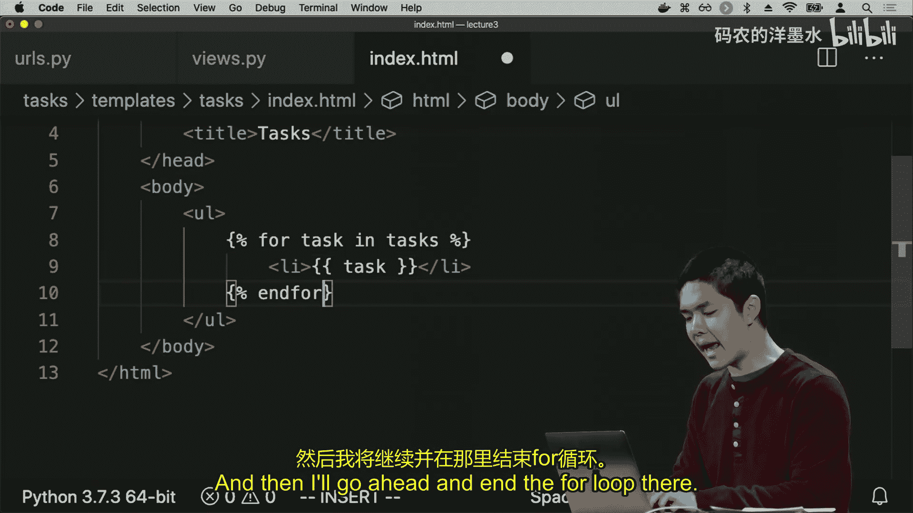

So what I've done here is rather than add a condition into a template， which we've already seen。

 I now have the ability to add a loop into an HML template using Django to say that for task in tasks。

 I'd like to loop over all of the elements inside of this sequence called tasks。

 And for each one of those individual tasks， I would like to display a list item in H TML that includes whatever the value of the task happens to be。

 And N4， just like and if and the F statement N4 is going to end the for loop。So this syntax now。

 rather than give me exactly the same number of list items every time with exactly the same content will be dynamic。

 Whatever the value of tasks is， we will now see on this page， each one as a list item。

And we can test this right now if I actually run this application by going to Python manage dot pi run server。

I'll go ahead and go to this URL， the default URL has no page， but if I go to slash tasks。Well。

 then here's what I see。 I see an unordered list that has fo， bar and baths。 Each one is a list item。

And if I view the page source to see what the actual H TM L is， here's what I see。

 I only wrote one LI tag inside of my template。 But because I put it inside of a for loop that iterates over each of the tasks。

 what I ultimately get in the H TM L that comes back to the user is one list item for each of the elements that was originally inside of that list。

😊。

So I now have the ability to loop over a list in order to generate that list of tasks。Of course。

 there is still no way to like modify any of these tasks。

 What we have here is just a fixed list of tasks that just so happens to be rendering using a loop。

 What I may be like is another page that will allow me to add in new tasks。

 a form effectively that lets me type in a new task and press add in order to add a new task。

So let's do that insideside of U stop Pi， I'll define a new function that I'm going to call add。

And what the addd function is going to do。😡，Is render？Tasks slash add dot Html。

In order to know when to run the few， I need to give this view a URL， so I go into URL。

pi and add a new path。😡，When I go to the add route， I want to go to the View。 add function。

And I'll call this function ad， for example。And so now， when I go to slash task slash addd。

 it's going to call the add function inside of views。And inside of use here。

 it's going to run this function that will render add dot HtMl。So let's go ahead and now write add。

htm。😡，We'll go into templates。 I'll create a new file called add dot H TM L。

 And you know what add dot H TM L syntax is very similar to the syntax from index dot H TM L in terms of what the HM L content is。

 So I'll go ahead and just copy this whole page from index do H TM L， paste it into a dot H TM L。

 the only thing that's different is the body of the page where instead of an unordered list that displays all the tasks。

 And instead like a form。Where that form has an input whose type is text。

 and maybe this input field has a name called taskask such that I can access that input data later。

And an input whose type is submit， for example。And maybe I'll give it a big heading at the top that says。

 like。

Add task， for example。So I have a new route that adds a task。

 so my default slash tasks route just displays a bulleted list of all the tasks。

 And if I go to slash tasks slash add here now is my form that gives me a place where I can type in a task。

 press submit that right now does nothing but that ultimately I hope will actually add a new task。

Of course， something I just did there should strike us as not the best design。 in particular。

 the decision I made was because the general structure， this HM L page is so similar。

 It's got the HM L tag。 It's got head。 The title of the pages tasks。Ultimately。

 I just copied all of the content of indext H TM L and pasted it into this new H TM L page。

 add dot H TM L。 And any time you find yourself copy pasting。

 this should be another area where you start to think that probably a better way to do this。

 And with just pure HM L， there kind of wasn't。 if we wanted multiple different HM L pages that displayed similar content。

 We needed the same H TM L on all those different pages。😊。

But now in the world of drngo， we have the ability to use something called template inheritance。

 What I'm now going to do is define an H TM L file called the layout。

 just some file that the other files add dot H TMl and index dot H TM L are going to inherit from。

 They're going to inherit from my layout。 All of the structure of the page that's the same on both of the pages。

 And all I' then need to write is what differs between the pages。 And as I mentioned before。

 the only thing that differs between add dot H TM L and index H TM L。😊。

Is the content of the body of the page over here。So what can I now do， Well。

 I will create a new file inside of my template slash tasks directory。Called layout dot H Tml。

And layout is going to have。The basic layout that is common to both of these pages。 I have a title。

 whose title is tasks。 I have the body of the page。

 and maybe there's more in common with both of the pages as well that I could add。 But right here。

 this in between the body tags， this is the body of the page that is going to change between each of the different pages。

So to denote this inside of layout in Django， I'll again use the curly brace and percent signs。

 I'll call this a block， and then I'll give this block a name。

 I'll call it body just because it's the body of the page， but I could give it any name。

And then I'll add an end block。😡，At the bottom here。

And so what I've now said inside of this layout file is that this layout file has a body inside of this structure of the page and inside the body is this block called body and what I'm saying here is this block might change depending on which file we're using add do Hm or index dot HTML。

 the rest of the structure won't change， but the content of this block。

 this block called body might change。😡，And so now what I can do inside of index dot H T M L and add dot H T M L。

Is instead of including all of this logic， I can get rid of everything other than the key part of the page that's going to be different about index dot H T L。

 The only thing different about index dot H TM L is this unordered list。

And what I'll now include at the top of index at H TM L is I'll say that this H TM L page extends。

Tasks slash layouthtm。So this is now this idea of template inheritance。

 I'm inheriting from the layout at H TM L template， basically saying。

 use the layout at H TM L template， except。Inside of block body。I would like to include。

All of this content。And maybe I'll give it a H1 that just says tasks， just as a title as well。

And so now what index dot H TM L is saying is rather than need to include all of that H TM L。

 All I need to say is this H TM L file is based on the layout dot H TM L file。

 But the difference is that inside the body of the page。

 it's going to be this particular content here。And for a dot H T M L。

 I can do exactly the same thing。 I can just add this line， extends tasks。

 slash layout dot H TM L to the top of a dot H TM L。

And then I can get rid of all of this boilerplate code， so to speak。

And just include the part of the page。😡，That differs。Inside。The body of the page。

And so it seems like we've done a fair bit more work for just these two pages。

 But if you imagine more complex websites and might have dozens or hundreds of different pages。

 the ability to factor out the H that pages have in common can definitely be very helpful just for good design to be able to make sure we're not repeating ourselves。

 And if we ever need to change the structure rather than change it in dozens or hundreds of different places。

 we just change it in one place inside of the layout file And the result of that is that it's going to change in each of the pages that inherit from that page as well。

😊，And we can test this by just going back to slash tasks slash add。

 which looks fine and back to tasks looks fine。 too。

 Both of these pages now are inheriting from that basic layout。😊，Now。

 it's a little annoying that any time I want to switch between this page and the ad page。

 I have to go to the URL and know that I need to go to slash tasks slash add in order to get back and forth between them。

 So I might like to add a link that takes me from one page to the other and vice versa。

 And I can do that。😊。

If I go into index study HTML T， you might imagine that I could just add a link here。

A H ref to create a link。 Let's go to slash tasks， slash add。

And like add a new task be the name of that link。Except the problem is。

 the reason why this isn't necessarily good design is the Django is designed to make it such that it's very easy to change the structure of the pages in terms of how the URLs all relate to each other。

 And I have here hard coded that when you click this link， we go to slash tasks slash addd。

 And if ever I wanted to change that URL。 maybe instead of slash slash add。

 I wanted slash new instead of slash addd。 Well， then I'd need to change it in two places。

 I'd need to go back to the URLs pfi to change the actual URL to say instead of add。

 it should be called new。 But then I need to find every place where I use that URL。

 and I'd need to change it there as well。😊，So in order to deal with this。

 Django has an additional feature that basically lets Django figure out what the URL should be instead。

 And we do that by using the name that we gave to each of those routes。

 And so this is where that name becomes relevant that I can hear just say。Link to a particular URL。

Linkked to the URL， called add。So I just said link to URL called add。

 And how django figures this out is based on the contents of my URLs dot pi file that inside my URLs do p file。

 I defined a number of different paths。 And I gave each of those paths a name。

 This one was called index。 This one was called add。 And so when I did that。

 I was able to say if you link to a URL called add。

 Django will find a URL whose name is a and link me directly to that route。

 And so if ever I were to change the route to something else。

 Django would just figure out what the new URL should be。 And I wouldn't have to worry about it。

 Djago would fix the problems for me。

And so now if I go back to the task site。I can click the add a new task button。

 and that will take me to the add task。

And maybe now I'd like to add a link that goes back so I can go to add dot H Tml。

And maybe add a link down on the bottom。 A H F equals And what URL would I like to link to。 Well。

 my default page was just called index。 So I go ahead and include the word index。

 I'd like to link to the URL index。And then。View tasks， maybe as the name of the link。

So now if I go to just the default tasks page， I see a link to go add a new task。

 and now I see a link that's going to take me back to the ability to view tasks。

 And when I click on that link， I see no。AndNow that's probably not what I wanted。

 I wanted to go back to the index page for my tasks application。

 but it seems that when I clicked on view tasks， I'm taken to no。 And what's going on here。 Well。

 if you look at the URL， the URL is flash new year。

Somehow， I was on the tasks app。 I clicked a link， and I'm back at the New Year app。

How did that happen？ Well， it turns out this is an example of a namespace collision where I have two things that all have the same name。

 And in this case， what's happening is that I have a URL p file for my task application where I have a route called add and a route called index。

But it just so happens that inside of the new year folder。 if I go up to New year。

 and I look at New Year's URLs p file， the New Year's URLs file also has a path whose name is index。

 And so what I said was create a link。 And I would like that link to link to the thing that has the URL with a name of index。

 And it turns out there were multiple things that all had a name of index。

 And so Janejago didn't know which to choose。 And it just chose the new year1。

 And you might imagine that linking between apps is something you might reasonably want to do。

 You want to from Amazon's shopping page， for example。

 be able to click a link that takes you to Amazon video or you want from Google search to be able to click a button that gets you to Google Maps。

 But in this case， this isn't quite what I wanted。 There's a namespace collision or two things have the same name that I would now like to be able to fix。

😊，And the easy way to fix this is inside of URL's dot Pi for my tasks application。

 Let me just give each of these URLs an app name called tasksask。

This just helps uniquely identify all of the URLs because now， inside of a dot H TM L。

 rather than just link to a URL whose name is index。

 I'm going to instead link to tasksask colon index to mean from tasks， the tasks app。

 get the index URL。 And likewise， inside of indext H TM L a link to tasks colon a to get that particular route from this particular application name。

😊。

So now， if I go back to the site， go back to my tasks page。 now the links work is expected。

 I can get to the new tasks， and I can get back to the list of all of my tasks as well。

So this now works。 I now have these two pages， one that displays my list。

 one that displays my ability to add a new task， but the form to add a new task doesn't really do anything right now。

 I type in a task。 I type in like fo。 if I want to add a task called Fo and I press submit。

 and like nothing happens。 Nothing changes meaningfully on this site。

 So I'd like for this form to do something。 And we've seen that we can add an action to a form to be able to take that form and submit it somewhere。

 And that's what I'd like to do。

When I add a new task， I'm going to add an action to this form。 And when I submit the form。

 what URL would I'd like to submit it to。 Well， I'll go ahead and submit it back to。

The URL for tasks， colon ad， I'll send it back to that ad URL when I submit the form。

And I'm going to give this form a specific request method。 Its method is going to be post。

And so we've already seen a request method of get。 Anytime you type in a URL or click on a link to go to another page。

 the request method implicitly associated with that request is called get。

 which just means I would like to get a particular page。

Anytime you're submitting data that has the potential to change some state inside the application。

 like changing the state of the list of tasks that is stored inside the application。

 then we'll generally use a different request method called post。😡。

Post is generally used for submiting form data。 It doesn't include parameters inside the URL。

 the way it get request does， as we saw with Google， for example。

 But this post ability is going to give us the ability now to send data via a different request method to my ad route。

And so let's now give this a try。Now I'm going to go to taskask slash ad。

 I see the ability to add a task， and maybe I'll add a task like check email or something and press submit。

And all right， I get an error forbidden。 This 403 and parenthesesis means that is the response code that came back。

 This is an error that django is generated for me。 So this 403 as we saw before， means forbidden。

 I don't have permission to do this for some reason， Now。

 why don't I have permission to submit this form。 It says C SR verification failed。

 So C SRF stands for crosss request forgery。 And what that means it is a security vulnerability that is inherent in some forms that they're not designed in a secure way。

 meaning that someone could forge a request to a particular website using some form on their own separate website。

 for example， you might imagine that someone on a different website might trick the user into submitting a form that submits its data to our add task function that adds a new task to their task list。

 And maybe that's not a big deal for task。 but you might imagine in more secure context。

 more sensitive context like a bank， for example， they might have a form on their website for transferring money from one user to another。

 And if they're vulnerable to this sort of。

cross site request forgery， Someone else on a different website could trick the user into submitting a form where it submits form data。

And that goes to the bank's website to say， I would like to transfer money from this one user to another user。

 So we would like to be able to design forms that are not vulnerable。

To that particular security vulnerability that don't allow for requests to be forged by another website。

So how can we go about doing this？ Well， one strategy that can be used in order to deal with these tor sorts of attacks is to add into our form a hidden crossite request forgery token or CSRf token。

 which will just be some unique token that's generated for every session。

 So every time a different user visits this particular form， they see a different CSRF token。

 And then when the user submits the form， there're submitting that token with the form and our web application is going to check to make sure that that token is indeed valid and if it is valid。

 then they'll allow the form submission to go through。

 but this means that an adversary wouldn't be able to fake a request to our website because that adversary doesn't know specifically what the generated token is。

 so they would fail the check for CSRF validation。And it just so happens that Django has CSRF validation turned on by default。

 and it's done so via a specific add on known as Django middleware。

 Middleware refers to the ability in Django to be able to sort of intervene in the request response processing of a Django request。

 And if I look at the settings do pi file， if you're curious for this particular web application。

Inside of settings up high， if we scroll down， we see there's a whole bunch of middleware that's installed by default inside of a Django application in terms of making sure that we have various different features hooked into this request response processing and one of those is the CSRF view middleware。

 this feature of Django that allows it to make sure that our request whenever we're submitting data via post。

 something that has the potential to change the state of the application in some way that we need to have CSRF validation。

 we need to add some sort of token to our form to make sure that Django is able to authenticate the validity of this form to make sure they know the form actually came from the web application itself。

And it's quite easy to be able to add this token into our HL page。

 Djainggo has it built in inside the curly brace and percent sign。

 we can just say I would like to add into this page， the CSRF token， for example。

 to go ahead and fill in the CSRF token right there。

If I now go back to the page and refresh the page。Now I see add task， but if we're curious。

 I can actually go and view the page source。 I can look inside this page。 And here now is the form。

 And this is the form same as we saw before。 but you'll notice that Django has inserted this additional input field。

 This input， whose type is hidden， meaning we won't be able to see it normally。

 whose name is CSRF middleware token and here is its value。 some long string of characters。

 that Django has generated for me such that when I submit this form。

 it's going check to make sure this token is valid。 And if it doesn't find this token。

 it is not going to accept my form submission。 And if someone else goes to this website。

 they are going to see a different token presented to them as well。

 And that helps to make sure that nobody can forge these sorts of requests。😊。

So now if I type in a task that I'd like to add something like check email and press submit。

 Now the form does submit without errors。 Of course， it doesn't do anything。

 If I go back to my task list， it's still empty， but at least I've now been able to submit that form。

It's worth noting that inside of a H TMl， we created this form sort of from scratch。

 I created an input field whose type is text and whose name is task。

 But creating forms is something that happens so often in the world of web programming。

 Oftentimes with many different fields that you might want to change over time。

 The Dringos added a number of ways to make it easier to create forms to validate the data inside of those forms just to make our lives a little bit easier when it comes to dealing with and interacting with forms。

 And so now we'll explore an alternative way of doing the same thing。 What we did here just works。

 We can create a form just using raw HM as we've seen before。😊。

But Django also has the ability to create forms for us。😡，So in order to do this。

 I'll go into View do Pi and at the top add from Django import Form。

And now I'm going to create a new class to represent this form。

 I'll create a Python class that I'll just call new task form。

 since I'll use it to create a new task。 It will inherit from forms。 form。

And now inside of this class， I need to define all of the fields I would like for this form to have。

 all of the inputs that I would like the user to provide。

 And so I want them to provide the name of a task， which will be a character field or a char field。

 meaning I want the user to type in characters， and I can give this a label。 call it new task。

 for example。And now what I can do is when I render a dot H TMl， I can add some context and say。

 give this template access to a variable called form， which will just be a new task form。

 I'm going to create a new task form， Pass it into this a dot HtMl template。

And now inside of add dot HtML， instead of writing the input whose type is text name is task and having to do that on my own。

 I can just use double curly braces and say， plug in the form here and that will automatically take care of Django will generate the necessary HTMLML to make that form work。

So if I refresh this page。 now I see that here is the form the Django is created for me。

 It's created in an input field It's given it a label of new tasks。

 so I know that it's where a new tasks should go。 but now rather than needing to edit the HTML。

 anytime I want to change the form data that's involved inside of this application。

 I can just change this new task form。 if maybe I want to eventually make upgrades to my application where in addition to specifying a text field where I can type in the new task。

 maybe I also want to be able to specify a number indicating the priority that task should have。

 I could additionally give this form access to a priority variable。

Which is an integer field。Whose label is priority。 And I can even add constraints on this to be able to ensure that it's valid data。

 I can give it a min value of maybe 1 and a max value of 10， for example。

 in order to add all of that。 And now， without touching anything in my H TM L。

 I just changed the form itself inside of my Python code。 Now， if I refresh the page。

 I see an additional field， I see an opportunity for me to type in a new task。

 And I see an opportunity for me to specify some priority。 And， of course。

 you could add CS in order to style this up a little bit nicer。 But now。😊。

Jingle will automatically do client side validation， where if I type in a new task， like check email。

 but I don't specify a priority and submit it。 It tells me to fill it out。

 If I type in a number that's in an invalid range， I only want numbers from 0 to 10， It fills it out。

 And this is all what we would call， again， client side validation。

 The server isn't getting any of this data。 It's just the web page has been encoded to know what the valid values are。

 and it's going to constrain me to make sure that I'm typing in something that matches those values。

 But in general， when we're doing form validation。 when we're making sure that forms are valid data。

 We want to somehow make sure。😊。

To include not only client side validation， but also server side validation。

 we also want to check on the server to make sure that inputs are value valid as well。

 because there are many reasons why this we might want to be able to do this。

 one is that it's very easy to disable this sort of client side validation or just submit a request without doing any of the client side validation And maybe if the user is looking at an old version of the page。

 The validation we're doing on the server is more up to date than this client side validation as well。

 And Django's forms will make it very easy for us to do both of these things。

 Both the client side validation and the server side validation as well。😊，So how does this work。

 How do we do that， Well， inside of the add function。

This ad function now gets called in two different ways， depending upon the request method。

 If I try to get the ad page and by just clicking on the link for add a new task or going to the URL of slash a。

 then I want to just render a new blank form。But if I post data to this page by using the post request method instead of get。

 that means I'm submitting the form， and I now want to submit a new task to be added to my list of tasks。

So I'd like to add a check for that。I'm going to add a condition here that says。

 if request dot method。Equals post。Well， then here。

 what I'd like to do is process the result of that request。

 And the way you do that in a Djainga form is by creating a new variable called form。

 which will be a new task form。 And if I just use new task form with two parentheses like I did before。

 that creates a blank form。 but you can also populate that form with some data。

And if I populate it with request dot post， what that is going to do is request do post contains all of the data that the user submitted when they submitted the form。

And so what I'm doing now is I'm creating a form variable by taking all of that data and filling it into this new task form。

 which will contain now all of the data the user submitted。

 And you can imagine checking this manually。 But I can just call if form。😊，Dot is valid。

And inside this if statement， view some logic using the cleaned data as a result of using this form。

And so inside of a variable called For dot cleaned data。

 that will give me access to all of the data the user submitted。

 And so if I want to get like what task they submitted。

Because I had a variable here called task inside of any new task form。Well， I'll just go to form。

clean data。And then， task。And I'll go ahead and save this inside of a variable called tasksask。

And now what I might like to do is add this task to my list of tasks。 Go tasks， dot append。

This new task。So that's what we do if the form is valid。 If the form is valid。

 we take the data from the form， get the task， save it inside this variable called tasksask and add it to my growing list。

But else， if the form is not valid。What should we do instead， Well， then I should return。

The ad dot H TM L file again。 But instead of providing the form back to them。

 the a new form back to them， I'm gonna send back the existing form data back to them so we can display information about any errors that might have come up as well。

So what does this now look like， let's show an example and then I'll go back to the codes you can see in better detail how it works。

Here's task slash add。 recall that if I type in a task like check email and a priority that's not valid out of range。

 like 11。And press submit， it says value must be less than or equal to 10。

 But let's now imagine a situation where the client and server are validating different things that maybe I've now decided。

 you know what， priority instead of being from 1 to 10， can only be from  one to 5。

 That's now the valid range for priorities。 But this client。

 which is still an older version of the page， doesn't know this。

So it thinks that a priority of  eight is still valid and it's going to pass client side validation。

But now I press submit and the server is going to process it。 And because it's invalid。

 it gives me back the form and gives me an error to ensure this valid value is less than or equal to 5。

 And so this now is why we generally want both client and server side validation to make sure that the data we ultimately get is going to be accurate and it' going to be clean。

 matching whatever specification we send out when we were creating that form for the first time。😊。

And so for the purposes of now， we're not gonna to really worry about priority too much because we just really care about what the task is。

 but just know that if you wanted a form that had multiple fields。

 you could add additional fields to this form input as well。

So now we've added some application logic to our route that checks to make sure that the form is valid or not。

 If we take a look at what the ad function is really doing。

 we're checking if the request method is post， meaning if the user submitted some form data。

 then we figure out all the data they submitted and save it inside this form variable。

 We check to see if the form is valid。 Did they actually provide a task or they providing all the necessary data in the right format。

 If so， then we get the task and add it to the list of tasks。 Otherwise， if the form is not valid。

 then we go ahead and render that same a do HMl file back to them。

 but we pass in the form that they submitted so that they can see all of the errors they made。

 they can make modifications to their own form submission if they'd like to。And then otherwise。

 meaning if the request method wasn't post at all， if the user just tried to get the page rather than submit data to it。

 then we're just going to render to them an empty form。

 And this sort of paradigm is actually quite common when we're dealing with requests and responses that oftentimes pages that have forum will want you to first be able to get that form via the get method to just get the page in order to display the contents but those routes will also often support a post method where you can post data to those routes in order to say I would like to now submit data to a particular route in order to get some sort of results。

 some sort of addition to a list of tasks transferring money in a bank from one account to another。

 for example， or something else entirely。😡。

But watch what happens if I now try inside of tasksask a to add a new task that's valid。

 something like check email， for example， I press submit。 and allright。

 nothing quite seems to happen because I just get back this new task form。

But if I go back to view tasks， now I see that check email has been added to my list of tasks。

 The original list of tasks just had Fu barbas。 and now we've added check email to it。

 But this wasn't quite the behavior that I might have expected。

 Maybe I wanted that after I submitted the task form to add a new task。

 I would like to be redirected back to this page as well。

 And it turns out Django makes it easy for us to be able to redirect users from one page to another。

In order to do that。After we add a new task to my list of tasks。

 I'm going to return an H T TP response redirect。😊，And redirect the user to a particular route。

 I could redirect them to just like slash tasks， for example。 But again。

 we generally try not to hard code URLs into our application。 So better design would be to say。

 let me give you the name of the route。 And go ahead and reverse engineer what the route actually is from that。

 And so in order to do that， we can use the function called reverse built into Django。And say tasks。

 colon index to say figure out what the URL of the index URL for the tasks app is and use that URL as the one that we ultimately redirect to when we return this H T TP response。

 redirect in order to use these， we need to import both of them。 So from the top。

 I'll say from django dot H T TP， import H T TP response redirect。 and。From django do URLs。

 I'll go at and import reverse。 So I've imported both of these。

 And now the effect of this is that after I submit a new task and add it to my list of tasks。

 I'm going to be redirected back to the index page of my tasks application。 And for good measure。

 I'll go ahead and start us off with an empty list to get rid of the food bar bath that we saw there originally。

 So tasks start out as the empty list。😊。

Now Ill refresh the page。 I see no tasks in here by default。 But if I add a new task。

 I type in something like check email， press submit。 I now see that added to the task list。

 and I get redirected back to the task page。 I can add a new tasks， something like do laundry。

 press submit。 and that gets added to my task list as well， too。

 So by maintaining this global variable called tasks and updating it。 anytime I submit the form。

 I've been able to dynamically grow this list of tasks inside of my application and display all of those tasks here inside of my H TM L page。

😊，However， there's still one big problem with the application that I've built。

 and it goes back to the idea that I've stored these tasks inside of a global variable。

 This variable is something the entire application has access to。

 which means that anyone who visits my website is going to be able to see the same exact list of tasks。

 And we can simulate this by imagining someone else visiting this URL。

 which I can simulate in Google Chrome by opening an incognito window to simulate a different session。

 a different person interacting with the page and going to the same URL。😊。

What they see when in the incognito window， they go to the same URL is they see the exact same list of tasks。

 Both me and another person see the same list because there's just one tasks variable across the entire application it is shared among all of the requests that come in to that particular application。

 And that's probably not what I want when I'm dealing with something like a list of tasks。

 I probably want it to be per user， such that if a different user visits the page。

 they have their own list of tasks as well。 And so in order to do this。

 will introduce the concept of sessions in D django or in the web more generally。

 where sessions are a away for one django to be able to remember who you are。

 such that on subsequent visits， it remembers who you are and knows who you are。

 But more importantly， it's able to then store data about your particular session。

 It's able to store your user I or information about you or in this case。

 it's able to store all of your tasks。😊。

And so in order to take advantage of sessions。Instead of having a global variable called tasksask。

 we're going to go ahead and delete this， and instead store tasks inside of the user's session。😡。

So inside the index route， I'll include a line like this。

I'll check to see if tasks is not in request dot session。Meaning。

 if I look inside the session and you can think of the session as like a big dictionary representing all the data we have on file inside the session about the user。

And if tasks is not in that session， well let me add to request dot sessions。Re session， tasks。

 and set that equal to the empty list。And so what I've done here is I'm looking inside of the session。

 I'm looking inside the session to see is there already a list of tasks in that session。

 And if there isn't， if there isn't already a list of tasks in the session， well。

 then I'd like to create it。 Then I'd like to set request that session square bracket tasks equal to the empty list。

 If the user doesn't already have a list of tasks， go ahead and give them an empty list of tasks。😊。

And now here in tasks， instead of rendering the variable tasks which no longer exists。

 I'll render a request dot session。Tasks to pass in that list of tasks to this particular template。

And now in index at HTML， we're still looping over to that list of tasks。

 and now we'll see if I go back to tasks， I see no such table Django underscore session。

So this is a bit of a stranger。 What's going on here。 No such table Django underscore session。 Well。

 it turns out， as we'll see in the future， Django tends to store data inside of tables。

 and we haven't yet gotten to what that ultimately means or how to manipulate or interact with data stored inside of tables。

 But Django stores data about sessions it would happen。 inside of a table by default。

 you can change this to have Djago stored data about sessions elsewhere。 But ultimately。

 Djago is keeping data about who you are and what your tasks are。

 And that data needs to be stored somewhere。 And by default。

 Django wants to store it inside of a table。And right now， that table doesn't exist。

 So we need to create it。 And the way to give Django access to that table that it wants to create that hass been waiting to create when it hasn't yet is to run this command inside the terminal。

 Python manage dot pi， migrate。We'll learn more about what that means in terms of what a migration is and what it means to migrate data into a database。

 But for now， just to know that Python managed migrate will allow us to create all of the default tables inside of Django's database。

 Next time， we'll take a look at actually creating databases of our own and adding tables of our own that store our own custom data。

 But Django has some initial default tables that it wants to create and running Python managed migrate allows for those tables to be created。

 Now that those exist。 I first need to run the server。 So Python managed up Pi。😊，Run server。

I load the page。 And here now is my list of tasks。 There's nothing here。

 So when I loop over all the list items， it's sort of empty。

 which maybe isn't the best user experience or user design。

 So what I might want to do is add an additional condition。 It turns out inside of index dot H T M L。

 whenever I have a for loop inside of a Django template。

I can also add an empty condition to say， if I run the for loop。

 but it doesn't run at all because the sequence is empty。 Well， then let me just say like no tasks。

 for example， And this is just a nice to have feature of the Django language that just makes it easy for us to be able to deal with situations where we're iterating over a list。

 And there's nothing in that list。😊。

So now I refresh the page， no tasks， exactly what I would expect to see。

And now this index route seems to be working fine。 What now needs to change when it comes to adding a new task。

Well， rather than append the task to my list of tasks， let me go ahead and say request。

 sessionession tasks。😡，Because that is my list of tasks。 And let me add two request session tasks。

 this new task。 I'm adding to it a new sort of adding a list to the end of it that just contains the one new task that I got from the form。

😊，So when the form is submitted， we check to make sure the form is valid。

 We get the task the user submitted， and we append that to the list of tasks that's already stored inside of the session before redirecting the user back to the index page。

So let's give it a try。 We'll go back to this URL， Back to tasks。 I see I have no tasks initially。

And now I can go ahead and add a new task。Type in something like， check。你呢？Press submit。And allright。

 now that's added， add a new task， something like do laundry。 submit。

 And now both of those tasks are there。 But now， importantly。

 if you imagine someone in in an incognito window or in a different computer visiting my same website。

 going back to this page。 What they see is an entirely different list of tasks。

 because they have a different session。 Those sessions are determined by cookies。

 these little hand stampamps that help the browser to be able to give some information to Djago's web server to say。

 here is who I am。 So Djago knows what data to show you。 And in this case， my original case。

 Djago knows who I am knows to show me these tasks。 And in this case。

 it's a different user in incognito window in this case。 And so what they see。😊。

Is a list that has no tasks inside it at all。

So now we've really just scratched the surface of what D django has to offer。

 But we've seen now the ability it has to be able to create dynamic web applications。

 instead of just displaying Hml and Css， that's the same every time using Django。

 we now have the ability to be able to generate programmatically custom HMl and CS either saying hello to a person's name based on what name is provided inside of a URL or the ability to say to check the current date and conditionally display something if the date is one thing versus another and the ability to store data on a session basis to be able to store information about a users to do list。

 for example， such that on subsequent visits， they can see their list of things they need to do with a different list for each of these possible users。

 And here really is just the beginning of what django has to offer。

 where django gets very powerful is when it comes towards storing data inside of database and manipulating that data and interacting with that data in various different ways。

 And that's ultimately where a lot of the power of a web framework like this。 ultimately comes in。

 We'll explore more of that next time。 But for now， that was just a look at django and how。😊。

Can use it to be able to build these sorts of web applications。

 This was web programming with Python and Javascript。 We'll see you next time。😊。

