# 【全集】哈佛大学 web应用开发 9小时速成 中英字幕 附完整课件 p06 Lecture 4 - SQL, 模型和迁移 -BV1RYUsB2Ejz_p6-

🎼。

All right， welcome back everyone to web programming with Python and Java。

 So last time we took a look at a brand new web framework written in Python called Django and what Django allowed us to do was to build dynamic web applications。

 applications where we now have the ability to not just display the same Hml and CSS to the user every single time but to dynamically generate HTML in order to allow users to interact with a page that was a little bit more dynamic doing things like rendering things on the page only if a certain condition was true we're looping over a list of values and displaying one HTML element for each of those possible values。

 but where Django gets especially powerful and where web applications certainly get much more interesting is as we start to delve into the world of data and trying to have web applications that store data inside of a database and to do that we're going to introduce a couple of topics today in particular we're going introduce the idea of SQL models and migrations。

 SQL is a database language that we can use to interact with databases and Django is going to allow us to have an abstraction。

😊，On top of SQL to interact not by writing direct SQL queries。

 but by interacting with Python classes and objects that we're going to refer to as models and migrations are going to be a technique that are going to allow us to update our database in response to changes that we make to our underlying models。

 So before we get into things that are more drngo specific。

 let's begin with the discussion of SQL more generally。 and more broadly。

 just a discussion of data and the types of data that we're going to want to store。

 And now there are a number of ways that we could try to store data inside of a computer system。

 but oftentimes in databases in particular， in a type of database known as a relational database we're going to store data inside of a table where each table is going to have rows and columns so for the sake of today。

 we're going to imagine starting to construct a database and a web application that an airline might use。

 for example， for keeping track of various different flights on that airline and keeping track of which passengers are on those flights。

 And so what we have here is a sample table， for example， of how you might represent a whole。

Of flight related data here， I have three columns for three pieces of information that I might want to keep track of for any particular flight for any given flight。

 I might want to know that flight's origin， what city it's leaving from。 It destination。

 What city it's arriving at。 And its duration。 Some value in minutes of how long it's going to take the flight to get from the origin to the destination。

 So each of those columns represents one field that I might want to keep track of about my data。

 And each row， meanwhile， is going to represent an individual flight。 So here， for example。

 is one row representing one flight from New York to London。

 And that flight just so happens to take 4015 minutes。

And so what SQL is going to allow us to do is it is going to be a database language that is designed to interact with relational database management systems。

 databases that organize data into tables where every table has rows and columns。

 And it turns out there are a number of different database management systems that implement parts of the SQL standard of this type of language some of them more popular or MysQl Postresql and SQLite。

 but there are definitely others as well。 and each of these has various different features and different use cases where some might be more appropriate。

 MySql and Postgresql otherwise known as just Postgres are more heavier database management systems。

 so to speak， they're generally running on servers elsewhere。

 where a lot of big companies will use servers like this in order to store data and represent their data in a sort of a separate database where the idea of that is that you might want your web application running on one server。

 but you might want your database running as an entirely separate process such that they can behave independently you can debug and test them independently and one is if one goes down the other doesn't go down。

As well， SQLL is a bit of a simpler lighter weight implementation of the SQL standard and what SQLL is going to do is rather than be an entire server that is going to be listening for requests and making responses。

 SQLL is just going to store all of its data as a single file so we're going to store SQL data inside of a SQLite file and that's going to make it a little bit easier for us as we're just getting started to begin to write queries and add things to our database and retrieve things from our database。

 but know that many of the same types of SQL syntax that'll see with SQLL。

 which is Django's default can also be applied to other languages as well in other database management systems too。

😡，So as we begin to store data inside of a SQL database， ultimately。

 each of those pieces of data has a type in the same way that in Python。

 we have types for various different types of data。 We have integers， and we have strings。

 and we have lists and tuples and so forth。 SQL 2 has types that represent various different categories of information that you might want to store inside of a database。

 and each database management system has its own different set of types。 SQL light， for example。

 has a fairly short list of basic types that it supports。

 It supports text for just like strings of text， for example， something like a city name。

 for instance， might be stored as text。 We have support for integers， which are just 0，1，2，3，4。

 plus the negative numbers， negative 1 negative 2， negative3 and so forth。

 We have support for real numbers where real numbers don't have to just be integers that can have something after the decimal point。

 something like 2。8 or something else that might have a decimal in it。

 And then numeric is another category for data that's just more generally some sort of number that might number like data。

 So something like a Boolean。😊，Value or something like a date， for example。

 might be stored using this numeric type where it's not really an integer or a real number though you could represent it it such。

 it's other numeric type of data。 And then finally blogb， which stands for binary large object。

 is any type of other binary data just zeros and ones that you might want to store inside of your database。

 So for example， if you're storing files， maybe there audio files or images or other types of files that you want to keep track of inside of your database。

 you can store just pure binary data inside of a SQL database as well。

So these now are the basic types of SQL light supports。

 but other database management systems have other types that they support as well。 My SQL。

 for example， has a much longer list of other types that it supports。

 in addition to just supporting a text type for arbitrary length text。

 My SQL also has a type called char that takes an argument of size for saying I want like size character is worth of data that we're going to store inside the database and you might imagine that this can be advantageous in situations where you know that your data is going to be within a certain number of characters。

 So if you're storing a zip code， for example， in the United States。

 a zip code in the United States might just be five characters。

 And so you can allocate a character length of five characters worth of space for storing every single zip code inside of your database table。

 So for efficiency sake， if you know the maximum length and you can fix that length inside your database that can be an efficient choice。

 var cha of a size is similar， and this is a variable length character。

 if something isn't going to be exactly a certain number of characters that may be up to a certain number of characters。

😊，You can use v chart to say， you know， maybe sometimes it's going to be fewer characters。

 but it could be up to size number of characters。 and there are trade offs there too。

Then there are various different types of integers。 There's not just a single integer type。

 but small int and int and big int， each of which uses a different number of bytes in order to store an integer data。

 So if you want to be able to store much larger or much smaller numbers。

 you might need a bigger type like an int or a big int。

 but if your numbers are going to be pretty small， maybe you're okay with just a small int and likewise there are similar types of tradeoffs for floating point numbers where much as in programming languages like C if you're familiar have both a float and a double type where a double uses more bytes of memory in order to store information here too。

 we have float and double which allow us to store floating point numbers。

 numbers that might be real numbered values where a double just allows us to express a number to a little bit more precision than a floating point number might be able to and there are many other types as well。

 but the general idea is that here， even in SQL， much as in a language like Python。

 we have types for each of these various different kinds of data。

So now that we understand that each type of data has types。

 what we'd like to do is to be able to inside of a database， actually create a table。

 and there are various different SQL commands that we can run on our database in order to perform various different operations。

 And the first we might want to execute is a command that is just going to create a table。

 for example， So how might we go about doing that。 Well。

 it turns out the syntax for creating a table is going to look a little something like this。

 This here is the syntax we would use to create a table in SQL light for representing flights。

 for example。😊，So we begin with the keyword。 create table to say I would like to create a new table inside of this database。

 Next， I give the name of the table。 Every table has a name just for ease of reference。

 and here the name of the table is just the word flights。

 Then what follows in parenthesism are a comma separated list of all of the columns that should be present in the table。

 I'm not yet adding any data to the table。 The create table query is just going to decide the structure of the table。

 What are the columns and what are the columns types。

 And so here we see that in the beginning of each of these of these clauses that are separated by comms。

 We have the name of the column。 So we have an Id column because though we didn't see this before。

 often in SQL it's going to be helpful to be able to have some way of uniquely referencing a particular element inside of the table。

 And you know， maybe there are multiple flights that are going from New York to London， for example。

 And I want some way of distinguishing between them。

 and one easy way is to give every single entry inside of a table。😊。

unique identifier or a unique I represented here by this I column。

 And that's going to be of weight making sure that we can always access a particular flight uniquely。

So we have an ID column， an origin column， a destination column， and a duration column。

 and each of those columns has a type。So the types here， Id is an integer。

 It's just going to be some number representing the flight， counting 1，2，3，4， so on and so forth。

 Origin and destination。 will'll label here as text， though you'll see that if we were using my SQL。

 for example， I might make these a variable length character that could be up to a certain number of characters if I know know there's probably not going to be a city that's longer than a certain number of characters。

 for instance， and then I have a duration which here then is an integer。

 some number of minutes that is going to be how long it takes for this flight to go from the origin to the destination。

After the types for each of the columns， I have additional constraints that I might add to the columns as well。

 So integer primary key， the primary key here means that the ID is going to be the primary way via which I uniquely identify a flight and there's going to be some optimizations here to make it very quick to be able to look up a flight by its ID and not know is a constraint that I can place on columns to be able to say I don't want to allow for this particular column to ever be empty。

 I don't want there to ever be a flight that doesn't have an origin or doesn't have a destination or a duration so I can add constraints to a particular column to say you know what for the origin destination duration columns those should not be allowed to be null。

 I want to always have an origin and a destination and a duration and then finally this auto increment after the primary key is a queue into SQL to automatically update the I every time I add a new row into the table。

 So if I add a new flight I can give the flight in origin destination and duration but I don't have to worry about giving it an ID。

I going handle that for me automatically automatically giving that new table。

 the next the new row in that table， the next available Id number。

 So here then it is the way we create a table by giving the name of the table， each of the columns。

 the types for each of those columns and then any constraints that we would want to place on those columns。

 And it turns out there are a number of different types of constraints that I can add to a particular column。

 not null as one we've seen before， you can add a default。

 which adds a default value to a particular column， primary key。

 we've seen unique guarantees that every value is going to be unique。

 So if you don't want to allow for the same value to appear twice for a particular column。

 you can add a unique constraint to a particular column to enforce that as well。

 And then check can be used to make sure that a value obeys a certain condition。

 like a number falls within a certain range， for example， if you have like movie ratings。

 for example， and you're storing movie ratings inside of a database。

 you might care to make sure that those ratings are within the one to five range or the one to 10 range or whatever。

😊，you deem valid for the database。 And so via constraints。

 you can begin to ensure that as you add data to the table。

 that data is going to be valid in some way that it needs to obey certain constraints。 Otherwise。

 if you try to add it to the table， it's not going to be accepted at all。

And so that leads into the natural next question， which is I now have all of these various different tables that I can create using these create table commands。

 but how do I actually add data into those tables， And the way we're going to do that is via an insert command where we're going to insert data into a SQL table。

And so what might that command look like， The command is generally going to look like this。

 where we're going to say insert into to say， I would like to add a new row to a table。

Following that， we provide the name of the table， something like flights to say。

 I would like to add a new row to the flights table。 And following the name of the table。

 we need to provide in parentheses a comma separated list of all of the column names for which we are going to provide values。

 So here I've said， I want to provide values for the origin destination and duration of this flight。

 Note that I'm leaving out the Id column。 I don't have to worry about adding a value for the Id because I said the I should auto increment。

 So it's going to automatically give the next available I D。And what values am I going to provide。

 Well， after the word values I provide， again， in parentheses。

 a comma separated list of all of the values that are to be associated with those columns in the same order。

 So origin was the first one here。 So origin will correspond to New York。

 Destination will correspond to London D will correspond to 415。

 So this query then lets me take the flights table that I've already created and add some data into that table as well。

😊，So you can use these insert queries。 So once you have a table to be able to add new rows of data to that table every time a new flight comes up for an airline。

 the airline might behind the scenes be running an insert into flights command that takes data about that flight and adds it to the table。

 But， of course， once we've added data to a table， we'd ideally like some way to get data out of that table as well。

 that once we've store data inside of our database， we want to retrieve that data too。

 And to do that， we're going to use a particular type of query。😊，Called a select query。

 And what select is going to do is it's going to take a table that already exists and allow us to get data out of that table。

It's not going to modify the data that there。 It's just going to retrieve data that might be inside a particular table。

 So what do those queries look like。 Well， the simplest query might look a little something like this。

 Select star from flights。 Select from flights means I want to select data from the flights table And this star is a wild card that here just means that select all of the possible columns that you can。

 And so if this is my table， My table of flights where each flight has an Id an origin。

 a destination and a duration。 Then select star from flights will select all of that data。

 All of the rows and all of the columns are going to come back to me when I run a query like this。😊。

Now， it's possible that when I'm running these queries， when I'm accessing data。

 that I don't actually care about all of these columns。

 especially if I have a table with many more columns than just this。

 maybe I only care about particular columns， and it would be wasteful to query the database asking it to return to me a whole lot more data than I actually need。

 So instead， I could run a query like this。😡，Select instead of star。

 I'm saying select origin comma destination from flights。

 So I'm again selecting from the flight table， selecting all of the rows of still。

 But the difference is that instead of select star。

 which means select all of the columns that are present in the table。

 select origin comma destination means I'm only going to select these two columns。

 the origin column and the destination column， So highlighted in blue here is the data that would be returned。

 if someone were to run this particular SQL query。😊，Now。

 especially as tables begin to get larger and begin to have more and more rows here。

 I just have six rows， but you might imagine a table with thousands or even millions of rows within it。

 You probably don't want to be returning every single row every single time。

 So just as you can constrain which columns come back to you。 Likewise。

 you two can constrain which rows come back to you when you perform a query2。

 So I could say something like select star from flights where Id equals 3。 Again。

 this reads is very English like。 I'm saying select all of the columns from the flights table。

 But not all of the rows。 I only want to select the rows where this is a sQL keyword where Id equals 3 Id is the name of a column。

3 is the value and it's going to look through this table only find me the flights where the Id is equal to3。

 and I'll just get back that one row as a result， it finds the row with an I of3 and it gives that back to me。

😊，If instead， I said select star from flights where origin equals New York。

 I can see that I don't just need to filter on the primary key。 The Id。

 I can also filter on any other column。 I can say give me all the flights where New York is the origin。

 So all the flights leaving from New York。 And you might imagine that in New York's airport。

 for example， they likely want some sort of query。 that's going to find all the flights leaving from New York such that they can display on a screen of some sort all of the departures from that particular airport。

 So you could run a query like this and get back only the rows in this database inside of this table that happen to have an origin of New York。

 for example。😊，So let's go ahead and take a look at how we might actually run some of these queries inside of a SQL database。

 So in order to create a SQL light database， which is really just a file。

 I can start just by creating the file。 And it turns out that in the terminal。

 there's a command called touch that will create a brand new file for me。

 So I'm going to create a file called flights dot S QL。

 It's going to be a SQLite database file that by default has nothing in it。😊。

But then assuming you have SQLite installed， I can run SQLite 3， followed by flights SQl。

And now I'm inside of the SQLite prompt。 I can now begin to write commands that will be executed on the SQL database。

So one thing I might do is create a table。Called flights。This table， I want to have an I D column。

 which is an integer。 It should be the primary key， the main way which I identify a flight。

 And I would like to auto increment it。I would also like for the flights table to have an origin。

 which will be a text field that is not null。I'll add a destination field。

 also a text field that if not known。And then finally， I'll add a duration field。

 which is an integer that also shouldn't be null。 I'll end with an N parenthesis and a semicolon press return。

 And that executes that command on my database。 I have now created a table called flights。

 And to verify this in SQLite in the prompt I can type dot tables。

 And that will show me all of the tables that currently exist in my database。

 and it just so happens when I have a table called flights。😊，Of course。

 there's nothing inside this table， which I can verify by running select star from flights。

 meaning get all the data from the flights table。 If I press return， Allright， nothing happens。

 I don't see anything。 There is no data that happens to be here。

But now I could say something like insert into flights。

Then I'll provide in parentheses the names of the columns。 And on the slide a moment ago。

 I showed this on multiple lines。 That was just for visual sake。

 These command can be entirely on one line if we would like it to。 So I can say origin。

 destination and duration。And then provide value。 I can say， let's add New York。To London。

And I'd like for this flight to be a duration of 415 minutes。 So I press， type in that command。

 press return that adds a new row to my flight's table。

 And I can verify this by running select star from flights。

And I see that now I have this table whose Id is one。

 That's the I column from New York to London with a duration of 415 minutes。

 And I could do this again and again。 And I in advance。

 prepared a couple of insert queries just to give us a little bit more data。

 Each of this is just a different insert query。 That's gonna add one new flight into our database。

 So I'll go ahead and copy those and then into the database。

 I'll go ahead and paste in all these insert commands to insert a whole bunch of flights into this database。

😊，And now， if I run select star from flights， what I get is all of the flights。

 And this is not formatted particularly nicely。 SQL light has some additional tricks。

 if you'd like to format it a little nicer。 So I can say。

 go ahead and put this into columns mode and give me some headers。 Yes， so header dot headers。😊，Yes。

 and now if I select star from flights。The data is organized a little more nicely where things are really into columns and their headers for each of the rows where I can see that all right。

 I kind of have a textbased representation of what I was displaying graphically a moment ago that inside of my flights table。

 I have four columns， an Id column， origin， destination and duration。

 Each flight is just one of the rows that's inside of this table。😊。

And now I can begin to run additional select queries if I want to do something like select star from flights。

Where origin equals New York。Well then instead of getting back all of the flights。

 I'm only going to get back the flights where the origin is New York。

 so I can very quickly filter down on this data， only getting the information that I actually care about taking a look at。

 And there are other ways of interacting with SQLite as well。

 but this SQLite prompt is a very direct way of just being able to write a query very quickly and see the results of that query。

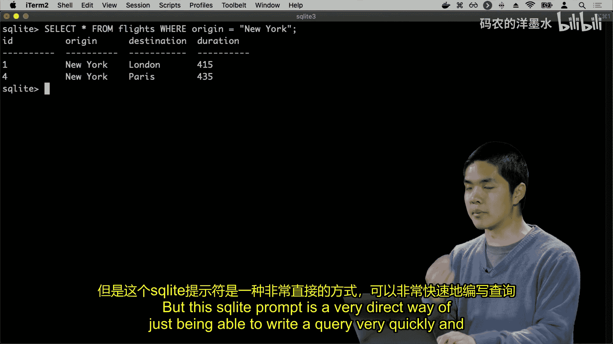

So it turns out there are other types of queries we can run as well。

 So we'll take a look at some others。 We don't just need to say where something equals something else。

 Other types of boolean expressions are allowed as well。

 So I could say something like select star from flights， where duration is greater than 500。

 where the idea here is， all right， let's look at the duration column。 It's an integer。

 So we can do arithmetic expressions on these values。

 I can take a value and see is it greater than 500 or not。 And when I do that。

 what I get back is all of the rows that have a duration that's greater than 500。

 So I can begin to query not just on whether one value equals another value but also other types of comparisons as well。

 And much as in Python is when we had Boolean expressions in Python。

 I could join multiple Boolean expressions together using words like and and or SQL has the same type of thing in its own query syntax2。

 I could say something like select star from flights where duration is greater than 500 and destination equals Paris。

 And as you might logically into it。 This means This means get me。😊。

The flights that are going to Paris and that take longer than 500 minutes。

 And it turns out there's only one such row inside this table that satisfies both of those constraints。

 Of course， instead of using and， I could have also used or to get a different query where now I'm looking for all of the flights。

Longer than 15 minutes or longer than 500 minutes or the destination in Paris is Paris。

 So as long as either of those conditions are met， I'm going to get results back。

 And so when I get back are some of the rows where the destination is Paris。

 Some rows where the destination isn' in Paris。 But the duration is more than 500 minutes and。

 of course， any row that satisfies both of these constraints in particular flight I D number two。

 that gets come to get resulted as well。 when I run this particular query on this table。😊。

And there are other types of queries I can perform in addition to that。

 So I can say something like select star from flights where origin is in and then in parentheses。

 New Yorkma Lima to say， check if the origin is in this sequence of possible values。

 the sequence of New York and Lima， as long as it is one of those two。

 Then I want for the results to come back。 And so then you'll get back rows that have an origin of New York rows that have an origin of Lima as well。

 So you can begin to construct more sophisticated queries that are able to check for whether an origin is in a list of possible values。

 or even if it matches a particular pattern， that maybe you know that one of the columns looks a certain way or is formatted according to a particular structure。

 but you don't know exactly what the value is。 I could run a query like select star from flights where origin not equals。

 but where origin is like， and then in quotation marks， I have a bit of a strange expression。

 percent a percent。😊，This percent again， stands for a wild card。 And this time。

 the wild card is looking at the values of a particular column。 In this case。

 the value of the origin column， meaning the percent stands for0 or more characters。

 no matter what those characters are。 We're looking for some number of characters， maybe 0。

 maybe more followed by an a followed by some other number of characters， maybe 0 maybe more。

 And ultimately， what this  query is going to do is look inside of the flight table and get back to me all of the results where there is an a in the origin。

 as long as there is an a in the origin column doesn't matter if there are characters before it or characters after it。

 all of the rows that come back are going to be the rows that just so happen to have an a in it。

 So lots of ways we can begin to run select queries。

 And there are even additional functions you can add to your select queries as well。

 where if instead of just selecting the values of columns。

 I want to compute the average duration of a particular category of flights。

 or I want to count how many flights are coming out of New York。

 or I want to find the longest flight that goes to London or the short。😊，Flight that goes to London。

 or I want to add up all of the durations for a whole bunch of flights。

 Maybe theirre flights that are connected to each other。

 And I want to add up the total travel time that might take。

 SQL has a number of built in functions that allow us to perform these sorts of calculations as well。

So a couple of different SQL commands we've now taken a look at。

 We've taken a look at create table that allows us to create a new table。

 insert that lets us add data to a table and then select。

 which lets us take data inside of the table and retrieve it。 But of course， often。

 when we're dealing with databases， the data doesn't just get added。 the data changes in some way。

 So we also need some way of being able to update data after it's already inside of our database。

 And to do that， there's another query for that， which is an update command that we can execute on our database。

 And that command looks something like this。 Again。

 displayed on multiple lines but you could put this entirely just on one line。

 SQL doesn't really care。 If you add line breaks。 It just knows that when it sees a semicolon at the end of the command。

 that is the end of this particular command。😊，But here。

 what I've said is use the update keyword to say， I would like to update a table。

 What table would I like to update。 I'd like to update the flights table。

And then what would I like to do Well， I'd like to set the duration equal to 430。

So whatever the value of duration happens to be right now， change it to 430。 But of course。

 I don't want to change it to 430 for every single flight。 just as in a select clause。

 I could say where something equals something or where and then some other clause to specify where I want the rows to be selected from Likewise。

 to an update， I can say set duration equal to 430。 where a particular condition is true。

 So here I'm going to look through the flights table find myself all of the flights where the origin is New York and the destination is London。

 And for those rows， I'm going to update the value of the duration column setting the duration column equal to 430。

 So using that syntax I can take data and update it。

 changing one value to another value by pinpointing which row or rows I would like to change。

 if I only want to change one row， I might do like update flights set duration equal to something where I D equals a particular Id to be able to pinpoint one Id and then take that row and make some modification to it。

😊，And in addition to inserting data， selecting data and updating data。

 the last main command we'll concern ourselves with is the ability to delete data。

 the ability to take a row and say I'd like to get rid of it or take multiple rows and get rid of them。

 And so a command like delete from flights where destination equals Tokyo As you might imagine。

 deletes from the flights table， all of the rows satisfy this condition where the destination is equal to Tokyo。

 So number of different operations now that we have the ability to do the ability to delete from a particular table where a condition is true。

 the ability to update a table based on particular conditions。

 the ability to select data from a table and insert data into a table as well。

 And there are a couple other clauses that can be used to add the SQL queries as well。

 just to add additional functionality。 if I don't want all of the rows to come back from a particular SQL query。

 I can limit the results that come back So normally select star from flights would get me all of the flights inside of the table。

 But I could say， select star from flights， limit5 to just say， you know what。😊。

Only want five results to come back from this table。

Order by allows me to decide how the results are ordered inside the results to come back。

 so I could say select star from flights， order by destination or order by duration to get all of the flights in order by how long they are Group by allows me to group a whole bunch of rows together。

 So if I wanted to group all of the flights by their origin so I can get all of the flights leaving New York and all the flights leaving London and so forth。

 I could do something like select star from flights group by origin to group flights by their origin as well。

 and having as a constraint I can place on group by to say that I would like to select all of the flights from grouping them by their origin。

 but they need to have account of at least three， meaning there need to be at least three flights that are leaving from that particular city。

😊，And for all of these particular clauses， these are helpful to know if you're going to be directly writing SQL。

 We won't worry about them too much here in particular， because fairly shortly。

 we're not going to be writing SQL ourselves。 We're going to just be writing Python code。

 And Django is going to under the hood， be manipulating the database and creating the SQL commands that it is going to run on the underlying database。

 And so we will see how we don't actually need to worry about writing the specific syntax。

 But Django is going to handle much of that for us。So here now， we have a flights table。

 a table that keeps track of all of the flights that we have organizing them by their I D and their origin and their destination and their duration。

 But oftentimes when we're dealing with data， especially in a larger database。

 we don't just have one table of data。 We have multiple tables of data。

 And those multiple tables might relate to each other in some way。

 And let's take a look at an example of how that might come about。

 we're going introduce a concept that we'll call foreign keys。

 and we'll see what that means in just a moment。😊，So here again is our flights table。

 The flights table has four columns， an ID， origin， destination， and duration。But， of course。

 in New York， there are multiple airports in New York， for instance。

 And so it might not make sense for me to just label each origin or each destination。

 just by the name of the city。 Maybe I also want to give the three letter airport code that corresponds to the airport to which I'm referring in this case。

 And so how would I encode into this table not only the origin。

 but also that city's airport code and not only for the destination， the name of the city。

 but also the airport code for that airport as well。 Well， I could just add more columns。

 I could say something like， all right， now we have this table that as an I D。An origin。

 an origin code， a destination， a destination code and a duration。But here now。

 the table is starting to get fairly wide。 There are a lot of columns here。 And in particular。

 theres some duplicate data that I've repeated my mention of Paris is associated with this particular three letter code and the same thing for New York and other airports as well。

 There is some messiness in the structure of this data。

 And so often what we'll want to do is we begin to deal with data in larger and larger sets with more and more columns is well want to normalize this data。

 separating things out into multiple different tables that just reference one another in some way。

 And so instead of just having a single flights table。

 What we might consider doing is saying that flights are one type of object。

 But another type of object that I care about is like an airport。

 And so I might just have a separate table just for airports where this table has three columns。😊。

A column for the Id of the airport， just a unique number that can identify a particular airport。

 one column for the three letter code for that airport。

 and one letter for the city or one column for the city where that airport is in。

 And now this is a much more straightforward， simpler representation of all of the airports。

 and the question becomes what happens to my flight table， that my flight table that here had an Id。

 origin destination and duration， where the type of origin and destination， where in this case。

 just text， textbased data representing the name of the city from which the flight is departing or to which the flight is arriving。

 Well， now that I have this separate airports table。

 where every row in the airports table has its own unique I， then what I can do in this case。

 is instead of storing an origin and a destination as text。

 I can store what we'll call a foreign key， a reference to a key in another table。

 and rename these columns to origin I and destination I that instead of storing text。😊。

Are going to store a number。Where origin I D 1 means the origin of flight 1 is。

Whatever airport number one happens to be。 And I could go to the airport table。

Look up which airport has an I of one and that would tell me the origin of this flight。

 And if I went to the airports table and looked up which airport had an idea of4。

 that would tell me the destination of this flight as well。 So by combining now two different tables。

 one table for representing airports and one table for representing flights I'm able to connect this these two different tables together by way of a foreign key。

 some columns inside of my flights table， namely the origin I column and the destination I column that together allow me to reference information stored inside of another table as well。

 And as you imagine this sort of airlines database growing and storing more different kinds of data。

 the ability to relate tables to each other is going to become incredibly powerful。

 So one thing you might imagine is that in addition to storing airports and storing flights an airline probably also needs to store information about its passengers like who is on which flight。

😊，And so you could imagine constructing a passengers table that has an I D column to uniquely identify every passenger。

 a first name column that stores every passenger's first name。

 a last name column for storing their last name and a flight I D column for storing what flight that passenger happens to be on。

 So in this case， I could say that all right。 Harry Potter is on flight number one。

 I could look that up in the flights table to find out all right inside the flights table Here is where the flight is leaving from。

 where it's going to and what its duration happens to be。😊，Now， as we begin to design these tables。

 we have to think about what the implications of that design happen to be。

 And in the case of this passengers table， it does seem that there is a limitation on the table design that I have created。

 And namely， if you think about it， you'll see the limitation of this table design is that any particular row can only have one flight I associated with it that Harry Potter has a single flight I column that can only have one value stored inside of it。

 And this would seem to make it impossible to allow for us to be able to represent a person that could be on multiple different flights。

 And so this starts to get at the idea of different types of relationship that rows in a table can have to one another。

 One type of relationship is a many to one relationship or a one to many relationship where I can express the idea that one flight can be associated with many different passengers。

 for instance， But what we might also want is a many to many relationship where many different passengers。

😊，Can be associated with many different flights。 A passenger might have more than one flight。

 A flight might have more than one passenger。 And to do that。

 we're going to need a slightly different structure for this particular type of table。

And one way we can approach it is by creating a separate table for storing people。

 But I can have a people table where every person has an I D has a first name and has a last name。

 samee as before。 But I'm no longer storing flight information inside of the table。

 I've cleaned my setup up。 I'm only storing people in this table and nothing about their flight information。

 And then I'll have a separate table for dealing with passengers on the flight and mapping people to their flights。

 And we can think about what does that table need to look like。 Well。

 I need some sort of table that is going to relate people to what flights they happen to be on。

 So odds are we're gonna need one column that is a foreign key that references this people table。

 And we'll need another column that is a foreign key that references the flights table such that I can relate those two tables together。

 And so that table could look like this。😊，This now is the simplified passengers table that only has two columns。

 that as a person I D column and a flight I column。

 And the idea of this table now is it's known as an association table or a join table that just associates one value from one table with another value from another table that this row here。

 one and one means the person with an I D of one is on flight number one。

 And I could look up that person inside of the per people table。

 Look up that flight inside of the flights table and figure out who the person is and what flight they're on And down here2 and 4 means whoever the person with an I of two is is on whichever flight happens to have an I D of four。

😊，And so this now has allowed us to be able to represent the types of relationships we want。

 We have a table for airports and a table for flights and any flight is going to map to two different airports。

 One destination， one origin。 And any airport might appear on multiple different flights。

 It's sort of a one to many relationship。 And then over here。

 when it comes to passengers we've stored people inside of a separate table and then had a many to many mapping between people and flight so that any person could be on multiple different flights。

 like here， for example， person number two is on both flights 1 and 4， and likewise。

 a flight could have multiple people。 So in this case。

 flight number 6 has passengers 5 and 6 that are on that flight as well。

 So we've been able to represent those relationships。😊，Of course。

 a byproduct of doing this is that now our tables are a little bit messier to look at and messy in the sense that it's not immediately obvious to me when I look at this table。

 like what data I'm looking at。 I see these numbers， but I don't know what these numbers mean。

 I've separated all these tables into different places。

 And now it's a little harder for me to figure out who's on which flight I have to look at this data look up people in the people table。

 look up flights in the flights table and somehow associate all of that information back together in order to draw any sort of conclusion。

 But luckily， SQL makes it pretty easy for us to be able to take data across multiple different tables and join them all back together。

 and we can do this using a join query that takes multiple tables and joins them together。

 So the syntax for a join query might look something like this。

 And here we'll go back to just the two table set up where I have flights and passengers where every passenger is associated with one flight that you could extend this and join multiple tables to deal with our more complex example as well。

 But here I'd like to。😊，Select every person's first name and their origin and their destination。

 And I'm gonna select that from the flights table。 But I need to join it with the passengers table。

 And then I say on to indicate how it is these two tables are related to one another。

 And in this case， I'm saying the way these two tables are related to one another。

 is that the flight Id column of the passengers table is associated with the Id column of the flights table。

 The flights table has an I that uniquely identifies every flight and the passengers table has a flight I column that uniquely identifies the flight that we're referring to for this particular passenger。

 And so the roadz I might get is a table that looks like this that gives me everyone's first name but also their origin and their destination where origin and destination are going to be drawn from that table of flights and the first name is going to be drawn from the table of passengers But by using a join query I've been able to take data from two separate tables and join them both back together。

 And there are a number of different。😊，Types of join queries that I can run。

 What we saw here was just the default join， which is otherwise known as an inner join。

 where effectively an inner join。 will' take the two tables。

 It will cross compareare them based on the condition that I've specified and only return back to me the results where there's a match on both sides where we match a passengers flight I with an Id in the flight table And there are various different kinds of outer joins。

 if I want to be okay with the idea that maybe something on the left table that I'm joining doesn't match with anything on the right or maybe something on the right table doesn't match with something on the left。

 But just know there are other types of join queries that I can run as well。😊。

Other strategies that can be helpful when dealing with SQL tables are optimizations we can make to make queries more efficient。

 And so one thing we can do with our tables is to create an index on a particular table and you can think of an index as kind of like the index in the back of a book。

 for example， where if you wanted to be able to search for a topic in a textbook you could open the textbook and just page by page。

 look for every topic and just try and find the topic you're looking for。

 but often what you'll be able to do， if the table has an index is go to the index of the book find the topic you're looking for and that will quickly give you a reference for how to get to the right page in question。

 and an index on a table operates in much the same way。

 It is an additional data structure that can be constructed and it does take time and memory to be able to construct this data structure and to maintain it anytime you update the data inside the table。

 But once it exists， it makes querying on a particular column much more efficient that you can very quickly look something up in the index and find the corresponding bun rows that go along with it。

😊，AndSo here we could have a command like create an index that we're going to call name index on the passengers table and in particular on the last name column to say something like。

 I expect that as I  query this table， I'm pretty frequently going to be looking up passengers by their last name so I would like to create an index on that table to be able to more efficiently search for a passenger based on their last name as well。

And so that's just a general overview of what SQL syntax is all about。

 a syntax that we can use to be able to create data tables inside of which are storing rows of data。

 where every row consists of some number of columns and every column has a type。

 You have the ability to create tables， add data to them， update。

 delete and get data out of those tables as well。 But as we begin to introduce these new technologies。

 there are always risks and potential threats that are associated with those technologies as well。

 And in SQL， the key one to be aware of is what's known as a SQL injection attack。

 a security vulnerability that can happen if you're not careful about how it is you actually execute your SQL commands。

 And so where might this come about， you might imagine， for instance。

 that if a database has some number of users， you might be storing those users inside of a database。

 For instance， in a user's table where there's a username column and a password column。

 though in practice， you probably wouldn't want to store passwords in clear text。 Let's imagine here。

 for example， that you are storing username and passwords inside of a table。😊。

And we have a login form for a website that looks like this where you get to type in your username and your password。

 And so if someone types in their username password。

 what might happen is that the web application might look。

 select star from users where username equals this particular username highlighted here。

 We're just gonna substitute the username right there。

 and password equals and will substitute the password over there。

 So if someone tries to log into our site like Harry logs in with a password of 1，2，3，4，5。

 What we might do is run the select query and say， select star from users， where username is Harry。

 And where the password is 1，2，3，4，5。 And our logic might be if we get results back。

 then that means there is a user whose username is Harry and password is 1，2，3，4，5。😊。

And we can go ahead and find that user in。But imagine now what might happen if instead the user who's typed in a username of hacker quotation mark dash dash seems like a bit of a strange username to type in。

 And it doesn't matter what they put in their password here now。

 The result might be that what they plug into the username is where username equals hacker and then the dash dash。

 It turns out dash dash and SQL stands for a comment in SQL。

 It just means ignore everything that comes after it in the same way that in Python。

 you can use the hashtag symbol to mean the rest of this line is a comment and the compiler whoever's running the program should just ignore it。

 So everything after the dash dash kind of gets ignored。

 and we've effectively been able to bypass the password check。

 that someone could bypass a password check and log in to an an account even if they were unauthorized to do so。

 So here the vulnerability within the SQL syntax。 If we're not careful about when we're running SQL syntax。

 we could be running untrusted SQL commands that some hacker。

 some adversary has been able to plug in to our program。😊，So how do we solve this sort of problem。

 One strategy is to escape these characters， escaping。

 just meaning add some backslashes that just make sure that SQL knows to treat these as a literal quotation mark and a literal dash and not as like special SQL syntax of any sort。

 Another strategy is to use an abstraction layer on top of SQL so that we don't have to write the SQL queries at all。

 And that's， in fact， what we're about to do as we transition to the world of D django to take a look at how when we begin to use a web framework like Django。

 We now have the ability to not worry about the nuances of the syntax of SQL and just deal a little more high level with what our models are what are the types of objects that we're dealing with and interacting with inside of this application。

😊。

One other concern worth noting about with regards to SQL is the possibility of race conditions and a race condition is something that might happen anytime you have multiple events that are happening in parallel threads。

 so to speak that you have one thing happening and another thing happening simultaneously you might imagine that in the case of social media sites where you can like a post like an image on Instagram or a tweet on Twitter。

 for example， What would happen if two people tried to like the same post at the same time。

 if we're not careful about how we run those particular SQL queries。

 there's a potential for us to be able to get a race condition problems where we end up like trying to query for the number of likes that a post has and then another person tries to do the same thing and there are conflicts when we try and update it where the result might not be what we would expect it to be and there are a number of unexpected results that can happen when we deal with problems related to race conditions where multiple things are happening simultaneously。

 how do we solve those problems where one strategy is to sort of place a lock on the data。To say。

 all right， while I'm working on this database， nobody else can touch this data。

 Let me finish this transaction。 so to speak， finish working on this particular transaction and making all the changes I need to make to the database。

 And only after I'm done， I can sort of release the lock。

 let someone else go ahead and modify the database as well。

The number of concerns to be aware of as we begin dealing in this world of SQL and trying to work with databases。

So now that we've taken a look at the syntax of SQL， understanding how these tables work。

 how they're structured and what it is that we can add to those tables。

 let's go ahead and turn our attention in particular， to Django models。

 which are a way of representing data inside of a Django application because we djago' is really going to get powerful in designing our web applications is the ability to represent data in terms of these models。

 And so we're gonna go ahead and try and create a web application that is going to represent like what an airline might want to store inside of its own web application as well。

 Allright， so the first thing I want to do is create a Django project。

 So I'll go ahead and type Django admin start project and the name of my project will just be called airline。

 I' creating a project for an airlines website， for example。

 I'll go ahead and go into the airline directory open them up in my code editor before I actually begin editing any code。

 remember that every django project needs to have one or more apps within it。

 So the first app that I'll create for this airline。

 is I'll start an app for keeping track of flight。😊，So keeping track of flight related information。

 like origins and destinations and durations， and what passengers are on those flights。

When I create a new app？First thing I'll need to do is go into Se stop Pi inside of airline and go ahead and add this app as an installed app。

 right， So flights is now an app that I have installed。

And then what I'll want to do is say go ahead and go into URLs。pi。Which is， again。

 that table of contents for all the URLs I can get to for this particular web application。

 I'll import include because I want to do is when someone visits the path of flights slash something。

 I want to take them to flights dot URLs， Naping them to the URLs pi file that will be inside of my flights application。

Of course， now I need a URL dopi file inside of my flight's application。

 so I go into flights and create a new file that I'll call URL steppi。

And what can do from dot Django， dot URL's import path from dot import views。

 And then my URL patterns are going to go inside of this list right here。

But before I begin dealing with actual URLs， the first thing I'm going to want to do is create some models。

 Models are going to be a way of creating a Python class that is going to represent data that I want Django to store inside of a database。

 And so when I create a model， Django is going to figure out what SQL syntax that needs to use it to a create that table。

 But then B， manipulate that table， selecting and updating and inserting anytime I make changes to those models。

 And so here what I can do。Is inside of every app that gets created in this case called flightlights。

 there is a models do pi file， one that we haven't looked at before。

 but this is going to be the place where we get to define what models are going to exist for our application。

😡，Every model is going to be a Python class。 And you can think of this as having one model for each of the main tables we care about storing information about。

 So let me define a new class called flight that is going to inher from models do model。

 So I'm creating a new class called flight that is going to be a model。

 And then I need to provide inside of this class。 All of the parameters that a flight has。

 What properties does a flight have that I might want to keep track of。 Well， a flight has an origin。

😊，And the origin is going to be a models do char field。

 And this is all documented on Tgo's website in terms of the various different types of fields that exist that I can include inside of a Django model where here I'm saying。

 al right， here is a character field whose max length is going to be， let's say 64。

 I'll assume that most city names are not gonna go longer than 64 characters that seems like a reasonable maximum length for the origin of the flight。

 for example。😊，Every flight will also have a destination which will be a character field whose Mac length is also 64。

 and every flight will have a duration， which will just be an integer field。

So now this is my very first Django model。 It is a class called F。

 where I've defined all of the properties that a flight has。

 and then using Django syntax to find what type they should have as well。 Every flight has an origin。

 has a destination and has a duration。😊，But， of course。

 nothing here has actually modified the database that Django was using in order to store information about my web application。

 and we can see if we， in fact， go back to Air and I type Ls。

 What you see here is that there isn't yet a database that exists。

 I just have an airline directory a flights directory and a manage do pi file。

 So what I'd like to do is somehow tell Django that you should update the database to include information about the models that I have just created。

 And this is a process that we refer to in Django and more generally as migrations。

 I create a migration to say here are some changes that I would like to apply to the database。

 And then I migrate them to tell django， all right。

 take those changes and actually apply them to the database。 It's a twostep process。

 One is creating the migration， the instructions for how to actually go about manipulating the database and then one to take that migration step of saying now take those instructions and actually apply them to the underlying database。

😊。

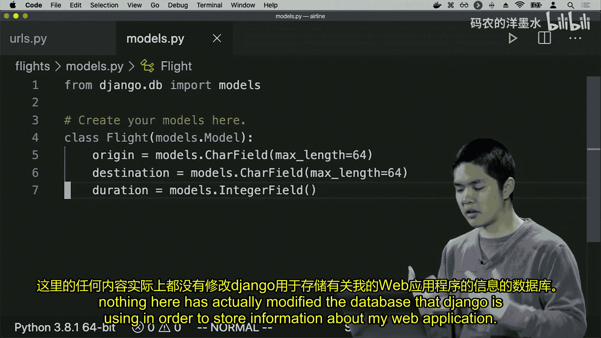

We can make the migrations via command。 Again， we'll use the managed pi script that has a number of different commands that allow us to control various parts of the application。

 I'll use Python managed pi， and then make migrations。

And now what we see is we've created immigration inside of 0，0，0，1 underscore initial dot Pi。

 where in this migration， it's created a model called flight。

 And so if I go ahead and look at the migrations directory。 I see this file has been created for me。

 I didn't have to create it myself。 And what this file is。

 is that is instructions to Django for how to manipulate the database to reflect the changes I have made to the model that here is an instruction to Django to create a new model called flight that has these particular fields inside of it。

 And it's bascing this off of the changes that I made to models Pi。

 the model that I added is now reflected in this migration。😊。

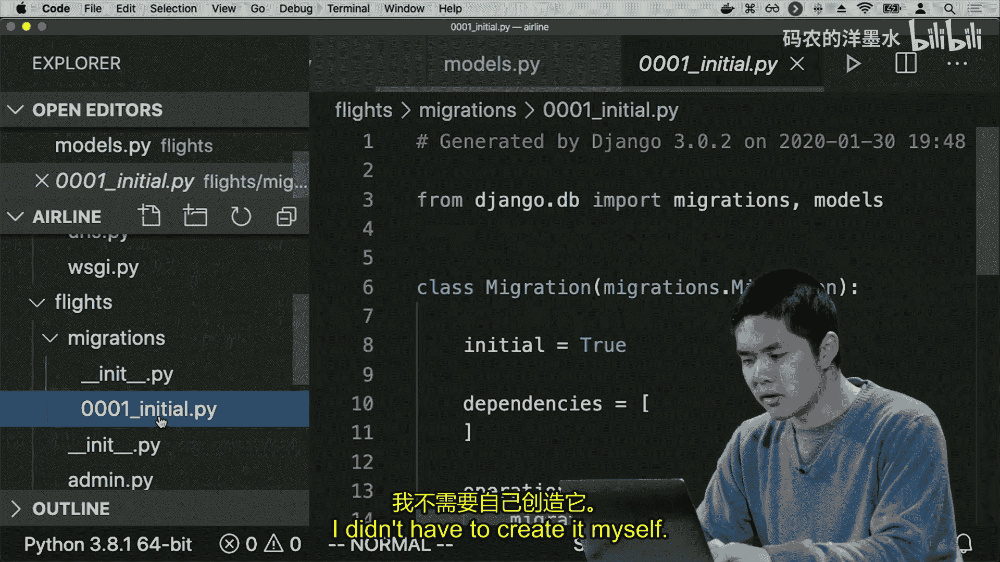

And now if I want to apply the migration， actually apply it to Dinggo's database， I can run Python。

 managed up pi migrate to go ahead and apply these migrations。

 There are a bunch of default migrations that get applied as well。

 But notice that one of the migrations that gets applied is this one here applying flights do 0，0，0。

1 underscore initial to say， let's go ahead and apply that migration create that table that is going to represent flights。

 And if I type LS now， you'll see that now I have a DB do sQLite 3 file。

 a SQLite database that is going to contain a table that is going to store all of my flights。😊。

And so how can I actually begin to manipulate this data。

 How can I interact with these with these sorts of models。

 I could use direct SQL syntax by opening up this database file and running commands。

 but Django provides some nice abstraction layers on top of it so that I don't actually need to execute those commands myself。

 I can begin to work more generally with Python classes and variables and things that I'm used to inside the Python language so I can enter django's shell where I can just run Python commands by running Python manage dot pi shell。

😊，And what this does is open up a shell or a console where I can begin to write Python commands that get executed on this web application。

 And the first thing I'd like to do is from flight do models Let me just import flight。

 So flights is the name of my app models is the name of that file。

 I'm importing the flight class from that models file that I've just created。

 And now what I can do is I can create a new flight。

 I can say something like F equals a flight whose origin is New York。

 and whose destination is London。😊，And whose duration equals 415 minutes。

 And then I can say F dot save to save that new flight that I have created。 And this syntax now。

 and I'll go ahead and make it a little bit bigger。 so we can see it a little easier is my way。😊。

Of inserting data into this table。 I don't need to use an insert query in SQL。

 I just have to write a Python command。 And Django knows that when I create a new flight and save it。

 that it should run an insert command on the underlying SQL tables。

 where here I've created a new flight with this particular origin and destination and duration。

 and I've gone ahead and saved that flight as well。 And if I want to query that flight。

 get information about that flight， I can say something like flight dot objects dot all is the equivalent of like a select all。

 get me all of the flights that exist inside of my database。😊，And here I see I get back a query set。

 which is just a set of results。 And here I have one flight that came back， flight object 1。

 So a flight has been created for me with I D1。 Now， flight object 1。

 probably not all that helpful of a name。 It'd be nicer if this model had a cleaner way of seeing the name of a particular of a particular flight。

 for example。 And it turns out we can do that。 that any model。

 I'll go back to the code inside of models stop Pi。😊。

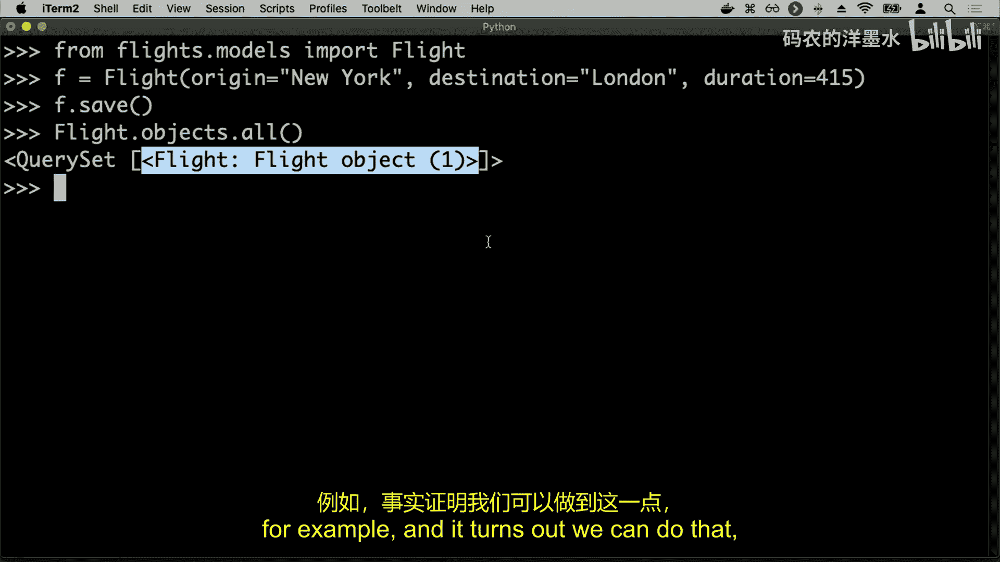

Any model can implement a double underscore stir function。

 which returns a string representation of that particular object。

 And this applies not just to jingle models， but to Python classes more generally。

 Then if this function returns a string representation of the object。

 Let's go ahead and return a formatted string， that is self dot I D。

 I'll say self dot origin to self dot destination。

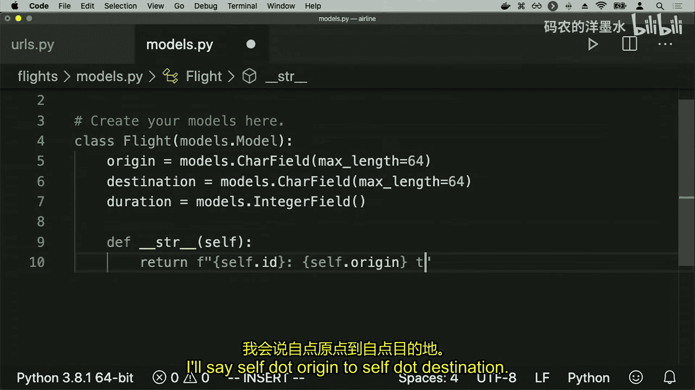

So here what I said is that the string representation of any flight is going to be a string that gives its I D and then says。

 alright， origin to destination， Just a nice clean name that is going to represent this particular flight。

 So now， if I go back。To the shell by running Python managedage P shell。

 I can say from flight do models， import flight。I can say， allright。

 let's let a variable called flights be equal to flight dot objects dot all。

 And now flights is going to be this flight， flightlight 1 New York to London。

 It now has a much nicer string representation of the name。

 which just makes it a little bit easier to interact with。 If I wanted to get just that one flight。

 I can say flight equals flights dot first。😊，Flights is a query set， first gets me that first flight。

And so now I have this flight from New York to London。And just as in any Python object。

 I can begin to access properties of that object。 I can say， allright， flight， What is your I D。

 flightlight， What is your origin， flightlight， What is your destination， flightlight。

 What is your duration， And I can access as values。

 all of the properties of this flight that I ultimately care about。

 And if I want to delete the flight， I can say something like flight dot delete。

Now， ultimately， though， this is not the model that I actually want to represent my flight because here again。

 I'm using a character field， a char field for things like origin and destination。 When in reality。

 I probably like to use something like another table for representing airports and then some relationship between every flight and an airport。

 So let's go ahead and try and implement that idea now that I can go back into models do Pi and create a new class。

 I'll create a class called airport。😊，That is also a model。

 and I'd like for this airport class to have a code。

Which is a character field with a max length of three for the airport's code， as well as a city。

 which would be a character field with a max length of 64。

And let's also give this airport a string representation。

 We'll say that the string representation of an airport will just be the city of the airport。

 And then in parentheses， the code of the airport。 So'll be something like New York and then in parentheses。

 JFK to represent a particular airport。And now our flight model needs to change a little bit。

 No longer will origin and destination be character fields that are just storing text， but instead。

 origin is going to be a foreign key。A foreign key that references another table。

 like the airport table。And then I can provide some additional arguments。

 So this alone would be enough， but I can add some additional arguments like on deleteelete equals models do cascade。

 So what does this mean， Well， when I have tables that are related to each other。

 SQL need some way of knowing what should happen if you ever delete something。

 If I have a flight from JFK to London。 And I later in the later in time。

 decide to delete JFK airport from my database， What should happen to that flight。

 like what happens to flights when the thing that it is referencing gets deleted what models do cascade means is if I were to ever delete an airport from the airports table。

 it's going to also delete any of the corresponding flights。

 And there are other on deletete parameters you can set for saying like don't even let me delete an airport。

 if there are flights that are leaving from or going to that airport that's called models dot protect。

 But there are other ways of implementing similar types of constraints。😊。

And the other argument that I'm going to provide is what's called a related name。 and a related name。

 as we'll see in just a moment， is going to be a way of me accessing a relationship in the reverse order。

 that from a flight， I can take a flight and say dot origin to get the flight's origin in airport。

 But the other question I might want to ask is in the reverse order。 if I have an airport。

 how do I get all of the flights that have that airport as an origin。

 And so here if I give a related name to this foreign key。

 Djainggo will automatically set up the relationship going in that opposite direction。 And so here。

 well， if we have an airport。 and I want to know all of the flights that have that airport as their origin。

 the reasonable name for a related name here is something like departures。 So if I have an airport。

 I can access all of the departures which gets me all of the flights that are leaving from that airport。

😊，And I'll likewise do the same thing here for destination。 Instead of a character field。

 it's going to be a foreign key。 It's going to reference airport。 When we delete it。

 we'll go ahead and Cascade。 and the related name will be arrivals。 because if I have an airport。

 I might want to access all of the arrivals。 All of the flights that correspond to flights that are arriving at that particular destination。

And so now I've done two things。 I've added a new class called Airport。

 and I've modified my existing flight model。 So this is changed in my Python code。

 but it hasn't yet changed in my database。 So in order to make the change in the database， again。

 it's a two step process。 Step 1， Python managed Pi， make migrations to say。

 look for any new changes that have been made to models do pi and go ahead and create a migration instruction for how to make those changes for the database。

😊。

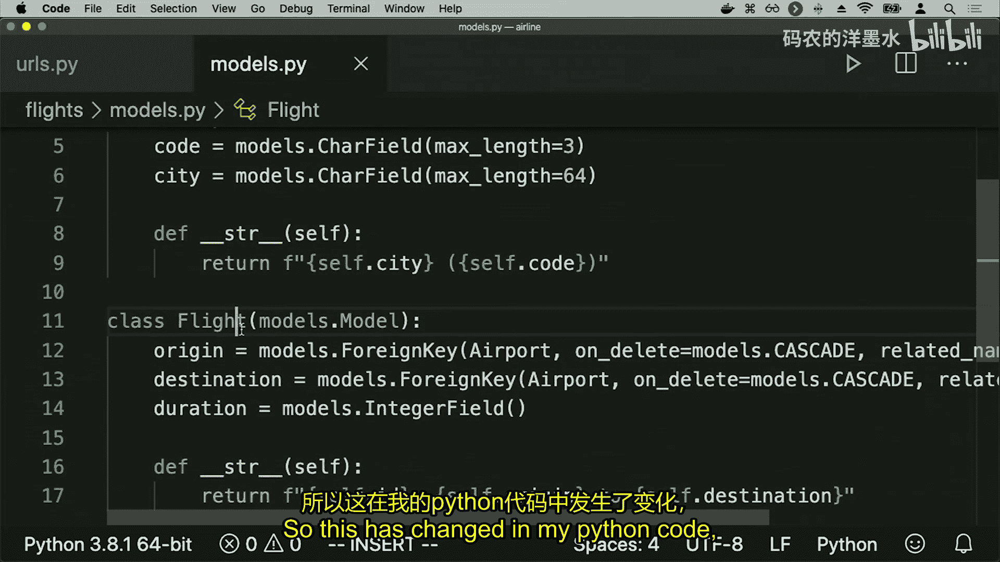

And here we see that we've created。A new migration file。

 And this migration is going to create a model called airport。

 And it's also going to alter the destination field and alter the origin field on my flight model。

 because as we know， we've changed destination and origin to no longer be character fields。

 But to instead be references to a particular airport。

 So that's something that's going to need to change in the database and to make that change。

 I can run something like Python managed up high migrate to go ahead and apply those changes。

 We've now applied this migration that we just created and our database is now up to date。😊。

So what can we do， Well， now I can go ahead and go back into the shell。

And I'll just go ahead and import from flighttop models， import star， importm everything。

And I can now create an airport。 I can say something like JFK equals an airport whose code is JFK and whose city is New York。

 for example， and then save that I can create a London one。

 So LHR is an airport whose code is LH and whose city is London。 And I can save that。 you know。

 you could create more。 I could say C G equals an airport whose code is CG and city is Paris。

 And maybe we'll do one more。 We'll say N RRT is the airport whose code is N RT and whose city is Tokyo。

 for example。 So I've created and saved four airports that get added to my airport table。😊。

And now I can add a flight。 F equals flight， whose origin equals JFK。

 whose destination equals London Heathrow and whose duration equals 415 minutes。

 And I'll go ahead and save that。As well。 So I've now created four airports。

 I've created a flight and saved it。 If I type F just for my flight， I see that。 all right。

 this is a flight from New York to London。 But I can also say what is F dot origin And to write F dot origin。

 that is now an airport object。 It's JFK in particular。

 and I can do F dot origin dot city to get the city of the origin。

 which is New York F dot origin dot code to get the code of that airport， which is JFK。

 And if I start with in origin， something like JFK or London Heathrow。

 I can say L HRR dot arrivals to go ahead and dot all to get all of the arrivals。

 all of the flights arriving in London Heathrow。 And it looks like there's just one of them which is this flight that I've just created from New York that is going to London as well。

😊。

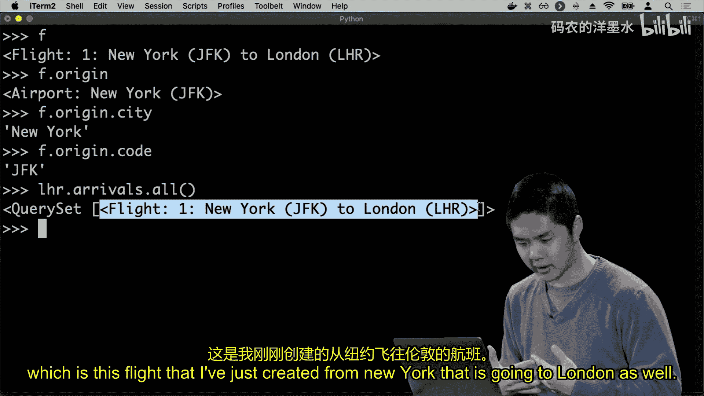

And so this now gives us the ability to manipulate SQL just by using these Python models。

 And I now have Python classes that represent all of these various different types of data。 And now。

 instead of running SQL queries， like select star from flights or from airports。

 I can just interact with these classes and these properties on the classes and D django takes care of the process for me of figuring out what the underlying SQL queries should be。

 executing those queries and just giving those results back to me。

 And we can begin now to design a web application around this idea。

 that I can go into URL Pi and let's add a URL pattern that says， you know。

 the default route will go ahead and load the index view give it a name of index。

 same as similar things we've seen from last time。😊，And now， what should we do in the index view。

 Well， the index view， let's go ahead and say what I would like to do is just display a list of all the flights。

 So I might from dot models import flight and airport。 Or maybe maybe just need flight。

 I just want a list of all the flights。 So I'm going to import flight from all of my models。

And now what I'd like to do is return， let's go ahead and render a template called flight slash index do HtMl and give index Html access to a variable called flights。

 And what is that variable going to be equal to it's going be equal to flight dot objects do all to get me like all of the flights that I would like to put right here。

Alright， so what can I do from now。 Now what I need to do is actually create those individual templates。

 So inside of flights， I'll create a new folder called templates inside of which I'll create a new folder called flights inside of which I'll go ahead and create a layout dot H TM L。

 much as we've done before， where that layout is going to contain the basic structure of our H T L page。

 So a head section whose title is flights。😊，And a body section that is going to have a block body。

And the end of the block。Much as before， this is the default layout for this particular page。

And then I'll add a new template called index dot HtMl that is going to extend flight slash layout do HtMl。

And then inside the body of the page。I'm going to display an H1 that just says flights。

 And let's now create an unordered list where I can now loop over for flight in flights。

And4 to end the loop。 But inside the loop， let me create a list item where I just print out like flight。

 Maybe I'll print a flight and then flight dot I D to print out like flight 1， flight 2， flight 3。

 and then I'll print flight dot origin to flight dot destination。

So what I've done here is create a template that I'm going to give access to a variable called flights。

 where flights is going to be a variable that represents all of the flights that Iqueri by running flight dotobject do all。

 that is my way using Djarango's API using the functions that it has given me access to to say take the flight and get all of the flights that are stored inside of Djago's database。

 Then here in the template I'm looping over each one of those flights for each one printing at a list item。

😡，Where I can access properties of that flight， say flight， this I D from origin。

To a particular destination。So now。I'll go ahead and go into my terminal， run Python， managed。

 run server， which again iss how we run a Jinggo web application。

 And now if I go to that URL slash flights this time because that's the URL。

 What I see is exactly what I would expect to see an unordered list that just so happens to have flight 1 New York to London displayed there。

 It is taking data from my database and now displaying it inside of this template。

 And if I were to add new flights， it would also update on this page as well So if I go ahead and go back go into the shell Python managed shell。

 I'll go from flights models import star， let's go ahead and all let's add a flight from Shanghai to Paris。

 for example， how do I get the airports for Shanghai and Paris。 Well。

 it turns out that if I want to get like Shanghai， I can say like Shanghai equals airport do objects do And then I can say if I do airport do objects all that gets me all of the airports。

 for example。 and it seems I don't actually。😊。

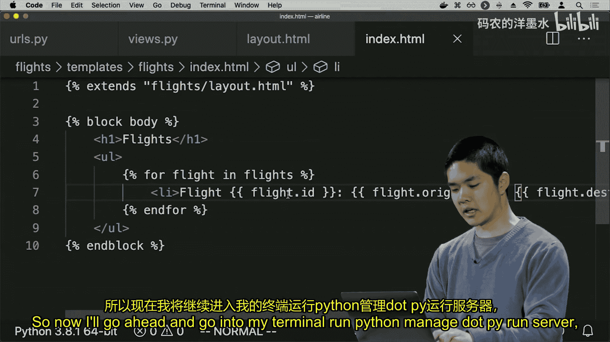

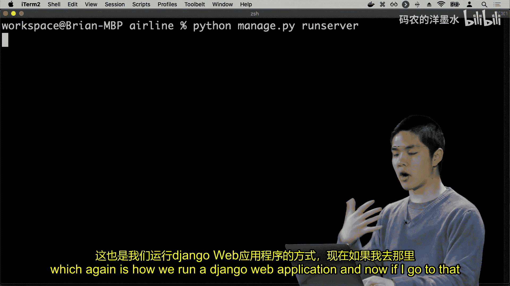

Have a Shanghai 1， but I can add one if I wanted2。 But if I do airport dot objects do all。

 that again gives me all of them。 But if I want to filter my airport's list。

 not get all of the airports， but just get some of them， I can say airport dot objects dot filter。

 And I can say， like， get me all the airports where the city is New York， for example。

And that is going to hell go ahead and give me a query set that only contains the results that I care about。

 So again， airport do objects do filter lets me constrain the results that come back。

 not get me all of the airports， but only get me airports Who city is New York， for example。

 and it only giving back one。 So I could say dot filter city equals New York dot first to say。

 take that query set and just get me the first and only thing in that query set。

 And that gives me airport New York。 a simplified way of doing the same thing。

 If you know you're only going to get one result back is I can say something like airport dot objects dot get。

 which will only get one result if it knows that there's only going to be one airport with the city of New York。

 thatt two will return to me New York， JFK Air。😊，But it will throw an error if ever there's more than one or if there's none。

 for example。 So we go ahead and save that inside of JFK and we'll go ahead and create a flight that is going from New York to Paris。

 for example， I can do CG equals airport do objects get city equals Paris。

 And now I have this variable CG， which represents the airport Paris。

 And if I want to create a new flight that goes from New York to Paris。

 I can say F is going to be a flight， whose origin is JFK whose destination equals CG and whose duration equals 435。

 And I can save that flight as well。 And so I've added a new flight。😊，And so now if I run the server。

 Python managed up pi， run server。

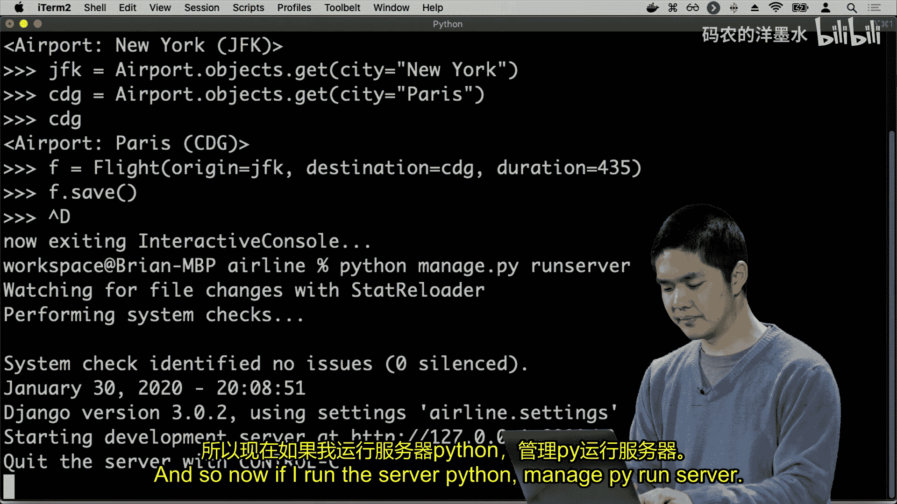

Refresh the page。 I now see that I have two flights， one flight that's going from New York to London。

 one flight that's going from New York to Paris。 But of course。

 it's going to be pretty annoying if every time I want to update the data， adding new data。

 Manipulating the data。 I need to go into the shell in order to run direct commands that are able to add new flights add new airport so on and so forth。

 What I'd really like to be able to do is just very simply to add it via a web interface via the web be able to say。

 all right， let me add a new flight that goes from location 1 to location 2。

 And it's possible using the information we know now to build a web page that does just this。

 But Django is built on this idea that it doesn't want you the programmer to have to repeat work that other people have already done。

 And this process of trying to define models and very quickly be able to create and edit and manipulate models is so common that Django has already built for us an entire app that is just design for the manipulation of these models and it's known as the Django admin app。

 And this is an。😊。

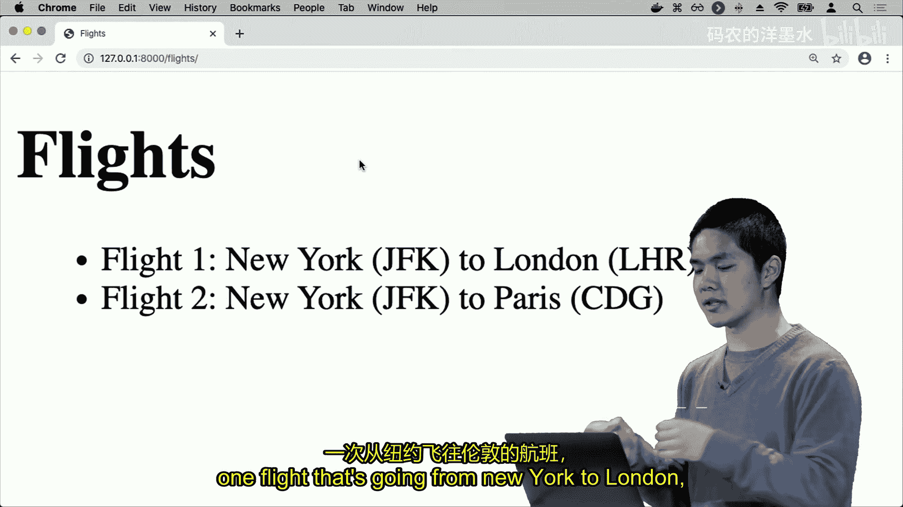

That we've seen traces of already that if we remember that URLs pi file from inside of our application。

 we saw that we added a path for our own app， but there was already a path given to us by default slash admin that takes us to the admin app as well。

 And so in order to use the admin app， we need to create an administrative account inside of our Djainggo web application。

 And the way to do that is via the command line， I can run Python managed do Pi。

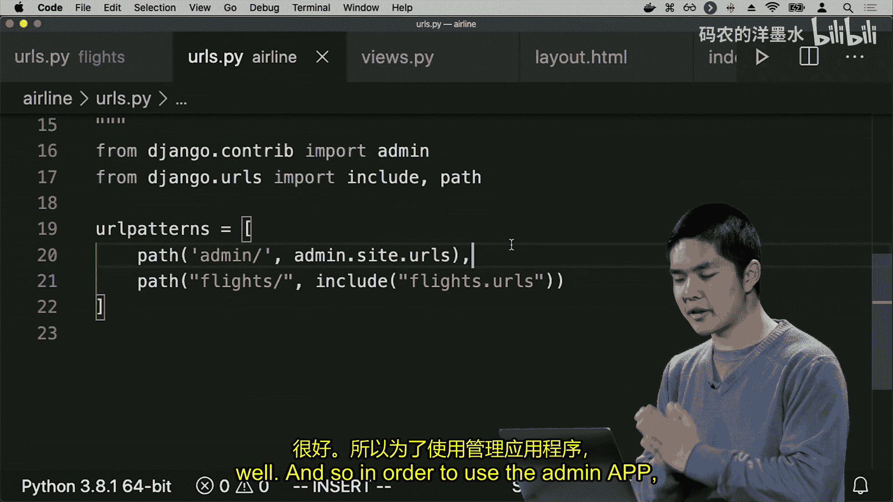

Create super user。It's going to ask me for my name。 I'll go ahead and type in my username。

My email address， and it's also going to ask for a password。

 I can just make up a password that I would like to use。Retype it in just to confirm it。 And now。

 Django has created a super user account for me in this web application so that I using these credentials have the ability to visit the web interface for the admin app and actually manipulate some of these underlying models。

 So in order to do this， the first thing I need to do is take my models and add those models to the admin app。

 So inside of models do Pi。 I have a class called airport and a class called flight And if we look at the files I have。

 There's another file， we haven't really looked at yet called admin dot Pi inside of my app。

 And inside of admin dot Pi。 I'll first from my models， import flight and airport。😊。

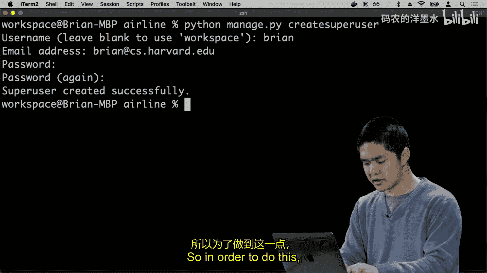

And now I'm going to say admin。s。 register airport and admin dot site。

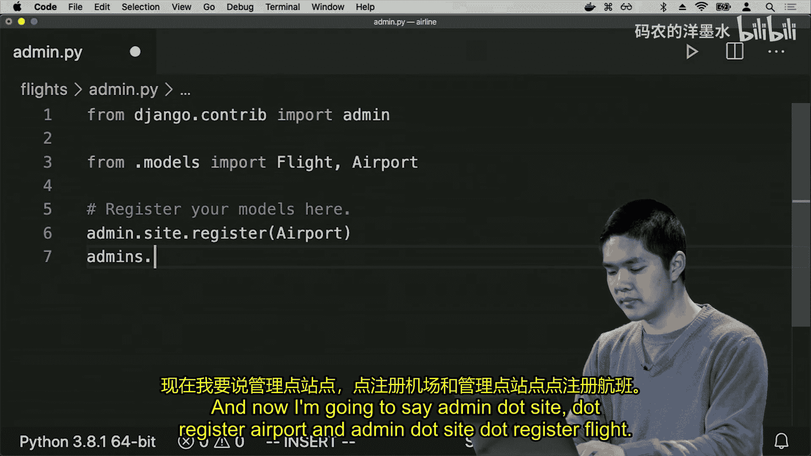

Dot register， flight。And what this is going to do is it is going to tell Django's admin app that I would like to use the admin app to be able to manipulate airports and to be able to manipulate flights as well。

And so let's take a look at this admin app and see how it actually works。 I can run Python。

 managed up Pi， run server。😊。

That will start up the Web server。 I'll now visit this URL。 Instead of going to slash flights。

 I'll go to slash admin。 And this opens up this D django administration app that's not written by me。

 Django has written this。 and it's asking me to log in I'll go ahead and log in using those credentials I used a moment ago。

 typing in my username and password。 And what I get here is django's site administration interface built for me by Django where I didn't need to design this at all。

 But importantly， if we notice down here， I now have the ability to add and manipulate airports and flights via this web interfaces django administrative interface。

 So now using this interface， I have the ability to manipulate the underlying database to manipulate my models to add and modify data that already exists。

 So if I click on airports， for example， I see here here。

 all of the airports that I've already added to my database， Tokyo， Paris， London and New York。

 and I can add a new one。 I can say， let's go ahead and add PV G， which is Shanghai。😊。

And I can either save it， save and continue editing， save and add another。 I'm gonna add a couple。

 So I'll go ahead and save and add another。 Let's go ahead and add Istanbul Airport as well。

 Let's add Moscow as an airport to and maybe one more， we'll add Lima as well。

 And I'll just go ahead and click save。 And now I've added a whole bunch of airports。

 all via this web interface。 Dgo was originally created for like news organization。

 that very quickly wanted to be able to post articles and post new posts on their website。

 And it made it very easy via an interface like this to very quickly， just say like here。

 add a new article。 And here's the content of the article to be able to display on a page。

 And now we've been able to very quickly， add new airports to our website as well。

 And so if we want to add flights。 Well we can go ahead。😊，And go back home。Cl on flights。

 I see that I already have two flights inside of my database。

 I have New York to London and New York to Paris。 I'll add a new one。

 It's letting me choose an origin destination and duration。

 And Django knows that the origin must be an airport。

 So it's gonna give me the opportunity to just choose an airport where I can say， okay。

 Shanghai is the origin。 the destination is going to be Paris and the duration is going be like 760 minutes。

 for example。 So now using Djainggo's admin interface。

 I've been able to add a number of different flights and a number of different airports。

 And if I go back not to the admin app， but to my flight app。

 the app that I wrote myself and go back to slash flights。

 now I actually see all of the new flights that I have added to my database via Django's admin interface。

 I added them to the admin interface and now I see this flight from Shanghai to Paris。

 I see this flight。😊，From Paris to New York， as well。

And so now what I might like to do is begin to add some more pages to this web application。

 Make this web application a little more sophisticated by maybe giving me the ability to like click on a particular flight。

To view details about that flight， what I'd like is for every flight to have its own page。

 not just slash flights for all the flights， but slash flight slash1 for flight I D 1。

 slash flight slash 2 for I D2， so on and so forth。

 What I can do in order to do that is go back into URL stop Pi。😊。

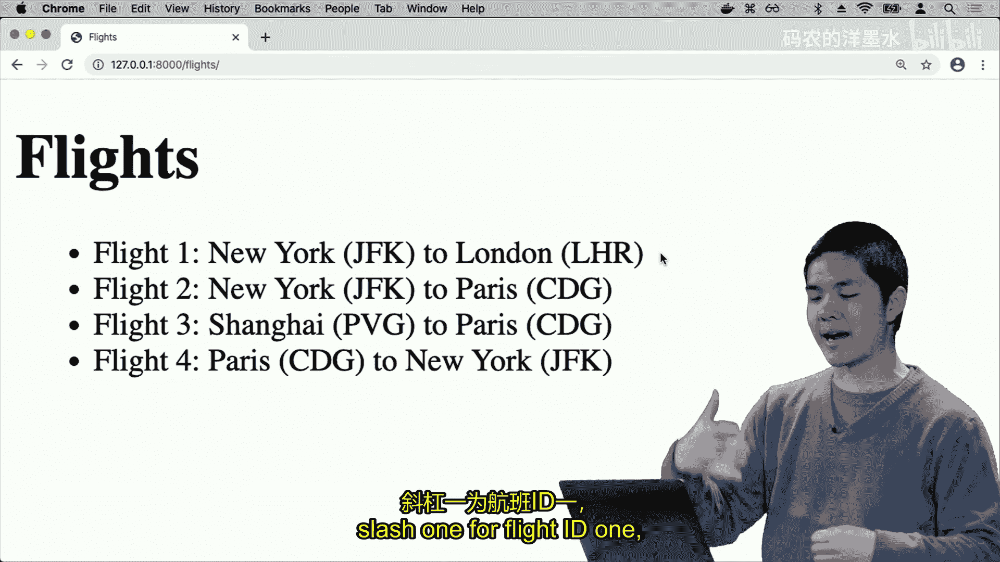

And create a new path。 We'll create a path where I'm going to specify a flight I D。

 which will be an integer。 When I do， let's go ahead and load the flight view whose name will be flight。

 And now I need to just go to views dot Pi and add a function called flight。😊，So I'll go back。

 go into views do Pi。 In addition to an index function。

 we'll define a flight function that accepts as an argument， a flight I D。

So now what is this flight function going to do。 Well。

 the first thing I knew is actually need to do is actually get that flight。

 I can say flight equals flight dot objects dot get。

 get me the flight whose I D is equal to flight I D， for example， or alternatively。

 Django also lets you say P K。 instead of I D is a more generic way of referencing the primary key for whatever the primary key happens to be called the P K in this case is just the I D。

😊，But then what I can do is render。A template like flight flushushflight。html。And pass input to that。

 the flight。So we're passing it this flight to flight dot H TM L。 And now I can create a template。

 create a new file called Flight dot H TM L。Which is going to also extend flight slash layout dot H Tml using that same H T M L layout。

 and inside the body of the page。Let's just say something like。In big， we'll say flight flight I D。

 and then maybe an unordered list where I can say something like the origin is flight dot origin。

The destination is flight dot destination。And。The duration is flight dot duration。

So now I have a page that displays flight information about any particular flight。

 And if I go ahead and load not slash flights in my web browser， but slash flight slash1。

 for example， well now I have information about flight number one and slash flight slash2 gets me information about flight number two。

 querying for that particular flight then printing out its origin， destination and duration。

 Now there's some error checking that we probably should do here。

 if I try and access a flight that doesn't exist something like flight 28， for example。

 I'm going get some sort of error that does not exist error。 F matching query does not exist。

 I might like to control what happens in that situation a little better。

 So you might imagine adding some additional error checking to handle those cases as well。

 but we'll leave it at this just for now。😊。

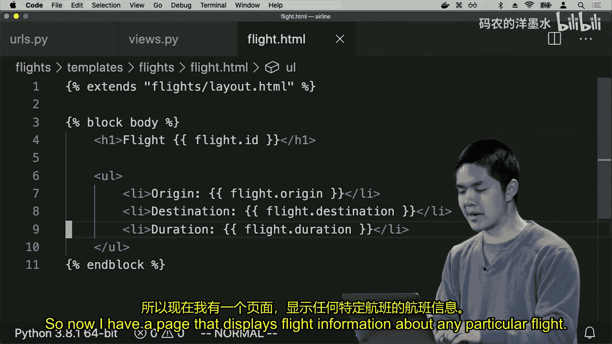

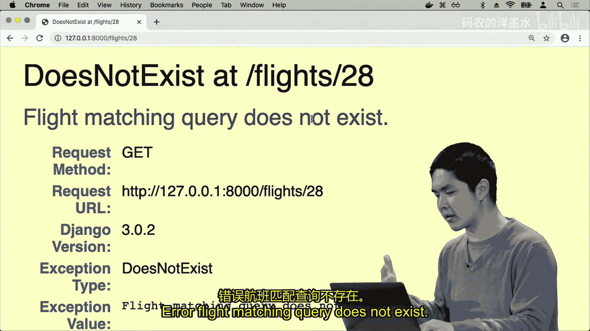

But now let's go ahead and add the ability not only to have flights that have airports associated with them。

 but let's also add passengers to our flights as well to be able to represent passengers that might actually be on these flights too。

So I'll go ahead and go back into Model。pi。😡，And in models dot Pi。

 in addition to an airport class and a flight class， let me create a new class called。

Passenger also gonna be a model。 And what properties does a passenger have， Well。

 passenger has a first name， which will go ahead and make a models dot cha field。

Whose max length will put at 64。And a last name。Max length equals 64。 and passengers also。

 as we described before， they have a many to many relationship with flights that a flight could have multiple passengers。

 A passenger could be on multiple flights。 And ultimately。

 we need an additional table to keep track of this。

 But we can think a little bit more abstractly here in Django。

 and just say that every passenger has flights associated with them。

 which are a models dot many too many field， with flight。

 So every passenger could be associated with many flights。

 We'll say blank equals true to allow the possibility that a passenger has no flights。

 maybe if they're not registered for any flights at all。😊。

And we'll also give this a related name of passengers， meaning if I have a passenger。

 I can use the flight's attribute to access all of their flights， and likewise， if I have a flight。

 I can use this passenger's related name to access all of the passengers who are on that flight and we'll see how that'll be useful in a moment too。

The string representation of a passenger will just go ahead and be their first name， space。

 their last name， which feels like a reasonable way of representing a particular passenger and now I need to apply these changes I need to say Python managed up high make migrations because I've made new changes to my model。

 I've created a model passenger in particular， and now if I do Python managed up high migrate。

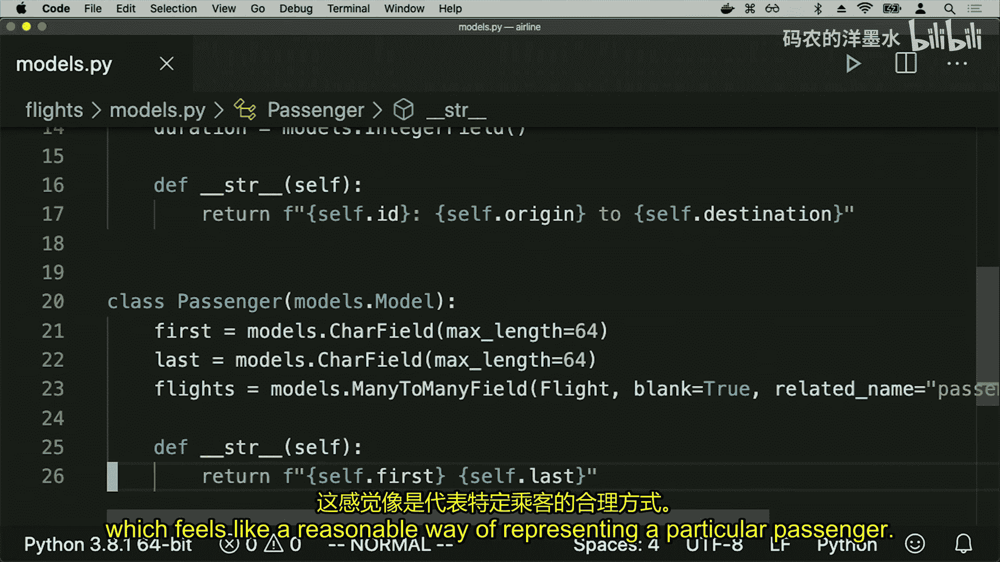

Now I have applied those changes to my actual database。And if I go into admin do Pi。

 So we'll go into admin dot Pi and register not only flight and airport but passenger。

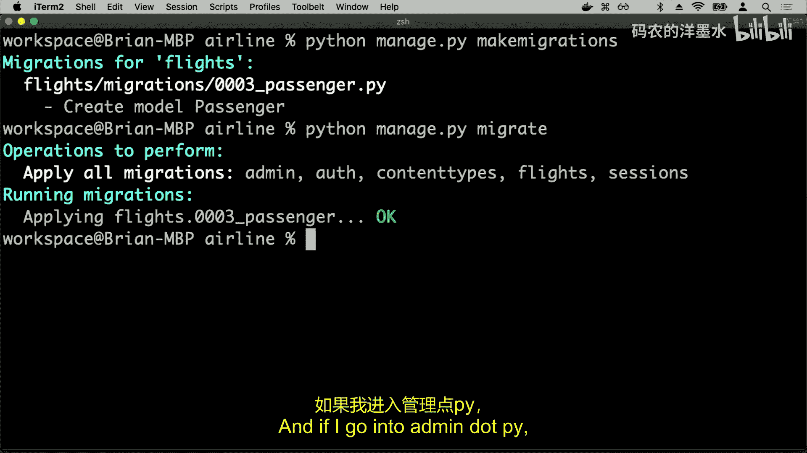

Admin。ite。registerpaenger。

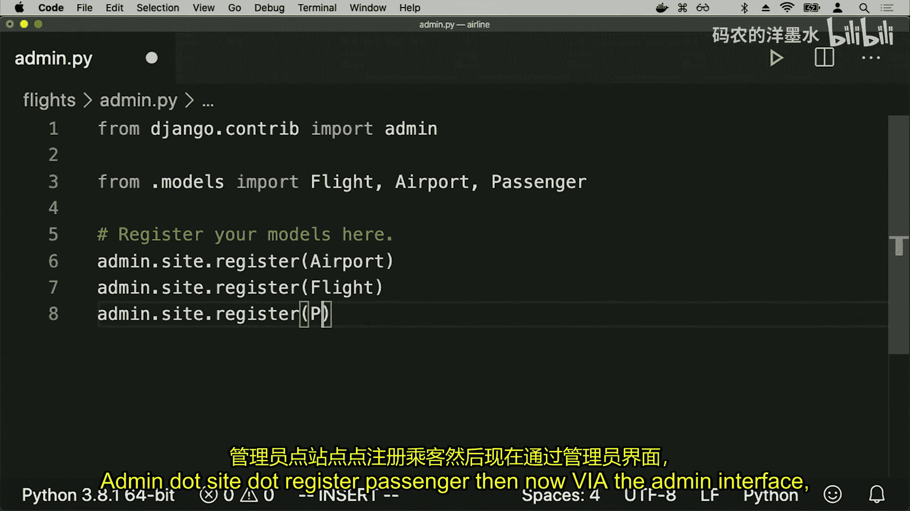

Then now， via the admin interface， I can manipulate passengers as well。

 I can say Python Man in Shaie run server to run my web server。

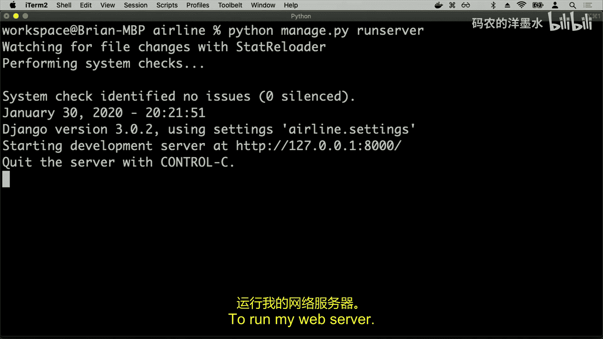

Go to my Web server's admin view by going to slash admin。

Go down to passengers and let's go ahead and add a passenger。Where I can say， allright。

 first name Harry， last name Potter， and we'll go ahead and put him on flight 1 and flight 3。

 Maybe he's on two different flights， for example， and you can hold down command or control to be able to select multiple flights。

 and we'll go ahead and save that。 Harry Potter has been added successfully。

 And let's add a couple of other passengers will'll add Ron Weasley and we'll add another。

 we'll add Hermioneone Granger and we'll add Jenny Weasley as well。

 So we've added a number of different passengers that now all exist in Django's admin interface。

 And now what I'd like to do is on the flight page。

 display information about which passengers happen to be on any given flight。

 So the way I might do that is by going into views do pi。😊。

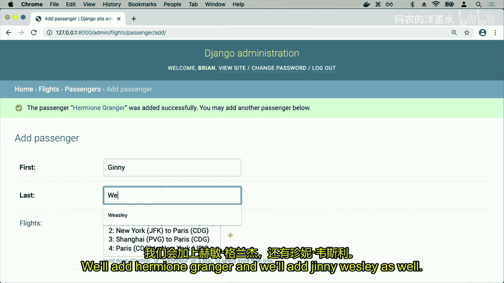

And on the flight page， in addition to giving access to the flight。

 let me also give it access to passengers。 So passengers。This template is going to get access to。

 And we get passengers by saying flight dot passengers dot all。 And the reason we can do this is。

 again， because passengers is that related name。 It is our way of taking a flight and getting all of the passengers that happen to be on that flight。

And so now， inside of。Flight dot H T M L。 I can add something like。

 let's add an H2 called passengers。 where here I'm going to loop for passenger in passengers。

Go ahead， and display。That passenger， just print out that passenger inside of a list item。 And inja。

 I can say if the list is empty， let's just have a list item that says。No passengers。

 meaning nobody is currently on this flight。

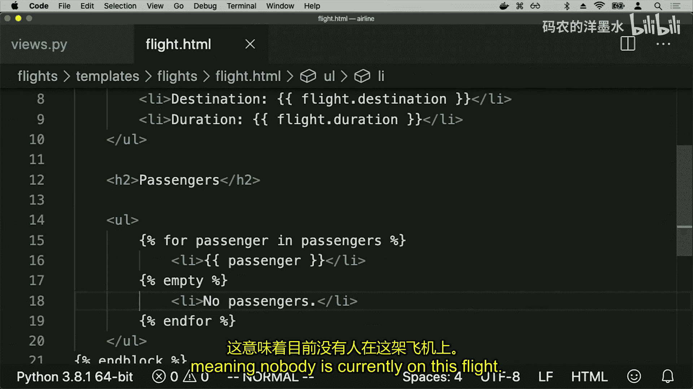

So now my web server is still running， I can go back to slash flightlights。

 here are all of the flights。And if I go to slash flight slash1， I now see that I'm flight 1。

 Harry Potter is a passenger on that flight， but if I go to flight 2， allright。

 no passengers are on that flight either。 And now it's been a little annoying that I've had to do everything by using the URL here to be able to go back and forth between pages。

 I could link to those pages if I want to。 And the way I might do that is let's on the flight page add a link。

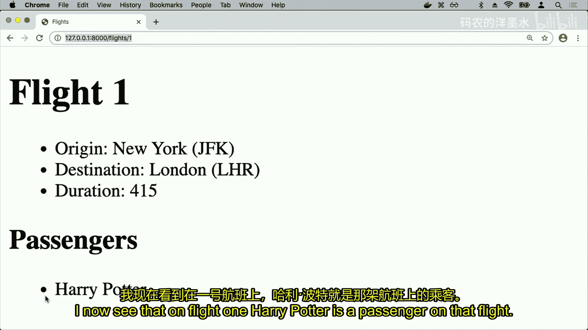

That goes to the URL index。That says something like back to flight list。 maybe。

 So here's now a link that takes me to the index view。And likewise， I can go into index。

 HTMLtm and for each of these list items， each of these list items is really going to be a link。

That links， to。It's a URL to a particular flight， and the flight route takes as a parameter of flight I D。

 And so inside this URL substitution here， I can specify use flight dot I D as the I D of the flight that I would like to use here。

And so now I've put every single flight inside of a link that takes me to the flight route。

 But because the flight route requires as an argument， the flight I D。

 I can specify the flight I D here。And so now， if I go back to slash flights。

 I now see a list of flights where every flight is， in fact， a link that can take me somewhere else。

 And so now I can click on any one of those links like New York to Paris。

 and that takes me to the flight page I can click back to flight list that takes me back to the flight list。

 click on another flight and go to that flight as well。

 So I've now been able to come up with this way of linking these pages together by having links in each of the various different pages that take me to some other route as well。

😊。

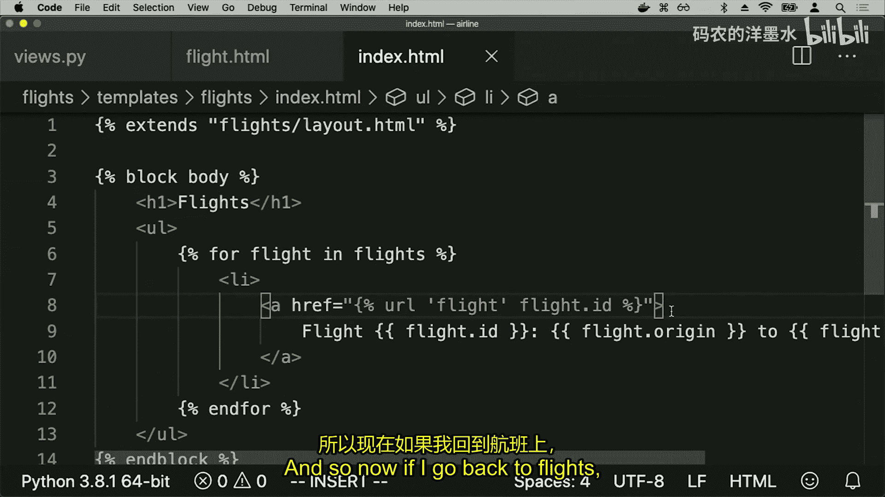

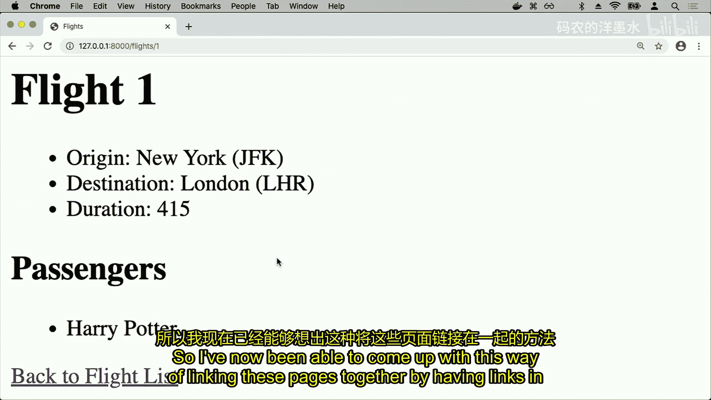

And so now what I might like to do is in addition to displaying all the passengers on any particular flight。

 also give myself the ability to add passengers to a flight as well。

 which feels like a reasonable thing that I might want to do inside of this web application。

 And so how can I go about doing that。 Well， in order to do that。

 I'm going need some new route that lets me book a flight for a particular passenger。

 And so I'll go ahead and go back to URL stoppi。And inside of URLs dot Pi。

 I'll add a new path that will be int flight I D flashlash book。

An in flightlight I D slash book is going to let me book a flight for this particular flight I D for flight 1 or flight2 or flightlight 3 or so forth。

When I do， we'll go ahead and go to the book view and we'll name that book。

And so now I need to implement the book view。So how is this view going to work。

 I'm going to define a function called book。That is going to take its argument， not only the request。

 but also a flight I D。The first thing as with before is I want to get the flight I。

 but remember from before that there are multiple ways that I can request a web page。

 I can request a web page via the get request method， which means I would just like to get this page。

 or I can request a method via post， meaning I would like to send data to the page。

 and generally speaking anytime you want to manipulate the state of something。

 especially manipulating our database， that should be inside of a post request。

 I'm submitting some form some data， and in response to that post submission。

 you should manipulate what's going on inside of the database。

So we're going to check when this book route is called upon if request method is post。

 then we want to perform some sort of action。The flight in question is just going to be flight do objects do get。

 get the flight whose primary key is that flight ID。😡。

And then what I'd also like to do is associated with the form when someone submits this form to like book a new passenger on the flight。

 they should tell me what the ID is of the passenger。

 like what passenger should I book on this flight because those are the two pieces of information you need to know in order to actually book a flight。

 you need the flight and the passenger information。

 So let's assume for now that the information is going to be in request do post。

And then in square brackets， passenger。 what this means is that the data about which passenger I D we want to register on this flight is going to be passed in via a form with an input field whose name is passenger。

 The name on any particular input field dictates what name we get what is received when a route like this book route is able to process the request from the user。

 So we'll go ahead and take that information。 And because by default， this might be a string。

 Let's go ahead and convert it into an integer just to make sure we're dealing with an integer。

And let me say that the passenger in question is going to be passenger do objects dot get PK equals。

This whole thing。So now what I've done is if the request method is post。

 meaning someone submitted this form via the post request method。

 I'm first saying flight do objectsject do get to get a particular flight。

 Get me the flight with that flight I D。😡，And then I'm getting a passenger。

 Which passenger am I getting， The one whose Pk， their primary key， otherwise known as IDd。

 is equal to whatever was submitted via this post form with a name of passenger。

 And we haven't yet created that form， but we'll do so in just a moment。 Now， ultimately。

 we'll want to add some more error checking to this as well。

 like what if someone requests a passenger that doesn't exist or a flight that doesn't exist either。

 So there's definitely some error checking that we probably should be doing here。 But for simplicity。

 let's just assume for now that we're able to get a flight and get a passenger。Well。

 how do we access a passenger's flights， I can just say passenger dot flights。 And order。

 in order to add a new item to some set like flights， I can just say passenger dot flights dot add。

Fight。And this will do the equivalent of adding a new row into a table of keeping track that the passenger is on that flight。

 But the nice thing about Django's abstractions is that I don't have to worry about those underlying details。

 I don't have to worry about what the structures of the tables are。

 I can think at a much higher level and just say。😊，Take this passenger。

 take their set of flights and go ahead and add a new flight to that set of flights。

And when all that's said and done， what I probably want to do is return some sort of redirect that redirects the user back to the flight page。

 So we'll go ahead and return an H TTP response redirect。What URL would I like to take them to。

 Well I'd like to take them to the flight route and reverse again。

 takes the name of a particular view and gets to me what the URL is。 And we saw that last time。

And the flight route takes an argument， so I need to pass as an argument， the flight's ID。😡。

So I need to provide it to the flight route what the flights IDd is structured as a tuple。

 and that is going to redirect me back to the flight route so that I can see that flight page again。

And what I need to add up at the top here is from Django do HGDP， import HGDP response redirect。

In addition to from Django。 URLs import。Reverse。AndSo those I'll need to add as well so that I can redirect the user back to the flight page after they're done submitting the form and reverse takes the name of a particular view as defined in URLs do Pi。

 something like index or flight or book and gets to me what the actual URL path should be。

 And as we talked about last time， that's helpful so that I don't have to hard code URLs into my Jjango web application。

 I can just reference URLs by their name。 And if ever I need to change a URL。

 I can just change it in one place in URLs do Pi。 And that change is going to reflect everywhere else as well。

😊，So now the next thing I need to do is actually create this form that what I have so far is just a function called book that is waiting for a post request to be made to it。

 And when a post request is made to it， then we're going to go ahead and submit this form and go ahead and add the flight for this particular passenger。

 But what I'd like to do now is actually add that form。 So I'll go back into templates。

 Go into flight dot H TM L。And what I'd like to add here is a form。

 Ill go ahead and label it with an H2， called a passenger。And we'll create a form。

Whose action is going to be URL of book。 So we're going to go to the book route。 And again。

 if we recall the book route in URL。 Pi， the route with name book， this view。😡。

Required is a parameter， some flight I D。 So I need to provide the flight I D as an argument for what flight I'm booking the passenger on。

 And it just happens to be flight dot I D， because this template has access to a variable called flight。

The method of this submission is again going to be post。😡。

And recall from before that whenever I have a form in Django。

 I need to give it this CSRF token just for security to make sure that Django knows it's really this application that is submitting this form。

😡，We'll go ahead and add a drop down list， which you can create in H TM using a select field。

 The name of this select field is going to be passenger。

And the reason for that is inside of use dot Pi， when I get the passenger。

 I'm looking for inside the post data inside of request dot post for a field whose name is passenger。

 and so that is what I would like the name of this dropdown to be。 and inside of a select dropdown。

 we have a whole bunch of options， options that we can choose from and there's going to be one option for everyone who isn't a passenger on this flight。

😡，And so how do I get everyone who isn't a passenger on the flight？ Well， it seems that right now。

 the flight page only has access to actual passengers and doesn't yet have access to people that are not passengers on the flight。

So it sounds like I need to add some additional context to the template。

 additional information that we want access to。 So I'll go ahead and give this flight access to additional information that we'll call like nonpass for people that are not on the flight。

 And how do I get nonpassengs。 Well， just as I could say passenger do objects do filter to only get passengers that match a particular query。

 There's also a way in django to say passenger dot objects dot exclude to say exclude passengers that satisfy a particular query。

 So I want to exclude passengers who among their flights have this as one of their flights。😊。

And so what does this actually mean， Well， it means that when I render flight dot H TM L。

 there's a couple pieces of information that it should have。

 It needs to know what flight is being rendered。 It needs to know who is on the flight。

 who are the passengers But if I want a drop down where I can choose from all the people who aren't already on the flight。

 like I would like to register you for this flight。 Well， I also need all of the nonpass。

 Passs except excluding the ones who are already on the flight and get me all of them is what that dot all is ultimately saying。

And so using that， I now have access to this variable called nonpaengs that I can use as I'm constructing this page。

 So back on flight dot H Tml， I can say for every passenger in non passengers。

Let me create an option that I can choose from。And the options's value is going to be the passenger's I D。

 because ultimately， when I submit the form， what I care about getting is what is the I D of this passenger that I've chosen from this dropdown。

 But， of course， the user who's looking at this page， they don't want to see people's Is。

 they want to see people's names。 So inside of the option tag will go ahead and just print out the passenger's name。

And we'll see in a moment what all of this actually looks like in terms of HTML。

 so now that I've created this form， I'll also need at the bottom to add an input whose type is submit to let myself submit this form to。

Let's now try running this application。 It looks like there's a slight error where I said view dot book instead of viewss dot book viewss is the name of the module since this's in a file called viewss dot Pi。

 And now it looks like my server is running。 okay， I can go back to slash flights。

 Let me get one of the flights like New York to London， Flight number one。

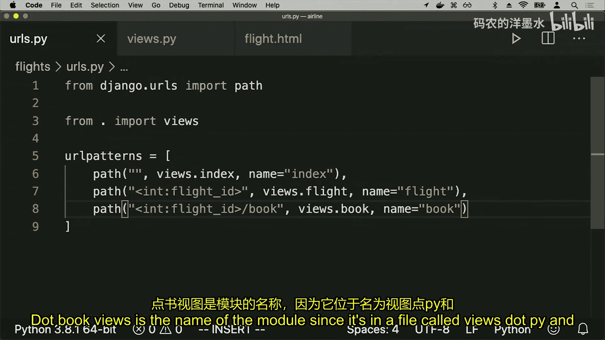

And all right， name error。 name passenger is not defined。

 This is how Djainggo renders to me errors that are occurring in my Python code Look like it just means inside of used Pi。

 I'm referencing passenger， but I never imported it。 So up at the top。

 I'll go ahead and import passenger as well。 Now it seems that my web application is working okay。

 So hopefully I refresh this page I see flight information。 I see passengers。

 and I also down at the bottom now， see an ad passenger section with the drop down list where I can click on it and see。

 all right， here the three people that are not already on this flight。

 And so if I want to add like Jeninny Weasley to this flight。 I can click Jeninny Weasley。

 click submit， and that submits the form and I'm redirected back to the same flight page。 now。

 Harry and Jinnie are both on the flight。 and then the ad passenger list。 I see Ron and hermi。😊。

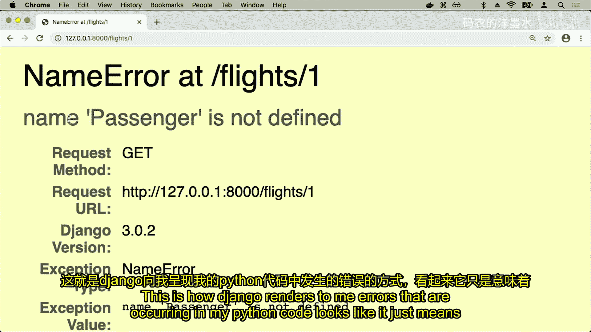

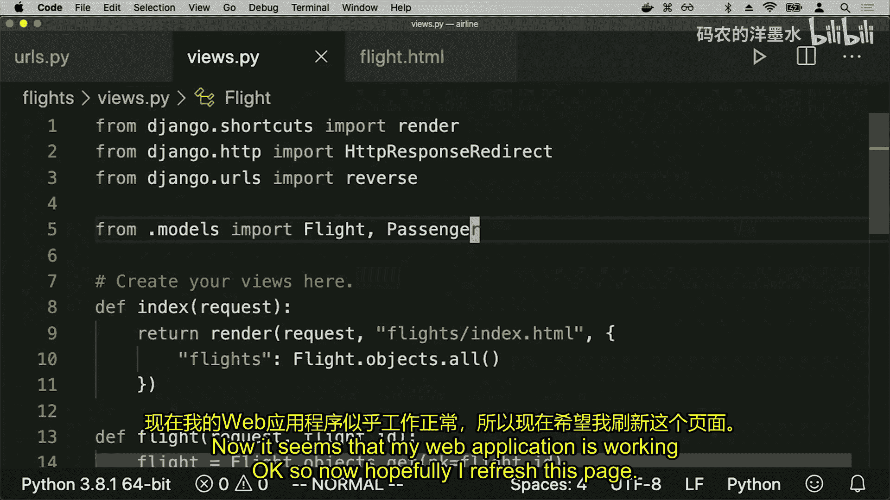

What's the options for me there？And so using Django's models。

 I've been able to very quickly build up a reasonably sophisticated application。

 an application that has models that displays that information to me and lets me manipulate that data。

 And that data is ultimately stored inside of a SQL database。

 And one of the big powers of django that it really gives to me is this admin interface that I ordinarily might have had to spend a lot of time designing a web interface that just lets me do things like take some person and go ahead and update like what is their name。

 What flights are they on and the ability to very quickly add and delete and edit the models is something that in a web application could take quite a lot of time to be able to build from scratch。

 But Django very fortunately。😊。

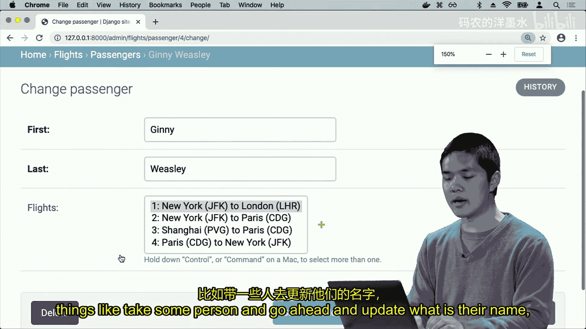

Gives all of that right to me。 And this admin interface， even though it is designed by Django。

 it's very customizable in terms of things that I can do on this admin interface if I want to manipulate it in certain ways in order to add additional features to it as well。

 So we'll see a couple brief examples of this。 If I go into admin dot pi。😊。

Here is my configuration for Djainggo's admin interface。

 And I can say I would like to configure the admin interface in a particular way that in a flight。

 for example， by default， all I saw was like the flight's origin and destination。

 If I want to be able to see more information about a flight， I can say， go ahead and give me。😊。

A class called Flight admin， which is going to be a subclass of model admin。

 where I can specify any particular settings that I want to apply to how the flight admin page is displayed。

 So I can， and all of this is documented on Jinggo's website and you just have to read it to be able to know what configuration options are available to you。

 But I can say in the list display when you list all the flights and display them all to me。

 What fields should I have access to。 Well go ahead and show me something like the origin and the destination and the duration and maybe also show me the Id。

 for example， So I want to see all of this information when you load a flight。

 And when I register the flight， I'll say register this flight。

 but use the flight admin settings when you do so。 So I can specify I would like to use these particular settings when you view the admin interface。

😊。

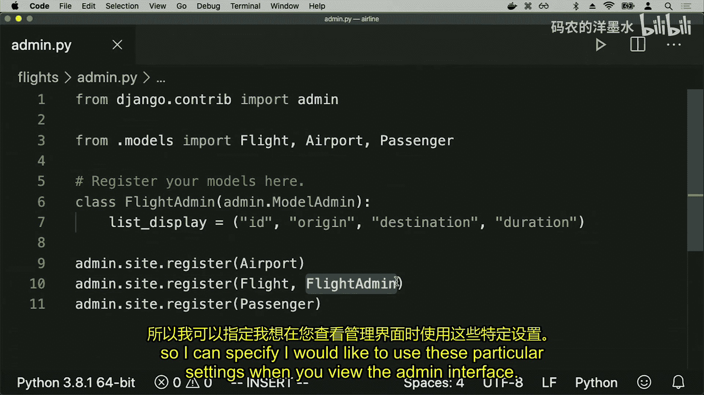

And so now if I go back and go ahead and click on flights， then now in this list display。

 whereas before I only saw IDs and origins and destinations。

 now I can configure it to show me all of the Is and origins and destinations and durations as well I've been able to configure this display to work the way I would like it too and there are other configurations you can do as well。

 one that I quite like to use is if I want to update my passenger admin。

 So when I'm editing a passenger， you can have a special way of manipulating many to many relationships inside of an attribute called filter horizontal。

😊。

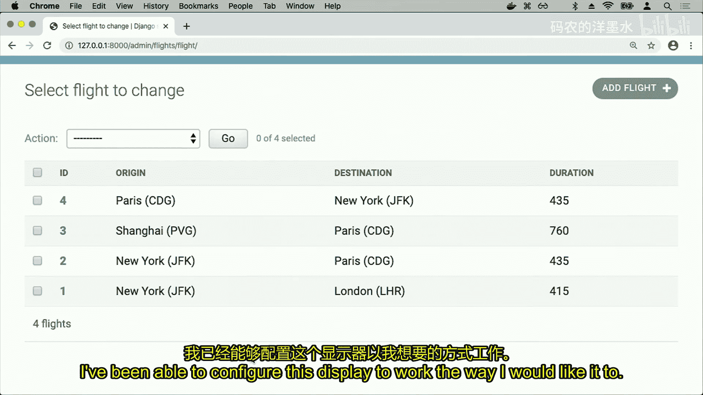

And if I use a horizontal filter on flights， this will just make it a little bit nicer for manipulating the flights that a passenger is on。

 and again， the specific syntax of this not as important as the idea that these are all just configurable settings that Django has documented that you can look at to see how to configure the adamin interface to work exactly the way you want it to work。

😡。

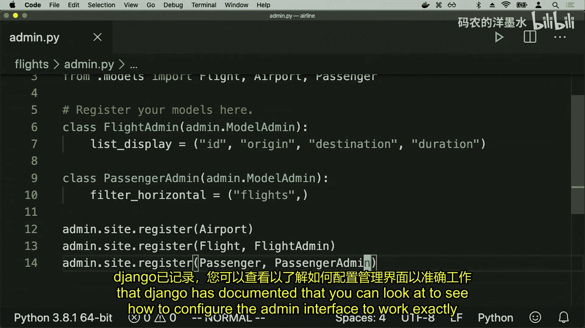

And so now if I go back home。And go to passengers and maybe click on a passenger like Harry Potter。

 I now see this horizontal filter， which is a very nice way of being able to manipulate flights that the persons on。

 I see on the left a list of their available flights that I could add them to on the right。

 a list of their chosen flights， flights that they're already on。

 and it becomes very easy for me to just take a flight and double click on it to move it from an available flight to a flight that they're on and vice versa just very quickly being able to control and manipulate these models。

 And this is all stuff that Django just gives to you right out of the box。😊。

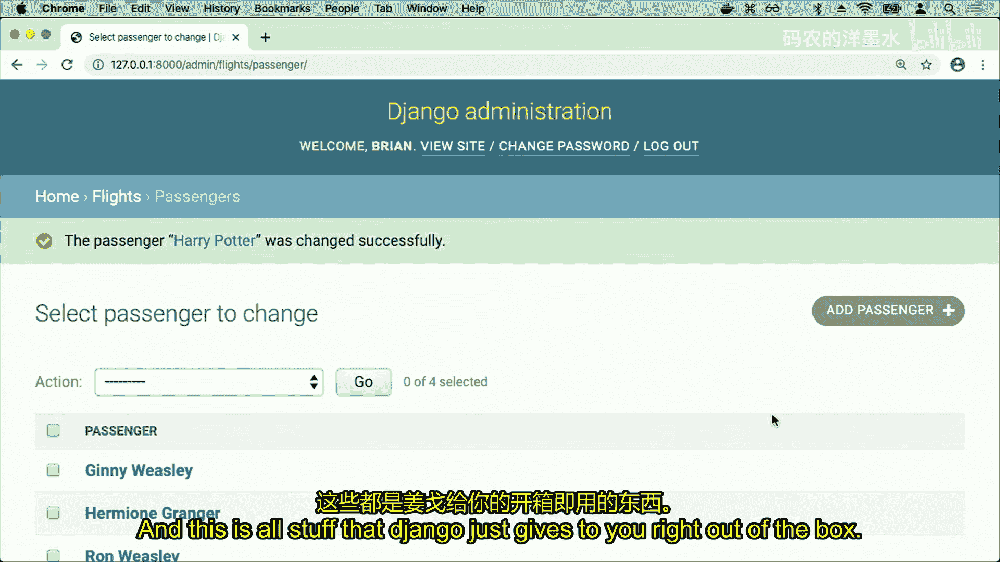

So Django now has given us a lot of features， the ability to represent models very succinctly。

 a migration method for being able to very quickly apply those changes to our database。

 And the last thing we'll take a look at is this idea of authentication。 that on many websites。

 we want some method of authentication， some ability for users to be able to log in and log out for django to remember who a particular user happens to be。

 And what we're going to do now is introduce an application that lets us interact with this authentication method because Djago has a whole bunch of authentication features built right into the framework that we can take advantage of so that we don't need to rewrite all the logic for how do you log someone in and what does it mean to represent a user。

 Django has done a whole lot of that for us。 So we'll go ahead and create an application to do that now。

 All right， so let's go back into my terminal now。 And now I have this airline project inside of which is one app called flights。

 And I'd like to now create another app that's going to maintain users inside of this application。

 So we'll go ahead and run Python managed Pi start app users。😊。

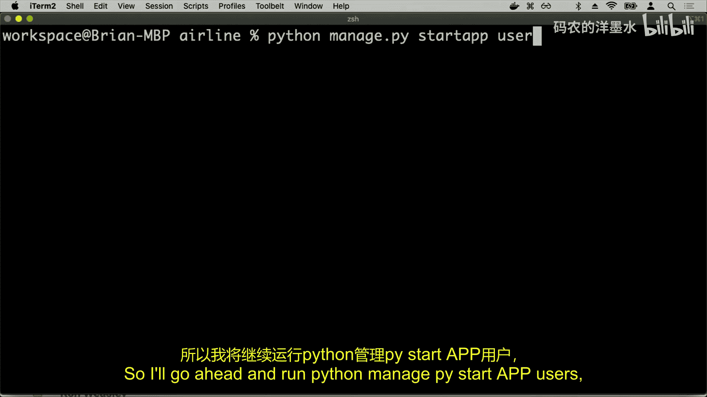

It will just be an app that's going to allow me to represent users as of before， when I create a new。

An applicationpplication， I'll need to go into Setting De high。

Add users as one of the installed apps inside of this project。

And I'll go into URLs dot Pi to say I'd also like when I go to like users。

We'll go ahead and include users。urs。So all the URLs that are associated with my users's application。

 Now， Ill need to actually create those URLs。 So I'll go ahead and go down into my users's application。

 create a new file called URLs dot Pi， inside of which is the same as what we've normally seen inside of these URLs files。

 I need to import path， import my views and then define some URL patterns。😊。

Where here what I'd like to do is define one path。That takes me to views dot index。

And we'll call this one index。Then I'll create another path that takes me to log in。

Called the login view。And the name will be login。And we'll have another path called log out。

For a function called logout view that will be associated with it。

 So we'll effectively have three different routes， One main index route that's just gonna display information about the currently signed in user。

 One route for logging someone in a form that will display the place where they can type in a username and password to log in。

 and then one route to allow users to be able to log out from this application as well。

So let's go ahead now and actually write these functions， we need one function called index。

 one function called login view， one function called log Out View。So I'll go into View。

pi and we'll start with index。And so what does the index function need to do。

 It's going to display information about the currently signed in user that I sign into this website And then I'm presented with the index page。

Because as we think about this programmatically， we first need to think about what should happen if someone tries to access this page。

 but they're not authenticated。 How would we even find that out。 And what do we do in that situation。

 Well， let's say if not request dot user dot is authenticated。

 The request object that gets passed in as part of the request to every user in Django automatically has a user attribute associated with it。

 and that user object has an is authenticated attribute that tells us if the user is signed in or not。

 if they're not signed in， we'll go ahead and H T TP response redirect them。To， the login view。

And in order to make this work， I'm going to need to from Django do H E TP import H TP response redirect。

 And likewise， from django dot URLls， let's go ahead and import reverse as well。

 So if the user is not authenticated， then we're going to redirect them to the login view where what is the login view going to do。

Well， the login view for now， let's just go ahead and render。Users slash login do HM。

 some form where the user can log themselves in。We'll need to create some templates。

 I'll create a templates folder inside of which is a user's folder。

 inside of which we'll just create a basic layout， as we've done multiple times now。This is again。

 going to be the general structure for pages in this app， title will be users。

 and the body will just have a block called body that I can later fill in with other content。

And now that I have this HTML layout， I can go ahead and create a new file called login。html。

 where login dohtml will extend user slash layout do HTMLtm and inside the body block。😡。

I can just display an H L form so I can say something like I would like for there to be a form whose action When I submit the form。

 let's go ahead and still go to the login URL。But let's do so using the post request method。 Again。

 I'm logging in。 I'm submitting a form generally， when you're doing that。

 you want to submit form data via post， especially in the case of username and password。

 because if you do this sort of thing， you don't want the username and password to be passed in as get parameters because those show up in the URL。

Our form will have our CSRF token for security as before。An input whose type is text。

 whose name is username。And just for user friendliness。

 let's give it a placeholder also of username so the user knows to type in their username here。

We'll also have an input whose type is password， whose name is also password。

 and when an input's type is password， that just means our HTML will know in the browser that Chrome or Safari or whatnot will know to show the password as dots instead of as characters。

😡，And we'll give that a placeholder of password。And then an input of type submit。😡。

Whose value is log in。 So we now have the ability to log in。

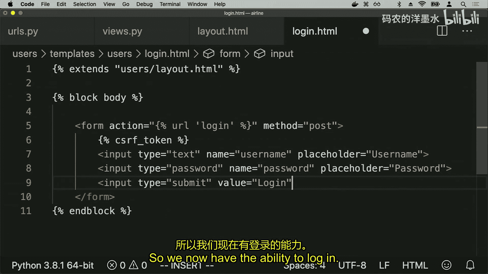

So if we go ahead and run this program， Python managed up P run server， we should see。

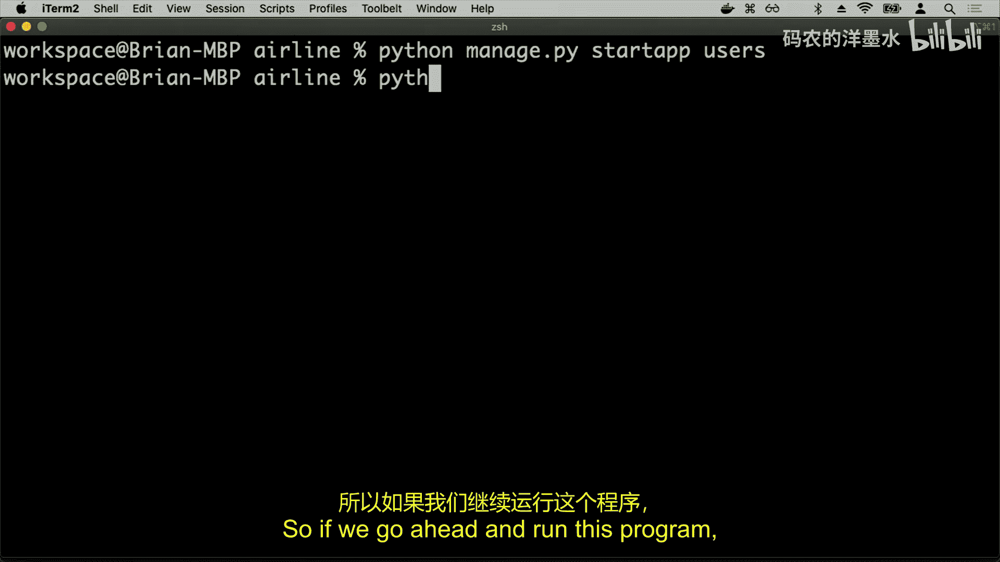

Users do views has no attribute login view。 All right。

 It looks like I called this function login request。 It should actually be called login view。

 and I'll also need a function called log out view。 but I haven't implemented that yet。

 So I'll just go ahead and say pass for now， but I'll come back to that later to implement the logout view。

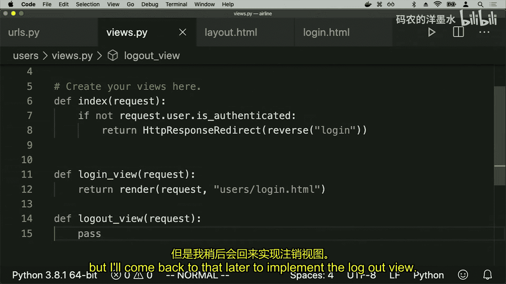

Alright， so it looks like my web server is running now。 And before I actually go to the login page。

 let me first go back to the admin page and actually just create some users。

 I can go to users and then add and let's add a user。 The user name will be like Harry， for example。

 and we'll go ahead and give Harry a password。 And we'll go ahead and save and add another。

 Let's add maybe Ron as well。😊，Go ahead and add him。 We'll go ahead and save that。 And these users。

 they can have additional information associated with them。 I can give Ron a name like Ron Weasley。

 Ron weasley at example dot com This is email address。

 There are a bunch of default fields that Django gives you for manipulating users And you can take these users and go ahead and add to those fields if I want to giving them the first name。

 Last name， email address and whatnot。 And you can also customize these fields as well。

 If you'd like to add custom fields that you would like to keep track of with regards to your individual users。

 And I will go ahead and log out from Django admin now， because I don't need it anymore。😊，But now。

 if I go to slash users， I'm not authenticated。 So what I see is a login form that just looks like。

's a place for me to type in a username and a password。 And， of course。

 I could type in like Harry's username and password。

 but I haven't yet implemented the processing of that data yet。 So let's go ahead and do that now。

We'll go ahead and go back to View。 Pi。In the login view。

 there are two ways the login view function could be called。 One is via the get request method。

 meaning just show me the login form， and one is via post。 Sub data to the login form as well。

 So if the request method is post。Well， then let me first get the username。

 which will be inside of the post data in a field called username。 and let me get the password。

 which will be in a field of in the request post。Inside of password。

And now what I'd like to do is try to authenticate this user。 And how do I go about doing that？ Well。

 it turns out there are a couple of functions that django has given to me that I can import。

 So from Django dot contri dot off off for authentication。

 I'm going import three functions we're ultimately going to use。

 One is authenticate that checks if username and password to correct， one is called log in。

 one is called log out。😊，And I can now use those functions inside of this login view here。

 After I've gotten the username and password， I'd like to authenticate the user。

 Check if the username and password are correct。 So I'll go ahead and say user is equal to。

 authenticate request username is the username password equals password。

 And so authenticate as a function， just takes the request， takes a username takes a password。

 And if the username and password are valid， they give me back who the user actually is。

 And as long as the user is not none。😊，That means the authentication was successful。

 and I can go ahead and log the user in。 How do I log the user in。

 I use the login function that Django gives me logging in with this request， this user。

 And now I can go ahead and redirect them， H TP response redirect the user back to the index route back to the original route that the user started out as。

 And so that's if the user is not none。 If the authentication was successful。 But otherwise。

 if the authentication failed。😊，What should I do， Well。

 let me go ahead and render the same user's login page again。 But let me add some additional context。

 The context will be a message that says， invalid。Cruedentials。And now， inside of login dot H TM L。

 I can just add some logic that says， if there's a message。

 then go ahead and display that message inside of a div。And then end if to end that。

 So if there is a message， we'll see the message printed， Otherwise， we won't see it at all。

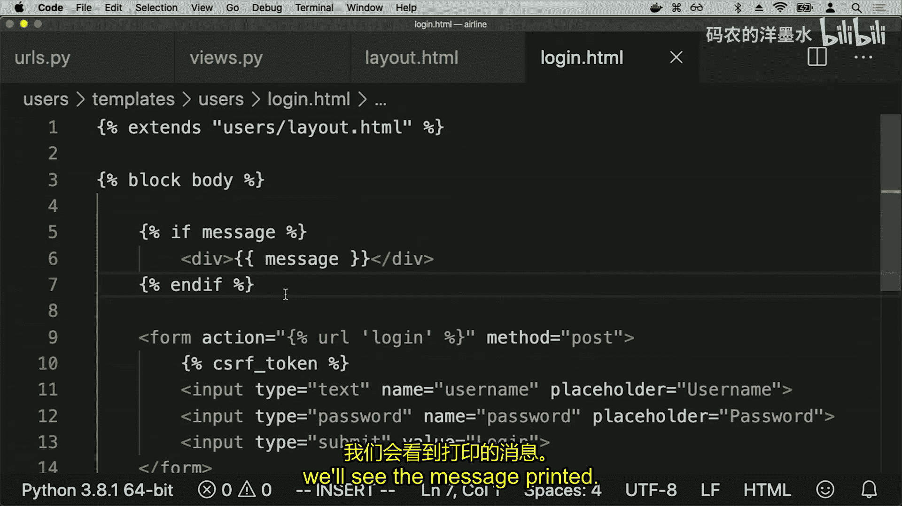

So now， if I go ahead and refresh the login page， nothing seems to have changed。

 But let's say I type in a username that doesn't exist。 Hermione and some password and I log in。

 Well， then I get this error message In credentials。 we were not able to log the user in。😊。

So what happens if we do successfully log in？ Well， then the user is going to be taken to。

This index route。 And it looks like now we need to finish off this index route。

 What does the index route do， Well， let's go ahead and return。

 render a template called users slash user dot H T M， L。And inside of user。 HTMLtm。😡。

We'll go ahead and display some information about the user。

 We'll still extend user slash layout because we're gonna use the same basic layout。

 But in the body of this page， the information I want to show is I want to say like， welcome。

 and then like Harry or welcome Ron or whoever the user happens to be。

And it turns out inside of Django templates， I have access to the request that was used to make this H T TP request。

 which means I also have access to request dot user who is the user associated with that request。

 And if the user has a first name， I can access request dot user dot first name。😡。

And in addition to that， I can display other information。

 Maybe like their user name is request dot user dot username and maybe their email address is request do user dot email。

 And so I can show the user information about them。 such that if like Harry logs in， for example。

 I sign in as Harry sign in with Harry's credentials。

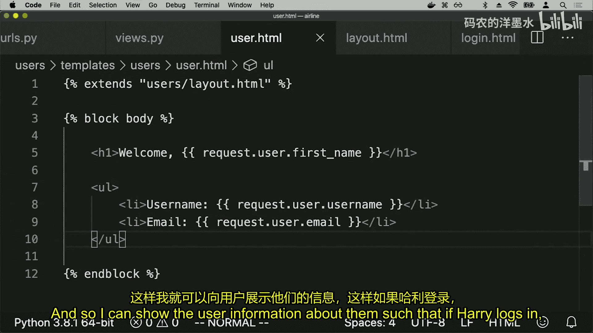

Click login。

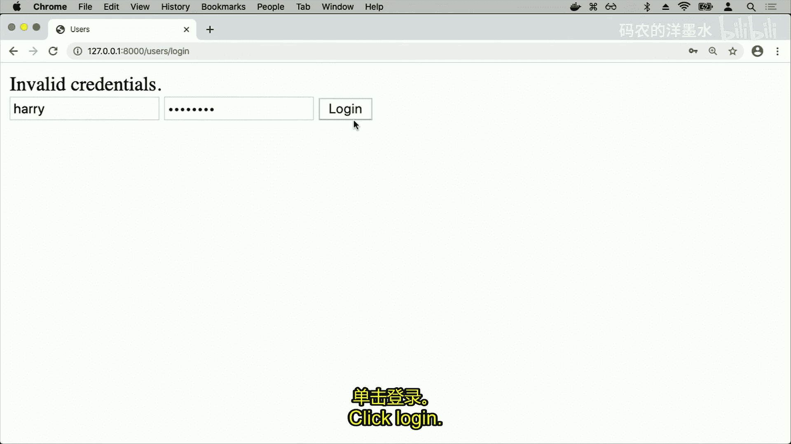

Well， then Harry sees a page that says， welcome Harry。 Harry is logged in。

 They are request dot user and using that information， we can access first name。

 user name and email as well， just by accessing properties of request dot user。😊，Now。

 last thing we need to add， which still doesn't yet exist， is a way to actually log the user out。

 And it turns out that just as Django has a login function。

 Django also has a log out function that handles log out for us。

 So we don't need to implement it ourselves。 So all our logout view needs to do is make a call to this log out function。

 And then figure out where should the user go after they've been logged out。 And you know what。

 Let's go ahead and take them back to the login page。

With a message of logged out to indicate that the user has now been logged out。Then in user。html。

 we'll go ahead and add。😡，A link that will go to the logout route。It just says。Logout， for example。

So now when Harry goes back to Harry's page， Harry sees a URL that says log out。

 If Harry clicks log out， Harry gets logged out is brought back to this page because now request do user dot is authenticated is going to be false。

 There is no authenticated user。 And so they now see just the default login page。

 And if now Ron were to log in， for example， using Ron's username and Ron's password。😊。

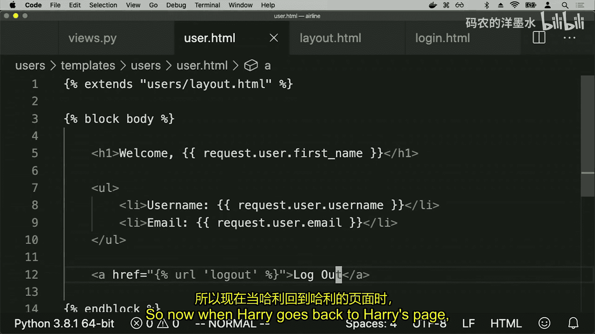

Logging in， then Ron Nasi's information associated with him as well。

 So Django gives us a lot out of the box gives us the ability to represent these models in admin interface to be able to manipulate them a migration system that allows us to very quickly。

 make changes to our models and apply them to our database and also a built in user authentication system。

 a system that allows us to very quickly enable users to be able to log in。

 log out from our web application as well。 So all of this are features that just helps to make it so that we can very quickly take advantage of things like SQL and models and migrations to build dynamic。

 interesting web applications with data to back them up。

 This was web programming with Python and jascript。 We will see you next time。😊。

