# 【全集】哈佛大学 web应用开发 9小时速成 中英字幕 附完整课件 p07 Lecture 5 - JavaScript -BV1RYUsB2Ejz_p7-

🎼。

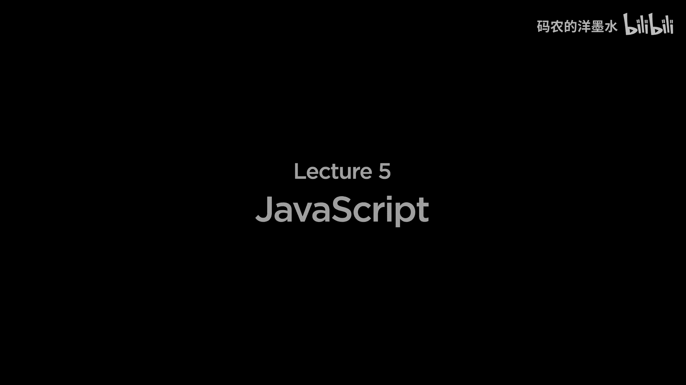

Okay， welcome back everyone to web programming with Python and JavaScript。

 and today we turn our attention to the second of the main programming languages that we' be looking into this class。

 in particular JavaScript， and to get an understanding for why it is the JavaScript is actually helpful。

 let's go back and revisit this diagram of what communication over the internet will generally look like。

 oftentimes will have a user， otherwise known as the client using their computer on their web browser。

 whether that's Chrome or Safari or some other web browser that sends an HTTP request。

 a web request to some sort of web server， that server then processes that request and then returns some sort of response that comes back to the client thus far all of the code that we've written。

 the Python web application code running in a Django web application for example。

 has all been code that runs on some sort of server code that is listening for request doing some computation in order to process that request and then generating some sort of response usually in the form of an HTML template that we then send back to the client。

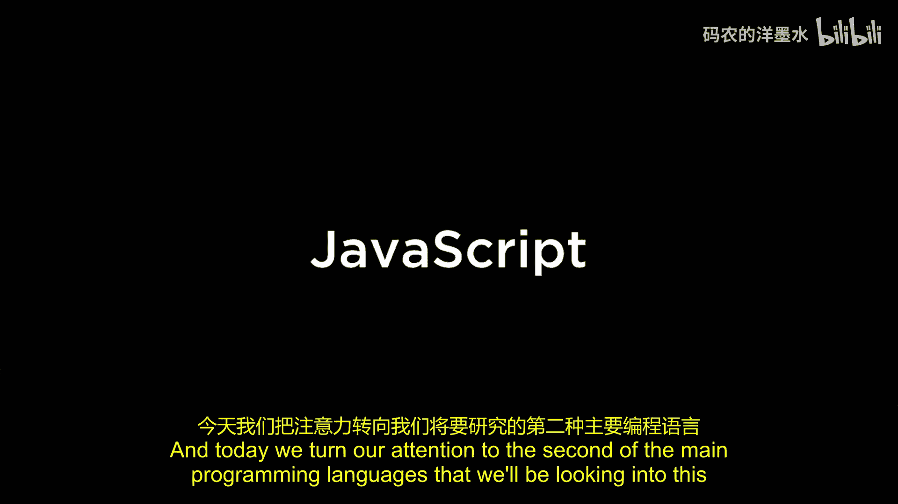

What jascript is going to enable us to do is to begin to write client side code。

 Javavascript is going to allow us to write code that actually runs inside of the user's web browser on the client。

 and this can be useful for a number of reasons One if there's computation that we want to do but we don't need to go out and reach out to a server in order to do so we can do the computation potentially faster just by running the code exclusively on the client and in addition to that we can begin to make our web pages a whole lot more interactive。

 Javascript is going to give us the ability to directly manipulate the dom where again the dom is the document object model that treelike hierarchy that represents the web page that the user happens to be looking at So jascript will enable us to write code that directly manipulates the content on the web page and we'll see how that can be quite powerful very soon So how do we then use ja inside of a web page in order to add some code add some programming logic to a web page so far we've already seen HTMLm the language we use to describe the structure of a web page where。

😡，TMl page just describes the structure of a page in terms of nested tags we had those head tags at the top of the page。

 the body tags that describe the structure of the page and then additional tags that could be nested within those and in order to add JavaScript to a web page it's as simple as including some script tags that are often located inside of the HTML page itself when we use these script tags we're telling the browser that anything in between these script tags should be interpreted in this case as JavaScript code that the web browser is then going to execute。

😡，So our very first program， for example， might just look like a line of code inside of the script tags。

 something like this， where alert， for example， is the name of a function。

 a function that's going to produce an alert， and then just as with functions in Python。

 functions in JavaScript can take arguments， so in between these parentheses we have an argument。

 something like the string hello world， the text that we would like to display to the user。😡。

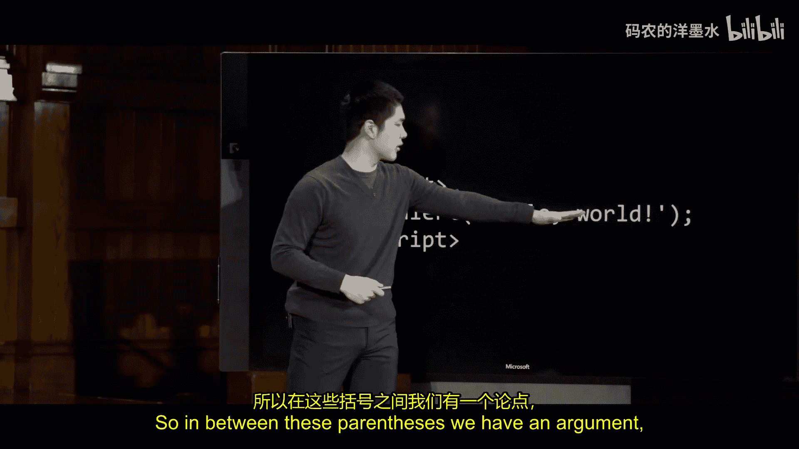

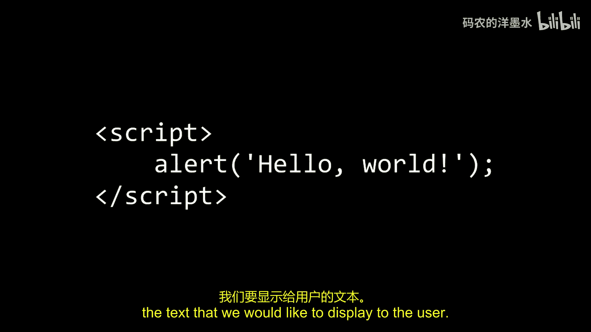

So let's go ahead and give this a try and see how we can actually use this code to write JavaScript that is going to run inside of the user's web browser。

😡，I'll go ahead and create a new file that we'll call hellello do H T M L。 And inside of it。

 I'll include。The same basic HTMLM structure that we've already seen before。

 where I have a head section that has a title and then a body that maybe just says hello。

 for example。And so now what I'd like to do is add a little bit of JavaScript to this web page so in the head section of my web page。

 I'm going to go ahead and add a script tag where in between these script tags now I can write JavaScript code code that is going to be written in JavaScript that will run inside of the web browser when the user actually opens up this page and for now I'll just say alert and then hello world。

 it turns out in JavaScript， you can use either single quotation marks or double quotation marks in order to represent strings I'll generally use single quotation marks here just by convention so here I'm running a function called alert。

 that's going to display an alert， something like hello world to the user and that's going to be inside of the script tags of this HTML page。

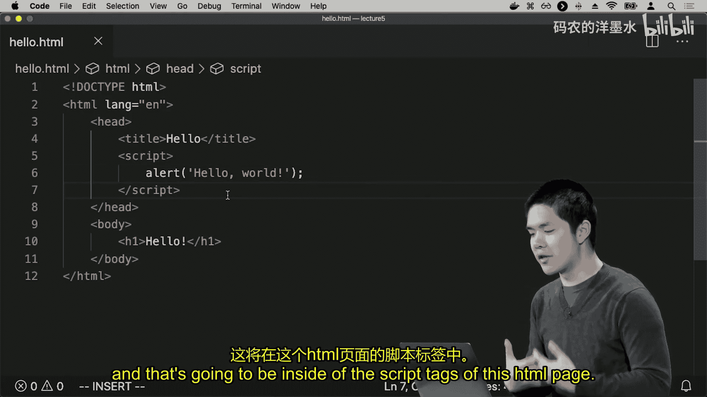

So now if I want to actually open the page up， I can open hello do HTML or you could just visit it inside of your web browser。

 whether it's Chrome or something else and now at the top of the page。

 what you'll notice is that I get a little bit of an alert some interaction where it says this page says hellello world and gives me an option to like press a button for example。

 like hello like the okay button that'll say all right dismiss the alert now and this is our very first example of JavaScriptscript we have a function called alert built into JavaScriptscript for our web browser and our web browser knows that when we call the alert function。

 the browser should display an alert message that looks a little something like that and if I click the okay button to dismiss the alert。

 then we go ahead and get back the original page that I had from the beginning。

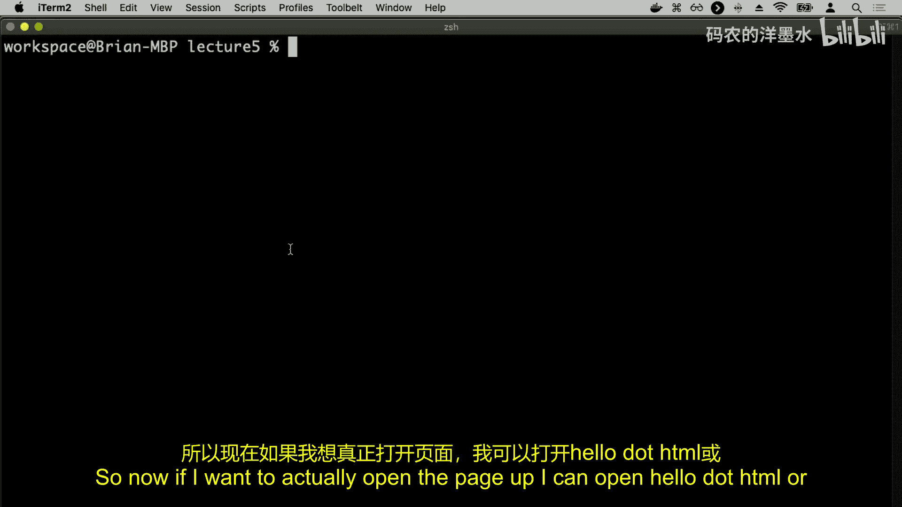

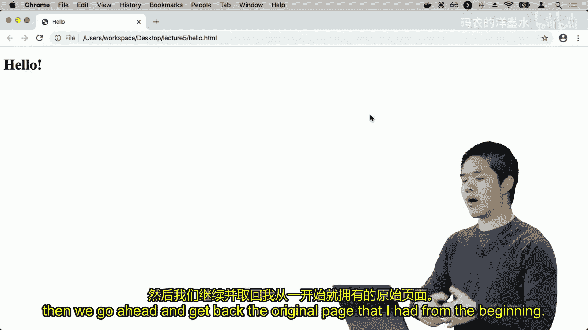

And so now we can begin to imagine that using this ability to programmatically display alerts that we can add additional features to our applications as well。

 and one big area where ja can be quite powerful is with eventdven programming and what event- drivenriven programming is all about is thinking about things that happen on the web in terms of events that happen what are some examples of events events are things like the user clicks on a button or the user select something from a dropdown list or the user scrolls through a list or submits a form。

 anything the user does can generally be thought of as an event and what we can do with JavaScript is add event listeners or event handlers。

 things that say when an event happens go ahead and run this particular block of code or this function for example and using that we can begin to allow our JavaScript code to respond to how the user is actually interacting with our web page to say when the user clicks on a button I would like to run this particular ja function for example。

😡，So let's go ahead and give that a try。 I'll go ahead and now。

 instead of just saying alert hello world。 let me put this alert inside of a function and to create a function in jascript。

 you just use the keyword function followed by the name of the function。 I'll call the function。

 hello， for example， and then in parentheses， any inputs that function takes。

 This hello function is not going to take any input。 So I'll just use an empty set of parentheses。

 And then inside of curly braces。 I include any of the code that I want to run in this function。😊。

And so what I've done here now is create a function called Ho。

 and then inside of the curly braces I've defined the body of the function。

 what code should run when I run the hello function。

 and what the hello function should do is it should display an alert that in this case says a hello world。

😡，So now what I'd like to do is get this function to run when something happens on the page。

 for example， when a user clicks on a button， so to do that。

 the first thing I'll need to do is actually create a button。

 so I'll add a button that just says like click here for example。😡。

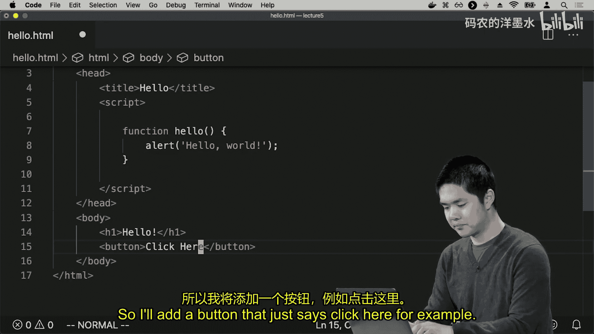

So now if I refresh this page。I now see that I have hello and I also have this button that says click here。

 but when I click here， like nothing happens， I'm clicking the click here button。

 but it's not changing anything because I haven't yet said what should happen when the user does click on this button。

 And so one way we could do this is by adding an attribute to this HTMLM element。😡。

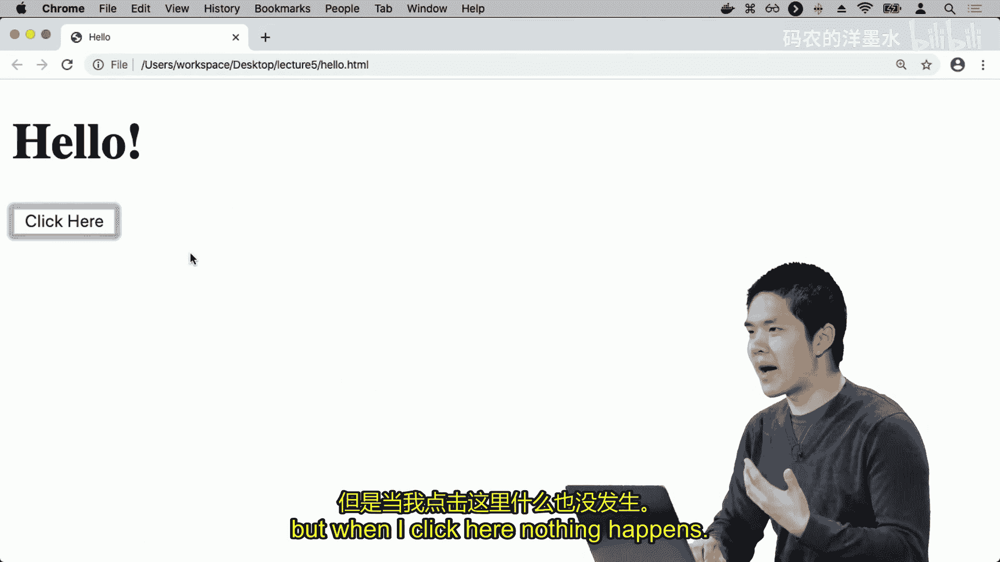

callled onclick what this is going to do is it's going to add an onclick handler to this button。

 it's going to say what should happen when the user clicks on this button。

 and I'm going to set the onclick attribute equal to running the function hello and in order to run a function and JavaScript just as you ran a function with Python you use the name of the function。

 followed by a set of parentheses to say go ahead and actually run this function using those parentheses calls the function in other word for running the function and the fact that there's nothing in between the parentheses means we're not providing anything as input to the hello function。

 though if the hello function did take inputs， we could certainly add that in between the parentheses。

😡。

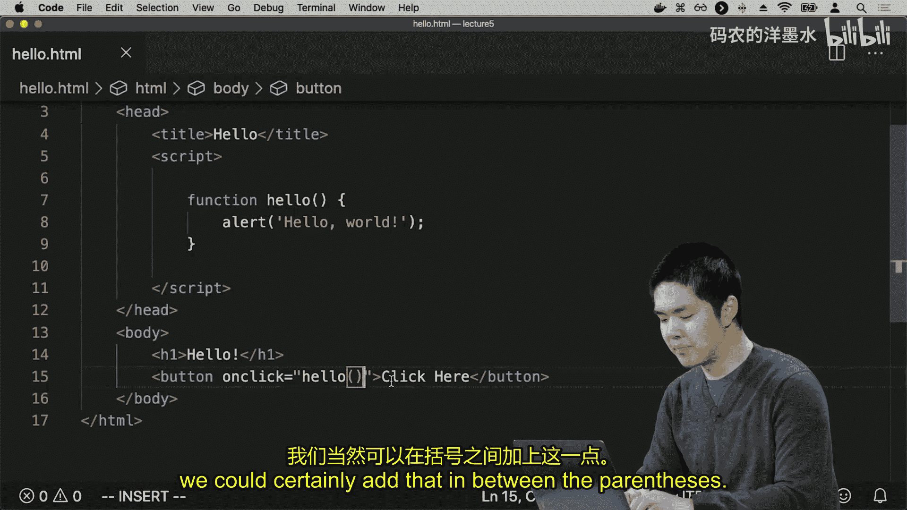

So now I've tied the two pieces of this page together。

 I have a button that says click here and I've added an oncl handler that says that when you click on the button。

 you should run the hellelloo function and then up above I've defined the hello function to say what should the hello function do well when the function is called we're going to display an alert then in this case saysHello world。

😡，So now we should be able to refresh the page。We still see the same thing， at least initially。

 where it just says hello in a button that tells me to click here。

 but now if I go ahead and click the button that it says click here。Well。

 then I get the alert that says this page says hellello world， I can press okay。

 and this event handler is always going to work。 I click the button again and I get the alert a second time because every time I click the button。

 it's going to call the hello function again and when I click the when the hello function runs。

 it is going to display this particular alert。

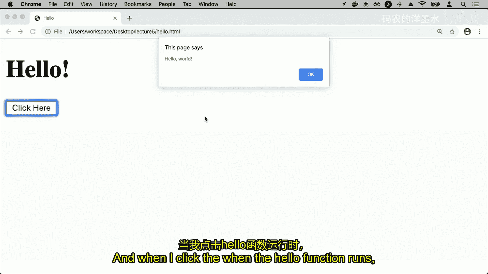

So this now appears to give us a fair amount of power and much as in other programming languages。

 languages like Python or other languages you might have worked with。

 JavaScript has all these same types of language feature so far we've seen data types。

 things like a string， but we also have other data types that we'll take a look at Z too we've seen functions。

 some functions that are built into JavaScript like the alert function。

 and other functions that we can write for ourselves， functions like hello。

 but we also have the ability to include things like variables inside of our program as well。

 so what might that look like。😡，I'll go ahead and create a new file that we'll call counter。html。

And counter is going to have some of the similar code to hello。

 so I'll just go ahead and copy it for now， but I'll clear out the script section。

 change the title from hello to counter。And now。Inside， I'll get rid of the button， or actually。

 I'll keep the button。 But instead of saying click here， the button is going to say count。

 I'd like to create a program that just counts for me from 0 to 1 to 2，3，4， so on and so forth。

And now in order to do that， in order to have some way of counting repeatedly0，1，2，3，4，5。

 I'm going to need to have some sort of variable inside of my program。

 something that is keeping track of data like the number that I'm currently have counted to。

 so in order to do that in JavaScript， I can say something like let counter equal0。😡。

This is the way in JavaScript that I define a new variable， I first say let counter。

 meaning let there be a new variable called counter。

 and I'm going to initially set the value of counter equal to the number 0。😡。

And now when I click on the button， instead of running the hellello function。

 I'm going to go ahead and run the count function。😡，Which doesn't exist yet， but I'll now write it。

I'll define a function called count。And what the count function is going to do。

Is it is going to first increment the value of counter and a number of ways I could do that one is by saying counter equals counter plus one to say go ahead and reset the value of counter to whatever counter is plus one。

 and there are a couple of shorthand notations for this I could equivalently say counter plus equals one to say add one to the counter or in the case of adding one JavaScript much like languages like C if you've seen them before。

 support notation like this counter plus plus which just means take the value of counter and increment add one to it。

 so I'll add one to the value of counter， and then I'll just display an alert。😡。

That has whatever the current value of counter happens to be。

And so I've incremented the value of counter and then displayed an alert that shows me what's contained inside of counter。

😡。

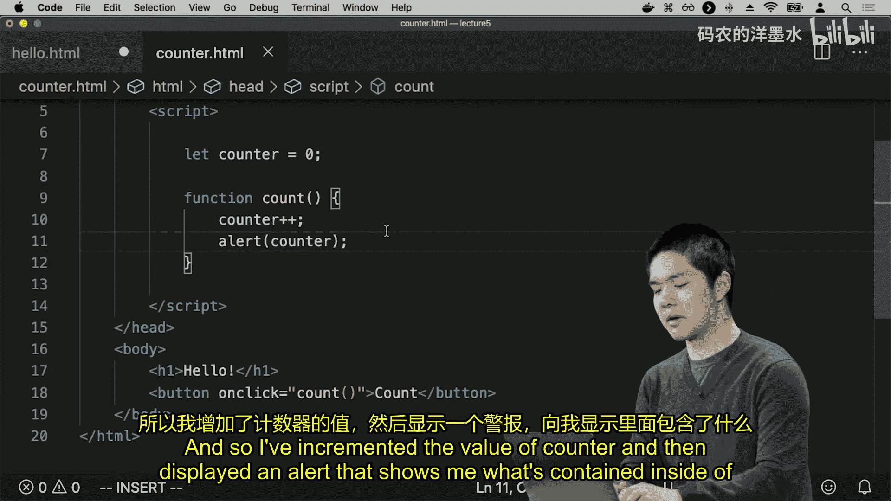

And so now。If I go ahead and not go to hello。html， but to counter dohtml instead。

I now see that I still see a button that says count and if I click on that button。

 I get an alert that this time says1， we've incremented the value of counter from 0 to 1。

 the alert now says 1 and I can press OK。😡，If I press count again， the count now goes to2。

I press OK press count again， it goes to three and every time I click count。

 it is going to increment the value of the variable counter inside of my JavaScript web page。

 and then it's going to display an alert that is going to contain the value of that variable So using alerts now we're able to manipulate we can inside of functions manipulate the values of variables and then display alerts that show the contents of those variables but ultimately when users are interacting with the page。

 it's going to be fairly annoying is the only way that we have to interact with the user is via displaying these alerts。

 the equivalent of like printing something out except instead of printing it to a terminal we're printing it via an alert that appears on the screen。

 what would be more interesting and more powerful and much more useful in the context of a web page is if we could programmatically update the website。

 change something about the web page that the user is actually seeing changing the content that happens to be on the page and turns out JavaScriptscript is going to enable us to do that as well because JavaScript allows us to manipulate the dom the document object model。

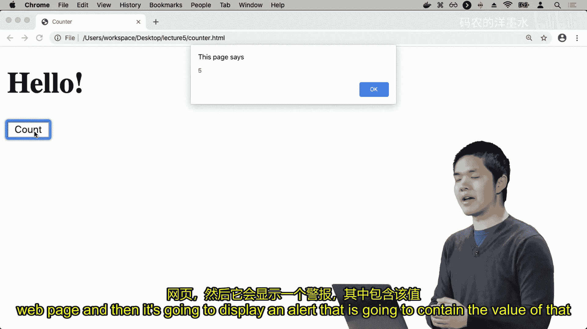

That represents all of the elements that happen to be on that page。So to do that。

 let's go ahead and return to hello dot H T M L。 This， again。

 was this web page that just said hello and gave me a button where if I clicked on that button。

 it would display an alert that said， hello world。 Now what I'd like to do is instead of having the hello function。

😊，display an alert， I'd like to have it manipulate something on the page and what might I want to manipulate。

 well inside the body of the page， I here have this heading。

 this heading that just says hello for example， which is inside of an H1 element and what I might like to do is actually change that element。

😡，How can I do that？ Well， it turns out that in Javascript。

 we have access to a function called document。Query selector and what document queryery selector is going to do is it is going to give us the ability to look through an HTML page and extract an element out of that page so that we can manipulate that HTML element using JavaScript code。

😡，And so if I want to select like an H1 element， I can say document dot query selector and then as the argument。

 the input to document do query selector， I'll go ahead and say H1， meaning go through the page。

 find me an H1 element and query selector is only going return one element。

 So if they're multiple it's going to return the first thing it finds。

 but here we only have one H1 element。 So it's okay。 I'm going to say look through this document。

 try and find an H1 element， and when you do I'd like to manipulate it。

 And the way I'd like to manipulate it is by saying dot inner H equals let's say goodbye for example。

😡，So all right， what's going on here Well right now initially when we first load the page。

 we have an H1， a big heading at the top that just says hello and now when this hello function is called which is called when this button is clicked on because it has an on-click attribute that is equal to hello calling the hello function what the hello function is going to do is it's going to say document dot query selector H1 find me the H1 element that will return this element right here。

 a ja representation of this HTML element that is just an H1 who HTMLm inside of it says hello and if I want to change that HTMLm。

 I can do that by modifying the inner HTML property of the JavaScript element in order to update a property of anything in JavaScriptscript will generally use this dot notation where dot access is a property of some particular object and so I have this element。

 this H1 and saying dot inner HTMLm means take that element and access its inner HTML property some property。

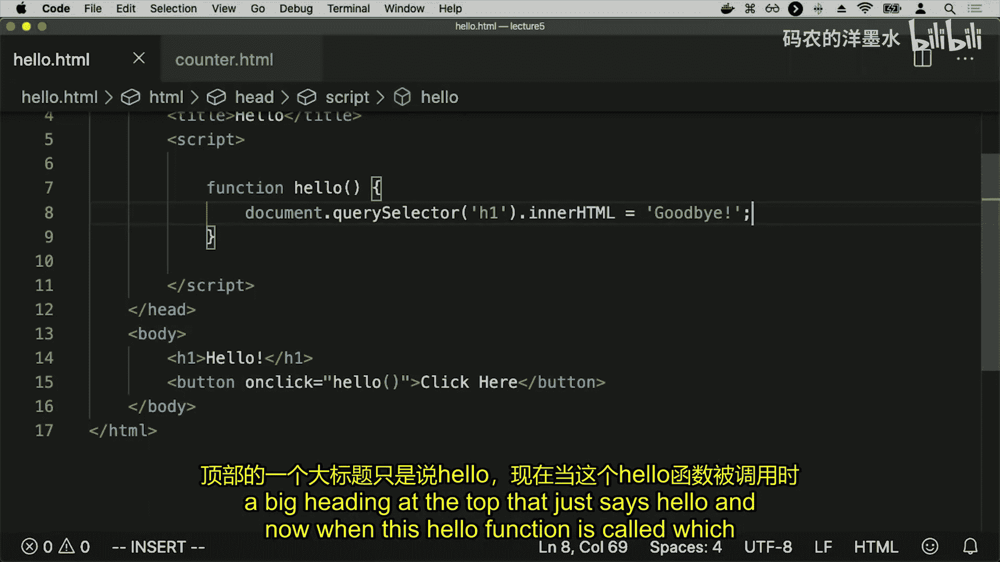

of that object， and I would like to update its inter HTML to just in this case be the word goodbye。

 followed by an exclamation point， for example。😡，So now what we'll see is that when we run this page。

 when we open this page up as by opening up hello。htm， I still see an H1 that says hello。

 I still see a button that says click here， but now when I actually click on the button， click here。

😡，You'll see that hello changes to goodbye。 We've run jascript code that finds an H1 element on the page and manipulates it changing it to something else than it was originally。

 Now every time I click here nothing else happens because every time I click here it's going to find the same H1 and it's going to update its Hm changing it from hello to goodbye。

 So maybe what I'd really like then is the ability to toggle back and forth to toggle back and forth between hello and goodbye rather than just change it from one thing to something else。

 every time I click the button I'd like it to alternate back and forth and there are a number of ways you could imagine doing this。

 But one way is by taking advantage of conditions So much in the same way that a language like Python has conditions。

 ifs and Ls and else's ja 2 has if and else if and else that allow us to describe conditions such that we can only run certain blocks of code when a particular Boolean expression is true for example。

 So what would that look like Well， let's go ahead and say inside。

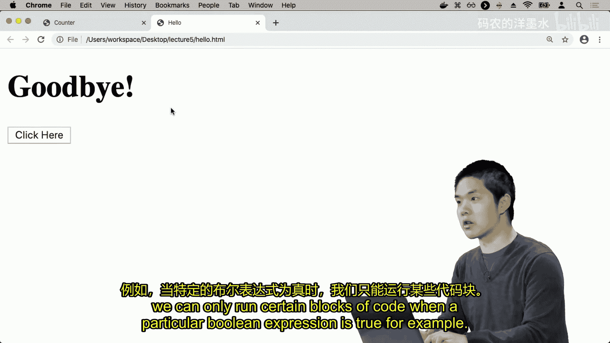

This hello function。I can ask a question if。Document do query selector， H1's inner HTML is equal to。

Hello。Well， then。Go ahead and set it to goodbye。And else。

Then go ahead and update the N HTML of this H1 element。Go ahead and set it to hello instead。

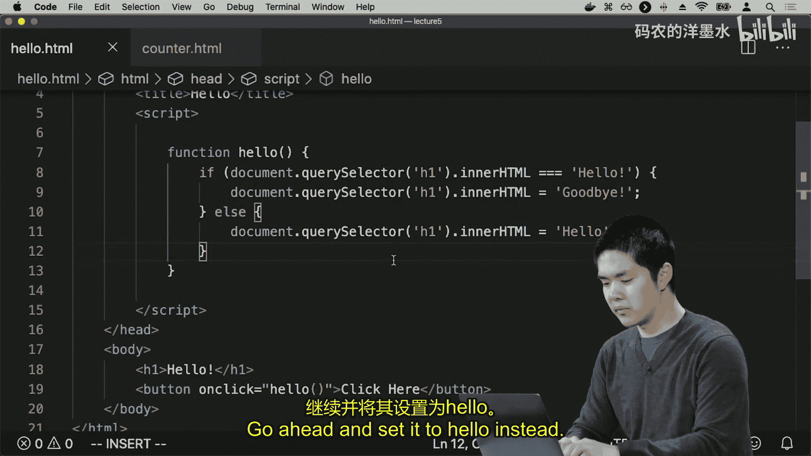

So what is this hello function doing， It's now a little bit more sophisticated It now has a condition where I say if the keyword if followed by in parentheses。

 the condition that I want to check for the thing I want to see is this true or not and what I'm checking for is is let me run document query selector H1 which again looks through the page。

 finds me the H1 tag and gets that element for me if I look at that innerhtm if it is equal to hello then I want to do something and this triple equal sign here is JavaScriptscript's way of checking for strict equality checking to make sure that two values are equal and also that their types are the same thing that if this is a string this must also be a string it turns out in ja is also a weaker way to check for equality that just uses two equal signs and that is going to check that values are the same but it's going to allow for a bit of differences in type the two things might have different types but so long as they're basically the same value the double equal sign might generally come to be true。

 usually if you can。😡，You'll want to use this triple equal sign the strict equality to make sure that not only are the types the same but the values are the same too。

 and the triple equal sign will check both of those things。

 so if I go ahead and find the H1 element and its inner HTMLt is the word hello。

 well then go ahead and find the H1 element and update its inner HTML setting it equal to goodbye。

 for example。😡，And else。Go ahead and find that same H1 element， update it to inter HTMLt。

 set it equal to Ho。And again， just as in functions where we use these curly braces to enclose the body of the function。

 all of the lines of code that are inside of the function， JavaScript does the same thing too。

 that inside of a condition when we want to express that this is inside the body of an if condition。

 I can use curly braces to say this line of code and that line of code that's inside of the if expression or that's inside of the else expression。

 for example。😡，So let's go ahead and try this now， I can go ahead and open Hello。ht。😡，Refresh it。

 it currently says hello with a button that saysCl here。And now。When I click here。

 hellello changes to goodbye and when I click here again， goodbye changes back to Hello。

 and every time I click the button， it's going to alternate between hello and goodbye because we either get caught in the if expression or we get caught in the else expression。

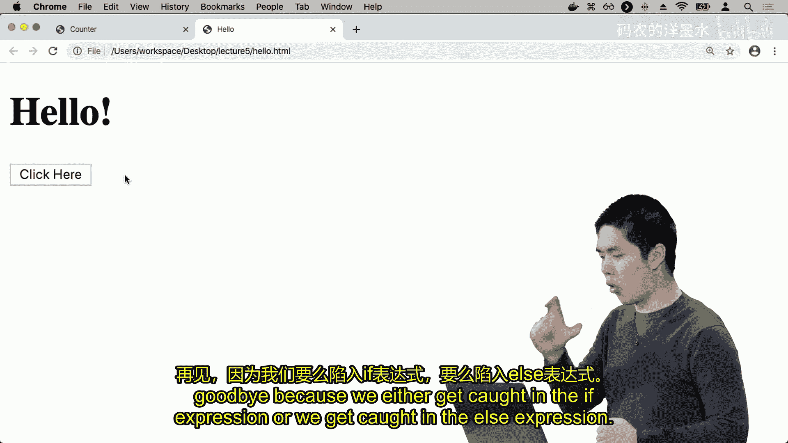

Now there are a couple of places where you might look at this and notice that maybe this isn't as efficient as this code could potentially be and recall that every time we run document do query selector to say go ahead and try and find a particular HTML element for me it's going to look through that page trying to find the H1 element and it turns out that right now we have three separate calls to query selector even though only two of them will ever run on any given instance of the function。

 but we call document query selector then we call it again inside of the if expression。

 we can probably improve the design of this page by factoring that out by just looking for the H1 element once and then manipulating it and checking it using that element that we have found and to do that we can store an element inside of a variable in the same way that a variable can store a number like a counter or a string like hellello worldd。

 it can also store other values like an HTML element that we get back from document doc query selector。

So I could say something。Like。Let heading where heading is just the name of a variable。

 be equal to document do query selector。H1， for instance， find the H1 element。

 save it inside of a variable called heading。😡，And now rather than documentQuery selector H1 all the time。

 I can just say if the headings enter HTML as hello， then set the headings in HTML to goodbye。

 otherwise set the headings into HTML to hello， so I've improved the efficiency of the program but also reduced the number of characters of code that I've had to write my lines are now much shorter a little bit easier to read this we would consider to be an improvement in design。

😡，And it turns out there's one other improvement we can make here too that we can define a variable like let something equal something else。

 but it turns out that jascript gives us a couple of ways to define a variable and if we're going to be creating a variable whose value is never going to change We're never going to reassign the variable name to something else then instead of let we can enforce that it's never going to change by calling it a constant variable So con heading equals document query selector H1 means I am going to create a variable called heading setting it equal to the result of document query selector H1 and never again will I change what heading is equal to I will never have another line of code that says heading equals something else because it is constant and JavaScript will then enforce that this variable should not change and if ever I do try to change it。

 jascript will give me an error and this can just be helpful to prevent against possible unintended behavior that if you know you have a variable that is never going to change it's often good designed to label。

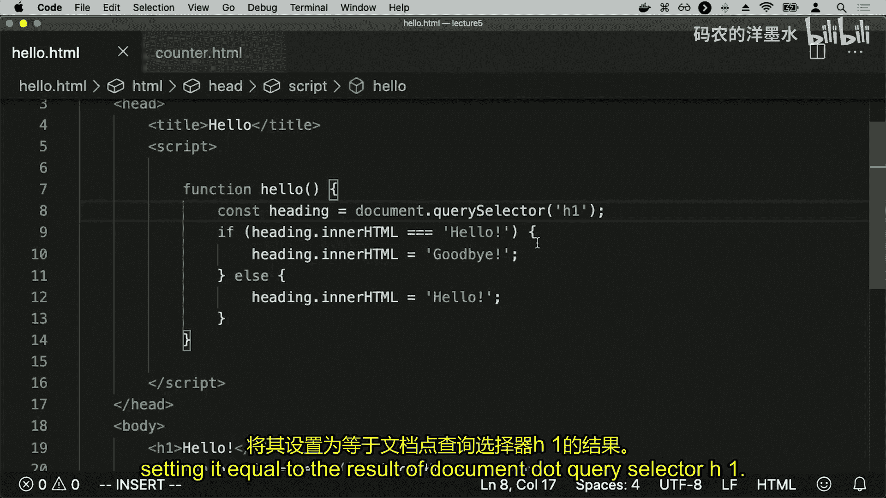

It as a constant variable so that you and other people looking at your code know that that is never going to have a value that gets changed later on。

😡，So this then will behave the same way where it says hello， but I can toggle it back and forth。

 changing it to goodbye， and then changing it back to hello again。And so now using this ability。

 this ability to manipulate the Dom， we can go back to our counter program and actually improve upon it that right now the counter program。

 I count and it displays an alert that says one， I count and it displays an alert that says two。

 I can probably do a little bit better than that by instead of displaying an alert actually manipulating the Dom in some way that I would like to have this H one。

 this big heading at the top， instead of starting up by saying hello。

 let's have it start out by saying。😡。

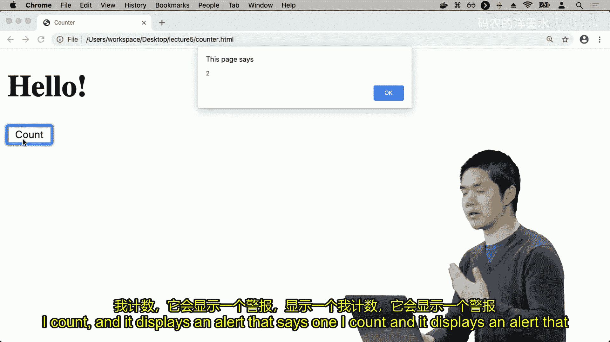

Zero， for example， just some initial value for the counter。

And now when I increment the value of counter， rather than display an alert that just tells me the value of the counter in an alert。

 I'm going to instead say document query selector。😡，Each one。Dot inner HTMLm equals。Counter。

Where I'm saying find the H1 element， update its inner HTML。

 set it equal to whatever the value of the variable counter happens to be。😡。

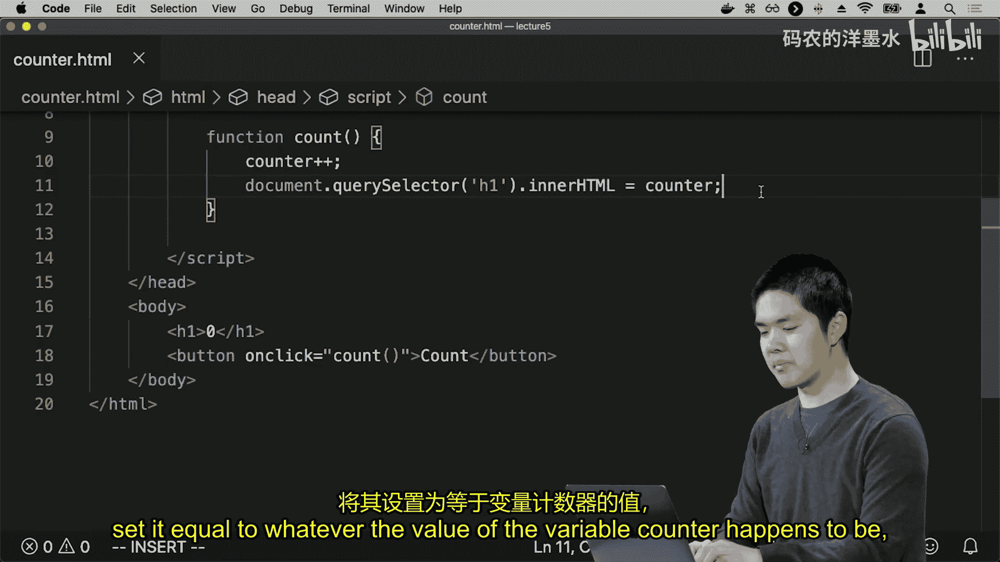

Such that now if I refresh this page， the value of this H1 initially is 0。 that's the initial value。

 but every time I click count， we're going to update the contents of that H1 element。

 this time setting it to1，2，3，4， and so forth， every time I click the count button。

 it's going to increment the value of the variable as well as manipulate the dom。

 actually making changes in order to。😡，Produce the effect that I want to see on this actual page。

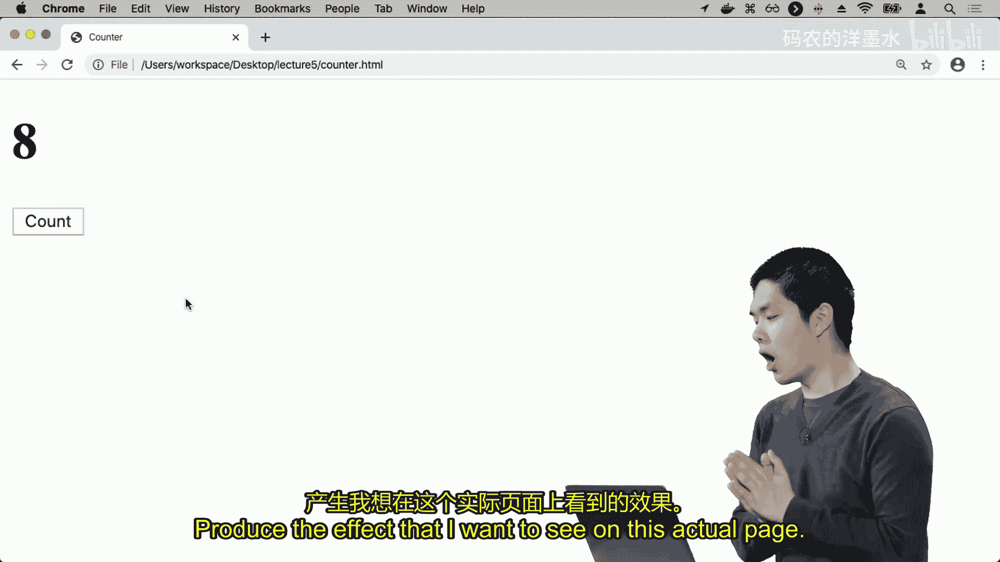

And we can begin to add additional logic to this as well， maybe I do occasionally want an alert。

 but I don't want an alert every single time I could add a condition。

 I could say something like if I only want to display an alert every time I count to a multiple of 10。

 like 10 in 20 and 30 and 40 and 50 and so forth， I could add a condition that says that if counter mod 10 and mod just gets me remainder when you divide by 10。

 so if you take the counter divide it by 10， if the remainder is0 when I divide by 10。

 well that means counter is a multiple of 10 and so I can now display an alert。😡。

Where I can display an alert that says like I want to say something like the counter is now 10 or the counter is now 20 and in order to do that。

 what I really want to do is have some way of plugging in a variable into a string inside of JavaScript and in Python the way we would have done this is by a pendingending F or pre-pending F in front of the string to create a formatted string and then I would have said something like the count is now and then I'd use curly braces to say go ahead and print out the value of counter so this f for formatted string followed by this string would have been the way in Python that we would have done this turns out JavaScript does the same thing just with slightly different syntax it doesn't use F instead instead of using the regular quotation marks whether a single or double quotation marks JavaScriptscript uses these backts which are usually located above the tab key on a standard US keyboard。

And this is going to create what JavaScript calls a template literal where I can then substitute the value of a variable somewhere inside of this template。

😡，And then in order to actually do the substitution。

 while Python uses double curly braces to say plug in the value of counter right here。

 JavaScript does something similar， it also uses double curly braces。

 but there needs to be a dollar sign in front of it。

 the dollar sign and then the dollar double curly braces mean go ahead and plug in the value of a variable there。

😡，So this then is a template literal， where every time we get to a multiple of 10。

 we're going to display an alert that says the count is now。

 and then this dollar sign curly brace means actually plug in whatever the value of counter happens to be right there。

😡。

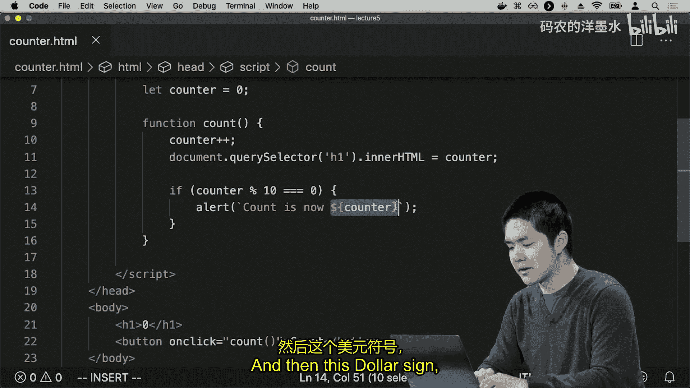

So now if I go ahead and refresh counter， it starts at0， I can count 3，4，56，7，8。

9 but when I get to 10， then I get an alert that says the count is now 10。

 and then I see the result update on the page。😊。

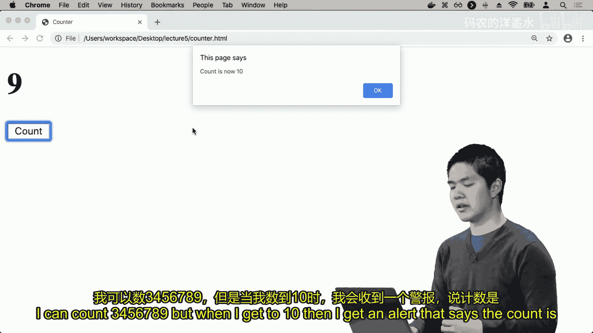

And so that template literal can allow us to combine variables and strings in order to generate new strings that are able to represent data inside of them as well。

😡，So now what improvements can we begin to make here。

 What changes can we make to this to improve upon the design of it Well。

 one thing especially as our programs get a little bit more sophisticated。

 a little bit more complicated is that we often don't want to be intermingling our jascript code with the contents of our HTML that down here we have button oncl equals count this name of this function and especially as our page starts to get more complicated it's going to start to get a little bit annoying if we're constantly having to maintain a little bit of jascript code like making a call to a function inside of our HTML we'll see a little bit later there are other paradigms that actually encourage this type of thing but right now it can start to get a little poorly designed as we really like to separate all of our ja related code from all of the HTML the general structure of our page and so there are ways we can begin to do that as well I can add an event listener inside of JavaScript too that I can say something like。

Document do queryery selector。Button。And then I can say dot on click equals count。

So what's going on here。 And I can do this instead of this on clickick equals count。

 What I'm now saying is document do query selector button， Find me the button on the page。

 And turns out there's only one button here。 So it's fine， though if there were more。

 I might have to be a little bit more specific。 But once I get that button。

Then I'm going to access its on clickick property。😡，And I'm going to set it equal to count。

 And what is count。 count is the name of a function。 Count is itself a function。

 And so what I'm here saying is I would like to set the value of the onclick property of the button equal to count。

 The count is the function that should run when。😡，The button is clicked on and notice that I am not actually calling the function。

 It's not count and then parentheses， which would being run the count function and then get its return value and use that as the value for onclick。

 I'm just setting oncl equal literally to the count function itself without actually calling the function and what this is going to do is it is going to say when the button is clicked on then and only then should you actually run this count function and we're not going to run the count function until that button actually gets clicked on。

😡。

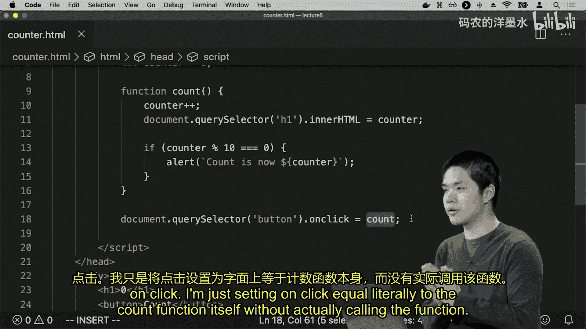

And so in JavaScript， functions can be treated as values of their own。

 just as you can set a variable equal to a string， just as you can set a variable equal to an integer。

 just as you can set a variable equal to like an HTML element like the result of document query selector。

 you can also set a variable equal to a function， something like count and pass that around as a value just as you could with any other value and this is a paradigm we generally call functional programming。

 where we have functions as values of their own things that we can reassign things that we can manipulate just as we could any other value。

So now I can try and run this program by going ahead and refreshing the page。

 I'll refresh it it's zero， I press count。😊，And all right， nothing seems to be happening。

 it's still zero， I want it to be counting。😡，But it doesn't seem to be working。 So why not？

 anytime you run into problems in ja where you're not getting the behavior you want。

 often it can be helpful to look at the Javascript console where the Java console is the equivalent of like the terminal window in when you're running your Django application in Python that would display any error messages。

 the ja console will display any of the ja logging information and error messages as well。😡。

In Chrome， I can get to it if I first go ahead and go to Inpect。

And then just open up the Con tab here。And all right， we seem to have some sort of error here。

 it's an uncutaught type error that says we cannot set property on click of no in counter。

 HTMLtml line 18， so that will generally tell you where the error is coming from。

 it's coming from counter。 HTMLtml on line 18 and the problem seems to be that I'm trying to access the onclick property of no。

 and no is JavaScript's way of expressing like nothing， some object that doesn't exist。😡。

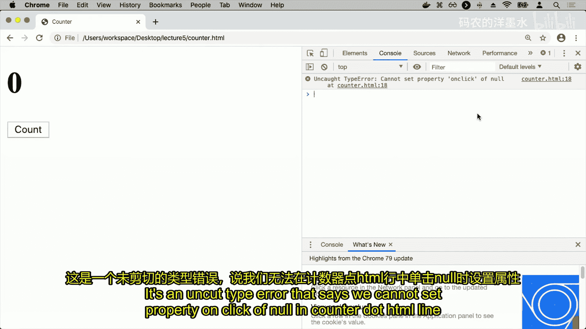

So somehow I'm trying to set the oncick property of null。

 well let's see what's going on on line 18 and see if we can figure out what's happening there。😡。

Well all right， here's line 18 where I say document query selector button setting its onclick property equal to count and now what seems to be the problem here Well the error message was that I was trying to modify the onclick property of null well here then is the onclick property so why would this document query selector button be returning or giving me an output of null Well it turns out the document query selector will return null if it's not able to find something if I try and find a button but it's not able to find a button Well this seems a little bit strange because there's a button down here on line 24 that I'd like for my JavaScriptscript code to be able to find when it runs query selector and tries to find the button。

😡。

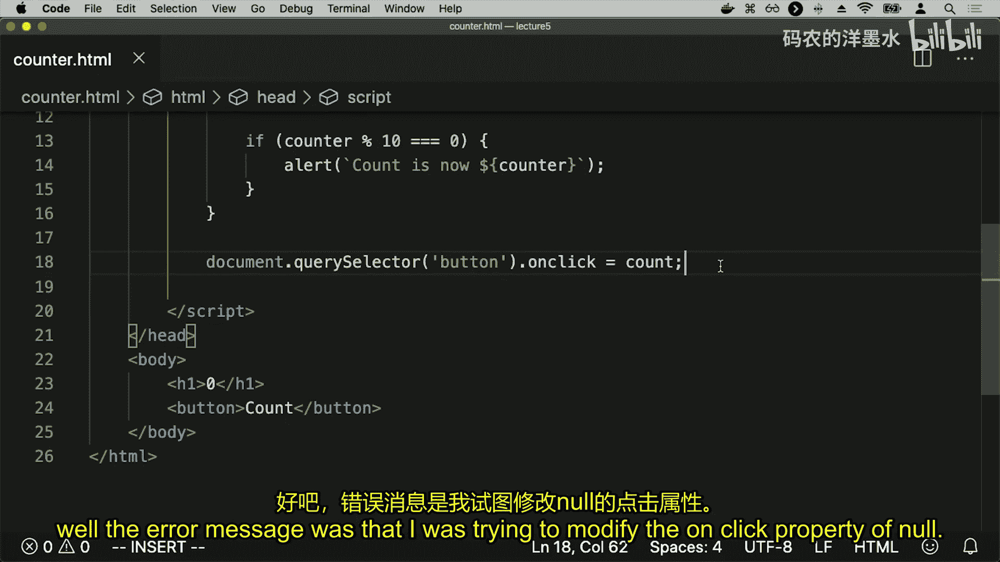

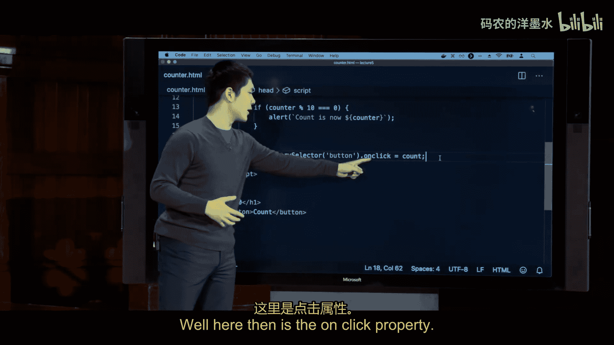

As it turns out， this is a bit of a the quirk of the way the browser is going to work。

 but if the browser is running our code from top to bottom， just reading it from line 1 on and on。

 then it's going to get to line 18， where I've said document do query selector button onclick equals count and it's going to try and find a button on line 18 but the button doesn't show up in my HTML page until much further down in the page so at this point when we get to this line of JavaScriptscript。

 JavaScriptscript is looking for the button but the Dom。

 the body of the page hasn't finished loading yet， the content of the Dom has not yet loaded and as a result we're not able to find this button。

😡，So how do we solve this problem， How do we get it So we actually are able to like ask for the button and actually get the button。

 Well， it turns out there are a couple of strategies we could use。

 One would be take the script tag and go ahead and just move it to the bottom section of the body so that after we've already defined the button that says count。

 then we have the script tag that then says all right。

 go ahead and now find the button and now we'll be able to find it。😊。

Turns out another way and perhaps a more common way is to instead add yet another event listener and we're going add an event listener not to the button。

 but to the entire document where document is a variable built into this JavaScriptscript that we have access to on the web page that just refers to this entire web document where I've used document query selector already to look through the whole web document trying to find a button or trying to find an H1 tag for example。

 but I can also add an event listener to the document itself， and in order to do that。

 I can say document do add event listener。😡，And when I call Add event listener。

 and I can do this on any HTML element， not just the document。

 but I could run this function on a button or on an H1 element or any other HTML element。

 a Even listener will generally take two arguments。😡。

Where the first is what event I want to listen for。

 The event could be something like click when I click on the document。

 it could be something like when I scroll through a page， for example。

 But the event I'm going to listen for is a particularly special event called Dom content loaded。

And the DoM content loaded event is an event that is going to be fired or triggered when the Dom。

 the document object model， the structure of the page。

 is done loading when all of the elements on the page are downloading。

 the DoM content has been loaded， and then if I attach an event listener to it。

 it'll run whatever code I want to run that should only run after the Dom is fully loaded after all of the content on the page has then been loaded。

😡，And the second argument to add event listener is what function should run once the event actually happens。

 when the Dom content loaded does happen。 so I could pass in the name of a function if I had the name of a function that I wanted to pass in。

 but alternatively， JavaScript allows me to just directly write a function here in the argument to add event listener。

 I can just say function。😡，And then a set of parentheses to mean the function doesn't take any input and then in curly braces。

 I can include the body of the function right here as the second argument to add event listener and this is a little bit of tricky syntax to wrap your mind around if you've never seen it before but the big picture way to think of it is add event listener takes two arguments one is the event the second is the function so here first is the event Dom content loaded and the second argument is a function and I' declare the function same as before just using function I haven't given the function a name because strictly speaking it doesn't need a name I'm never going to refer to the function by name so it is what we might call an anonymous function。

 a function that has no name but I'm still passing it into the add event listener function as an argument because I want to run the code inside of the function once the Dom is downloading。

And so inside of curly braces then is the content of that function。

 the content of what code should run when the Dom is downloading。

 and then at the end I again use just this end parenthesis where that end parenthesis lines up with this parenthesis here this is enclosing all of the arguments to add event listener where the first one is Dom content loaded and the second one is this entire function that might span multiple lines so you'll see syntax like this quite a bit in JavaScript。

😡，But now what I want to do is adding the event listener to the button。

 I can go ahead and just replace and put it here。And it turns out that if I wanted to。

 instead of saying dot on click equals count， you could have used the same syntax of add event listener。

 I could say add event listener。😡，Click and then count to mean when the click event happens。

 go ahead and run the count function， but you can equivalently shorthand this and just say dot on click equals count。

 and that would work just as well。So now what we're saying here is that wait until the DOm is downloaded。

 wait until all the content on the page is loaded， and then go ahead and run this function。

 and what the function is going to do is it's going to add the event handler to this button and that'll work because now we'll be able to find the button because now all of the content of the Dom has loaded。

😡。

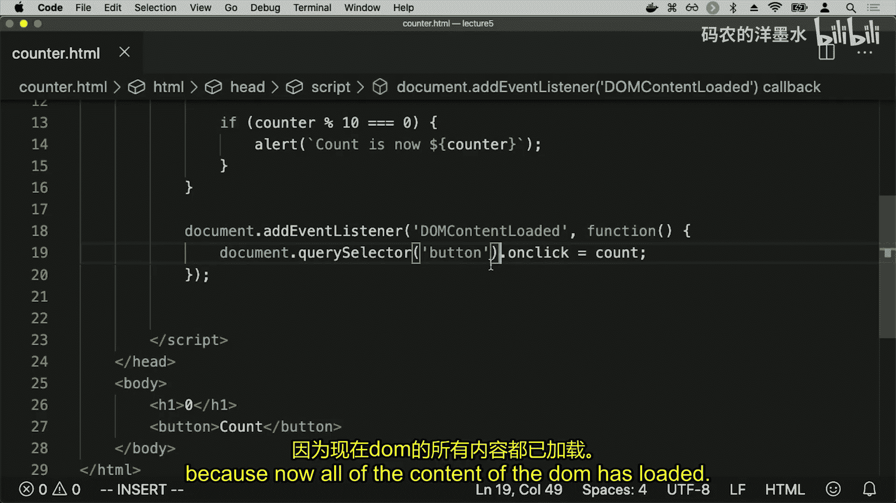

So now if I go back， refresh counter。 HTMLt， you'll notice that the JavaScript error goes away。

 I don't seem to have that error anymore。😡，And now if I press count。

 we're able to see the count increment just as before as well。

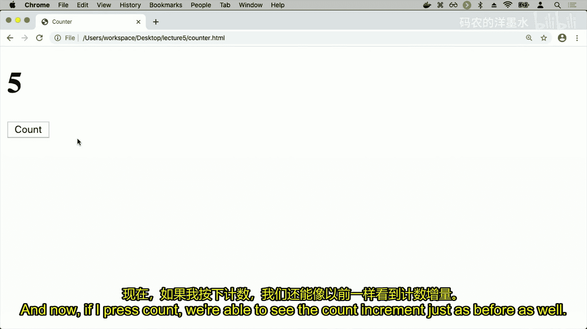

And so this then is an improvement upon what I've had before。

 where now I'm able to separate out my JavaScript code from all of the rest of my code as well。😡。

But much as in the case of CSS where we were able to take CSS it was originally located in the head of our page and move it into a separate file。

 you can do the same thing with jascript 2 and this can be helpful if you have multiple people working on different files you want one person working on the HTML and someone else working on the ja it can be helpful if you expect that one of these things is going to change more frequently than the other so you might not need to load the other one as often so there can be value in separating our HTML code from our jascript even more by moving our jascript into a separate file and so in order to do that I can create a new file that I'll just call counter js which will contain all of the javascript for my counter HTMLm file So in order to do that what I can say is let's go ahead and copy all of this ja code go ahead and cut it out of this page and I'll paste it into counterjs remove some of that indentation。

So now I have a file called counter。jS that just contains all of the JavaScript I want to run on my counter。

html page。😡，And now， rather than include actual JavaScript in between these script tags。

What I can say is script SRC， SRC for source equals。Counter。 Js， for example。

 just say go ahead and reference counter。 Js and use that JavaScript。

In the head of the page here and that then is going to work exactly the same way I still am able to count as high as I'd like I still get an alert every time the count reaches a multiple of 10。

 but my HTML is now a little bit simpler。 it's just the body it's just the H1 in the button and then all of my jascript is now located in a separate file that allows me to do that allows me to keep my HTML code and my jascript code separate from each other and that can be valuable for a couple of reasons among them if I have common jascript code that's in use by multiple different HTML pages。

 multiple HTML pages can all include the same jascript source rather than needing to repeat myself use the same ja across multiple different pages I can just use the same jascript across all of them and thatll be helpful too as we begin to take a look later at some jascript libraries which are jascript written by other people we can just include other people's jascript in our own web pages just by adding a script tag at the top of our page that specifies a particular source you may have already interacted with bootstap。

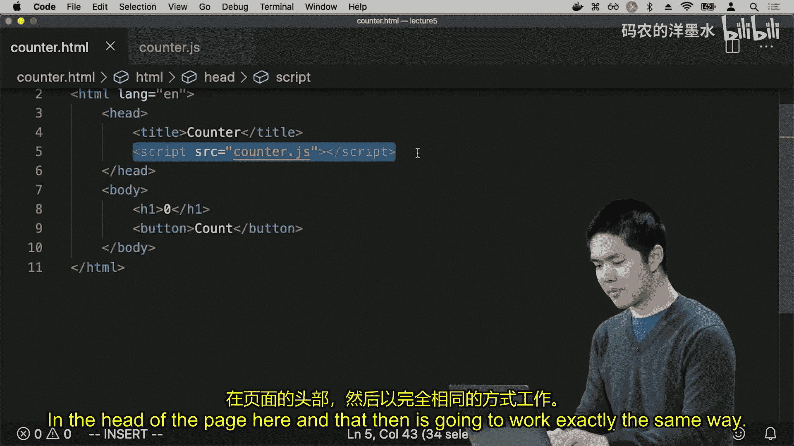

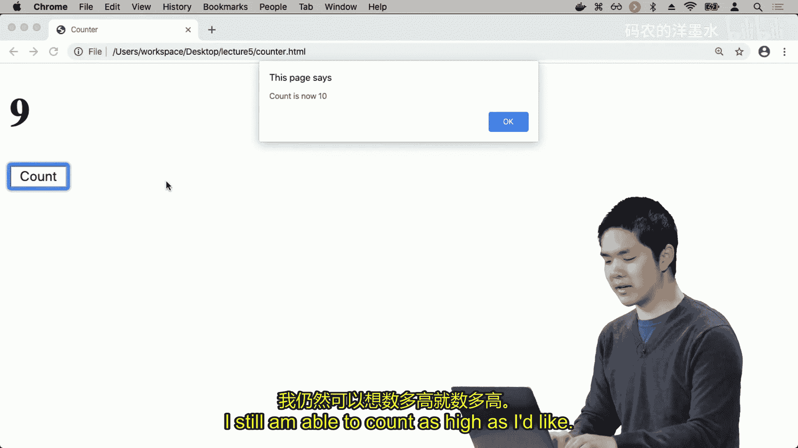

It has its own JavaScript code， and you can include Boottrapap's JavaScript just by including a script tag at the top of our HTML page in order to say。

 go ahead and include all of that JavaScript。😡，In our page， as well。

So what else can we do now now that we have the ability to get at elements of the Dom and actually manipulate their contents。

 well， one thing we can do is begin to make our pages a little bit more interactive。

 actually respond to what users are doing on the page whether the user is typing something in or maybe filling out a form for example。

 so let's go ahead and try an example of that where the user might be filling out a form and we would like for our code to somehow respond to what it is that they type I'll go ahead and go back into hello HTML。

😡，And now inside of the body of the page， I've said， hello at the top， I'm here instead of a button。

 I'm going to have a form。😡，This HTML form will look like the HTML forms we've seen before。

 I have an input field that I'll add the autofo attribute to to mean like automatically focus this input field when I open the page because I might want the user to start typing right away。

I'm going to give this input field an ID。😡，Of name， for example。And then a placeholder。Of name。

 capital N， whose type is text。So what have I done here。

 I've created an input field where the user can type in some text， the placeholder。

 the thing the user sees filled into that input field originally will just be capital end name telling them they should type their name in here。

😡，And I've given this input field。😡，In Id， some unique identifier。

 such that I later on can reference and find this particular input field。

And then I have input type equals submit， some way for me to now submit this form as well。

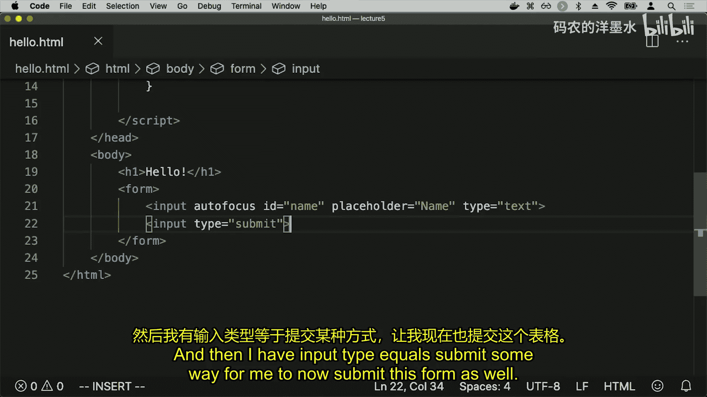

And so if I load this page， load hello。 HTMLtm。Here's what I see。 Hello。

 a field where I can type in my name， the placeholder name shows up there for me。

 and then a button where I can submit this form。

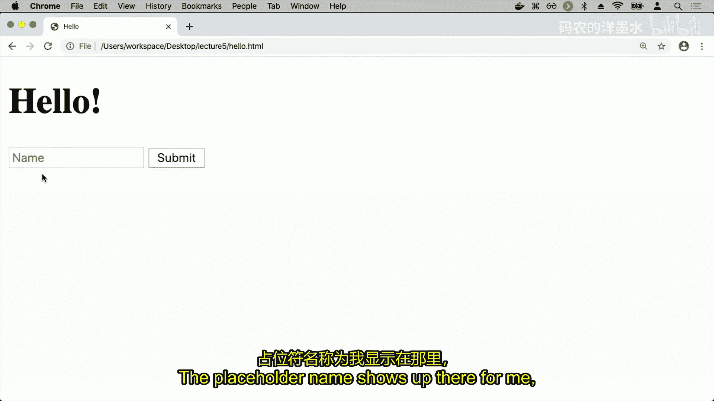

And now what I'd like to do inside of my JavaScript is instead of this hello function。

 what I'm going to do is I'm going to first run some JavaScript when the Dom is doneing and so I'll use that same line from before you're going to see it quite a bit where we're going to say document a event listener Dom content loaded and then this function I mean go ahead and run this code when the Dom is downloaded and the code I'd like to run is to say when I submit the form I want something to happen when I submit the form。

 maybe I want to display an alert that if I typed in Brian it'll say hello Brian or if I typed in David it'll say hello David for example。

 so how might I do that？😡，Well， how do I get the form。

 That's the first question Anytime you want to get at an element。

 one particular element on an HTML page usually what we're going to do is document do query selector to say get me the element That is a form and there's only one form on the page so they don't have to worry about ambiguity。

 I'm just saying get me that form。😡，And then I can say dot on submit when you submit the form。😡。

What code should run， And if I had a name of a function， like a function F。

 I could just say like run function F when the form is submitted。😡，But alternatively， just as before。

 instead of providing the name of a function， I can also just provide the function itself。😡。

I can say function。And then in between these curly braces。

 I can specify exactly what code should run when the form is submitted by providing this anonymous function instead。

 using this anonymous function as the value of the unubmit property of this form。😡。

And so now what I'd like to do is somehow get access to whatever the user typed into the input field。

 whatever the user's name happens to be， and so I could get the input field via document query selector input and that would work this time。

 but we'll want to start to be a little bit careful because on this page there are multiple different input elements there's an input element here for typing in the name and a second input element here for telling me a give me a button where I can submit this particular HTML form and so what I probably want to do is be a little bit more specific。

😡。

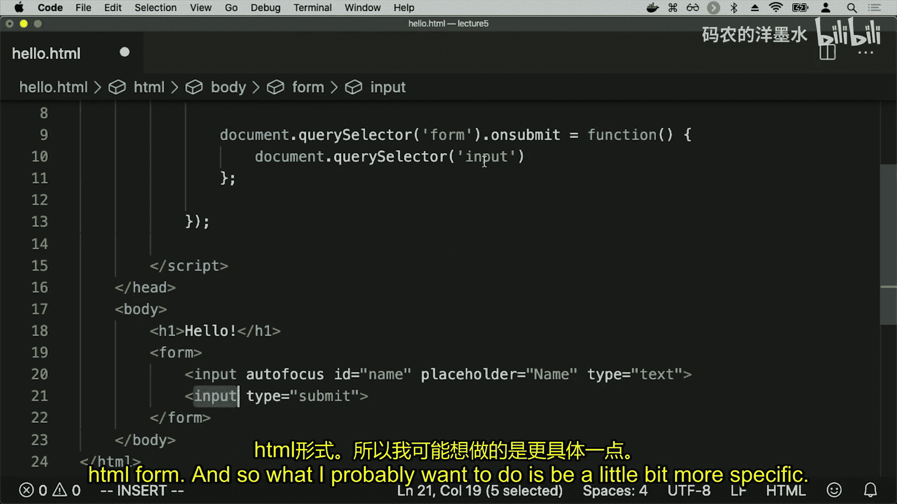

And it turns out that inside of query selector I can use all of the standard ways in CSS that we could select for a particular element。

 so in CSS if you'll recall， we had the ability to run CSS and just say style all the H1s or we could say style all the things with this particular ID or with this particular class and document query selector works the same way that I can say document query selector and pass in a tag to say like get me the H1 element or get me the button or get me the form but if there are multiple H1 elements or multiple buttons or multiple forms。

 I can be more specific than that if for example， an element has an ID in which case I can say document query selector and then in quotation marks the hash mark and then the name of the ID to say get me the element with that particular ID again using the exact same syntax that CSS uses if I want to apply a particular set of styles to only one element that only has one ID。

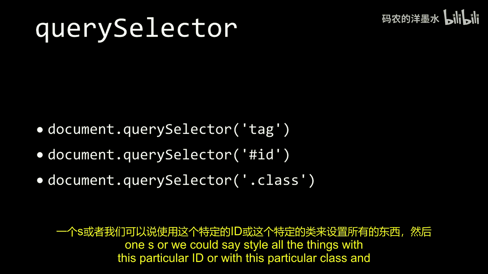

Likewise too， I can say document do query selector and then use dot followed by the name of a class if there's a particular class of elements and I want to just get one of those to say get me an element that has this particular class in order to manipulate it as well so the same types of syntax that we could use in CSS for trying to reference and get at a particular HTML element we can do the same thing here with document dot query selector to go ahead and try and get a particular element based on its tag name based on this ID or based on its class and it was for that reason that inside of the HTML page。

😡。

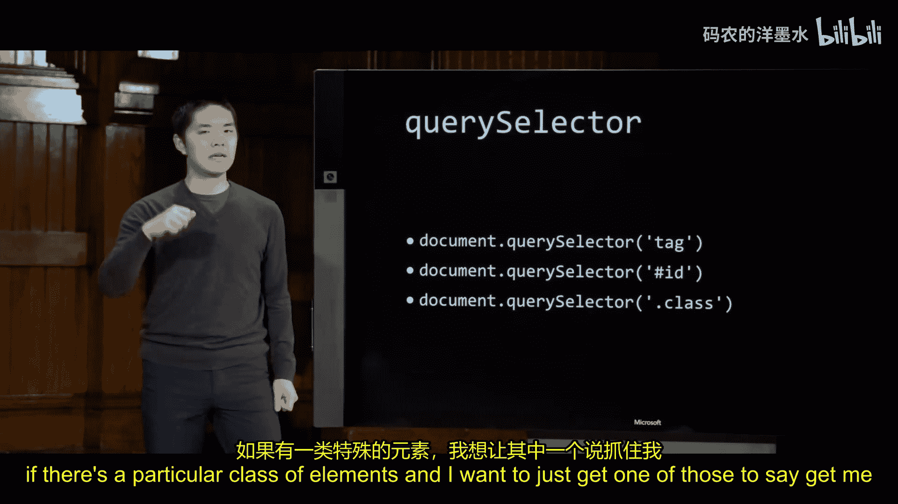

For my input， I gave the input an ID of name， I wanted some way to be able to uniquely reference it。

 and I can uniquely reference it not by input but by pound name where I can say get me the element that has an ID of name and that is the element that I would like to extract inside of my JavaScript code。

😡，Once I have that HTML element， what I want is like what the user actually typed into to that input field。

 and it turns out that if you have an input field in HTML。

 I can get access to what the user typed in by accessing its value property。

 value is a property that refers to what it is the user actually typed in。😡，So I can say dot value。

And I'm going to go ahead and save that inside of a variable so I could say something like let name equal whatever the user typed in。

 but if I'm not going to reassign name to something else inside of this function。

 inside of this function， I'm really going to get the name once and I'm not going to change it inside of the function so I can use a constant variable instead and that would be better design to say I have a constant variable called name which is equal to document query selector。

 get me the element whose ID's name and get access to its value。😡，And now I can display an alert。

 I can alert something like inbatics， hello， comma。

 and then using the dollar sign curly bracecingtax， I can say plug in the name there。

 followed by an exclamation point。So I've extracted the name from the form。

 get me the input field where they typed the name， get access to its value。

 and then I'm displaying an alert that is going to say hello to that person， for example。😡。

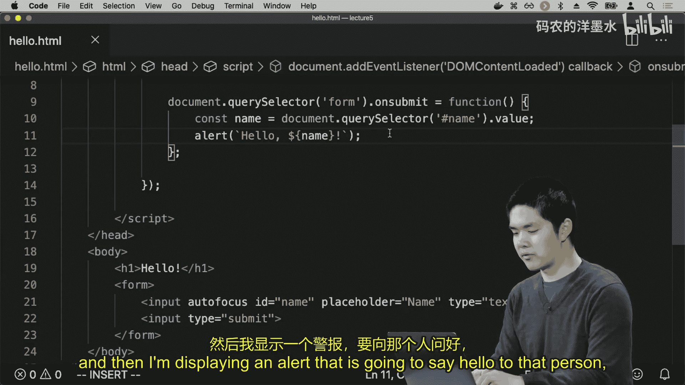

And so now。I refresh the page， I type in my name， I press submit。

 I get an alert that says hellello Brian， I press okay， I can try it again。

 I can type in something like David， press submit， and now the page says hellello David。

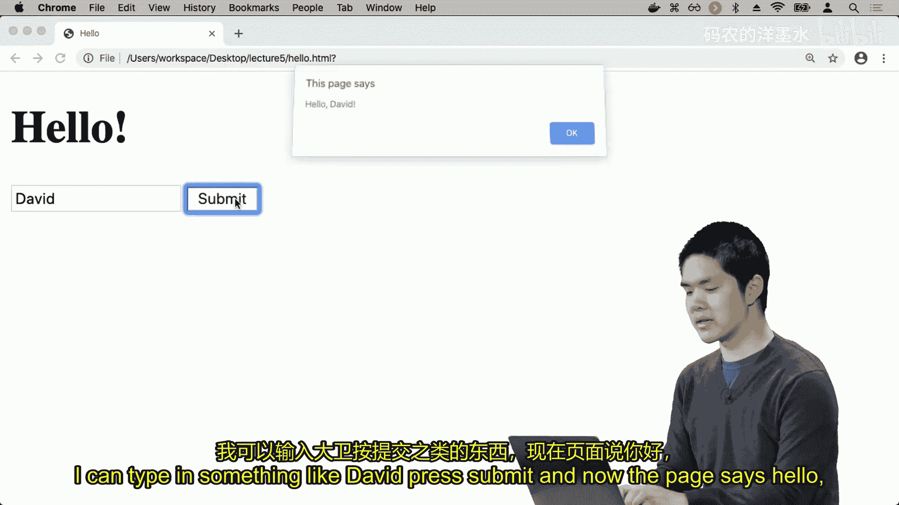

So here again， we've been able to combine event listeners and functions and query selector to be able to both read information from the page in order to say。

 get me this particular HTML element， find me an HTML element and access like what the user typed into it。

 the dot value property that gets me， what the user typed into an input field and we've been able to combine that with event listeners and alerts that are able to actually respond dynamically to when a user submits the form。

 or when the entire content of the page is downloading in order to produce some interesting effects as well。

😡，But it turns out we can do more than just change like the HTML that is contained within an element。

 we can also change CSS as well， change the style properties of a particular element as well。

 so let's go ahead and see an example of that go ahead and create a new file。😡。

That I'll call colors Htm， and inside of colors， I'll include the same standard HTMLm boilerplate code that we often start with。

 a head section with a title and a body section。 and inside of the body of this page。

 I'm going to display a heading。That just says hello， for example。

 And maybe I'll give it an I D just so I can reference it by name。 Maybe it has an I D of hello。

And then I'll have three buttons。😡，I'll have a button called red。A button called blue。

 and then a button called green， for example。

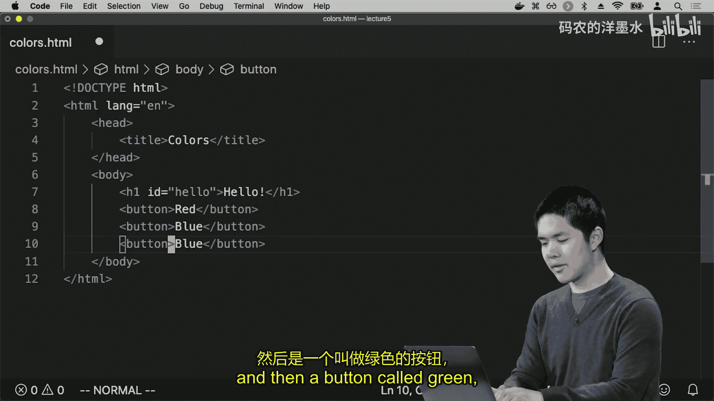

Where now if I open up colors。html。

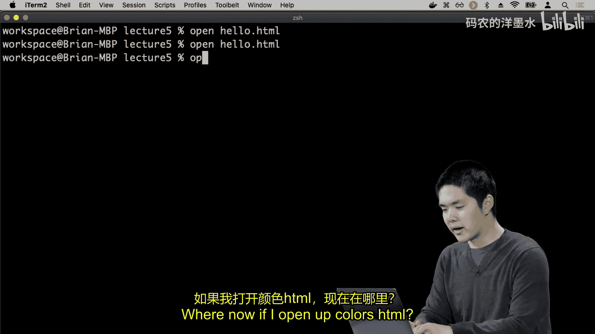

Here's what I see。I see a big heading this says hello， and then I see three buttons， red。

 blue and green， but of course right now these buttons don't actually do anything How do I get the buttons to do something Well。

 that's where JavaScript' is going to come in。 I'll add a script tag to the top of my page and I only want to run this JavaScript when the Dom is downloading So again we'll use the same syntax as before document a event listener。

😡。

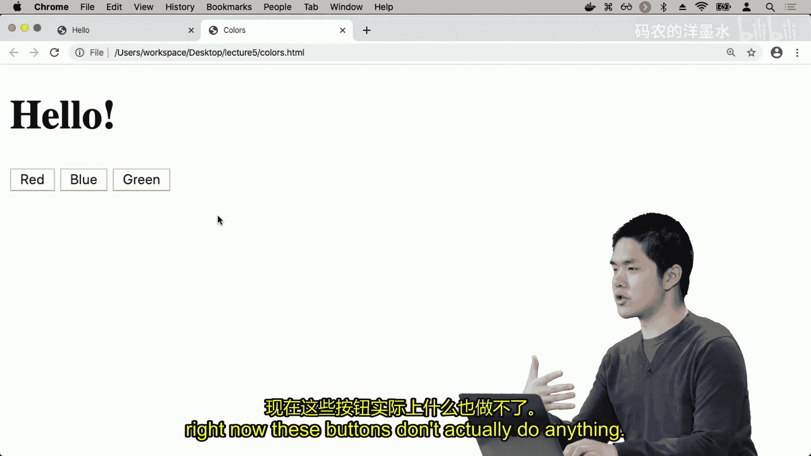

Dom content loaded。And then run this function to say everything in between these curly braces。

 this is all the code that should run once the page is downloading and what I'd really like to do is get at these three buttons and say when you click on each one of them do something different like change the color of a particular HTML element and in order to do that I need some way of uniquely referencing these buttons so to do that I'm going to give them all IDs this button will have an idea of red this button will have an I of blue。

 this button will have an ID of green just unique names I can give to the buttons in HTML such that in JavaScript。

 I'm later able to reference them。😡，So what do I include now here inside of my JavaScript code？Well。

 let me say document dot query selector。Hash red to say， get me the element whose ID is red。😡。

And when you're clicked on， on click。Go ahead and run this function。

What should the function do well I want to take this H1 element and change its color to red I want to change the font color to red and I'll leave a comment to myself in JavaScript the way you can leave a comment just to document what you're doing is using these two slashes the two slashes indicate everything after that on the page is going to be a comment The browser will ignore it。

 but it can be useful to use the programmer and to someone who's reading your code to be able to see what it is that you're describing here on the page。

😡，And now what I'd like to do is document query selector hello。

 get me the HTML element whose ID is hello and go ahead and modify its style property。

And now inside of this style object， I can modify any of the CSS style properties。 One of them。

 for example， is something like color， so I can update the color property and set it equal to red。😡。

So here now I'm saying when you click on the red button， go ahead and run this function。

And what the function should do is find the hello element， update its style。

 what part of the style update its color， What should we update it to， We should update it to red。😡。

And I'm going to do the same thing for the other two buttons as well and it's pretty similar code so I'm just going to copy paste。

 copy paste here I'm going to have one for changing the color to blue。

 when I click the blue button you should change the color to blue and then we'll do it one more time change the front color to green when you click on the green button。

 you should change the color to green。

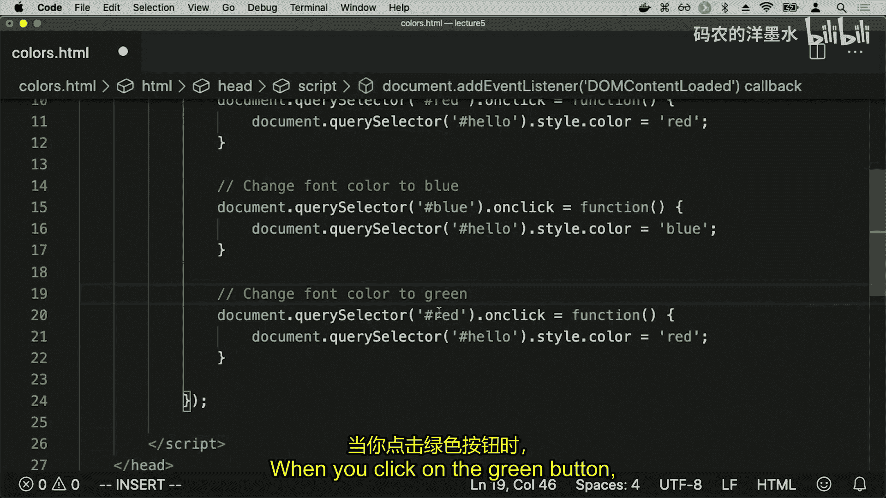

So now when I refresh the colors of HTML right now hello by default is just in black standard font color for HTML。

 I click red， hello changes to red， I click blue， it changes to blue， I click green。

 it changes to green so depending on what button I click that triggers some event listener it's going to then say when the button is clicked run this function and what the function does is it grabs this H1 element。

 the element whose ID is hello， modifies its style。

 updatess its color property to be something like red or blue or green。😊。

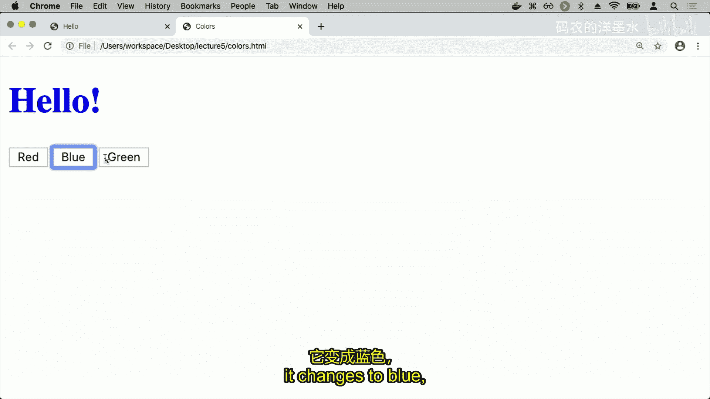

That showing that we can modify style in addition to just modifying the content of the page itself。

But it turns out that as you looked at me writing that code。

 something should have struck you is probably not optimal design that in general。

 any time you find yourself writing the same code again and again and again。

 especially if you're copy pasting， that that is a generally a bad sign。

 usually a sign that there is some better way of trying to modify of trying to implement the behavior that I'm trying to create。

 And it turns out that there is and there are a number of ways that you could do this one way here。😡。

Is that I might like to consolidate these three event listeners into just a single function that is going to handle changing the color to whatever the button says the color should be changed to。

 but one problem here is that if I just attach the same event listener to all three of the buttons。

 it's not going to be clear to me， when I click on the button。

 how does the button know what color we should change the text too。😡，And so to that effect。

 we can add some additional special attributes to a particular HTML element that are called data attributes。

😡，Where a data attribute is my way of saying that I would like to associate some data with this particular HTML element where here I can say data dash color equals red data dash color equals blue data dash color equals green data attributes always start with data followed by a dash and then I can specify really any name that I want for some information that I would like to store about the HTML element and here the information I want to store is I want to store data about what color you should change the text to when the button is clicked on and so what we're gonna to have the ability to do now is the ability to say that if I have access to this element。

 this button I can access its data color property to know whether we should change the text to red or blue or green by adding these data attributes to these HTML elements。

And so now what I want is some way of getting all of these buttons。 Now， document do query selector。

 as you recall， just gets one element。 It's just going to get for me a single element and it's going to get the first one that it finds。

😡，If I want to get multiple elements， what I can do instead is something like document query selector all Que selector all is going to return the same thing the query selector does。

 but instead of query selector returning a single element that matches what it looks for。

 query selector all is going to return to me an array of all of the elements that match my particular query。

 So if I want to select not just the first button I find but all of the buttons I find。

 I can hear say query selector all for button and that will give me back a JavaScriptscript array。

 the equivalent of a list that represents all of those buttons。😡。

And we can actually test what this looks like by looking at things inside of the JavaScript console that if I go ahead and refresh this page colors。

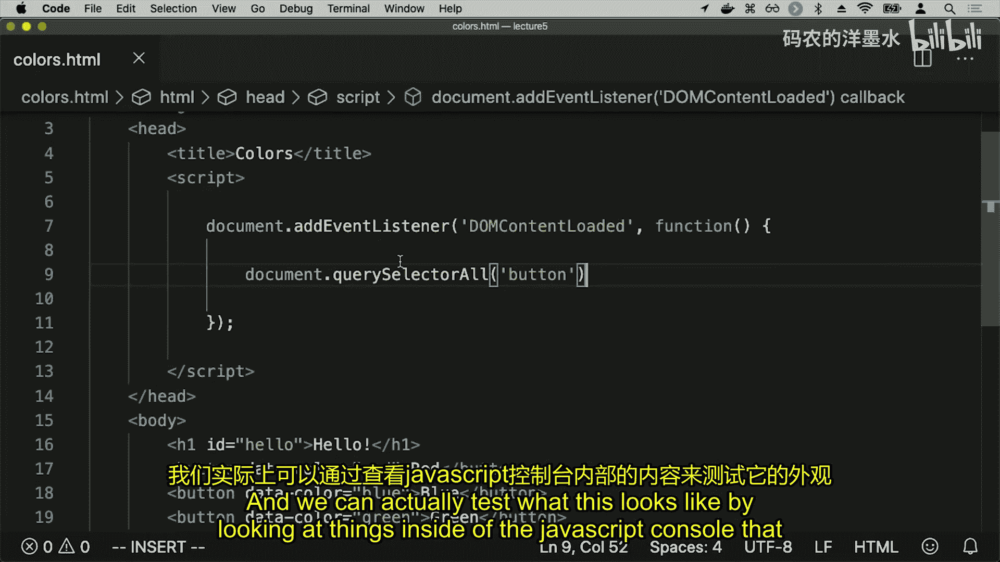

I can open up the inspector， go into the JavaScript console。

 and just as you could see error messages here， you can also actually write JavaScript code here as well。

 so I can say something like document query selector。😡，Button say， all right。

 what's going to happen when I try and select for a button on this particular page。

And what I get is all right。 I get just this very first button button whose data dash color is equal to red。

 That's what I would expect。 Queery selector just finds me one element。

 and it's going to find me the very first element。And likewise， I can say， all right。

 instead of query selector， let's do query selector all。

 and what I get back is a node list which you think of as kind of like an array or a list in Python that's got three buttons in it。

 button 0，1 and 2 and just as with a list in Python as you can indexed into things。

 arrays in Python arrays in JavaScript can be indexed into as well that if I have something like constant names equals Harry。

 Ron and Hermione。😊，Like a array of three names， I can say name square bracket0 to get the first name。

 name square bracket1 to get the second one name square bracket2 to get the third one for example。

 and that gives me each of the individual elements in the array if I want to get the whole length of the array I can do names dot length to get all right the length of the names array happens to be three so just some additional features that we have access to if you happen to have an array of things turns out query selector all returns to me a node list which is kind of like an array。

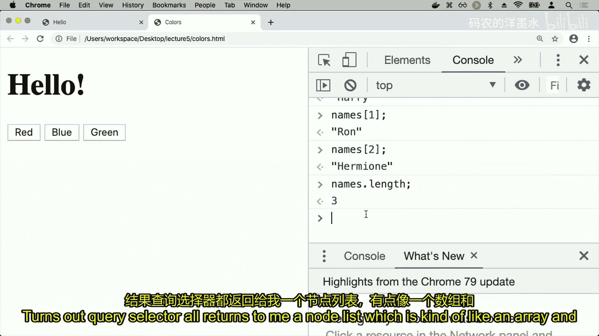

And that's going to be useful because when I say document。 queryery selector all button。

 I am saying get me all of the buttons on the page。😡。

And now what I would like to do is effectively loop over all of those buttons and say for each of the buttons inside of this list that comes back to me。

 I would like to add an event handler for when that button is clicked on to say for each of the buttons that comes back。

 go ahead and say when you're clicked on， change the color of the H1 element。😡。

And so there are a number of ways again that you could do this。

But one way is to use a particular property called for each。

 and for each is a function that accepts as an argument。

 another function where the idea is going to be I would like to run a function for each of the elements inside of an array or inside of a node list。

 for example。😡，So here I can say for each button， go ahead and run this function。😡。

This is going to be a function now that takes something as input。

 It's going to take one of the elements in the list as input， something like a button。

And now for each button， what would I like to do for that button。Well， when the button is clicked on。

 button dot on click。Then go ahead and run a function。😡，That is going to。Document。Query selector。

Get me the element whose ID is hello。Change its style within the style， change its color。

 and what do I want to change its color to Well I have access to this button。

 this argument to the function is whichever button I'm currently trying to add an event listener for。

😡，And in order to access its data properties， I can access a special property of an HTML element called its data set property。

And then I can say something like button。dataet。color to get at the data dash color attribute。😡。

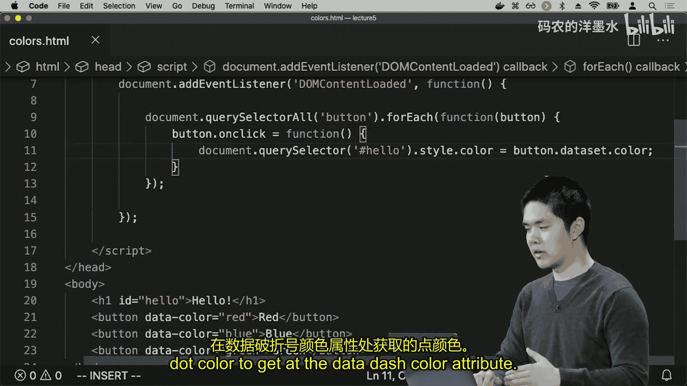

So a lot of stuff going on here， let's go ahead and try and read through this entire thing and just get a feel for what's happening because we have functions nested within other functions。

 nested within other functions up at the very top， I've said add an event listener to the document When the document's do content is loaded。

 meaning all the content to the page is downloading， go ahead and run this function。

 this is the body of the function。😡，So what do I want to do when the page is downloading。

 I'm going to document queryery selector all looking for all of the buttons。😡，And if I wanted to。

 if there could be more buttons， I could have added a class to these buttons and just looked for things of the particular class。

 query selector all just returns all of the elements that match a particular query。

And then I'm saying for each of those buttons， for each of the buttons that came back。😡。

I would like to run a function on each of those buttons。

 I'm basically saying if I have three buttons that came back。

 let me run a function on the first button， then the same function on the second button。

 then the same function on the third button。 and what is that function， Well。

 it's this function here。 a function that takes as input。

 the button it's first going to pass in as input the first button， then the second button。

 then the third。😡，And what this function does is it adds an onclick handler to the button。

 it says when the button is clicked on， go ahead and run this other function。

 and this function now is the function that will run when the button is clicked on to say when the button is clicked on。

 get me the hello element， change its color to button data set color， and button data。 color。

 takes a button， takes an HTML element like this one here。

 and accesses its data set all of its data properties。

 and specifically accesses the color data property， which in this case is equal to red。

 and that is what we would like to set color equal to。😡。

It's a little bit more complex that we've seen before。

 but now we've been able to reduce what was three different event handlers into just a single one and now this is going to work the same way。

 change it to red blue and green all by just using those data properties that we have access to and so when in doubt about how these things are working about what query selectors returning the jascript console can be a very powerful tool for this you can go into the ja console and actually manipulate things you can run queries。

 you can run functions， you can even modify the values of variables like if I go back for instance。

 to counter Hm or had this counter that's counting 0，1，2，3，4 if I wanted to。

 I could say something like counter equals 27 just like change the value of the counter Nothing appears to have changed on the page I didn't say update anything on the page but now next time I run count it's going to update the value of the count to 28 because I had updated the value inside of the jascript console it's going to increment that value。

 display that value。

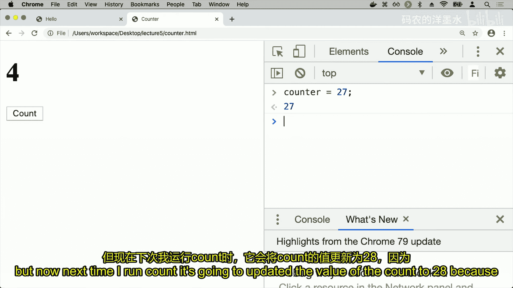

insideside of the H1 element， so you can modify variables， you can run functions。

 you can run document query selector to figure out what particular elements are going to come back all through the use of the JavaScript console。

 which can be a very， very powerful tool， especially as you begin working on trying to debug these programs and trying to figure out what might be wrong with them。

😊，It turns out too that there are other changes that we can make in order to optimize our code a little bit more in order to make it a little bit more succinct and one way is that in more recent versions of JavaScript they've introduced a particular notation for functions called the arrow notation for functions and I'll just show it to you because it'll come up but oftentimes instead of using the keyword function before introducing a function you'll just have something like button。

😡，And then。Arrow the curly braces and strictly speaking you'dt even need the parentheses around the input where button arrow and then in these curly braces and code just means here is going to be a function that takes this input。

 a variable called button and then runs this particular block of code when that function is run。😡。

And likewise， if a function takes no input like this function up here。

 you could express it using arrow notation with just parentheses， arrow block。

 And so this is often a notation that you'll see in jas。 if you ever see it。

 know that that's really just shorthand for creating a function。

 whatever is to the left of the arrow sign is the input to the function and whatever is to the right of the arrow is what code should actually run。

 when the function body gets executed， when the function is called upon。

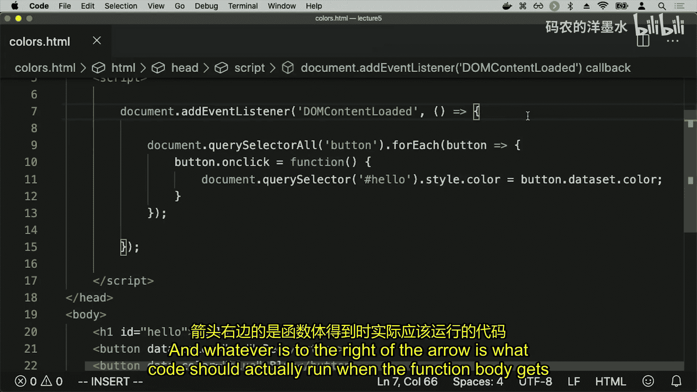

So what other changes might we want to make to colors Html Well， if we look back at colors。 Hml。

 here's what it looks like now， we've got a heading that says hello and then buttons to change the color to red or blue or green。

 for example， we might instead if we want the user to choose from one from a number of options。

 decide upon the user interface choice of using a dropdown instead of a bunch of buttons。

 for example， and JavaScriptscript supports that as well and we use this as an opportunity to explore some of the other event handlers that exist within JavaScript So for example。

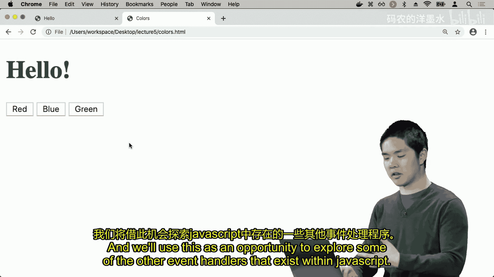

Instead of having these all inside of buttons， I can make my life a little bit easier by making this a select dropdown。

😊，Where the select is going to have an option， whose value is， let's say black is the default option。

 when it'll say black， and then we'll add another option。

 whose value is red and then we say red and the value is what we'll get in JavaScript when we try and extract the value of a particular select dropdown what's in between the option tags themselves is what the user is going to see on the page when they actually view it so I'm capitalizing it just for them。

Opted value equals blue， that will be blue， and then option value equals green and that' will be green。

😊。

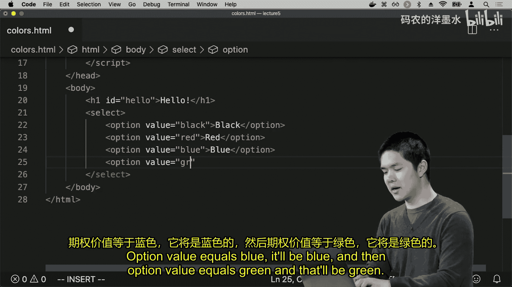

So now what the user sees is they see hello and then a dropdown menu where they can choose from a list of colors rather than click buttons in order to do so。

 and now of course this select dropdown doesn't do anything at the moment。

 but I can modify it so that it does。😡。

So now， instead of selecting for all of the buttons and doing something with all the buttons。

 we don't have any buttons anymore。 What I do have is I have。A select dropdown。

And now just as we've seen like on click to say when you click on something。

 as we've seen Dom content loaded as an event， there's another event called on change。

 which applies to things like select dropdowns， where when something changes in the select dropdown。

 when a user chooses something different， I can run some code， for example， so I can run a function。

That in this case， is going to take document。 query selector。Hello。

 meaning get me the Ho HTML element。Change its style， what part of the style， change its color。

 And I want to change it to something。 I want to change it to the value of this select dropdown。

 But how do I get access to this particular select dropdown。 Well， in jascript。

 we have access to a special value called this。 And this has special meaning in jascript and this meaning varies based on context。

 But in the context of an event handler， a function that is called when a particular event happens。

 This is going to be a special keyword that always refers to the thing that received the event。

 So what received the event， it was the select dropdown。

 that is what received the event of being changed。 And so this is going to be a special keyword。😊。

That always refers to that。 That always refers to the dropdown menu where I made a different selection。

 So if I want to get the value of that dropdown menu， what it is the user actually selected。

 I can just say this dot value to mean get that dropdown menu and get at the value。

 the thing that the user selected in that menu and now much more succinctly than before I've been able to implement the same kind of idea says hello right now in black。

 but if I choose from the dropdown menu， that changes color to something like red， for example。

 color changes to red， if I instead choose blue， which changes to blue， green changes to green。

 I choose black， it changes back to black。 So now I have this ability to detect these other types of events and respond to them as well。

 and there are many many different events that exist in jascript There's on click which we've seen already on mouse over it can detect like when you mouse over something when you're hovering over a particular element if you've ever seen websites that somehow respond when your mouse moves over something that can be how it's implemented on key down and on key。

Can respond to keyboard events， something like when you press a key on the keyboard。

 when you press down on the key， that's on key down and when you lift your finger off the key that's on key up。

 and there are other events as well， many more events that are just listed here that you can listen for and respond to so that you can really interact with the user based on what it is that they're doing。

😡。

So now let's take a look at an example of how we can use some of these events to now begin to create a little bit of a more interesting application。

 We'll go ahead and build a to do list application this time using exclusively JavaScript。

 we've seen to do list before that involve communicating with a server making requests and responses we'll now build a to do list that only uses JavaScript to do so。

😊，So I'll create a new file called Task。html。And we we'll create a head section whose title is tasks。

And a body section。 and inside the body of the page。

 I'll go ahead and have a heading that says tasks。 And underneath that。

 I want an unordered list of all of my tasks。 So I have an unordered list。

 I'll give it an I of tasks just for good measure so I can reference it later。

 but initially nothing' is going to be in here。But what I'll have underneath the unordered list is a form。

 a form where I can submit a new task， for example， so I'll give myself an input field。

 also given an ID， the ID will be task singular for the new task that I am typing in。😡。

The placeholder will be new task just so the user knows what to type in and the type of the input field will be text so I have an input field where the user can type in some new task。

And I'll also add an input field for Good measurea。

 whose type is submit that allows the user to submit a new task once they've created it。

So if I open up taskask。 HTMLtm。Here's then what I see big heading。

 there is technically an unordered list underneath it here。

 but theres nothing in that unordered list yet so it just shows up is empty。

 then a text field where I can type in a task and then a submit button where I can submit my new task。

😡。

So now I'd like some JavaScript such that when I submit this form， we actually do something。

So I'll add a script tag。 I want this Javascript to run after。The Dom content is loaded。

So we'll go ahead and add the usual Dom content Lued event listener。

And now I want to run code when the form is submitted， so I can say document。queery selector。😡，For。

Dot on submit equals， and then I want to run a function， and I could use the keyword function again。

 but I can just use an arrow function， which would be a little bit faster to type， just say。

 all right， here's the function that I want to run when the form is submitted。😡。

And what would I like to do， Well， I'd first like to figure out， all right。

 what did the user actually type in and what the user typed in。 Well。

 that'll be document dot query selector。Task。Dot value。Get me the element with I D task。

 That's the input field。 dot value gets the value of the input field。

 which is what the user actually typed in。 And I can save that as like。Const task。

 that is what it is the user typed in。And if I'm curious as to what the user typed in。

 I can actually print it out to the JavaScript console and the way to do that is using a special function called console。

log， and that just logs something to the console， the equivalent of printing something out in Python where it just shows up in the Python terminal here this is going to show up in the JavaScript console。

😊，And one other thing I'll add is by default forms we'll try and submit when you press the submit button。

 like take you to another page， we've seen this before already in the context of Django that when you submit a form。

 it tries and submits another web request if I want to prevent that behavior。

 stop the form from submitting so stop form from submitting。I can。

Return false at the end of my form submission handler to say， don't actually submit the form。

 we're going to do everything client side， everything just inside of the browser。😡。

So now this won't quite work yet， but it will be progress。 I refresh the page。

 I'm going to open up the JavaScript console so I can see what's going on if I add a task something just like Fo。

Press submit this now gets logged to the JavaScript console it's the equivalent of a way of providing debugging information to myself to know all right。

 I now have access to this value fo and it's also telling me what line of code logged at It was tasks。

 HTML line 9 is the line of code that logged Fo and so this can be useful when you're debugging a program when you want to see what the values of variables are you can just print them out using console log to figure out what's going on in your program and any particular point in time。

😡。

But what I want to do is not console。 logup， What I want to do is really create a new element that I'm going to add into my body of the HTML。

 so how can I do that， well to create a new element for my document。

 I can run a function called document do create element。😡。

Followed by what type of element do I want to create， Well， I have an unordered list， A U L。

 and every item inside of an unordered list is a list item， an L I。

 So I'll go ahead and create an L I element， a list item。

And I'll save that in a variable that I'll call li。So I've created a new list item。😡。

And this list items inner HTML， the HTML content inside of that list item。😡，Well。

 that's just going to be task， this variable from up here， which is whatever the user typed in。

 So I've now created a new list item and said what HTML should go inside of the list item。

 it should be whatever task the user typed in。And now。I'm going to say document do query selector。

Tasks get me the element whose ID tasks， and that's going to be this unordered list here。

 the unordered list whose ID tasks。 and if I have an HTML element。

 I can add a new element inside of it by saying dot append。😡，LI。

And what that now is going to do is it's going to say get me the unordered list whose ID tasks。

 get me the element whose ID tasks if I query selector here once I have that element。

 append to the end of what's inside of that element， this valueI。

 which happens to be this new element that I've created a new list item so I've been able to add a new HTML element and this line of code is going to say add it to the dom。

 add it to the unordered list that I am here now constructing。😡，So now I rerun this， I see tasks。

 I type in something like Fo。 I press submit and all right Fo now shows up。

 I type in something like I delete that type in bar bar now shows up。 I type in Baaz now shows up。

 Now one minor user interface annoyance is that it seems that every time I submit a new task this input field retains the value of what it used to be and that's probably not what I want because I'd rather just clear out。

 I've already submitted the task no need for it to stay there。

 but that's easy to manipulate in JavaScriptscript。 If I want to clear out this input field。

 the input field whose ID is task， then all I need to do is say document do query selector。😊。

Task， get me that input field， change its value equal to the empty string， equal to nothing。

 just to say clear out the value of what happens to be inside of that input field right now。

 and now if I refresh the page， type in Fo， press submit input field clears out and now I can type in something like bar and then something like BS to continue to add tasks as well。

😡。

Now， one thing that might be slightly annoying is that I'm not careful if I press submit。Well。

 it submits the empty string as a task and so I just get this empty bullet point that shows up here I press submit and I just get all of these empty bullet points。

 it might be nice from a user experience perspective if I were to not allow the user to do that。

 not allow them to submit a task if they haven't actually typed something in to the new task field and we can do that just by modifying properties of elements that it turns out that HTML elements have a property called disabled that can be true or false that allows us to disable something like a button。

So if I want to disable the submit button， one thing I might want to do first is give this submit button an ID D。

 I'll give it an ID of submit so that in my JavaScript code， I can reference the submit button。😡。

And now inside of this JavaScript code。😡，When the Dom content is loaded。By default。

The submit button should be disabled。 Like when I first load the page。

 I don't want the submit button to be enabled because I want the user to type in a task first before I enable the submit button。

 So how do I do that， Well， I can document do query selector， get me the element whose I is submit。

 get me that submit button and just said it's disabled property， equal to true。

 Javascript has Boolean values true and false， I set the disabled value equal to true to disable the submit button。

Now， if I refresh the page， I can type in a new task， but the submit button is disabled。

 it doesn't do anything。 Now obviously， I don't want to keep it that way。

 I'd like it such that as I begin to type things in， then the submit button stops being disabled。

 disabledable gets set from true to false instead。😡。

And so what I really want to do is listen for me like pressing keys on the keyboard。😡。

And so the way I can do that is by adding yet another event listener， document query selector。

What do I want to add a query selector to， what do I want to add an event handler for well I want to add an event handler for when I type something into this input field and this input field has an ID of task。

😡，So let me go ahead and get the input field， the element whose ID is task。😡。

And add an on key up handler on key up again is the event when I lift my finger off of the key。😡。

Go ahead and run this function。 And what should the function do， Well。

 it's going to say document dot query selector， submit。Set the disabled property equal to false。

And so now here's what we're doing。 We're saying by default， when I first load the page。

 take the submit button and disable it， set dot disabled equal to true。😡。

Then any time I type a key and my finger comes off the key。

 that means on key up is the event that gets triggered。 run this function。

 and what the function is going to do is take that same submit button and set its disabled property equal to false。

 So now instead of being disabled， it will be enabled。😡，So if I go back to the page。Go here。

 I type in right now by default， the submit button is disabled。

 but as soon as I start typing something， now the submit button is active and I can actually click on it。

😡，And all right， this isn't great because I clicked on it， but the submit button is still enabled。

 So what I might like to do is allright， after I've submitted the form， after I've added a new task。

 let's go back and disable the submit button。 So after I've submitted the form。

 after we've added the new task to my list of tasks。

 after we've cleared out the value from the input field， let me also。😊。

Get the submit button， set its disabled property equal to true。Now， even after I submit the form。

 the submitit button is still going to be disabled， such that I type inF， now submit is active。

 I press it， but the submit button goes back to being inactive as well。😡。

It turns out that even now there's still a little bit of a bug if I go back here and I type in something like bar。

 but then I backspace back to like nothing here。 the submit button is still active。

 so I can still technically submit a task that has no content inside of it。

 And so I might like to have some way of preventing against that as well。

 And that's just some additional logic。 we now have access to ja that has conditions that has loops that has functions。

 And so if I want to do something。😡。

Like conditionally， check， I can say if document do query selector task。Dot value， dot length。

Is greater than 0， meaning like something's actually typed into to the task field。

 will then go ahead and set disabledable default。But， otherwise。Go ahead and disabled fd。

Equal to true。So now here we're checking if the length of what the user has typed in is greater than0。

 they actually type something in， then yes， give them access to the submit button。

 but otherwise don't give them access to that button。😡。

So now I refresh the page， disabled by default， I type something in， it's enabled， I delete， delete。

 delete， and it goes back to being disabled。 So JavaScriptscript has allowed us to really make our pages much more interactive and immediately interactive based on how the user is interacting with the page as they begin to type things as they begin to delete things as they press buttons we're able to have the page respond either by adding content to the Dom by literally adding parts to the HTML page changing the sts of things。

 changing particular properties of elements， and this is really where the power of JavaScript begins to come in is in allowing ourselves to do things like that。

Now so far we've only been able to have events happen when the user does something。

 when the user clicks on a button or when the user presses a key， for example。

 but it turns out JavaScript has other ways of allowing functions to run in fact on their own。

 we can set what are called intervals where a particular function runs every sum number of milliseconds for example。

 and so if we go back to like the counterex from before。😡，Right now， for this counter example。

 I have to be the one to press the count button that is going to increment the value of count every single time。

 but I could put that inside of an interval instead， so let me go back to counter。

 HTMLt whose JavaScript is inside of counter。jS。😡。

And now what I'd like to say。Is。I would like when the Dom content is loaded。Let me set an interval。

For count。And 1000。So what is that going to do Se interval as a function built into JavaScript here where I'm saying that I would like to create a new interval where every so often go ahead and run a particular function。

 and I would like to run the count function where recall that count function is going to increment the value of count and I'll get rid of this alert for now just for simplicity。

 All I want the count function to do is update the H1 with the new value of the counter and go ahead and run that count function every 1000 milliseconds。

 otherwise known as every one second go ahead and run the count function。😊。

So now when I open counter。html。

It's zero， but every second now it's going to change every second updating wound by one by one。

 I don't have to click the button， of course I could in the event handler would still work。

 but the interval is saying now every one second， go ahead and run the count function and that has this particular result。

 So if you've ever seen a web page that displays the current time in seconds。

 It was like a countdown timer or is displaying the current time with seconds。

 it might be doing something like this。 just having some sort of interval that every second is going to count an increment in order to say update the number to the one greater。

 one greater and one greater than that。😡。

Of course， if I close the page and go back to it， if I close these pages and then open counter。

 HTMLt again， I've gone back to zero， like JavaScriptscript is not saving any state about my page it's just every time we're running the page。

 it's going to go back to counter。js it' going to say all right we're defining a variable called counter we're setting that variable equal to zero。

 so every time I load the page it's going to be set back to zero and that might not be great depending on the type of page you're trying to create that maybe you want a page that is somehow able to store information such that on subsequent visits we're able to utilize the information that was already stored some way of remembering information for later use。

And later versions of jascript and more modern browsers now allow us to do something just like that called local storage。

 And what local storage is is it's a way for us to be able to store information inside of the user's web browser that a page can ask to store particular values inside the web browser。

 And later on on subsequent visits to that page。 we can go back and say。

 let's extract those values that were previously stored inside of local storage。😊。

Local storage is going to give us access to two key functions that we're going to use to manipulate this local storage。

 The first is local storage do get item， where we would like to get something out of local storage based on its key。

 some name that we have given to that value。 And we also have access to local storage set item。

 which goes ahead and adds a new value to local storage or replaces an existing value in local storage setting this key equal to a particular value。

 So we can use local storage then to allow our web pages using jascript to be able to store information and retrieve information from the browser。

 and let's now try to use that in order to。😊。

Solve this problem of the counter that seems to always reset back to0。😡，So now in counter do Js。

 instead of sending counter equal to0， the first thing I want to know is is there already a value for the counter in local storage so I can ask a question。

Like if local storage。ge item counter， meaning go to local storage。Try and get the counter。

And anything in this if expression will happen if there is something inside of local storage for counter。

 but it turns out that if I want to do the inverse of that， say not。

 I can just use the exclamation point， much like in C in JavaScript。

 the exclamation point just means not， so meaning if there is not something in local storage called counter。

😡，Well， then let's go ahead and just set the value in local storage， local storage do set item。

 counter， and we'll set it equal to0。So what this is doing here is before anything else happens。

 we are checking local storage to say， is there already a value for counter and if there is not already a value for counter。

 we need to make sure there is something there inside of local storage for the counter。

 So we are going to set the value of counter equal to0， for example。And so now what needs to change。

 I'll go ahead and get rid of the interval so that it only happens when I click on it。

 But what should this count function actually do。Well， first， let me get the value of the counter。

Counter is going to be whatever local storage dot get item counter is。

 I'm going to get the counter out of local storage。 I'm going to increment it。 counter plus plus。

We'll go ahead and set the value of this H1 element enter HTML equal to that counter。

But the last step is I'll also do local storage。 set item。

Counter is equal to the new value of counter。So what I've done here is to say that when I click the button。

 count function is going to run， we're first going to go into local storage。

 get the value for the key counter， whatever the value of counter happens to be。

 save it inside of this variable called counter we'll go ahead and increment that variable setting it equal to itself plus1。

 update the H1's interhtm same as before just to update what we actually see on the page but then go ahead and local storage set item counter gets set to counter for example。

😡，So， now。Let's go ahead and see what's going to happen。

If I go ahead and open counter。 HTMLt。

We see zero。We count 1，2，3，4，5， Everythings so far so good。 Now。

 watch what happens if I refresh this page。 I refresh the page。😊，And all right。

 that seems a little bit strange at 0。 Let me try counting and see what happens。 I press count。

And all right， the count changed to six。So it seems like it did remember that I counted up to5，0，1，2。

3，4，5， but when I refresh the page it still showed me0。

 but then let me count up to the number6 and I can keep counting 78910。

 what happens if I refresh the page now I can try it I refresh the page I've gone back to0 but I count and okay now I'm at 11 so somehow I am still remembering but the first time it'm still giving me0 every time why might that be。

😊。

Well， if you look back at counter on H TM L， you'll notice that the reason is just inside the body of the page。

 the initial value of the H1 is just always 0。 So if I want to fix that。

 then what I need to say is when the Dom content is loaded。

 go ahead and get document dot query selector H1， go ahead and update the inner HtM equal to。

Whatever local storage。ge item。Counter happens to be。 So every time I open the page。

 even before I click the button， even before the event listener is triggered， I'd like to say。

 go ahead and replace this heading， update its inner H TM L to be the result of getting the counter out of local storage。

 for example。

So now if I refresh the page， it's at 11， I can update， update， update， click again。

 some number of times， bring it up to 18， for example， refresh the page。

 and it stays at the number 18 and no matter what value I get it to。

 it's going to store that number inside of local storage such that when I refresh the page。

 that number is going to stay there and we can actually see the value inside of local storage but again going into Chrome's inspector。

 I go into Chrome， if I go to the application tab。😊，And I go to local storage here on the left。

 I can see that I have a value for key counter whose value in this case happens to be 28 and you can go into local storage。

 you can manipulate this value， you could delete it if you want。

 but this just goes to show you that we have now stored this value inside of my browser such that on subsequent visits if this page gets loaded again。

 we can access that value from inside of the application as well。

And so now we've been able to see how our pages are able to store data in order to just make the user experience a little bit better if we want the user to be able to have information remembered from the last time they visited a particular page。

 which can sometimes actually be quite helpful。Alright。

 so now we've seen a lot of features of JavaScript。

 we've seen a bunch of different ways of representing data。

 we've stored data in variables and those variables have had types like integers。

 those variables have sometimes been strings sometimes they've been HTML elements。

 sometimes they've beens or lists of items sometimes they've even been function so we can set a variable equal to a function but perhaps one of the most useful data types inside of JavaScript is the JavaScript object so go into the JavaScript console just to demonstrate this what the JavaScript object is is it's really the equivalent of like a Python dictionary。

 some association of keys to values where you can look up something by a key or by a property and see what its value happens to be。

😊，So if I had a variable like person。I could set person equal to a JavaScript object whose first name is Harry。

And whose last name is Potter？Again， using syntax very similar to what the dictionary syntax looks like inside of Python as well。

 and now that I have this variable person， which is first Harry last Poter。

 I can access a particular property of the person in a number of ways I can say something like person dot first to say get me the first name property of this particular object and I see that it's equal to Harry I could equivalently use square bracket notation the way Python does square bracket first and that will also give me Harry。

😊，But this turns out to be quite powerful to be able to represent data in this structured way like this where I have an association of keys or otherwise known as properties with particular values。

 and then I have the ability given a ja object to be able to access a particular value and it turns out that one of the ways this is most useful is in the exchange of data moving data around from one service to another and so here we're going to introduce what are known as APIs。

 otherwise known as application programming interfaces。

 which in the context of the web you can think of as some well-defined structured way for services on the internet to communicate with each other that if you want your application to be able to talk to some other service。

 maybe you want your application to interact with Google Maps or to be able to interact with Amazon or some other weather service to get the day's weather then you might be able to access some API。

 some mechanism whereby you can communicate with another service by sending a request and receiving back data in some sort of very well structured format and very often。

that well structured format happens to be a particular type of data known as Jason。

 which stands for JavaScript Object notation， which is a way of transferring data in the form of JavaScript objects。

 these sort of objects that happen to have properties and values associated with them。😡。

And so what does jascript object notation look like， well。

 if we think back to the applications that we've been creating these applications that are able to represent things like an airline and movements of planes between particular destinations。

 a jascript object representing a flight might look something like this a ja object that has properties for origin is something destination is something duration is something things we've seen before but you might imagine that if we wanted our airline to be able to make its data available to other services so that other web applications or other programs could programmatically access information about flights we could pass data in this format to those other applications。

 so that they could then treat this as a ja object and get access to the information about it and the nice thing about this particular representation is that it is both human readable and machine readable that we as people can look at this and get an intuitive understanding for what all of this means。

 but also a computer knows how to access particular properties that appear before the colon and get access。

To what those values are which appear after that colon as well。 So jascript object notation。

 otherwise known as Jason offers a very convenient representation。

 and this isn't exactly what the jascript object syntax is in jascript objects。

 you don't strictly need the quotation marks around the keys you could just say origin colon and not origin and quotation marks。

 So jascript object notation uses slightly different syntax。

 but ultimately very reminiscent what we' seen in jascript objects。

 and jascript knows how to take data in this form and turn it into something like a jascript object and turns out there are ways of doing this in Python as well in other programming languages have the ability to interpret Jason data in order to use it in some meaningful way。

And another advantage of the J representation is that is very conducive to representing structures of things so these values don't just need to be strings or numbers。

 they could be lists ors that happen to have a sequence of possible values or they could even be other ja object so that if we wanted to represent not just the city name but represent the city name and the airport code for example。

 as we saw that we wanted to do before， I could instead of having origin be equal to a string like New York have origin be equal to yet another ja object that contains a city property and a code property where the city is the name of the city and the code is the name of the airport code。

 and the important thing is as long as I and the person I'm communicating with。

 agree upon this representation， agree upon what the names of these keys are and what the structure of this Jason payload this Jason object happens to be。

 then the person on the receiving end can take this data and write a program that's able to interpret it and use that data in some meaningful way。

And so we'll see an example of this now of using JavaScript to be able to communicate with yet another online service in particular for accessing information about currency exchange rates。

 currency exchange rates are always changing， we want access to the latest currency exchange rate data and if there is an online service。

 an API that provides access to that data in J form in a format like this that is machine readable and we can use that data to write a currency exchange application that uses real-time data in order to make those conversions。

 what might that data look like， well the data could look something like this that we make a request for accessing what are the exchange rates for converting from US dollars of the West known is USD and we get back adjacent J object that looks like this。

That has a base key of USD and then it has a rates key that has a whole bunch of rates within it。

 so conversion to euros and Japanese yen， great Britain pounds as well as Australian dollars and all of the various different currency exchange rates for all of these different currencies。

 for example， and this doesn't have to be the way that this data is structured but it happens to be a convenient way。

 and so long as the person providing this data to me and I both know what this structure is。

 we can begin to write programs that are able to use that data。

And so we'll now see our example of an API， which is exchange rates API dot I O。

 And if we go to API dot exchangerates API dot I O slash latest and provide a get parameter of base equals US dollars。

😊，Then what we get back is data that looks like this。😡。

Now it's a little bit messy- looking， not nearly as clean as we saw before。

 but it's the same exact thing just without the white space。

 We have a JavaScript object that has a rates key that tells me， all right。

 here is the exchange rate between US dollars and Canadian dollars and the pound in the euro and other currencies that exist as well and down below we have the base of what base currency we're converting from。

 so all of this data can come back to me if I just make an HtTP request I make a web request to this particular URL。

 I then get access to all of this currency exchange rate information that I can then use inside of my application。

So how can I do this， how can I now begin to use this information inside of an application？😡。

Let's know create a new page。I'm going to call this currency。html。Inside of currency HTML。

I'll add our usual HTMLM L， a title of currency， exchange and a body。And inside the body。

 I'm just going to include nothing for now， what I really care about is the ja that is going to make a web request in order to get access to additional data Now so far in jascript。

 our jascript code has exclusively been running code that exists only on our computer It's running inside the web browser and all happening inside the web browser we're not communicating with some external server what we'll take a look at now is something known as Ajax。

 which is about asynchronous ja where the idea is that even after a page has loaded using jascript。

 we can make additional web request to ask for additional information either from our own web servers or from some thirdpart web servers if we want additional information on our page and what we want in this case is for our page to make an asynchronous request to request for additional data about the current currency exchange rates。

 for example。So how am I going to do that， Well， I want to do this after。The Do content is loaded。

So we'll add that usually there。And what we're going to take advantage of is a function built into more recent versions of JavaScript and supported by most major browsers now and it's a function called fetchch and what fetchch is going to do is it is going to make a web request it is going to query some website it could be our own it could be someone else's and it's going to get back some HTTP response from that page and I'm going to fetch and the page I'm going to fetch is this URL API。

ex rates APIpi。o/lash latest base equals USD and the only reason I happen to know how this API works is because I've read the API's documentation that describes how the URL parameters work and what the structure of the data that I get back is。

And so I'm here going to say， go ahead and fetch from this URL。

 make a HTTP request asking for additional information from this URL and get back what the results are going to be。

😡，And what fetchch gives back to us is something in JavaScript known as a promise and a promise is going to be a way of representing the idea that something is going to come back。

 but it may not come back immediately。 We're not going to go into the details of exactly how those promises work。

 but it turns out there's a particular syntax for dealing with them。

 which is that I can say after I fetch I can add a line called dot then。😡，That says。

 what should I do when the promise comes back once I get back something like a response。😡。

And so when I get back the response， what I want to do is convert the response into J。

 treat it as JON data， a JavaScript object as something that I can then manipulate。

 and so what I can do is just use this as a function to say go ahead and return response do Jason。😡。

And so what this is saying is go ahead and get me the latest exchange rates。

 and then after that's done， this is an asynchronous process， it might take some time。

 but once I get back those results， then run this function。

 take the response and return the JSON version of the response。

 convert that response into just the raw JSON data such that I can use that data to then access the currency exchange rates。

😡，And it turns out that with arrow functions， if you ever have a very simple function that all it's doing is taking something and returning something else。

 I can simplify this function even further and just say I can emit the curly braces。

 I can emit the return， I can just say responsearrow response do Jason。

 and this is a shorthand way of saying a function that takes his input the response。

 and returns his output response do Jason。😊，So here I'm saying。

 go ahead and fetch me the latest exchange rates from this particular API。😡。

Then convert the response to J data。And then once you have the data。

Here's what I want you to do with that data。And for now let's just go ahead and console。

 log that data just to print it out to the terminal so we're not doing anything else just yet。

 all I'm doing is saying get me the exchange rates， convert the exchange rates data into J。

 and then let's go ahead and print out that data。

So I'll open up currency HTML， it's a blank page， but if I look in the JavaScript inspector。

 I see what got logged is a JavaScript object here indicated by the word object。

 and if I click the triangle at left， I can open up and see all right inside of this object is all of this data about exchange rates。

😡，For a whole bunch of different exchange rates for converting from the US dollar。

 where here US dollar1 means$ one US dollar is  one US dollar， for example。

So now that I've got this data， let's actually try and use this inside of the program maybe let's say I want to convert between US dollars and the euro to figure out what the conversion rate is between dollars and euros well if we recall what the data looks like。

 the data is a JavaScript object where we have a key called rates and inside of rates is this object and inside of that object I can access the EUUR property to get the exchange rate of 1 U dollar is equal to some number of euros for example。

 so it's inside of the rates key and then inside of the EUUR key and that's how I know what to get access to inside of my data。

😡。

So。What I really want to do。Is access data dot rates？😡，e that says。

 get me all the data that came back， access the rates key。😡，And then access the euro key。

And we'll go ahead and save that in a variable called rate。

And now I'll just document query selector body。Dot innerhtm equals rate， just like take that rate。

 put it inside of the body。So now if I refresh currency HTML， what I see is just this value， 0。

908843， which means that right now one US dollar happens to be equal to about 0。91s， for instance。

So that's useful。 I could make this a little more human friendly by putting this inside of a template string。

 I could say$1 US dollar is equal to， and then rate。😊，Eurs， for example。

And so now if I refresh the page。I see 1 US dollar is equal to this many euros and even this is a little bit annoying I probably don't care about it to this many decimal places unless I'm really in the mood to be very precise about these exchange rates if I only care about it to like three decimal places。

 for example， it turns out JavaScript has functions I can use on numbers like rate do2 fixed。😡。

Passing in three as an argument there， to me， I'd like to take this exchange rate and just round it to three decimal places。

 for example。

So now I refresh the page and I see 1 US dollar is equal to 0。

909s and the interesting thing about what's happening here is this is happening as a result of an asynchronous request I am asking for the latest exchange rates and when I get back the exchange rates data。

 JavaScript is plugging that information into the body of the page I now communicating with an API。

 getting back that API's data in JSO form and then using that data to update the contents of my HTML page。

😊。

Of course， in practice， if I really want a currency exchange web page。

 I probably don't just want to display the exchange rate between US dollars and euros。

 I probably want to let the user pick what currencies they would like to exchange between and so here is how I might go about doing that。

😡，Inside of the body of the page now， rather than just have an empty body。

 let's go ahead and add a form。That form is going to have an input whose ID is currency。

 just so I have a way of referencing it later， the placeholder will just be currency and the type of it is text。

And then I'll have an input whose type is submit， and we'll give it a value of convert。

 that'll be what the button says。 It says convert， and then I can convert to a particular currency。

And then I need some place to put my results， so I'll go ahead and add a div。😡，Whose ID is result。

 And this is where after I've done all the currency conversion。

 this is where I'm going to put the results of doing that currency conversion。So now。

 rather than fetch right away， here's what I need to do。

 I need to do something only when the form is submitted so I can get the form。😡，By saying document。

queery selector form。Dot on submit equals this function。

 And I'm going to go ahead and just in advance return false at the end of the function so we don't actually try and submit the form to another page。

 I just want to run everything locally on this same page。But now， inside of this forum。

Once you submit it， that is when I want to run this code that is going to fetch new data。

 So I'm going to fetch data from the exchange rates API， convert that data to J same as before。

 then go ahead and get access to that data。 But now what I want to do is I want to figure out what the user actually typed in to the input field。

 and that is going to be the currency that I care about getting access to。

 So I'll create a variable called currency which will be equal to document do query selector and write the input field if I scroll down it has an I of currency So if I want to get that input field。

 I'm going to say get the element whose I is currency。And get its value。

So this now is the currency that the user wanted me to get access to。😡。

And I can then say data dot rates。Currency， instead of data dotrates do e and importantly。

 I can't do data dorates dot currency that would literally try to access a property of rates that is called currency。

 if I use square brackets instead that allows me to use a variable。

 something like the currency variable which are defined up here on line 13 as the currency that the user typed in I would like to access that particular currency inside of the rates。

😡，And so now I can ask a question there are two possibilities here。

 either the currency the user typed in is a valid currency or it's not。

 and it turns out that if you try and access a property of an object that doesn't exist。

 what you get back is a particular ja variable called undefined， meaning there is no value there。

 So for example， if I have something like let person equal first name is Harry and last name is Poter like we did before。

 I can access something like person do first and get Harry。

 I can access person do last and get Poter， but if I access person do middle。

 that is going to be a special variable in javascript， a special value in jascript called undefined。

 meaning there is no value there。

Slightly different from null， which also has a similar meaning。

 They're used in slightly different context。 So here what I can say is if the rate is not undefined。

Well， then let's go ahead and update。Not the body。But the result。

To say$1 US dollar is equal to this rate， not necessarily euros。

 but whatever the currency happens to be。And otherwise。

 let's go ahead and document query selector result。

interhtml equals invalid currency just to let the user know that the currency they tried to provide is not actually a valid currency。

 and so we're going to need to try a different currency in order to get the result to work。

So now here's what we can do。If I open up currency Htl again。

 I now see a form where I can type in a currency， I can type in something like the euro， for example。

 press convert and I see all right，1 US dollar equal to 0。909。

 I type in something like the pound press convert 1 US dollar equal to 0。771。

 I type in the Japanese yen， 1 US is equal to 109。852 Japanese yen and all of this is happening where every time I submit the form。

 it's making yet another request。 So if the exchange rates happen to change in between when I submit the form。

 the next time I submit the form， I will be getting the latest exchange rates according to that exchange rates API and the results are going to come back here。

 and of course if I type in a currency that doesn't exist， I type in something like foo for example。

 and press convert invalid currency， So it's going to report back to me that it wasn't able to find that currency and so it tells me that I need to type in something valid and so I can type in something valid。

 maybe I try just US dollars itself。 It tells me 1 US dollar is equal to 1 US dollar exactly what I would expect。

To be。Now there are a couple of optimizations and improvements that we can make here。

 one is that I can search for euros right now with ER press convert。

 but if I search for euros in lowercase， for example。

 it turns out it thinks that's an invalid currency。

 and the reason why is because if you look at the data that comes back to me from the API。

 this is the data that I get back from the exchange rates API。

 what you'll notice is that all of the currencies are all in capital letters。

 they are all capital letters， all capital letters which means the only keys that I'm allowed to access are in fact those that have capital letters in them because these are the only keys that this API makes available to me。

😊。

So if I want to convert between US dollars and euro's lowercase。

 what I might want to do is first take the currency。

 the thing the user typed in and first just call to uppercase on it。

 which is a JavaScript function that takes a string and converts it to uppercase。

 I'd like to take whatever the user typed in and now just first convert it to uppercase that way。

 if I go back here I can type in Euro lowercase press convert。

 and I'm still able to get the correct conversion rate。

The other thing that we won't noticeably notice the difference with here is that right now I'm assuming that all of this is going to go successfully。

 that we're going to successfully be able to make a web request with successfully convert the response back to Jason but you never know an API could go down the API could change and do something unexpected and so anytime you're dealing with these types of promises where you fetch something and say then do this then do that it can often be a good idea to add one last case which is a catch case that basically says what should you do if something goes wrong so I can say catch the error and what I can just do is say like console log。

😡。

E。

And then log the error there。 And all that's really saying is that if anything above goes wrong with the fetching and trying to process the response。

 it's gonna catch the error。 And then we'll just like print out to the console that something went wrong。

 Some error message happened。 And so that can be helpful， Nice to have。

 just to make sure that when things crash， they crash in a predictable way that you're able to see exactly what the error is。

😊，Just by looking inside the JavaScript console and so now we have a fully working web page that is able to communicate with an external API that is able to ask for information from another service on the internet。

 use those results and put them back into the page。

 really just going to show the power now that we get by taking advantage of the JavaScript language。

 we have the ability now to not only use ja to be able to run code on the client where we weren't able to before。

 where right before we only had Python code that was running on a web server but using JavaScript the really powerful thing is now the ability to manipulate the dom。

 the ability to use ja to take the page and change the contents of the page by updating things by reading what happens to be on the page whether it's inside of a particular element or what a user happened to type in and using that in conjunction with event handlers。

 ways that we can listen for when the user clicks on something or when the user scrolls through something or when the user types a key to be able to respond and therefore make our web pages all the more interactive。

Next time we'll continue our discussion of JavaScript。

 looking at how we can leverage the features of JavaScript to continue to build even more interesting and engaging user interfaces。

 so we'll see you next time。😡。

