# 【全集】哈佛大学 web应用开发 9小时速成 中英字幕 附完整课件 p08 Lecture 6 - 用户界面 -BV1RYUsB2Ejz_p8-

。

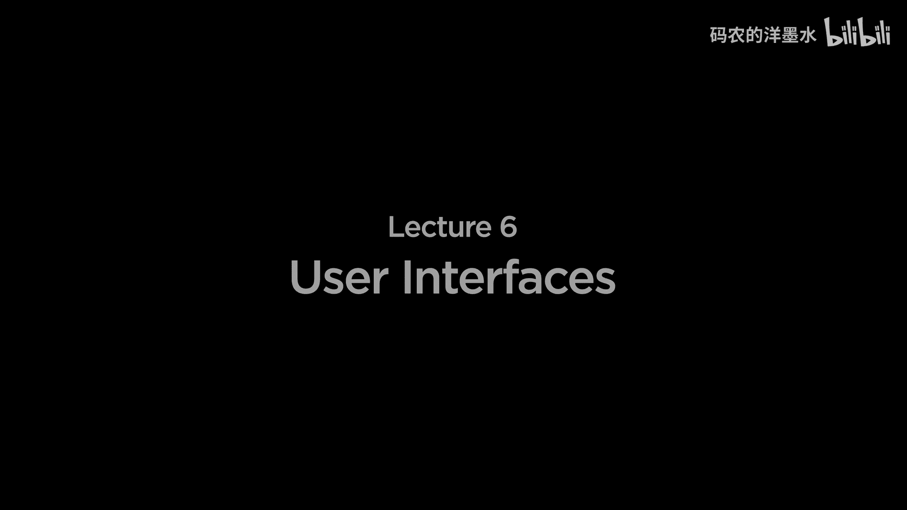

Welcome back， everyone to web programming with Python and JavaScript。

 and last time we took a look at jascript， that language that ran inside of a user's web browser。

 client side， and allowed us to do a number of things to make our web pages more interactive。

 JavaScript enabled us to display alerts to be able to manipulate the dom。

 the structure of the web page in order to add content or see what content was already there and it also let us respond to user events when a user clicked on a button or submitted a form or type something into an input field。

 we could have ja functions run that responded to those events in order to make our web pages more interactive。

😊，Today we're going to continue that conversation in particular。

 taking a look at user interface design， looking at some common paradigms in terms of user interfaces and how we can leverage JavaScriptscript to be able to achieve those goals to create interactive user interfaces that will be valuable when users are interacting with our applications so one of the more common paradigms especially nowadays in web programming is the idea of single page applications thus far if we've wanted to create a web application that has multiple different pages。

 we've generally done that via multiple different routes in our Django web application for example。

 where you go to slash something to get one page and slash something else in order to get another page。

😊，But commonly using jascript， we have the ability to create single page applications where the entire web page is really just a single page。

 and then we use jascript to manipulate the dom to replace portions of the page with things we want to replace。

 and this has a number of advantages。 one of them being that we only need to make modifications to the part of the page that is actually changing。

 if for example， you have five different pages but the general layout and structure of the page is pretty similar when you switch between pages rather than load an entirely new page you can just load the part of the page that is changing。

 And this is especially helpful for applications that are changing quite frequently。

 So let's take a look now at how we could implement， for example。

 a very simple single page application。 So let's imagine， for example。

 that we want a single page application that just displays three different pages but all included in the same page。

 I'll go ahead and create a new file that I'll call single page HM。😊。

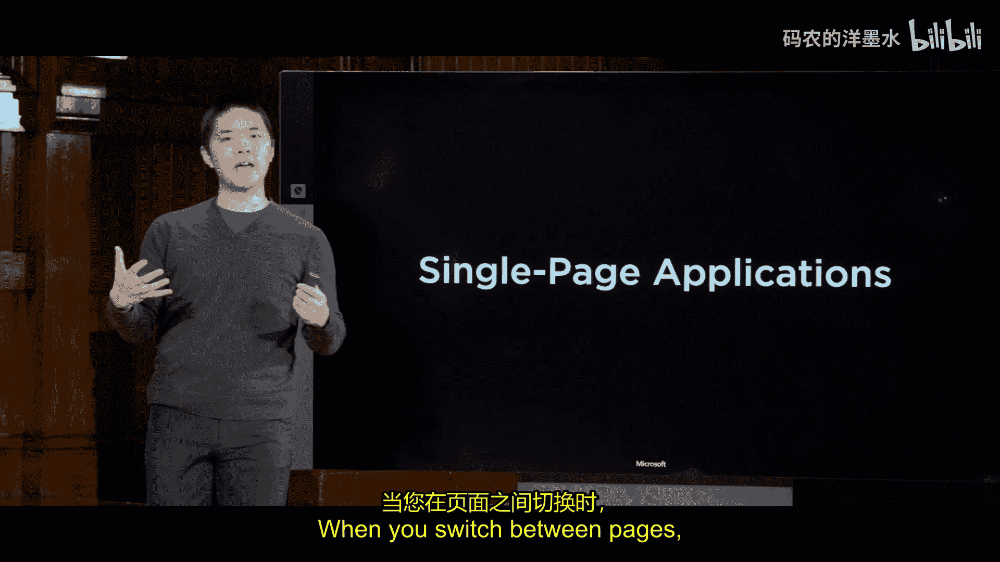

Inside of which we'll include our usual HTML tags。And inside the body of this page now。

 I'm going to include three different sections of the page to represent the three different pages I might want to display to the user。

 so I'll have a div in whose ID is page one that maybe just has a heading that says this is page one and you could imagine there's more content on these pages as well。

 a div whose ID is page two will' say this is page2。And then one final day of whose ID is page three。

It has a heading that says this is page three， for example。

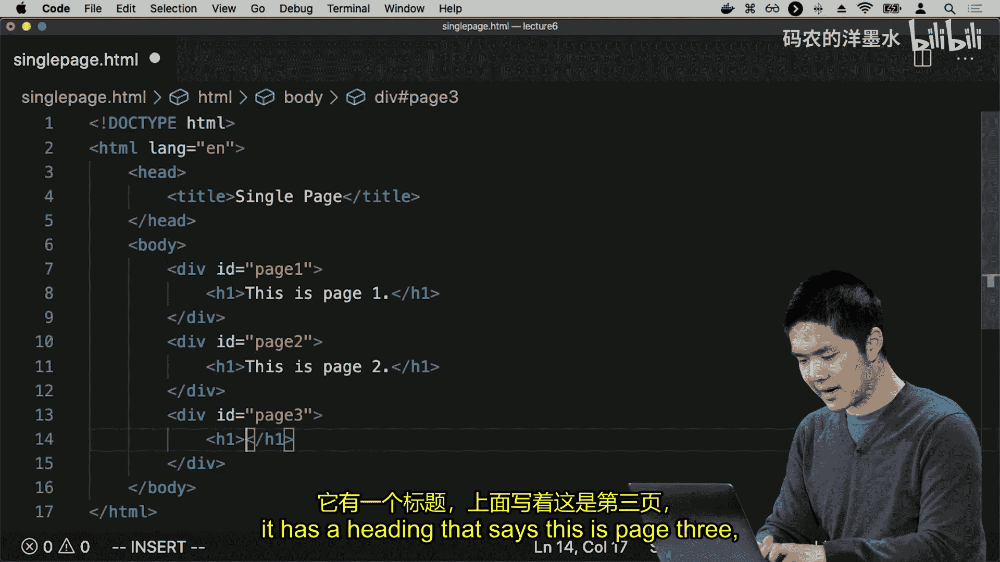

Now right now， if I were to open up single page do Htm。

 what we'd see is we see all three pages at the same time。 and now that's probably not what we want。

 what we really want is by default to hide these pages until we want to view the pages one at a time。

 for example， So one thing I could do is use CSS to be able to toggle whether or not something is visible。

 adding some style tags to my page to say that by default。

 all of my das should have a display property set to none， meaning they're not visible。

 they're not displayed on the screen。😡。

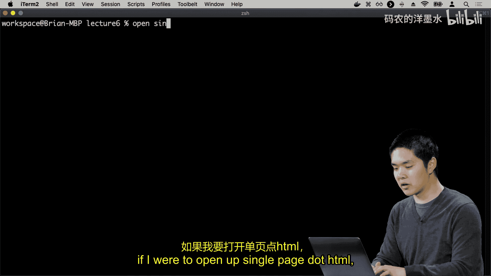

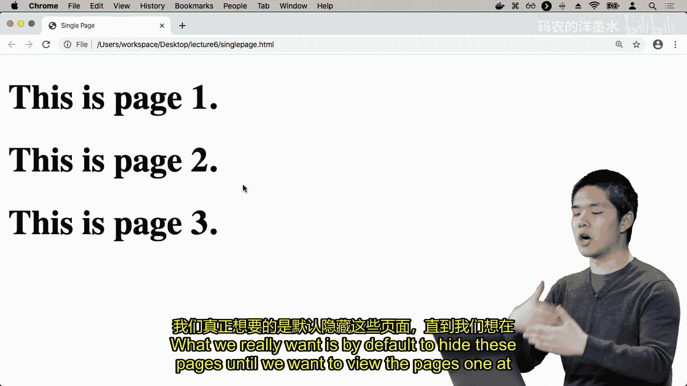

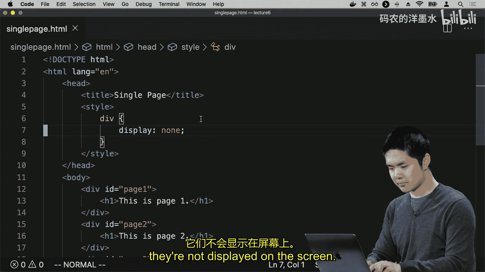

Now if I refresh the page， I don't actually see any of the three headings that I had there before。

 but what I'd really like is for some buttons now to allow me to toggle between these three pages。

 so I'll give myself three buttons， one button that says page1。

 one button that says page2 and one button that says page3 for example。😡。

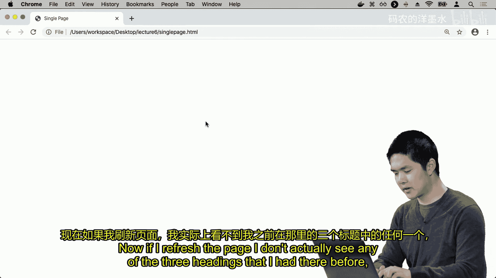

And I need some mechanism for these buttons to know when you click on this button what page should be displayed。

 So I'll go ahead and use data attributes， which we saw last time with jascript to add some additional information to these particular Hm elements where I'll give the first button。

 a data dash page value of page1。 The second one， a data dash page value of page 2 and the third one。

 a data dash page value of page 3 here again， just providing information so that later when I write some javascript。

 I can have the jascript code look at the data dash page attribute to say that when you click on this button you should let me see the Dave whose Id is page 1。

 That's what this is going to allow us to signal。So now let's go ahead and write that JavaScript。

What I want to be able to do is to be able to say I would like to show page one and hide the other two or show page two and hide the other two or show page three。

 for example， and so to do that I'll first write a function that will let me do that。

 I'll write a function called show page that takes us its argument like what page I want to show。😡。

And so what should this function do， What we're going to do is we're going to say document dot query selector。

And I want to get the thing that has a particular ID， the ID of whatever this input happens to be。

 this page is going to represent the ID of the div that I want to show。

 So I'll say get me the thing that has this ID and then using a template literal， I'll say。

 all right get me the ID of page， whatever element has that particular ID。😡。

And then I'd like to change its style property， which part of the style。

 well I want to change its display property， and instead of none。

 which was the default here where I said don't show it at all， the other option for a div is block。

 meaning it shows up is just a block that is on the page that is actually visible。😡。

And so now I have this show page function， and I can test it， in fact， if I go into my browser。

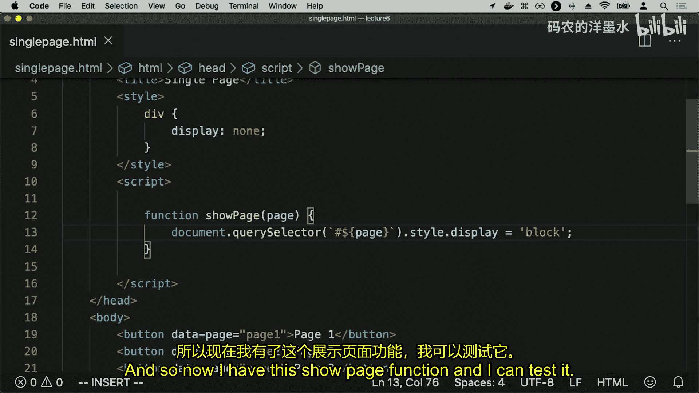

Refresh the page， I now see three buttons， the buttons don't do anything just yet。

But what I can do is in the console， if I actually just try running this。

 I can run the show page function and say like show page page one， for example。

 press return and all right page one now appears on my page and if I rest show page page two。

 then page two will become visible。And all right， that did half of what I wanted。

 Page two is now visible， but so is page1， so I probably want it such that if I ever show a page。

 I hide the other pages first， like hide all the pages and then show page two or hide all the pages and then show page three So how could I go about doing that Well first I might want to just when I show a page first hide all of the other pages hide all the pages So to get all the pages I'll do document do query selector all。

😡。

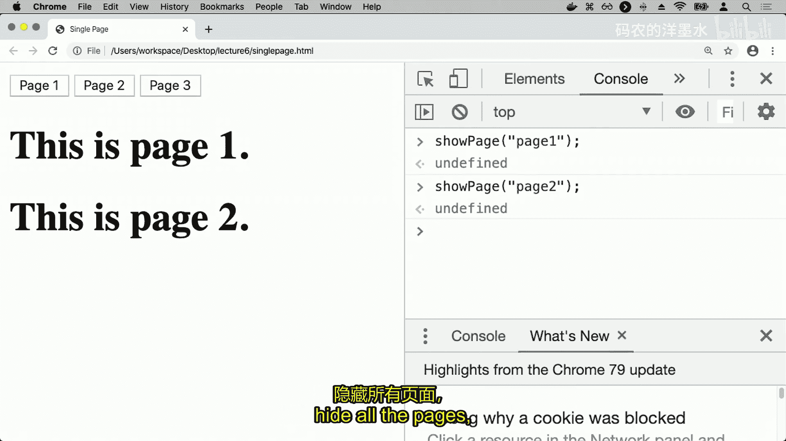

Get all of the divs， which is what I'm using to enclose the pages。 And now for each one of those。

 again， effectively creating a loop where I'm looping over each of the divs for each div。

 let's go ahead and set the div dot style dot display property equal to none。

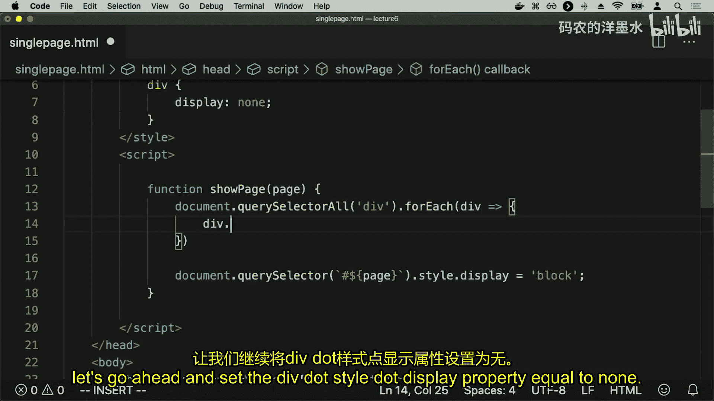

And so what this show page function is now doing is it is first querying for all of the divs。

 which are simulating my pages inside of this single page application， and for each one of the divs。

 we're going to pass it as input into this function， which is the argument for each。

 again using this arrow function notation， which is just a shorthand way of expressing a function where I'm here saying that for each of the divs。

 we'll go ahead and modify its style property， setting display equal to none。

 meaning don't show any of the divs and then show only the div that was requested。😡。

So now this should solve the problem of multiple pages appearing simultaneously。

 that if I go back to this page and I click a right show page， page1。Then page one appears。

 but if I run show page of page2。Then page two appears， but page one disappears， and likewise。

 when I show page page 3， that shows page 3， but not the other two。

 so I can manipulate which page is visible all via the console。

 but now what I'd like to do is get these buttons to actually work where if I click on one of the buttons that has the effect of actually displaying the requested page。

😡。

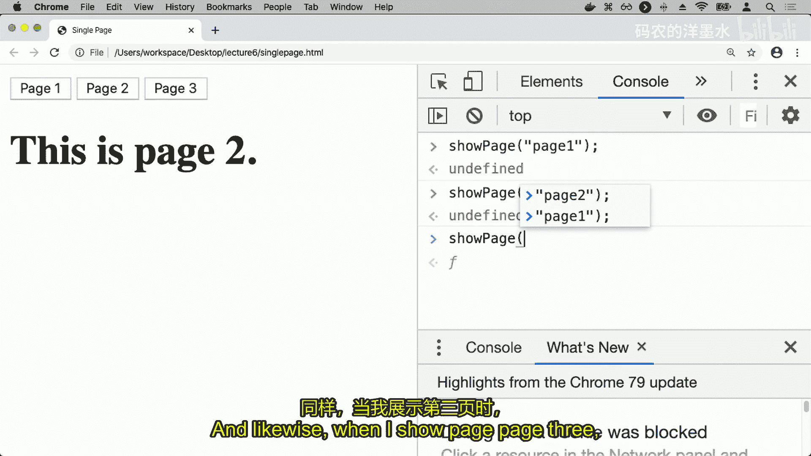

So in order to do that， well I want to attach some event listeners to these buttons。

 which means I need to wait until those buttons have loaded onto the page。

 so we'll use document do add event listener。Donwn content loaded， again。

 waiting until all of the content on the page has been loaded。And then and only then。

Will I say let's go ahead and query selector all for all of the buttons。

And for each one of those buttons， let's go ahead and attach an event listener to each of those buttons。

 So I'm querying for all of the buttons and saying for each of the buttons。

 I would like to do this with each button。 and what I'd like to do is say button dot on click when the button is clicked on。

Go ahead and run this function。 I'd like to show page and which page do I want to show。

 well I want to show whatever page is in the page part of the buttons dataset。

And to get it the current button， the button that has been clicked on。

 recall that when we're inside of an event handler。

 we can take advantage of the JavaScript keyword this which refers to whatever element has received the event。

 so whatever button in this case that was clicked on so I can say this dataet page to mean that all right for each of the buttons when the button is clicked on we're saying button on click for each of the buttons run this function when the button is clicked。

 we'd like to show a page， which page do we want to show we'll take this button。

 the button that received the event， access its data properties accesses data page attribute which are down here either page1 or page2 or page3 and go ahead and just call the show page function that we wrote a moment ago。

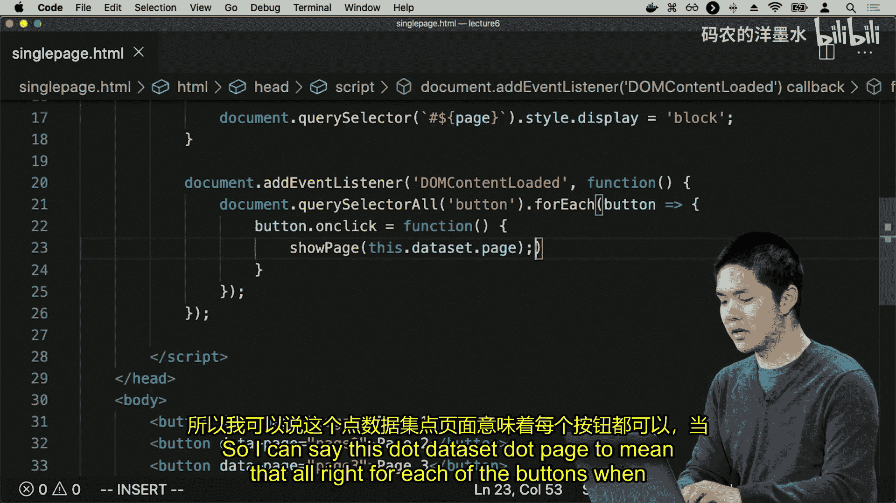

So now that we've done that， we've attached these event handlers to the buttons。

 so now if I refresh the page， I can click on these buttons and toggle between any of the three pages。

😡。

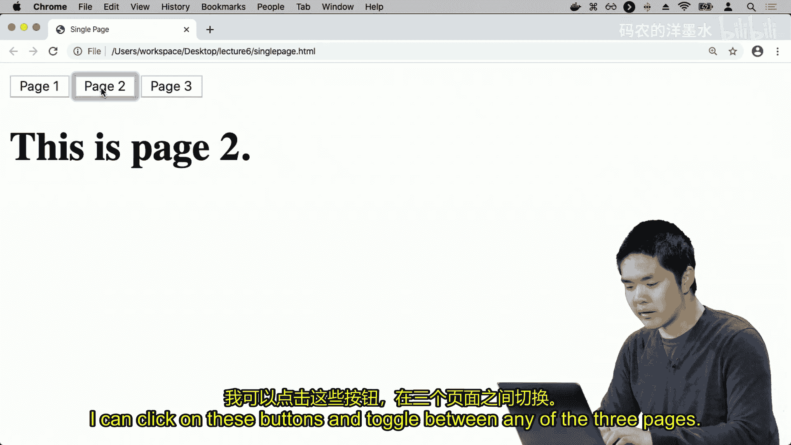

AndNow the interesting thing here is that we now have the ability to just in a single page。

 allow myself to simulate the idea of having multiple pages， all enclosed in a single HTML file。

 but not needing to consistently make additional request to a server in order to get access to that information Now sometimes though it might be reasonable to want to reach out to a server when you need new information for a page for example。

 you might imagine that each of these pages contains a lot of text。

 it's going to be inefficient if immediately we're loading all of that data into HTMLm and just showing and hiding them when we need to because maybe we're loading more information than the user is ever going to actually care about if they're never going to look at page2 or page3 So one thing we might imagine doing is loading this data dynamically。

 last time when we were talking about jascript we saw how we could use fetch to say go ahead and request some additional information from a web server last time it was currency exchange rates but then we use that data that came back in order to fill in something onto our page。

 And likewise， we could do a similar thing here。😊，That if we have the general structure of a single page and we want to load new content rather than load entirely new HTML content and reload the entire page。

 we can just ask our own web server for what part of the page needs to change and then just replace that part of the page。

😡，And so that's what we'll take a look at now now combining Django for our web server and JavaScript for writing the client side code to be able to generate a single page application and so for this we'll go ahead and go into an example I had in advance called single page1 and inside of single page1。

 this is just a Django application with a single app called single page and what we'll notice is we'll go to the URLs first。

😡，There are two URLs， one default URL that just loads the index function。

 and then a URL for loading different sections of a page that I might want to dynamically load。

 for example， so I have sections slash some particular number。

And if we look at the views for what it is these URLs are actually doing。

 the index function just returns index。html。😡，And then what the section function does is it first makes sure the numbers between one and three。

 and if so， responds with one of these just strings of text， for example。

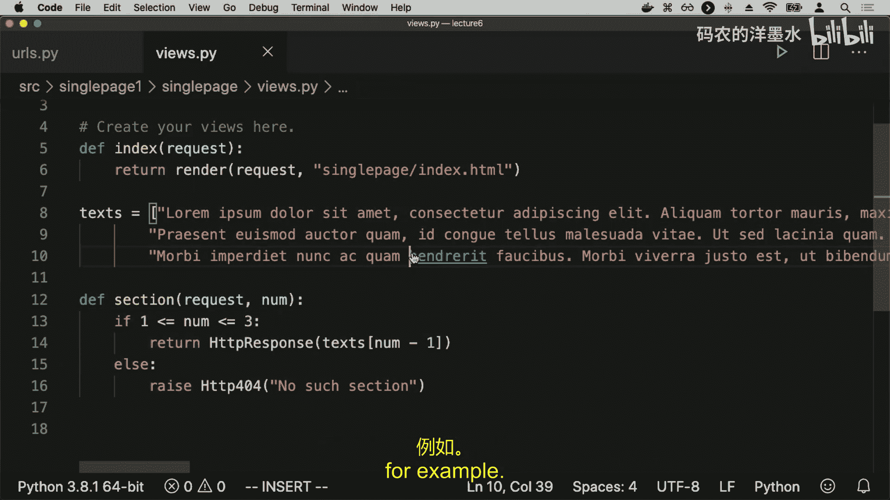

So how does this actually work if I go into。Single page one。

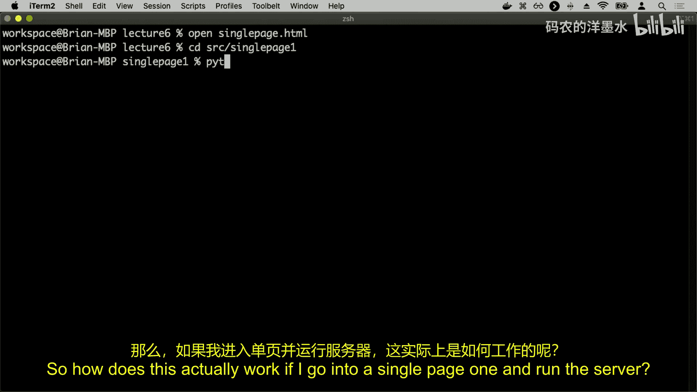

And run the server。If I go to this URL， slash section slash1， for example。

 what I get is this block of text， and if I go to slash section slash2， I get that block of text。

 section slash3， a different block of text altogether， so just different text。

 and I'd like to incorporate this text into an existing HTML page for instance。

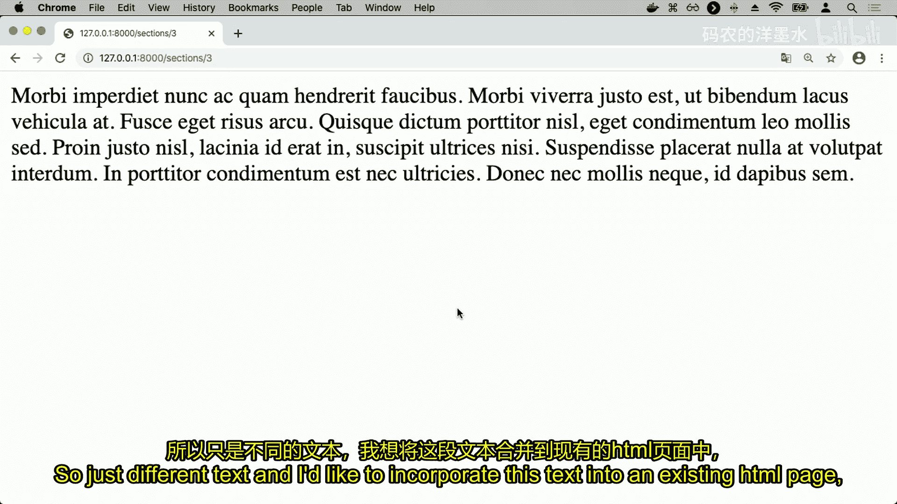

So here I'll go into index。htm， this template that gets loaded when I go to the default route。😡。

And inside of index dot H TM， what we'll see。Is I have a show section function that behaves very similar to the show page function we saw from a moment ago。

 but instead what show section is going to do is it's going to fetch what text I should display on the page from my own web server I'm fetching from slash sectionslash fill in a number here number like one or two or three when I get the response in the past we've seen how we can convert that response into Json data if it's some structured data we can also just convert the response into plain text then I'll take that text console logage just so we can see it in the log output but then go ahead and query selectlect for the content of the page something that an idea of content。

 update its innerhtm and set it equal to that text so what this entire function is now doing is it is going to reach out to my server figure out what text content belongs in the new section and fill in the part of my page accordingly with the text that comes back from that HttP request。

And then down further below inside of the page， we'll see that I have a hello heading three buttons that toggle between the different sections。

 each of them has a data dash section attribute this time for which section should be loaded and then a div that is initially blank just for the content of the page。

😊。

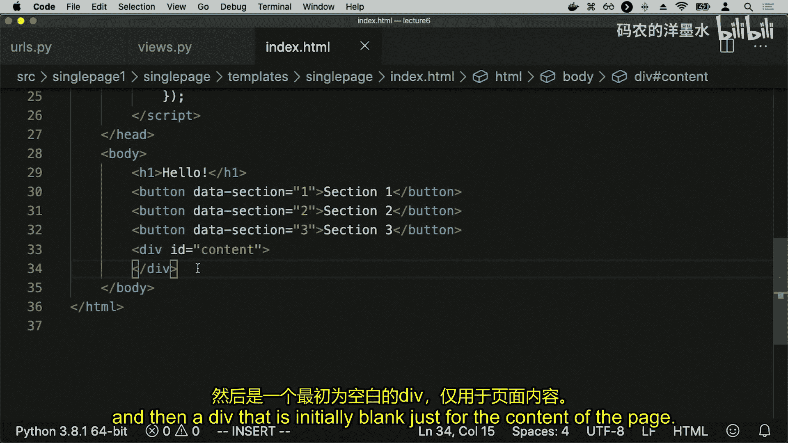

So putting this all together now if I go to the default route。

 I see hello plus three buttons to give me a choice between three different sections and if I click section1。

 what's going to happen is jascript is going to query slash section s1 ask for the text it gets that text back and it's going to fill it in into the page section1 section2 in section 3 So very similar to before but unlike what we had before where all of the text was being loaded into the HTML page all at once now we're using asynchronous jascript to only dynamically load information when we need when we click on a section then it's going to make the request for what content needs to be filled in and it's going to fill it in and everything else these buttons this heading and you might imagine in a more complex website you've got a lot more going on around the edges of this web page all of that stays the same we don't need to reload any of that information we're only reloading the portion of the page that actually changes as we toggle between these various different section headings。

😊。

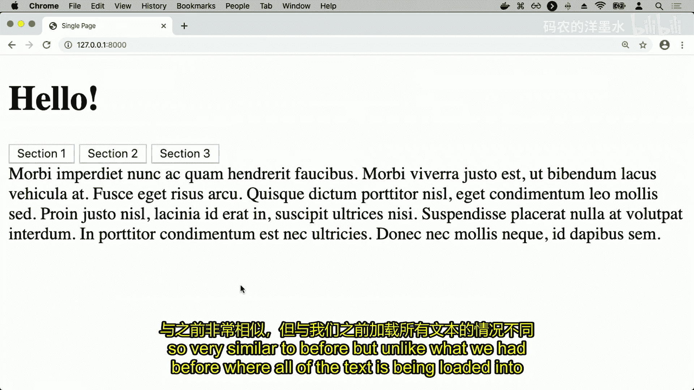

Now this seems to be an advantage in some ways that maybe we can be more efficient about how we run our single page applications like this。

 One thing we seem to lose， though， is the notion of maintaining state inside of the URL that generally the URL gives you an indication for what page you're on you're on something likelash1 if you're on section 1 orlash2 if you're on section2lash3 for section3 but of course we're staying on the same page in all of these examples whenever I click a button section 1 or two or three。

 the URL is never changing the URL stays the same。 It turns out there's a way in ja to manipulate that URL taking advantage of what's known as the JavaScript history API where I can push something to the history。

 meaning update the URL and actually save that inside the user's browser history So later on they could potentially go back to that。

And to do that， I'll show you yet another example inside of single page 2， which is very similar。

 except inside of index dot H TM L， I've added a couple additional things。

One is that when I click on a button， meaning when I click on section 1 or section 2 or section 3。

 I've added this line here， history do push state。 what history do push state is going to do is it is going to basically add a new element to my browsing history where I first specify any data associated with this state So in particular and storing jascript object representing what section number is being represented here next is a title parameter that most web browsers actually ignore so that can generally be the empty string but the third argument here is what should go in the URL and what I want to go in the URL in this case is something like section followed by the section number so I can go to slash section 1 or slash section 2 or slash section 3 for instance。

 and those will appear in the URL bar when I click on a different page。

Then what I want to be able to support is the ability to say when I go back through my history。

 if I click the back button in my web browser， I'd like to go back from section 3 to section2 if that was the page I visited previously。

 and there it turns out to be an event handler for that as well， window on popop state。

 meaning when I pop something off of the history， like go back in my history。😡。

We have the ability to take some event as an argument， and if you look at event state。 section。

 which I've。😡，Run console。t log on so we can take a look at it in a moment。

 we'll see what state was stored associated with that part of the user's history。

 and I can go ahead and show that section。

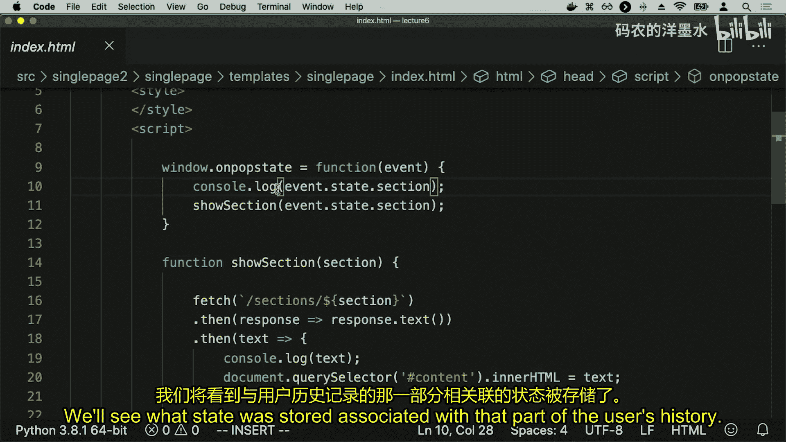

So all in all， when I run this web application， going into single page2 this time。

When I run the server？

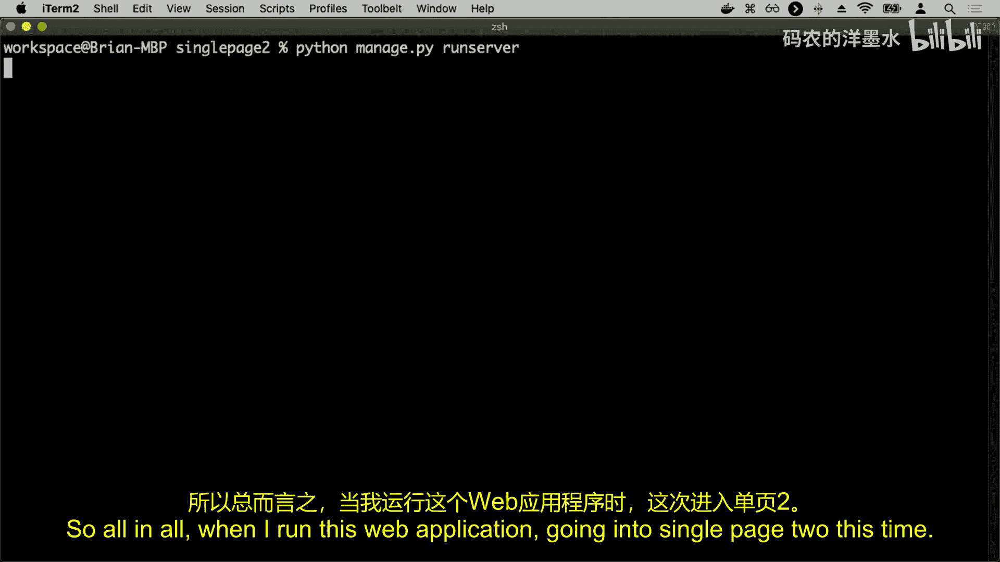

I see hello three sections for buttons when I click on one of those buttons not only do I see text but I also see in the URL bar that I'm now on slash section1 that has been pushed onto my history and I've updated the URL to reflect that to I click section2 that updates the URL as well section 3 updates the URL2 and when I've pushed things onto my history I've associated some state with them so that I can go back if I ever need to and in fact if I open up the JavaScript console now and I go back for example back to section 2 what you'll see is that what gets logged is the number two when I print out like what is the current section that's associated with this URL it's saving that state that I should be loading section number two and so it does load section number two here。

So there's certainly nothing wrong with the original paradigm of just loading different pages dynamically using Django。

 like make a request and get a response， but oftentimes as you begin to imagine applications where a lot of things are changing on the same page simultaneously。

 you might imagine social networking websites where a lot of things stay the same but new posts might be added and you might be looking at different parts of the same page。

 being able to dynamically load information， request additional information and then display it on the page can actually be quite powerful a way to make your web pages a little bit more interactive。

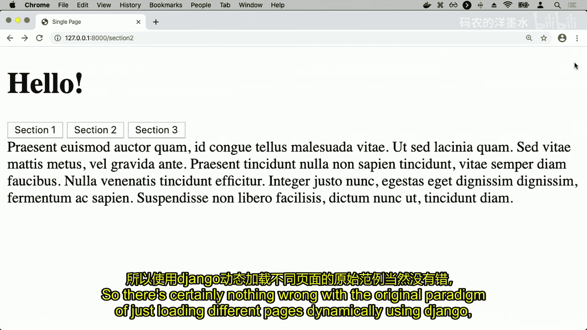

So that then is how we might build single page applications。

 taking advantage of jascript to asynchronously load new data and then taking advantage of this history API that let us add things to the URL。

 add things to the user's browsing history such that we could go back to them later by listening for window dot on pop state。

 And it turns out that window object that we get access to in jascript is quite powerful。

 It represents the physical window on the computers screen that displays all of their web content。

 And there are certain properties of that window we can look at that allow us to enable some interesting features。

 So， for example， your window is really described by what the user actually sees inside of their window in Google Chrome or safari or whatever web browser they happen to be using。

 And there are a couple of properties that might be of use。

 something like window dot inner with will represent how wide is the window which might be useful to know to know the size of the users screen。

 for example， to know how many pixels wide the window happens to be。

 And just as there's a window inner with。 There's also a window inner height that represents。😊。

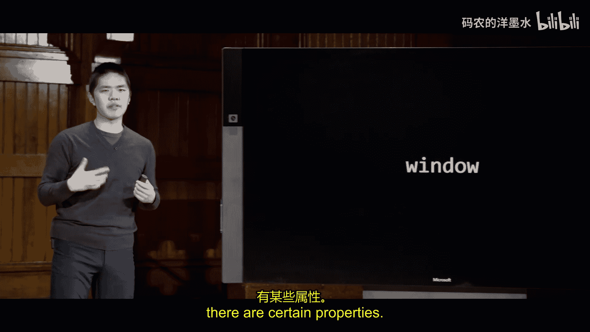

The height of the window as well。 Now， window represents the physical part that they're actually seeing。

 We've also seen another variable that jascript gives us access to。 and that is this document object。

 So what is the difference between the window and the document， well。

 the document generally represents the entire web page。 But if web pages are long， Oftentimes。

 the web page doesn't fit entirely inside of the window that you generally have to scroll through an entire web page and the windows only showing you one portion of that page in any given time。

 So you can represent the document as like this big vertical section that goes beyond the window。

 there might be part of the document that is above the window part of the document that is below the window as well。

😊，So windowow dot scroll Y is another variable you have access to on the window and window dot scroll Y represents how many pixels far down have you scrolled so if you're at the top of the page window dot scroll y is 0。

 you haven't scrolled at all， but as you begin to scroll if you want to know how far the user has scrolled on a page you can look at window dot scroll Y to figure out the number of pixels the user has scrolled in the y direction。

 the up and down direction。😡。

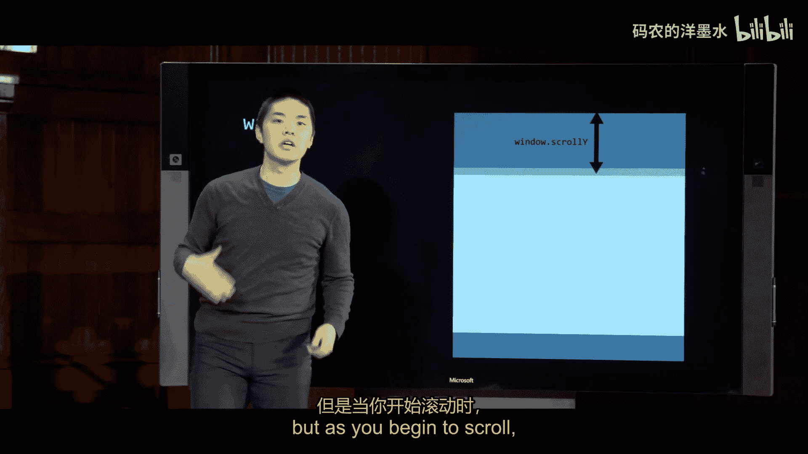

When the entire height of the page is represented in document dot body dot offset height that represents how tall the entire height of the document is and we talk about all this in addition to things like window do inner height and window dot inner width because using all of these values together you can begin to do some interesting calculations。

 So one thing you might want to detect， for example。

 is has the user scrolled down to the bottom of the page or not that might be something you care about knowing。

 And it turns out there isn't an event listener that does this automatically but we can calculate it in order to try and figure this out if inner height is the height of the window scroll why is how far vertically the user has scrolled and document body offset height is the entire height of the document you can ask yourself what needs to be true if the user has scrolled to the bottom of the page。

AndWell， if the user is scrolled to the bottom of the page， well then scroll y plus the inner height。

 meaning the amount that they've scrolled plus the height of the window。

 that must be at least or equal to document body offset height meaning the amount that they scrolled plus the window takes you down to the bottom of the page to the end of the page to who tall the document happens to be and using that mathematical comparison。

 we can actually detect when the user has reached the bottom of the page and we can actually try and Ill put that into practice。

 So I go ahead and open up an example that I have here。Called scrolled。htm。

And all scroll dot HTMLml has right now is 100 paragraphs insideside of the body tag。

 I have a P for paragraph， paragraph 1 paragraph 2， so on and so forth。

 I have 100 paragraphs inside of the body of this HTML page and that's all that really is there right now。

 such that now if I go ahead and open scroll HTML。

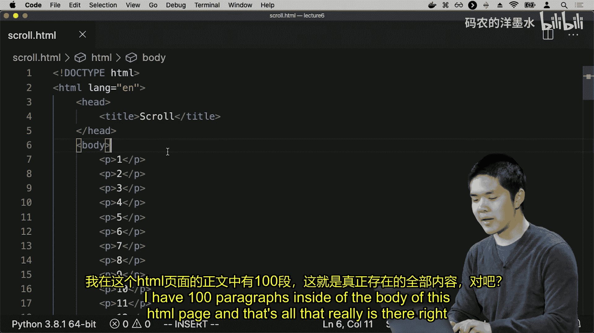

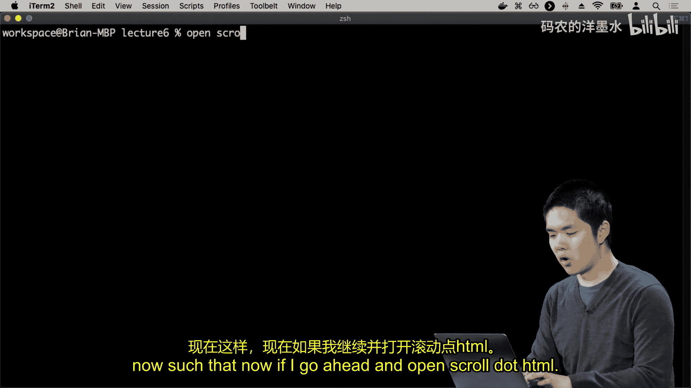

I see。That I have 100 paragraphs that I can scroll through。

 And what I might like to do is detect when I've reached the bottom of the page and maybe do something when I do so。

 something like change the color of the page， for instance。 So how might I go about doing that， Well。

 I'm going to need some jascript。 So I'm going to add some jascript。

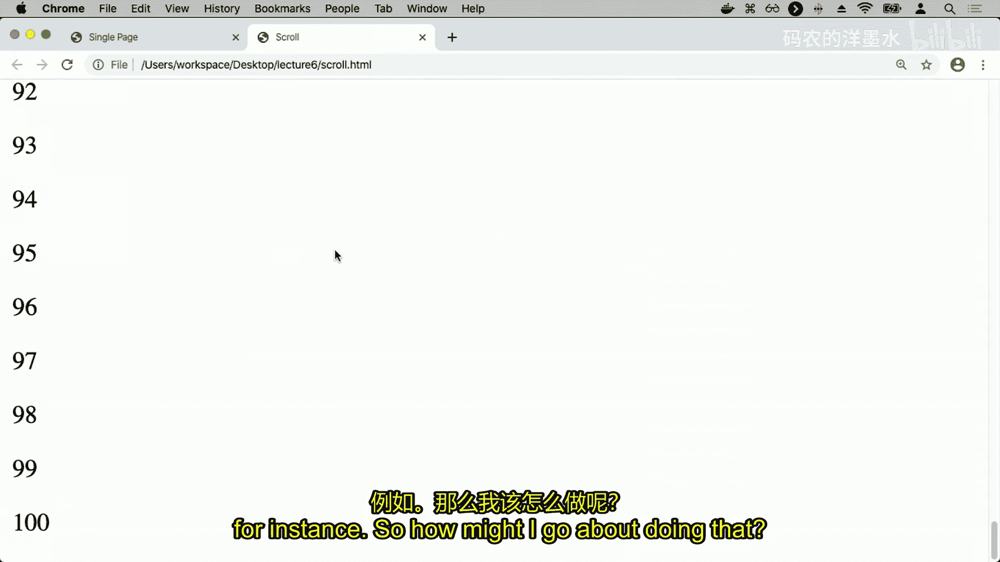

And they'll add an event listener for window dot on scroll。

 on scrolling is an event that listens for what I'm scrolling through the window。😊。

And when I scroll through the window， we'll go ahead and run this function。

 I'll just use an arrow function as a shorthand here。What do I want to calculate， Well。

 I want to calculate if window dot inner height， meaning the height of the window itself plus window dot scroll Y。

 meaning the amount that I've scrolled if that is。At least document dot body dot offset height。Well。

 that means I must have scrolled to the bottom of the page or maybe even a little bit further if there's a little wiggle room to scroll past the end of the page。

 So if this is true， well， then I've reached the end of the page。

 and then we'll go ahead and say document dot query， selector body。

 And let's go ahead and change its style， in particular， change its background color。

And change the background color to green。Otherwise， if we haven't reached the end of the page。

 then we'll take the body of the page。And change its background color to white。

So what we're now doing here is taking advantage of the properties we know of this window object。

 saying when we scroll the window， let's check to see if we add this up and at least the height of the entire document。

 we've reached the end of the page， go ahead and change the style of the background of the body accordingly。

 otherwise change the background to white or leave it at white if it already is。😡。

So now if I take a look at this actual HTML page and reload scrolled at HTML。

 we'll see that the background is initially white， but as I scroll down， once I reach the bottom。😡。

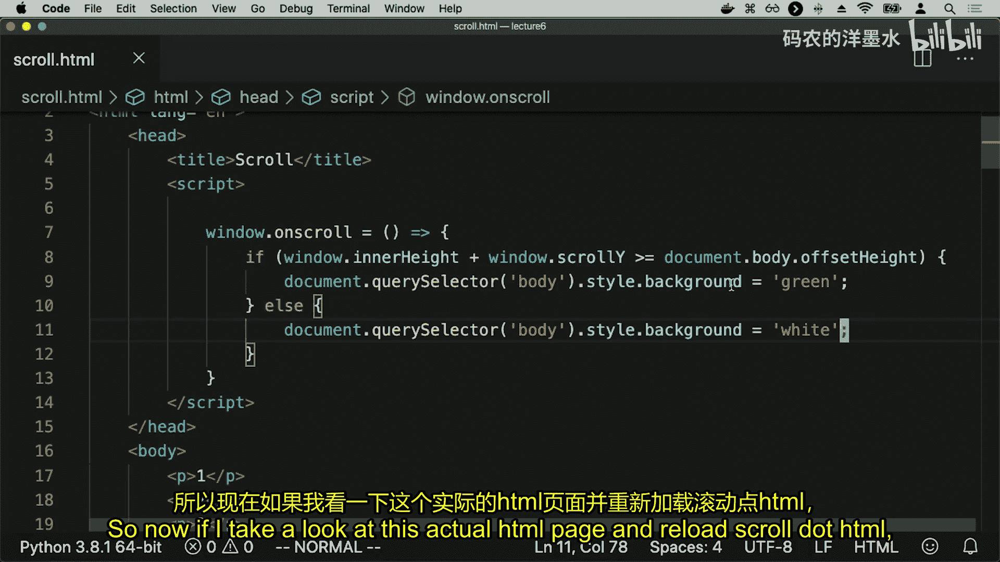

We'll see that the page changes to green。 It's white before I reach the bottom。

 but as soon as I get to the bottom of the page， it turns to green。

 and the reason why is because the height of the window， height of the window here。

 plus however much I've already scrolled from the top of the page up until now。

 that together is equal to the entire height of the document。

 which means we're able to detect the fact that I've reached the end of the page and as a result。

 we can change the color of the background to green。

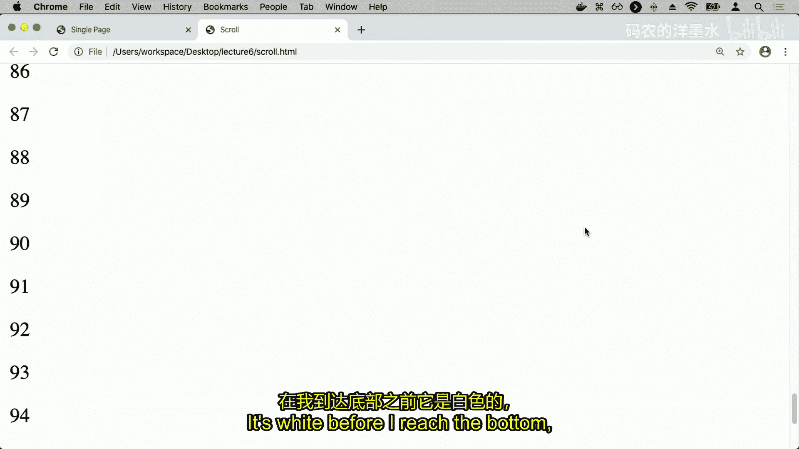

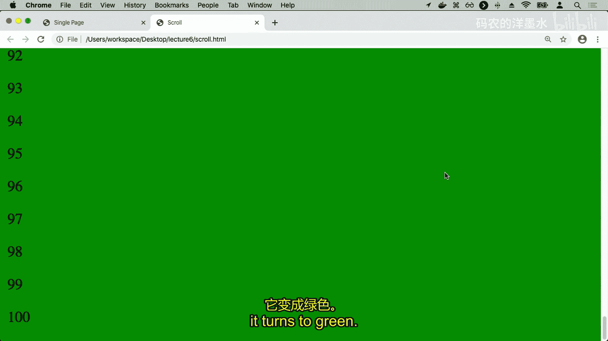

Now this in itself is not a particularly practical use of detecting when we' scrolled to the end of something。

 we probably don't usually care about changing the background color when you reach the end of the page。

 but there actually are real applications and you might imagine this in the context of websites that allow for things like infinite scroll that if you're on a social networking site that has a whole bunch of posts you scroll to the bottom of the list of posts and then it generates the new set of posts as well or you're looking at news articles and you're scrolling through news articles and once you reach the bottom。

 it'll load a whole new set of news articles without you having to go to another page how is it doing that Well it's a combination of the same types of ideas that we've been talking about。

 number one， the ability to detect when you've reached the end of the page using jascript to detect that you're at the bottom of the page and number two to be able to asynchronously load using jascript。

 load additional content， fetch some additional page that has some additional content。

 some additional news articles， some additional posts and whatnot and then take that information and manipulate the dom to add that information。

The existing web page。 And that ultimately is what's going to give us this power to be able to support something like infinite scroll。

So let's now go ahead and try and see what it would look like to implement In scroll。

 I've already started to create a sample application inside of this application called scroll and I've got an app called posts inside of it。

 And what the posts app does is it's got a couple of URLs。

's got a default URL that just loads an index route。

 And then a post route that loads this posts view。And so let's look at what these do。Index。

 all it does is going to load a file called index St HTML， this template。

And if I make a request to slash posts， I need to provide two arguments。😡。

I need to provide a start for what post I want to start with and end for what post I want to end with。

 And then it's just going to generate some sample posts that just say like post number one。

 post number two， so on and so forth。 In practice， you could actually use social network posts in place of this。

 but this is good just for demonstration purposes。

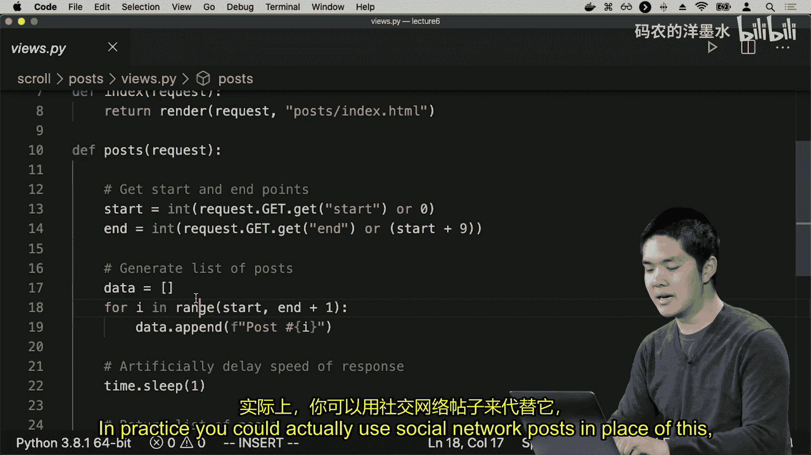

So what this is going to do if I go into scroll and run server。

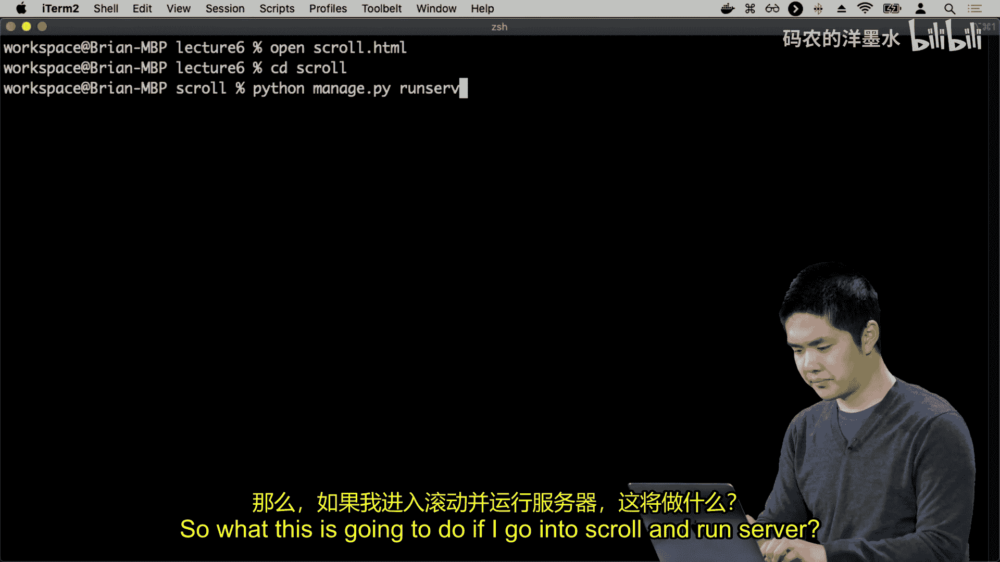

Is that if I go to slash posts and say start equals 1 and end equals 10， for example。

Then I get a jascript object that looks like this recall that a jascript object is just a convenient format for passing information back and forth in Json format。

 And what we have here is a Json object with a key called posts that gives me all of the posts。

 post number one， post number two all the way up to number 10 and it's giving me those posts because I said start at one end at 10。

 but I could have specified other numbers as well if I had said something like start at 20 and go to 28。

 then it's gonna give me post number 20 through post number 28。

 I can specify the range of posts that I want So this now is an API that I have implemented effectively that allows someone to get access to a variety of different posts by hitting this particular URL。

 this endpoint so to speak and passing in parameters passing in what posts they want to start with and what posts they want to end with and then they get all of this data back presented to them in Json format that can then be used。

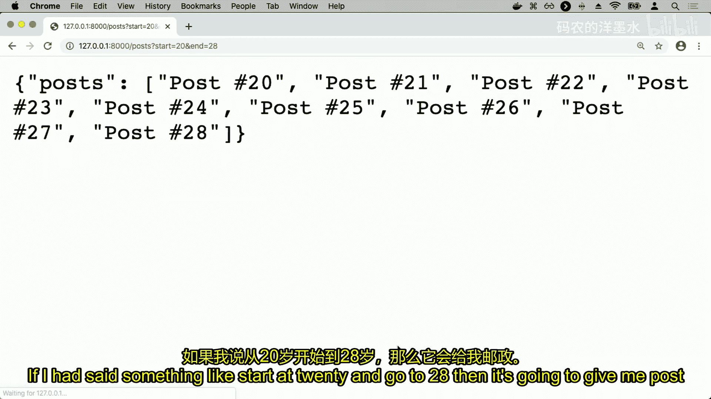

And what's nice about this is that now when we're loading posts rather than have to just guess at how many posts we need to load and then require someone to go to another page。

 we can just do something like load the first 20 posts。

 And now what we'd like to do is if they reach the end of the page go ahead and load the next 20 posts by hitting this API endpoint。

 getting the next 20 posts and then filling that in into the HMl page。

 So let's see now how that actually works in practice by taking a look at that template in index do HMl。

So we go into templates， index of HTML， and there's a fair bit of JavaScript here。

 but look at the body first， the body just has a div for all the posts that initially is going to be empty。

Now here's what the JavaScript is going to do and we'll walk through it。We start with the first post。

 some counter is going to keep track of what post we need to load next by default。

 we're just going to start by loading post number one。

 we have a variable called quantity that's going to tell us how many posts are we going to load at a time。

 let's just say load 20 posts at a time so start with 1 to 20， then 21 to 40， 41 to 60。

 so on and so forth。And when DoM content is loaded。

 go ahead and just call this function that's called load and what the load function does is it figures out what the start and end should be。

 it fetches all the new posts， and then for each of the posts that comes back。

 is it figures out what the asynchronously asking for new posts。

 and what the ad post function does is it creates a new div。

 populates the posts inside of it and adds it to the DoM。😡。

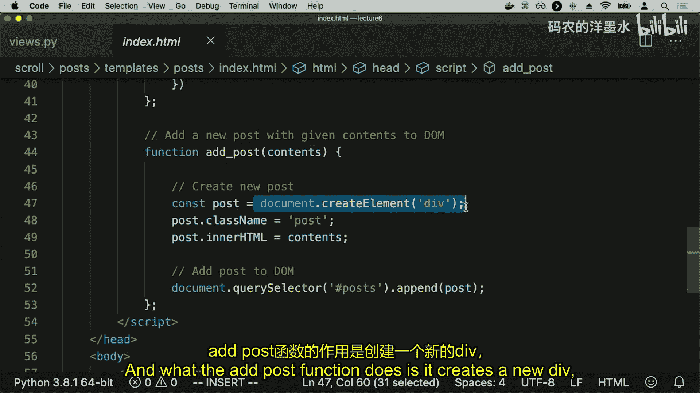

So now that we have these parts， the ability to load new posts as by fetching from some URL。

 all of the posts that we care about， and then for each of those posts that comes back。

 add something new to the Dom as by creating a new HTML element and inserting it into the page。

 we have the ability to dynamically load all of these posts。

 so if I go not to slash posts but just to this default route。😡。

I'll see that we have something like 20 posts that all show up。

 but just 20 posts because every time I call the load function。

 that is going to load the next set of posts for example， and so what I can do is in the console。

 if I try running the load function just by calling it myself press return after a second or so。

 the next set of posts show up 21 all the way through 40， I call load again。

 the next set of posts show up 41。

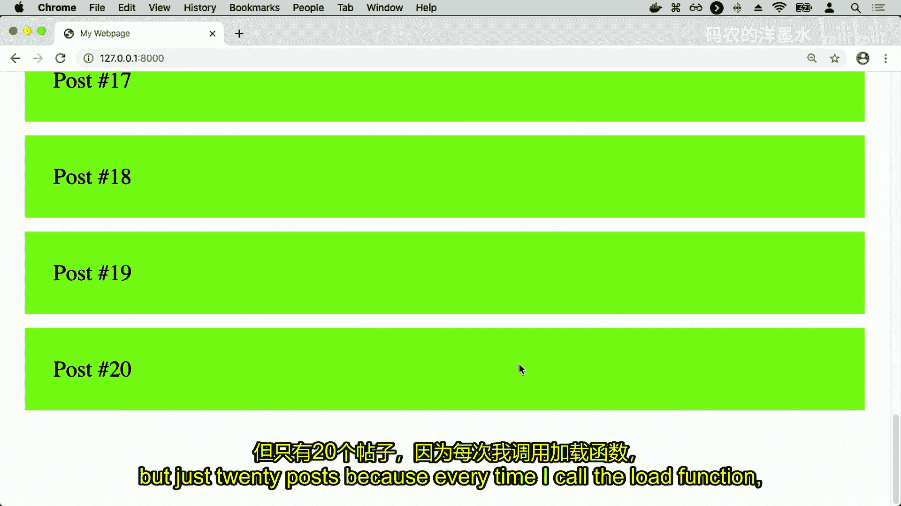

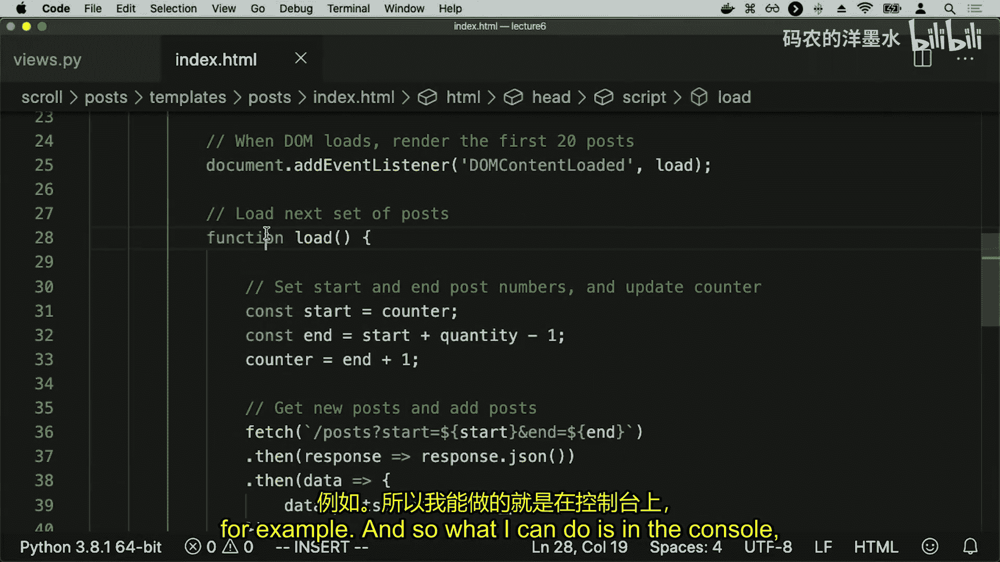

3 or60，20 posts at a time， all using that asynchronous JavaScript。

But now what I'd like to happen is for all this to happen on its own without me having to intervene and manually write Javascript column。

 I would just like to say。

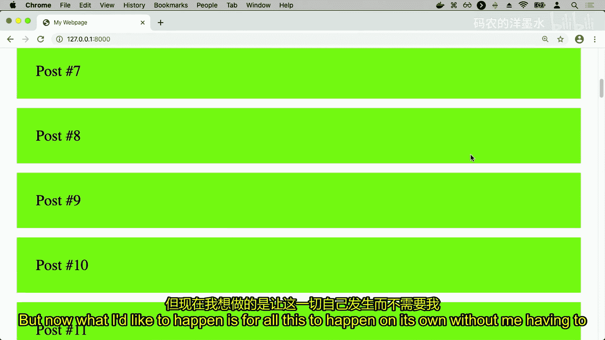

Well， the same type of logic as before， window donet on scroll。

Let's go ahead and say if window dot inner height plus window。

 scroll y is at least document dobody do offset height。

 meaning if I have scrolled to the end of the page。Well， then。

Just go ahead and call the load function。That's all these lines are doing。 Every time I scroll。

 we check did we scroll to the end of the page， And if we did scroll to the end of the page。

 then go ahead and load the next set of posts。

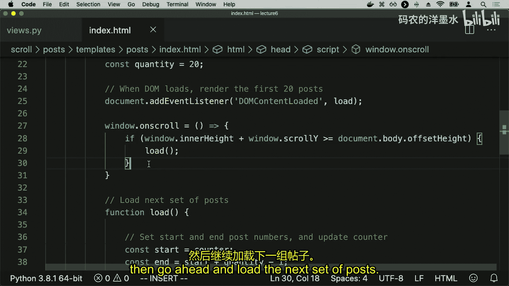

So now。I refresh the page。I see post1 all the way up through post 20。

 now watch what happens when I get to post 20 if I scroll to the bottom。

After a second the next set of posts appears， I scroll to the bottom again I'm at 40 and then after a second the next set of appears every time I scroll to the bottom。

 more posts are going to load after that， allowing me to effectively implement this idea of infinite scrolling by taking advantage of some JavaScript techniques where I can check for when I've got to the end of the page and then dynamically do something as a result of that。

 something like load some additional pages onto the screen。😊。

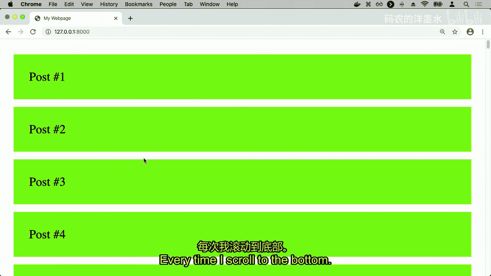

And so here too a lot of power to be had inside of JavaScript and a lot of where the power of user interface comes from is from how it is that the user interface interacts with the user thinking about what the user is going to do and how the page should interact as a result something like user scrolls to the end of the page and they see some new pages show up as well。

 and one technique we can use for just making HTML elements a little more responsive。

 a little bit more interesting is by adding some animation to them as well。

 the ability for things to move around and change their properties in some way and it turns out that CSS has support for animation。

 CSS has already given us support for things like styling elements。

 saying we want this element to be of this color and this size for example。

 but it also gives us the ability to animate those properties as well to change the size of something or change the position of something over some amount of time。

And so let's now take the look at an example of what that might actually look like。

 I'll go ahead and create a new file， and I'll call it。Animate dot H T M L。

 and inside of animate dot H T M L， I'll go ahead and start by including。Our usual HTML。

Title is animate。And what I'd like to do is just add a little bit of animation using C S S into this particular page。

 I'm going to start with just a heading， a heading that says something like。Welcome， for example。

 it's just going display a welcome message such that now， if I open。

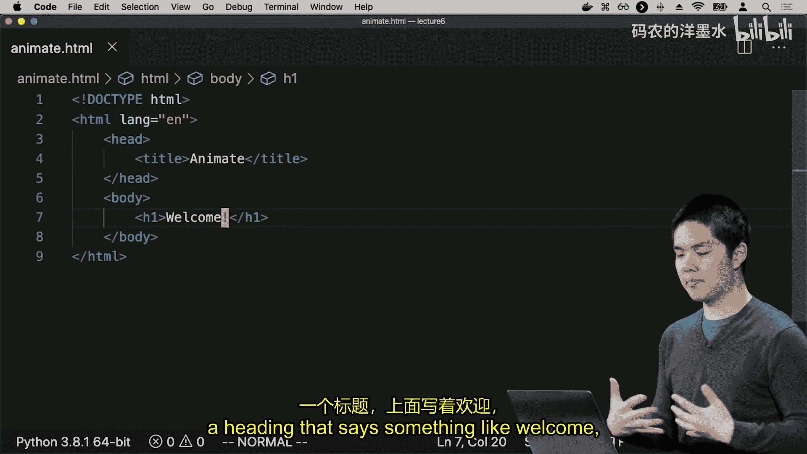

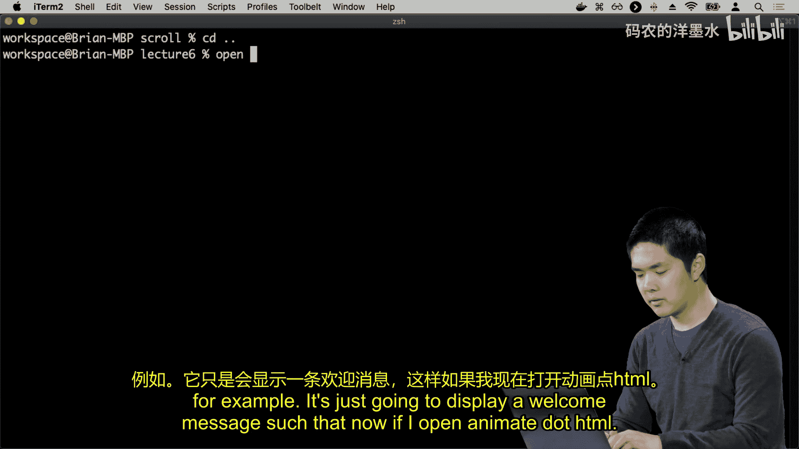

Animate。html。Here's what I see。 just a message that says welcome。

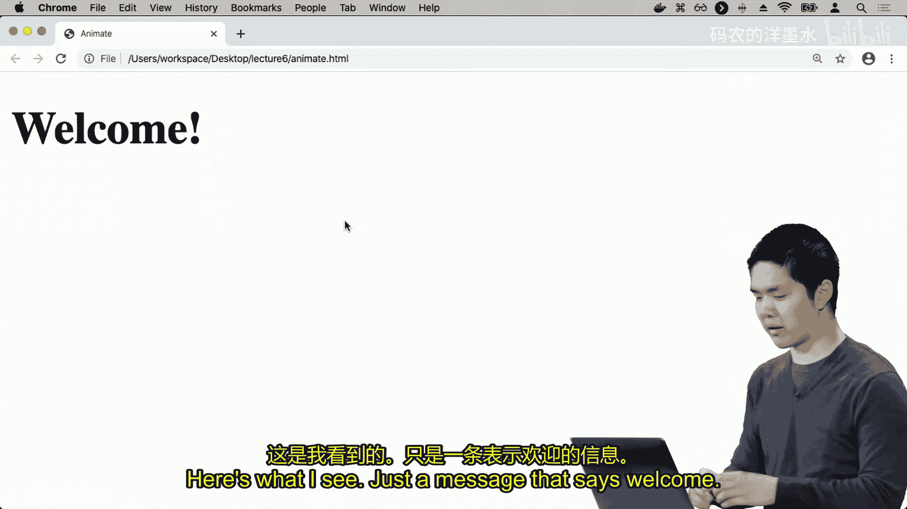

But now let's add some CSS to it。Let's go into the style tag。And for H1 for this heading。

 I'd like to apply a particular animation to it。 And I first need to specify what the animation's name is going to be。

And I can pick a name for the animation。 I'll say something like grow， for example。

I'll set the animations duration to be two seconds。

And then the animation fill mode is like what direction should the animation move in should it go forwards or should it go backwards。

 we' generally want our animations to go forward so they're making some sort of forward progress according to some rules that we're going to specify so here I'm saying we're going to animate all of our headings using an animation called grow and now I need to define what that animation actually does and to do that up above in style I'm going to say at keyframes grow。

😡，And what this is going to allow me to do is specify some key frames for this particular element。

 meaning where should the element start， what should its style properties be。

 and then at the end what should its style properties be。

 and CSS is going to take care of the process of figuring out what needs to happen in all those intermediary fractions of seconds。

 for example。😡，So what I can say is something like go ahead and grow from。

 meaning what should its initial properties be， and maybe initially I wanted to have a font size of 20 pixels。

And then we'll say two。Funt size of 100 pixels， for example。

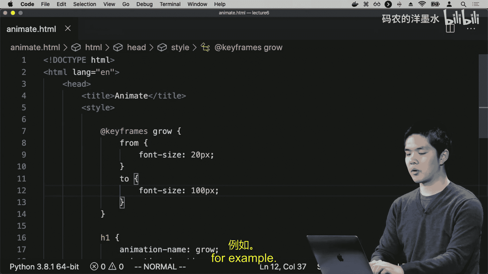

So all in all what this is saying is I would like to apply an animation called grow to all of my headings。

 This animation should last two seconds and go forwards。 and what is the grow animation going to do。

 Well， it's going to mean at the start， anything that obeys the grow animation will start with a font size of 20 pixels and at the end it will grow to a font size of 100 pixels。

 and I have now defined what it is that that animation means。😡。

So now if I go ahead and refresh this page， animate dot HTMLtm。

You'll see that welcome changes size over the course of two seconds it goes from smaller to larger by obeying those keyframes。

 I told it to obey this particular step set of instructions where it goes from a particular font size to another font size and as a result we see the effect here on the page and it turns out you can do more than just manipulate size。

 you can manipulate just about any CSS property you want。

 so if I tell the heading that it should have a relative position meaning its position should be relative to other elements or other things in its parent I can say you should change your position from being zero percent away from the left side of the screen。

😊。

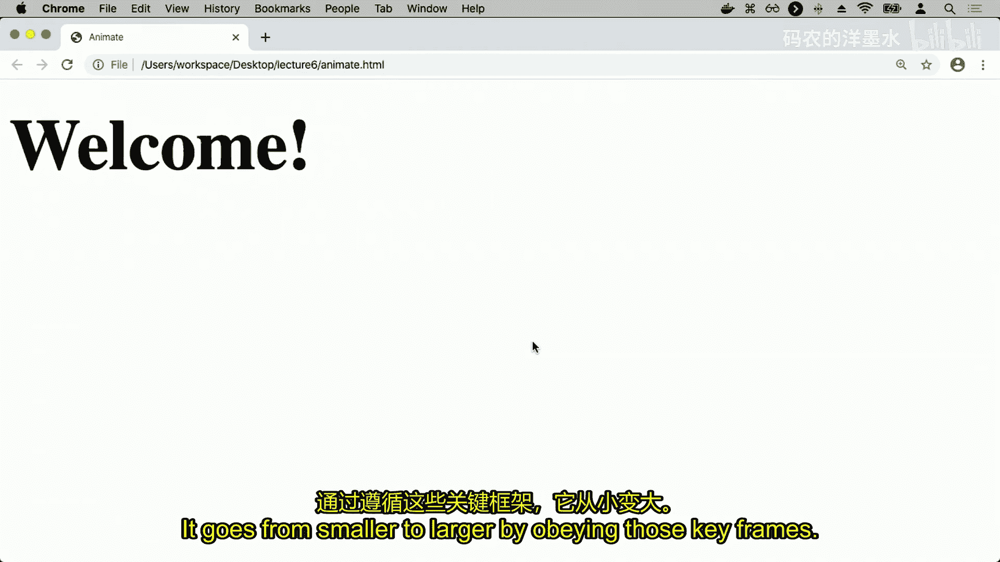

To being。50% of the way from the left side of the screen。And at this point。

 grow is probably not the best name for this animation。 I'll call it moveve instead。

 So animation name is move。 And so now what this animation is going to do is it's going to say when you run the animation。

 go from being right next to the left side of the screen to being about 50 away from the left side of the screen。

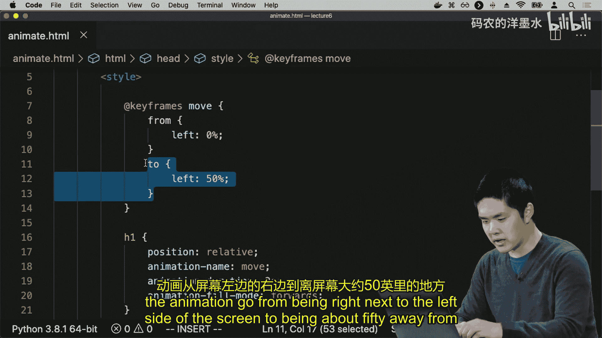

So I can go ahead and rerun this。And we see that's the animation that takes place。

 It goes from the left all the way back up to about halfway across the screen， refresh the page。

 and it goes ahead and does the exact same thing。

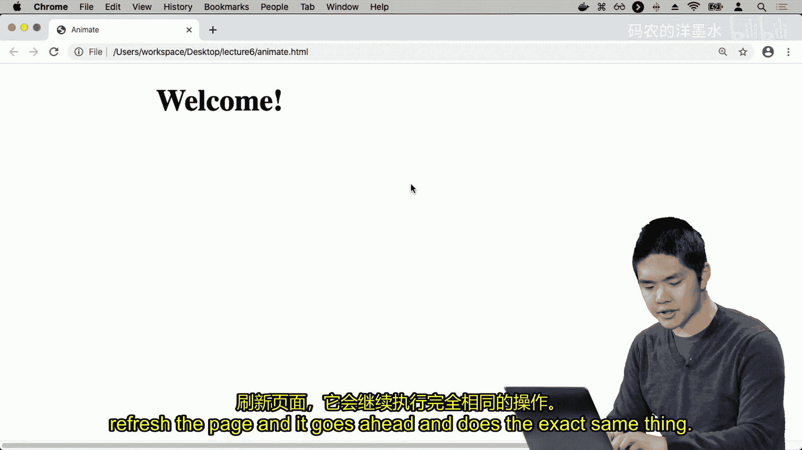

And it turns out we don't just need to specify a beginning point and an end point for an animation。

 we can specify various different keyframes for different points within the animation that we would like to capture something like at the beginning of the animation have this set of CSS properties。

 maybe halfway through the animation have a different set of CSS properties and then at the very end。

 have yet another set of CSS properties so I could say something like if I want the heading not just to move from left to right but also to move back again。

 I can say at the beginning， at the 0% point when you're 0% of the way through the animation。

 you should be 0% away from the left hand side。When you're 50% of the way through the animation。

 you should be 50% away from the left hand side。 And then when you're done with the animation。

100% of the way through， let's go back to 0% away from the left hand side。

 I now have three keyframes。 beginning of the animation middle of the animation back to the beginning of the animation again。

 And the effect of this is if I refresh the page。 We go to the right。 and then we go back。

 We're able to move one direction and then move back。😊。

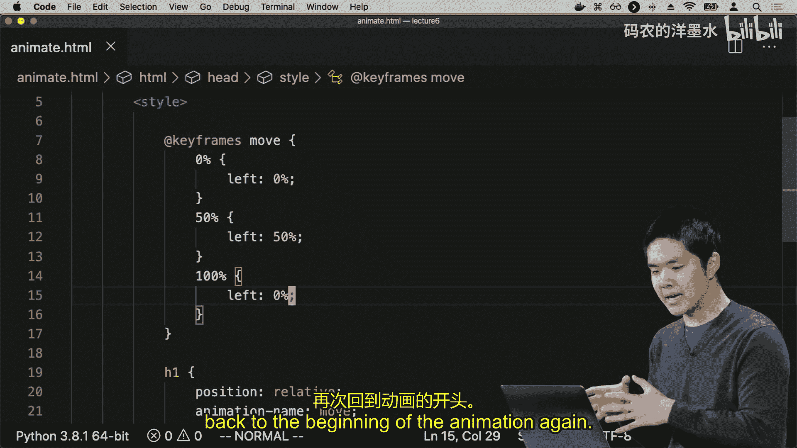

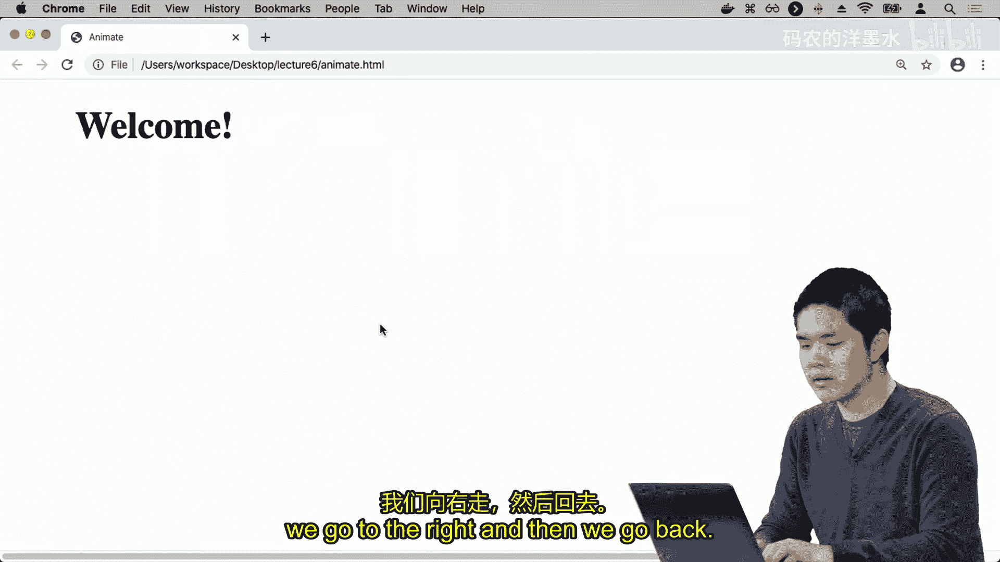

And there are other properties we can use to manipulate these animations as well。

 I can set the animation iteration count， for example。

 to two to mean rather than just do the animation once and then stop。

 do the animation twice and then stop So refresh， it goes to the right and then it goes left and then it repeats that a second time。

 And it turns out if you really want you can set this to infinite to mean never stop performing that animation it's consistently going to have this heading move to the right and then move left According to those keyframes that I've specified。

 And so if you ever see things moving around on a page interactive in some way。

 there are a number of ways to do it， you can animate things using jascript for example。

 but there are many cases where CSs alone is pretty good at just creating these types of animations。

 And while this animation right now is just running forever。

 we could use jascript in order to control that animation as well。

 So let's see an example of what that would look like。😊。

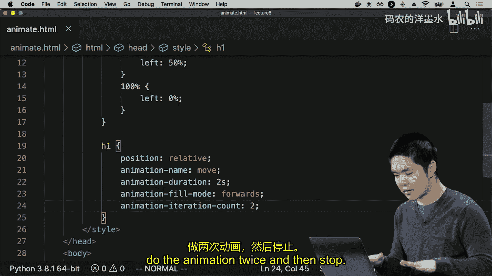

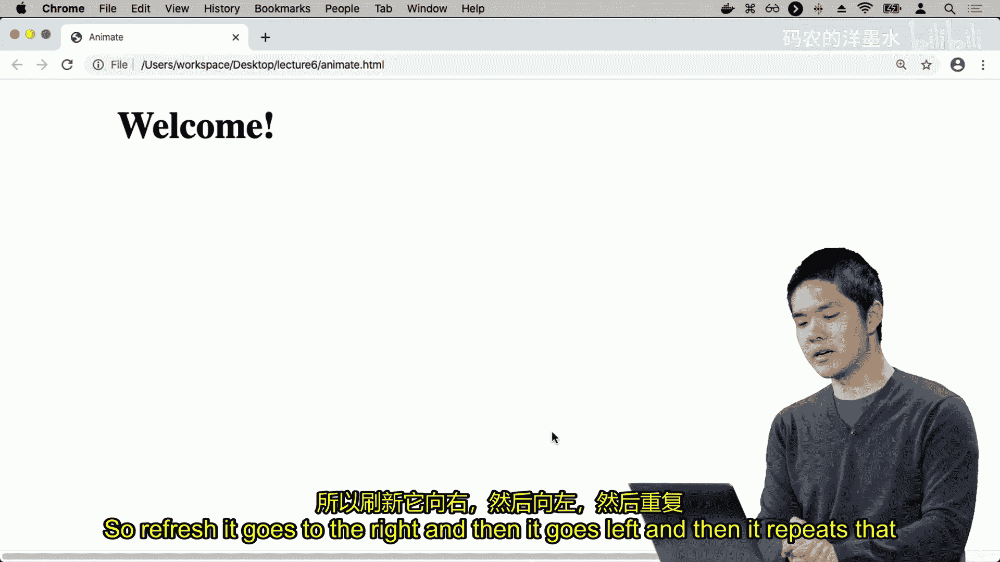

I'll go back here in the body of the page。 in addition to a heading that says welcome。

 I'll go ahead and add a button that just says。😊，Click here， for example。

And now what I'll do is add a little bit of JavaScript。

I'm going to add some JavaScript so that the button can now control the animation。

 decide when the animation is going to start and stop。😡。

And so what we'll do inside of this script is to first say document dot a event listener。

Dm content loaded， meaning wait until the DOm is done loading as we've done before。

And let me now get that H1 element。😡，Document。queery selector。Each one。And initially。

 I'm going to set its style dot animation play state equal to。Paed。

So animation play state is a property of the style that lets me decide if the animation is playing or paused。

 and I can control that using JavaScript rather than just say run infinitely forever。

 I can say the animation play state should start out as paused by first getting the H1 element then modifying the animation play state property of that particular element。

But now what I'd like to happen。Is anytime someone clicks on the button。

 I want to change the animation play date。 So I'm going to say document dot query selector button。

 meaning get that button。And when someone clicks on the button， let's run this function。

Where if the current animation play state is paused。Well。

 then go ahead and set animation play state equal to running。And otherwise， if it's already running。

 then let's go ahead and set the animation play state equal to。

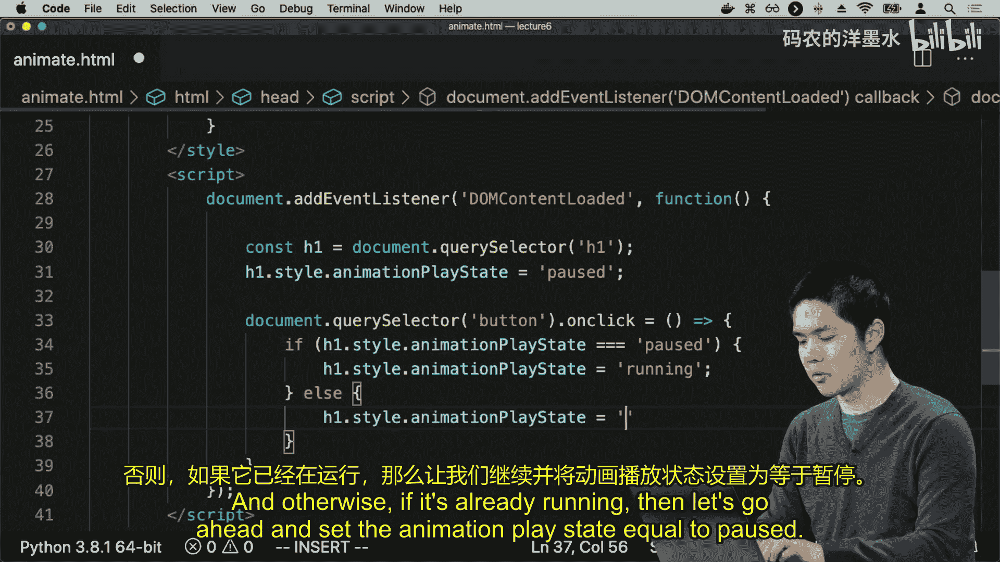

Poed。So all in all what this function is going to do is it's going to get me the heading。

 pause this initially， and every time the button is clicked。

 run this function where the function says if we're paused， go ahead and start running the animation。

 otherwise go ahead and pause the animation by modifying that animation play state property of the heading。

So now if I refresh this page， right now we have welcome plus a button that says click here and initially everything is paused there's no animation happening。

 but I click here and that begins the animation which will go on indefinitely until I decide that I want to stop it at which point I click it again and the animation pauses and I can control when to start and when to pause that animation as well。

😊。

And so this can be helpful and nice when you want to create something a little bit more interactive。

 something animated on the page。 But this is especially helpful because it means that you can gradually change CS properties over time。

 rather than just immediately change something。 You have the ability to animate something to make it work a little bit better。

 So let's take a look at an example of how you might put that idea into practice。 Let's go back to。😊。

Our posts example where we had this infinite scrolling list of posts。

 But imagine now that we want the ability to hide posts when we're done with them。

 So I've prepared an example called hide。

Which is very similar to what we had before。

But this time I've just added one extra button and the button says hide on every single div right now。

 clicking the hide button does nothing。 We'll go ahead and implement that in just a moment。

 But first to see how this worked。 if you go into hide， go into the index that HTML template。

 the only change that's been made here is what happens when I add a new post。

 recall again that what this application does is it loads posts from a server and then when it gets those posts it loops over each of the individual posts。

 which is a string of text and it adds that string of text inside of an element onto the page via this add post function。

And what the ad post function is going to do here is first create in a new element。

 create a div in which to store that post， give it a class name because that's how we're going to animate it。

 and then set its inner HTML equal to the contents of the post， something like post number one。

 post number two， post number three。And then add a button that just says hide。

And then we're going go ahead and add that to the Do as well。

 So that's what apost is now going to do。 We're sort of generating some H Tm L。

 using this jascript code and then adding that Hml to the page。

 And now what we're adding is a div that has not only the contents of the post as text。

 but is also going to give us access to a button that ultimately。

 we hope is going to let us hide that post as well。

So how do we actually get the hiding of the post to work？Well。

 what we want to do is somehow detect when the user clicks on one of those hide buttons。

 So there's a number of ways we could do this。 But one way is just to listen for any time。

Anyone clicks。On。The document as a whole。Anytime anyone clicks on the document I might like to ask something like what did they actually click on And it turns out that with most event listeners the function the event listener takes in can take as an optional argument。

 the event itself， which is a JavaScript object that contains information about the event that happened like the click event or the scroll event or the key down event or the key up event。

 for example， and one of the properties you get access to is event do target。

 which is like what was the target of the event in this case。

 what was the thing that was actually clicked on， and I'll go ahead and save event do target inside of a variable。

Called element where the idea now is that whatever gets clicked on。 That is the event's target。

 We're gonna save that inside of element。 And what I want to know is is element I that one of the hide buttons。

 I want to know is it a hide button， I could have also attached an event listener to each of the hide buttons。

 This is just an alternative way of doing it。 that I'm showing you for sake of demonstration where we say when we click anywhere in the document。

 figure out what was clicked on and save it inside of this variable。 And if it's a hide button。

 then it's going to have a class of hide because I gave every class every hide button。

 a class of hide。😊，And so what I can say is。If element dot class name equals hide。😡，Well。

 that means that what was clicked on is something with a class of hide， we can assume that it is。

 in fact a hide button， and then what I want to do is I can do something like element do remove to say go ahead and get rid of that element。

😡，So now， what does this do。

If I refresh the page， let's try it。 Post number one。 If I hide it， I want to hide post number one。

All right， that didn't quite work。 It was close。 It got rid of the hide button。

 but I didn't want to get rid of the hide button。 I wanted to get rid of the whole post。

So what's going on here is it seems to be that if the elements's class name is hidede。

 meaning I clicked on a hide button， element dot remove just removes that element。

 It removes the hide button， but it doesn't remove the post that contains it。

And if you think about this in terms of the dawn， the post is a div and its child element is the button。

 this hide button。 And so you remove the button， but it doesn't also remove the post as well。

 If you want to remove the post as well， you need to remove not the element， but the elements parent。

 And in Javascript， it turns out there's a way to do that， too。Rather than element dot remove。

 I can say element dot parent element dot remove to say take the element。

 get its parent and remove that。

So now I refresh the page。Now I see a post1， I want to hide it。 I hide post1。 And all right。

 now I see post2 and then post1 has gone away。 If I want to hide post 3， I hide post 3。

 Now post 3 is gone。 Now I go straight from post2 to post4。😊。

So this works， but it's also not immediately obvious what's going on。

 Like because all of the posts are the exact same height。 When I get rid of posts 1 and 3。

 it's not immediately obvious to the eye that they've gone away because post 2 and 4。

 they look almost exactly the same。 You really have to be paying attention to know the hiding worked。

 And so this can be a time where animation can actually be quite helpful。

 So what I can do is say something like。Let's go ahead。

And give this post an animation associated with every post we'll give it an animation name called hide an animation duration of two seconds we'll say it'll take you two seconds in order to hide and an animation fill mode of forwards I want to go forwards with the animation and initially I'll give the post an animation play state of pause。

 meaning initially I don't want the animation to be running because I don't want to hide all the post immediately pause this animation later we'll go ahead and run the animation in order to actually hide the post。

😊，Then I need to define what does it actually mean to hide the post？😡，And I'll say， well all right。

 at the 0% mark， what does it mean， let's give yourselves an opacity of one。

 opacity is a CSS property that just controls how opaque or how transparent an HTML T element happens to be。

😡，And at the end，100% of the way done with the animation will set opacity to 0。 So initially。

 we can fully see the element。 at the end， the element is totally transparent。

 And now what I need to do is actually trigger this to happen somehow。😊。

So this is probably going to happen inside of my event listener。😡。

We're instead of removing the element right away。Let me just take the parent element and set its animation play state equal to。

Running， for example， meaning。When I click the hide button。

 go ahead and run the animation that will change the opacity from 1 to0 over the course of a couple of seconds。

😡，And then if I really want to， I can add another event listener to say， take the parent element。

Add event listener， there's an event called An end， which happens when the animation is over。

And then I can say， allright， when the animation is over， well then。Go ahead and remove the element。

So all in all， rather than just immediately remove the element when I click on the button that saysH。

 what I'd like to do is say if you click on a button and the button is hide。

 go ahead and get the parent element， not the hide button， but the post itself。

 set its animation play date to running， meaning run the hide animation。😡。

And then add an event listener to the parent to that post as a whole to say when the animation is over。

 go ahead and remove that entire post from the dom altogether。😡。

So what is the effect of all of this now of having this animation and running it？😡，Well。

 now if I refresh the page。I see all these posts if I try and hide like post number two， for example。

 you'll see that the opacity changes and then it slowly disappears and then only after it's totally transparent。

 the post disappears entirely so I can say hide post number four it disappears and then post number five jumps up to fill its place and I can do that for any of these posts triggering the animation when I click on the hide button。

😊，And so this is part of the value of what animation can do is to be able to make our user interfaces a little more pleasant from the perspective of the user by not immediately getting rid of a post。

 but by having a nice fade out so it disappears nicely Now even this is not perfect animation wise。

 Like one thing you might notice is that it jumps up as soon as the post is gone。

 If I hide post number3 I hide it it disappears and post5 jumps up very abruptly in order to fill its place。

 what I might like is to be a little bit cleverer to somehow shrink the size of the post after it's gone so that the post doesn't jump into place。

 but it slides a little bit more naturally into place。

 And so there's some additional things I can play with here。 maybe I want to say that all right。

 let me make this animation a multiple part animation。

 So here instead of just from0 to 100% setting the opacity from one to0。

 maybe in the first 75% of the animation， that will take care of reducing the opacity going down from one all the way down to zero。

 but in the last 25% of the animation。😊。

Will still end with an opacity of 0。But anything that creates vertical space。

 I want to reduce down to zero。 So the height should be zero pixels， the line height。

 which is how high the text is should also be zero pixels any padding I want to go away。

 it turns out I've added some margin to the bottom of the post。

 I want to make that go away as well So I want to set all of those to0 from whatever their initial values happen to be that initially the height is like 100% of what the height could be likewise for line height。

100% of the parent initially I have like 20 pixels of padding and a margin at the bottom of 10 pixels and I want all of that to still be true 75% of the way through the animation。

 but it's only in the last 25% of the animation that I want to set all of these vertical height properties down to0。

 I want to remove all the height， remove the line height。

 remove all the padding and the effect of this is I'll have an animation now。

 where for the first 75% of the animation the only thing that changes is the opacity The opacity goes from one fully visible to0 fully transparent and then in the。

😊，Last 25% of the animation， the post is already transparent。 You can't see it。

But it's still taking up physical space on the page。

 but we're going to now reduce the height of that post so that now you won't be able to see it at all。

😡。

So now if I refresh this page。Here we again or all the posts。

 but now if I click hide on a particular post， we'll see that it first fades out and then it height shrinks so that the next post slides very nicely into place。

 I can do that again， hide the post it's transparent and then it slides into place and this again is just an application of this idea of CSS animations using properties of animation to make our interfaces a little bit nicer to use a little bit clear visually to the user that one post has gone away and the rest of the posts have now scrolled up in order to take their place。

😊。

So now we've been able to use ja to create a lot of nice user interfaces we've been able to create single page applications。

 to create infinite scrolling， to be able to create some animations as well and use ja to be able to control them but one thing you might be realizing at this point is that our applications are starting to get fairly complicated there's a lot of ja code needed to manipulate a lot of different parts of our application at the same time and you can imagine that as web pages start to get more complex and as you want to start making them more interactive and more dynamic。

 there's going to be a lot of ja code required in order to keep everything in sync in order to make sure that all of the elements are updated when they should so on and so forth and it's for that reason that in recent years。

 a lot of ja is now turned to some ja libraries or frameworks that allow to more efficiently and more effectively。

 create user interfaces that are more interactive and more reactive and one of the most popular of these is a framework known as react react as a ja library that is going to enable us to be able to design user interfaces that are very interactive。

The content of the web page updates automatically based on some underlying state。

 and what we'll do now is take a look at a brief taste of reactact to get a sense for how frameworks like it can actually work and can help us in designing some interactive and useful interfaces for users to be able to interact with。

😡，React is ultimately based on this idea of declarative programming。

 a particular style of programming， which is different from the types of programming you might be familiar with。

 more classical programming styles like imperative programming。In imperative programming。

 you generally give the computer commands， tell the computer what to do， for example。

 if we had that counter program from before and we wanted to update the counter from one number to another number in the view like the H that the user sees we would include something like a heading that just has the number zero inside of it and then the logic in imperative programming would take something like this form it would be like all right first document query selector H1 to get that H1 tag get it its's inner HTMLtm parse in well take the string and convert it into an integerm and we can save that inside of a variable called nu for example。

 and then after that if I want to increase it I would take this variable nu and just add one to it nu plus equals1 add one to it and then if I want to update this heading in order to replace the zero with a1 for example。

 well then I would need to say document query selector H1 set the inner HTMLtm equal to that number for instance in order to say all right nu is now one go ahead and replace that in the view。

But this is a fair amount of code to do something fairly simple。

 just like increase a number by one and the reason why is because we've had to be very explicit about what instructions we're giving to the web browser we're saying first grab the H1 figure out what number is inside of it。

 add one to that number and then replace it inside of this tag what declarative programming is going to allow us to do is it's going to allow us to just describe what state should be displayed on the page in what form in declarative programming in our view like the HTMLm like code that we're going to be writing we're just going to say something like H1 and then in cur braces nu to mean like fill in the number here and this is what the react syntax is going to look like and then the logic code if we want to increment that number by one is we just need to say nu plus equals1 add one to the number and the effect of that is that since we have declared that inside of this heading it should be whatever the value of the number is when we increment the value of number react is effectively just going to update the view。

So that the number updates as well。 And so this will be some of the power that react gives us react lets us divide our application into a whole bunch of different components where a component is something like this thing here that is keeping track of some sort of count along with a button that might manipulate it and then make that component based on some underlying state。

 some underlying variables that represent the state of the application。

 something like the current number and then we can manipulate that state and when we manipulate the state that will have an impact on what the user actually sees and react will handle the process of updating that user interface for us。

 There are a number of ways to get react working on our webage。

 but the simplest is probably just to include these three jascript packages inside of our web page。

 So we're first going to include react itself which is going to be the library that's going to allow us to define these components and how they behave。

 then is react Dam。 a special package that's going to allow us to take react components and insert them into the dom。

 the document object model that represents the。

of the entire page and then finally Babel is going to be a package that we're going to use in order to translate code from one language to another it turns out that when we're writing react code。

 we're not actually going to be writing JavaScript。

 we're going to be writing in an extension to JavaScript known as JSX and JSX is going to be an extension to JavaScript that looks a lot like JavaScript but has some additional features in particular it has the ability to effectively allow us to represent HTML inside of our JavaScript code in a way that's much easier to read and it's going to be convenient for us to deal with。

😡，Browsers， on the other hand， don't understand JSX automatically。

 so what we're going to use is a tool like Bebel to convert that JSX code into plain JavaScript that our web browsers are ultimately going to be able to understand。

😡。

The best way to get a feel for this kind of thing is just to see it in action。

 so I'll go ahead and create a couple of react applications just to get a sense for how it is that you can use reactact in your own applications as well。

😊，So let's start by taking a look at react do Hml。 And what I have here is the beginning of an Hml page inside the head section。

 What you'll notice is I've already included these three script tags and what these script tags are doing are just including those three jascript libraries we were talking about a moment ago。

 I have a title for the page just called react。 And now let's start to fill in the body of this web page。

 I'll begin by adding a div， which I'll give an I D to。 I'll call it app。

 but I could call it anything。 And this is where our application is going to go。 But right now。

 I'm just going to leave it as empty。 It's going to be reacts job to fill in this div with the contents of our user interface。

And now beneath that div， I'll start to write some JavaScript。😡，But remember。

 I'm not going to be writing jascript per se， but rather JSX that extension to ja。 So in this case。

 I'll need to add an extra attribute type equals text slashbabel。

 and all this is doing is telling my browser that it's going to need to translate this JSX code into ja code that the browser is actually going to be able to understand before it tries to run this code in practice if you were developing a real application what you would want to do is you would want to do this translation ahead of time prior to deploying the application。

 but here we're just going to translate it on the fly。😡。

And so all of our react applications are going to be composed of components where a component is just some part of my web applications's user interface。

 and to describe a component， I can write a JavaScript function。

 so I'll create a function called app， which is going to represent this app component。😡。

And what's going to go inside of this app component。 Well， it's a function。

 So it's going to return something。 And what it's going to return is what should appear inside of that component。

 And this app component could really just be， for example， a div that says hello。

 let's say and this is where the power of JSx really starts to come in that here I can write HTMLml like syntax inside of my jascript code and JSX is going to be able to understand it。

 So this function right here is a function called app that is representing a react component And when this component is rendered onto my web page。

 it's going to say hello So there's one last line I need inside of my jascript now。

 and that is to actually render this component into the page to do that。

 I'll say react Dom dot render。😡，And the first argument to this function react on dot render is what component would I like to render。

 The component is this app component that I just created。

 and so I'll say app again using this HTML like syntax。😡。

And then the second argument is where on the page would I like to render this component。

 And I want to render this component right here on line 10， where I have a div whose IDd is app。

 So I'll need to add some jascript code to find that particular div。

 and to do that I can just say document dot query selector and then。😡，呃。

Hash app to say find the element with an ID of app。

 and that is where I would like to render this app component。😡，So I first created this empty data。

 then I defined this function representing a react component。

 and then after that we're going to render that component inside of the HTML page itself。😡。

So now if we were to open a browser。😡，When see what this page actually looks like。

 I'll make the text a little bit bigger。 You see that we actually do see the word hello and if I make a change to the component and refresh the page。

 it will change the page as well。 So if the component instead displayed hellello world will then I refresh the page and the page now also says hellello world。

😊。

And because this is JavaScript， I can add JavaScript code to the function just as I could with any function in JavaScript。

 imagine for example， that I had some variables like let's create a variable x。

 which is equal to1 and a variable y， which is equal to 2。😡。

Inside of this div rather than just render some text。

 I can use curly braces to say plug in the value of some JavaScript expression。

 I could plug in the value of x plus y， for example。

 and now by including x plus y in these curly braces。

 JavaScript is going to evaluate what is x plus y and display that inside of the div instead。😡。

And so now when I refresh the page， you see that the page just says three， for example。

And so that's the basics of react。 We create these components and then render those components all using the power of JavaScript。

 But where react starts to get more powerful is when we can reuse components。

 the whole idea of a component is it represents some part of the user interface。

 and I could reuse that same component across multiple parts of the interface as well。 imagine。

 for example， that inside of my app component I was going to render a div that had three headings each of which said。

 hello。😊，So there's one heading。 There's another one， and we'll add a third one there as well。

So I have a div with three headings inside of it。 and we can see what that looks like。

 Each one of them says hello， but there's some repetition here。

 I'm having to use this H1 tag three times all to create exactly the same UI element on the page。

 This is a case where I can create a separate component and then just reuse that component rather than have to repeat myself multiple times。

 So how could I do that。 remember that in Javavascript。

 we can write a function to represent a react component。 So I'll add another function here。

 And I'll call that function hello。 because it's going to represent this hello component。

 And this hello function is also going to return something。😊。

And what it's going to return is a heading an H1 that just says hello。

And so now inside of my app component， rather than render three separate H1s。

 I can simplify this a little bit to just say hello。

 here I'm saying go ahead and render a hello component here or render a second one and a third one after that。

😡，Each time I render a hello component， it's going to display as this heading that just says hello。

So I refresh the page and nothing changes。 I still see three headings， each of which says hello。

 because inside of my app component， I'm rendering this hello component three times and each time it's going to display this H1。

😡。

But where components start to get more powerful is when they're not always displaying the same information every time。

 but when we can parameterize those components with properties。

 or as react simplifies them props short for properties。😡，So what would that mean。

 We see that HTML elements can take attributes， likewise react components can take properties where maybe I don't just want to say hello。

 but I want to say hello to someone， hello to Harry or to Ron or Hermione， for example。

 So I could say hello name equals Harry using syntax much like an HTML attribute。

 Then here is say hello name equals Ron。 And then finally hello name equals Hermione。😡。

And so now my hello component is accepting this prop， this property called name。

 which is different for all three of these components。😡，And so inside this hello function now。

 I would like the Ho function to take advantage of these properties， of these props。😡。

And so I'm going to add an argument to the Ho function。

 That argument is conventionally just called props。And now instead of just saying hello。

 I'm going to say hello， comma， and then remember to plug in a JavaScript value， I use curly braces。

😡，And inside of those curly braces I can say props dot and then whatever the name of the property is。

 in this case the name of the property is just name。

 so I can say props dot name to say whatever the name prop is。

 go ahead and plug that in right here inside of the hello component。

 so the hello component is going to say hello comma and then someone's name。😡。

So I can save that， refresh the page。 and now I see Hello， Harry， Ho， Ron and Hello Hermione。

 three different components， each of which is still just this hello component。

 but we're rendering it with different props。 one time with the name of Harry。

 one time with the name of Ron and one time with the name Hermione。

 And so this is where components can start to get a little bit different by passing in different props into those components。

 we can decide how that component is ultimately going to render。😊。

But let's add to this a little bit and start to add state into our react components as well。

 and state is going to mean any kind of data that we want to store inside of the component itself。

 and for this， let's try to recreate the counter application that we created when we first introduced JavaScript where we were really just creating a button that allowed you to count and count it up from zero。

1，2，3，4， etc。😡，So to do this， let's create a new file。 I'll create a new file。

 and just call it counter dot H TMl。 And we can start just by copying the contents of react do H Tml into our counter dot H TMl file。

 We're still going to use those same script tags。 and we can still have an app component。😊。

But what's going to be inside this app component is going to be a little different。

 I'll change the title of the page 2 to the counter instead of react。

So what goes inside of the app component。 Well， if we're going to do this counting。

 we need a div that's going to display the number that we've currently countered to。

 something like0 to start with。And we're going to need a button。😡。

This button is just going to be count。Which will be the label for that button。

So a div that just says0 and a button that says count。

And now if I open up counter。 HTMLt。😡，We'll make it a little bigger。

 You can see that I have this number 0 here and a button that says count。 Of course， right now。

 clicking on the button doesn't do anything because I haven't written any jascript code to say what should happen when this button is actually clicked on。

But before we get there， let's modify this program a little bit。

Right now I've written the number0 directly into the div itself。

 but it's not always going to be zero。 Eventually as I start counting by pressing that counting button。

 that number is going to change。 so what I'm going to do now is factor this0 out into what's known as state inside of my react component and here one way to create state in my react component is to use a special function inside of react called use state This is one example of a react hook that allows me to add some additional functionality into my react component and the argument to react u state is going to be the initial value of that state。

 I'm going to start counting and I want to start counting from the number0 so I'm going to include the number0 as the argument to this U state function。

😡，So we're going to start counting at zero and what this use state function returns is really an array of two things。

 it's going to be a variable that I can give a name to I'll call it count and also a function that I'm going to call set count and that function is going to allow me to set the value for the state if ever I need to change the state at some point in the future。

😡，So this use state function accepts  zero， the initial state as its argument。

 and then I get two things back。😡，I get the state variable itself called count。

 and I get a function for changing that state when I need to。😡，So now。

 instead of rendering a zero inside of the div just by writing the number 0。

 I'm going to instead in curly braces。Go ahead and render whatever the value of count is。

 initiallynitially it's going to be zero， but eventually that number might change。

 and I want my UI to reflect the changes in the underlying state。😡。

So right now， if I refresh the page， it still says zero because the initial state was set to0。

 but I could change that if initially that initial state with some other value。

 I could refresh the page and see a different value appear for the count instead。

 whatever the value of this count variable is in the state。

 that's going to be what the user is going to see when they're looking at my user interface and when they see my component。

So now let's make this button actually do something because right now the number is never changing to do that I can add an onclick handler and notice one difference between oncled and react and oncled as we traditionally used it in JavaScript I'm using this capital C and that's just a common react convention when we're defining event handlers。

😡，And here I'm going to say on click。 and then in curly braces the name of a function。

 a function that I would like to run when this button is clicked。 And I can call that function。

 whatever I'd like。 I'll call it update count， for example。

And now what I need to do is define a function called update count。😡。

And I'm going to define that function inside of this react component inside of my app function。

 It turns out in jascript， you can have functions that are defined inside of other functions。

 So I'll define this function called update count。😊。

And what do I want the update count function to do Well。

 what I'd like to do is just increase count by one。

 and you might think that I could do that just by saying count equals count plus1。

 but it turns out you can't quite do that in react in react whenever whenever I'm using this use state。

 if I want to change the state， I have to use this function that U state provides to me for whenever I want to set the new value of the state。

 So rather than count equals count plus1， I have to use this set count function and the argument to set count is going to be count plus one。

😡，So set count is this function that is going to change the underlying state inside of my component。

 and the argument is what should the new state be， and in this case it's just going to be count plus1。

 one more than whatever the count was before。😡。

So I can save that， and I'll go ahead and refresh the page。 It starts at at 0。

 but every time I click on this count button， you'll notice the count increases by one。

And again， I have no code that saying go into the div and change whatever it is inside of the div。

 All I have inside of this div is this reference to this state variable count。

 and whenever the state changes， jascript and in turn react knows that what react needs to do is to recreate this component。

 rerender the component by displaying the new value of this state variable。

 And then when the button is clicked on， we're able to run this function to change the value of that underlying state。

😡，So by taking advantage of these react components with state。

 we can start to represent information inside of our components and then define what our component is going to display as just by representing HTML in terms of that underlying state。

 deciding how we should use that state in order to render an interface that the user is ultimately going to see。

😡，So let's now try and put these pieces together and create a web application that uses these abilities of react to defined state and to manipulate that state and in turn。

 update a user interface based on changes that are happening to that underlying state and we create an application that will just display some simple mathematical questions to the user and quiz the user on some basic addition facts。

 for example。😡，So let's create that application， I'll create a new file and call it addition。htm。

And inside of Ed。 HTMLtml， I'll start again just by copying the contents of this counter。

 HTMLtm file because the framework， the structure of this page will be similar。

 but I'll go ahead and clear out what's inside of my app component， at least for now。😡。

And so what would I like for my app component to render， Well， let's go ahead and render a div。

And if I want to create an application that's going to ask the user some mathematical questions and then prompt the user to type in an answer。

 there are at least two parts of this user interface that I'm going to need。

 I'm going to need a place to display the addition fact answer like what is1 plus2 for example。

 and then I'll need an input field where the user can type in their response to that question and then see if they got the question right or wrong。

😡，So inside the div， I'll start by creating a div that displays the question itself。

 something like1 plus 2。And then beneath that， I'll just add an input field。

 Eventually we'll add more to this user interface， but for now all we really need is a div that displays the mathematical question and an input for the user to type in their response。

😡。

So now if I go ahead and go to addition。 HTMLtm， here's what I see， I'll make it a little bit bigger。

 I see 1 plus2， and then an input field where the user could start to type in their response。😊。

But just as we did before， I don't want to literally write the numbers one and two into what I'm returning。

 instead I want these one and two to be based on some underlying state inside of my application。

 the application is going to maintain state about what two numbers to add together and then it's going to display a user interface based on that state。

😡，So what could I do here？Well， one thing I could do is again， use react。u state。

 start this number off as one， and maybe call this number1， and then a function to set number one。

And then I could do it again， let's create number2 and set number2 to be react at U state2。

 and I could have two different pieces of state nu1 and nu2， each of which has a different function。

 set number1 and set number2 that are each representing the two different numbers that I would like to add together but already this is starting to get messy and over time as I add more different pieces of state to the application as we'll see in just a moment the state might start to get more and more complex with more and more different functions and variables and so it's often helpful in a common practice and react to combine multiple pieces of state just into one JavaScript object that's maintaining all of the different pieces of state for this particular component。

And to do that， I'll again use react。usstate， but instead of setting the state initially to be a number like one or two。

 it's instead going to be a JavaScript object that has keys and values。😡。

where I could say let number1 be the number one and let number2 be the number two。

 much like a dictionary in Python for example， where I have multiple different values。

 nu1 and number2 all together inside of the same object and I can call that state and have a variable and have a function called set state that is going to update the value of that state and so rather than have to have all of these different variables I can simplify a little bit to just state and a function to set the state and the state now has these two different pieces number one and number two。

😡，And so now instead of rendering literally the number one， using curly braces。

 I can say state doum 1。😡，And instead of rendering literally the number two。

 I can say state do number2。😡，Drawing upon that state to decide what it is going to appear inside of the user interface and so right now the page appears no different。

 but if I were to change those initial values of the state， maybe make it two and4， for example。

 and then refresh the page， well now it displays as 2 plus4。😡。

And so that's helpful。 we now have a user interface where the numbers are based on the state。

 but now what I'd like to do is add the ability to keep track of what the user typed in so we can tell if the user correctly typed in the answer to this mathematical problem and how would I do that well the state represents any information that we need to keep track of inside of this component and so in addition to storing the two numbers inside of the state。

 I likely also need to keep track of a third piece of information which is the response what did the user type in into this text field and so I'll add a third part of the state called response that initially will just be the empty string will just be nothing。

And then this input field， I'm going to give it a value and the value is going to be state dot response。

😡，Whatever these are typed in is the response that's stored inside of the state。

 and that is going to be the value of what shows up in the input field。And so that way。

 whatever is in the input field will have access to it inside of this state dot response variable。😡。

But there is a problem， and here's the problem。 I'll try refreshing the page。

 I'll go into this text field and let's say I know the answer。 I know 2 plus 4 is equal to 6。

 I'm now going to press6 on my keyboard。😡。

But as I press 6 on the keyboard， nothing's happening， no6 is appearing inside of the text field。

 even though I am pressing the key on the keyboard。😡，So why is that。

 why is the text field not updating？😡。

Well， the reason is the value of the input field， whatever appears in the input field， is this value。

 state dot response and state dot response is always this empty string I'm never changing what state dot response is equal to。

😡，And so I need to change this a little bit。 I need to add as an attribute to this input field on change。

 meaning when the input field changes， I need to do something。

 and I'll call a function that I can call update response。😡，But again。

 I could call that update function， whatever I'd like。

 It's just the name for the function that's going to run whenever something changes in the input field。

 So let me now define that update response function。 I'll define a function called update response。

 And because it's an event handler， it can accept an argument， which is the event itself。

 The fact that something has changed inside of the input field。And when I have access to this event。

 it turns out that if I want to figure out what it is the user is typed in to the input field。

 I can get at that with event。targe。value， and I only know that by looking at it in the documentation。

 but what I'd like is for event。tar。 value to be the new value for this response。😡。

And so what I'd like to do is do something like this， set state。

 and what should the new value of the state be， well I would like for a response to no longer be the empty string。

 but to now be event。 target do value， and that is going to be the new value for response。😡。

But I'm not quite done yet because state doesn't just have response as one of the parts of the state。

 the state also has number1 and nu2 and those two pieces aren't really changing， so I could say。

 all right number1 is just going to be whatever state do number1 was that's not changing and number2 is going to be whatever state do number2 was that's not changing。

 the only thing that's changing is the response。😡，But this is starting to get a little bit verbose and especially if I start adding more and more different pieces to the state。

 it's going to become difficult to manage if I constantly have to repeat myself for all of the parts of the state that aren't changing。

 idealally what I'd like to do is just specify the parts of the state that will change and ignore everything else。

😡，And so one shorthand way to do that in JavaScript is to use what's known as the spread operator。

 and it looks like this dot dot dot and then state。

 and what this is saying is just use the existing values of the state for everything else like number1 and number2。

 the only thing to override is the new value for the response。😡。

And so this syntax here is my way of saying I would like to update the state。

 everything should stay the same， except for response which is now going to be event。 target。 value。

 in other words， whatever it is the user typed in into that input field。😡。

And so I'll go ahead and refresh the page and now if I type a number like six。

 you actually see that number appear in the input field。So that's great。

 we've now displayed a question where the numbers are stored in the state and the user can type in a response where that response is also stored in the state now what I'd like is when the user presses the enter key on their keyboard。

 we check， did they get the answer right or did they get the answer wrong？

And so how would I do that？Well， the first thing I need to do。

Is in this input field somehow detect when a key is pressed。😡，When a key is pressed。

 what I'd like to do is check to see if it was the enter key， and if it was the enter key。

 then let's go ahead and check to see what the actual sum of the two numbers is and see if the user got that right or wrong。

😡，So let's add an event handler on key press。Is going to be equal to something。 Again。

 I can name this function， whatever I'd like， I'll call it input key press， but again。

 I can name that anything。😡，And now let's define that input key press function。😡，So up above。

 I'm going to define this function called input key press。 again。

 it takes that event as its argument and this event is going to happen any time a key is pressed regardless of whether it's a letter or a number or the enter key。

 And so I want to check to make sure that the key is actually the enter key。

 that's the only time that I want to now check to see if they got the question right or wrong。

 So I'll add here a condition it's just JavaScriptscript。

 So I can say if event dot key is equal to enter。😡，Well， then let's go ahead and check。

 and otherwise we don't have to do anything， I don't need an else case here because nothing should happen unless it's the enter key that was actually pressed。

😡，And so now how do I check to see if the user got the answer right or wrong？😡，Well， inside of state。

 number1 is the first number。😡，And inside of state do number2 is the second number。

 so I could have a condition that check if state。 number1 plus state do number2 is equal to state dot response。

 which is what the user typed in into the input field。

 but that doesn't quite work because state dot response that's a string。

 the user doesn't necessarily have to type in numbers。

 it's possible the user is going to type in some letters instead， for example。

 or other characters instead。And so what I'm going to do first is convert the response into an integer if we're able to do so。

😡，So I'm going to define a variable called An using the JavaScript function parse int that takes a string and tries to convert it into an integer。

 so we're going to parse the int state dot response。😡，And now we can check。😡。

If number one plus number two is equal to the answer。Well。

 then this means the user got the question right。And else， if the sum is not equal to the answer。

 that means the user。Got the question wrong。And so now what I could do is handle those two different scenarios in one case the user got the question right and we should do something and in another case the user got the question wrong and we should do something else and we're making that decision by looking at the state of the application。

 by looking at what two numbers we're supposed to be adding and looking at what the user typed in as their response。

So what should we do when the user gets a question right or gets a question wrong Well maybe this game is going to keep score by maintaining a number for how many questions the user has gotten right and every time the user gets a question right。

 we could increase that score by one and any time the user gets a question wrong we could decrease that score by one for example。

 so how would we do that Well the score is some piece of state inside of the application。😡。

And so we're going to need to add to the state right now in the state we're storing a number one。

 a number two， and a response。😡，I'll add to that a score where the score is going to start out as just zero。

😡，And we can render that score on the page if I scroll down to where we're returning the div to render。

 let's add。Another data that says the score is and then using curly braces。

 plug in whatever the value of state do score is， whatever the score is。

 let's figure that out from the state， and let's display that in the user interface。

So now this user interface shows not only a question in an input field， but also a score。

 and the score starts out as just the number 0。

So let's now go back to this function。 When a key is pressed， if it's the enter key。

 let's check to see if they got the answer right or wrong。 We check。

 did the user actually get the question right， If so， what should we do。

 Well we should increase the score。😡，And how do we do that。

 We do that by calling the set state function。 All of the state is going to be the same。

 So using that dot dot dot state spread operator， the only thing that's different is the score is going to be state dot score plus one。

😡，So we're updating the state to increase the score by one。And if the user gets the question wrong。

 let's set the state to be dot dot dot state， and then the score is going to be state dot score。😡，-1。

So if the user gets the question right， we increase the score by one。

 otherwise we decrease the score by one， and let's test that to see what it actually looks like when we try this in the user interface。

I'll refresh the page of 2 plus4， if I type in the correct answer，6， press return。

 the score increases by one。😡，If I typed in the wrong answer and say eight press return。

 the score decreases by 1。So this appears to work depending on whether I get the question right or wrong。

 the score is able to update increasing or decreasing based on the result of that condition Now this game is pretty easy to get a high score on right now because I can just keep pressing return over and over and over and the questions never changing my response is already there and so the score keeps going up and up and up so let's make the game a little bit more interesting Every time the user gets a question right let's display a new question for them to answer and how would we do that Well the question that's displayed to the user is based on two underlying pieces of the state of the component it's based on state do number1 and it's based on state do number2。

😡。

So if I want to change the question， all I have to do is when the user gets the question right。

 and I'm updating the state， instead of only updating the score， let's also update number1 and nu2。😡。

And I could set these to be specific values， maybe like five and 10 for example。

 but let's make it more interesting and display a random number every time we'll generate a random number and so the user will be adding two random numbers together every time they get a new question right how do we generate a random number Well math dot random is a ja function that generates a random number between 0 and1 we can multiply it by 10 so now we're getting a number between 0 and 10 but we don't want any decimals to appear in the number so we'll go ahead and take the ceiling of the number math dot seal to say if the number was like 5。

8 we'll just go ahead and round that up to 6 for example。

 and we'll do the same thing for number two we'll take the ceiling of math dot random times 10。

So every time the user gets a question right， we'll update number1 and number2 to be new random numbers generated just like this。

😡。

And so let's go back and try it again。We see 2 plus4， I type in the correct answer 6。

 and the question changes8 plus5 I type in the correct answer， press return。

 my score increases and the question changes again this time if I get the answer wrong。

 I type in 10 for example watch my score decrease， it went from two down to one。

 but the question didn't change now I get another opportunity to try to answer this question and when I answer it correctly。

 the score increases again from one to 2。😊，So this game is starting to come along now it's keeping track of my score。

 it's displaying different questions there is at least one user interface quirk right now and that is the fact that at the moment when I get a question right and press return I type in 6 and press return the6 still stays there ideally I get a new question I'd like to clear out the response so the user can just type in whatever the new answer is rather than have to delete whatever they typed in before and then type in a new number so how could we do that reset whatever is inside of the input field。

Well， what's typed into the input field is stored inside of the state of my component。

 it's stored inside of state dot response。😡。

And so if I wanted to change that。All I would have to do is say let's change the response to be the empty string。

😡，When the user gets a question right， we're going to update these two numbers， increase the score。

 and also clear out the response so that it's just the empty string。😡。

And I can do the same thing if the user gets a question wrong， decrease the score by one。

 but also clear out that response back to the empty string so that there's nothing there。

And so now we get a question， I type in an answer， press return， and the input field clears out。

 I get a new question and the score increases by one， four separate pieces of state。

 all changing at the same time， and that gets reflected in the user interface that I'm now able to see So I type in another value and the score increases and everything updates again。

😊，Alright， so that's definitely progress。 One other user interface quirk that I noticed here is that the input field by default isn't automatically selected。

 where I would have to go in and click on the input field in order to highlight it so that I can start typing in my response。

 I can fix that pretty easily if I scroll down to where the input field is We'll add an autofocus attribute。

😡。

And just set that to be true so that the input field automatically focuses when I load the page for the first time。

So now I refresh the page， the input field is already highlighted。

 and immediately I can start to try to play this game。😡。

So now that we have the basic functionality of this app working。

 let's try and improve the CSS so that the game looks a little bit nicer。😡。

I'll scroll up to the top of the page and add a style tag to the head section of my HTML page。

 and I'd like for this entire app to be centered， so I'll say text align is going to be centered and I'm going to set the font family to be Sansif because I prefer that font for this particular game。

So I refresh the page and now everything is centered and the font is different than what the default was and what else would I like to have changed？

Well， this problem 2 plus4， maybe I'd like for that to be bigger。

 I'd like the problem to be bigger and the score beneath that that can stay the same size that it is right now。

😡。

So how would I do that？Well， if I go back to the H here。

 I'll go ahead and give this div where I'm displaying the problem number one plus number two。

 I'll give it an I of problem。😡，And then if I scroll back up。

 I'll say for the element with an idea of problem， let's go ahead and set the font size to be。

72 pixels， for example。

Just to make it bigger and so now I see a big math equation 2 plus4 for example。

 the input field and then the smaller score beneath it。

 so that's a nice UI enhancement a little bit and now I can play the game。

 get a question right and the score increases I get a question wrong and I get to try again。

 but maybe I'd like to offer more of a visual indication that the user got a question wrong maybe anytime the user gets a question wrong。

 I'd like to change the color of this text instead of being black instead it should be read when the user gets a question wrong。

😊，And how could I go about doing that？ Well， we can change the color of something just by using CS if we had like a class called incorrect。

 for example， if I scroll down here。

And give this div a class name， which is how you add a class in react of incorrect。

Then I could use this class name to style it as red or not red， so I could say。

Anything that has a class of incorrect， let's go ahead and give that a color of red。

And so now because I gave this problem a class of incorrect and I saidternal incorrect text to be read。

 we now see this text appear as red， but this again is not quite what I want。

 I don't want it to be read all of the time I only wanted to be read when the user has just gotten a question wrong when they were just incorrect in answering a mathematical question and so how could I represent that information inside of my application Well I'm going to need some additional state state again is any information that I need to keep track of inside of my component and now it seems that in addition to the response and the score and the numbers。

 I also want to keep track of did the user just answer a question incorrectly or not。😡。

So I'll add another piece to the state， I'll call it incorrect。And initially it would be false。

 they didn't just get something incorrect。And now here。If I scroll down to this class name。

 rather than have it be incorrect all the time， let me add in curly braces in expression。

 I'll say if state dot incorrect is true using the ternary operator with a question mark。

Then the class should be incorrect， but otherwise it shouldn't have a class of incorrect that'll just be the empty string。

And so this expression here allows me to change the class of an HTML element based on the underlying state。

 if state do incorrect is true， then this Dave will have a class of incorrect。

 and otherwise it won't。😡。

And so now when I load the page for the first time。The text appears as black。

And what I need to do is when the user gets a question wrong。

 I need to change the state to indicate that they just got a question wrong。😡。

How do I do that？Well， here is the set state call when the user gets a question wrong。😡。

And in that case， I'll go ahead and set incorrect， equal to true。

And when the user gets a question right， we'll go ahead and set incorrect， equal to false。

 We're modifying this one additional piece of state based on whether the user got the question right or wrong。

So now if I load the page， answer a question correctly， the score increases and I get a new question。

 but if I answer a question incorrectly and press return。

 you'll notice the score decreases the input field clears out and the text changes color because I change the value of that incorrect part of the underlying state and based on that we were able to see the text color change as well。

 if I now get a question correct， press return the text color changes back to black and the score increases。

😊，And let's now add one final piece of state or one final change to the UI for this application。

 let's give me a way to win this game。 maybe once I get to a score of 10 by answering 10 questions correctly。

 then we're going to win the game and how could I do that Well remember that each react component can just be a ja function and this function is just immediately returning this div。

 but it's a function so I can add additional logic to it。

 I can say if state dot score is equal to 10， for example， then rather than render the old div。

 let's return a new div。😡。

This div is just going to display。Something like you won。And so that I can style it。

 I'll give it an ID。The ID will be winner。And if the ID is winner。

Let's go ahead and make the font size 72 pixels and let's make the color green if I win。

So I added some CSS just to style it， but really the only new logic is further down below。

 where I'm here saying， check the state， if the score is 10。

 well that means we win so instead of returning the new problem。

 just return a div that says you won the game。

So let's try that now。I get these questions every time I answer a question you're noticing that the score is going to increase by one and every time we're generating new random numbers to display as what's going to appear in the user interface and once I get to question number 10。

 if I answer it correctly， press return the entire UI changes instead of the problem and an input field and a score I just see in green large text that I won and again I was able to do that by looking here at this condition where we're looking at the value of the state and if the state is 10 we're deciding what to retina and this again is one of the great powers of react。

 this ability to use this underlying state and based on the value of the underlying state。

 decide what it is the user should see in their user interface。

And React is just one of many libraries that do this type of thing。

 other popular ones include Angular and view where all of these are just these web frameworks that make it easy to be able to create applications that are able to respond to some underlying state。

 so that you， the programmer don't have to worry about constantly having to manipulate various different parts of the page。

 which especially as you imagine websites like Facebook or Twitter where there are many things happening on the page at the same time。

 every time a new tweet comes in you might get a notification and see a new post in your main area of your newsfeed so these are the types of things that you might want the application to be able to more easily handle for you where you describe what the state is。

 you describe what the page should look like based on that underlying state and let the library。

 whether it's react or something else， begin to handle the process of doing that for you。

And the world of user interfaces is changing pretty quickly that a lot changes in user interfaces in terms of the technologies and the tools that are quite popular。

 but they're really based on the same set of underlying ideas。

 the idea that we can use ja in order to manipulate what it is the user sees on their page in order to detect what's happening based on particular events like scrolling to the bottom of the page or typing something into an input field and then responding to those particular events by providing some sort of function that gets called any time a particular event happens by mixing that in with other features like the ability to asynchronously request information from an external server or the ability to do computations based on the values of the state like we saw within reactact we have the ability to create very interesting engaging dynamic user interfaces very。

 very quickly all just using the power of combining Python and JavaScript that was web programming with Python and JavaScript for today we'll see you next time。

😊。