# 【全集】哈佛大学 web应用开发 9小时速成 中英字幕 附完整课件 p09 Lecture 7 - 测试和CI⧸CD -BV1RYUsB2Ejz_p9-

🎼。

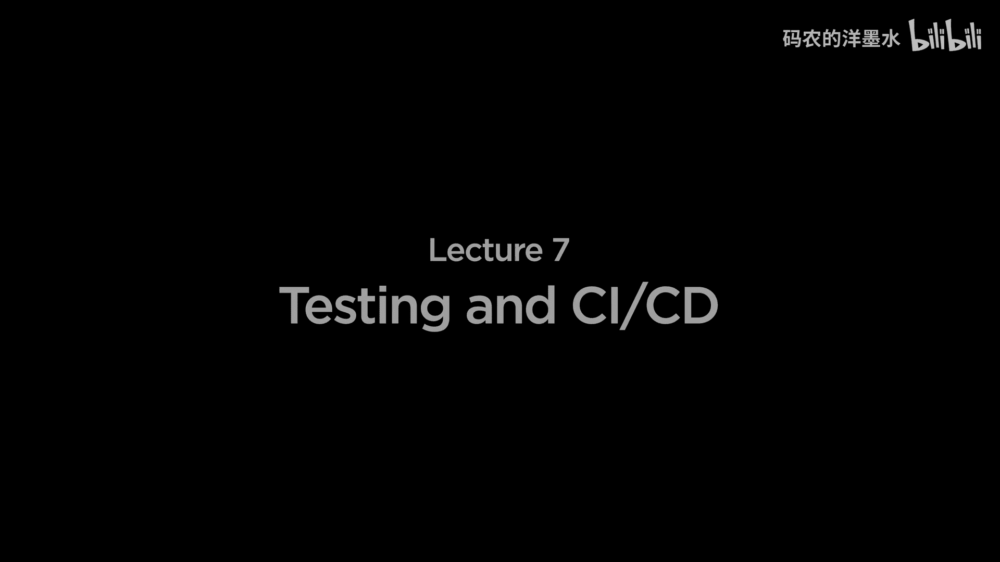

Okay， welcomee back everyone to web programming with Python and ja and now at this point we've seen a number of different techniques and tools that we can use in order to design web applications。

 HTMLm and CSS to describe how it is that our pages look programming language like Python using a framework like Django in order to listen for requests process them and provide some sort of response and then more recently we took a look at ja another programming language that we can use in particular on the client side running inside of the user' web browser in order to make our web pages even more interactive and user friendly Now what we'll transition to today is taking a look at some of software's best practices。

 some tools and techniques that developers actually use when they're working on web applications。

 especially as those web applications start to grow larger in particular we start by discussing testing this idea of verifying that our code is correct and then transition to CCD short for continuous integration and continuous delivery some other best practices that are used in making sure that the work that software developers are working on。

😊，testedested and deployed readily and very quickly So we'll begin the conversation with testing and testing is really about this idea of verifying and making sure that the code that software developers are writing are in fact correct to make sure that the functions work the way they are supposed to that the web pages behave the way that they are supposed to and ideally we'd like some way to be able to efficiently and effectively test our code over time and as our programs grow more complicated to allow our tests to make sure that our program is behaving the way that we wanted to So we'll go ahead and start simple and consider the basic way that we might take a function for example written in Python and test and verify to make sure that it works the way we would expect it to and to do so we can start with a command in Python known as assert and what assert does in Python is it asserts or just states that something should be true and if that something is not true then the assert is going to throw an exception。

 some sort of error so that whoever is running the program or running the command knows that something went wrong and this can be。

Bas way that we can leverage Python's abilities to test a function and verify that that function behaves the way we would want it to。

 So let's go ahead and try a simple example of writing a Python function and then trying to test to make sure that that function works the way we would want it to。

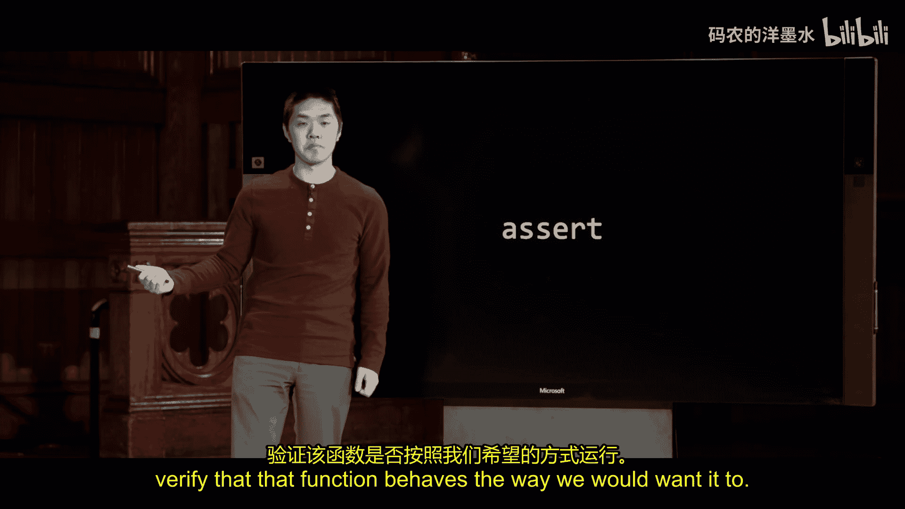

So I'll go ahead and create a new file。 I'll call it a search dot Pi。

And let me define a new Python function， for example， that is going to take an integer and square it。

 I just want to take a number and return it square。

 So I'm going to define a function called square that takes this input a number like x and I want to return X times x。

 It's a fairly straightforward function。 but I would like to now verify that the function works the way I would expect it to。

 Now there are a number of ways that you could do this。

 one would be just like let's print out what the square of 10 is， for example。

 and just see what that's equal to。 and then you could run a program。

 something like Python assert dot pi and just say， all right。

 the answer is 100 and I could say to myself okay that's what I would expect it to be。

 but I now have to do the mental math of squaring the number 10 making sure that the answer comes out to be the value that I expect。

 it would be nice if I could automate this process。😊。

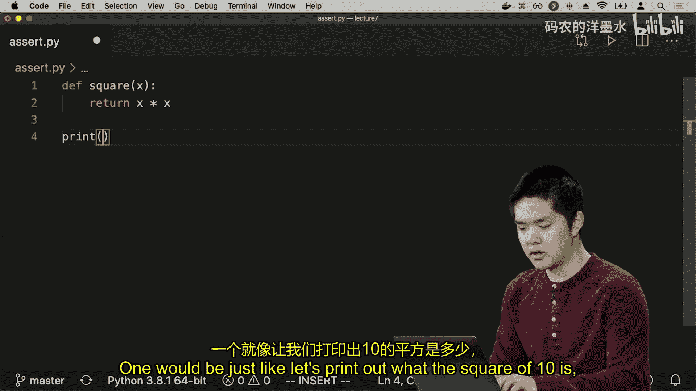

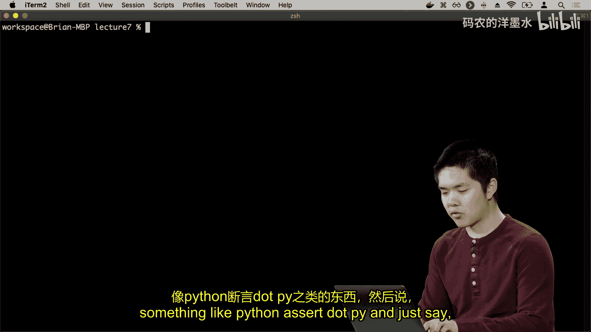

Well， one thing I could do is print out does the square of 10 equal 100。

 I know that I want square of 10 to equal 100 so I could just print out that value。

 print out does square of 10 equal the number 100， I' go ahead and run the program again and this time what I get is true。

 for example， because those two things are equal to each other and if on the other hand I had tried to check for something that wasn't true。

 like does square of 10 equal 101 you run the program and okay now it's going to be false。

So this is nothing new。 Nothing we haven't seen before。 but now what I can do is instead of this。

 I can just say， let me assert that square of 10 is equal to 100。

 Here I'm just asserting that this expression that the square of 10 is equal to 100 is going to be true。

And now I can run the program。 And what you'll notice is nothing happens。 No output， nothing at all。

 because when an assert statement it runs。 and the expression that it's checking turns out to be true that the square of 10 does equal 100。

 it effectively ignores that statement altogether just continues on to the next thing。 No output。

 no side effect of any sort。 And this is helpful because it just means that if I want to assert that something is true。

 I can assert it。 and then just continue writing my code。

 And it's as if I hadn't written that assert statement at all。

 So long as the thing that I am asserting is actually true。 But if there were a bug in my code。

 for example， some sort of mistake， where instead of returning x times x imagine that I accidentally said return x plus x to calculate the square and said something that would be a bug in this case。

😊。

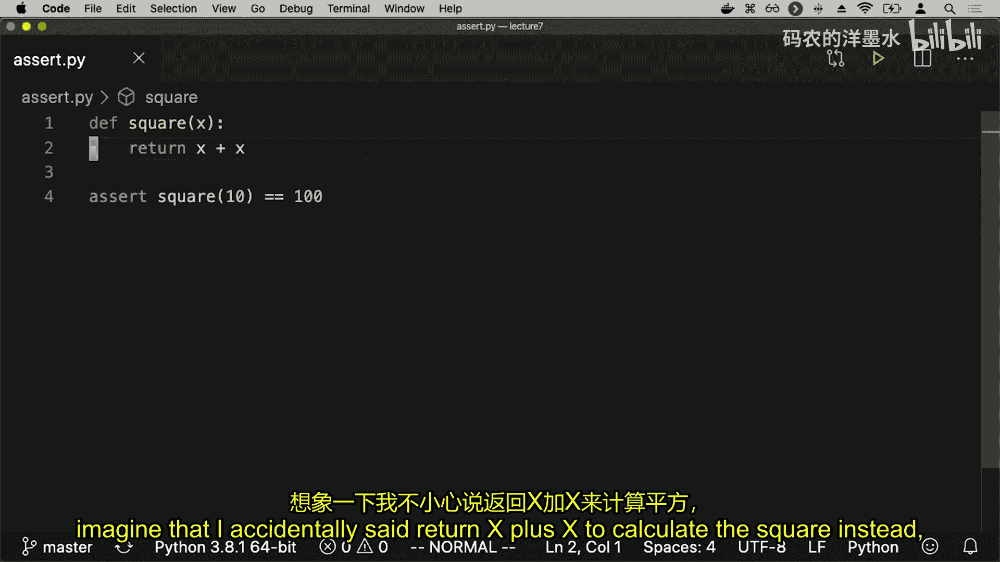

Well then when I try to run Python assert dot pi， what I'm going to get is an exception and the type of exception that I get is something known as an assertion error and I can see that here there's an assertion error and then I see the reason why the assertion error happened and the assertion error happened on line4。

 which is this line here where I said I would like to assert that the square of 10 is equal to 100。

 So one way we could imagine testing our code is just by including a number of these different assert statements。

 if I want to verify that my code is correct， I can write various different assert statements and for a function that's fairly simple like this square function。

 probably not too many tests that I would need to write but you can imagine for more complex functions that have multiple different conditional branches being able to assert that no matter which conditional branch。

 the program chooses to follow that the code will actually be correct can be a valuable thing to be able to say。

😊，And this can be helpful too， when in working on a larger project。

 you want to deal with the problem of like bugs that might appear inside of a project and this gets it the idea of test drivenrin development。

 developing while keeping this notion of testing in mind and one of the best practices would be if ever you're working on a program of your own and you encounter some bug in the program you'll first want to fix the bug but then you'll want to write a test that verifies that the new behavior is working as expected and once you've written these tests。

 these tests can start to grow over time and as you continue working on your project。

 you can always run those existing set of tests to make sure that nothing no new changes that you make to the program down the line。

 no future features that you add or changes you might make are going to break anything that was there before and this is especially valuable as program start to get more complex and testing everything by hand would start to become a very tedious process to be able to just automate the process of just run a whole bunch of tests on all the things that I know that I would like the program to do and making sure the work is expected that can be quite helpful。

So assert then is one basic way of just saying that I would like for this statement to be true。

 and if it's not true， go ahead and throw an exception and using Python。

 we know we also have the ability to catch those exceptions in order to make sure that we're able to handle those appropriately so we could display a nice error message for example。

 if we wanted to do so。😡，But now let's go ahead and try and write a more complex function。

 something more complex than just taking a number and squaring it somewhere where there's more room for various different cases that I might want to test and more room where I。

 the programmer， might make a mistake， for example。 So let's imagine。Writing a new file。

 and I'm going to call Prime dot5 where here I'll go ahead and say that I would like prime dot5 to implement a function called is prime。

And what the is prime function should do is check to see if a number is prime or not。

 the prime number only has factors of one in itself。

 and I would like to write a function that verifies that fact。😡。

And so how might I go about doing that。Well， if n is less than 2。

 then it is definitely not prime because we say 0 and 1 are not gonna be prime。

 And we'll only deal with numbers that are 0 or greater and we'll deal with that for now。

 But let's start then with other numbers， numbersumb that are2 or greater。Well， what do I want to do。

 I really want to check each of the possible factors。 Like。

 if I want to check whether or not 100 is prime or not。

 that I want to loop over all the possible numbers that could be factors of 100， like 2，3，4，5，6。

 And when I get to a number like 2 or a number like 5， that do go into 100 cleanly。 Well。

 then I'll know that the number is not prime。 So I could say for I in range from 2 all the way up through n。

 for example。Let me go ahead and say if。N mod I equals 0， then return false。

 So what am I saying here， I'm saying， go ahead and start it2， go up through， but not including n。

 So if I'm checking to see if 10 is prime， for example， I'm going to check for I is 2，3，4，5，6，7，8，9。

 and for each of those numbers， check if n， my input to this function， mod I。

 the factor that I would like to check is equal to 0。 this mod operator， this percent。

 if you don't recall， gives us the remainder when you divide one number by another。

 And so if n mod I equals 0， that means the remainder when you divide n by I equals 0。

 meaning I goes into n cleanly with no remainder， and that means that it's not prime because it does have a factor。

 Whatever I is is going to be that factor。And if I get to the end of this for loop。

 then I can go ahead and just say return true。 if we weren't able to find a factor for the number other than one in the number itself。

 well then we can go ahead and say that true， this number is going to be prime。

 And so this for example could be a function that checks to see if a number is prime。

 but if I'm trying to optimize。 I'm trying to make my function more efficient。

 I might realize that you really don't need to check every number from2 all the way up to the number n itself。

 I could really just check up to the square root of that number for example。

 that for a number like 25， I want to check like 2，3，4。

5 because5 squared is going to be 25 but after5， I don't need to check any more number beyond that that after you get to a number after the square root of that number is multiplied by itself。

 there's never going to be a case where a number bigger than that could be a factor that I won't have already known about。

 So just thinking about things a little bit mathematically。

 we might be able to make some sort of optimizations where instead of going from two all the way up through n。

I might go up to the square root of n。And I'll go ahead and import math to be able to use mathbot square root。

 And I'll convert that number to an integer。 just in case the square root doesn't already happen to be an integer。

 So I think this works。 I've at least talked myself into thinking that this is a function that might be able to check if a number is prime。

 So what could I do if I wanted to verify this。 Well， I could write some assert statements。

 Another thing I could do is just use the Python interpreter。 I could say， all right。

 let me go ahead and type Python。😊，And now I'm in the Python interpreter。 And I can say from prime。

 go ahead and import is prime。 Prime is the name of that file。

 is prime is the function in that file that I would like to test。 And let's just try all right。

 like is prime5。 That's a prime number。 Hopefully， it'll say true that it's prime。 All right。

 It does。 Let's try is prime 10。 see if that works。

 All right is prime 10 is false because 10 is not prime。 That's good。

 That seems to be working as well。 Let's try like is prime99。

 That's not prime because like 3 is a multiple of that， for example。 All right， false。

 So that's good。 This seems to be working。 And I could in the interpreter。

 Test this function to make sure that it works the way that I would want it to work。

 But let's now see some other ways that I might go about testing it。 Well， one way。😊。

Is that I could write a file like test0 dot pi。 And what test 0 do pi is going to do。

 instead of using thisert， I'm just going to do our Boolean checks like we were doing before。

 I'm going to import the is prime function And I've defined a new function called test prime。

 which is going to serve the role of testing to make sure that when you square some number or when you check to see if some number n is prime that you get some expected value where that expected value is either true for it is prime or false for it's not prime。

 what then is a function doing Well the function is checking。

 We're calling the is prime function on this number N。

 and seeing whether or not it is equal to the expected value that we get where we expect to be either true or false。

 And if we run is prime on n。 and it is not equal to what we expect， well then we print out。

 okay there' is an error we expected some value true or false， but it turned out not to be the case。

😊，And so now that I have this test prime function， well I can say， all right。

 let me go back into the Python interpreter from test 0， import test prime and now I can say。

 all right， let me test prime， make sure that five。😊，Is prime。 So I'm passing it my first input。

 the number N， the number I would like to check。 I want to check if 5 is prime and the second input I provide is what I expect it to be either true or false。

And here nothing happens， which is a good thing。 If there were an error it would have printed something out。

 and the fact that I see nothing printed out means that everything was okay。

 If I test prime now and say something like， all right， make sure 10 is not prime。

 make sure that 10 when you pass it into is prime is going to give us false。 Again， nothing happens。

 seems to be working just fine。😡，Let me now try， I can try more examples， maybe I try test Prime 25。

 I want to make sure that 25 is not prime because 25 is not a prime number。All right。

 we get some sort of error。 There's an error on is Prime 25 where I expected the output to be false。

 but for some reason， it looks like is prime returns something other than false。

 It probably return true。 And so might indicate some sort of bug in my program。

 somehow I don't think that 25 should be a prime number but my program thinks that 25 is a prime number and that error can be a clue to me as to how to do this。

 But ultimately especially as programs start to grow longer。

 especially as I start to add more and more functions。

 testing each of those functions by hand is going to start to get tedious。

 So one thing I could do is like write a script to be able to run all these tests for me automatically。

 And so here what I have a test0 do S H do S being like a shell script。

 some script that I can just run inside my terminal。

 And what this is doing is it's running Python 3 for Python version 3 C。

 which means I'm just going to give it a command。 and it is going to run that command。

 And so I can just run these。 and each of these lines does what。😊，From test 0。

 it imports my test prime function， that function that is going to test to make sure that the prime function produces the output that I would expect it to。

 And each time I'm testing a different number， making sure that one is not prime。

 making sure that two is prime 8 is not prime。 so on and so forth。

 And I can just write a whole bunch of these tests。

 and then rather than have to run each test 1 at a time。

 What I can do is I can just run test 0 dot S。 I can just say。That I would like to run dot slash。

 test0， do F H。And allright， I see that I get two errors。

 I get an error on is Prime 8 where I expected it to not be prime。 but for some reason。

 it seems to be prime。 And then again， here， exception on is Prime 25。

 where I expected it to not be prime。 But for some reason， my program thinks that it is prime。

 It's a very helpful way for me to know immediately that there's some sort of error that is going on here。

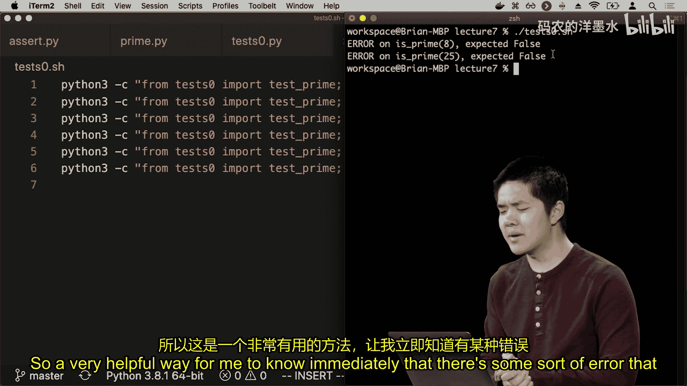

But ultimately， rather than have me have to write all this framework for how to go about testing my code on my own。

 there exists libraries that can help us with this and one of the most popular in Python is a library known as unit test and what unit test is a library designed to do is it is going to allow us to very quickly write tests that are able to check whether something is equal to something else and then unit test is built in with an automated test runner that will run all of the test for me and verify the output and unit test gets built in to a lot of other libraries within Python willll see how we'll soon be able to apply this sort of idea to our Django applications as well。

 but let's now translate these tests that we have written ourselves just by writing a function like test whether the prime number is what we expect it to be and now translate it to using this Python unit test library instead。

😡。

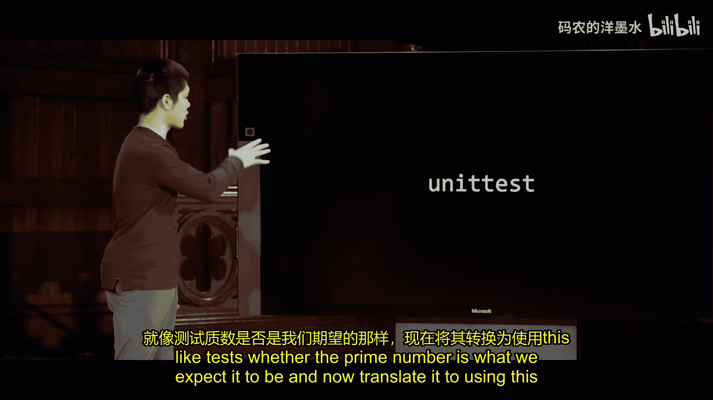

And so just to get a sense for what this looks like。

 I'll now go ahead and open up test 1 dot pi where here。

 first thing I'm doing is I'm importing unit test， which we get for free with Python。

 I'm also importing a function that I would like to test。😊。

And now I'm defining a class which will contain all of my tests。

 This is a class that inherits from or derives from unit test do test case。

 which means that this is going to be a class that is going to define a whole bunch of functions。

 each of which is something that I would like to test。😊，And so， for example， in this very first test。

 this is a test that checks to make sure that one is not prime。

And so the way I do that is by calling self this testing object itself。

 it happens to have a method or function built into it called assert false。

 There's an equivalent assert true。 But I would like to assert false。

 And what would I like to assert that is false is prime1。

 So whatever is prime1 is that should be false。 And I would like to just assert that it is false。

Likewise， for the number two now， I want to check that the number two is prime and the way I do that is by calling self dot assert true。

 I would like to assert that when I run the is prime function on the number two。

 the output that I get is going to be a true value， self dot assert true。

And I can translate each of the rest of my tests into one of these self do assert trues or self dataert false。

 and then I say that if you go ahead and run the program， go ahead and call unittest。 main。

 which will run all of these unit tests。

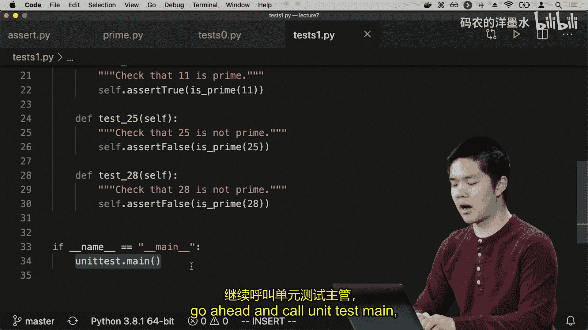

So now when I run Python， test1 dot pi。

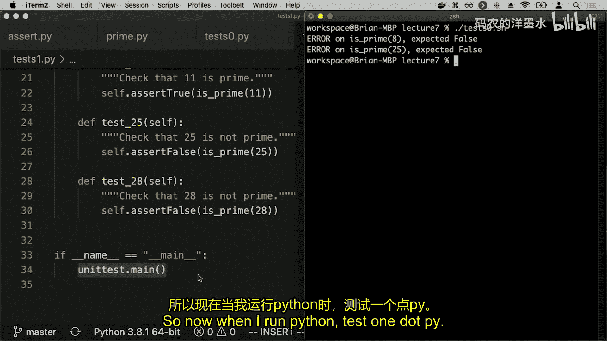

Here's what I get。 I get some nice output where up at the top I see dots every time a test succeeded and on a letter F for a test that happened to fail。

 It says that it ran six tests and down at the bottom I see that there were two failures。

 So it's immediately going to tell me exactly what failed and it'll give me some rationale。

 some reason for why it is that those tests failed as well so we can see all right here is one test Here is another test This test that failed is the test that checked that 25 is not prime and this sentence here is what I supplied inside of what was known as that python doc string inside of those triple quotation marks underneath the declaration of the function。

 those triple quotation marks otherwise known as a doc string serve a number of purposes。

 they can serve as just a comment for describing what it is the function does。

 but there a special comment insofar as someone who's looking at the function can access that dock string that's usually used for documentation for what it is that the function is doing and they can use it inside of other places as well。

 and so what unit test is doing is for every function it uses that。😊。

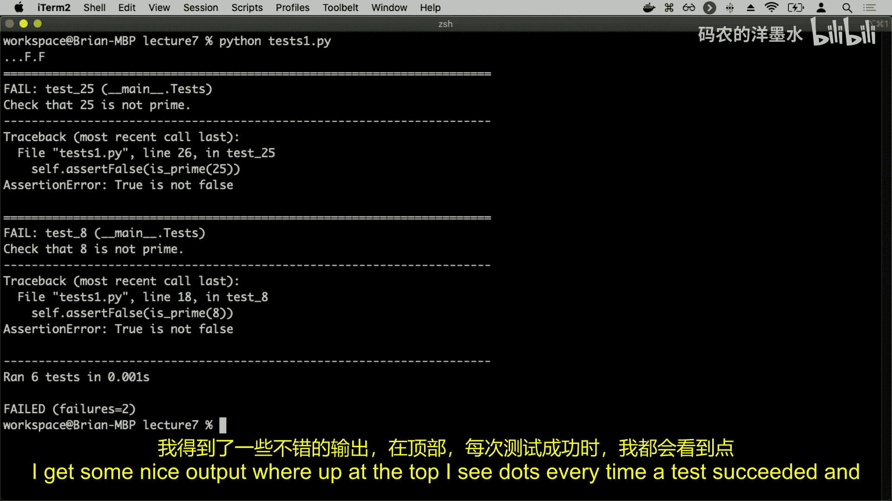

Dooct as a description of what the test is testing for so that if a test fails。

 then I can see exactly what the name is of the test that failed and what it was tested where the description describes what was happening Now。

 in this case， where it's just one function I'm testing a whole bunch of different numbers。

 it doesn't seem all that useful。 But again， if you imagine projects that start to get more complex。

 being able to know immediately when you run your tests。

 which parts of the program or which parts of your web application are working the way they are expected to can actually be quite helpful。

😊，So test 25， that was the function that triggered an assertion failure in this case。

 And the line that caused it was self docent false is prime 25。

 And the reason that it failed is because true， which apparently was the output of this function。

 is not false。 And I expected it to be false instead。

And so multiple different ways of trying to run our test。 This happens to be one quite popular one。

 But this now tells me that I should go back and try and fix my is prime function。 I can go back。

Into prime dot pi and say， all right。 I would like to figure out why this went wrong。

 And if you look at this enough and maybe give it a little bit of testing。

 you might see that I slight off by one error that I probably need to check one additional number than I actually am because in checking whether or not 25 is prime or not。

 for example， I might need to go up to and including the number 5 to know that 5 is a factor of 25。

 But before I was going up to the number 5， but I wasn't including the number 5。

 So I also need to just check one more number。 And now to verify that this is right。

 I could just manually test the function myself。 or I could just run these tests again。

 run Python test 1 dot pi。 And this time all these dots I mean all these tests succeeded。

 We ran six tests and everything was okay。 No failures。 And so。😊。

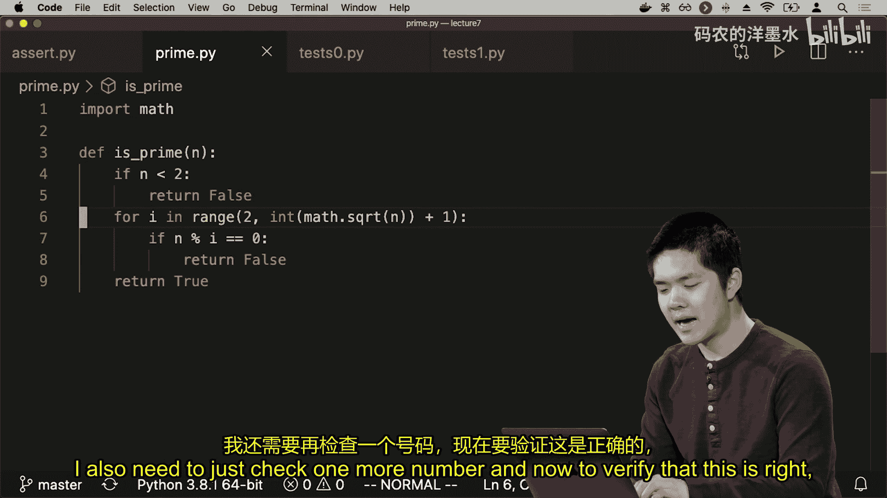

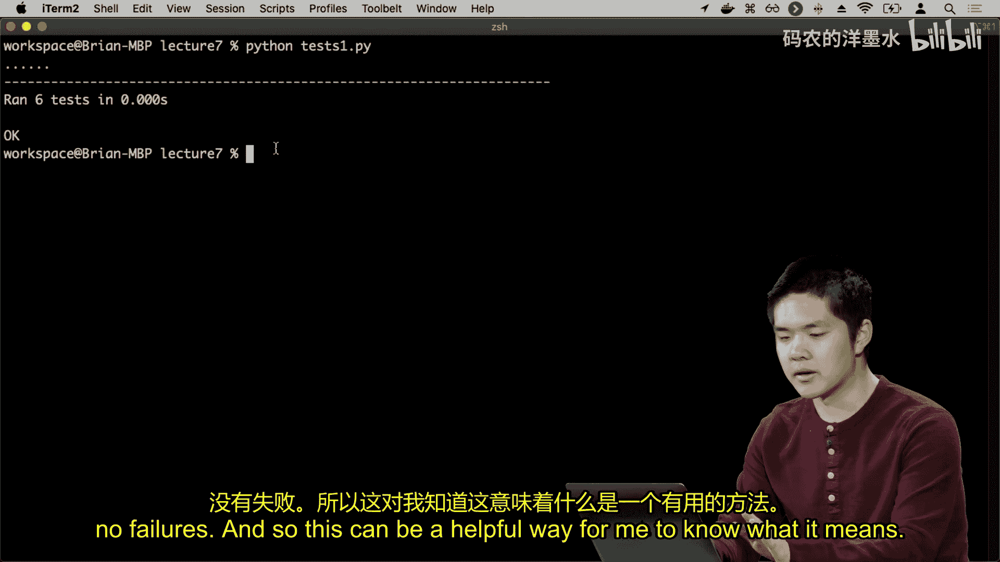

This can be a helpful way for me to know immediately that things seems to be working okay so the takeaways from here are that these tests can definitely help as you begin to write new changes to your program。

 especially as you begin to optimize functions， you might make a function more efficient but then run your tests to make sure that in making these improvements you haven't broken anything you haven't changed any behavior that the way the program was supposed to behave and now it doesn't behave that way。

 you are able to verify with much more confidence that that is true。

 but of course that only works if your tests have good coverage of all the things that you would want the function to do and you've covered appropriately all the various different cases for how the function should behave because only if the tests are comprehensive well they actually be useful to you in indicating that the change that you made isn't going to break anything and only then can you actually feel confident in those changes themselves。

So now let's take this idea of using unit tests to be able to write these tests that verify that a function works and apply it to something like a web application。

 like a web application written in Django that we would like to now use in order to be able to test to make sure that various different functions inside of our Django web application work as well。

😡，So what I'm going to do is actually take a look at the airline program that we wrote back when we were first talking about Django and first talking about storing data inside of databases。

 And I'm going to open up models do pi。 where you see that I've made one addition to our definition of a flight And recall from before when we first introduced this idea of defining a model inside of our application for a flight inside of an airline We gave that model 3 properties。

 So it has an origin and a destination where both origin and destination referenced an airport object where an airport object was an object we defined separately。

 But a flight has an origin airport and a destination airport。 And in addition to that。

 every flight has a duration， some number of minutes long that that flight is going to last。😊。

Now I might like to have some way to validate， to verify that a flight is a valid flight that there isn't some error somewhere in how the data was entered into the database。

 I would like to just generally make sure that given a flight I can check to make sure it's a valid flight and what does it mean for a flight to be valid well in general。

 given these particular fields I'll say there are two things that need to be true for a flight to be valid the origin in the destination need to be different that's condition number one it wouldn't make sense to have a flight whose origin and destination are the same airport and condition number two the duration of the flight needs to be greater than zero minutes if ever the duration is0 or the duration is negative。

 that probably indicates to me that there was some sort of mistake in data entry or some problem that happened with how it is that these flights were configured so I want to make sure that the duration is greater than zero and those then are my two conditions for what makes a valid flight and I've in fact written a function here called is valid flight that just works on this flight class that simply checks given a flight make sure。

That it is in fact valid and the way it's doing that is by checking for these two conditions that I've just described。

 it's checking to make sure that the origin is not equal to the destination。

 it's checking to make sure that the duration of the flight is greater than or equal to zero。

 and maybe I should change that to greater than to make sure it's entirely positive。

 but this then is my definition for what it means for something to be a valid flight。😊。

And what I'd like to do now is test these various different parts of my application。

 I have this is valid flight function inside a flight that I might like to test as well。

 but we also have all of these other properties that I would like to test these relationships that a flight has an origin and a destination we have passengers that can be associated with flights。

 So there's lots of relationships between my data that I would like to test and verify to make sure they work the way we would expect it to。

😊，So to do that， whenever we create an application in Django like this flights application here。

 we were also given this test dot pi file。 and we haven't yet used the test do pi P file file for anything。

 But what it's supposed to be used for is for writing these sorts of tests。

 Test that verifies that our application behaves the way that we want it to behave。

So let's go ahead now and open up test stop Pi and see what happens to be in here。

What we can do is we can define a subclass of test case。

 which behaves very similar to unit tests and is based on that same idea。

 I'll define a new class called flight test case that will just define all of the tests that I would like to run on my flight's application。

And so things to know about this is that first， I might need to do some initial setup in order to make sure that theres some data that I can actually work with and test with。

 And what Django will do when I go ahead and run these unit tests is that it will create an entirely separate database for me just for testing purposes that we have one database that contains all the information that actually pertains to the flights that are actually there on my web server。

 but we might also like to just test things with some dummy flights and some dummy airports just to make sure that things are working。

 and then once we're confident things are working， then we can deploy our web application to let actual users begin to use whatever new features we've added to the web application。

 for example。 So inside of this database I might need to do some initial setup。

 and I can do so by defining a setup function inside of my test case class。

 This is a special function and Django knows that when it's running these tests it should first do any of the setup steps that we need to do。

😊，And so how are we doing this。 Well we're doing is inside of the setup。

 we're going to just add some sample data into the test database。 Again。

 this won't touch the database that users actually see and actually interact with。

 This is just our test one for testing purposes。 And we'll start by going ahead and creating some airports。

 So airport dot objects dot create。 And then specifying what the values for these fields should be。😊。

We'll just have an airport whose code is A A， A for city A and an airport whose code is B，BB。

For city B， just dummy airport names， are not real airports， but just use for testing purposes。

 And I'll save those airport objects inside of these values， a 1 and A 2。And beneath that。

 what I'm gonna to do next is go ahead and create some flights where I create using flight dot objects dot create three different flights。

1 that goes from a1 to a2 with the duration of 100 minutes。

1 from a 1 to a1 with the duration of 200 minutes，1 from a1 to a 2 with the duration of negative 100 minutes。

 So I have a whole bunch of these flights now that I would like to test that I would like to make sure work in some predetermined or expected way。

😊，And so now if I scroll down， we can see that I have a whole bunch of these various different tests。

 Here is one test that just tests the departures count。

 So every airport has access to a field called departures。

 which ideally should be like how many flights are departing from that airport。

 and I'd like to make sure that departures count works the way I expected to。

 So here I go ahead and get the airport， whose code is aAa and now using unit tests like syntax。

 I would like to say self do assert equal， So assert true verifies that something is true。

 assert false， verifies that something is false。 assert equal verifies that two numbers are equal to each other。

 and here I'd like to verify that a do departures count if I take airport A and count how many flights are departing from that airport that that should be three。

 So just verifying that works。 And then after that。

 if this test passes then I can be confident that elsewhere in my program。

 if I take an airport and call that airport do departures do count。

 I can feel pretty confident that that is going to work。😊，The way I would expect it to。

I can do the same thing for arrivals， get the airport， and assert that a done rivals。 count。

 that that is going to be equal to the number one if there's only one flight that arrives at airport a1。

 for example。So that tests these relationships and I can also now test the is valid flight function as well that here I get my two airports。

 A1 and A2， this is the one whose code is AAA， this is the one whose code is BBB。

 I'll go ahead and get the flight， whose origin is a1 whose destination is a2。

 whose duration is 100 and let me just assert true that this flight is going to be a valid flight。

Because this flight is valid。 The origin is different from the destination。

 Its duration is some positive number of minutes。 And so I should feel pretty confident that this is going to be a valid flight that I can verify by calling self not a third true。

😊，I can do the same thing for testing for an invalid flight， testing for an invalid flight。

 because the destination is bad。 I can get the flight airportport a1 and get the flight whose origin and destination are both a1。

 And now let me selfdo assert false。 say that this should not be a valid flight。

 because the origin in the destination are the same。What's the other way a flight can be invalid。

 Well， a flight can be invalid because of its duration。

 So I could say something like go ahead and get airports A1 and A2 and get me the flight whose origin is a1 destination is a2。

 but the duration is negative 100 minutes。 That was one of the flights as well。

 And well that should not be a valid flight。 So I'll say selfdota are false is valid flight because when I call is valid flight on that flight。

 It shouldn't be valid because the duration makes it an invalid flight。

So here now I've defined a whole bunch of tests and there are more down below that we'll take a look at in a moment as well。

 but I've defined a whole bunch of these slides now or a bunch of these tests。

 and now I'd like to run them and the way that I can run tests in Django is via a managed do Pi command。

 managed Pi has a whole bunch of different commands that we can run we've seen like make migrations and migrate and run server but one of them as well is if I go into airline  zero I can say Python。

😊。

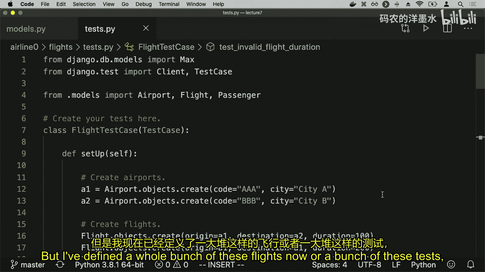

Managed that Pi test that's just going to run all of my tests。And all right。

 it seems that we ran 10 tests， but two of them failed。

 So let's go ahead and see why did those two tests fail。 Well。

 the way to read this is that we get this heading any time a test failed。

 And so we failed the test invalid flight destination function。

 and we failed the test invalid flight duration function and doc strings could have helped me to know what it is that these tests are exactly doing。

 But it seems that true is not false。 I wanted to do assert that this should not be a valid flight that it should be false。

 but for some reason these appear to be valid flight。

 So something seems wrong with is valid flight where it's returning true when it should be returning false。

 And so this then gives me a place to start looking。 I can say， all right。

 let me go to is valid flight and make sure that function is correct。 So I go back into models do。

 I take another look at is valid flight， maybe I'll think through the logic again。

 All I wanted to check that self that origin is not self that destination。

 I wanted to check that the duration is greater than or equal to 0。

 I could change this to greater than。😊。

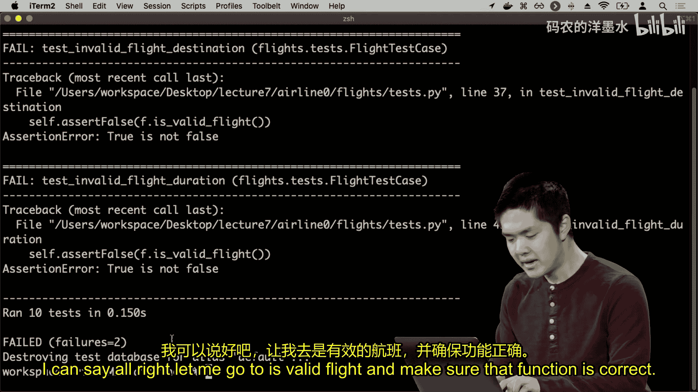

I don't think that's the issue because my duration was negative。

 and so that already should have been invalid。 but the other thing I might realize looking at this now is that okay。

 the logical connective that I have used was not the right one。

 I want to check that for to be a valid flight。 It needs to satisfy both of the conditions。

 The origin in the destination need to be different。

 and the duration of the flight needs to be greater than zero for example and here I've used or instead of and so I can just change it and hopefully that will fix things and to verify as much I can rerun Python managed pi test go ahead and press return。

😊。

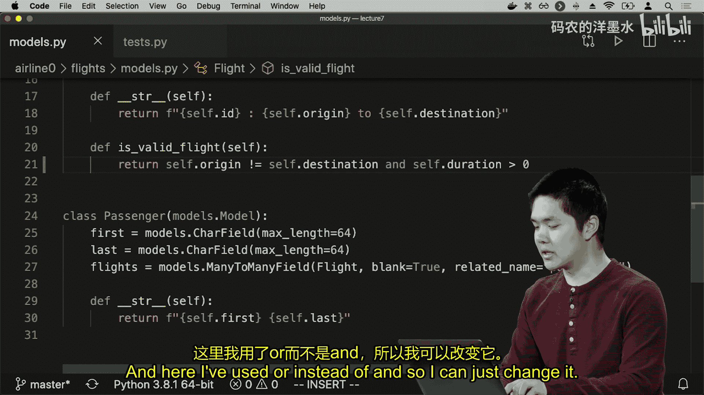

It's going to check things， ran 10 tests， everything is okay。 And all right。

 it seems that now I have passed all of these tests。😡。

And notice here at the top it created a test database。

 so it just created a test database for me in order to do all of this testing work and then it destroyed that test database at the end as well。

 so none of my tests if I'm adding data removing data。

 it's not going to touch any of the actual data inside of my database for the web application。

 Djago will take care of the process of keeping all of that separate for me by first calling that setup function to make sure that my new test database has everything that it needs to。

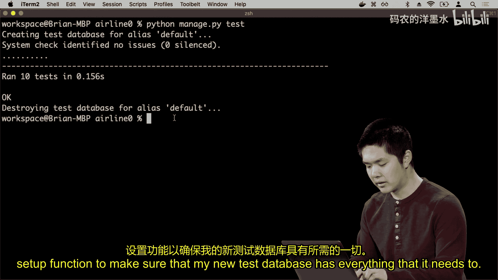

So all right， we now have the ability by using unitT to be able to test various different functions inside of our web application。

 We first saw that we could test a function like the is prime function。

 just a Python function that we wrote， but we can also test things like functions on our models like checking to make sure that a flight is valid checking to make sure that we can take a flight and access all of or take an airport and access all of its arrivals and all of its departures but I'd like to do more than that especially for a web application。

 I'd like to check that particular web pages work the way that I want them to work and so to do that。

 Drango lets us simulate trying to make requests and get responses to a web application。😊。

And so let's go ahead and look at some of these other tests as well。 Here。

 what we have is a function called test index。 And what test index is going to do is it's just going to test my default flights page to make sure that it works correctly。

 So we start by creating a client， some client that's going to be interacting。

 request and response style。Then I'm going to call client dot get flashlash flights。

 That is the route that gets me the index page。For all the flights。

And I'm saving that inside of a variable called Rese。

 whatever response I get back from trying to get that page。

 I would like to save inside of this variable called Respon。😡。

And now I can have multiple assert statements inside of the same test if I would like to。

 Sometimes you might want to separate them。 But here I want to check that the index page works。

 And what that means is a couple of things。 It means that response status code， Well。

 that should be equal to 200，200 again， meaning okay。

 I want to make sure that whatever response I get back that that is going to be a 200。

 And if there was some sort of error， like a 404 because the page wasn't found or a 500 because of some internal server error。

 I would like to know about that。 So let me first just assert that the status code should be equal to 200。

😊，But then Django also lets me access the context for a response and what is the context well recall again in Django when we rendered a template for example。

 we called like returnturn render then provided the request and what page we were going to render but we could also provide some context some Python dictionary describing all of the values that we wanted to pass in to that template and Djago's testing framework gives us access to that context so that we can test to make sure that it contains what we would expect it to contain and on the index page for all my flights。

 I would expect that to contain a listing of all of the flights and we created three sample flights inside of this test database so I should be able to assert that these two things are equal。

Response do context flights that gets me whatever was passed in as flights in the context。Dot count。

 will that better be three， because I want to make sure that there are exactly three results that come back when I look at the context and access whatever happens to be inside of that flight key。

There are other tests I can run as well。 So in this case I've gone ahead and gotten a particular flight。

 The flight who in this case had an origin of a1 and destination of a1。

 Now that was not a valid flight， but we'll go ahead and get it anyway because it exists in the database。

 And now I can get slash flights slash that flights ID D because on my flights page。

 I would like to be able to go to slash flight slash1 to get it flight number one and go to slash flight slash2 to get it flight number two。

 So if I take some valid I， some I of an actual flight F and go to slash flights slash that I D。

 Well， that should work it should have a status code of 200。😊，Meanwhile， though。

 if I test an invalid flight page， this is a Django command that will get me the maximum value for the ID。

 this ID underscore underscore max gets me the biggest possible ID out of all of the flights that happen to exist inside of my database if I go ahead and try and get slash flights slash max ID plus1 So a number that is one greater than any of the flights that were already inside of my database。

 well that shouldn't work。 there shouldn't be a page for a flight that doesn't exist。

 So here then I can assert equal that the status code of what comes back that that is equal to 404 because I would expect that page to return a 404。

And finally， I can also check various different contexts for things about the passenger page so in this case I've added some sample passengers to the database so inside of my test I can manipulate the database as well。

 adding data into the database and checking to make sure that when you count up the number of passengers on a flight page that that is going to be like the number one for example。

 So a number of different tests that we can then write in order to verify various different parts of our web application I would like to verify not only that our database works the way we would expect the database to work in terms of how functions on our models work in terms of relationships between those models like the relationship between a flight and an airport but we can also simulate a get request simulating a request to a page and verify that the status code that comes back is what we would expect to be verify that the contents of the page contain the right contents verify that the context that was passed into that template is correct as well。

 and then all of that can then be verified。

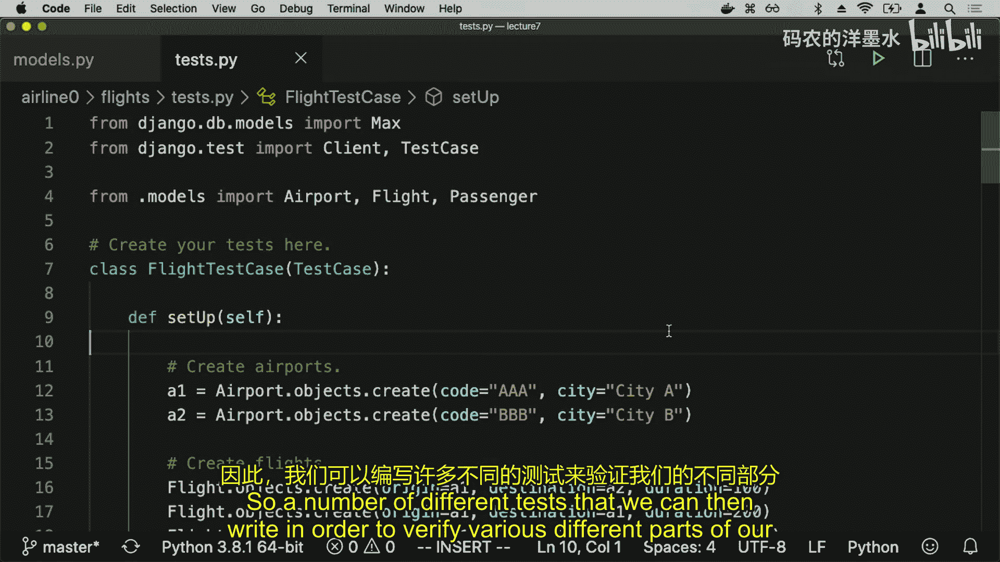

By saying something like Python managed a Py test。Then go ahead and running that。

And we see that in this case， all of the tests happened to pass。

 which means that everything seems to be okay， at least for now。

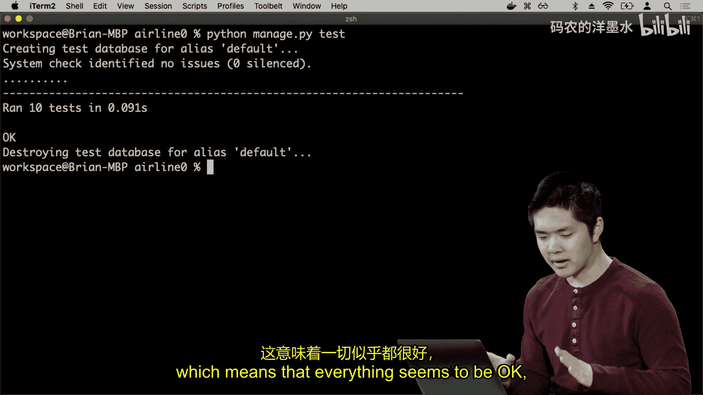

So this then again very helpful as our web programs start to get more complex as we have multiple different models。

 multiple different routes， the ability to test to make sure that if we change things in one part of the program that it doesn't break things in another part that can be quite helpful too but we haven't yet been able to test though is any interaction that's happening exclusively in the browser that I've been able to test a lot of things that are happening server side and recall that Django is all about working on writing this web server。

 a Python application that acts as a web server that listens for requests that come in from users。

 processes those using these various different views and models and then provides some sort of response back and we can test the contents of that response。

 things like does the status code match what we would expect it to does the context match what we would expect it to but there are sometimes where we would like to really simulate like a user clicking on buttons and trying things on a page and making sure that page behaves we would like how we would like it to as well even if we're not using Django or even if we're just dealing with the front。

So let's create like a sample JavaScript web page that we might like to test now by using these sorts of ideas。

 the ability to automate the process of testing various different parts of our application to verify that they do。

 in fact， work correctly。 What I'm going to do now。😡，I we'll get out of the airline directory。

 and I'm going to create a new file that I'll call counter do HtMl。

And recall before we created a counter application using just JavaScript where what the counter application did is it let me click a button like an increase or account button that just incremented a number one from0 to one to 2 to 3 to4 and so forth。

 I'm going to do the same thing here will' add a little more complexity though and give myself both an increase button to add a number and a decrease button to decrease the number by one as well so I go ahead and start。

😊，With our usual doc type HTML。And our HTMLl tag， I'll give this page a title of counter。And now。

 inside of the body of this page， I will go ahead and start with a big heading that just says0。

And then beneath that， I'll create two buttons。 I'll have one button。

 which will be the plus symbol and one button， which will be the minus symbol。

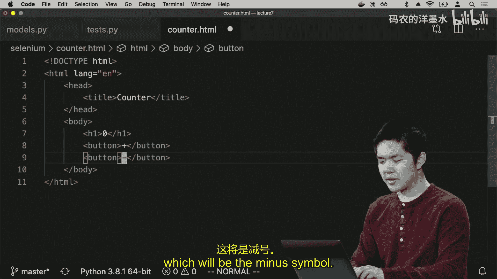

So now no jascript yet。 This won't actually work， but I can go ahead and go into open counter dot H TM L。

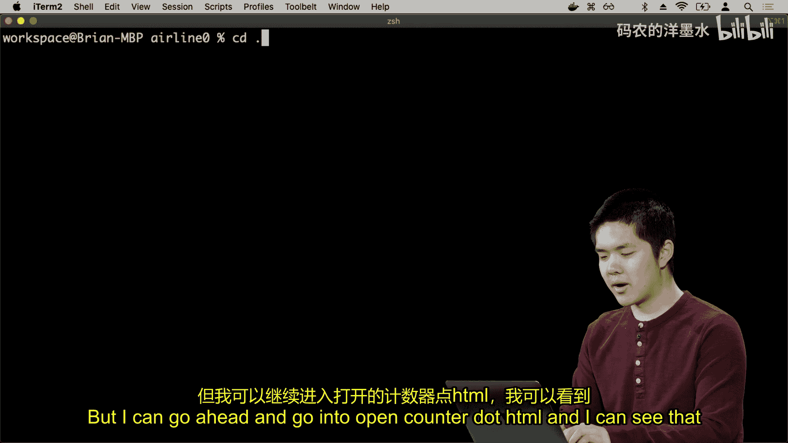

And I can see that I now have 0， and I have a plus and a minus button。

 although those plus and minus buttons don't actually do anything right now。

 So let's go ahead and make them do something。

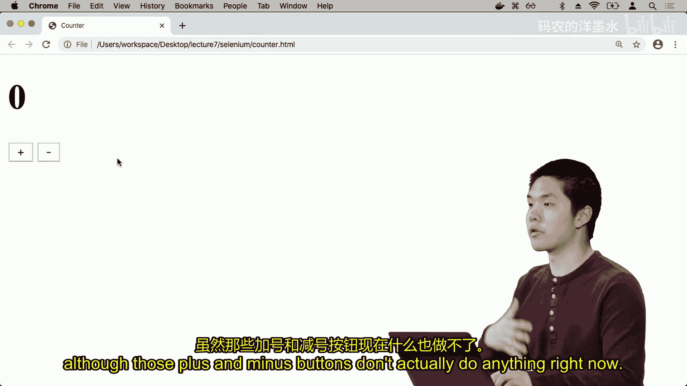

Let's give this button an ID called increaserease。So that I can reference it later and give this button an I D called decrease again so that I can reference it inside of my jascript。

And now in the head section of my web page， I'll add a script tag where I want to start running some ja once the page is downloading。

 And to do that， you'll recall， I can say document do ad event listener。

Dm content loaded to say go ahead and run this function。Once the dom is loaded。

 once all the contents of this page have loaded the way I would expect it to。

And what am I going to do， Well I first need a variable， something like let counter equals 0。

And then I can say， allright， document do query selector increase。

 get me the element whose ID is increase。 That's that plus button。 And when you are clicked。

 let's go ahead and add an event handler in the form of this callback function。

 this function that will be called when the increase button is clicked。😊。

And what would I like to do well I'd like to increase the counter。

 go ahead and say counter plus plus。And then I'm going to update this H1 that currently contains zero。

Document dot query selector， H1 that gets me the H1 element。

I'll go ahead and update its inner HTML and go ahead and set that to whatever the value of counter happens to be。

And then I'll do the same thing for the decrease button document do query selector。

 get me the element whose ID is decreased。 That's the button that will be the minus button。

 And when you are clicked， go ahead and run this callback function。

 which will do the same thing except we first do counter minus minus。

 decrease the value of the counter by one and then。😊，Get me the H1 element。

Set its inter HTMLtml equal to the counter。I think this should work。

 and I could verify that by opening up counter do HTMLtMl。 I'll refresh the page。

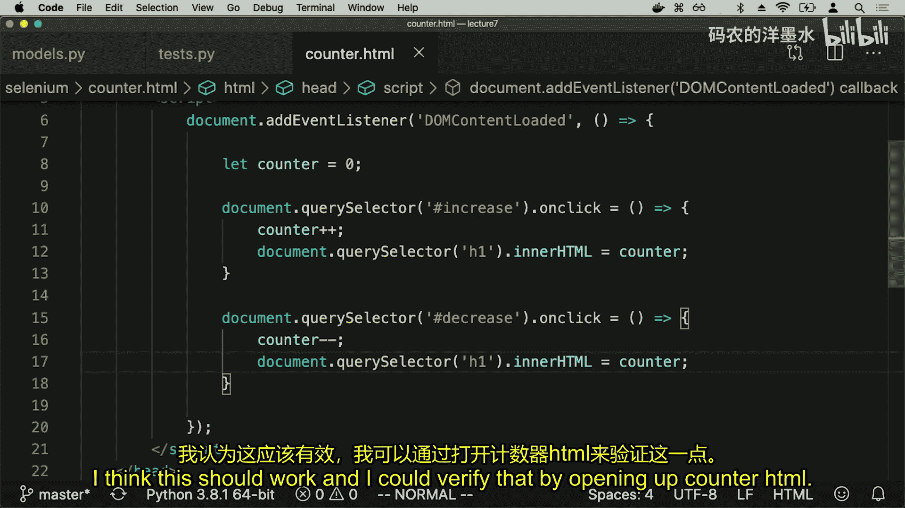

And I can test these buttons， test a plus button。 All right， that seems to work。

 increases the value by one。 I can test the minus button。

 make sure that that decreases a value by one。 That all seems to work just fine。 But of course。

 this requires me having to interact with this page。 I have to open up the page。

 I have to click on these buttons。 and it's not the type of thing where I'm simulating like a get request or a post request。

 There is no server that I'm sending a request to in getting back a response of 1，2，3。

4 from This is all happening in the browser。 And so what I might like to have the ability to do is some sort of browser testing。

 And there are a number of different frameworks for doing this。 One of the most popular is selenium。

😊。

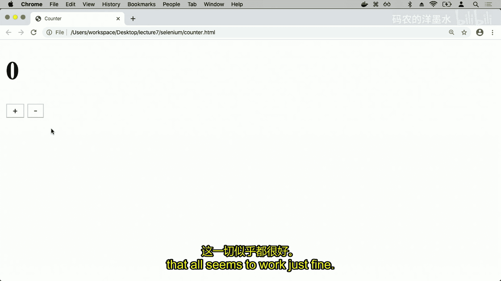

And what this is going to allow me to do is I can define a test file that using unit test or a similar library can effectively simulate a web browser。

 can simulate a web browser and simulate a user interacting with that web browser。

 using something that we call a web driver that's going to allow me to using code。

 control what it is that the browser is doing， and how it is that the user is interacting with this program。

😡，So how is this going to work， Well， I'm going to go ahead and just as a test。

 let me open up the Python interpreter and let me import from test import star。

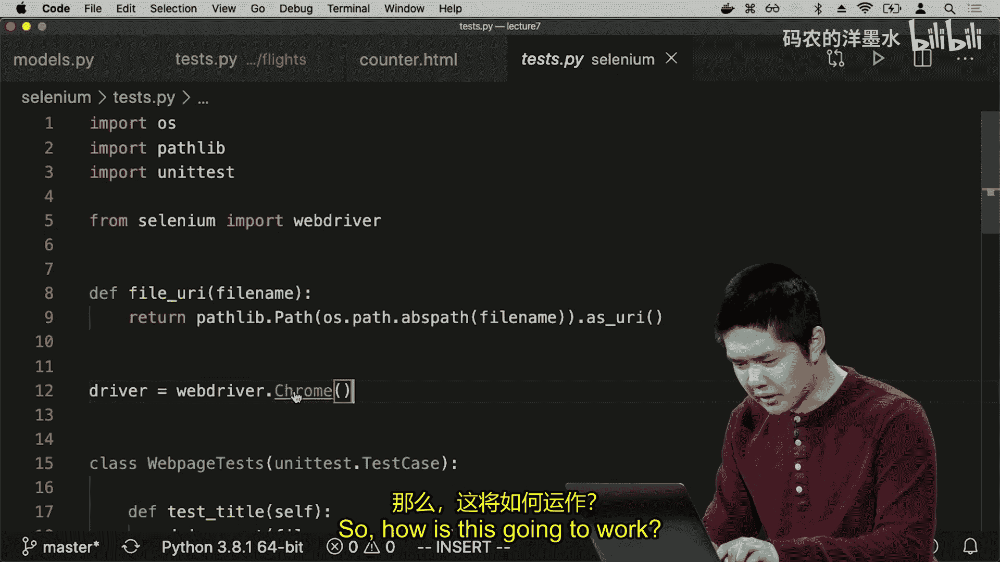

And that's going to give me access to a couple of different things。

 but the first thing you'll notice that it's doing is because I'm using this webd。

 it's going to give me a web browser and here I'm using Chrome， but you could use another browser。

 but notice that here Chrome is telling me Chrome is being controlled by automated test software that Chrome has the ability to allow me using automated test software using like Python code。

 control what it is the web browser is doing。😡，And so what I can do here is the first thing I need to do is like tell Chrome to open up my web page。

 And it turns out that in order to do so， I need to get that page's U R I or uniform resource identifier。

 just some string that will identify that page。 and I've defined a function called file UI that gets me the UI of a particular file in this directory。

 So I'm going to say I want to open up counter at H TM L。 and I need to get its U I。😊。

But now what I can say is driver dot get URLI， meaning like tell this web driver。

 this python part of the part of the Python program that is controlling the web browser that I would like to get this web page as if the user had gone to the web page and like pressed return after typing in the URL So I say driver dot get UI I go ahead and press that。

😡，And what you'll notice on the right hand side here is that Chrome has loaded this page。

 I am effectively controlling this web browser window using my Python program。 I said driver。 getuI。

 meaning go ahead and open up the counter。 HTMLt page and then inside of this test window。

 Chrome has opened that up and inside my Python program now using this web driverri I have the ability to like see the same things that the user sees when they open the page So what does the user see when they open the page Well they see for example。

 the title of the page so I could say like driver do title。And see that all right。

 The title of this page is counter。 That was， in fact， the title of the page。

 but I could verify that inside my Python program that by checking that driver do title by taking my web driver。

 getting the title of the current page that it's looking at making sure that that is counter。

 And likewise， if I looked at driver page source press return。 What I see there in string format。

 So it's a little bit messy is the content。 the Hm content of this page。

 and you'll notice things like Do content loaded here my on click handlers。

 here's my H1 that says zero。 It's very messy because it's being represented as a python string and these backlash ends refer to like new lines where there's a line break。

 But this is the content。 And this is really all the browser gets。

 the browser takes this information and just knows how to render it in some nice more graphical representation that's easier for a user to look at and therefore be able to understand。

 But this is fundamentally all that my web browser is actually getting back when it tries to load a web page。

😊，So what can I do from here， well I would like to simulate a user's behavior on this page that is sure I can get a page and see the title。

 but I want to simulate like clicking on the plus button for example。

 so in order to do that first thing I need to do is actually get the plus button and to do that I could say something like driver dot or find element by ID there are a number of ways that I could try and find an HTML element but I would like to find an HTML element by its ID and I know that the plus button。

 the increase button has an ID of increase for example。

 and so if I find element by ID let me find the element whose ID is increase。And all right。

 it seems here。That I've gotten some web element object back from my web driver。

And I'll go ahead and save that。Inside of a variable called increase。

So what I now have is a variable called increase that represents the increase button that my web driver has found on the web page。

 It's effectively effectively the same thing as you， the human going through the page。

 looking for the increase button。 The Web driver is doing the same thing。

 except instead of looking for the button based on what it looks like。

 it looks for the button based on its Id。 And so this again。

 another reason why it's helpful to give your HTML element Is。

 in case you ever need to be able to find that element。

 it's very useful to be able to reference that element by its name。😊，But now that I have a button。

 I can simulate user interaction with that button。 I can say something like increase dot click to say I would like to take the increase button and simulate a user clicking on that button in order to see whatever it is that the user would get back when they click on that button。

 So increase dot click I press return And what you'll notice happens is that the number increases increases from0 to1。

 It's as if I， the user had actually clicked on the plus button except all I did would say like increase dot click to say go ahead and increase the increase button and let the browser do what it would normally do in response。

 And what it would do in response is get that javascript event handler that on click handler and run that callback function that increases the value of counter and updates the H1。

 So I can say increase dot click to simulate increase the value of that variable。😊。

But this is just a function call， which means I can include it in any other Python constructs that I want that if I want to repeat something like 25 times。

 for example， and press the button 25 times， I can say like for I in range 25。

 go ahead and click the increase button。 And now very quickly 25 times。

 it's going to click the increase button。 and I'm going see the result of all of that interaction。

 so I can simulate user interaction just by using the Python interpreter。Likewise。

 if instead of increasing I wanted to decrease， well， then I'm going to do the same thing。

 I'm going to say decrease equals driver do find element by IDd。 Let me get the decrease element。

 the element whose ID is decrease。And now say decrease dot click。

And that will simulate me pressing the decrease button， press it again。

 and the more I press it every time it's just going to decrease by one。

And if I want to decrease it all the way back to0， well then I'll just do it 20 times for I and range 20。

 go ahead and decrease click， and that's going to go ahead and reduce this account all the way back to0 by simulating the user pressing a button 20 times and what you'll notice is that it happened remarkably fast like I can simulate 100 presses of the increase button by saying for I and range 100。

Increase dot click。 and very quickly， you'll see that number 100 times。

 go ahead and go up to 100 faster than a human could ever have clicked that plus button over and over again。

 And so these tests cannot only be automated， but they can be much faster than any human could ever be in order to test this behavior。

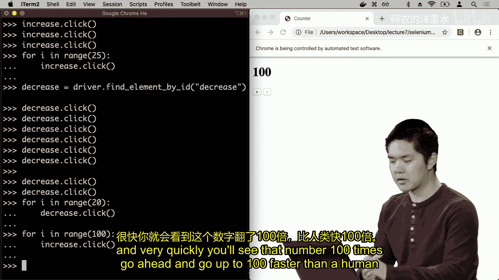

So how then can we incorporate this idea into actual tests that we write into like a unit testing framework that allows me to define all of these various different functions that test different parts of my web application's behavior。

Well， to do that。Let's go ahead and take another look at tests。

pi insideside of testpi here again is that file UI function where that function has the sole purpose of like taking a file and getting its UI and we need the UI to be able to open it up。

😡，Then we go ahead and get the Chrome Web driver， which is going to be what's going to allow us to run the ins simulateimulate interaction with Chrome。

 And in order to get Chrome's webdriver， you do have to get Chromedver separately。

 It is separate from Google Chrome itself， but Google does make it available and other web browsers make equivalent web drivers available as well。

 if you'd like to test how things would work in other browsers because different browsers might behave differently。

 And it might be useful to be able to test to make sure that not only does everything work in Google Chrome。

 but it's also going to work in other browsers that you might expect users to be working with as well。

😊，Here then I've defined a class that again inherits from unit test。

 test case that is going to define all of the tests that I would like to run on this web page that here I have a function called test title that's going to go ahead and first get counter。

 HTML it's going to open up that page and then just assert equal。

 let's make sure the title of the page is actually counter。

 That's what I would expect it to be so I can write a test in order to test for that case as well。

Here I test the increase button by finding the element whose ID is increase and clicking on that button to simulate a user pressing the plus button in order to increase the value of the counter。

 and then what do I want to check well I want to check that when you find element by tag name H1。

 and so find element by tag name similar to find element by ID except instead of finding something by its ID it's going look at what's the tag and there only is one element that is an H1 And so here I'm saying go ahead and get me the H1 element and access its text property。

 meaning whatever it is that is contained inside of those two H1 tags I would expect that to be the number one。

 And so I would assert that this is equal to1。And likewise I can do the same thing for the decrease button。

 finding the element whose ID is decrease， clicking on that button， and then asserting equal。

 find me the H1 element and make sure that the contents of it are equal to the number negative one for instance。

 and this final test just testing multiple times that three times I'm going to press the increase button and make sure that after I press the increase button three times when I check the H1。

 check what's inside of its text that the answer should in fact be three。😊。

So now I should be able to go ahead and。

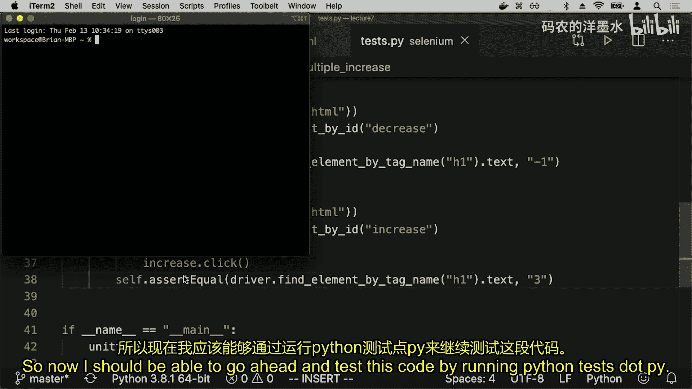

Test this code by running Python tests do pi。 And what that is going to do is it's going to open up a web browser。

 And what you're gonna to see very quickly flashed across my screen where all of those tests。

 we test the increase by one。 we test decreased by one and then we test like increase three times after we had checked to make sure the title was correct。

 And then we can see here is the output。 we ran four tests in this amount of time and everything turned out to be okay。

 None of the tests failed。 But if one of the tests had failed。 Well then。😊。

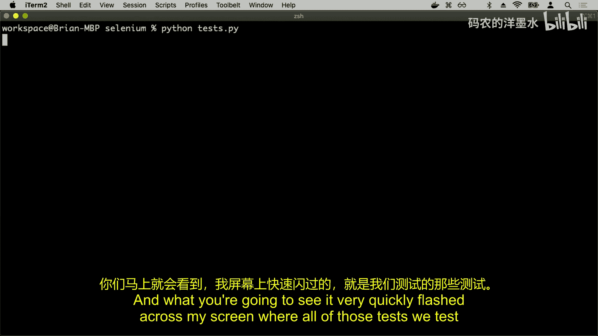

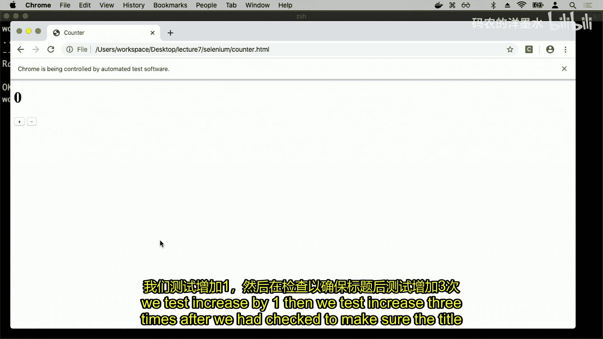

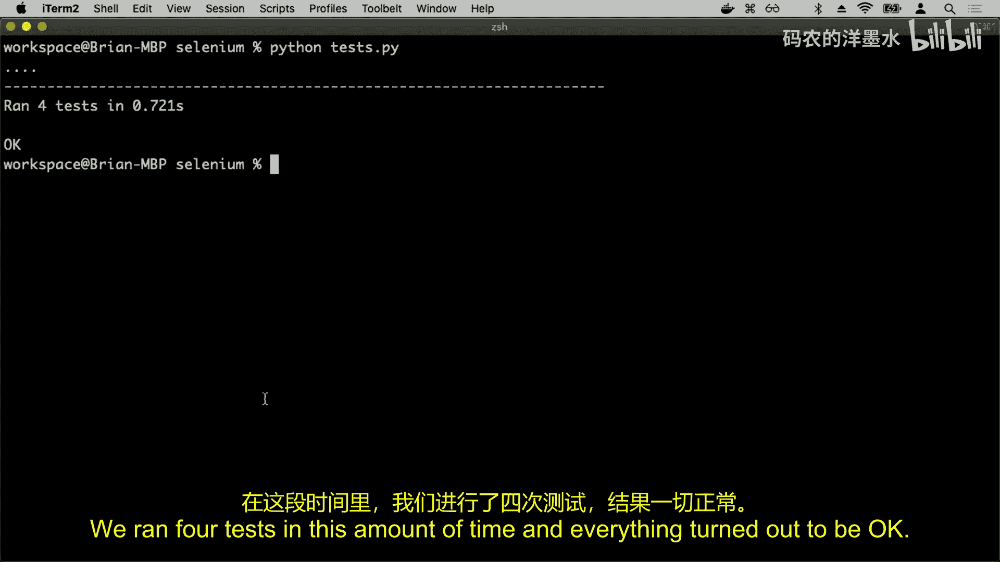

We would see a different output。 So let's imagine， for example。

 that I had had a bug in my decreased function， for example。

 where the decrease function wasn't actually working。 What would that bug look like。

 Maybe I forgot to say counter minus minus or maybe perhaps more likely What might have happened is I wanted to I already had written the increased function。

 And I decided to very quickly add the decrease function。

 And I thought I just you know what copy paste， like copy the increase event handler。

 the decrease event handler is basically the same thing except I need to query for decrease instead。

 and maybe I adjusted that and forgot to change plus plus to minus minus a bug that might happen if you're not too careful about how you copy and paste code from one place to another。

😊。

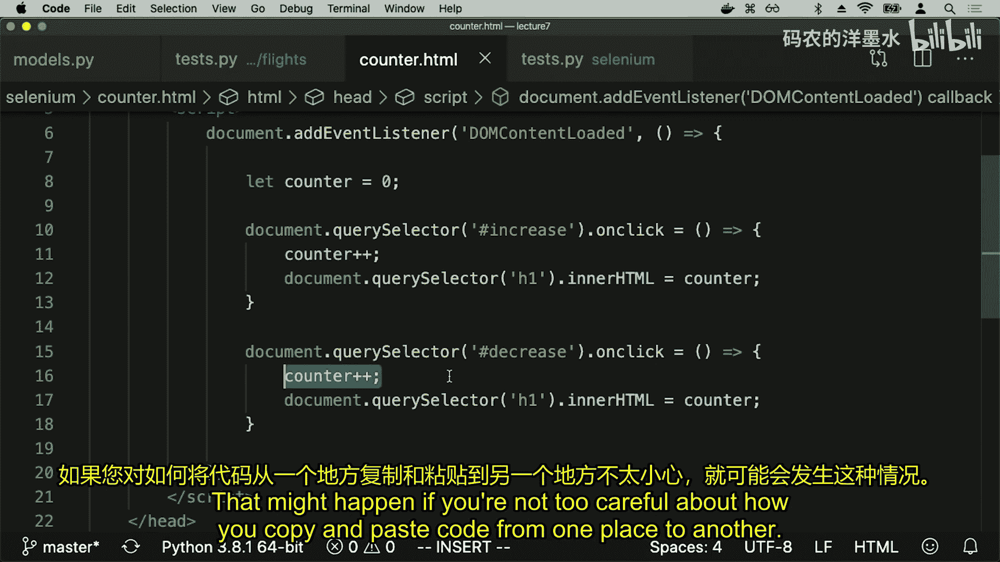

Now when I run these tests， Python test。 pi。

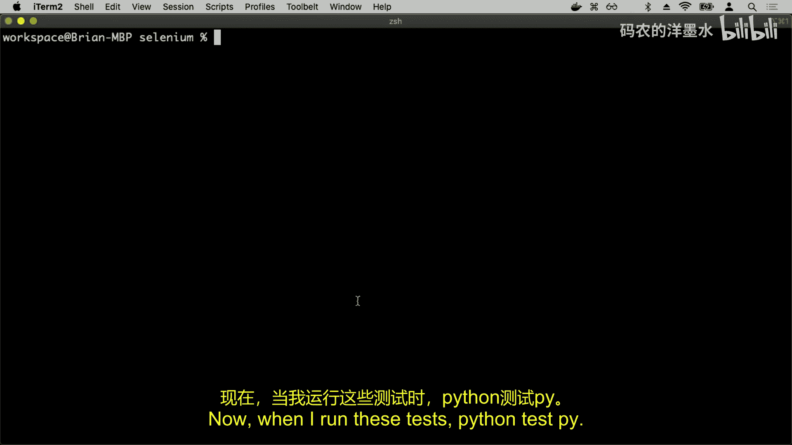

We'll see the simulation。A whole bunch gets simulated。

 And when I go back and check the output of my test， see what actually happened。

 I see that we do seem to have an assertion error here。

 The assertion fail was on the test decreased function。

 and it happened when I tried to assert that what was inside of the H1 element was negative1 because one is not equal to negative1。

 So this is the value of this assertion error as well。 and this is helpful。

 an advantage over just assert assert just tells you you know there's an assertion error。

 But here in unit test we actually get to see if I asserted that two things are equal。

 it tells me what both of those things are。 It tells me the actual output of H1's text。 it was one。

 but what I expected it to be was negative1。 So it tells me exactly what the discrepancy is。

 I know that for some reason， it was one instead of negative1。

 and that can be a clue to me a hint to me as to how I can go about trying to solve this problem。😊。

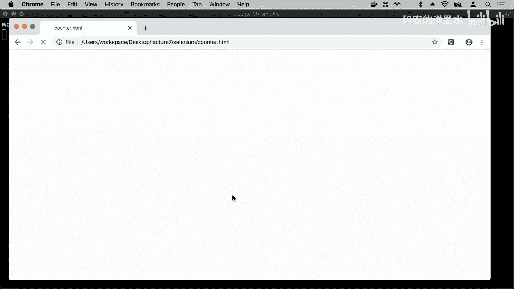

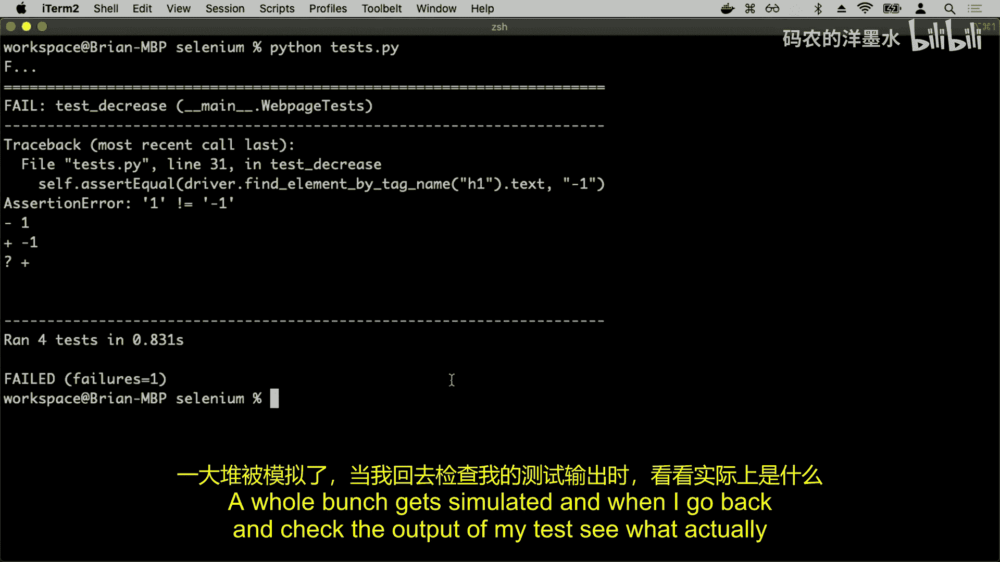

And I can solve the problem by going into my decrease event handler， See that。 allright。

 this was increasing the counter。 instead of decreasing it， change plus plus to minus minus。

 And now rerun my tests and see。😊。

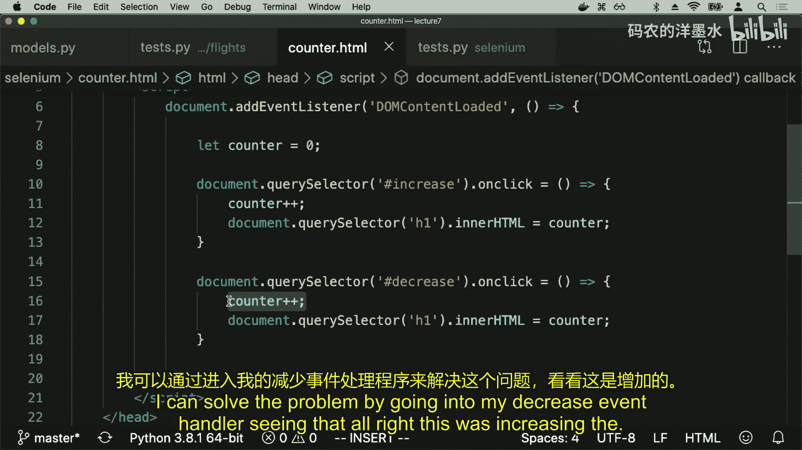

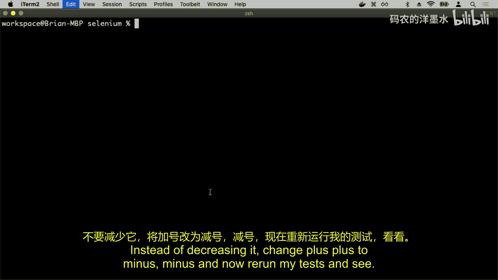

그。All of the tests simulated inside of my Chrome driver。

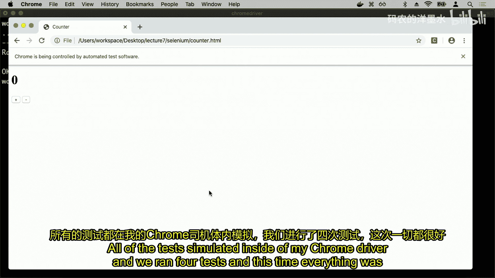

And we ran four tests， and this time everything was okay。

 so all of my tests appeared to have passed this time。

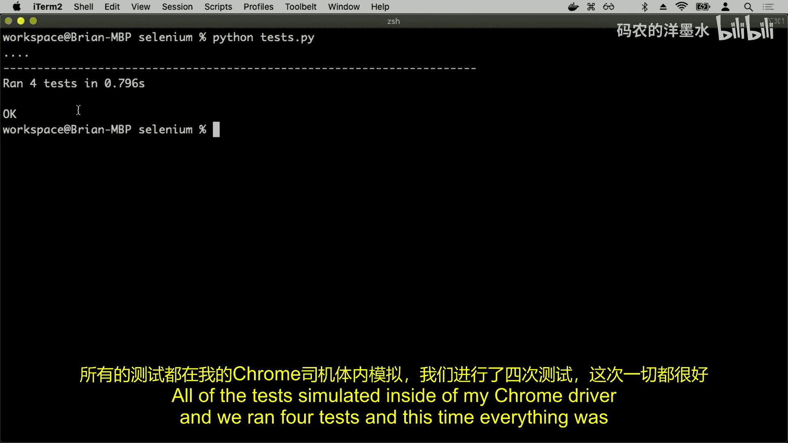

So those then are some possibilities for being able to test our code。

 especially taking advantage of unit tests， this library that we can use in Python in order to make various types of assertions about what we would like to be true or false about our code and unit test contains a number of helpful methods for being able to perform these sorts of assertions some of them are here so we can say things like I would like to assert that two things are equal to each other。

 which we've seen there's a counterpart to that， assert not equal for making sure that two things are not equal to one another。

 assert true and false we've seen as well， there are others as well。

 though things like assert in or assert not in if I would like to assert for example that some element is in some list for example or that some element is not in some list。

There are other assert methods as well that we can use in order to verify that a part of our program or a part of our web application does in fact behave the way we would want to behave and we can integrate this type of idea into a number of different types of testing we saw integrating it into Django itself using Djago's unit testing in order to verify that our database works the way we expected it to and that our views works the way that we expected them to and provided the right context back to the user after the user makes the request to our web application and there are also applications of unit testing。

 whether using the framework or not to browserbased testing when I want to test like inside of the user's web browser does it actually work when a user clicks on this button that the ja behaves the way that it expected to and I don't need to especially use ja in order to do those tests I can write those tests。

Using Python， using unit test to be able to say， click on the button that has this ID and verify that the result that we get back is what we would expect it to be。

😡，So that then was testing。 and now we'll go ahead and take a look at CicCD。

 continuous integration and continuous delivery， which refer to two best practices in the software development world that have to do with how it is that code is written。

 especially by groups or teams of people， how it all works together and how that code is eventually delivered and deployed to users who are using those applications。

 So C， which refers to continuous integration， involves frequent merges to a main branch of some repository。

 like a Git repository， and then automatically running unit tests when that code is pushed。😊。

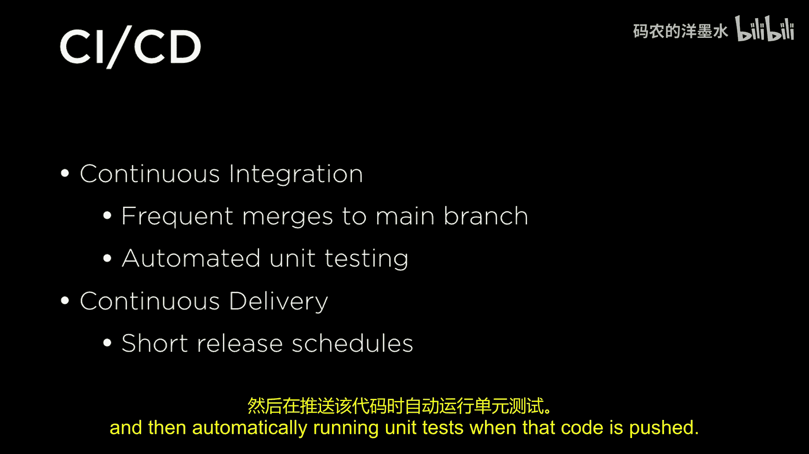

So what does that generally mean Well， in the past。

 you might imagine that if multiple people are working on some project at the same time and multiple people are each working on different features or different parts of that project。

 then after everyone's done working on those features and we're ready to ship some new version of a web application or ship some new version of a software product well then everyone's going have to take all these various different features and combine them all together at the end and figure out how to then try and deliver that program to users and this has a tendency to cause problems。

 especially if people have been working on different big changes all simultaneously。

 they might not all be compatible with one another。

 there might be conflicts between the various different changes that have been made so waiting until everyone's done working on a feature to merge them all back together and then deliver it is not necessarily the best practice which is why increasingly many more teams are beginning to adopt a system of continuous integration that there's one repository somewhere online that's keeping the official version of the code everyone works on their own version of the code。

Maybe on their own branch， for example。But very frequently。

 all of these changes are merged back together into the same branch to make sure that these incremental changes can be happening。

 such that it's less likely that there is two really divergent paths that the program has gone under and as a result it's much more difficult to merge those two paths back together In addition to frequently merging to a some main branch another key idea of continuous integration is this idea of automated unit testing。

 where unit testing again refers to this idea of on our program we run a big series of tests that verify each little part of our program to make sure that the web application behaves the way it is supposed to and unit tests generally refer to testing particular small components of our program。

 making sure that each component works as expected there are also bigger scale tests tests like integration tests that make sure that the entire pathway from like user request to response that everything along a certain pipeline works as well but there are various different types of testing and the important thing is making sure that any time some new change is merged。

to the main branch or someone wants to merge their changes into the main branch that these tests are run to make sure that nobody ever makes a change to one part of a program that breaks some other part of the program and in a large enough codebase it's going to be impossible for any one person to know exactly what the effect of one particular change is going to be on every other part of the program they're going to be unforeseen consequences that the one programmer may or may not know about and so the advantage of unit testing assuming they're comprehensive and cover all of these various different components of the program is that any time someone makes a change and attempts to merge that change into the main branch according to the practice of continuous integration。

 the fact that it doesn't pass a test will know about that immediately and as a result that programmer can go back and try to fix it as opposed to waiting until everything is done merging everything together and then running the test realizing something doesn't work and then being unsure of where to begin we don't know where the bug is which change happen to cause the bug if everything is merged more incrementally it's easier to。

Spot those bugs， assuming there's good coverage of tests to make sure that we're counting for these various different possibilities。

So continuous integration refers to that idea frequently and more incrementally updating the main branch and making sure that the tests are in fact passing。

 and it's closely tied to a related idea of continuous delivery。

 which is about the process of how it is that the software is actually released to users how the web application actually gets deployed and there are a couple of models you might go about thinking with regards to how it is that some program or web application gets deployed you might imagine that the release cycle might be quite long the people spend months working on various different features on some software development team and after they're happy with all the new changes they've release some new version of the web application but especially with web applications that are undergoing constant change that have lots of users that are moving very quickly。

 one thing that's quite popular is this notion of continuous delivery which refers to having shorter release schedules instead of immediately releasing something at the end of some long cycle you can in shorter cycles make releases every day every week or so in order。

😊，orTo say that let's just go ahead and incrementally make those changes。

 whatever new changes happen to have merge to the main branch。

 let's go ahead and release those as opposed to waiting much longer in order to perform those releases。

😡，And that again lends itself to certain benefits， the benefit of being able to just incrementally make changes such as something goes wrong。

 you know more immediately what went wrong as opposed to making a lot of changes at once。

 where if something goes wrong， it's not necessarily clear what went wrong and it also allows new features to get out to users much more quickly so especially in a competitive market where many different web applications are competing with one another。

 being able to take a new feature and release it very quickly can be quite helpful so continuous delivery is all about that idea of short release cycles rather than wait a long time for a new version to be released。

 release versions incrementally as new features begin to come in。

It's closely related to the idea of continuous deployment。

 which CD will sometimes also represent continuous deployment is similar in spirit to continuous delivery。

 but the deployments happen automatically rather than a human having to say all right we've made a couple of changes let's go ahead and deploy those changes in continuous deployment any time these changes are made。

 the pipeline of deploying the application to users will automatically take place as well。

 just removing one thing for humans to have to think about and allowing for these deployments to happen even more quickly as well So the question then is what tools can allow us to make continuous integration and continuous delivery a little bit easier。

 what techniques can we use in order to do so and there are a number of different continuous integration tools but one of them produced by Gitthub more recently is known as Github actions and what Github actions allows us to do is to create these workflows where we can say that any time for example。

 someone pushes to a Git repository I would like for certain steps to take place。

St it might be like checking to make sure that code is styled well that if a company has some style guide that it expects all of its programmers to adhere to when working on a particular product。

 you could have a Github action such that anytime someone pushes to a repository you have an action that automatically checks that code against the style guide to make sure that it is well styled well commented documented and so forth you might also for instance。

 have a Github action that tests our code to make sure that any time anyone pushes code to a Github repository we automatically run whatever tests we would like to run on that particular code base and Gitthub actions can allow us to do that as well by defining some workflow to be able to do so and so that's what we'll take a look at in just a moment using Github actions to automate the process of running tests so that the human though it would be a good thing for the programmer when they're done writing their code to test their code and make sure it works。

 we can enforce that by making sure that every time anyone pushes to a Github repository will automatically runs some Gitthub action。

I going to take care of the process of running tests on that program and we'll know immediately as via an email that GitHub might send to you to say that this particular test failed and you'll know every time you push to that repository。

😡，So how do these workflows get structured， What is the syntax of them。

 Well they use a particular type of syntax known as YamO， which is some language。

 a configuration language that can be used in order to describe。

 often describe for configuration of various different tools and software。

 Github actions happens to use that Other technologies use it as well。

 and YamO is a file format that structures its data sort of like this in terms of key value pairs much in the same way that adjacent object or a Python dictionary might where we'll have the name of a key followed by a colon followed by its value。

 name of a key followed by a colon followed by a value and the value doesn't necessarily need to be just a single value it could be a sequence of values。

 like a list of values for example， and those are denoted this way by like a hyphen indicating a list item1 item 2 item 3。

 and in addition to just having single values and lists of items these ideas， these lists。

 these sequences these values can be nested within one another that you might have one key that leads to another set of keys that are associated with values that leads。

😊，to other sets of keys associated with values as well， much in the same way that a object。

 like a representation of keys and values can also have nested adjacent objects within adjacent object。

 likewise too， we can have nested key value pairs as the value for a particular key too so we'll take a look at an example of what that actually looks like in the context of creating some GiHub workflow that will run some GiHub actions。

😊。

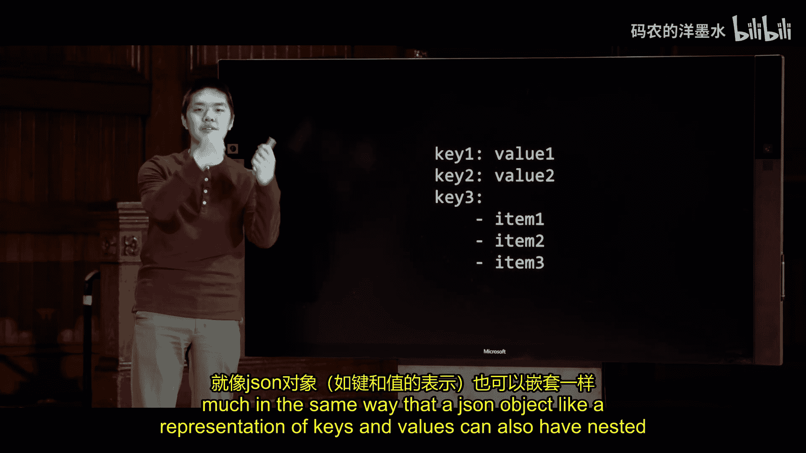

So what will that look like Let's go back into airline0。

 where here I've defined inside of a dot Github directory， a directory called workflows。

 inside of which I have a C dot YMl file。 It can be any name dot yal dot YMl or dot Y AMMl or the conventional file extensions for a Yal file。

 And here I'll open up C dot YMl。 And this now is the configuration for how this workflow ought to behave。

 I give the workflow and name it's called testing because what I want the workflow to do is like test my airline application。

😊，Then I specify an on key to mean when should this workflow run and here I've said on push。

 meaning anytime someone pushes their code to GitHub， we would like to run this workflow。

 Every workflow consists of some jobs and so what are the jobs。

 What tasks should happen any time that I try and push to this repository。 Well。

 I've defined a job called test project， and this is a name that I chose for myself。

 you can choose any name for a job that you would like。😡。

And now I need to specify two things for what happens on a job。

 One thing I need to specify is what sort of machine is it going to run on that Github has its own virtual machines。

 otherwise known as VMs。 And I would like to run this job on one of those virtual machines。

 And their virtual machines for various different operating systems。 here I'm just saying。

Go ahead and run on the latest version of abutu which is a latest version of Linux that I would like for this test to run on。

 and then for the job， I specify what steps should happen。

 where I can now specify like what actions should happen when someone tries to test the project when I try and run this job。

 And here I'm using a particular Github action。 and this is a Github action written by Github called actions slash checkout and what this is going to do is it's going to check out my code in the Git repository and allow me to like run programs that operate on that code。

 and you can write your own Github actions if you would like。

 And here all we really need to do is go ahead and check out the code as by looking at what's on the branch that I just pushed to。

😊，And then I'm going to run Django unit tests， this is just a description for me to know what's going on in this particular step。

And here is what I would like to run。 I'm going to first go ahead and install Django because I'm going to need to install Django to be able to run all of these tests。

 but after and if there are other requirements， I might need to install those requirements as well。

 but the airline program is fairly simple。 All we really need in order to run the test is just Django。

 so I'll go ahead and install Django。And then。I'll run Python 3， managed up Pi test。

 I would like to test， run all of the tests， and the way I can do that is just by providing this managed up command to say that I would like to run all of the tests on this particular application。

So this configuration file altogether now is going to specify a particular workflow。

 The workflow that says that every time I push to the Gitthub repository。

 what I would like to happen is I would like to check out my code inside of the Git repository。

 So on some Ubutu VM， Github is going to check out my code and it's going to run these commands。

 it's going to install Django。 and then it's going to test my code。

 and it will then give back to me what the response is after I do that。😊。

So let's go ahead and test this。 and in particular。

 let's run it on a program where the tests are going to fail。 So I might say， for example。

 let's go into flights and model stoppi。And let's go to my is valid flight function from before and change it back to that version that didn't work。

 that before it was something and something， I'll change it to something or something that as long as the origin is not the destination or the duration is greater than 0。

 will count that as valid。 But we know that that's wrong。 That should not work。

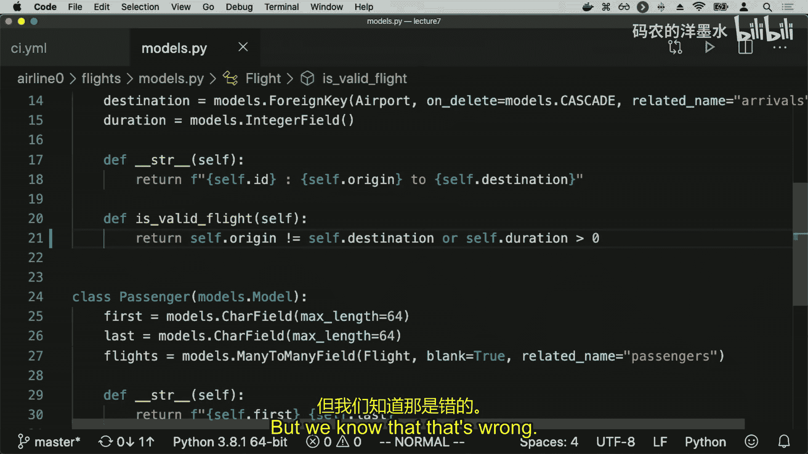

Sa hereそ do。I'll go ahead and first say gi status。 See。 all right。 what's changed。

 And it seems that allright， I've changed。 I've modified models dot pi， which makes sense。

 I'll go ahead and get add。 I'll add dot。 We'll just add all the files that I might have modified。

 I'll commit my changes。 So go ahead and use。😊，A wrong， valid flight function。

That's what I'm going to do。And now I'm going to push my code to GitHub。I added it， I committed it。

 I pushed it。That now then pushes my code to Gitthub into a repository called Air that I already have。

 And now if I go ahead and go to GitHub and I go to my airline。

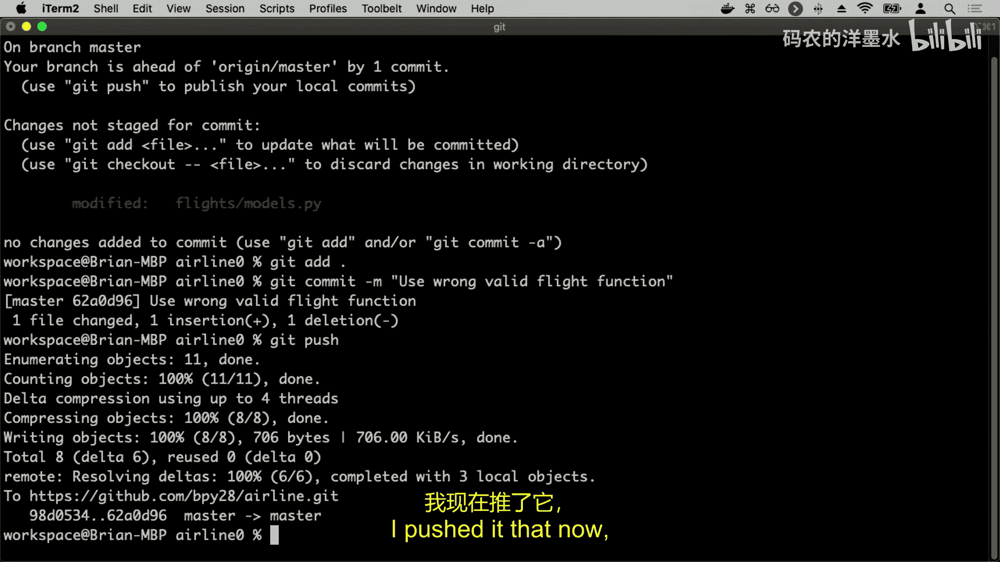

Repository。What you'll notice is that we've mostly been dealing with this code tab。

 but GitHub gives us other tabs as well that are quite useful as you begin to think about working on a project in larger teams so in addition to looking at the code。

 we have issues， issues are ways for people to just report that something is not quite right or there is a feature request that we have for this particular codeb so the issues might maintain a list of all of the pending action items for a particular repository things that we still need to deal with and once those issues are dealt with the issues can be closed so I have no issues here as well。

Poull requests are people that are trying to merge some part of the code from one branch into another branch。

 so you might imagine on a larger project， you don't want everyone merging things in the master all at the same time。

 you might have people working on their own separate branches and then when they feel confident and happy with their code then they can propose a poll request to merge their code into the master branch and that allows for various other features like the ability for someone to offer a code review to be able to review the code。

 write comments and propose suggestions for what changes to be made to a particular part of the code before it gets merged into the master branch and that's another common practice with regards to。

Working on a GitHub repository or any other larger project that you're controlling using source control is this idea of code reviews that oftentimes you don't want just one person making the changes without anyone's eyes on that code。

 but you'll want a second pair of eyes to be able to look things over make sure the code is correct。

 make sure it's efficient make sure it's in line with the practices that the application is using and so pull request can be quite helpful for that and then this fourth tab over here represents GitHub actions these are the various different actions or workflows that I might want to run on this particular repository and what we'll see here is that if I go to the actions tab now。

What I'll see。Is here is my most recent testing action。 So anytime I push。

 I get a new testing action， This one was from 29 seconds ago。

 I'll go ahead and click on it and see what's within it。😊，Alright， here was the job that I ran。

 Test project。 I see that on the left hand side。 You'll notice this big red X on the left hand side of this workflow means something went wrong。

 So I'd like to know what it is that went wrong。 I'll go ahead and click on test project。

And here within it， these are all of the steps， the things that happened when we actually ran this particular job。

 first the job sets up， then the checkout action goes ahead and checks out my code because we need access to my code to be able to run it。

 Here was the step I defined， run Django unit tests。

 which was going to install Django and run those tests。😡，It has an X next to it。

 indicating something went wrong。 And I see down below annotations one failure。

 So all over the place， Github's trying to tell me that something went wrong。

 It failed two minutes ago here。I'll go ahead and open this up。

And what I'll see is the first thing that happened is we installed Django。

 and that seems to have worked okay。😊，But down below what you'll see is the output of running these unit tests that we see failed failures too。

 And now I can see here are the unit tests that failed。

 We failed the invalid flight destination test。 We failed the invalid flight duration test。

 And as before， I can see in Github's user interface。 What those assertion errors are。

 I can see true is not false。 Tru is not false。 Those were the problems that happened when I tried to run this particular test sweep。

😊，And now others who are also working on this repository can see as well what the results of these tests are and can offer suggestions can offer ways that I might be able to fix the code in order to deal with that problem。

 but now I know that this particular test failed。And if I go back to the main code page for this GitHub repository。

I'll see that next to this commit， theres a little x symbol and that little X symbol next to the commit just tells me that the most recent time I tried to commit。

 something went wrong， they ran the workflow when there was an error。

 and so I'll immediately see for this commit and I can go back and look at the history of commits and see which ones were okay and which ones had a tendency to cause some sort of problem。

😊。

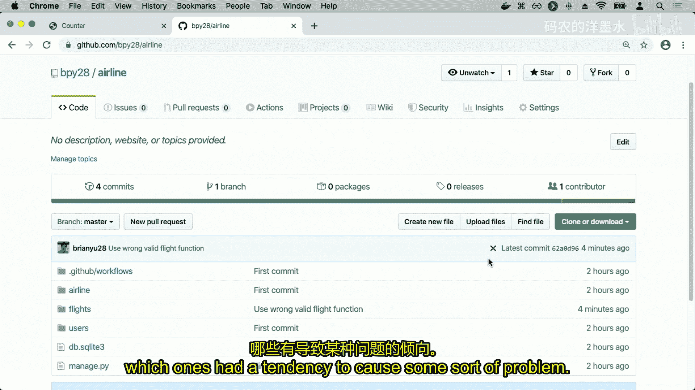

So this one， it appears caused a problem。 And we know why it caused a problem because of this condition。

 something or something else。 so I can fix it。 I'll change the or to an end。

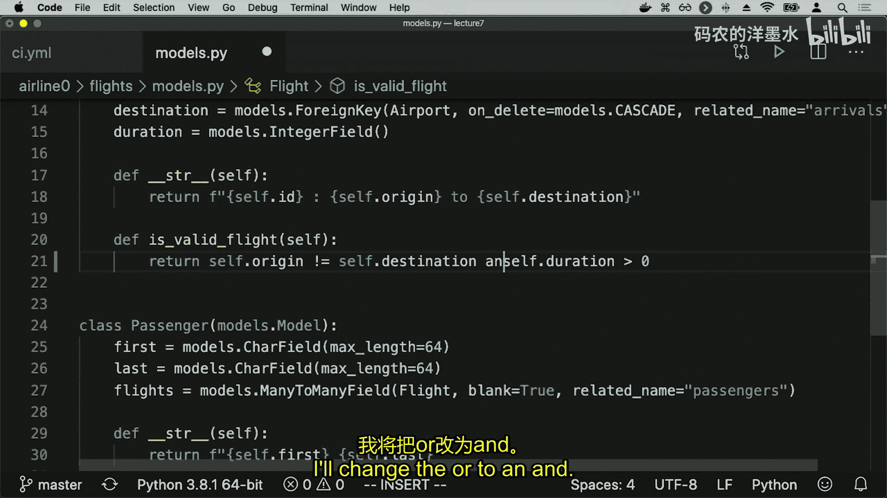

I'll go ahead and get add dot， get commit， say I will fix。A validid flight check。If I do Git status。

 just to check out like what's going on right now， I'm ahead of the master branch by one commit。

 that's exactly what I would expect。 And now I'll go ahead and push my code to Gitthub by running Git pushush。

Saying， all right， let's push this update。 And now hopefully we are going to pass the workflow now。

 Now I go back to the repository。 I refresh the page。

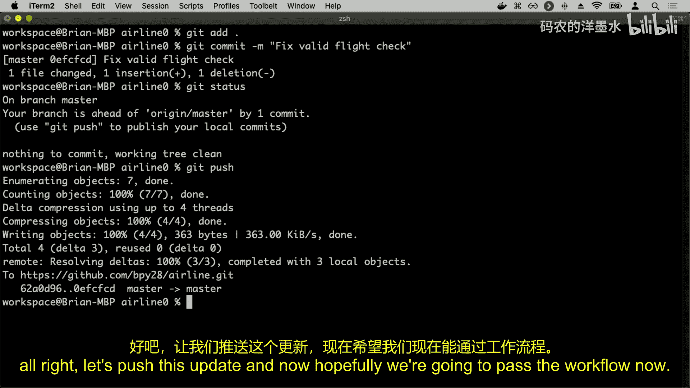

Here's my latest commit fix valid flight check you'll notice here there's an orange dot instead of the redx as before this dot just means the tests are currently pending。

 the workflow is in progress because it takes some time for GiHub to be able to start up the VM to be able to initialize the job to check out my code to run all those tests it does take some time but if I go back to the actions tab I'll see that all right this time for testing we get a green checkmark everything seems to be okay I go to test project just to see it and now I notice the green checkmark next to run Django unit tests means that the unit tests has passed as well if I open those up now I see at the bottom the same output that I saw before when I was running those unit tests on my own machine we ran 10 tests and everything was okay and that tells me that these tests have passed。

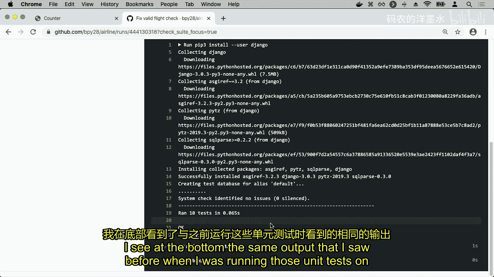

So GiHub actions have the ability to allow for certain jobs to happen。

 certain work to happen anytime you push code， anytime you submit a poll request or on various different actions that might happen on a GitHub repository and they're very helpful for being able to implement this idea of continuous integration because it means you can make sure that when you're merging code from some developer's branch into the main branch that everyone's merging their code into you can verify that those tests can pass。

 and you can add rules to say that you don't want to allow anyone to merge code into the branch if the tests don't pass to guarantee that any code that does get merge is going to pass all of those tests as well and so that can definitely help the development cycle make it easier to ensure that changes can be made quickly but as we make those changes quickly。

 we're not going to lose accuracy and validity within our code that we can make sure that our code still passes those tests by automating the process of running those tests altogether。

So other than continuous integration then we now talk about this idea of continuous delivery。

 these short application cycles where we would like to very quickly be able to deploy our application onto some sort of web server and when we're deploying applications to a web server there are things that we need to think about we need to think about getting our program that was running fine on our computer working on a web server as well and this can just be fraught with headaches and all sorts of configuration problems because you might imagine that the computer that you are using is not necessarily going to be the same as the computer on the cloud。

 the computer in the server where your web application is actually running。

 it might be running a different operating system it might have a different version of Python installed if you have certain packages working on your own computer。

 those same packages might not be installed on the server so we run into all sorts of various different configuration problems where you can be developing。

 deploy your code and realize that it doesn't work on the server because of some sort of difference between what's happening on your computer and what's happening on the server。

😊，becomescomes even more problematic if you're working on a larger team。

 you and multiple other people working on a software project。

 but you each have different versions of various different packages or libraries installed and those different versions have different features and might not all work and cooperate with one another and so we need some way in order to be able to deploy applications efficiently and effectively to be able to standardize on just one version of the environment。

 one version of all these packages to make sure that every developer is working on the project in the same environment and once we deploy the application it's going to be working in the same environment as well and the solution to this comes in a number of possible options but one option is to take advantage of a tool like Docker which is some sort of containerization software and by containerization software we're talking about is the idea that when we're running an application instead of just running it on your computer we're going to run it inside of a container on your computer and each container is going to contain its own configuration。

 It's going to have certain packages。😊，It's going to have certain versions of certain pieces of software。

 it's going to be configured in exactly the same way and by leveraging a tool like Docker。

 you can make sure that so long as you provide the right instructions for how to start up and set up these containers then if you are working on the application and someone you're working with and colgue is also working on the same project so long as you're using the same instructions for how to set up a Docker container you're going to be working in the identical environment that if a package is installed on your computer in your container。

 it's going to be installed in your colleague's container as well and the advantage of this too works with this idea of continuous delivery when you want to deliver and deploy your application to the internet。

 you can run your application inside of that exact same container set up using the exact same set of instructions so that you don't have to worry about the nightmare headaches of trying to make sure that all the right packages and all the right versions are in fact installed on the server。

Docker might remind you of the idea of a virtual machine or a VM if you're familiar with that concept。

 Github uses VMs， for instance， when running its Gitthub actions， they are in fact different。

 A VM is effectively running an entire virtual computer with its own virtual operating system and libraries and application running on top of that all inside of your own computer so a virtual machine ends up taking up a lot of memory taking up a lot of space Docker containers meanwhile。

 are a bit lighter weight， they don't have their own operating system。

 they're all running still on top of the host operating system but there's this Docker layer in between that keeps track of all these various different containers and keeps track of for each container such that every container can have its own separate set of libraries set of binaries and an application running on top of that So the advantage then of containerization is that these containers are lighter weight than having an entire virtual machine but they can still keep their own environment consistent such that you can feel confident that if the application is working。

😊。

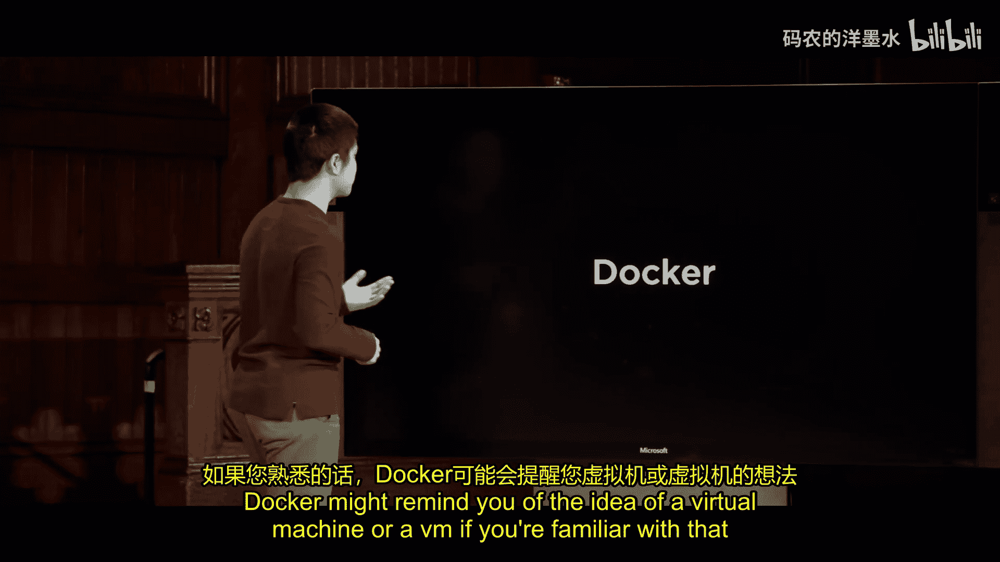

In a Docker container， you can have that Docker container running on your computer on someone else's computer on the server to guarantee that the application is going to work the way that you would actually expect it to and so how exactly do we configure these various different Docker containers Well in order to do so we're going to write what's called a Docker file So do this I'll go ahead and go into airline1。

And I'll open up this Docker file and the Docker file describes the instructions for creating a Docker image where the Docker image represents all of the libraries and other installed items that we might want to have inside of the container and based on that image we're able to create a whole bunch of different containers that are all based on that same image where each container has its own files and can run the web application inside of it。

 so this Docker file， for example， describes how I might create a container that is going to run my Django web application。

😊，So first essay say from Python colon 3， this happens to be another Docker image on which I'm going to base these instructions that this is going to be a Docker image that already contains instructions for installing Python 3。

 installing other related packages that might be helpful oftentimes when you're writing a Docker file。

 you'll base it on some existing Docker file that already exists。

 So here I'm saying go ahead and use Python 3。😡，And now。

 what do I want to do in order to set up this container。Well。

 I want to copy anything in dot in my current directory into the container and have to decide where in the container am I going to store it。

 well I could choose to store it anywhere， but I'll just store it in slash user slash source slash app。

 just some particular path that will take me to a directory where I am going to store the application。

 but you could choose something else entirely。😡，So I copy all of the current files in my current directory。

 so that'll include things like my requirements file， my managed P file， my applications files。

 all my settings files， everything inside of the directory， I would like to copy into the container。

😊，Then I'm saying workD， meaning change my working directory。

 effectively the same thing as something like CD on your terminal to move into some directory。

 I would like to set my working directory equal to that same application directory。

 the application directory inside of the container that now contains all of the files for my application because I copied all of those files into the container。

😡，Now， once I'm inside of this directory， I need to install all of my requirements。

 so assuming I've put all my requirements like D drngo and any other packages that I need inside of a file called Re text。

 I can just run the command。😊，Pip install requirements， dot text。And then finally。

 inside the Docker file。I specify a command and this is the command that should run when I start up the container。

 everything else is going happen initially when we're just setting up this Docker image but when I start up the container and actually want to run my web application。

 here is the command that should run and I provided effectively is like a Python list where each word in the command is separated by a comma where here I'm saying the command that I would like to run when you start up this container is Python managed up Pi run server and here I'm just specifying on what address and what port I would like it to run I'm running it on port 8000 for example。

 but I could choose another port that I would like to run instead。😡。

So what's going to happen then is that when I start up this Docker container， it's going to。

 if it needs to go through these instructions and make sure that it sets up the container。

 according to these instructions， make sure that we've installed all of the necessary requirements make sure that we're using Python 3 and anyone using the same Docker file can generate a container that has all the same configuration on it。

 we don't have to worry about configuration differences between me and someone else who might not have the exact same computer setup that I do。

 And the nice thing about this is that it can run on Mac and Windows and Linux so even people running on different operating systems can still have containers that all have the same configuration that all work in the same way just to speed up that process。

😊，Now so far when we've been building Django applications， we've been using a SQLLite database。

 SQLite database just being a file that is stored inside of our application and this filebased database allows us to create tables。

 insert rows into it delete rows from it in most production environments and most real web applications that are working with many。

 many users， SQLL is not actually the database that is used it doesn't scale nearly as well when there are many users all trying to access it concurrently oftentimes in those sorts of situations you want your database hosted elsewhere on some separate server to be able to handle its own incoming requests and connections and we talked about a couple of possible databases we could use instead of SQLite。

 things like MySQL things like Postgres or various different SQLbased databases。

So imagine now I want to deploy my application， but instead of using SQL light。

 I would like to use Postgres， for example as the database server that I would like to run。

 Well that would seem to be pretty complicated for me to test on my own because now in addition to running my web application in one server effectively I also need like another server that's running Postgres for example。

 such that I can communicate with that Postgres database instead and that's going to be even harder for like other people to be able to work on as well。

 potentially it might be difficult to get the server to work in that way too but the nice thing about Docker is that I can run each of these processes in a different container effectively。

 I can have one container that's running my web application using this Docker file right here and I can have another container that's just going to run Postgres and as long as other people also have access to that same container for running Postgres they can be working in an identical environment to the one that I am working in as well and so there's also a feature of Docker known as Docker compose。

😊，And what Docker Compose lets us do is allow us to compose multiple different services together that I would like to run my web application in one container and I would like to run a Postgres database in another container。

 but I would like for those containers to be able to talk to each other to be able to work together whenever I start up the application。

😡，So if I'd like to do that in order to run this application on my computer and have both the web application and Postgres installed。

 I can create a Docker compose file， which looks like this here I'm specifying using version 3 of Docker composeose。

😊，Here I specify， again， using a Yaml file， much as in my GiHub workflows were formated in Yaml just as a configuration file。

 Dockercompposed YML is a Yal file that describes all of the various different services that I want to be part of my application where each service is going to be its own container that could be based on a different Docker image。

Here I'm saying that I have two services， one called DB for database。

 one called web for my web application， The database is going to be based on the Postgres Docker image。

 image that Postgres wrote that I don't have to worry about someone else has written the Docker file for how to start up a Postgres container。

Here though， for the web application， that's going to be built based on the Docker file in my current directory。

 the Docker file that I have written。😡，And then down below。

 I've just specified that my current directory should correspond to the app directory。

 and then I've specified when I'm running this on my own computer， I would like port 8。

000 on the container to correspond to port 8000 on my own computer just so that I can access port 8000 in my browser and access port 8000 inside the container it just lets my computer and actually talk to the container so I can open up the web application in my web browser。

 for example， and actually see the results of all of this。😊，So here then I've created two services。

 a database and web。 So now let's actually try starting up these containers。

 I'm going to first go into my airline1 directory， and I'm going to say Docker compose up to mean。

 go ahead and start up these services。 I'll press return。

 And what you'll see is we're going ahead and starting up two services。

 I'm starting up the database service。 And I'm starting up the web service。😊。

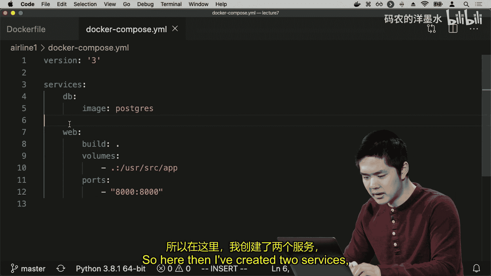

And now as a result of all of this， I've started up the application and I started it on port 8，000。

 so if I go to 0。0。 0。0， slash 8000 or colon 8000 slash flights。😊。

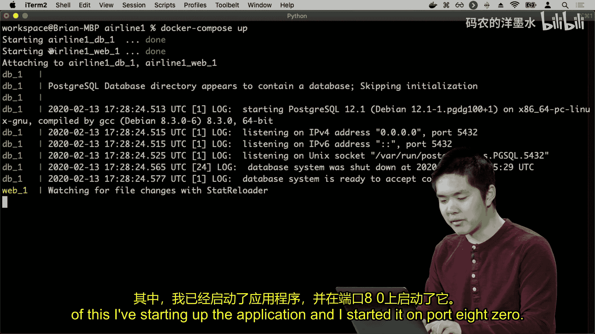

That's going to take me to the flights page。 And now this is running not just on my own computer。

 but inside of a Docker container。 Now， of course， right now。

 there are no flights inside of this page because I haven't actually added anything to the database yet。

 So I could do that if I wanted to。 But how do I do that。 Well。

 I needed to like go into slash admin to say， like let me log in and go ahead and create some sample flights。

 but I don't have a login yet because I need to like create a super user account。

 And I can't just like inside of my airline 1 directory， say Python managed pi。

 create super userer the way that I used to because this is running in my terminal on my computer。

 whereas what I really want to do is go into the Docker container and run this command there inside of the container。

 So how can I do that。 Well， there are various different Docker commands that I can use Docker P will show me all of the Docker containers that are currently running。

 So go and shrink this down a little bit。 I see two rows one for each container。

 One for my Postgres container that's running the。😊。

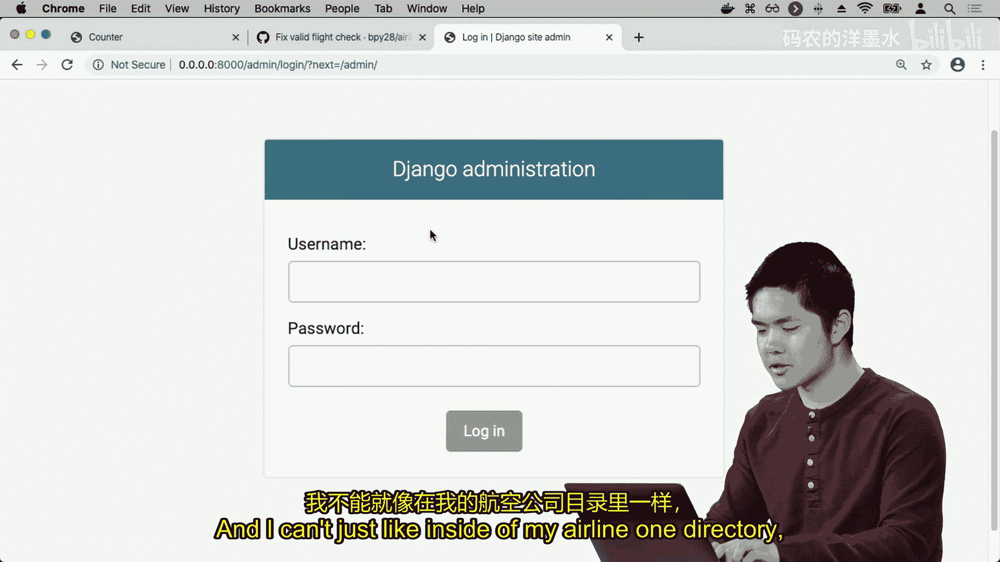

Inbase， one for just my web application that's running as well。Each one has a container I。

 so I want to go into my web application container in order to run some commands inside of that container。

 So I'm going to copy its container ID and say Docker exactec。

 meaning go ahead and execute a command on the container。 D I will make this interactive。

 here is the container I that I would like to execute a command on and the command I want to execute is bash passing the dash L flag。

 but bash to say I want to run a bash prompt。 I want to be able to interact with a shell so that I can run commands inside of this container。

So， I press return。And now what you'll notice is that I am inside of my container in the user source app directory。

 that directory that contained all the information about this web application。 I type L S。

 and what I'll see is here all the files inside of this container now。

 And now I can say something like Python managed up Pi create superuser。😊。

And now it's gonna let me create a super user。 So I'll create a user inside of my Web application called Brian。

 I'll give it my email address。 I'll type in a password。And now we've created a super user。

And you can run other commands here if you wanted to migrate all of your migrations。

 I could say Python managed up I migrate， it turns out I've already done that so I didn't actually have to do it again。

 but you can run any commands that you could run on on your computer。

 but now you can run them inside of the Docker container instead I'm can press C D just to log out。

 get out of the container and get back to my computer。😊。

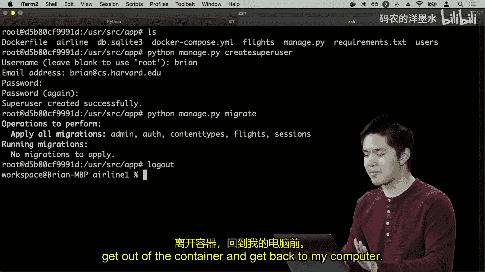

But now I've created a super user so I could go ahead and sign in to Jns admin。

 and now I can begin to manipulate this database， which is a Postgres database running in a separate container。

 But the nice thing about it is that I can start them both up together just by running something like Docker composeose up。

 for example。😊。

So Docker can be quite a powerful tool for allowing us to very quickly ensure that an application is running in the environment that we expect it to be running。

 to make sure that all the right libraries are installed。

 make sure that all the right packages are installed as well。

 that the configuration between my development environment and the environment that's running on the server are the same as well。

😊，So those then were just some of the best practices for how you can go about developing a program now that we have the tools to do so we have a lot of tools for being able to develop these web applications。

 but as our programs start to get more complex， it'll be increasingly important to test them。

 make sure that each various different component of our web application behaves the way that it is expected to behave and then taking advantage especially in bigger teams of CicCD continuous integration continuous delivery to make incremental changes and make sure each of those incremental changes in fact works on the web application and then Cd continuous delivery to say that rather than wait and then deploy everything all at once。

 let's deploy things incrementally as well， let users more quickly get access to the latest features and more quickly find out if something went wrong。

 we can better identify what it is that went wrong if we've deployed things incrementally rather than waiting a long time in order to do so as well so these are some of the best practices in modern software application development。

 not only for web applications but for software more generally。

Next time we'll consider other challenges that might arise as we go about trying to make web applications that are used by more and more users in particular。

 taking a look at challenges that will arise in terms of scalability as our programs get bigger and also security of what security vulnerabilities open themselves up as we begin to design our web applications using Python and JavaScript。

 so more on that next time and we'll see you then。