# 【全集】哈佛大学 web应用开发 9小时速成 中英字幕 附完整课件 p10 Lecture 8 - 可扩展性和安全性 -BV1RYUsB2Ejz_p10-

🎼。

Al right， welcome back， everyone to Web programming with Python and jascript。

 And for our final topic， we're going to explore scalability and security。 So so far in the class。

 we've been building web applications and we've been building web applications that work on our own computer。

 But if we want to take those web applications and deploy them to the world。

 So people all across the Internet can begin to use them。

 then we're going to need to host our web application on some sort of web server。

 some dedicated piece of hardware that is listening for web requests and responding to them with the response that we would like for our web application to deliver。

 And when we do so， this introduces a whole bunch of interesting issues surrounding scalability and security。

 So we'll take a look at these issues today， beginning with problems concerning scalability。

 what those problems are and how we might go about addressing them。😊。

So when we deploy our web applications， we deploy them by putting them onto a web server that I'm here just representing with this rectangle。

 But all the server is is some dedicated computer， some piece of hardware that is listening for incoming requests。

 So we'll draw this line to represent an incoming web request from a user。

 The server takes that request and responds to it。But ultimately。

 our web application isn't just going to be servicing one user。 If it becomes popular。

 It might have many users that are all trying to connect to that server at the same time。

 And as multiple people start to connect to that server at the same time。

 Heres where we start to deal with issues of scalability。

 A single computer or single server can only serve as so many users at any given time。

 And so therefore， we need to think in advance about how we're going to deal with those issues of scale。

 But the first question， before we even get there is where these servers actually exist。

 And nowadays， there are two main options for where these servers can exist。

 These server series can be on the cloud or they can be on premisemise and on premiseise servers。

 you might imagine as if a company is running their own web application on premise servers or servers that are inside of the company's walls。

 The company owns the physical servers maybe on some server racks inside of a room。 and therefore。

 they have very direct control over all of those servers， exactly what kind of servers they are。

 exactly what software is running on them， they can go and physically look at the server。😊。

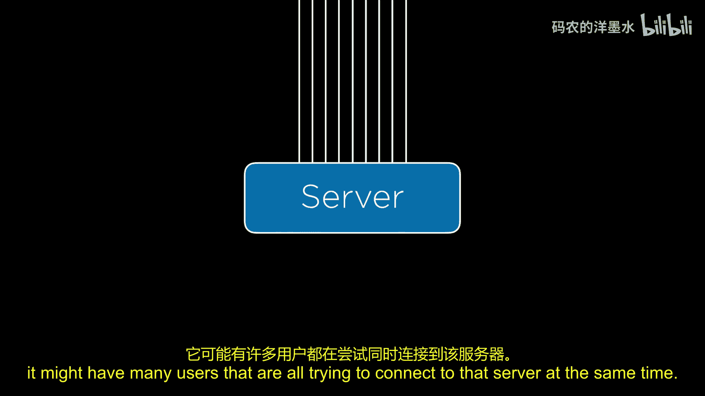

And debug them if need be， in order to make sure that any issues are're dealt with。But increasingly。

 we're starting to move into a world where cloud computing is becoming increasingly popular。

 We're in cloud computing， rather than have dedicated servers that are on premise。

 We have servers that are somewhere in the cloud where cloud computing companies like Amazon or Google or Microsoft are able to run their own servers。

 And we simply use those servers that are provided by those third parties。

's Amazon or Google or Microsoft or someone else。 And there are tradeoffs here。 with cloud computing。

 we no longer have as direct control over the machines themselves because they not on premise。

 We can't physically manipulate those computers。 but we have the advantage of not having to worry about dealing with physical objects that are inside of the premise of the company whose servers we'd like to run code for went on the cloud。

 Everything is managed externally by some other company。

 And we can simply use the servers that we need to。

 And we'll see that this lends itself to other benefits as well。

 as we might need more servers as we start to get more sophisticated web applications that need more users。

 These cloud computing companies can allow us to create web。😊。

Os that are able to scale across multiple different servers as we start to get more and more users。😊。

But we'll discuss those issues of scale as we get to them。

 The question we need to ask after we have these servers。

 whether there's servers that are on premiseise or servers that are operating somewhere in the cloud is how many can those users can the server actually service at any given time。

 And that's going to vary It's going to vary based on the size of the server。

 the computing power of the server， and it's going to be dependent upon how how long it takes to process any particular users' request if user requests are quite expensive。

 It might mean that there are fewer users that can be serviced at any given time。

 And it's for that reason that a helpful tool is to do some kind of benchmarking。

 some process of trying to do some analysis on how many users a server can actually be handling at any particular time。

 And there are numerous different tools that allow us to do this kind of benchmarking Apache bench or otherwise known as A B is a popular tool for doing this kind of thing。

 But benchmarking is going to be useful so that we know how many users。

 one particular server can handle。 maybe it can handle 50 users， maybe。😊，And handle 100 users。

 Maybe it can handle more at any given time。 But ultimately， it's going to be some finite limit。

 Every computer just has some finite amount of resources and servers are no exception。

 There's going to be some number of users after which the server is not going to be able to handle it。

 So what do we do in that situation。 What do we do if our server can only handle 100 users at any given time。

 But 101 users are trying to use our web application at the same time。 something needs to change。

 We need to deal with some sort of scaling to make sure that our web application can scale。

And there are a couple of different types of scaling that we can try。

 One approach is to do what's called vertical scaling。

 which might be the simplest way you could imagine scaling。

 If this server is not good enough for handling the number of users that we need it to handle。

 will then just get a bigger server in vertical scaling。

 we just take the server and get a bigger server， a more powerful server。

 a server that can handle more users at any given time。 It's going to cost more。

 But if we need it to handle more users we can just get a bigger server to be able to deal with that problem。

 This approach is fairly simple， it just involves swapping out one server for another。

 One that can handle more users can currently。 but it also has drawbacks。 right。

 There's some limit to how big the server can be to how many users。

 any physical one server is going to be able to handle。

 because there's a physical limitation on what is the biggest， fastest。

 most powerful server we could possibly get。😊，So when vertical scaling ends up not being enough。

 an alternative， as you might imagine， is what's known as horizontal scaling。

 And the idea behind horizontal scaling is that when one server isn't enough to be able to service all of the users that might be trying to use a web application at the same time。

 Well， then we can take the approach of saying， well， rather than just using one server。

 let's go ahead and split it up into two different servers。

 We now have two servers that are both running the web application。 And now， effectively。

 we've been able to double the number of users that this web application can handle rather than just a single server that can serve as 100 users。

 if we have two of them， now we can service 200 users at any given time。

 if you imagine 100 of them using server A over here and 100 of them using server B over there。😊。

But this then lends itself to some other questions that we have to answer。

 which is how do these servers get their users in the first place。

 Like when a user request a web page， how does that user get directed either to server A or to server B。

 It seems that they need some way to make that decision in order to decide whether to go one direction or another。

 And it's for that reason that we might introduce another piece of hardware into this picture。

 And that additional piece of hardware is what we might call a load balancer and a load balancer is just another piece of hardware that is going to sit in front of these server。

 so to speak。 In other words， when a user makes a request to a web page rather than immediately getting that request to one of these web servers。

 the request is first going to go through this load balancer where the request first comes into the load balancer and the load balancer then decides whether to send that request to server A or to send that request to server B。

😊，And this process is likely less expensive than actually dealing with and processing that request。

 So the load balancer is effectively just acting as a dispatcher。

 It waits for those requests to come in。 And when the request do come in。

 the load balancer directs those request either to go to one server or to another。

 And you might imagine a story where we have more than just two servers。

 Maybe we have many servers and the load balancer is just going to balance between all of those different servers。

 And this process of deciding which server to send a request to is known as load balancing。

 which is what the load balancer is ultimately doing。

 And there are various different methods that you might use in order to perform this load balancing。

 So you might imagine thinking about this intuitively， how would the load balancer decide。

 given some request， should we send the request to this router to this server or should we send the request to some other server instead。

😊，And there are many different approaches that our load balancer might take。

 And here are just a couple。 random choice might be the simplest of options。

 given a user that shows up and tries to make a request to our web server。

 The load balancer first takes a look at the user and just randomly assigns them to one of the various different servers that might be processing that request。

 if there are 10 different servers。 It randomly chooses among those 10 servers to decide which of them is going to be servicing that request。

 This has the advantage of being very simple。 It's just a quick calculation。

 The computers can pretty readily generate random numbers。 And based on that random number。

 The computer can dispatch the user to one server or to another server。😊。

But it might not be the best option because if we happen to get unlucky。

 we might end up with many more users on one server than another。

 or in we might end up with servers that are entirely unused。

 if it just so happens that we don't end up randomly selecting that server。 Now。

 in practice with many users that are all using this load balance that are all being dispatched odds are high that eventually all of them will be used。

 but it might not be a totally even distribution。 And so for that reason。

 another approach you might take is a round roin approach where the approach instead。

 for the very first user， go ahead and assign that user to server number one。

 for the next user assign them to server number2， and maybe if they are five servers。

 you say the third user goes to server 3， user 4 goes to server 4， user 5 goes to server5。

 And then user 6 goes back to server number one， you basically rotate going one through 5。

 And then once you've assigned someone to each of the servers， you go back to the beginning。

This is also a relatively easy thing to implement because you can simply just keep count somewhere in the load balancer。

 saying what was the most recent server that I assigned a user to。

 And the next time a request comes in， go ahead and assign it to the next server and the next server after that。

 effectively is doing a round roin style approach where you go through all the servers once before going through the servers again。

😊，Now， this might seem better than random choice in the sense that it's going to more equitably decide whether to assign any particular request to any particular server。

 but it also suffers from certain problems that round Robin might be great。

 But if some requests take longer than other requests， we might also get unlucky。

 and the requests that are taking longer might end up all going to one of the servers as opposed to another server。

 So there are other approaches that we might want to go to as well。 For example。

 something like fewest connections where the approach there is to say。

 go ahead and when a user makes a request。The load balancer should pick which of the servers currently has the fewest connections。

 the fewest active connections from other users and other requests that are currently connected to those servers instead。

 And by choosing the server that happens to have the fewest connections。

 you're probably going to do a better job of trying to balance out between all of the various different requests that might be happening inside of your Web application。

😊，And while this might do a better job， there are trade offs here as well。

 that it might be more expensive， for example， to compute which of the servers happens to have the fewest number of connections。

 whereas it's much easier just to say， choose a server at random or to do the round Robin style approach of just 1。

2，3，4，5，1，2，3，4，5 again and again and again。But all of these approaches naively。

 have yet another problem， which has to do with sessions。

 And you recall that sessions we used whenever we wanted to store information about the user's current interaction with the web application。

 When you log into a website like you log into your email or you log into Amazon， for example。

 and then you come back to that website or visit another page on that website。

 making another request， For example， It's not the case that you have to sign in yet again。

 that the web browser is totally forgotten who you are。

 when I go back to my mail account or when I go back to Amazon for a second time。

 my mail account or Amazon remembers me from the last time that I visited。

 I have some sort of session where it's keeping track of who is logged in。

 maybe information about what I've been doing on the page and allows me to continue interacting with the web application。

 even if I'm making multiple requests。And this， you might imagine。

 could be a problem for this type of load balancing that if I have multiple different servers。

 Imagine if I try to log into a website and the first time I make a request。

 I'm directed to server number one。 and I'm now logged in on server number one。

 But then I make another request， I'm directed back to the load balancer and maybe the load balancer this time decides to send me to server number two。

 But if the session is stored in server number one somewhere。

 server number one remembers who I am and what I'm doing。

 server number two is not going to know who I am。 And therefore。

 it's not going to remember that I've already logged in to this web application。 And as a result。

 I might be prompted to log in again。 And if I go make another request。

 and I end up on yet another server， I might be logged out again and have to log in for a third time。

 So the problem comes about when our load balancing happens。

 but we're not doing so in a session aware way that our load balancer isn't caring about when a user visits the page and then visits another page on the same web application。

😊，Again， because we want to remember information from the previous time that the user was here。

So how can we solve this problem， How can we make sure that when we do this load balancing across multiple different servers that we do so in a session aware way。

 Well， there are multiple different approaches to session aware load balancing。

 One approach is this general idea known as sticky sessions where the idea is that when I come back to the load balancer。

 the load balancer will remember what server I was sent to last time and send me there yet again。

So for example， if I log into a website once and I'm directed to server number two， for example。

 then the next time I visit this web application， even if I should be directed to server 3 or4。

 according to random choice or according to fewest connections or any of these other load balancing methods。

 the load balancer should remember that last time I came to this site。

 I got directed to server number two。 And so this time the load balancer is going to direct me to server number two yet again。

 that way， server number two， which contains information about my session is going to see me again and remember who it is that I am and it's not going to make me log in again into the exact same website for a second time。

 For example。And so sticky sessions are one way of dealing with this problem。 But again。

 with all of these approaches。 And this will be a recurring theme as we talk about scalability and security。

 there are trade offs here that are trade off to the sticky sessions is that it's possible that one of these servers is going to end up getting far more load than another if one server happens to have a lot of users that keep coming back to the website and keep requesting additional pages。

 but other pages other servers might have had users that decided not to come back， for example。

 And so there's a difference in utilization， where some of our servers might be more heavily utilized than other servers and we're not doing a very good job of balancing between them。

😊，And so one approach is to store sessions inside of the database rather than store information about sessions inside of the server themselves so that if I get directed to another server。

 that other server doesn't remember who I am doesn't remember information about my interaction with this website。

 if we instead choose to store sessions inside of a database。 And in particular。

 inside of a database that all of the servers have the ability to access。 Well。

 then it doesn't matter which of the servers I get directed to and which server。

 the load balancer decides to send me to， because regardless of which server I end up getting sent to。

 the session information is in the database and each of the servers can connect to the database to find out who I am to find out whether I've logged into the site already and therefore is able to recognize me。

And so that might be one approach as well。 Another approach is to store sessions on the client side。

 We've talked a little bit about this idea of cookies。

 which can be stored where the web browser can set a cookie so that your web browser is able to present that cookie。

 the next time it makes a request to the same web application。 And inside this cookie。

 you can store a whole bunch of information， including information about the session。

 you might inside of a cookie store information about what user is currently logged in。 for example。

 or other session related information。 But here too， there are drawbacks。 if you're not careful。

 someone could manipulate that cookie and maybe pretend to be something else。 And so for that reason。

 you might want to do some encryption or some kind of signing to make sure that you can't fake a cookie and pretend to be someone that you're not。

😊，But another concern is that as you start to store more and more information inside of these cookies。

 these cookies keep getting sending back and forth between the server and the client every time a request is made。

 that can start to get expensive， too more and more information passing back and forth between the client and between the server。

So lots of possible approaches， no one approach that is necessarily the right approach or the best approach to use in any cases。

 but things to be aware of， things to think about as we begin to deal with these issues of scale of making sure we have multiple servers that are available for usage in case we do need it。

 but also making sure that when we do so， we don't break the user experience。

 We don't result in a situation where a user is logged in， but then suddenly isn't logged in at all。

And so horizontal scaling gives us this kind of capacity。

 the ability to have multiple different servers， all of which can be dealing with user requests and responding to those user requests as well。

But a reasonable question to ask is， how many of those servers do we need？Now。

 we can use benchmarking to try to estimate this。 if we have an estimate of how many users are going to be on our website at any given time。

 we can benchmark and see how many users can be handled by a single server and extrapolate based on that information to infer how many servers we might need in our web application to be able to service all of these different users。

 but it might be the case that our web application doesn't always have the same number of users。

 Maybe sometimes there are going be far more users than another time。 you might imagine， for example。

 that in a news organization's website， like the Web application for a newspaper。

When there's breaking news， some big story， there's going to be a lot more people that are all tried to access the website at the same time than at other times。

 So one approach might be like consider the maximum。

 What is the most number of users that ever might be trying to use our web application at any given time and choose a number of servers based on that maximum so that no matter how high the number of users get。

 we will have enough servers to be able to service all of those users。

 But that's probably not a great economical choice。

 if in the vast majority of cases there will be far fewer users， In that case。

 you're gonna have a lot of sew servers that are underutilized。

 where you don't need that many servers， but you're still paying for the electricity for keeping all of them running。

 which might not be an ideal choice either。So one solution to this， quite popular。

 especially in this world of cloud computing， is the idea of auto scaling。

Or you can have an auto scaler to say that， you know what， let's start with， for example。

 two servers。But if there's enough traffic to the website。

 if enough people are making requests to the website。

 maybe it's a peak time where people are using the website， go ahead and scale up。

 go ahead and add a third server， where now our load balancer can balance between all three of those servers。

 And if even more traffic ends up coming to the website。

 more users are trying to use this application all at the same time。 Well。

 then we can go ahead and add a fourth server as well。 And we can continue to do that。

 Most autoscalers will let you configure， for example。

 a minimum number of servers and a maximum number of servers and dependent on how many users happen to be using your web application at any given time。

The auto scalealr can scale up or scale down， adding new servers as more users come to the website。

 removing servers as fewer users are using the website as well。

And so this can be a nice solution to this problem of scale where you don't have to worry about how many servers there are。

 It's just autoscales entirely on its own。 Now， there are trade offs here， too。

 that this auto scaling process might take time。 And if a lot of users all come into your website all at the exact same time。

 Well， it's going to take some time。To be able to add all these additional servers to start them up。

 And so there might be some trade offs there， too。Where you might not be able to service all of those users immediately。

 And another problem worth thinking about is as you add more and more of these servers。

 you introduce opportunities for failure。 Now， it's better than having a single server。

 where if that single server fails。 Now， suddenly， the entire web application doesn't work at all。

 That's what we generally call a single point of failure， a single place where if it fails。

 the entire system is going to be broken。 One advantage of having multiple servers is that we no longer have a single server that acts as a point of failure。

 If one of the servers goes down， than ideally， our load balancer should be able to know based on that information。

To no longer send a request to that particular server to instead balance the load across the remaining three servers instead。

Now， there's an interesting question there as well， which is。

 how does the load balancer know that this server is no longer responding that for some reason。

 it have some sort of error that it's not able to process requests appropriately。 Well。

 there are multiple ways you can do this。 But one of the most common is what's simply known as a heartbeat。

 or effectively， every so often， every sum number of seconds。

 The load balancer pings all of the servers just sends a quick request to all of the servers。

 and all of the servers are supposed to respond back and using that information。

The load balancer knows a little bit about the latency of each of the servers。

 how long it took for the server to respond to the request。 But also。

 it can get information about whether or not the server is functioning properly。

 that if one of the servers doesn't respond to the ping。

 will then the load balancer knows that there's probably something wrong with the server that we probably shouldn't be directing more users to that server at all。

And so this can solve for the problem of a single point of failure by allowing ourselves multiple servers。

 where if any one of the servers fails， the load balancer learns about that via heartbeat。

 And then based on that information， can begin to redirect traffic to the other servers instead。Now。

 one thing you might notice is that even in this picture。

 now the load balancer appears to be like a single point of failure。

 where if the load balancer happens to fail， well now nothing is going to work because the load balancer is the one responsible for directing traffic to all of these various different servers。

 And so even there there is no single server that is a point of failure。

 This load balancer also appears to be a single point of failure。 And that's definitely true。

 And you might imagine instead having multiple load balancers， where if one load balancer goes down。

 another load balancer can swoop in， acting as a hot spare where it picks up all of the traffic that was originally going to the first load balancer。

 And if it ever goes down， a second one is ready to take its place。😊。

And it might also be doing this kind of heartbeat process checking up on the first load balancer。

 And if all as well， the second load balancer doesn't have to do anything。

 But if the first load balancer ever were to fail， well then the second load balancer can step in and begin servicing those requests directing them to all of these individual servers as well。

 And so there another opportunity to think about where the single points of failure are and thinking about how we might address those single points of failure in order to make sure that our web applications are scalable。

 So that then deals with issues about how we might go about scaling up these servers。

 But ultimately the servers are not the entirety of the story that inside of our applications。

 we mostly writing web applications that interact and deal with data in some way。

 And there are multiple different databases that we've talked about。

 SQL light has been the default one that Jinggo provides to us。

 which just stores data inside of a file。 But as we begin to grow our applications we want to begin to scale them。

 It's quite popular and quite common to put databases entirely somewhere separate to have a separate database server running somewhere else。

😊，the servers are all communicating with that database。

 whether it's running Mysql or Postgres or some other database system instead。

 And all of the servers then have access to that database。 And so there， too， are。

 are considerations that we need to take into account issues of how it is that we go about scaling up these databases。

😊。

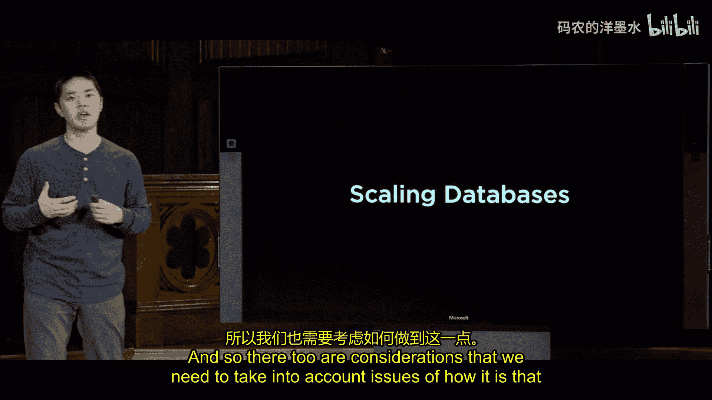

That in this picture， for example， you might imagine a load balancer that is communicating with two servers。

 but both of those servers， for example， need to be communicating with this database。

 and much like any server can only handle some number of requests。

 some number of users at any given time。 Datas， too。

 can only handle some number of requests some concurrent number of connections at any given time。

 And so we need to begin to think about issues of how it is that we scale these databases as well in order to be able to handle more and more users。

😊。

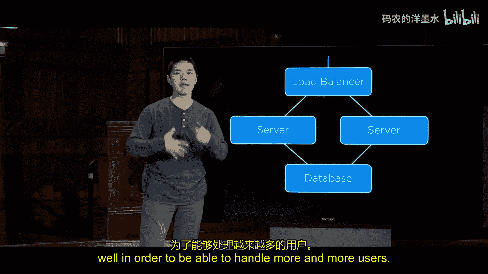

Now， one approach， the first thing we might try to do is something called database partitioning。

 effectively splitting up what is a big data into multiple different parts to that data。

 And we've already seen some examples of database partitioning。 We've seen one example， where。

 for example， when we talked about SQL， we looked at a table of flights where each flight had an origin city。

 the origin city's airport code， the destination city， the destination city。

 airport code and some number of minutes， the duration for that particular flight。😊。

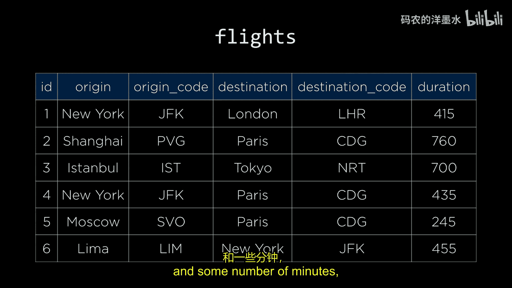

And we decided that storing all of this data in a single table probably wasn't the best idea。

 And instead， we wanted to split that data up in a type of partitioning。 where instead we said。

 all right， let's just have one table that will have all of the airports。

 And so each airport gets its own row inside of this airport's table。 And we also had another table。

 which was just the flights table， which rather than storing all of those columns just mapped two airports to each other with any given flight It has an origin I D。

 meaning which object， which row in the origin of airports table is represented by the flight and then which row in the airports table is going to represent the destination for that flight。

😊，So we took one table and effectively split it up into multiple tables。

 each of which ultimately had fewer columns。 And this might be something we call the vertical partitioning of a database where instead of just having single big long tables。

 we split them up into multiple tables， each of which have fewer columns that are able to represent data in a more relational way。

 And that's something we've seen before too。 But in addition to vertical partitioning。

 we can also do horizontal partitioning。 where the idea there。

 is that we take a table and just split it up into multiple tables that are all storing effectively the same data。

 but split up into different data sets。 So the same type of data but just in different tables where we might have originally had a flights table And instead we split it up into a domestic flights table and in international flights table。

 Each of these tables still has the exact same columns。 They still have a destination column。

 they still have an origin column， They still have a duration column， for example。

 But we've just now taken the data that used to be in one table and split up that data。😊。

Into two or more multiple different tableism instead， one for all the domestic flights。

 one for all the international flights。And the advantage there is that we no longer need to search through the entirety of the data。

 if we're just looking for one domestic flight， for example。

 if you know the flight you're looking for is a domestic flight， well。

 then it can be more efficient to just search the flight's domestic table and not bother searching through the flight's international table。

 And so if we're intelligent about how we choose to take a table and split it up into multiple different tables。

 The effect of that is that we can often improve the efficiency of our searches。

 the efficiency of our operations because we're dealing with multiple smaller tables where these operations can come faster。

One drawback， though， is that as we begin to split data across multiple different tables。

 it becomes more expensive if ever we need to join this data back together and connect all the domestic and international flights。

 running separate queries on each。 And so in that case。

 we'll want to think about trying to separate our data in such a way that generally we're only going to need to deal with one table or the other at any given time。

 And so domestic and international might be a reasonable way to split up our flights table because maybe most of the time。

 our airport just cares about searching domestic flights。

 If we're know we're looking for one kind of flight or just cares about searching for international flights if there are different people or different computers that are going to handle each of those different types of systems。

And so partitioning our database can sometimes help with issues of scale by making it faster to search through large amounts of data and being able to represent data a little bit more cleanly。

 But it still seems to represent a single point of failure that we have multiple servers now that are all connected to the same database and there again is a single point of failure。

 If the database fails for some reason， well， now suddenly none of our web application is going to work because all of those servers are all connected to that exact same database。

 And so it's for that reason that we might， just as we tried to add more servers in order to solve the problem of a single point of failure with our servers。

 We might also try database replication that rather than just have a single database in our web application in order to guard against potential failure。

 we might replicate our database have multiple different databases and therefore。😊。

Reduce the likelihood that our application entirely fails。

 And there are a couple of approaches we can use for database replication。

 Two of the most common are what are known as single primary replication and multiprimary replication。

 And in single primary database replication。 we have multiple different databases。

 But one of those databases is considered to be the primary database。

 And what we mean by a primary database is a database to which we can both read data。

 meaning like select rows from the table。 But also write data。

 meaning insert rows or update rows or delete rows to any of those tables。😊。

So in single primary replication， we have a single database where we can both read and write。

 and we have some number of other databases， in this case。

 two other databases from which we can only read data so we can get data from those databases。

 but we can't update or insert or delete from those databases。

And now we need some mechanism to make sure that all of these databases are kept in sync。

 And ultimately， what that means is that any time the database changes。

 all of the databases are informed。 Now， the only database that can change is our primary one。

 This is the only one that can be written to the only one that allows for the data to change。

 the others are read only。 So any time this primary database updates or changes in some way。

 It needs to inform the other databases of that update。

And so it informs the other databases of that update。

 And now all of the databases are kept in sync where if you try and run a query on any of these databases to select and get some information。

 you'll get the same results from all of these various different databases。 Now。

 the single primary approach has some drawbacks。 It has the drawback of only one of these databases can be written to。

 So if you have a lot of users that are all trying to write data to the database at the exact same time。

Well， there might be some issues here where this one database is going to be carrying all of that load for all of the people that might be trying to update and change that database。

 And it also has a slightly smaller version of the same problem of a single point of failure。

 There' is no longer a single point of failure for reading from that data that if you want to read from the data and one of the databases goes out。

 you can read data from any of the other databases and the' work just fine。

 but it does have the drawback that if this database fails if our primary database fails。

 Well then we're no longer able to write data that if we want to update data inside of our database。

 this one database is no longer gonna be operational and none of the other databases are going to allow us to write new changes。

So there are a couple of approaches we can use to try to solve this problem。 One approach， though。

 is instead of having a single primary database， a single database to which we can read and write to use a multiprimary approach。

 And in the multiprimary approach， we have multiple databases， all of which we can read and write to。

 We can select rows from all the databases and we can insert and update and delete rows to all of these databases as well。

 But now the synchronization process becomes a little bit trickier。

 And here now is the tradeoff that now we've replicated the number of reads and write we can do by having many databases to which we can read data and write data。

 But anytime any of these databases changes， every database needs to inform all of the other databases of those updates。

😊，And that's certainly going to take some amount of time。

 It introduces some complexity into our system as well。

 And it also introduces the possibility for conflicts that you might imagine situations where if two people are editing similar data at the same time。

 that you might run into a number of different types of conflicts。 So one type of conflict。

 for example， would be an update conflict。 If I try to edit one row in one database and someone else tries to edit the same row in another database when they sync up with each other via this update process。

 our database system needs some way to decide how it's going to resolve those various different updates。

😊，Another conflict might be a uniqueness conflict。 We've seen in the case of databases in SQL that when we're designing our tables。

 I can specify that this particular field should be a unique field， common one being the I field。

 for example， where every single row， is going to have its own unique Id。 Well。

 what happens if two people try to insert data at the same time， into two different databases。

 theyre each given a unique Id， but it's the same Id on both of the databases because neither database knows that the other databases added a new row yet。

 So when they sync back up， we might run into uniqueness conflict。

 where two different databases have assigned the same exact I to multiple different entries。

 And so we need some way to be able to resolve those conflicts as well。

 And there are many other conflicts that you might imagine trying to deal with。 one example， being。

 for instance， delete conflicts where one person tries to delete a row and another person tries to update that row。

 Well， which should take precedence， should we update the row should we delete the row。

 we need some way。😊，To be able to make those decisions。

 because there is some latency between when a change is made to a database and when that database is able to communicate with another database。

 So these issues of scale， these issues of synchronization are always going to come up as we start to deal with programs that are interacting with more and more of this kind of data。

 And as a result， we need to design more and more sophisticated systems that are able to deal with those issues of scale。

Now， ultimately， we'd ideally like to reduce the number of different of these database servers that we have that every additional database server is going to cost time。

 It's going to cost resources that cost money in terms of keeping all of these servers running。

 And so ideally， we'd like not to have to talk to this database。 if we don't need to。

 So you might imagine， for example， a news organization's website。

 something like the front page of the New York Times。

 If you go to the home page of the New York Times website。

 It displays all of today headlines with images and with information about what each of the stories are about。

 for example， And you might imagine that the way they're doing something like this。😊。

Is that they have some kind of database that's storing all of these news articles And when you visit the front page of the New York Times。

 it's going to do some kind of database query， selecting all of the recent top headlines。

 for example， and rendering all of that information in an HM L page that you can see。

And that would certainly work。 But if a lot of people are all requesting the front page at the same time。

Well， it probably doesn't make all that much sense if the Web application every time is making a database query。

 getting the latest articles。And then displaying that information to all of the users because the articles might not be changing all that frequently。

 If one person makes a request one second and another person makes the same request half a second later。

 it probably is not going to be useful to re request all the information from the database。

 regenerate that template yet again， because it's an expensive process of requesting data from the database of generating that template。

 ideally like some way of dealing with that problem。

 And the way we can deal with that problem is some form of caching。

 and caching refers to a whole bunch of different types of ideas and tools that we can use at various different places inside of our system。

 but in general， when we're talking about caching， we're talking about storing a saved version of some information in a way that we can access it more quickly so that we don't need to continue making request to a database。

 for example。 And so there are a number of ways we can do caching。

 One way we can do caching is on the client side via client side caching where the idea is that your browser。

 whether it's Safari or。Or something else is able to cache data。

 store information so that the browser doesn't need to re request the same information the next time if its the page。

 For example， if you request a page and it loads an image on the page， for example。

 and you reload the page。 Well， your Web browser might try and make a request again for the exact same image and then display it to you。

 But an alternative might be。That your web browser could just save a copy of the image inside of a cache to locally store a version of the image so that the next time that the user makes a request to the website。

 the user doesn't need to reload that entire image。

 And that might be true of entire web pages and web resources。

 that if there's some page that doesn't change very often。

 Then if the web browser just stores a cache， a saved version of that page。

 Then the next time the user goes to their web browser tries to access that page。

Rather than rerequest to the server and make a new request that the server needs to respond to。

 if the browser has that page cached， the browser can just display the cached save version of the page。

 saving the need to talk to the server at all。 So this can certainly help to reduce the load on any given server that if users are caching information inside of the web browser。

 it makes the experience faster for the user because they can see the information immediately。

 rather than need to make a request and wait for a response to come back。

 and it's good for the server because the server doesn't need to be dealing with as many requests if some of those requests are getting cached。

And so one approach to trying to do this is by adding this inside of the headers of an H T TP response that when your web server responds to some request。

 the web server can include a line like this inside of the response。

 something like cache controlled max age 86400。 in effect specifying the number of seconds that you should cache this resource for that if I try to access this page 10 seconds later。

 Well， that's less than 86400。 So rather than reload and rerequest the entire page。

We're just going to use the version of the page that happens to be cached inside of the web browser。

 And so this has several advantages that we've talked about in terms of reducing the amount of time it takes to see the content of a page because it's already saved and reducing the load on any particular server。

 But it also has drawbacks that if， for example， the resource changes within this amount of time that maybe in 60 seconds。

 the page has changed。 if I try and load the page again。 Well。

 then if it's loading the cache and version of the page。

 I might be seeing an outdated version of a web page。

 I'm seeing an older version of the web page because my web browser just so happens to have that particular resource cached。

 And this might be true of a web page， it's especially true of other like static resources。

 things like CS files or jascript files。 that the CS of a web page probably doesn't change all that often。

😊，And so as a result， it's pretty natural that your web browser。

 rather than request the exact same CS files again and again and again。

 might just save a copy of that Those CS files like cache them such that it's able to just reuse the cached version。

 But if the website were to update their CS， you might not see the latest changes and you might have experienced this yourself。

 if you're working on your own web applications。 when you change your CsS and refresh the page。

 you might not always see those changes reflected if your web browser is caching those results。

 And so in most web browsers， you can do a hard refresh to say。

 ignore whatever is in the cache and actually go out and make a new request and get some new data。

 But ultimately。😊，If you don't do that， you're subject to this cache control where the web browser is going to say unless this number of seconds has elapsed。

 we're going to reuse the existing version of the page。

 And so an alternative to this approach and this approach certainly works and is quite popular。

 we can add to this approach by adding what's known as an E tag and the E tag for a resource like a CS file or an image or a javascript file is just some unique sequence of characters that identifies a particular version of a resource that identifies a particular version of a CS file or a jascript file。

 for example。😊，And what this allows a program to do like a web browser is that when a web browser requests a resource。

 like makes a request for a CS file or a JavaScriptscript file。

 they get it back and they get its associated Et value。

 So I know that this is the value that is associated with this version of the CS file。

 And if the web browser， if the web server， wherever to change that CS file。

 replace it with a new updated CSS file， the corresponding Etag will also change。

So why is this helpful。Well， it means that if I am trying to decide。

 should I load a new version of the resource or not。

 should I try and make another request to get the latest version of the CsS。

 What I can do first is just ask for what is the Etag value。

 this short sequence that can be answered very quickly very quickly， we can just respond and say。

 you know what， if the Etag value is the same as what I remembered from last time。

 then I don't need to get a whole new version of that resource。

 And so this is quite common too that a web browser will say， hey， let me request this resource。

 But I already have a version of the resource with this particular Etag。

 So if that Etag is still the Etag for the most recent version of a particular resource like a CS or javascript file。

 then no need for the web server to send a new version of that file。

 just go ahead and respond and say the version you have that one works totally fine。

 But if there is a new version will then the web server can respond with the new asset。

 the new CS file， for example， but also the new Etag value。

So these two approaches can work in concert with each other that you can say。

 go ahead and cache this for some number of seconds so that for some number of seconds。

 you're not going to ever request a new version of that resource。

 But even if you do ask for a new version of the resource after this number of seconds has elapsed。

 If the E tag value hasn't updated， then no need to re downloadload a whole new version of a particular file。

 you can just reuse the version。That happens to be cached already in the browser。

 So caching on the browser can be an incredibly powerful tool for trying to speed up these requests for trying to reduce the load on any particular server。

 But the client side is not the only place where we can begin to do this kind of caching。

 We also have the ability to do server side caching。 And in server side caching。

 we're going to introduce to our picture the notion of a cache。😊。

That we have these multiple servers that are all communicating with the database。

 But these servers can also communicate with a cache。

 someplace where we've stored information that we might want to reuse later rather than have to do all of that recalculation。

And Django， in turns out， has an entire cache framework。

 a whole host of features that Django offers that allow us to leverage this ability to use the cache to be able to speed up requests。

 So there are per view caches where you can specify a cache on a particular view to say that rather than run through all this Python code every time someone makes a request to this particular view instead。

😊，Just cache the view so that for the next 30 seconds or 30 minutes。

 the next time someone tries to visit the same view。

 go ahead and just reuse the results of the last time that that view was loaded。

 And this can work not just for a single view， it can work for fragments inside of a template that your template might have multiple different parts that on your web page。

 you might render the navigation bar and the sidebar and the footer maybe based on information about today that might change the next day。

 But if you expect that the sidebar of your page is not going to change very often within the same minute or within the same hour。

 then you might imagine caching that part of the template。

 so that the next time that Jen Go tries to load that entire template。

 It doesn't need to recalculate how to generate the sidebar for your website。

 it just knows that we can use the same version of the sidebar from the last time that we loaded this website instead。

And Dnangle also gives you access to a lower level cache API。

 where for any information that you might want to cache and store for use later。

 you can save that information inside of the API。 You make an expensive database query that takes a couple of milliseconds or a couple of secondsd to process。

 you can save those results inside of a cache to make it easier to access that same data。

 if ever you tried to get access to that again。So caching allows us to be able to deal with these issues of scale by reducing load on our servers。

 but also on our databases that rather than need to talk to the database every single time we make a new request for a particular web application。

😡，We can just reuse information that happens to be in the cache to allow our web applications to become even more scalable。

So that then was a look at some issues concerning scalability。

 And we'll next turn our attention to security， trying to make sure that as we build our web applications as we deploy our web applications and more users start to use them。

 we want to make sure that they're secure。 And there are a whole bunch of security considerations to take into account across all of the topics we've looked at in the course。

 We've looked at a number of different topics。 And with each of them， there are security。

 vulnerabilities， their ideas to be mindful of when it comes towards making sure that our applications are secure。

 And we can begin our story。 In fact， by talking about Git and version control。

 Git is all about trying to make sure we're able to keep track of different versions of our code。

 And one thing that goes hand in hand with Git is this idea of open source software。😊。

That on websites like Github and other services that host Git repositories。

 increasingly a lot of software is becoming open source。

 where anyone can see and contribute to the source code of an application。

 And this is great in the sense that it allows for many people to be able to collaborate。

 work together in order to try to find bugs that might exist inside of a web application。

 But it also comes with drawbacks， drawbacks where if there is a bug in the application。 Now。

 someone who's looking through the source code of a program might be able to spot that bug。

 or you might imagine。😊，That because Git keeps track of different versions of our code every time we make a commit to our repository。

 you have to be very careful when it comes towards credentials or things that might leak inside of the source code。

 You generally never want to put passwords or any secure information inside of the Git repository because the Git repository could be shared with other people it might be open to anyone to look at。

 And so there's a security considerations to be mindful there as well。

 that if you make a commit and accidentally make a commit to your code where you expose those credentials。

 you might remove those credentials and commit again So the latest version of your program doesn't have those credentials in it。

 But someone who has access to the Git repository has access not just to the latest version of your code。

 but to every version of your code。 And that person。😊。

Could theoretically go back through the history of the repository and find the commit where the credentials were exposed and see those credentials as well。

 So while Gi is a very powerful tool， it's also one to be mindful of that any change you make could potentially get saved inside of a commit could potentially therefore be accessed later on。

 And so if ever credentials are exposed inside of the repository。

 you want to make sure to wipe out all those previous commits and not just make some new commit in order to try and hide the previous credentials that can be exposed because they can still be retrieved if someone goes back through the history of any particular repository。

😊，And so that then was a look at some issues that might surround Git。

 We also talked at the beginning of the course about H TM L and about what it is that we can use with H TML and how we can use this language in order to design the structure of a web page in order to decide where all of the paragraphs are going to be what tables that are going to be on the page We talked about links and how we can use anchor tags to link one page to another page。

 Now， one concern is this type of attack known as a phishing attack with H TM L and a phishing attack really just comes down to a little bit of H TML that looks like this。

 very easy to write where I have an anchor tag that is going to direct a user to URL 1。

 But it looks like it directs the user to URL 2。😊。

So what might an example of this be， Alright， So we'll take a look。

 I'll go ahead and open up link do H TM， L。And in linked HtMl。

 I have a website that I've written that appears to have a link to Google that if I click on that link。

 I'm suddenly directed to this course's website， for example。 So how did that happen。

 Why did that happen， It seems like it's linking to Google， Well， if you look at the code。

 if I go ahead and open up link at HMl， willll see that here I have an anchor tag that actually links to the course website But appears to be linking the text that the user sees appears that it is linking instead to Google。

 And so this is a very common attack vector， especially in emails。

 for example that you might see an email that tells you to click on a particular link。

 But that link takes you to somewhere else entirely instead， And as a result。

 someone might inadvertently share their bank account credentials or other sensitive information And so here too。

 something to be mindful of if you interact with the web， maybe not necessarily on your own website。

 but in other websites that you might interact with。

 just to be mindful about where links are actually taking you。 And most web browsers。

 if you hover over a link will show you where that link might。😊。

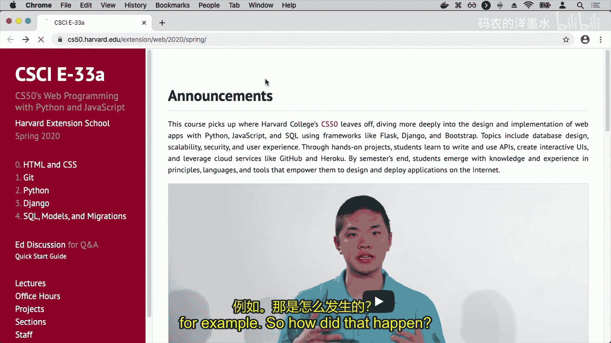

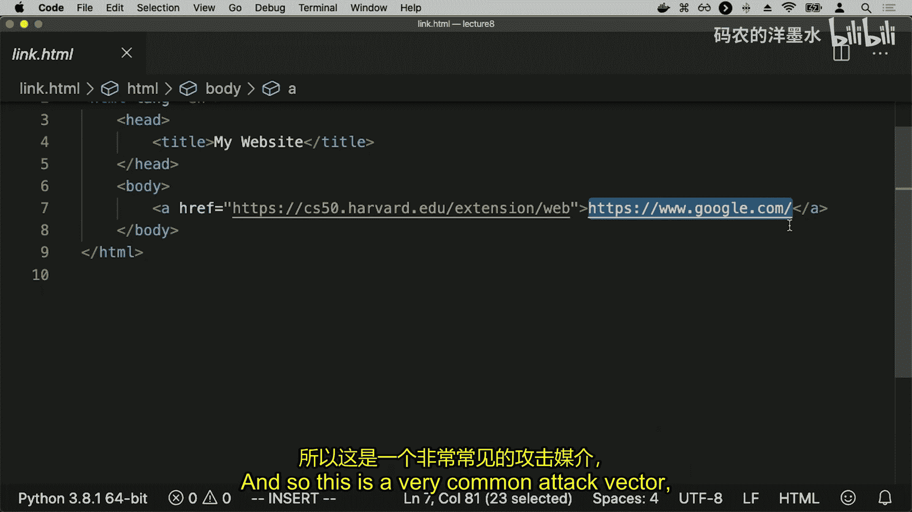

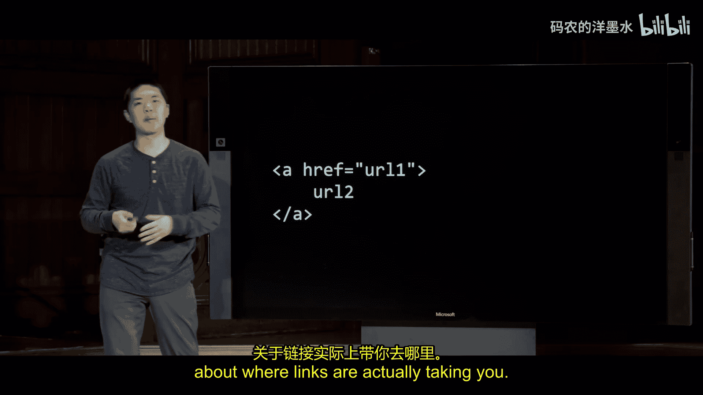

Actually be directing you to because it might be different than what the text of that particular anchor tag might appear to link you to instead。

And so H TM L has all these various different vulnerabilities where because you can just decide what you want the structure of the page to be。

 it leaves open the possibility that someone might try to trick you into thinking that you're going to a page that you're not actually on。

 And this problem is more widespread because anyone can look at the H TM L for any page。

 H TM L comes back from the server。 And therefore， the web browser has access to all of that HM L and can use that H TMl in order to render a page。

 for example， And this leaves open other vulnerabilities too。 So， for example。

Let me go ahead and go to Bankofamerica dot com。 just Bank of America's website。

 go to any other website instead， If I wanted to create a fake version of Bank of America's website。

 for example， to trick people into thinking they're going to Bank of America's website when really they're going to my website。

 Well， then what I can do is just go ahead and view the source of this page。

 I'll go ahead and view page source。

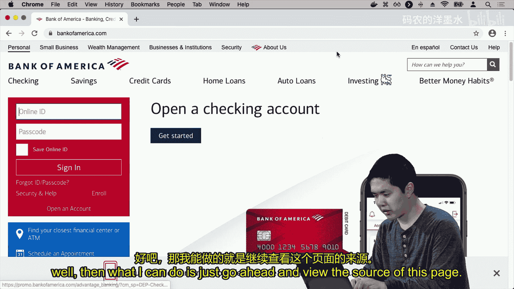

And here is all of the H TM L for Bank of America's website。

 And nothing then stops me from copying all this content。

Going into an H file and creating a new file that I'll just call like bank do Html。

And I'll go ahead and paste in the contents of that H L file。

 So here then is all of Bank of America's H TMl。

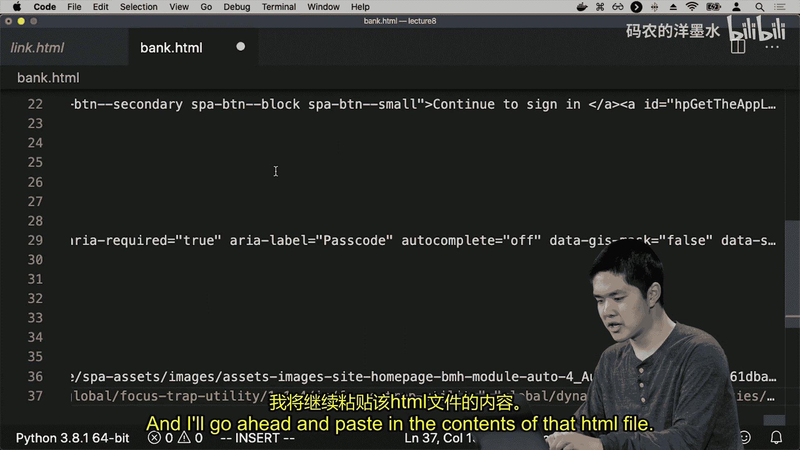

And now if I open up bank do HTMLtm， that HTML file that I have now written。

 but really just copied from Bank of America。😡。

I open it up and now here on my page is a web page that appears to look like Bank of America。

 It's using all of Bank of America's HM L， but instead it is my HM page and not actually Bank of America。

😡。

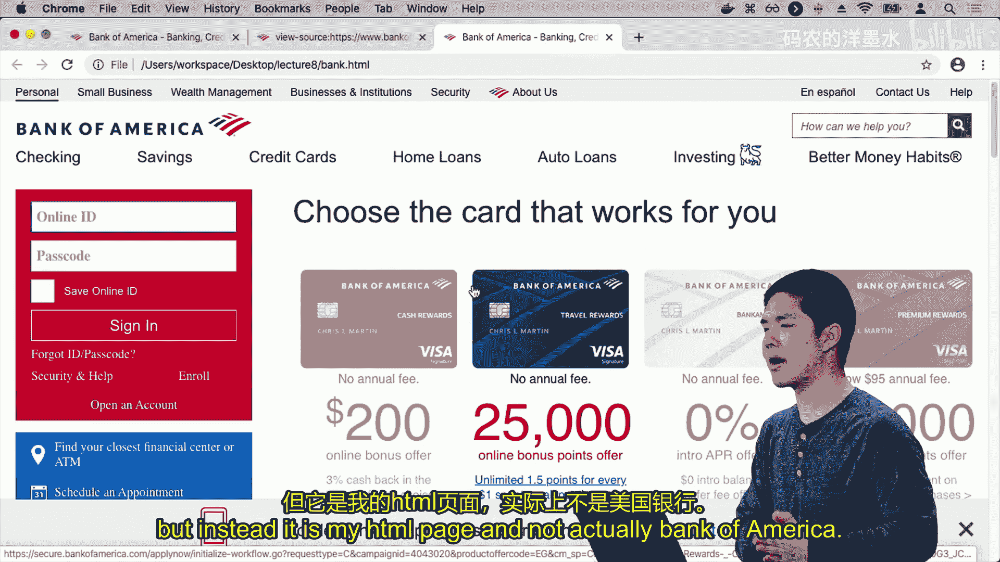

And so you might imagine combining these to create an even more concerning attack vector。

 where instead of linking to Google dot com， let me try and link to Bank ofam America dot com。

But where I'm actually going to link to is Bank dot H TM L， my version of Bank of America's website。

 where now， if I open up link dot H TM L。

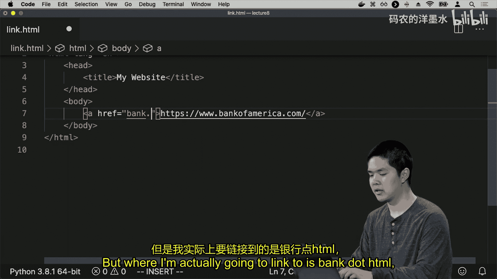

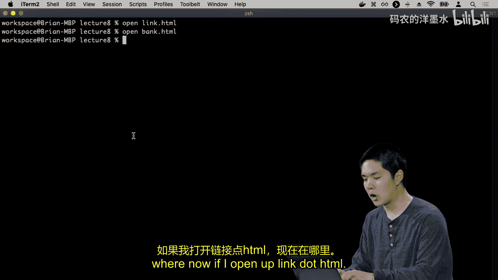

Here appears to be a link that links me to Bankofamerica dot com。 If I click on that link。

 I get to a page that looks like Bank ofam Americaica's website。

 but it's not Bank of Americaica's website。 It's my bank Hml file that I have written that just so happens to look like Bank of America's website because I copied all of that underlying HM L。

 So Hl has the ability to describe the structure of our web page。

 But any time you're writing this Hl， It's good to be mindful of this fact that anyone can copy your Hl could theoretically pretend to be you。

 These are the security vulnerabilities that are worth bearing in mind as we start to develop web applications and interacting with Web applications as well。

😊。

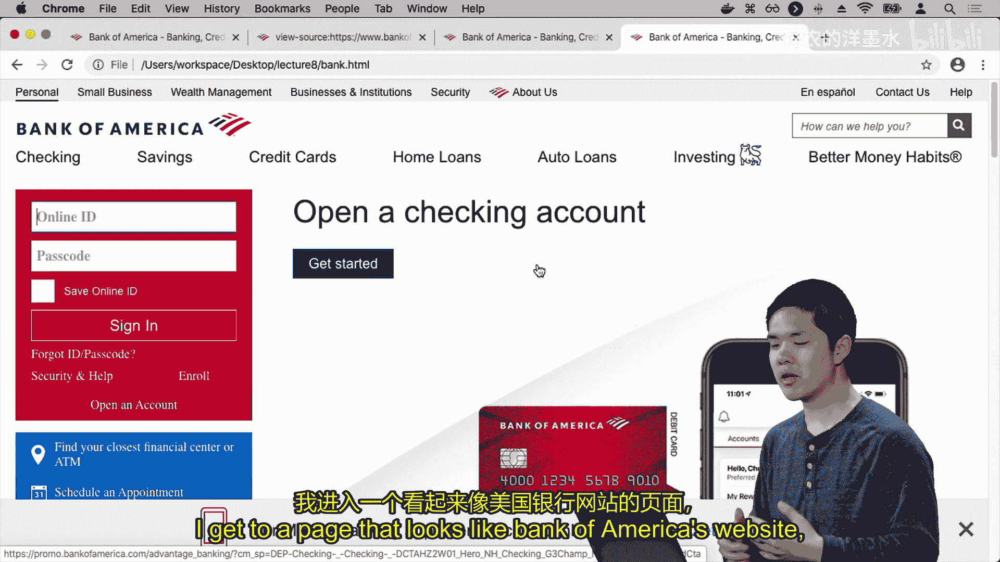

So ultimately， we used H TML in the context of designing web applications using Django， a framework。

 And how exactly then did these web frameworks work in terms of creating these web servers that are listening for request and then are responding to those requests。

 Well， ultimately much of the Internet is based around this idea of a client communicating with a server or more generally any one computer。

 communicating with another computer， using HttP and in particular， HttPS。

 a more secure version of the HttP protocol。 And so you might imagine that what these protocols are really about is how information gets from one person to another and what we're storing with that information that we have one computer trying to communicate with some other computer And in order to do so。

 information is generally going to flow through these routers。

 that you might imagine information going back and forth between one computer and another computer going through these intermediate routers along the way。

😊，And as a result， one thing to be cautious about is how do you know that this information that's getting passed back and forth is getting passed back and forth securely that ideally。

 when I send a message to another computer， I'm sending an email to someone else。

 I'm sending a message I making a request to a website that might contain sensitive information like my bank account。

 for example， I don't want it so that any intercepting router that is taking my request and passing it along。

 I don't want those routers to be able to look at that request and see the contents of my email or the contents of what password I happen to be sending across the web or not ideally。

 I'd like for this information to be encrypted。 And so here we'll talk a little bit about cryptography。

 this process of trying to make sure that I am able to communicate with some other person without some eavesdper in the middle being able to intercept that message。

Obviously， if I just take a plain text version of the message I'm trying to send。

 I just literally take the text of the message I'm trying to send and effectively pass it along across the Internet。

 Well， then anyone who is able to see that message is going to know what the text of that message is。

 And so I want to do some kind of encryption。 some way of encrypting that message so that someone along the way won't be able to do that decryption。

 If a router in the middle or someone in the middle is able to intercept that message。

 And so the first approach will look at is what's known as secret key cryptography in secret key cryptography。

 I have not just the plain text but some key， some secret piece of information that can be used in order to encrypt or decrypt information。

And so I'll use both the key and the plain text to generate what's known as the cipher textex。

 the encrypted version of the message I'm trying to send。

 And then instead of instead of sending the plain text across the Internet to the other person。

 I might instead want to just send the cipher text across the Internet to the other person so that I'm not sending the plain version of the message across the Internet。

 So the ciphertex goes across。 and the other person will also need the key。

 And now if the other person has both the cipher textext and the key will then using that information。

 the other person can use the key to decrypt the ciphertex and obtain the original plain text。

This key is what we might call a symmetric key encryption and decryption key。

 You use the key in order to encrypt messages and you use the same key in order to do the decryption process。

 And as long as both I and the person I'm communicating with。

 both have access to that key will then we be able to encrypt messages and decrypt messages。

 And someone who just has the cipher textex， but not the key likely won't be able to figure out what that original message was。

But there's a problem here， especially in the context of the Internet。

 And that is that both I and the other person need to have access to this key。

 The key is what I use to do the encryption and the decryption。

And I can't just send the key across the Internet to the other person because if I do that， well。

 then someone in the middle who's intercepting all of my requests could intercept both the cipher textext and the key。

 And therefore， they would be able to decrypt the message because they have both the cipher textex and the key。

 Now， if I were able to go to another person in person and exchange the secret key in secret。 Well。

 then this scheme might work because we both have the key。

 and I didn't share the key publicly with anyone who might intercept the message only I and the other person have the key。

 But in general， when communicating on the Internet。

 you're not communicating with servers you've necessarily communicated with before。

 I might be trying to make a request to a new website and we somehow still need to agree on a system where I can encrypt messages but only the other person on the other side is able to decrypt those messages instead。

So this kind of cryptography， probably not great for trying to initially try and create a secure connection on the Internet。

 And for that reason， a major advancement in cryptography that allows for the internet to work is this notion of public key cryptography in secret key cryptography。

 It's important the key is secret， because if the key we're known by everyone Well。

 then anyone would be able to decrypt messages。 in public key cryptography。

 we're able to create a secure encryption system where the key is allowed to be public or one of the keys as we'll soon see。

 And the idea here is that we're using two keys instead of just one that we have both a public key and what's known as a private key。

 The private key， your private key is something you should not share with other people to keep the encryption scheme secure。

 but the public key is one that is okay to share with other people in the distinction between the two。

😊，Is that the public key will be used in order to encrypt information and the private key will be used to decrypt information that was encrypted by the public key。

 and the public key and the private key are mathematically related。

 And there are a couple of ways that we might imagine doing that。

 But the idea now is that if I want to communicate with another person。

 That person sends me their public key。 And it's okay for the public key to travel across the Internet。

 Anyone is allowed to see the public key because the public key is only used for encrypting that data。

 So I can then take the plain text and the public key。 and use that to generate the cipher text。

 the encrypted version of the message that I am trying to send across the Internet。

 And then I send the cipher text to the other person with whom I'm trying to communicate。

 And the other person now。😊，Using the ciphertex then uses the private key。

 the private key that they did not share and the private key that has the ability to decrypt information that was encryptpted using the public key。

 So using a combination of the cipher textex and the private key。

 the person I'm communicating with can decrypt that information and get back whatever the original plain text of that information happened to be。

 And so this then is how we can do a lot of this communication on the Internet by using this public private key pair。

 we can say use the public key to do the encrypting， use the private key to do the decrypting。

 And now two computers that have never interacted with each other before without having the opportunity to meet to exchange some secret information can use the technique like this in order to securely communicate with each other to send a message back and forth without anyone in the middle being able to intercept the message and identify what the message is about。

 And once you have this ability， the ability to communicate with another secretly Well。

 then you could imagine。😊，Areeeing on some secret key and then using secret key encryption to be able to encrypt and decrypt messages as well。

 And so that's an approach that you can also take when trying to communicate with other people across the Internet。

 But this idea of encryption is what allows for H TtPS。

 a secure version of the HtTP protocol to actually work to make sure that when you are communicating with your bank's website。

 for example， that someone along the way won't be able to intercept that information and identify what it is that you're communicating about And instead only has the encrypted version of the information and in a public key with which they can encrypt information。

 but not a private key that can ultimately be used in order to decrypt information as well。

And so that then is how we might allow for this kind of secure communication on the Internet and allow our web applications to be secure。

 But in addition to our web applications just listening for requests and then providing some sort of response。

 our web applications were also dealing with data。We introduced the idea of SQL data tables where we had tables of data with rows and columns that are representing information。

 and we've also created web applications in this course where we've had applications that have users。

 users that sign in with a username and a password， for example。

 And so how might we represent that information about users and their passwords。 Well， one way。

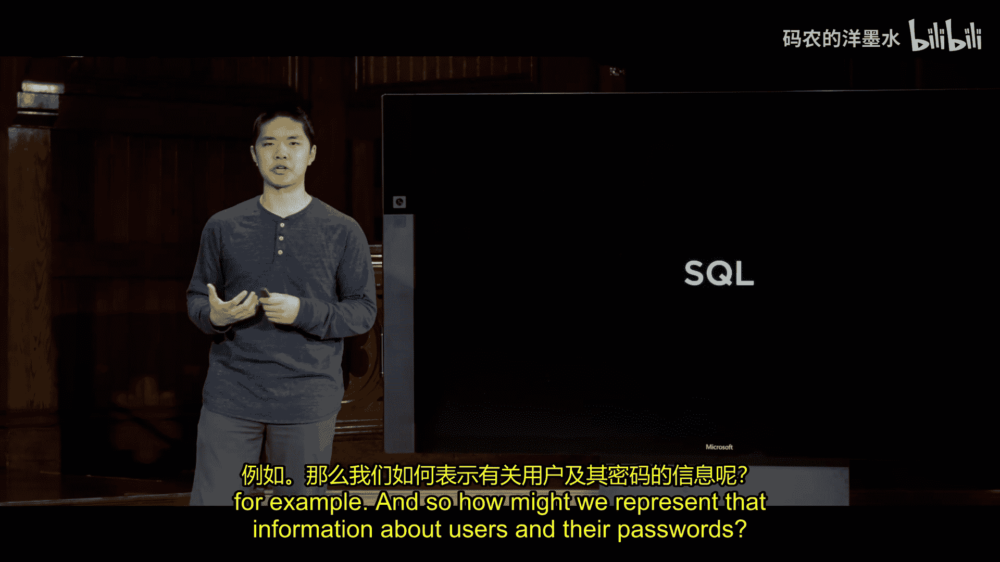

It would be just stored inside of a table like this。 Here's a table of userism。

 Every user has an I D， They have a username， and they have a password。

But this turns out to be an incredibly insecure way to store passwords。

 to be storing passwords in what might be called plain text。

 just to literally store the passwords inside of the database。

 And we should never do this in practice， because of the security vulnerabilities associated with it。

 If ever someone were to unauthorized to get access to this database。

 they would be able to see all of the passwords for all of the user。

 So if this database ever leaked for whatever reason， suddenly， all of these passwords are now known。

 And this kind of thing does happen that if companies are not careful about how they represent username and passwords inside of their databases and have ever。

 there's sort of some sort of database leak。Suddenly。

 a whole bunch of passwords could potentially be compromised。

 And it's for that reason that the recommended approach。

 rather than store an actual password is to store a hashed version of the same password using a hash function where a hash function in this context is some function that takes a password as input and outputs some。

😊，Hash， some sequence of characters and numbers in this case that represents that particular password。

 a hash version of the password。 But the important thing about this hash function is that it's a one way hash function from the password。

 you can get to the sequence of letters and numbers， But it is very。

 very difficult to go the other way around to use this information。😊。

To figure out what the original password actually was。

 And so what this means is that the companies won't actually know what any particular user's password is when a user tries to log in。

 what we'll do is take their password that they're trying to log in with。

 We'll hash it and compare that hash against the hash that we've stored in the database。

If the hashs match up， that means the user probably typed in their password correctly。

 And therefore we can sign the user in。 And otherwise。

 that's a sign that the user did not type their password in correctly。

 So this then is the reason why companies， if they're obeying these best practices。

 usually can't tell you what your password actually is， if you forget your password。

 if you forget your password。 the company will let you reset your password。

 They can update the data inside of the table。 but the company won't be able to tell you what your password actually is because the company doesn't know your password。

 The company only knows some hashed version of the password。

 Some result of passing that password through a hash function。 And as a result。

They're able to know whether you logged in successfully or not with the correct credentials without actually knowing what your password actually is。

 And so this is another area where you might imagine that if you're not careful about how you're storing this data。

 it could be a security vulnerability inside of your program。

 wherever that data is leaked passwords suddenly become known。

 And there are other more subtle ways that Web applications could potentially leak information that you as the web developer need to decide if you're okay with or not。

 Imagine a website， for example， where you do have a place where you can say。

 if you forgot your password， you can be sent a place where you can reset your password， for example。

😊，You might imagine that if you type in your email address， click reset password。

 you might get a message like， all right， passwordword reset email has been sent。

 But you might imagine typing in an email address and getting something like error there is no user with that email address。

 And here again is a potential security vulnerability in terms of leaked information This page that just seems to send you an email if you forgot your password is now leaking information about which users happen to have accounts on your website and which users do not because all someone needs to do is type in an email address and find out whether it results in an error or not in order to know whether a user happens to have an account on the website or not。

 And maybe that's not a big deal if that's not something you care about securing。

 But if it's a website where you do care。

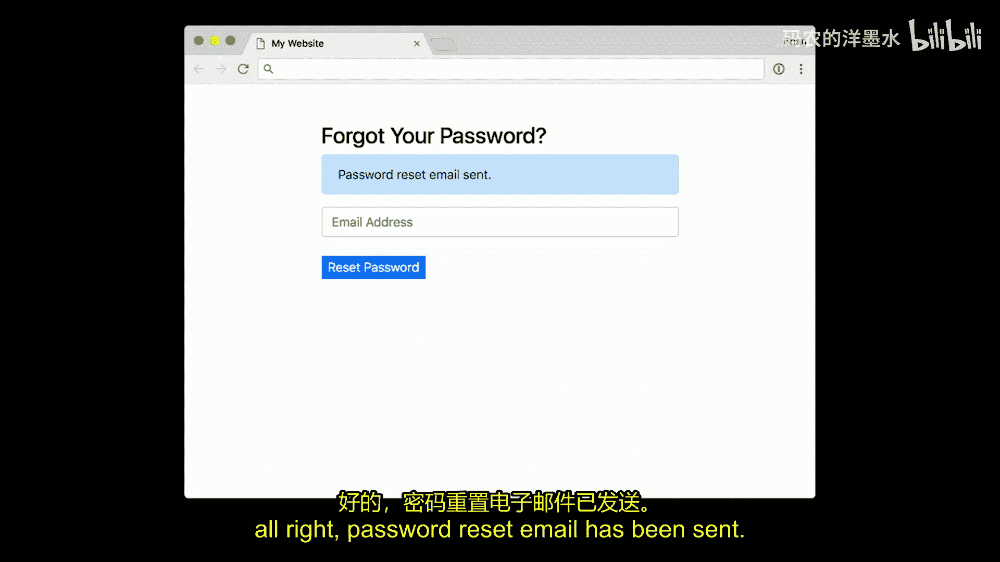

About making sure that if someone has an account or doesn't have an account。

 that information is kept private and secure only to the user unless they want to share it。 Well。

 then this type of page， this type of interface with the database could potentially be leaking that kind of information and information can be leaked in all sorts of different ways。

 you can even leak information just based on the time it takes for the database to be able to respond to a particular request that you might imagine if you make a request about a user and it takes longer to respond。

 that might tell you something about the number of database queries it needs to run or the amount of information that's stored about that user as opposed to if a request takes less time。

 So even something like how many milliseconds it takes for a web server to respond to a request can reveal or leak information about the data that is stored inside of the database and there have been examples of researchers who actually try and see what information they can get just from looking at these kinds of information。

 that it doesn't seem like with leak information but might actually reveal information as well。Now。

 another concern when dealing with SQL and databases we've talked about is the context of SQL injection。

 this threat where if you're not careful about how it is that you run your SQL code。

 you could inadvertently end up executing code that you don't mean to be executing situations like here we' in a username and password field。

 we've seen this example before。 Or if a user tries to log in。

 You might imagine a query like this is run， selecting from the user's table where a username equals whatever was typed in as the username and password equals whatever was typed in as the password。

 And we saw how for a normal user。 Someone who types in like Harry and 1，2，3，4。

5 as a username and password。😊，That this type of query works just fine。

 But if a hacker tries to log into a website and maybe includes a double quotation mark and two hyphens。

 for example， where two hyphens mean a comment in SQL。

 and we were to literally substitute these values into our SQL queries。 well。

 then you might end up substituting hacker hyphen hyphen hyphen hyphen creating a comment that ignores the rest of this query effectively ignoring any kind of password checking that we might want our web application to be doing。

 So this to another vulnerability that comes about whenever we're dealing with executing SQL code inside of a database。

 And in order to deal with this， we want to make sure that we're escaping any of these potentially dangerous characters that might show up inside of our SQL queries and djago's models do this for us。

 when we do these kinds of queries using django saying like dot objects do filter to be able to filter out for only certain versions of a particular model。

 it is going to take care of the process of making sure that it's not subject to these kinds of SQL injection attacks。

But if you're writing a web application that is directly executing SQL code。

 which you might imagine doing， you do want to be careful about making sure that you're not exposing the application to be vulnerable to these kinds of threats as well。

So that then are potential threats to come about when we're just talking about what's happening on the server。

 but we also can think about what might happen when we're interacting with other servers。

 when we're interacting with APIs， for example， And so we talked about jascript and using ja to be able to make additional requests to APIs or to other services that are able to return back with certain types of information。

 and with APIs， there are a number of techniques that we can use in APIs to allow them to be more scalable to allow them to be more secure。

One is this notion of rate limiting， where we might want to make sure that no user is able to make more than a certain number of requests to an API in any particular amount of time。

 This is in response to a security threat that has to do with the scalability of a system。

 which is known as a D S or denial of service attack， where effectively。

 if you just make a whole bunch of requests to a single server over and over and over again。

 you could potentially shut down that system because you're making so many requests that it's not able to handle that many requests all at the same time。

 And for that reason， because it's so easy to make an API request。

 you can do so using just a single line of like Python or jascript， for example。

APIpis will often institute some kind of rate limiting to limit the number of requests you can make so that you're not going to overwhelm the server or overwhelm the database that needs to be queried in order to respond to those requests。

 And so this kind of limiting might work as well。😡。

Apis might also want to add some kind of route authentication。

 You might not want everybody to access the same data via an API。

 Maybe there's some sort of permission model where only certain users are able to access certain pieces of data from the API。

 So you might imagine that a user needs to have an API key， for example。

 some effectively like a password that they need to pass around any time they're making an API request to your API。

 And that allows you to then be able to look at that key and verify that they are who they say they are。

Now， with those API keys comes other potential security vulnerabilities to be mindful of。

 One is that just as you should never be putting like passwords inside of your source code。

 inside of your git repository， for example， you likewise generally shouldn't be putting your API keys inside of your Web applications as well inside of the source code of those web applications because then anyone who has access to the source code for the Web application can see what your API key is because then use the API key to pretend to be you and therefore get access to potential API routes that they should not be able to access one common solution to this is to use what are known as environment variables were effectively。

😊，You and your program say that your API key is not going to be some predetermined string that is in the text of your program。

 but instead it' going to be drawn from the environment in which the program is being run。

 And then on the server。When you're running the web application。

 you'll first make sure the server has all of those environment variables set correctly。

So that rather than have the API key actually in the source code of the program。

 the API key is simply in the environment on the server where the web application is running and the server can just draw that information from the environment so that it knows what the API key should be without the API key actually having to be inside of the web application source code itself。

 And so as we begin to deal with APIs， you might notice that many APIs will require you to have an API key and often it's for these sorts of reasons to make sure that we're able to authenticate users effectively and also to make sure that we're able to limit users to make sure that they're not making too many requests to the server or to the database at any particular time。

😊，But this then starts to get us into other potential vulnerabilities。 In particular。

 vulnerabilities concerning jascript。 Javascript， again。

 is a programming language that we use in order to write code that runs inside of our web browser。

 a browser like Chrome or Safari or something like that。 And as a result。

Javascript has a lot of power to manipulate things on the page。

 it can simulate the clicking of buttons， it can change the content of what happens to be on any particular page。

 and as a result， there are many， many vulnerabilities that come about when it comes to thinking about JavaScript。

And one such vulnerability is this notion of cross site scripting that in general。

 when on your web application， you only want jascript to run if you yourself have written it。

 crossite scripting is a potential threat where someone else might be able to get ja code to run on your website when it's ja code that someone else wrote instead of you yourself。

 and this is a potential vulnerability because someone else can write the ja code。

 they can manipulate the contents of what happens to be on your website。

 they can potentially manipulate the user experience to get a result that is not actually desired。

 So let's go ahead and take a look at one example of crossite scripting。😡。

Alright， so I've prepared a web application in advance。 It's called security。

 inside of which is a single Django app called XSX， XSS for crossside scripting。But inside of here。

 we'll first take a look at the URLs。 So there's a single URL that just allows us to provide any path。

 and then it's going to load the index view。And on the index view。

We're going display an H TTP response that says here was the path that just happened to be requested。

 So you might imagine this is a simplified version of what you might see on other websites。

 for example， where websites might show you on any particular page what path you're on in order to get to that page。

 Some sort of indication of where you are inside of this web application。

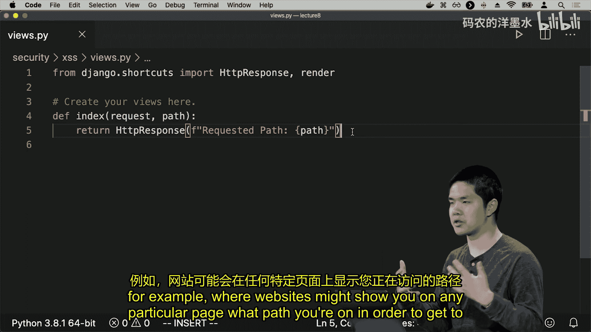

So Ill go ahead and CDd into security。And run the server， Python managed up high， run server。

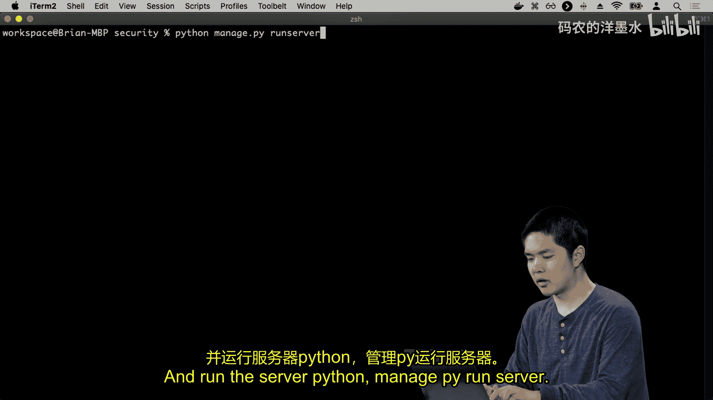

So I am now running the server， and I'll now go ahead and go into。My web application slash hello。

 for example。 And so what I see here is requested path hello， which is what I would expect it to be。

 I can change it to something else like hi， So here's requested path high。 Here's high slash 2。

 for example， whatever page I visit， it gives me a page that says requested path。

 and then whatever path I happen to be visiting。😊，But watch what happens if I try and visit this URL instead。

 I'm gonna visit URL slash script alert hi。And then， end script。So I run it， and suddenly。

 an alert shows up on my page that says hi。And I press， okay， and it says， all right， requested path。

 That alert was a JavaScriptscript alert。 It was JavaScript code running on my web application。

 but it was not code that was JavaScript code inside of my web application。

 It was someone else who wrote based on the URL to run particular ja on my particular page and so someone linked to my web application and passed in this script tag as part of the URL。

 someone who clicked on that link might have been taken to my web application but ultimately had JavaScript run that was created by someone else。

😡。

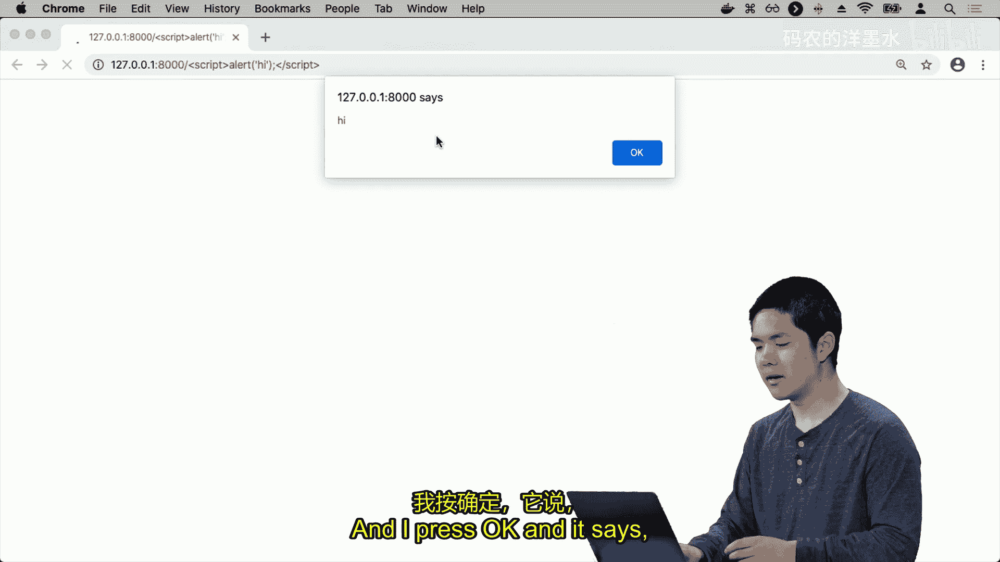

And that ultimately is potentially dangerous。 It leaves open the possibility that someone else could run jascript code on my page。

 and it might not just be something like a script。 You might imagine someone not just displaying an alert。

 but modifying something inside of the dom， changing the contents of the web page。

 making API requests， doing other types of tasks that you can do using jascript inside of a web browser that ultimately leave my page open to potential security vulnerabilities。

 And so these are cases where it's important to be mindful of when you're designing these pages if ever there's a possibility that someone could inject their own jascript into your page somehow you'll want to either detect that or escape it in some way or take other precautions to make sure that this kind of cross site scripting。

Is't going to be possible。 You might imagine that in a messaging application， for example。

 if you're messaging back and forth， you don't want it to be the case that if you message someone else some jascript code that when they receive it。

 that code actually ends up running as some jascript that runs on that particular page。

 You want to be sure to escape that information so that they just see the text of the jascript code but the code isn't actually execute。

 And this is a similar threat to that threat of SQL injection。

 It all comes back to the idea of not wanting to allow someone else to be able to inject their own code into your program。

 You don't want someone else to be able to inject SQL code into the queries you run on your database and you don't want someone to be able to inject jascript code into your web page because that leaves open potential security vulnerabilities as well。

One type of security vulnerability that Dngo is quite good at defending against is one that we've seen before。

 but we'll explore in more detail how it might work。

 And it's this idea of crossite request forgery where you fake a request to a website when you didn't intend to actually make a request to that website。

 So you might imagine。That if your bank， for example。

 had a URL that allowed you to transfer money from one person to another person。

 We've talked about this idea a little bit。 But imagine now how you could implement this。

 if it really was just a URL that you could go to like slash transfer and say as get parameters。

 Who am I transferring money to And what is the amount that I'm transferring。

 then someone else on some other website could in the body of their page just have a link。

Where that link says click here。 and it links to your bank do com or whatever your bank is transferring money。

 like to me in this amount。 And if some user unknowingly just clicked on that link。

 not knowing where it would take them， This website might be able to forge a request to the bank。

 make it seem like the user had gone to the bank and try to initiate some kind of transfer and ultimately tried to transfer money and it doesn't even necessarily need to be in a link。

 How else might you get some new request to happen inside of the web browser， you might imagine。

 though it might seem a bit strange to put this inside of an image， image source。

 the source of the image is this particular URL， the bank's transfer page。

 that doesn't really make any sense。 The transfer page is not an image， but it doesn't matter。

All an image tag is going to do。😡，Is try to make a request to this source URL to get that image and then try to display it in the user's web browser。

 But the first part is what's important。 The fact that this source ends up being requested by the web browser。

 without the user having to click on or do anything。

 they might try and request from your bank dot com slash transfer， this particular request。

 which might initiate some sort of bank transfer without the user even realizing it。

 And it's for that reason that we generally suggest that any time you're creating a website。

That is going to allow for the manipulation of some kind of state that allows for some change to happen。

 something like transferring money。 You don't want that to be via a get request。

 something you could just load in an image or load by clicking on a link that takes you to another page。

 You don't want that to happen because then it makes it very easy for someone else to fake a request to your page by just creating an image or a linking to somehow a website like transferring funds from one user to another。

So a solution to this， as we've talked about， is that generally。

 we only want post requests to be able to manipulate something inside of the database。

 to be able to actually initiate a transfer from one user to another user。 But even then。

 this is not perfectly secure that you could still be tricked into submitting a post request。

 Imagine an adversarial website that had a form like this。

 a form whose action was your bank dot com slash transfer and whose method was post。

 And now here to input fields whose type is hit it。

 meaning you won't actually be able to see those input fields when the user is looking at the page。

 they'd only know about it if they inspected the source code of this particular H TM L page。😊，Here。

 there's a hidden input whose name is2。 meaning， the person I'd like to transfer money to。

 Here's the amount。 the value that I would like to transfer。

 And all the user is going to see is a button that says click here。

 They're not going to see either of the input fields because they're hidden。

 But if they do click the click here button。 then suddenly they're going to be submitting a post request to the bank and initiating some transfer when they didn't intend to。

 Now， maybe this seems like， oh， it's not a big deal because the user still needs to click a button and the user shouldn't be clicking on a button if they don't know what the button is going to do。

 Well， for one。It's probably reasonable to imagine that an adversary might embed this button inside of a page where it looks totally safe to be able to click on a button。

 but more， the user doesn't even need to click on it in order to submit the form。

 We can just add a little bit of jascript， you might imagine that an adversary could do something like this。

 Add an onload attribute to the body that says when the body of the page is downloading。

 go to document dot forms， meaning all of the forms for this web page， get the first one。

 and submit it， submit the form。😡，And what that's going to do is even without the user doing anything。

 even without the user clicking on the click here button， as soon as this page is loaded。

 this form is going to submit， submitting a post request to the bank and attempting to transfer funds from one user to another user。

 And so this is what we might call a cross site request forgery where some adversarial website has forged a request to our website。

 And ideally， we wouldn't like for that to be able to happen。 So how to we guard against this。

Well what Jjainggo allows us to do and a very common approach is to add a CSRF token。

 a cross site request forgery token that is going to be regenerated for every session。

Such that only if that token is present， will the transfer be able to go through。So on our website。

We can include the CSRF token inside of this HTML form and as a result。

 make sure that we're able to transfer money only when the CSRF token is present。

 but if some other website tries to forge a request。

 they won't know what the CSRF token should be because it changes for every session and therefore they won't be able to actually forge a request from one user to another。

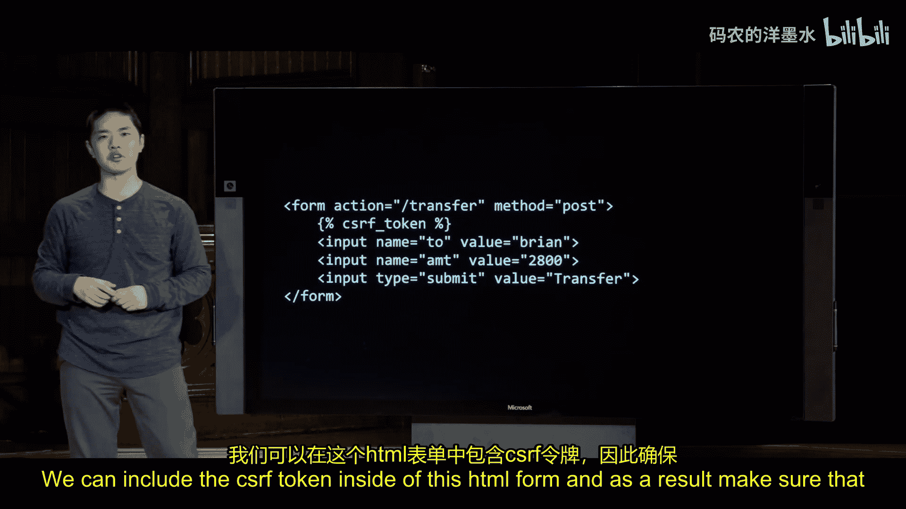

So all across the various different tools and technologies we've been using Python， H TDP， Django。

 H TM L， in terms of creating these web applications。

 using jascript and the APIpis that we might be interacting with。

 There are security considerations all throughout， we've only touched on a couple of them here。

 But just goes to show how it's important to be mindful as you think about the practice of web programming。

 thinking about what you're going to add to your web applications and what features your web applications supports to think about what the potential vulnerabilities there are as well。

 How someone might exploit your web application in order to do something with it that they probably shouldn't。

 And as you take your web applications from applications that are just running on your own local computer。

😊，To applications that are running in some web server that many people are starting to use。

 these are the types of questions to start to be asking。

 How can you make sure that your web application is scalable。

 How can you make sure that your web application is secure。

So now that we've explored that a lot of web programming。 What comes next in this course。

 we've explored a number of different tools and technologies and languages。

 but there are many other web frameworks and ways you can build web applications as well。

 We spent most of our time looking at the Django web framework written in Python。

 But you can use other programming languages to build web applications as well。 Express Js。

 for example， is a very popular javascript framework for building web applications Ruby on rails as a popular serverside web built using Ruby。

 And there are many others as well。 And there are also client side frameworks used primarily with javascript to be able to build user interfaces。

 We've seen a little bit of react to build dynamic and interactive user interfaces。

 other popular client side frameworks include angular Js and view Js and a number of others as well。

 And then once you've built these web applications using any of these server side frameworks and client side frameworks。

 Then you might imagine wanting to take these applications and deploy them to the web。

 And to do that， there are a number of ways we can do this as well。 A number of different services。😊。

Including Amazon Web Services， AWS， Google Cloud and Microsoft， Azure。

 that can be used in order to deploy these web applications。

Horoku is a service that uses AWS and tries to simplify the process of making it easier to deploy your web applications。

 And if your web application is really just static， it's just Hml and Cs and jascript。 Well。

 then you can use something like Github pages to be able to host a web application for free on Github's own service instead。

 And there are many other ways you can imagine deploying web applications as well。

 Different services that you can use in order to take the web applications that you have been building or web applications you might build in the future and make them available on the Internet for others to be able to use as well。

 So as we look back on the various topics within web programming you've explored。

 we've seen a lot of tools and technologies we can use that we can leverage in order to build interesting web applications。

 We started。😊，By taking a closer look at HMl and CSS。

 diving into how we can use that to describe the structure of our page and then taking advantage of tools like SaS that allow us to generate CS that allows for much more complex styling for our website that would have been much more difficult to do with just CS alone as we started to build larger web applications。

 we took a look at git version control tools that we can use in order to make sure that we keep track of versions and changes we make to our code。

 allowing multiple people to collaborate on our project simultaneously。

 we then took a look at Python looking at various different features that the language offered。

 functions in the conditions and loops as we see in many other programming languages。

 but also objectoriented programming， the ability to represent objects and methods and functions that operate on those particular objects。

 which prove especially powerful in the context of dealing with data inside of our web applications。

😊，Dengo was the example of a web framework written in Python that we use to very quickly be able to start up a web application that's able to listen for requests and make responses。

 Djago has a whole lot of features built in that really make it easy to get started with building a web application。

 And in particular， it makes it easy for writing web applications that deal with data。

 So Django allows us the ability to build models that interact with SQL without us having to actually write any SQL code。

 Django can generate the SQL for us， just using these models and migrations that allow us to continually apply changes that we make to our database。

 that as we add new tables， Add and modify existing fields on those tables。

 Django can take care of all of that。😊，After that， as you'll recall。

 we took our attention towards the second of the main programming languages in the course。

 Javascript， which has a lot of uses and is very， very popular。

 but we primarily used on the client side to be able to build interesting user interfaces using jascript to manipulate the dom。

 the structure of the page to change what it is the user sees and also to add event handling so that when the user clicks on a button when the user hovers over something when the user interacts with the page in some sort of way our code is able to respond to it。

 And we saw react a web framework our client side framework that uses jascript in order to allow us to create really interesting and interactive user interfaces with not all that much code at all。

 And then finally， in these last couple of lectures。

 we've been looking at some best practices how we can design tests， test the test the server。

 but also the client to make sure that our code is working appropriately and also some industry practices like continuous integration and continuous delivery that just help to make sure that as we make changes to our code。

 we're able to deploy and deliver them rapidly and effectively。😊。

And make sure that we're able to make incremental changes to our codeb rather than need to wait on longer release cycles。

 And then finally， today， we've been talking about issues about scalability and security。

 especially important as we begin to take our applications and move them to the web。

 We want to make sure that these applications are scalable that they're able to handle multiple different users and also to make sure that they're secure。

 that we're not exposing ourselves to potential vulnerabilities like someone who might inject SQL or inject jascript code into our pages or who might try to access some data that they're not supposed to access。

 we want to make sure that when we go about designing these web applications。

 we're able to do so in a scalable and ultimately in a secure way。😊。

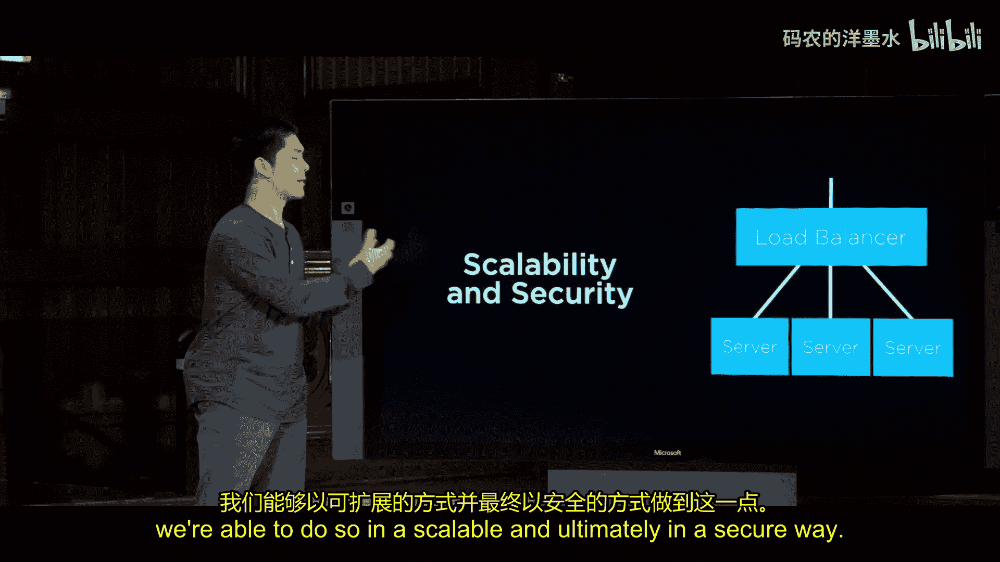

So hopefully you enjoy this exploration into the world of web programming with Python and ja。

 best of luck with the web programs that you yourself might build with the tools we've seen here today and also other tools that are inspired by or use similar tools and techniques and ideas as the things that we've ultimately talked about here。

 A big thanks to the course's teaching staff and the production team for making this entire class possible。

 I look forward to seeing the web applications that you might go on to create。

 This was web programming with Python and Java。😊。

