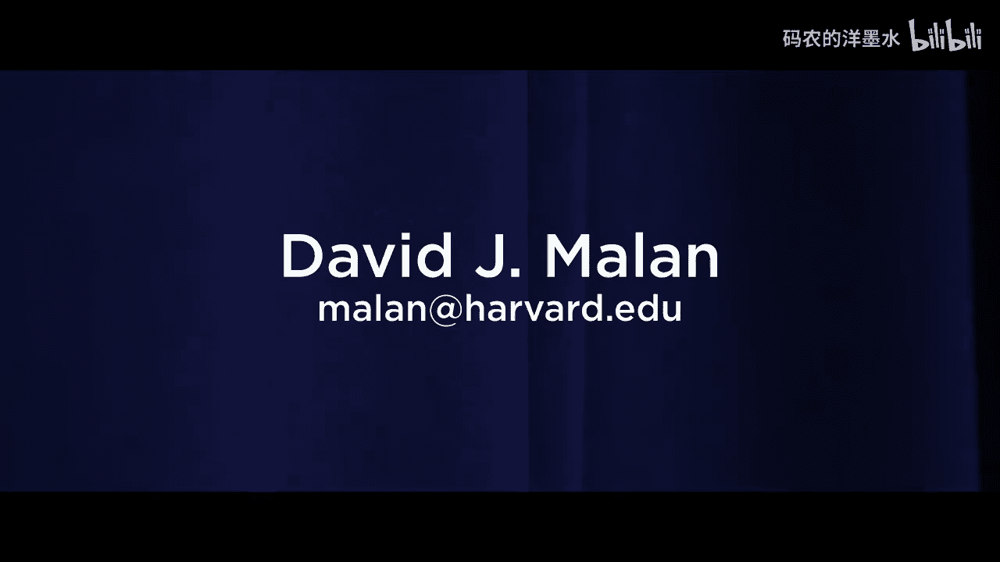
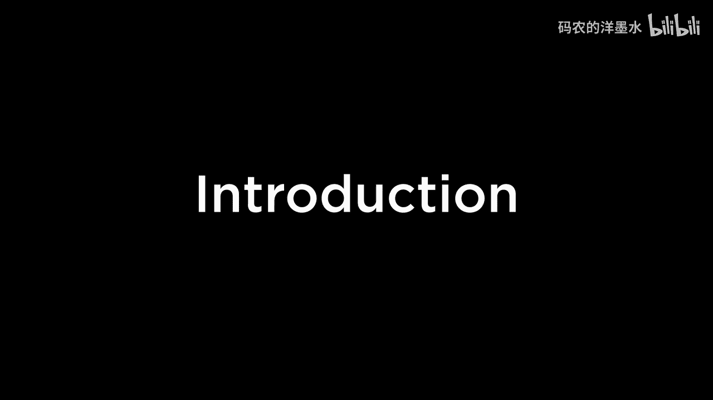
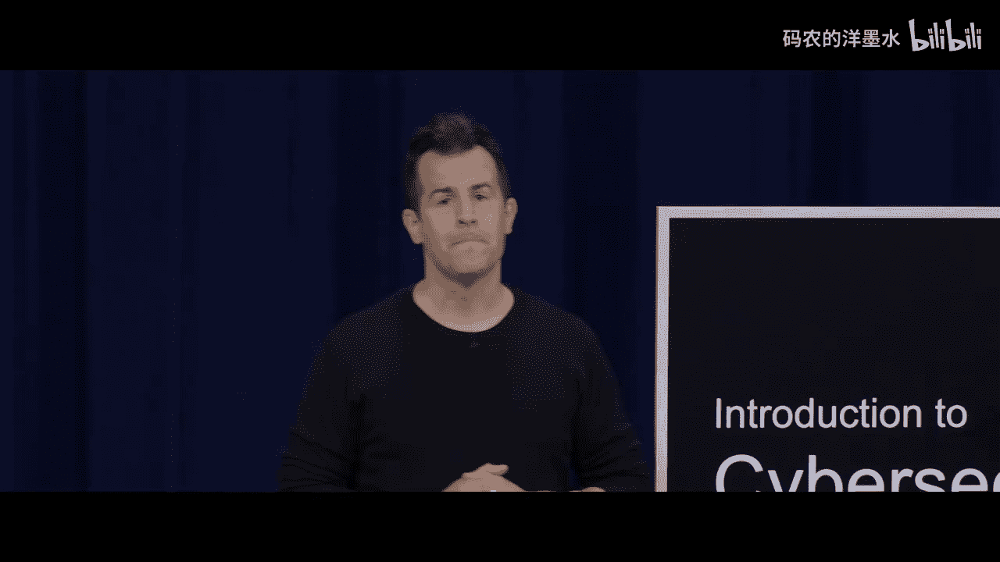
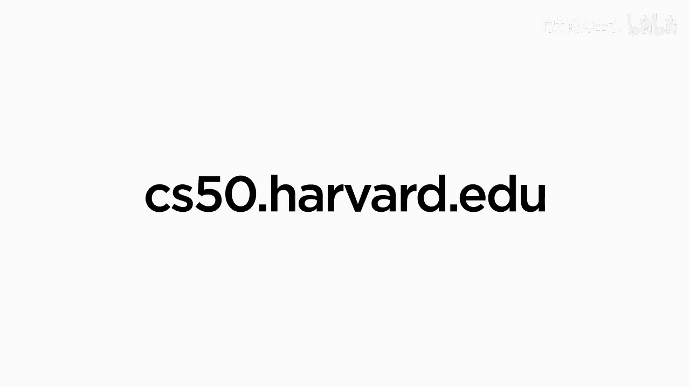

# 【全集】哈佛大学CS50 & 网络安全 中英字幕 课程附完整课件 p01 课程介绍 -BV1wJy3BLEe7_p1-

Hello， world。 My name is David Main， and this is C S 50's introduction to cybersecurity for technical and non technicalchnical audiences alike。

 In this course， you'll learn how to secure your accounts。 Data。

 systems and software against today's threats and how to recognize and evaluate tomorrows as well。

 both at home and at work。 You'll learn how to preserve your own privacy。

 You'll learn how to view cybersecurity， not in absolute terms， but relative。

 a function of risks and rewards for an adversary and costs and benefits for you。

 and you'll learn to recognize cybersecurity is a tradeoff with usability itself。😊。

In the world of cybersecurity， I dare say you and I have to be perfect。 All of our doors。

 all of our windows virtually speaking， have to be locked。

 but an adversary has to find just one mistake that we've made a single door or window ajar。

 So perhaps we should be focused not only on prevention， but on detection。

 especially through auditing through monitoring so that even if an adversary gets in。

 we can at least detect as much quickly and minimize the downsides for us and in turn。

 the upsides for them。 Perhaps nowadays， tools like artificial intelligence or AI can even help with that。

 detecting patterns and potential adversary behavior that we might not even notice ourselves。

 And perhaps if we raise the bar high enough for the adversary， increasing their cost。

 their risk decreasing their potential reward， they'll simply lose interest in us as a target。

 Of course， if they have more resources than us， they might very well win anyway。

 but will they be even interested in us， Which of these threats should we actually worry about throughout this course。

 will present both high level and low。😊，Level examples of threats and provide you with all you need know technically to understand both。

 even if you're not a programmer or computer person yourself through those examples。

 we'll introduce you to certain first principles， how computers themselves work so that you can understand and deduce even after the course ends how other threats that the world might not have even seen yet actually work。

😡。

This is CS50's introduction to cybersecurity。😡。

