# 【全集】哈佛大学CS50 & 网络安全 中英字幕 课程附完整课件 p02 Lecture 0 - 保护账户 -BV1wJy3BLEe7_p2-

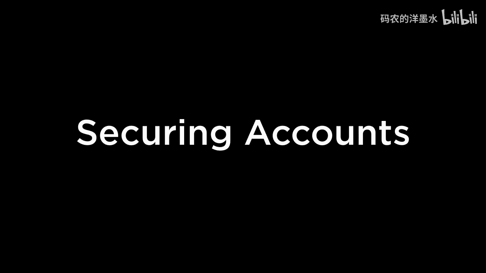

All right， this is CS50's introduction to cybersecurity。 My name is David Main， and this week。

 let's focus on securing accounts。 you and I have so many accounts nowadays。

 be it for websites or apps or the like and we' focus on exactly what the threats are to all of those accounts but more importantly what some of the defenses are so that you can keep those accounts secure but let's first consider what we mean by security in the physical world for instance。

 whether you live in a home， an apartment， a dormitory or the like odds are you have a key that lets you into that building now that key of course lets you in through that locked door and then you have access to the entire habitat but the catch is that if someone else gets that key。

 of course， they too can let themselves into that system or into that same building so let's consider now in the digital world though what some of the building blocks are of security so that we can focus exactly what those threats and what those defenses are so first allow me to propose that we think about the security of our accounts in terms of authentication。

Authentication refers to this process digitally of proving who you are that I， for instance。

 am David， but that alone isn't necessarily enough to keep a system secure because just because I'm David。

 doesn't necessarily mean I should access to your entire home。

 perhaps I should not have access at all。 perhaps I should just have access to the entryway or some narrower form of access。

 And so there's this related topic when it comes to the security of locations or systems known as authorization。

 So authorization speaks to whether or not you should have access to something once you have proven that you are you that I am David and that I should in fact。

 have access to the door that I just walk through。 Now。

 when it comes to our account in the digital world， we of course don't use physical keys。

 but very frequently nowadays we use usernames which of course can be public。

 it might be a username like David， it might be a username like mailland or it might be more commonly even an entire email address。

😡，That presumably uniquely identifies you in the world。 But even though that's public。

 the thing that you and I ideally keep private is， of course， our password。

 and nowadays you and I must have dozens， maybe even hundreds of passwords that are hopefully distinct and not reused across all of those different websites。

 but more on that in a moment， and so it's really this password that ultimately allows you to authenticate yourself。

 demonstrate who you are， because presumably I am the only one in the world that knows not only my username or email address。

 which all of us can know， but presumably I'm the only one in the world that knows my username and this here password。

 and so the presumption is if I type in both of those values to some app or some website that I must in fact be David Main in that case。

 Of course it's not good enough to just have a password you need to have a good password。

 Now what do we mean by good password。 Well ideally this password is not going to be a dictionary。

 like literally a dictionary of English words or whatever your human language。😡，Might be why well。

 there's this threat known as a dictionary attack and by this I mean an adversary。

 a hacker that wants to get into your account， they could just start typing randomly to try to figure out what your password is。

 but they're a little smarter， they'll actually use a dictionary attack that is they'll open a physical book of words or more likely they'll open a file on their computer containing a whole lot of actual English words or in some other human language and then just one at a time。

 try this word as your password， this word as your password。

 this word as your password and so forth because if you and I have chosen a pretty guessable password。

 one that is an actual word in a dictionary， they're going to get into your account much faster but even if you and I are clever and odds are by this point in life。

 you know that you shouldn't just choose a simple English or some other language word but rather you should probably have some number。

 some letters， some punctuation or the like you're still vulnerable as am I to what we know we'd call a brute force attack brute force sort of evokes the memories of。

😡，Yester year where someone might have had a big branch of a tree using as a battering ra trying to get into the castles from past times。

 but brute force attacks in the digital world mean something analogously whereby you're using software to digitally try all possible passwords。

 And so here too are you vulnerable because your for password is too short。

 even if it's random with letters， numbers and symbols。

 odds are an adversary or hacker that has enough time and enough technical savvy。

 they can just try every possible password in the world and eventually they might very well get into your system。

 So how do we go about Defing against these kinds of attacks。 Well we use these passwords。

 but these passwords of course come in different forms and it's kind of a low bar that is set by default on a lot of devices still nowadays。

 for instance， on your phone if you'd like to chime in here in the chat how many characters or digits in particular are typically required of systems Well I would conjecture that very often when I。

😡，up a phone。 I'm only asked for a passwordcode， a numeric password of four digits alone。 Now。

 if you have a four digit passwordcode or password more generally。

 how secure is that and how do we even go about thinking about how secure that password is Well it would propose that we could start to measure not even using fancy math。

 but just some basic heuristics， we could measure the security of a password that has just four digits by considering。

 well， how many possible four digit passwordcodes are there。

 So perhaps if you'd like to chime in here in the chat。

 how many possible passwords are there if they're all digits。

0 through9 decimal digits and if you only have four of them how many possible are there。

 I'm seeing 1000， I'm seeing 10000 I'm 9999 and I'm seeing a whole range and I think a lot of you have the answer spot on。

 it's 10000 it's 10000 why Well， if we just think about this nuly if I've got four decimal digits。

0 through9。The smallest password I could come up with so to speak would be 0000 and the largest password I could come up with would be 9999。

 Now you might think， okay well that's obviously 9999 possibilities but not quite because if you include 00。

00 that's the 1000th possibility So indeed there's 10000 possible passwords if we're using four digits specifically so how do we actually think about that more generally especially so that we can now figure out the math for larger passwords as well well if you've got0 through9 as the first possible digit and 0 through9 is the next and0 through9 is the third and 0 through9 as the fourth you have 10 possibilities。

 times 10 possibilities times 10 times 10 this of course if we do it out more mathematically is 10 to the fourth power the exponent being four and that of course gives us 10000 as well so that might be the more mathematical way approaching of approaching it versus just the more intuitive that 00。

0，0 can go all the way up to 9999。😡，Now， again， a question for the group。

 how long do you think it might take for an adversary or a hacker to get into my device。

 for instance， my phone， if I do have a four digit password。😡，If I've got a four digit password。

 this means they might have to try as many as 10000 possibilities because in the easiest case。

 Sure I they get lucky and my password is still the default 0，0，0，0。 but in the worst case。

 I chose 9，9，99 and they don't get to that until the very end of their attempts。

 or maybe I choose something there in between。 I'm seeing 10 seconds。

 less than a second milliseconds，10 seconds a day，4 hours， so the responses are all over the place。

 So how could we go about actually measuring this or estimating this。 Well let me propose this。

 I'm going go over to my computer here。 And even if you've never written any code before let's go ahead and write some code together here。

 I'm gonna go ahead and open a program called Vs code visual studio code。

 which is a free program that we use in Cs 50 more generally that allows me to write code on my Mac or PC or in really any internetbased device and I can actually write code and not only write it but run it。

 And I'm gonna write code in this case in a language called Python。

 and this is just a very popular language， but I could use any of。😡。

Dozen or more different programming languages。 And the goal here is not to learn Python for that。

 We have whole other classes， but to just demonstrate what an adversary。

 What a hacker need do if they want to get into， for instance。

 your iPhone or Android device or anything that has just a fourdit password。 Now。

 my presumption here for demonstrations sake is that I'm going go ahead and write code that just prints all possible passwords on the screen。

 But you could imagine if I had a USB cable or maybe a lightning cable。

 I could connect this phone to this laptop， especially if it's your phone that I just swiped from a table could quickly plug it into my computer here。

 run the code that I'm about to write and maybe automatically send all 10000 possibilities to your device before you even realize the phone is gone。

 Now， here's how I'm gonna to do this。 I'm going go ahead And in a text file called cracked where crack is actually a term of art。

 It just means to figure out what a password is to brute force your way in。

 I'm going go ahead and from a library。

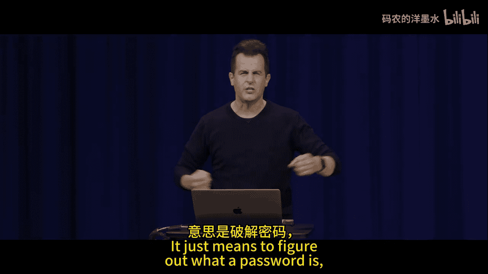

Called string。 I'm going to go ahead and import digits。 Now。

 this is a very easy way of just giving me access to the number 0 through 9。

 I could obviously type them all out on my keyboard。

 This is a little faster because this gives me like a list of the numbers I care about。

 Now there's a bunch of different ways I can write this code。

 But what I really want to do intuitively， is try all possible digits for the first value。

 try all possible digits for the second， then third the third， then for the fourth。

 So one way of doing this might be as follows。 I'm going to use a keyword and Python called4。

 which just means do something for as long as I want you to。

 And then I'm going give myself a variable， like in math。

 just so I can use something to keep track of each number。

 And I'm going to use a default value of I for integer。

 And then I'm going to go ahead and say that for each value I in those 10 digits。

 I want to go ahead and do the following。 Well， for each of those I digits for the first value。

 I want to do for J in digits as well。 And then for each value for my third。😡。

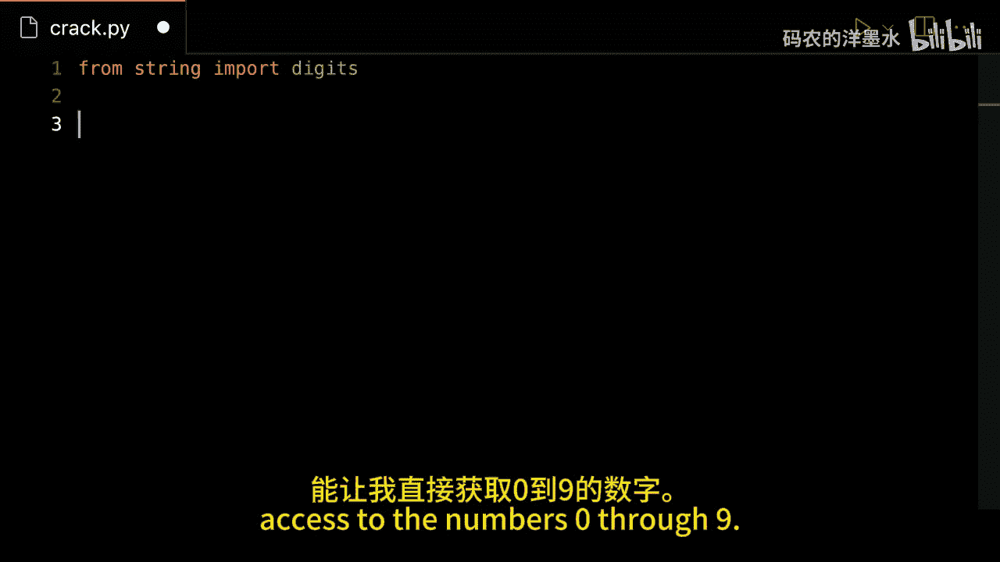

older， I might do something like 4K in digits。 And then lastly， I might do 4 L in digits。

 So this is admittedly not the best design。 And those of you have programmed before probably cringing that I have this indentation。

 indentation indentation。 But it's a simple way of demonstrating。

 especially for those unfamiliar with programming。 how we can try all possible first digits。

 all possible second， all possible third， all possible fourth。

 and all I'm going do very inside of this code now is print out the value of I J K and L。

 So that iteratively， we should see on the screen0，0，0，0。 And then all the way up to 9，9，9，9。

 So if you assume that I've connected my phone to this laptop。

 ideally then we'll have an estimation of how long it might take until we actually have cracked into the device。

 So let's go ahead and do this。 I'm gonna to open up a separate window on my screen here It's called a terminal window。

 And I'm going to go ahead and run Python of crack dot5。 So in just a moment we're gonna see is。

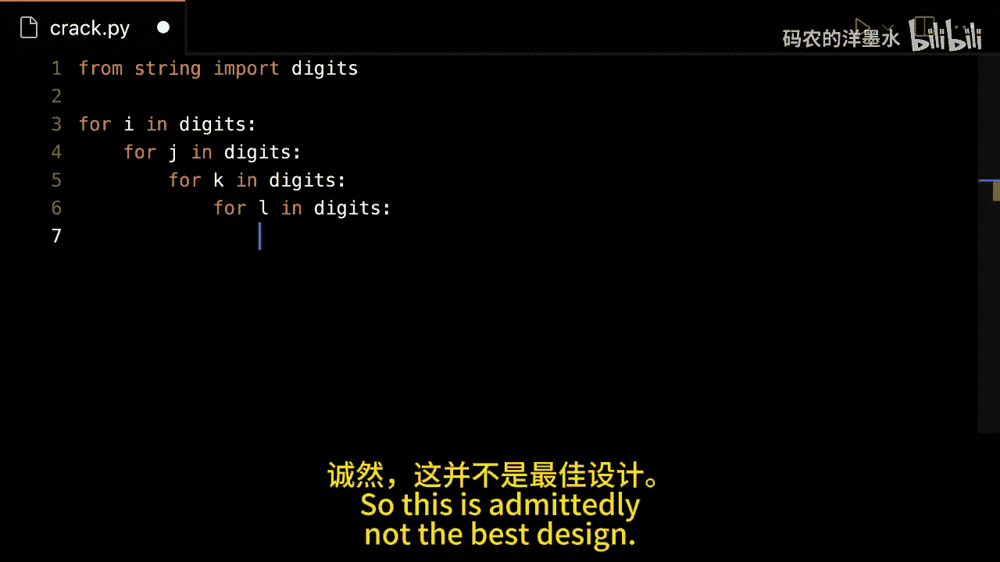

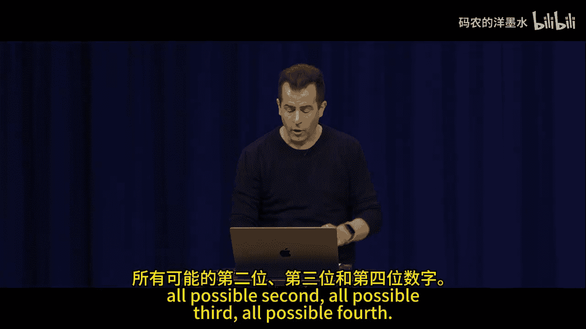

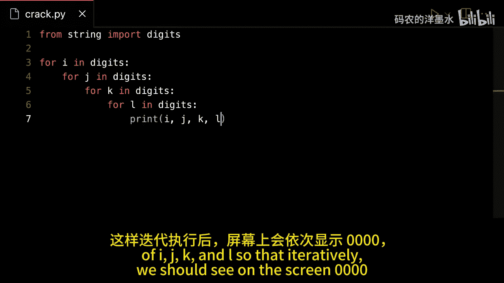

To take a few minutes， a few milliseconds， a day， four hours， or here we go， one， two， three， go。

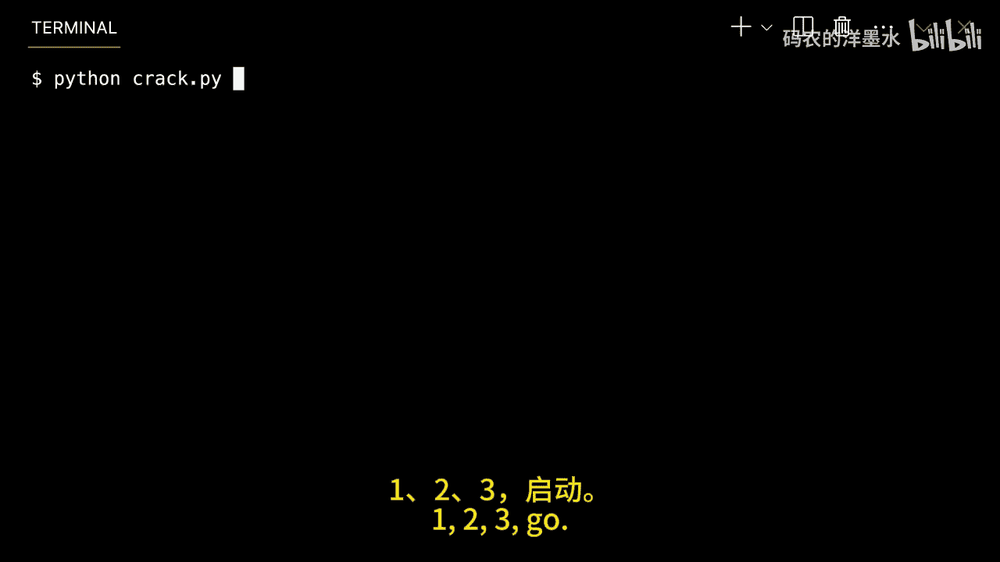

Okay， so those of you who estimated just a few milliseconds were spot on。

 So what's the takeaway here。 Well， apparently using a four digit password is not very secure at all。

 because look how quickly I the adversary， the hacker in the story was able to get into your phone。

 And in fact， I could probably unplug it at that point because I've gotten whatever data I care about off your phone and you might not be none the wiser。

 So how can we go about improving upon this system。

 Well let me propose that instead of using a four digit passcode， let's use four letters instead。

 and we'll use English because that's what I speak well。

 And in English we have 26 letters of the alphabet a through Z。

 but you know what that might give us initially 26 possibilities for the first position times 26 times 26 times 26 for the second through fourth。

 But let me propose that we actually use lowercase and uppercase letters So that gives me not 26 but 52 possibilities for each location。

 So if I do 52 possibilities， that's 52 to the fourth power And does anyone。😡。

want to estimate how many possible passwords there are if I'm using four English letters now。

 uppercase or lowercase。I'm seeing 26 to the fourth power。

 but that's not right if for're using uppercase in lowercase。 It's indeed 52 to the fourth power。

 And I'm seeing a lot。 But here we have estimates along the lines of indeed7 million as well。

 So with 7 million possibilities。 you might think， okay， surely that's gonna be a lot better。

 And it's gonna take the adversary a lot longer to hack into this phone。 But let's try that。

 let me go back to my terminal window here。 Let me reopen now my code file。

 and let's go ahead and use not digits。 but let's go ahead and use ASI letters for those unfamiliar。

 ASI letters are simply the letters A through Z in both uppercase and lowercase。 Now here I go。

 I have to go ahead and change this from digits to ASI letters from digits to ASI letters from digits to ASI letters and lastly。

 from digits to ASI letters。 Again， there's an easier way。

 I could implement this code to be more succinct and less duplicative。

 but it involves some features that will introduce in another。

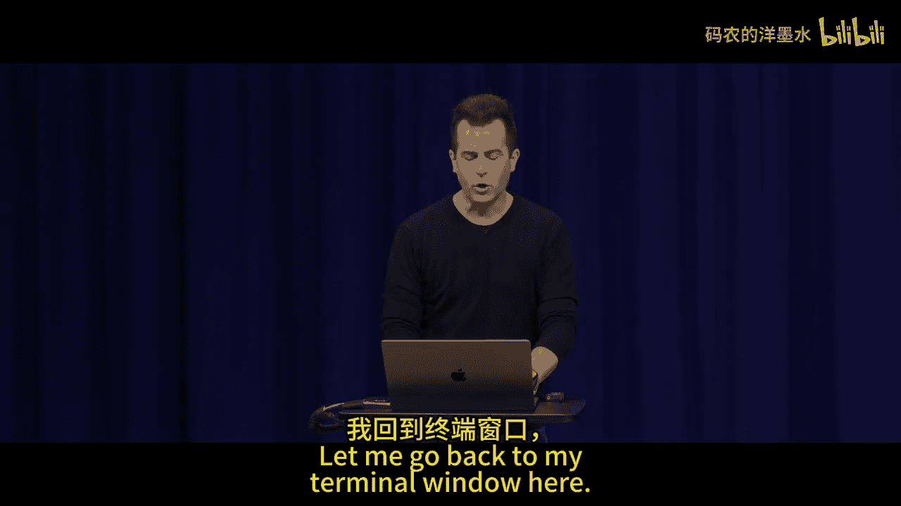

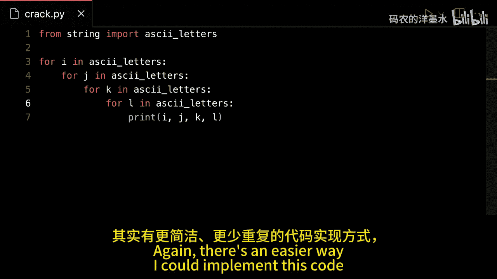

Alto。 But now I have all possible ASCI letters from my first placeholder to the last。

 Let's go ahead and open up that same terminal window。 Let's run Python of crack do pi。

 And here now is the answer to how long might it take an adversary to get into your phone if you're using four letters of the English alphabet for your password instead。

😡。

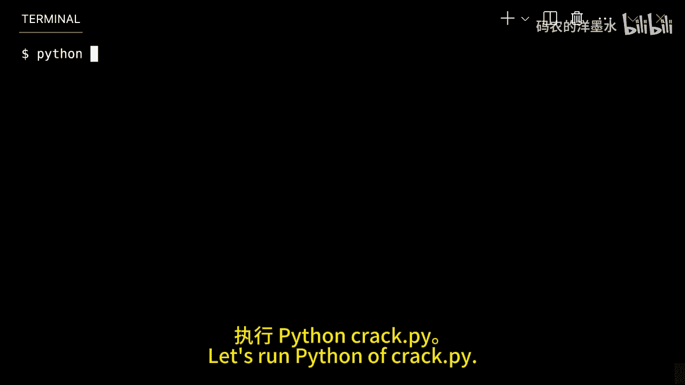

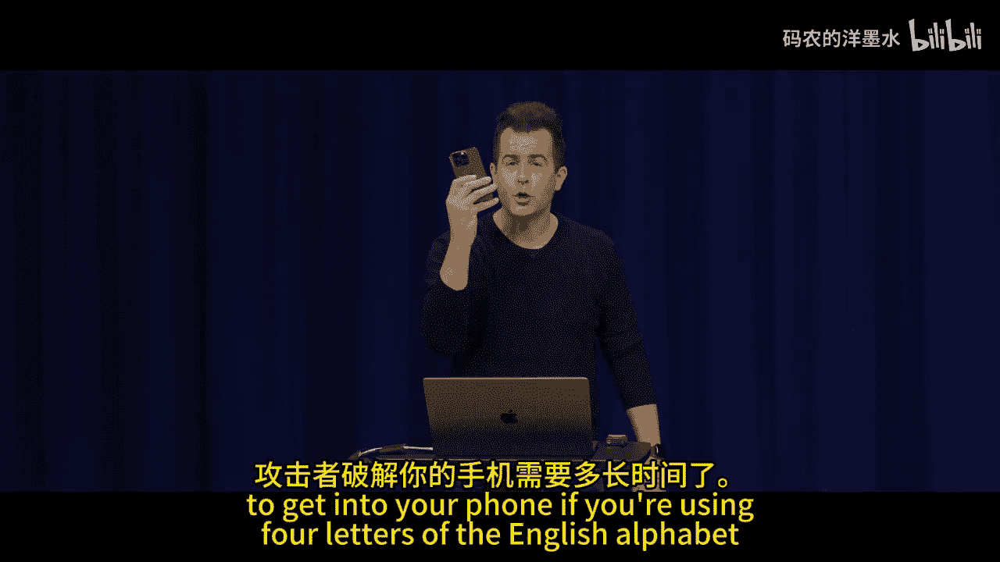

Okay so this time I have enough time to walk all the way over to the screen here and you can see that we're going in alphabetical order first lowercase now uppercase。

 but in just a moment we are done and we're down all the way to Zzzz so that was a few seconds which is indeed slower but that really wasn't that much effort at all so presumably then even four letters of the alphabet might not be enough to keep us secure。

 So let me go ahead and do what we all are told to do anyway which is to go into your phone or whatever device in question and actually use four characters perhaps instead。

 So not just letters， not just digits， but let's toss in some punctuation as well and in the world of punctuation。

 at least on a US English keyboard， there's typically as many as 94 possibilities for letters numbers and punctuation because we have 26 lowercase letters26 uppercase letters。

 10 decimal digits 0 through 9 and another 32 punctuation symbols that we can add into the mix as well so that gives。

😡。

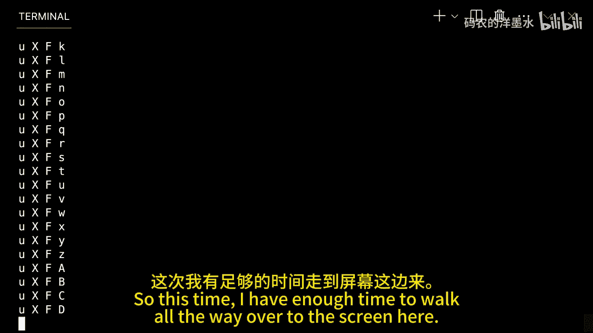

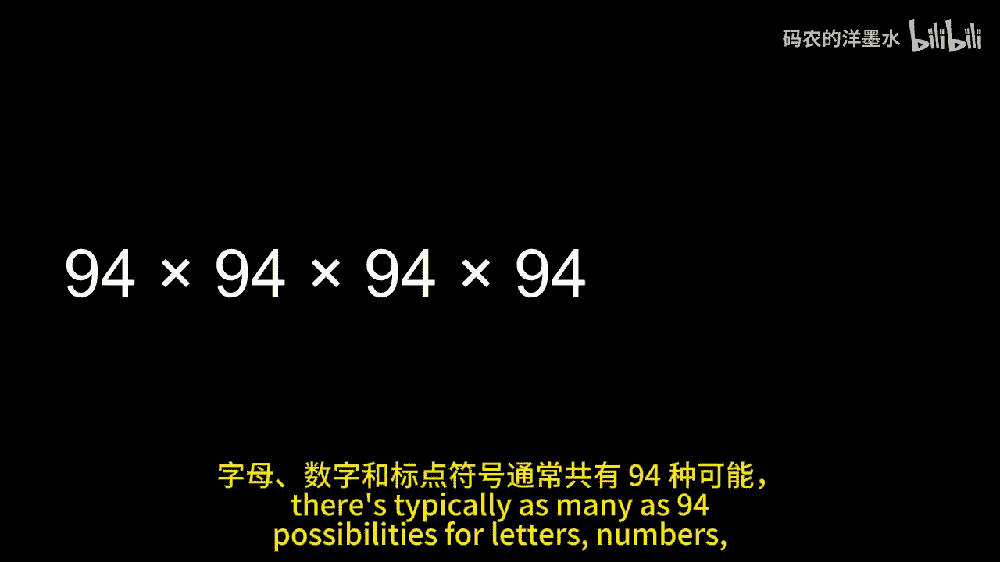

94 possible keys that I can hit here or 94 to the fourth power and does anyone want to estimate what this is we've gone from 10。

000 to 7 million to I'm seeing it indeed in the chat roughly 78 million possibilities。

 So in some sense，10 times more secure。 Let's go back to my terminal window open up my code here and import not only ASI letters but also the digits from before and also this time some punctuation as well now let's go ahead and change just the ASI letters alone to ASI letters plus those digits plus that punctuation and just to save some time I'm going highlight and copy what I just typed and I'm going to change the second position the third position and the fourth position as well to use that combination of 94 possibilities I'm going open up my terminal window again I'm going run Python of crackedtop pi and this time because we have 10 times as many possibilities I kind of had 10 times the amount of time to walk over to the screen because indeed we're still in the lowercase ease。

😡。

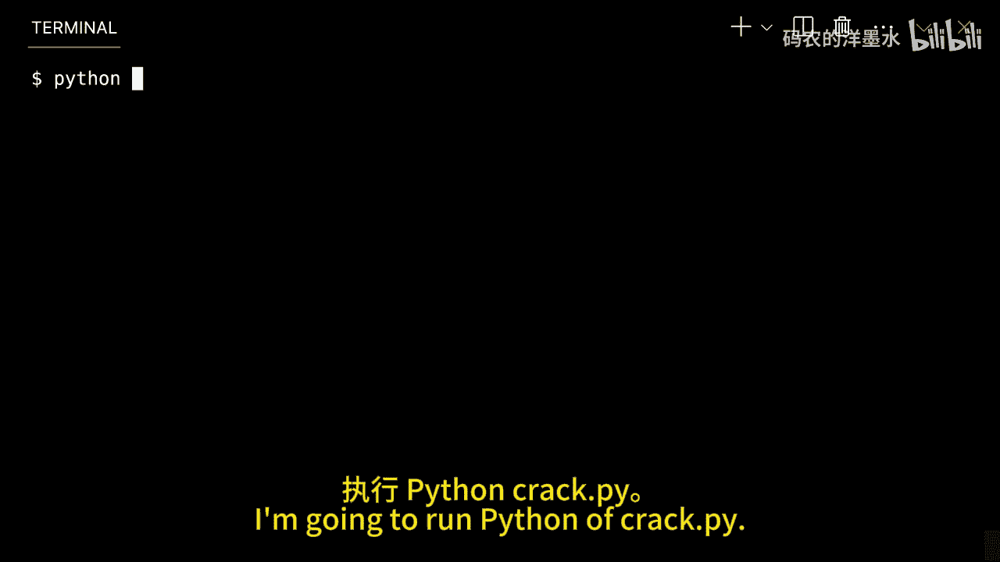

Gs， Hs。 And now it looks a bit like a Hollywood movie。

 maybe you can perhaps see even though it's going across the screen fast that there's a lot of cryptic output here because we're running through all of the letters。

 the digits and the punctuation。 So it looks a little fancy at that。

 Now you might recall too from Hollywood movies too that they tend to be very dramatic。

 And so instead of just doing this， which is iterating from left to right very slowly。

 the movies and TV shows tend to very dramatically get like the third character right then the first character right。

 then the fourth character And then just in time you get the second one as well that's not really how brute force works。

 you tend to do things methodically not jumping around from symbol to symbol。

 But this is clearly taking a long time。 And I'm not even going finish waiting for this to go。

 because we still have to get through all the punctuation。

 So this is to say ultimately that 78 million possibilities is actually getting up there pretty fast。

 But honestly， if we come back in like a minute or so， I bet that will be finished nonetheless。

 And none of us hopefully has a password。It's only four characters nowadays， letters。

 numbers and punctuation odds are it's at least a conventional eight characters and indeed most websites and apps require as much of you as well now the math here is pretty straightforward to if you have 94 possibilities but you have eight characters in total now now that's 94 to the eighth power and does anyone want a ballpark just how many passwords are possible if it's only eight characters which isn't even that long。

😡，But you have eight of them total。Too many。 It comes back one answer。 too much to count。 Okay。

 I see that we've given up here。 but oh I did see one in the chat。

 It's roughly this many possible passwords， which is actually a little hard to figure out。

 So this is， let's say millions， billions， trillions， quadrillions。

 So this is 6 quadrillion possibilities。 So now we're talking Now the adversary is probably gonna run out of time。

 run out of energy， run out of money， run out of lifetime。

 if it's going to take this much time to try to crack。 So to speak your particular password。

 And so here's one of our first takeaways when it comes to cybersecur and securing our accounts。

 It really is this game of relativity and resources。

 What we're really doing here iss not something fundamentally different by adding in digits and numbers digits and letters and punctuation。

 It's sort of still the same formula， the same approach to our passwords。 But as we add complexity。

 And as we make it longer in longer， we're raising the。ATo the adversary。 Why， Well。

 so long as you and I don't do something dumb， like still choose 0，0，0，0，0，0，0，0。

 So long as we're choosing something that's pretty random in that range of 6 quadrillion possibilities。

 it's going to take the adversary way more time than it would otherwise to brute force their way into that password。

 And so by the time they finally get into the account， you might have changed the password already。

 you might not be using the account anymore。 or you or the adversary might not even be on this planet anymore。

 And that's indeed the goal。 But there is a downside， of course， the longer your password gets。

 and the more complicated it gets， the more likely you and I are to not even be able to remember what that password is。

 And so here is that sort of balancing act trying to figure out this balance between the usability of the account。

 just how user friendly it is to access versus the security of that account。

 And finding that inflection point is somewhat personal or somewhat corporate in policy。😡。

Typically， well let me pause here and see if there are any questions now on securing our accounts via passwords alone。

😡，I was wondering a couple of years ago there were devices USB devices with fingerprint recognition。

😊，How come that's not more frequently used or it too expensive or a really good question and we'll come to this topic in a little bit on biometrics more generally。

 but your intuition is pretty much right， It's expensive to have in another device and most consumers are not going bother wasting money on something just for them some companies might。

 but if they have a lot of employees that could get very costly but you might be glad to know that one of the topics will end on today is a new technology called pass keys that actually leverages a device you most likely already have a phone that might use your fingerprint or might use your face or some other form of biometrics。

 that's becoming more common nowadays or soon will even for your laptop and desktop which will talk to that phone in some form about one more question here on securing accounts My question is why why for the diggiits password is so unsafe。

 some program still is using。

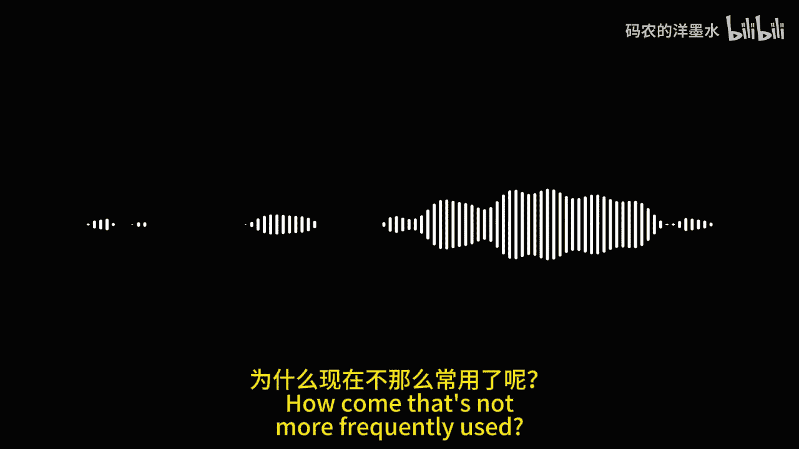

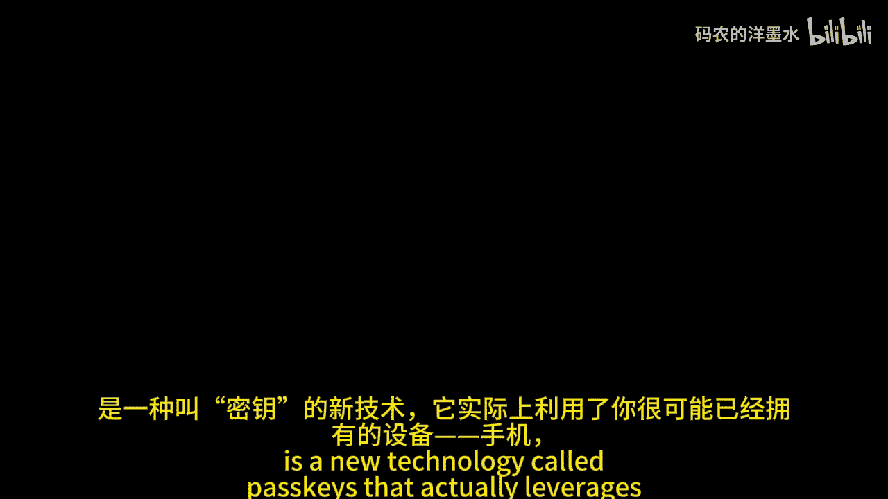

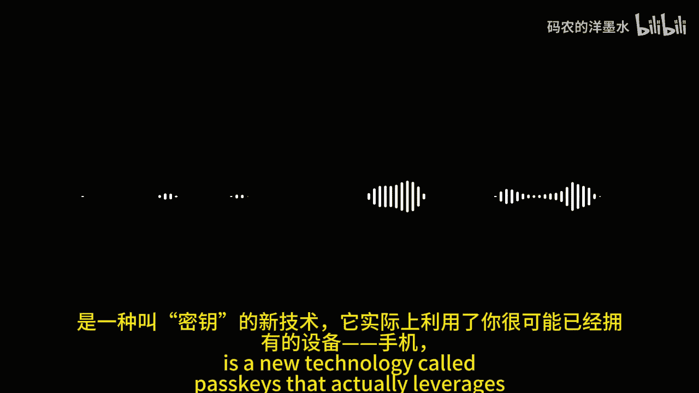

This password， not the website like program。Really good question。

 Why are some programmers using this， So it's a tradeoff between usability and security。

 If you are the programmer designing the system， you presumably want users to use the system and to come back and to keep using it。

 But if you make it too hard for them to access that account。

 if you increase the probability that they're going to constantly forget their password lose their password。

 they might just stop using your system or your app or your website altogether。

 And so that's probably not a good thing other reasons might include just an awareness or not having taken a class on cybersecurity or not really have fought not having really fought through the implications of having such short passwordcodes。

 So nowadays is industry starting to nudge us in better and better directions。

 but we'll see today and the rest of this class that there are still going to be a lot of tradeoffs again between usability and security。

 So what can we do to defend ourselves against these brute force attacks。 Well。

 at least here in the US there's an organization called the National Institute of standards and technology。

😡，Otherwise known as NISistT that actually issues recommendations for how we as consumers or companies or more generally humans can go about securing their accounts more effectively and we thought we'd share just some of these recommendations that it informs not only your own behavior as a individual citizen or consumer but perhaps if you're in a place of business where you can influence your own companies' policies here are generally what are considered best practices nowadays So a quote from their recommendations memorized secrets shall be at least eight characters in length so that at least corroborates the quick math and the tests that we ourselves just ran that only once we got up to like six quadrillion possibilities did it feel like it was going take a very long time to actually hack into someone's device so consider that for your own accounts even on your phones you might have to go through a few menu options to upgrade from just four digits to something more but odds are you'll benefit from this additional layer of security。

😡，a mouthful but helpful as well Verifiers。 So the website or app that's verifying your input when you authenticate with your username and password Verifiers should permit subscriber chosen memorized secrets of at least 64 characters in length。

 all printing ASII characters as well as the space characters should be acceptable in memorized secrets。

 Uniode characters should be accepted as well。 Now if you're not yourself a computer person。

 there's a bit of jargon within this。 But first of all the takeaways are that websites and application should let you and me come up with passwords that are actually as long as 64 characters Now that's pretty long。

 but that's exactly the point particularly as it's gotten more difficult for you and I to remember all of our passwords to come up with very complex passwords。

 the reality is you and I might very well be better off on the whole by just choosing an easier to remember but much longer password。

 for instance， a sentence。Quote a phrase that you can more easily keep in your human mind。

 but that doesn't necessarily have a crazy amount of punctuation or digits or letters。

 but at least is it 64 characters in length。 So even if an adversary tries a dictionary attack trying all possible English words or some other language even if they try a brute force attack it's going take them way too long unless of course。

 you do something foolish， like choose a 64 character passcode that's0，0，0 or so forth。

 So you still want to be original within that space。

 Now more technically this recommendation is referring to ASI ASI generally refers to US English symbols on a US English keyboard as was the origin of this code system。

 So that includes a through z 0 through 9 and the punctuation I alluded to earlier。

 but websites and apps nowadays should also support uncode。

 including things like emoji and other accented characters or symbols that you might have in a languages beyond English Unfortunately。

😡，This is not really common practice。 I dare say just yesterday I created an account on a new website for the first time and it made me jump through hoops so to speak。

 figuring out the right number of uppercase letters， lowercase letters。

 punctuation and even then it told me I could only use certain punctuation so I had to think about now which symbols I'm using that is a lot of friction that is not good for usability and it's of questionable value for the security of the system if I can't even remember the thing afterward。

 so keep this in mind in general that your passwords should not only be eight characters minimally。

 but most apps and websites you maybe be yourself develop moving forward should allow much longer passwords as well and you as the human can use longer passwords if systems allow them as well Now here's another set of recommendations from NISist verifiers the website or the apps that we're using shall compare the perspective secrets。

 the passwords you're choosing against a list that contains values known to be commonly used expected or compromise。

😡，So that is to say when you type in a password， if it's already been a commonly used password。

 if it's very easily guessable， the website or app should probably say pick a better password than that just to decrease the probability that an adversary is going to get into that account specifically NIST recommends that passwords obtained from previous breach corpusees which is a fancy way of saying if some website。

 some database has been hacked and that database contains usernames and passwords and those passwords have now been uploaded to the internet for adversaries or anyone to download and browse well then you should not be allowed to pick a password from that list because it's essentially an alternative dictionary it essentially is a list of passwords that a smart adversary should just start with before they even bother resorting to brute force which we've seen would take much more time2 dictionary words so this we've already stipulated would be a good thing to avoid because it's just much too easy for an adversary to go through a big list of English words or some other language and try those first。

😡，3， repetitive or sequential characters， A A A A A A or a slightly more creatively。

 but not good enough，1，2，3，4 ABCD。 I would also add0，0，0，0 and so forth into that category as well。

 it's just too easy for the adversary to guess that maybe you're doing something repetitive like that too。

 And then lastly， context specific word， such as the name of the service。

 the username and derivatives thereof。 This is to say if you sign up for a Gmail account for the first time。

 you should not be allowed by Google to choose a password like Gmail password quote unquote if you sign up for an Amazon account。

 you should not be allowed by Amazon to have your password be Amazon password or some such variant thereof because smart adversaries are going try those same heuristics and that's the catch too。

 if you can think of it， even if you think you're being clever。

 odds are a just as clever adversary can think of that heuristic as well， and prioritize those trick。

😡。

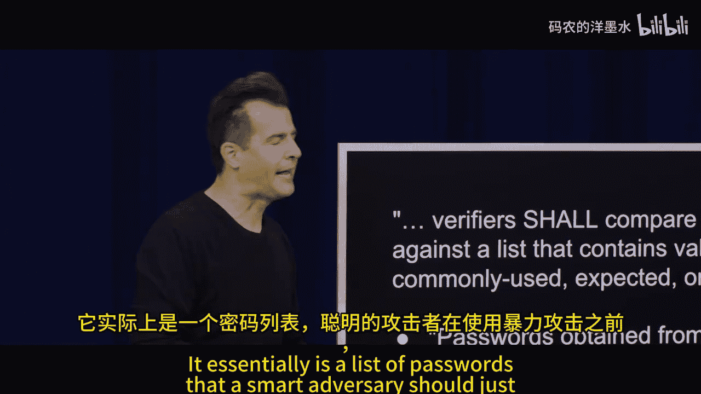

Before they resort to brute force like I did on my own laptop a few other recommendations as well。

 memorized secret verifiers shall not permit the subscriber to sure to store a hint that is an accessible to an unauthenticated claimant Verifiers shall not prompt subscribers to use specific types of information for instance。

 what was the name of your first pet when choosing memorize secrets So there are a lot of companies a lot of websites。

 a lot of applications that violate this recommendation nowadays， and in fact。

 I bet you can think of one or more accounts that you have where you've had to tell them。

 for instance， what was the name of your first pet or your first car or your mother or father's name or the like that's not good to collect either nor is a hint a good thing because frankly you and I are all too often in the habit of maybe typing into that hint field if it's available a question that's meant to help you remember what your password was but if your hint is something like my password is the name of my first。

😡。

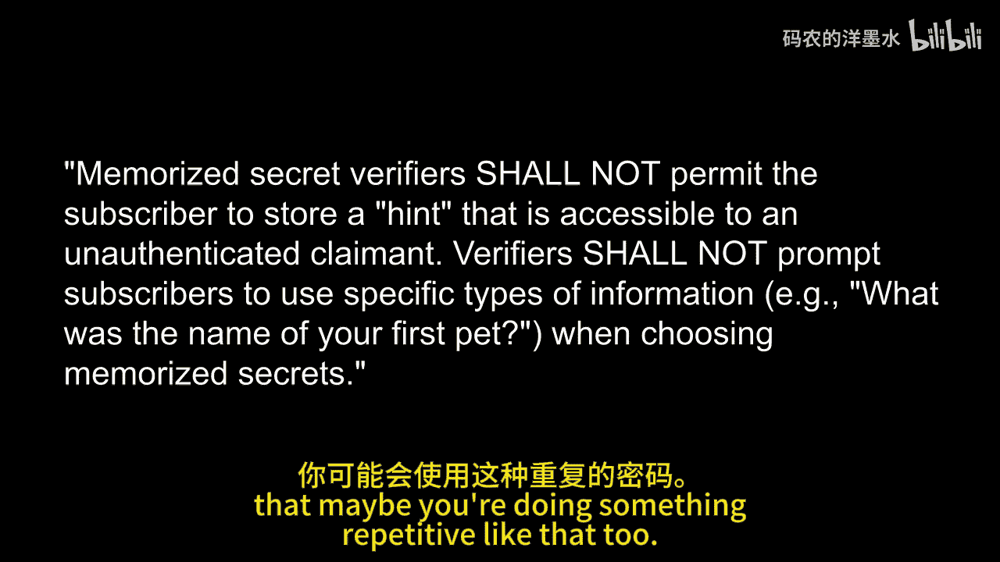

Pet， well， you're now just leaking information to the world and anyone who can go online and figure out that information can now get into your account as well。

 And so that's really the threat in this case。 if you start using personally identifiable information in this age of social media and websites like linked in and the like。

 there's just so much information out there about us that can be discovered you don't want to fill all of these databases。

 all of these systems with each of these tidbits about you because a smart adversary with enough time and enough focus on you can probably figure out all of those same values。

😡，So what more Verifiers shall not require memorized secrets to be changed arbitrarily， for instance。

 periodically， so this one too is something that a lot of companies violate as a recommendation still。

 if you're in a corporate workplace in particular， and you're being required by the system administrators to change your password every month。

 maybe every three months， six months， every year， perhaps that's not generally recommended anymore。

 even though not too long ago， it did feel like sound like a best practice but why is this not recommended anymore。

 to have you forcibly change your password periodically like every few months。😡。

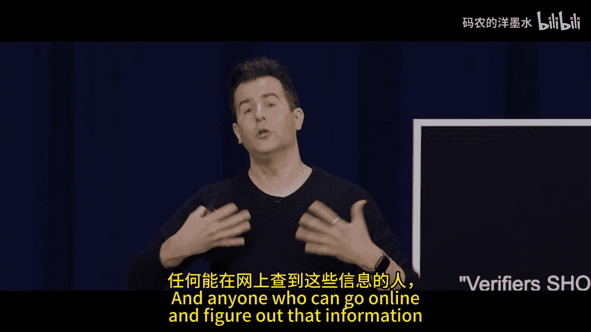

Because the password will be easily forgotten and be more vulnerable to brute first attacks。

 why would it be more vulnerable？Becauses can get access to to password and get hint a new password。

 Okay， so yes， one danger of forcing you and me to change our password too frequently is that you and I do not tend to exert much effort when we're required to do so。

 for instance， if my password today is， for instance， password1， Well。

 you know what my password might be in three months， password2。 or in another three months。

 password 3， you and I might exert the minimal amount of energy to change the password so that we meet the company's requirements。

 but so that it's not too hard for you and me to remember what the new password is。 And so indeed。

 if information about my password passwords leaks out。 And some adversary sees， well， wait a minute。

 your password was password2 last month， I'm just gonna guess Heurically that this month。

 its password 3， we might indeed be leaking information。

 What's another reason that you might not want to require humans to change their passwords arbitrarily on some schedule like this。

 Okay keep forgetting out passwords。

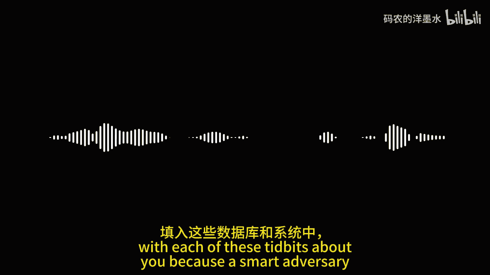

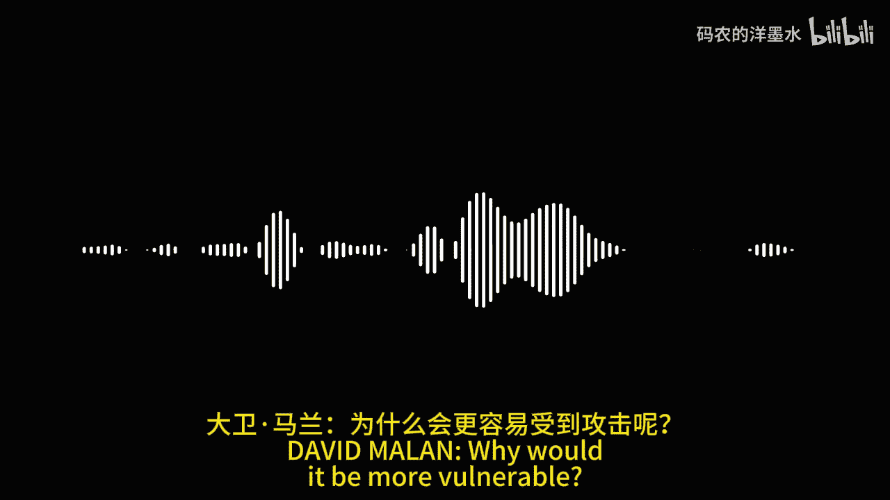

We change it too frequently so that is not a good exactly。

 if you make me change my password too frequently， honestly。

 I'm probably gonna forget what my next password is because I'm gonna get confused with last month or the previous months or the like。

 And so there's the sociological effects on us humans just being human not being very good at remembering not only the first password you made me choose that's very complex。

 but the second and the third as well。 And so generally。

 you should not come up with such a scheme anymore because of these adverse side effects。

 And how about one more recommendation here， Verifiers shall implement a rate limiting mechanism that effectively limits the number of failed authentication attempts that can be made on the subscribers account。

 Now， what do we mean by this。 odds are this is something you yourselves might have experienced if for instance。

 you forgot your password or you kept typing it slightly wrong。 Maybe your phone screen was wet。

 So it wasn't registering your fingertips properly。

 it turns out you can lock yourself out of your own phone and you might have， in fact。

 seen something like this on iPhone。 Android has。Similar screen， if for instance。

 you type in the wrong passcode 10 times in a row。 The presumption by Apple and Google and others is that if after 10 times you still haven't inputted your password correctly。

 It's probably a higher probability that you are not David that you are not you but rather it's someone else who has taken your phone stolen your phone and is trying to get into it。

 Now that's not always the case， you can imagine situations where you just were being absentmined you were half asleep。

 maybe you weren't really focusing on it and you locked yourself out。 And so there too， is again。

 a tradeoff between usability and security， but the higher probability event after 10 wrong attempts probably tends to be that it's an adversary trying to get in and not you。

 But what's the point of this beyond annoying the adversary and maybe more significantly really annoying you when it happens by accident。

 But this effectively does is it slows the adversary down。 In other words。

 it increases the cost of this。😡，to the adversary。 why Well we saw a moment ago that a smart adversary who knows a little bit of Python code and steals your phone can try 10000 possible passwords in just less than a second。

 However， if you now slow them down by having this feature on on your iPhone or Android device that pumps the break。

 so to speak that lets the adversary try no more than 10 at a time thats significantly slows them down。

 Now they might have to spend at least 10 seconds，20 seconds an hour a day or longer。

 especially since what Android and iPhone also do is they tend to increase this time limit。

 The first time you mess up it's one minute。 If you mess up another 10 times， it's now two minutes。

 maybe5 minutes， maybe 10 minutes， maybe the phone even deletes itself。

 wipes itself if that too is a feature that you or your company has enabled。 So again。

 the right way to think about this beyond the usability trade off is that we're just trying to raise the bar to the adversary。

 We're trying to make it more expensive。😡，More costly。

 maybe more risky to the adversary by slowing them down and by more risky I mean。

 if this is like a Hollywood moment and someone's just stolen the phone from your table at Starbucks or a coffee shop。

 they've plugged it into their laptop。 they're trying desperately to crack into it before you come back to the table well by slowing them down。

 it's going to significantly increase the risk too that they are caught in the act while doing it and hopefully too the goal is to just get them to lose interest in your phone。

 lose interest in your account and have them move on to ideally no one else's。

 but at least borrowing that， someone else's instead of yours。😡。

So what are other defenses against these kinds of brute force attacks or even these dictionary attacks Well。

 this is a system that you and I are increasingly being able to turn on but also increasingly are being required to turn on as well。

 which is in general probably a good thing two factor authentication or two f more generally known as multifactor authentication is a technology whereby in addition to having one factor that you use to log in like your password as is tradition you also have a second or maybe more factors that you additionally have to use in order to log in。

 but these factors don't just generally mean one password， two passwords。

 three passwords or the like， they're fundamentally different types of factors and in general they're broken down into these three categories one is a knowledge category a knowledge factor is just something that you know something like your password that ideally you keep secret。

 no one else knows and that's why it enables you to authenticate your。😡。

SoPro that you are you because you and only you hopefully have that knowledge。

 but a second type of factor would be a possession factor， something that you physically have。

 so you might be in the habit at work of carrying around one of those little keyFbs that has a little code on it that changes Now those things can be expensive so increasingly the world is just using our own phones。

 your own Android phone， your own iPhone that maybe has SMS support on it text messaging or maybe a specific app that displays a short code that you type in the presumption is if that you challenge the user not only for a knowledge factor like their password。

 but a second factor like something they possess you significantly decrease the probability that an adversary is going to be able to get into that account。

 because whereas anyone on the internet， millions of people can be a threat to you by just figuring out or finding your password a possession factor really narrows the scope of the threat to only the other customers in Starbucks or the。

😡，only the other people physically near you because they would have to physically obtain that second possession factor and then a third type of factor nowadays might be an inherentance。

 something that is unique to you specifically， more generally described as biometrics。

 so maybe it's your fingerprints， maybe it is your face nowadays。

 something that's inherent to you can be a third factor nowadays。

 because the presumption is that only you ideally in the world have exactly that factor as well。

 Now this is a little different from what some companies， some websites。

 some apps describe as two step authentication， where two steps might actually just be two passwords of some sort。

 but to factor more technically refers to two or more of these types of fundamentally different factors。

😡，That being the most common in our case here。 Now， when it comes to those possession factors。

 those keyFs or the apps or the codes that you receive。

 specifically what you're receiving in those models is generally known as a onetime password or OTP the idea being that this is not a password that you know and keep remembering and keep using again and again。

 it's literally one time because it's texted to you or it's sent via an app via push notification or it's actually sent to something on on your keycha like this here key foob。

 for instance， nowadays， a company can buy these and what happens is on the screen here。

 this onetime password constantly changes every few seconds。

 and it's synchronized somehow with a server so that the presumption is if I am carrying around this device and I type in when prompted this particular code and that code matches the synchronized code that's on the server。

 I should be allowed into the account because the presumption is that it's indeed David carrying this around and not necessarily some adversary。

 It might also be。😡，Posible to plug it in as via USB or some other technology。

 thereby removing the human from the formula so that the device itself can just authenticate using special software on the system instead。

 nowadays， though you can download special apps， whether it's one from Google or other companies that allow you to manage all in one place。

 all of these onetime passwords that you might automatically see updating on the screen and you can type any or all of them in when you're actually prompted by website or app。

 But even in this space of onetime passwords and possession factors。

 it's worth keeping in mind that some of these technologies are more secure than others。

 Now it's very common for websites or apps nowadays。

 to want to send you one of these onetime passwords via text message， for instance。

 and you receive it via S and then you can type in that six digit code。

 as is often the case more secure though would be something like an actual app that you install from the app store the Google Play store that actually talks directly to。

Some server and does not just go over the cellular phone network， Why is that Well。

 as you might know in your phone is typically a Sim card， either a physical card。

 a little chip or nowadays it might actually be built into the phone as well。

 but that Sim card has a unique identifier And when you sign up for phone service typically with the company they need to know what the unique identifier is of your Sim card be it something physical or something wired。

 hardwired into your device。 Why because that's how they associate your phone number with that specific device。

 the catch is that it's all too possible and in some cases all too easy to trick even the phone companies into swapping your Sim。

 not necessarily doing it physically per se， but convincing the mobile phone carriers to update their system to say oh。

 David now has this Sim card and not that original one That is to say if I'm an adversary and I just have any old phone with any old Sim card and I figure out what the unique idea and maybe I call up David's。

😡，Mobile phone provider。 and I somehow convince them that I am David by tricking them into believing it's me as by telling them all of those personal information。

 all of that personal information about myself， I might be able to convince them to swap my SIim card。

 the adversaries with what is already on file The implication of that is that when David subsequently gets text messages。

 they don't actually go to me the real David， they go to the adversary's phone as well because they're tied to that SIim card So in general nowadays。

 if you have a choice using some website or app to use SMS or textbased messaging versus a native application that you install onto your phone or other device you should generally prefer the ladder。

 some first class piece of software that actually uses push notifications or your data plan and does not rely on SMS text messaging because of this potential threat。

😡，So what are still other threats when it comes to these systems。 Well。

 it turns out that it's very possible， unfortunately， for adversaries to somehow get software。

 malicious software， otherwise known as malware onto your Mac onto your PC perhaps even onto your phone。

 this might be because you installed a piece of software that you shouldn't have trusted this might be because your phone or your device is infected with something like a virus or a worm。

 but in general， you might be vulnerable to malware。

 including software that logs all of your keystrokes。 key logging refers to exactly that。

 some piece of software that most likely maliciously is literally recording everything you type or everything you tap into that device。

 and what is this software do with those keystrokes very often it will upload them if there's an internet connection。

 maybe to a server that the adversary controls。 Now what's the implication of this key logging threat。

 Well， if you're typing in your user name， that's not such a big deal because those are generally public。

 but if you're typing in your。😡，and that's being automatically uploaded to the adversary server。

 Now they know your username and your password worse if the adversary also sees you typing in that six digit code。

 onetime password that you might have received even from your phone or some other device if they are fast enough and smart enough and figure out how to log what you're typing send it to the server。

 perhaps even before you yourself hit enter， maybe they can use not only your username and your password。

 but even that onetime password by pretending to be you on their own phone or their own laptop or desktop typing in or more realistically automatically through software typing in those same values and accessing your account even before you had a chance to do so as well。

 Now what are the defenses against that particular threat。

 really just to be generally paranoid about what computers you yourself use For instance， nowadays。

 I will rarely， if ever actually use like a。😡，An Internet cafe's computer or even a lab computer here at Harvard's campus or frankly even a friend's computer because I don't know just how safe they are when it comes to best practices using their device on the internet I will in general only log into websites and apps on my own personal devices which isn't to say that I too imperfect but rather at least I'm reducing the probability that I lose control over my data by using some other device that I myself don't oversee by that person。

 that owner not themselves adhering to best practices now even then I will admit that using keyloging and getting it up to an adversary server and inputting it faster than you might is a pretty sophisticated and difficult threat but it's worth keeping about it's worth keeping in mind and realizing that these are certainly theoretical attacks and if you yourself are targeted for some reason these are absolutely things you should be mindful of so in general。

😡，If you have the luxury of only using your own device and not some shared device。

 that too tends to be best practice， I would say。😡。

All right， any questions on these here attacks？😡，Regarding using long passwords。

 do you recommend using like Google passwords or Apple passwords for the system to remember the passwords for us。

 A really good question。 short answer， yes， but we'll come to that in more detail in just a few minutes。

 So what are other attacks that we should be mindful of。 So this one has kind of a funny name。

 but there's this attack known as credential stuffing。

 And we've seen we've come across reference to this already in this discussion thus far。

 credential stuffing， a credential is something like a username and password refers to the process of an adversary having found a whole bunch of usernames and passwords。

 maybe online， maybe in some database that they or someone else attacked and posted for the whole world to download credential stuffing means not using dictionaries not using brute force。

 but just literally using a list of already known usernames and passwords。

 maybe from some other application or website to try to stuff them into a different website to see if well maybe if David。

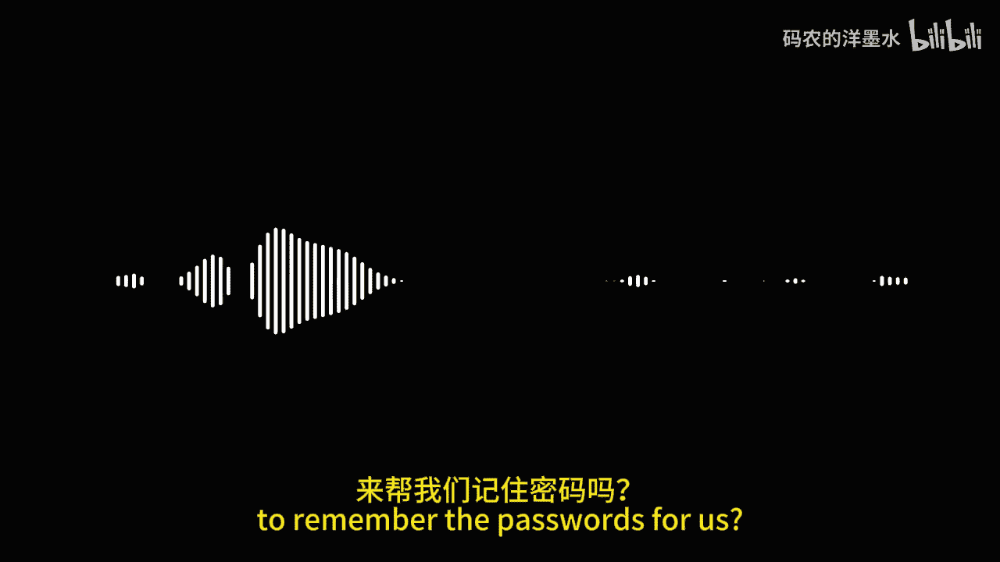

Using this username and password over here with high probability。

 he's probably using the same username and password over here So credential stuffing is the threat that I dare say many of you are vulnerable to now you don't need to raise your hands and admit to this right now but if you are using the same username and the same password on two websites three websites 30 websites。

 all websites you are today vulnerable to this attack to be clear if any one of those websites or apps is compromised by some adversary and they figure out all of the usernames and passwords on that system what a smart adversary is going to do now is to try that same username and password they found for you on Amazon on Gmail on any other website or app that you with high probability might be using just because those services are popular so what's the takeaway ideally if you want to be immune to this kind of credential stuffing attack where someone takes your credentials over here and tries to stuff them into these other services over here。

😡，You have to use different credentials on each and every website on each and every app。

 you cannot should not be reusing the same password on multiple websites or apps。 username， yes。

 especially if it's your email address， but passwords。

 No Now this is admittedly easier said than done。 So we'll see soon how we can try to achieve this。

 avoiding credential stuffing by having unique passwords by at least having some help when it comes to managing the same。

 but there's another attack too that's come up in directly here already known as social engineering。

 Social engineering isn't a technical attack per se。

 but rather a social one and an attack among humans。 for instance。

 let me go ahead and suggest the following。 if you have a piece of paper near you and a pen or pencil。

 go ahead and write down if you could on that piece of paper， one of your passwords。

 Any of them is fine。😡，Just go ahead on this piece of paper in front of you。😡，And write down。

One of your passwords， including any letters or digits or punctuation。😡。

Now I'm seeing in the chat some resistance， I'm seeing some heads down though and some scribbling。

 which is exactly the point why would you take my suggestion and write down your password on a piece of paper even though I'm presumably someone you should trust in a cybersecurity class those of you who reached for a pen or pencil just wrote down one of your passwords on a sheet of paper were're just socially engineered because a circumstance was created where you believed or trusted the person that was asking or telling you to do something and you took at face value that you should do that thing moving forward if any teacher ever asks you to write down a password on a piece of paper。

 one takeaway for today is just don't do it that would be social engineering and in general if someone calls you on the phone sends you an email and tries to get information from you even if it seems and sounds legitimate moving forward after today especially you should always have a healthy skepticism if not just enough。

😡，Prannoia to be healthy in the interests of protecting your account， moving forward。

 if you had someone ask you something like that or even a little more nefarious。

 trying to figure out what your first pet was or something should kind of perk your ears up。

 Your Spy senses should go up so to speak in the context of Spidman。 and you should wonder。

 wait a minute， Why do they need that information。 let me see how this plays out before I share anything about myself。

 And indeed， if you were bless your hearts。 But if you did jot down your password with a pen or pencil。

 remember that feeling of being duped because you do not want that to happen when it actually matters。

 Now， after this， now I know you'll believe nothing I say。

 but go shred or tear up or flush whatever piece of paper has that password on it。

 The point is not to share it with anyone Just to prove that particular point。 Now。

 beyond social engineering， there's another threat that's a variant of that but is more technical in nature。

 and that is fishing。 And most of you probably have heard about。

In this context and you can think about it sort of physically like going fishing。

 but trying to hook a sucker， someone like me or you who is duped into providing information that they shouldn't。

 and this very often happens via emails。 odds are if you go through your spam folder sometimestime you will see emails that seem to be coming from Paypal co or seem to be coming from Google or maybe a politician or the like and very often those emails are encouraging you to click a link and maybe make a donation。

 click a link， maybe change your password， click a link and verify your information phishing is all about trying to use social engineering in this case in a technical way to try to convince you through very convincing looking emails and even websites that it is a legitimate email from Paypal co or it is a legitimate email from a politician or it is a legitimate email or request from a teacher here at Harvard but it's not what they're trying to do the adversaries in this case are。

😡，On your trust for those certain companies or persons。

 they're trying to prey on your comfort with familiar user interfaces。

 things that you've seen before， but unfortunately it's all too easy for an adversary to make a very official looking email to make a very legitimate looking website。

 even one that looks identical to Paypal co identical to Gmail or other services and frankly。

 if you take some of CSs with these other courses kind of boils down to copy and paste in the simplest of scenarios。

 just copying and pasting some legitimate website and pretending that you own it too So how my phishing manifests itself in the real world well consider one of those social media posts online that tend to invite you to comment with your favorite song from childhood sometimes those posts have like a million responses from people you know and don't even know but more than being interested in what your childhood favorite song was those posts are very often phing for personal information because suppose that you or at least someone。

Those comments is actually using their favorite childhood song as their answer to some website or secret question。

 Now， the author of that post， not to mention everyone else knows the answer to the same。

 So how else my phishing manifest itself in the real world if you were to visit a screen later today that looks a little something like this well this looks like Gmails login page。

 at least here in the US when using English and frankly。

 I've seen this so many times that I might be inclined to just blindly type into the form my email address and then after that。

 probably my password， but it's important to begin to develop an intuition for a suspicion for when and when these sites might not be legitimate how might you do that Well you should minimally be looking at the URL bar and making sure that it is Gmail co or probably Google co or whatever Google country code depending on where you live in the world making sure that it looks legitimate and that you've actually been there before。

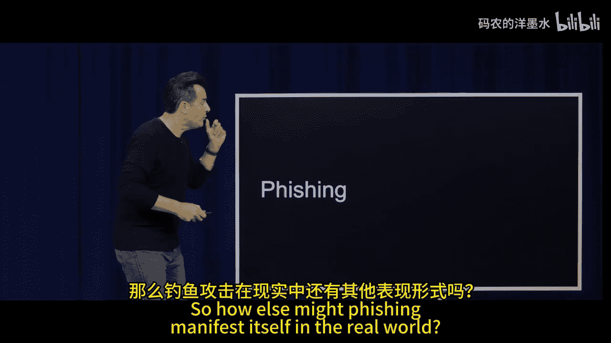

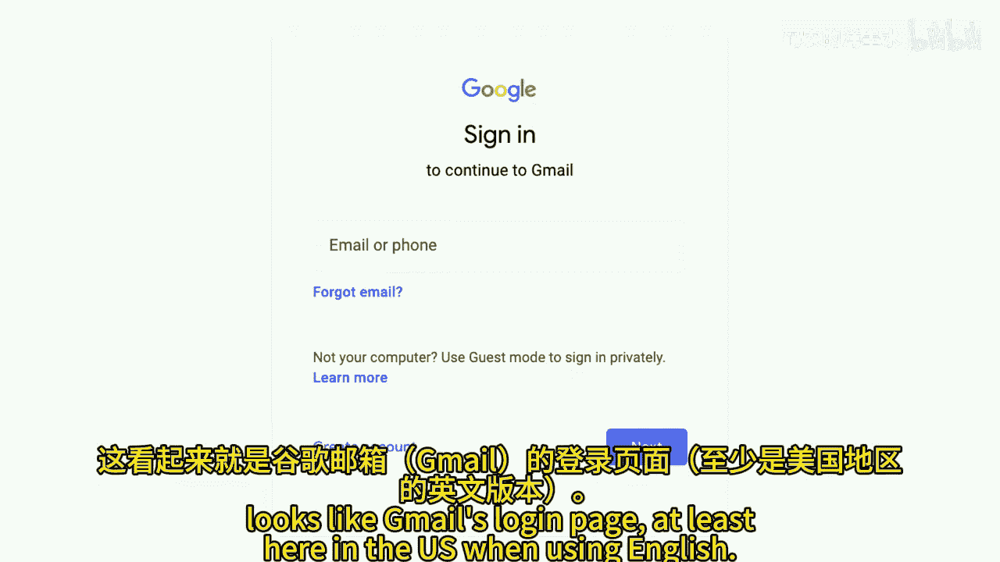

When you hover over links， you can very commonly in your browser。

 look at the bottom lefthand corner or some corner of your screen and you can see what URL a link will actually take you to even though the words on the screen might say something the actual link might take you somewhere else Now even then it's hard sometimes to discern these kinds of things but these are just best practices you don't need to do you don't need to be so worried that you don't go anywhere on the internet。

 but you should learn to keep an eye out for these kinds of things and in general with phishing rather than trust any link in an email that you receive。

 especially when it's something private like a bank account， something medical。

 something personal well that's fine open a new tab and manually go to Paypal co enter or manually go to Gmail co enter don't just blindly trust these links Now here again we see a tradeoff between usability and security it's a little annoying if I can't just click on a link and go to the place I want to go you have to manually open the page。

 type it in。😡，and so forth。 But again， it depends on what's now more important to you。

 the usability of that service or the security of your account therein this is even worse when it comes this is even more worry someone when it comes to two step verification and Google take some liberties with the wording here。

 This is usually best described as twofactor authentication but again the most sophisticated adversaries theoretically if they sent you a phishing email tricked you into a visiting a website that looks like Gmail but is not Gmail they could theoretically even prompt you for a twofactor code like this。

 And then if they're smart and savvy enough with code。

 they could automatically now send your username， your password and a twofactor code maybe to the real Gmail co log into your account change your password before you even get up and running therein it's a more sophisticated threat and it's not something you need to worry about as much but it's this principle of not just trusting screens and requests that are presented in front of you。

😡，You should have this healthy skepticism and at least some technical savvy to know how you can decide for yourself。

 Yes， I am comfortable with proceeding with this step。

 Now there's another type of attack too that's more sophisticated and not one you need to worry about as frequently as some of the earlier ones but they're generally known as a machine in the middle attack whereby if you're on the Internet there are suffice it to say many other machines on the internet very often between you and whatever website or app you' are visiting often those machines might be things like routers servers that internet service providers。

 companies， universities， maybe even your own home owns and controls but all of your data is passing through those machines in the middle so to speak if any of them are malicious and are maybe storing your data looking at your data。

 it's possible that you might not be having secure communications with the other end and you are using certain defenses and in our focus in this class on data willll talk about。

😡，tography and encryption and building blocks via which we can mitigate attacks like these。

 but it's worth knowing about this general idea that even though it feels like it's only you in Amazon co。

 it's only you and Payal com it's only you in Whatsapp。

 there are many other machines in the middle and if you're not using the best practices and if you're not keeping an eye out for those things suspicious those machines in the middle might actually be there to attack you to take your data to change your to access your accounts or something more as well。

😡，So there's a lot of attacks out there。 and at this point， you might be feeling a bit defeated。

 but hopefully we've presented at least enough defenses thus far。

 and there are still a few more to come， but let's consider now kind of the source of a lot of these problems。

 Unfortunately， it's you and it's me Like the whole story here today started with you and I are not very good at choosing passwords and we generally like you meet the minimal requirements。

 not necessarily the best practices。 but again， there's these sociological side effects of certain corporate policies or technical policies that do induce this tradeoff between security and usability。

 And it's one thing for me to preach here， so to speak and say， yes， you should use long。

 complicated passwords that are really hard to guess with letters and digits and punctuation still。

 maybe even 64 characters if you rather want to be really secure， even if it's a longer phrase。

 but honestly， there are also these pressures on me not doing that。 It's annoying to type in 64。😡。

It's annoying to type in eight characters If a lot of them require uppercase。

 lowercase punctuation and the like。 and honestly， I have dozens。 I have hundreds。

 maybe thousands of accounts nowadays on the internet that have accumulated over time。

 What am I going do if it just gets difficult to remember these things。 Well。

 like someone you you yourself might know in your company you might walk by their desk and see on their monitor the familiar yellow postit note with one or more of their passwords actually on it。

 maybe worse， you open their desk drawer and there's a whole printout of all of their username and passwords or even beyond that maybe they actually have a text file or an Excel file。

 a Cv file on their computer thinking well， at least it's all digital but it's just sitting there on their desktop and worse。

 maybe it's called passwords TxT or the like But that's a very real side effect of having policies and technical constraints that make it harder to use systems。

 So what are some other defenses that either you can use or maybe companies can use or offer to make things better。

😡，A solution to some of these problems might be this single signon or SSO。

 So single signon refers to an ability to sign up for to log into to one's website using an account that you already have on another website and very often the account that you use is one of the big ones。

 One of the popular websites or applications out there。 So for instance。

 if you log into this representative website here， what you might see is yes。

 a form field bio which you can type in your own email address and your password to log in or if you prefer。

 you can just log in with Google， or you can just log in with Facebook。

 or you can just log in with any number of other services if this website or application supports it Now what's the motivation here。

 Well one， it's still backwards compatible so to speak with the very familiar approach of just let me register with my own email address。

 let me come up with my own password and be done with it。

 especially if I don't use Google or Facebook as a customer。😡。

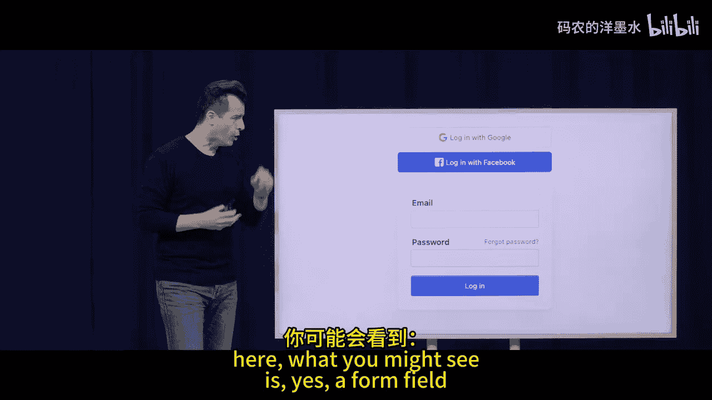

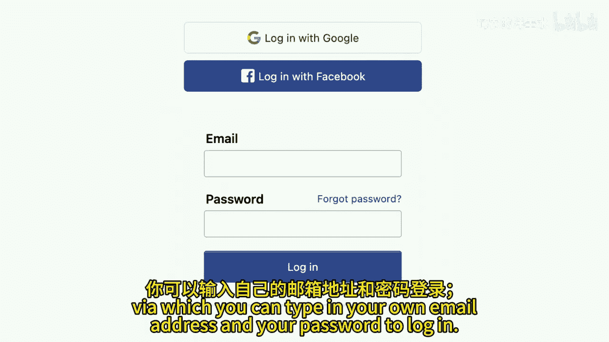

But the upside of offering these solutions， especially for popular websites like Google and Facebook and others。

 is that if I already have an account with Google or Facebook and hopefully I already have a good password for both of those because those are important to me and better yet I ideally have twofactor authentication enabled on one or both of those because again they're important accounts to me wouldn't it be nice for this new website to let me one just log in with my existing account so that I don't have to waste time signing up for yet another internet account I don't have to remember a new password that's going be difficult to remember and so forth so it decreases friction。

 it increases usability of the system and ideally it increases the security of the system in this case as well。

 why Because if you're doing a good job protecting at least these most important personal account then this website stands to benefit from those same best practices on your part。

 Now what is actually happening here when you click log。With Google login with Facebook。

 you should see the Google login screen or the Facebook login screen respectively。

 you should literally be redirected in your browser to Google co or Facebook co or one of their international domain names instead there you'll type in your same username and password as usual for Google or Facebook。

 but that password is not given to this new website or this thirdpart website you're visiting rather using a technique known as cryptography and encryption in some fancy math。

 essentially the username with which you log in is sent back to this thirdpart website。

 but not your password， just a confirmation that yes。

 David successfully logged into Google or David successfully logged into Facebook therefore you can trust that his username is Meland@harvardedduu or whatever it is I typed in to log in there。

😡，So using single sign on benefits not only you potentially。

 but also the website or application by making it easier for you to register and or log in subsequently as well。

😡，Now， where does this leave us ultimately， some of you might already be thinking well。

 what about using a password manager and some of you might be thinking what is a password manager。

 So let's emphasize this one perhaps the most increasingly best practice is to use a piece of software that manages your passwords for you thankfully there's gonna to be an even better solution this on the horizon but for now minimally if you're not using a password manager。

 you probably should be if you're using the same password on multiple sites or applications and thus you're vulnerable to credential stuffing。

 you should probably be using a password manager instead so that you can change all of those accounts to have unique passwords。

 but this piece of software known as a password manager can remember those passwords for you if you are in the habit of choosing very easy passwords because it's just better for you to remember you should probably start using a password manager because beyond remembering your passwords these password managers also make it easy to generate new passwords click。

😡，A button and essentially it will generate a password that's however short or long that you want with some uppercase。

 lowercase， symbols， numbers， whatever it is a website requires。

 it will just generate it for you and better yet， it will then save that generated password for you so you。

 the human do not need to memorize it And you， the human certainly don't need to write it down on a postit note or any other file somewhere else。

 So password managers literally do just that and they have even more features than that generally。

 if you're using a password manager， and you go visit a website for the second time or the third time you can typically hit an automatic keystroke that will just automatically log you in。

 it will fill in your username under your password， but better yet it will only do so。

 if you're on the real Gmail do co or the real Facebook do co or the real Paypal co these password managers also remember the URL at which you created or last use that username and password so that if you are somehow。

Oubject to a phishing attack。 you've been tricked into clicking a link and going to a website that looks like Google looks like Facebook。

 but actually isn't。 The password manager will ignore your keystrokes and not actually log you in pasting into that form。

 your actual username and password because it doesn't recognize that same URL So there are a lot of upsides of these password managers。

 the one catches that the onus is on you to remember one primary password that protects your password manager itself。

 That is to say if this is a piece of software that stores all of the dozens， hundreds。

 thousands of usernames and passwords that you have。

 you are putting proverbbially all of your eggs in one basket。 so to speak。

 that is you want to protect this password manager with probably the best password you've ever come up with。

 This should probably be long， it should have some complexity， it should be a little annoying。

 perhaps to type in。Because you don't want an adversary to get in and get access to everything else。

 but it's just one password that we're really asking you to pick really well and reasonably long so that you're protecting everything else。

 Now these password managers are a little different than what you're probably familiar with in your own browser。

 It's been common for years for browsers to remember your username and password by just showing you like bullets like dot dot dot in the form field so you can just hit enter。

 That's fine。 But that information is often associated only with that one browser。

 It doesn't propagate to your phone or another device that you're logged into。

 It's not easy to share it with someone else。 if you have a family account， for instance。

 or something like that。 So password managers often offer additional features beyond that and really protect all of the things that you're using and also help you generate those same passwords。

 Fortunatelyly， thankfully nowadays， these are increasingly standard。

 There are thirdpart options that you can find。Online or even purchase。

 but they're increasingly built into our own operating systems， which if I had to choose。

 especially for a less technical audience， using what comes with your computer from the major manufacturers。

 is probably a good thing as opposed to going third party unless third parties offer you additional features that might be especially beneficial in companies and families or the like So Apple has what they call their icloloud keychain via which you can not only stave passwords on one device。

 they can propagate securely to your other device like your phone， Google has its password manager。

 Microsoft has its credential manager and there' are certainly other options as well the takeaway for today though should be that if you're not using a password manager。

 it's probably time to start doing So at least for your most important accounts。

 maybe things that are particularly personal medical financial anything where you or your family would really be upset if that account were somehow compromised。

 at least figure out how to start migrating those kinds of accounts。

A password manager and also enable some of our other best practices like twofactor authentication better yet。

 don't just enable twofactor authentication。 Don't use SMS if you can instead use like a native application on your phone or even a physical key foob just to decrease the probability of those threats and I would encourage you too because it's one thing to sit in on a class like this and be like oh yeah I should do that but then it just feels like so much work to go and change all hundreds or thousands of my accounts again。

 take baby steps bite off the easiest most important accounts first and over time the next time you log into that other website。

 okay go ahead and change the password to something better。

 put it in the password manager and be done with it the next time you go to another website do it that one you can do these things incrementally because again with this advice。

 I'm just trying to help you personally strike this balance between usability and security because if your takeaway is I have to go change a thousand passwords tonight you might not realistically do it so better would be to change a few。

and chip away at this problem over time。

Let me pause here and see if there are any questions if a management is helpful why we are using anti websites。

 Oh， so you should certainly be using antivirus for other reasons that we'll talk about in another class。

 viruses worms and malware can do any number of bad things， including encrypting your data。

 deleting your data， sending spam from your computer。

 there's many reasons you want to run it instead。 However。

 if you have malware like a virus on your computer and it's logging all of your keystrokes。

 theoretically， you could still be vulnerable to attack if they are also logging your two factor code。

 maybe because you get distracted， you don't enter fast enough and they can use that too。

 It's a lower probability threat。 It's a theoretical one。 but also in the interest of best practices。

 you don't want any software on your computer that could be doing bad things anyway。

 you just want to raise the bar as much as you can to these adversaries without making your own accounts unusable。

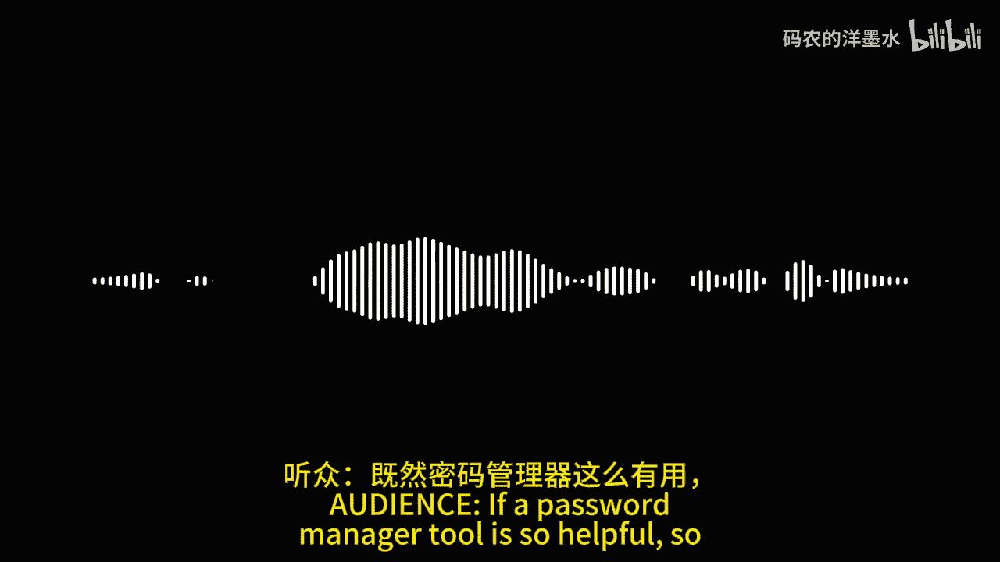

Another question。 Oh yeah。 I had a question about social engineering。 if that's fine。

 And we know that the rise of AI technology， you know， now AI can record your voice and sample it。

 and that could be a real threat in social engineering。

 because now someone can mimic your boss and call you or someone can mimic your voice and call your bank。

 So is there a way to combat this or just is there any technology to prevent this from happening。

 That's a really good question in another piece of advice that should reflect back if on any of your accounts。

 particularly bank accounts， you are using voice recognition technology。

 whereby when you set up the account， you were prompted to say a phrase into the phone， For instance。

 to evoke an old movie called sneakers， My voice is my password。

 you should disable those features and stop using them assuming there's an alternative like to factor authentication whereby they send you a push notification to an app or the like the reason being exactly that is you probably seen in this age of AI there are technologies。

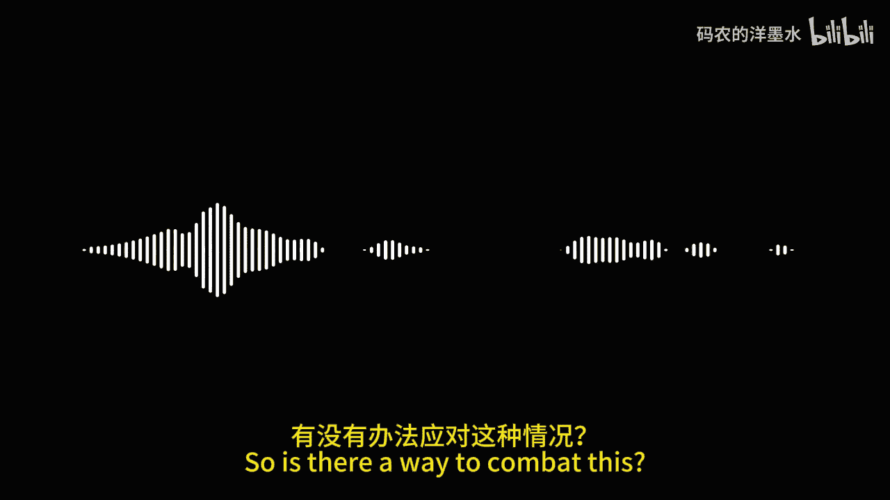

Deep fakes whereby you can generate video， but also audio of people。

 This is very commonly done for celebrities for politicians and voices that you see a lot on the Internet。

 but it would not be that hard if someone has access to voice recordings of you to use some software or some app to generate you saying my voice is my password。

 even though you might not have said that in since the time you set up the account and so your accounts。

 too， might be compromised。 So my own advice there would be don't use voicebased recognition anymore。

 if there's a better alternative available。

Other questions。😡，Doesn't having one password manager。

 so figuratively keeping all your keys in one safe defeat the purpose of having different passwords because if you lose that one key to your。

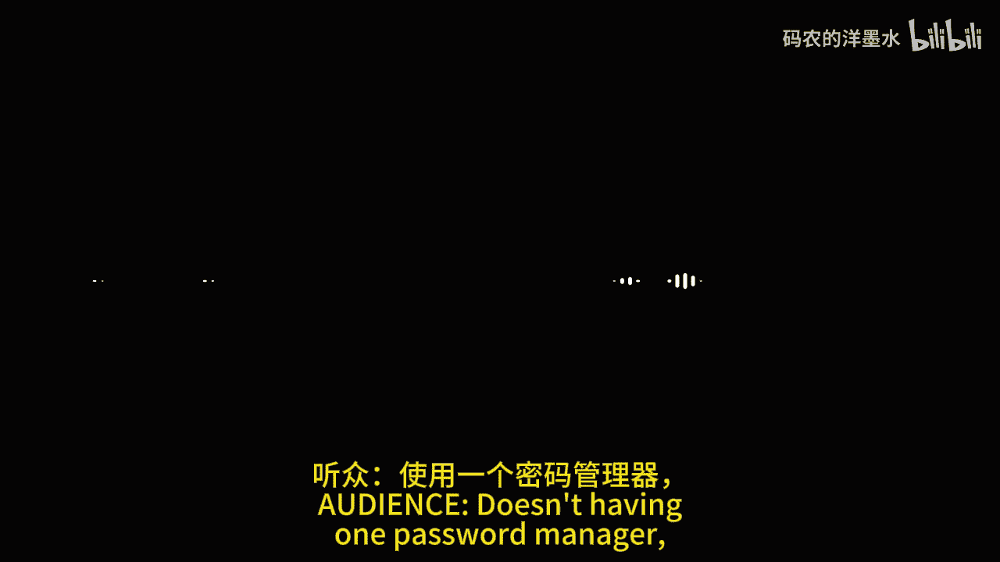

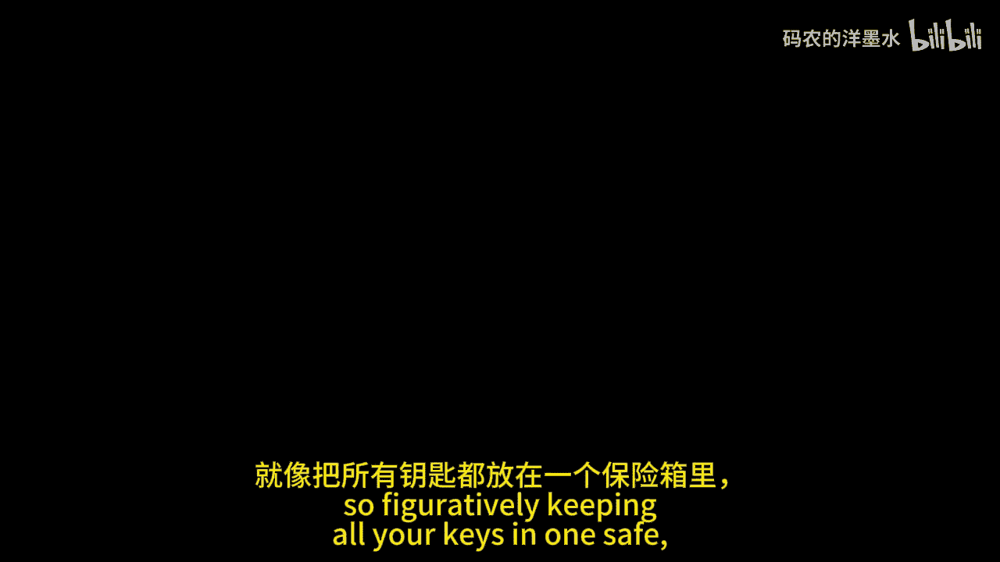

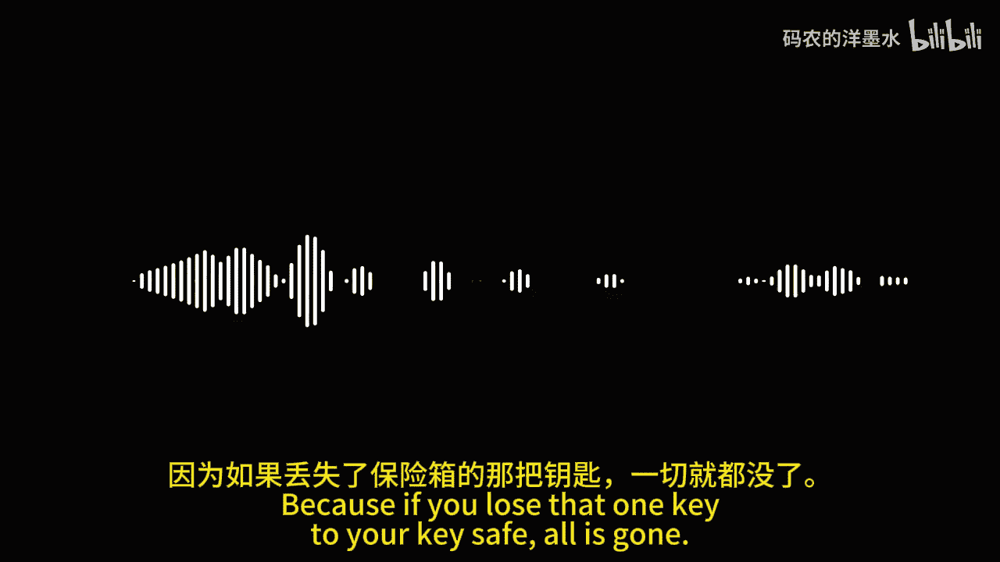

K Dave。All is gone。It's a really good intuition and that's exactly the tradeoff to think about I would consider in deciding for yourself if you want to take that advice what the alternative is。

 because if you're using pretty easy to guess passwords everywhere。

 like this is probably a net positive to move to a password manager instead if you're reusing the same password on a lot of websites and apps this is probably a net net positive to switch to a password manager instead。

 if however though you've actually been a very good internet citizen and you've been choosing hard to guess unique passwords for all different sites。

 they're not written down on a posted or easily accessible then this might be a net negative for you to put all of those eggs so to speak in one basket thereby making them more vulnerable from experience and from sort of the head nods and admissions that we get from students over the years I guess that most of us in this room would benefit as a net positive from a password manager but there too you should decide for yourself and again one of our lessons for today is don't just believe something some guy。

😡，On the internet I told you， decide for yourself based on these tradeoffs。

 these upsides and downsides。😡，Now password managers are not all upside indeed if you lose or forget that primary password。

 you might lose access to all of your other accounts。

 Fortunately there is an alternative that's increasingly available on websites and apps known as pass keys and what's nice about pass keys is that moving forward it will be your Mac your PC or your phone that generates a pass key for a new website or app for which you're registering you yourself don't have to remember what that pass key is and indeed it isn't even just one value rather it's a pair of values a private value and a public value that have a mathematical relationship between the two and those two values are used the next time you try to access that website or application your Mac。

 your PC or your phone will use those values to automatically authenticate you thereafter and better yet those values are synchronized as needed across your devices so that you can use your Mac and your PC and your phone or any other such devices to authenticate but to better understand these pass keys will need to know。

😡，A little something about the world of cryptography。

 and so for that we'll wait for our discussion of securing your data， so more on that next time。😡。

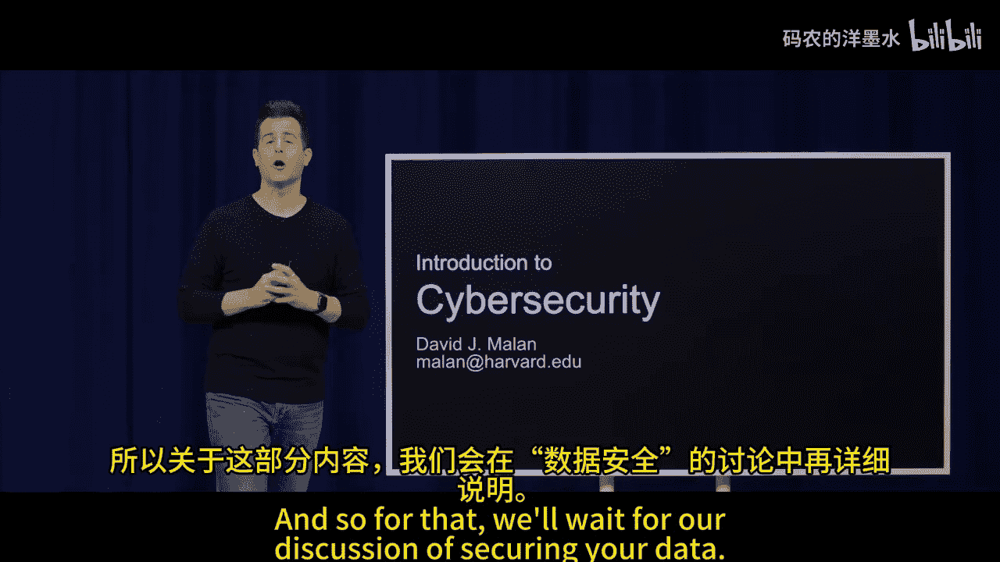

Yeah。

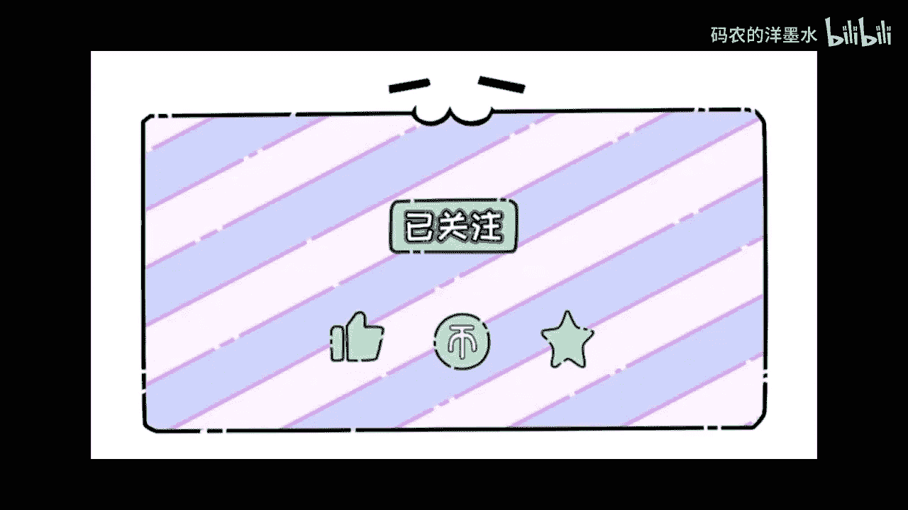