# 【全集】哈佛大学CS50 & 网络安全 中英字幕 课程附完整课件 p03 Lecture 1 - 保护数据 -BV1wJy3BLEe7_p3-

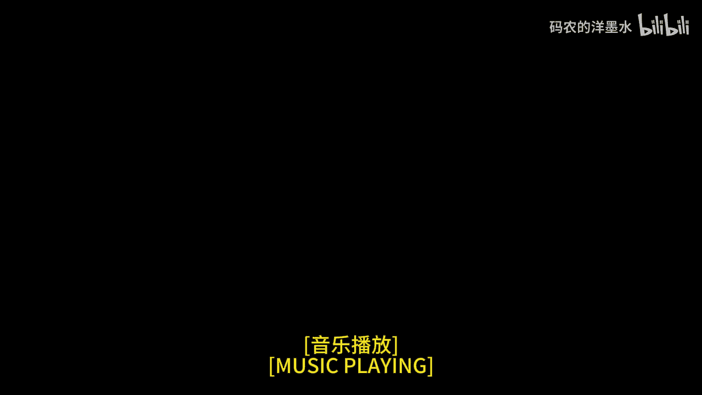

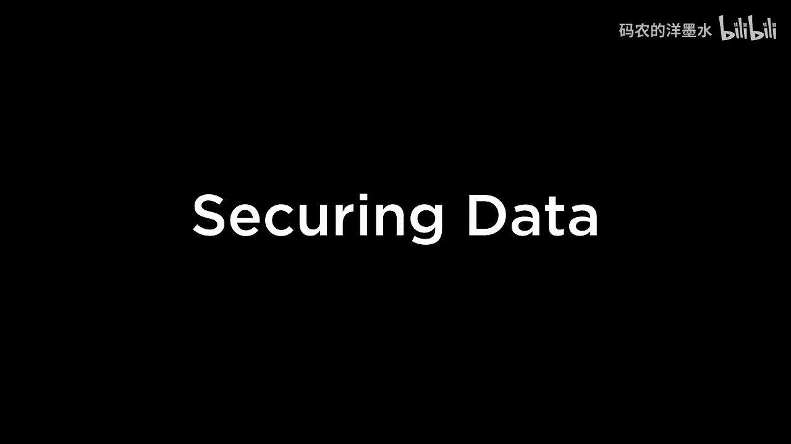

All right， this is CS50's introduction to cybersecurity。

 My name is David Main and this week we'll focus on securing data。 Last week recall。

 we focused on accounts and particularly one of the mechanisms via we protect our accounts is generally by way of these things called passwords but we focus last time really on are having the responsibility to keep these things secure and yet there's another party involved whenever you have an account with a username in a password and that's the server or app that is actually storing that password in some form long term so that you can actually authenticate yourself that is proved to this application or website that you are who you claim to be。

 Well， in the simplest form， perhaps these servers that are storing our usernames and passwords for which we have registered or maybe doing something very simple like this。

 for instance， if a website or app has two users at the moment。

 at least Alice and Bob and suppose for simplicity that Alice's password is Apple and Bob's password is banana。

You could imagine that app website or that app simply storing in like a very simple text file。

 these key value pairs， username， colon password， new line， username， colon password。

 new line and in fact， that's actually very commonly how passwords are stored on systems。

 at least certain operating systems like Linux not necessarily as simply as this。

 they often have a little more information off to the right there， but in essence。

 it's the username and password， but this wouldn't be a good thing to store the passwords exactly like this。

 why Well， suppose that this website or this app and its database are somehow hacked by an adversary that if someone gains access to that file containing these username and passwords Well at that point they literally have everyone's username and password and we talked last time about a text like credential stuffing whereby an adversary。

 once they know your username and password on one system they can try stuffing that username and password into other systems。

 other websites， other apps， just in hopes that you are。

Fortunately using the same username and password elsewhere as well。

 So this is generally not a good thing if an adversary gets access to everyone's username and passwords。

 and even though of course， in an ideal world that would never happen。

 we should probably as the administrators as the creators of this website or app。

 we should probably do everything we can to at least minimize the fallout， the downsides。

 the damages that might result if and dare say when our database or this text file here are somehow compromised So how might we go about doing that here。

 rather than just storing Apple and banana in clear text so to speak。

 literally in the English words themselves， why don't we go ahead and employ a technique known as hashing。

 Now， if you've studied computer science before， you might actually know this phrase in the context of hash tables and data structures。

 Well， it turns out the idea in this world of securing data is very similar and in fact。

 this is a technique that's incredibly common for solving all sorts of problems。

 what do we mean by hashing。In this context， hashing is the process of taking a password is input and somehow converting it to a socalled hash or hash value。

 Now， these hash values don't look like English。 They're typically strings of text that might have letters might have numbers。

 but they're generally of some fixed length typically and in this case here。

 when we go about taking our password is input converting it somehow via an algorithm or some code that we wrote。

 We want to convert it into this hash value and then store that hash value in that database of passwords instead。

 So here's a proverbial black box。 and let's stipulate for the moment that I have no idea how hashing works。

 But I do know that this box can do it。 So how do I think about this process。 Well。

 generally speaking， there's gonna to be some input to this box。

 ultimately I want to get some output from that box。 And what this box really represents is in fact。

 a hash function you can think of this as a device like some kind of machine。

 you can think of it like a program， some piece of software。

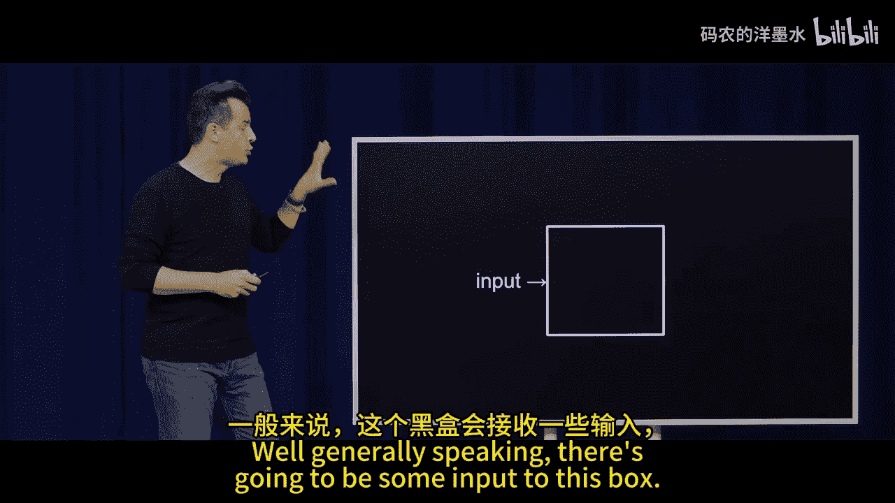

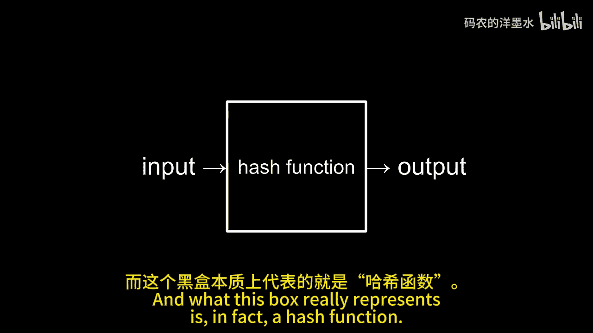

Or you can even think about it as a mathematical function that operate simply on numbers coming in as input。

 In fact， if you're mathematically inclined that we won't use the syntax often you can think of that hash function as being represented by F。

 you can think of the input as being represented by X。

 and you can think of the output of this process as being so-called F of X。

 if not familiar with that notation that's fine， but this is directly connected hashing to basic mathematics as well that you might encounter before long。

 But what we care about is passing into this black box。

 a password and getting out a hash and then storing that hash and not the password in our database or text file of usernames and passwords。

 So how might we go about doing this。 Well， if I were to provide Apple as an input to this hash function let's think about the simplest hash function possible that doesn't output Apple but some representation of Apple that I can eventually store in that database。

 So I'm going to propose very simply that maybe the simplest。😡。

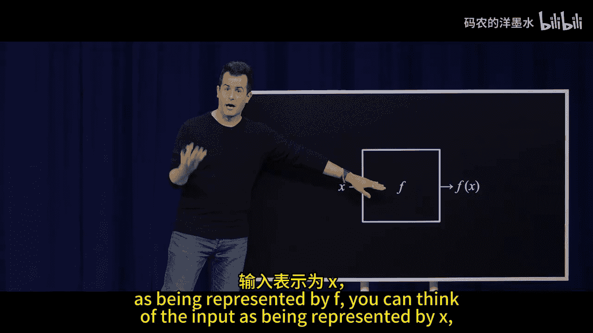

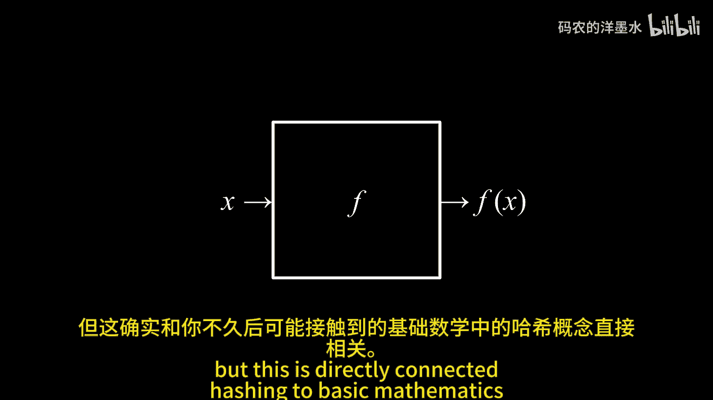

Hash function we can come up with。 And indeed， if you've studied computer science or taking C50 itself。

 you might recall that we can hash our inputs unlike specific letters therein。

 So Apple starts with a。 So you know what a is the first letter of the English alphabet。

 So I'm gonna create a hash function here pictorially that outputs one。

 whenever the input happens to start with an a as does Apple。 Meanwhile， if we pass in banana。

 I'm gonna have this hash function output2， because B is the second letter of the English alphabet。

 And dot dot dot we might get to cherry or other passwords as well。 that might output 3 and beyond。

 And you could imagine doing this for all letters of the English alphabet。 Now， unfortunately。

 this isn't the best hash function because it's fairly simplistic and in fact。

 I can quickly think of some other fruits like avocados that also start with a and that would give me the same hash value。

 And that's actually a characteristic will come back to whereby when you hash values。

 there can actually be ambiguities potentially。😊，Whereby two inputs might actually have the same output and we'll consider eventually what the implications of that might be。

 But for now， I dare say that's a little too simplistic And what might be better than outputting one or two or3 is a little something more cryptic because that's just too helpful。

 That's too much of a hint。 If I see that your hash value is one。

 I at least know that your password now clearly starts with an a which means at best， I can do 1，26。

 The amount of work to figure out what it actually is。

 So we want these hashes generally to be a little weird looking and really unguessable and not leak any information。

 So for instance， a very common older hash function for Apple might actually output this dot dot E K W X A 8。

3 D H IA with some mixed uppercase and lowercase letters there're in。 Now it looks weird。

 you probably can't and shouldn't see any kind of pattern in there。

 There is a fancy math formula that took as input Apple and outputted as it hash。

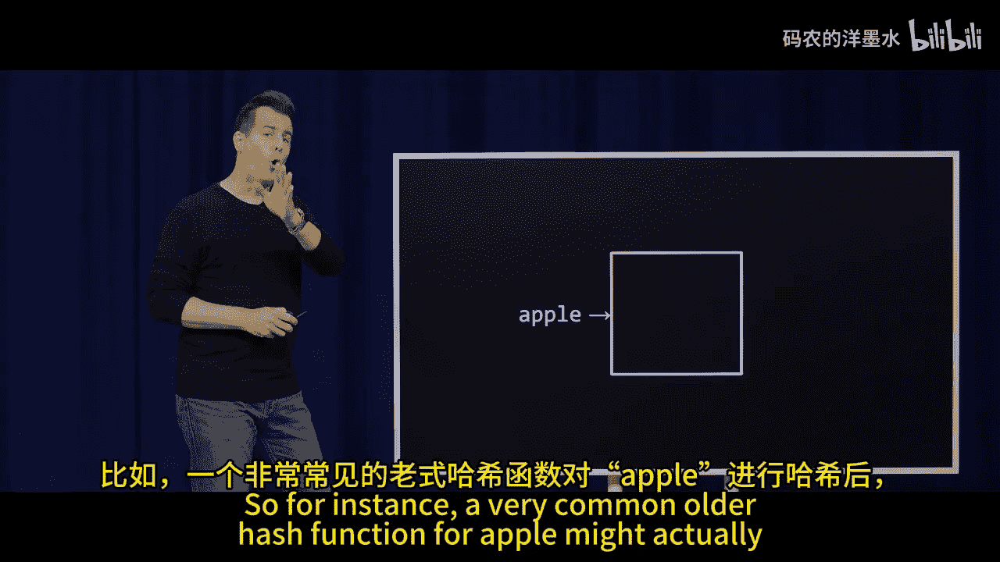

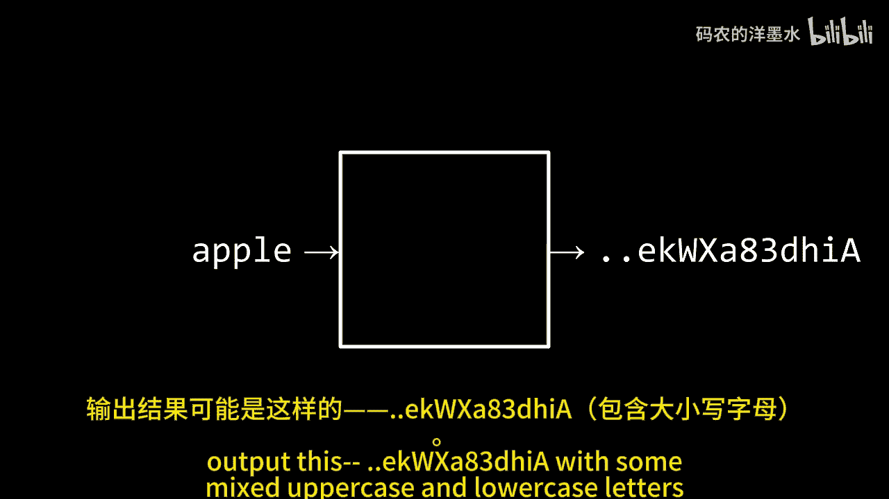

That string of text there。 But in and of itself， it doesn't really leak any information like the number one or two or three would。

 So we've already made an improvement。 Banana， meanwhile， would look like this and cherrry。

 meanwhile， would look like that。 So notice that these values are indeed quite different。

 So using this better hash function I claim that doesn't just look at the first letter of the alphabet。

 but looks at maybe all of the letters in the input， C H E R R Y， in this case。

 we can probably come up with something more interesting， more cryptic looking， if you will。

 like the values we've just seen。 So let me propose now that what we should do in our database of passwords is not store Alice。

 Apple， Bob banana， but let's instead store the hashes of Apple and banana respectively。

 So instead in this password database。 I'm gonna store this instead。

 the exact same values that we just saw coming as outputs from that black box。

 But in this case now I'm storing in my database of passwords usernames and hash。

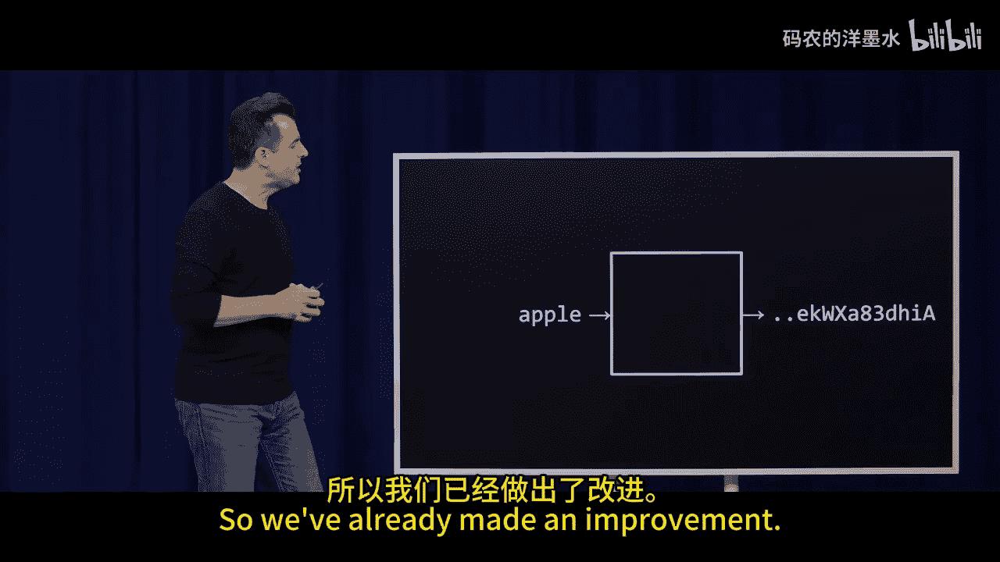

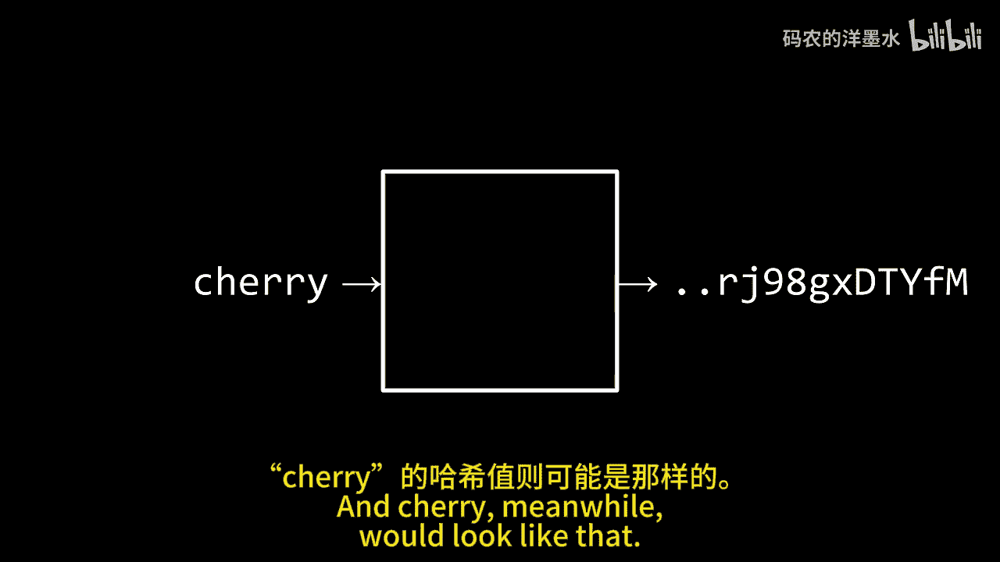

Values。Now， why is this perhaps a good thing。 Well， one。

 if someone now attacks this server and somehow gains access to all of these username and hashes。

 what they don't have is an entire list of password。

 So they can't quite as easily go about credential stuffing and figuring out maybe if this database will give me access to my account somewhere else。

 I at least creating some work for the adversary。 But at the same time。

 I feel like I've kind of broken the whole system because previously presumably。

 when you log into a website or app and you type in your username And then you type in your password。

 what is the website or app probably do， Well， once that username and password are sent over the Internet。

 typically to that server， well， the server probably compares what you typed in against the username in their database or their text file and the server compares what you typed in is your password against whatever password is in their database。

 But now we have a problem， We have you typeping the username and we do have the username still in the database。

Point Alice and Bob are still here。 but what we don't have is Apple and banana。

 We've replaced those all together with hashes。 So even if you type in or Alice types in Apple， well。

 we don't want to compare APP L E to this because it obviously doesn't match。 And Bob's banana。

 We don't want to compare against this because it's not gonna match and so forth。😡，So what can we do。

 Well， the way authentication typically works on the server side when using hashing is as follows when you first create an account or register for this website or app。

 you type in if you're Alice， Alice enter and then Apple， for instance， enter that username。

 Alice that password， Apple are sent to the server。

 But what the server does before saving the username and password。

 is it runs that hash function on Alice's password。

 which is Apple converts it thereafter to this value and stores Alice's username and the hash of Alice's password only and throws away Apple deletes it it forgets it in memory。

😡，What then happens next Well the next time Alice tries to log into this website， maybe the next day。

 a week from then， a year from then for the second or third or more time。

 What happens Well Alice types in Alice as or username hopefully Apple as our password hits enter those get sent to the server as usual and obviously the server can't just compare username against username and password against password because it doesn't have the password in its database so what can the server do the server can repeat the very same process。

 taking Alice's password as inputted APPleE， run it through the exact same hash function a day a week a year later and then compare that resulting hash value to whatever is stored in this text file or database and now admittedly we're creating a whole lot more work for ourselves but it's not that big a deal because this is just a math function or if you know how to program it's just a few lines of code that you've written in software that converts passwords to hash values。

😡，Honestly， nowadays， you wouldn't even rewriting most of this code yourself。

 you'd be using a library， thirdpart code that someone else smarter than you maybe has written and gotten it just right。

 no bugs or mistakes， so you're just relying on someone else's code anyway to achieve this goal。

 but the upside now to be clear as if this file is compromised somehow。

 the servers hacked into and this data is leaked， at least they only know the username on your system not the actual passwords。

😡。

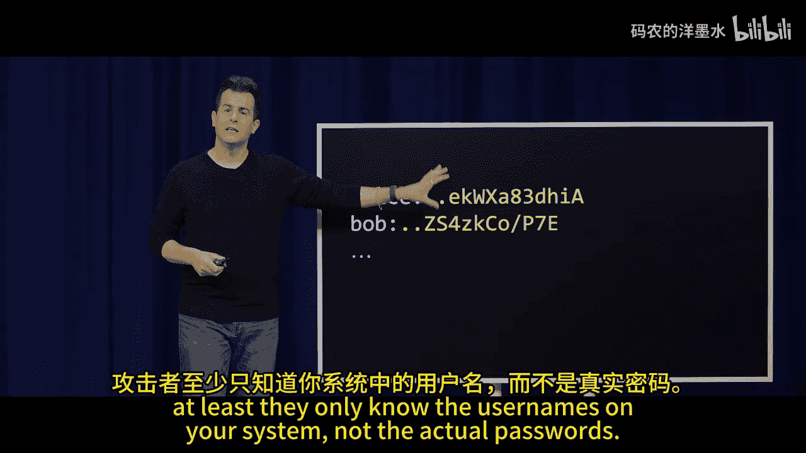

Let me pause here and see if there's any questions on this technique of hashing。

Four passwords specifically。You said yourself， we are using libraries more often than write the hash functions ourselves if we are not taking the course on CS50。

So then it's easy to hack this hash has right， because we can go through 10，50， I don't know。

 hash functions that are available in the libraries。😊，And then you can reverse the hash results。

 Is that right， Almost you can do exactly what you described first， whereby you use the same library。

 the same code to create hash values to then compare those against what's in the database。

 But generally， these hashes are not reversible per se。 You can compare them。

 but you can't reverse the process for reasons will come back to。 But your intuition is right。

 And so really the takeaway here is that we haven't made our system absolutely secure。

 we've made it relatively more secure。 Why， because we've increased the cost to the adversary to the hacker。

 they now have to do more work to figure out what the actual passwords are if they want to benefit from this hack。

 So again， it just raises the bar， It does not keep the adversary necessarily out or even stop them from figuring out one person's password。

 but it might take them a lot more time。 It might take them a lot more resources like server or cloud cost or money or it might even heighten the risk before they actually are。

😊。

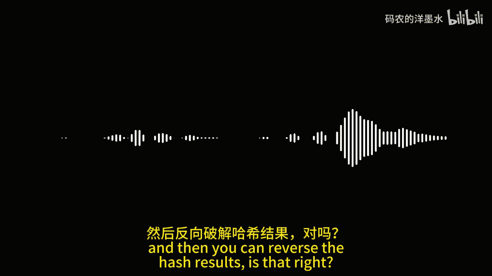

about one other question here on。

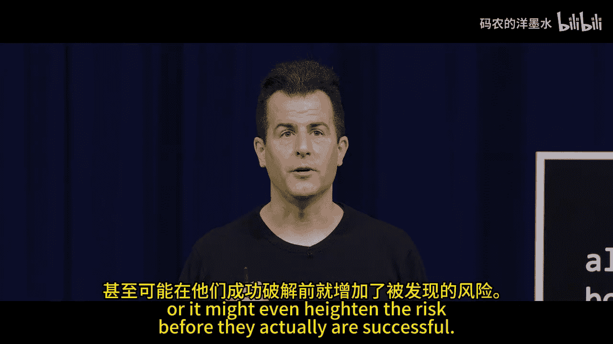

Hashing if the if the password is intercepted before after after the website is hacked and the password is intercepted before it's encrypted。

So wouldn't that pose a problem。 Yes， absolutely。 then all bets are off。

 Everything we just discussed is not useful at all。

 If the adversary has actually intercepted the password before it has even been hash。 Now。

 thankfully， there's gonna be solutions to that problem too will come to them today。 But for now。

 focusing only on hashes， It solves one problem， but not all。 In fact。

 it turns out that those attacks we talked about last time with respect to our accounts are still possible。

 you can still use a dictionary。 For instance， of English words or better yet。

 a dictionary of English fruits。 And you could one fruit at a time run each of those values as input into the same hash function。

 The library or code that you're using to achieve this。

 And then that's gonna give you one hash value after another。

 And you could compare each of those hash values against whatever is in the database or the file of passwords that you。

 the hacker in the story might have actually stolen somehow。 you have to do more work though。

 because it's no longer。😊。

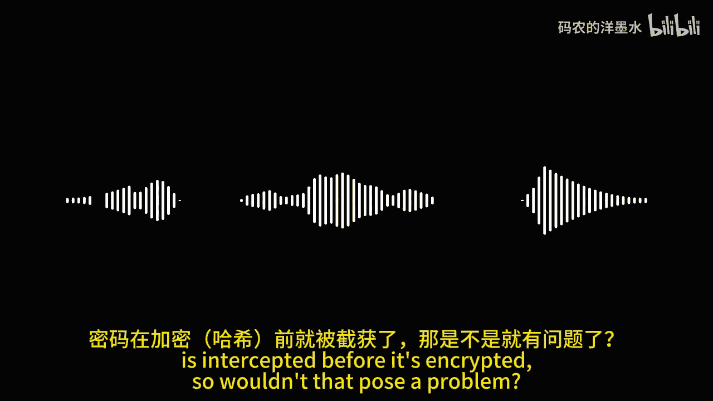

As simple as just comparing Apple against Apple and banana against banana。

 You actually have to do some work。 You have to do some computational work。

 And if the file is only a few values， of course， not a big deal。

 if it's thousands or millions of rows。 It might actually take a lot more time， energy and effort。

 So again， we're just raising the bar， but not keeping the adversary out altogether。

 And even if you don't have a dictionary available。

 And even if the passwords are not all fruits in English。 Well。

 you can still as the adversary resort to brute force attacks。

 And you can try even the simplest of passwords like 0，0，0，0， or maybe 80s instead。

 and you can hash that and see what the resulting hash value is and compare that against what's in the database。

 then you can try 0，0，0，0，0，0，0，1， hash that， compare that against what's in the database and then move on to the next。

 and the next doing this not just for numbers， but for letters as well。

 A A A A A hash that and compare。Eventually， Apple will be on that list。 Eventually。

 banana will be on that list。 but there too， the brute force attack is still going to take some amount of time。

 So it's just increasing the cost or the complexity for the adversary in this particular taste。

 But there's yet another threat that's possible in the context now ofh the hashes which is worth knowing about there's a term of art known as a rainbow table。

 which is a very beautiful way of saying that adversaries in advance might have already hashed all possible English words and a dictionary adversaries might have already hashed all possible passwords of length 4 or five or 6 or 7 or 8 or something else。

 And maybe if they have a big enough hard drive， they are storing a big table。

 like an Excel file or a CV file of all of the words that they've tried。

 all of the passwords they've tried。 and all of the hash values they've already computed。

 Then it's even easier。 then they don't even need to do a brute force attack per se hashing and hashing and hashing and hashing。

 then they can just compare， compare。airBecause indeed。

 a rainbow table simply contains all of the passwords they've tried。

 all of the hash values they've generated。 And so they just compare left to right。

 whatever the user typed in against the hash value they've already computed。 Now。

 for certain hash functions， this threat of a rainbow table is just not feasible。

 you might need terabytes or petabytes of data， which means a lot of hard drives in a lot of money。

 So there are potential downward pressures on this kind of an attack。

 but it can certainly speed things up。 Certainly if you're precomputing。

 that is precalculating some of the hashes for at least words in an English dictionary and certainly some shortlist like all of the fruits in the world。

But there's another problem that we might encounter on the server with regard to our passwords。

 Alice might have a password of Apple。 Bob might have a password of banana。

 but suppose that both Carol and Charlie have a password of cherrry。 and just by coincidence。

 they both chose the same password and are in this same database。 Now we've already concluded。

 I think that we definitely don't want to store the plain text passwords。

 We don't want to store literally in the clear Apple banana， cherrry and cherrry。

 because this is too easy for the adversary to do bad things with it。

 So we at least want to hash this。 but here's where hashing can kind of leak information so to speak。

 If I go ahead and use the same function I've been using to hash Apple and banana and now chrry。

 what do you notice about Carol's and Charlie's hash values。😡。

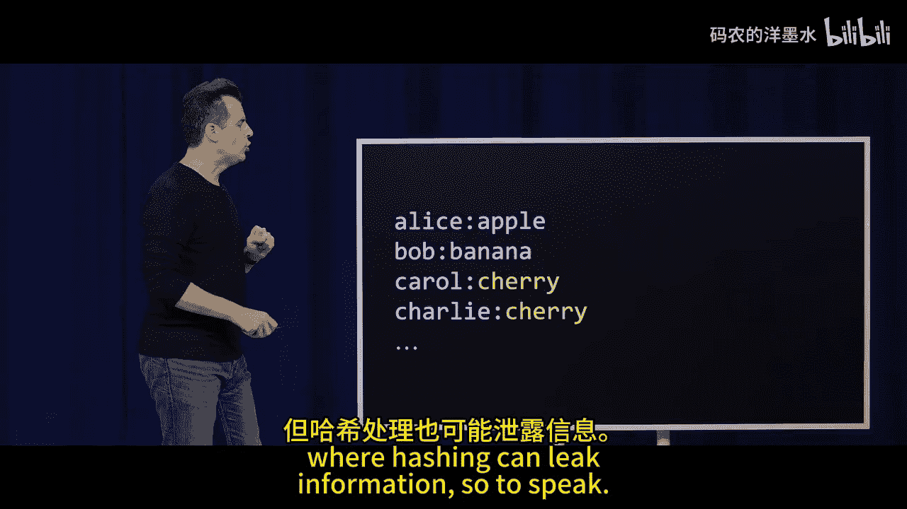

Curiously， but maybe not surprisingly， they're exactly the same。

 That's after all how functions typically work， be it in math or in software in code。

 if you pass the exact same input， unless there's some randomness going on。

 you're gonna get the same output again and again。 Now， why is this a big deal。 Well。

 if some adversary attacks this database and gains access to all of these these username and hashes。

 we have leaked information in the sense that the adversary。

 just by glancing at this file knows that， okay， I don't know what Carol's password is or what Charlie's password is。

 But I know it's the same password。 And that alone might be enough information to figure out with higher probability what it is。

 Maybe Carol and Charlie are related。 So maybe you focus on words or numbers that are common to both of them。

 Maybe there's some information that's implied by this。

 if they both are in they both like the same TV shows。 They both like the same movies。

 you can try to find in your mind， maybe the intersection of information。

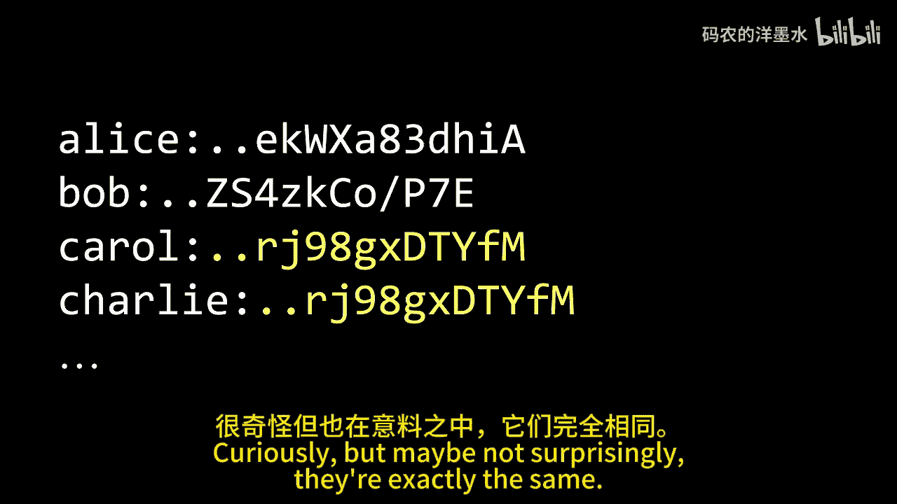

And that might lead you with higher probability to figure out without brute force。

 even what Carol's password is and Charlie's password is。 So this is a common problem。

 And we only have four users in this database。 You can imagine having many more odds are。

 some of us are going to have the same user name， not the same username。

 some of us are going to have the same passwords。 In fact。

 without raising your hands or admitting to this for the whole world to see。

Do any of you have a password of one， two， three， four？In some website or app， maybe a little harder。

1，2，3，4，5，6，7，8。 you know， something very simple like this。 Maybe it's an account。

 you don't really care about， well， that's a perfect example of where if you have an account on the same system as someone else here in the classroom。

 you're going have in that database， presumably the same hash values。

 and that might be alone enough information to leak and increase the probability that you and not Alice or Bob are actually compromised with respect to your account。

 So how can we fix this。 Well， it turns out there's another technique in the world of data that we can use to perturb this process。

 And you can think of it metaphorically is like sprinkling a little bit of salt on the hash function。

 So it's to change what its output is。 It's not random per se。

 but you are perturbing the output so that it's much less likely that two people with the same passwords are going to have the same hash value。

 So how does this work。 in this case before when we passed in chrry as。

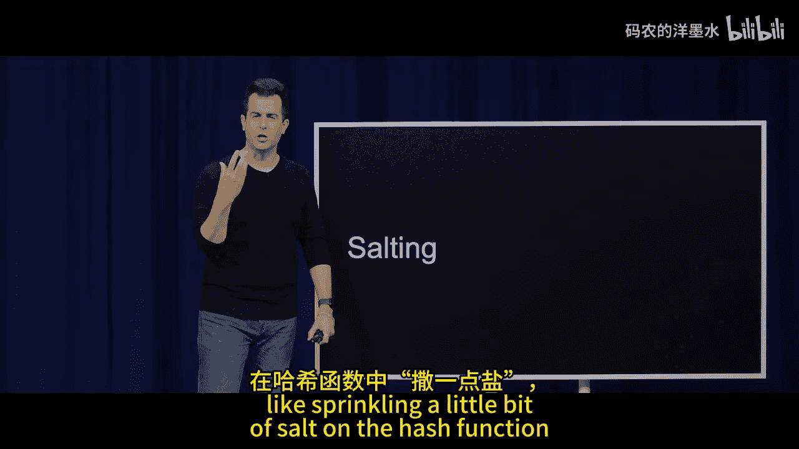

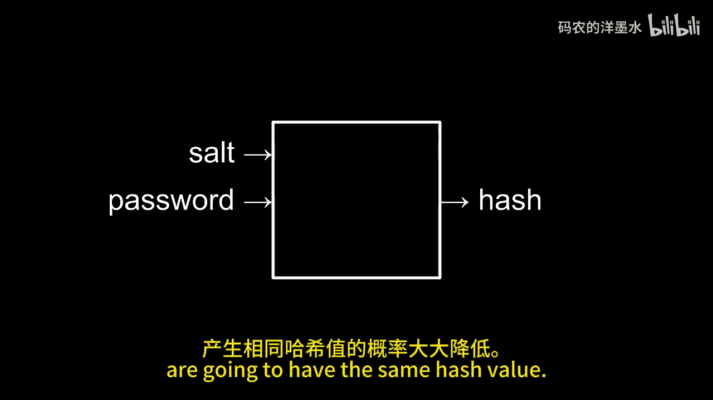

input， we got the same hash again and again。 But let me propose that we modify our hash function to take two inputs now。

 not just a password， but also a salt value so to speak a little bit of a sprinkling of in this case。

 just two characters to numbers to letters or a combination thereof。

 now this hash function that I'm describing is still gonna output a hash value but notice it's different from the one before。

 and even if you don't quite remember what it was before。 it was not this。

 but worth noting is that in the output of this hash function now is the salt itself。

 So the salt isn't something that's meant to be private or secret or secure。

 it's just sprinkled in there to make sure that whatever hash value comes out of this black box is a little bit different than if you had put a different salt value instead。

 So for instance， suppose that for Carol and for Charlie， we use different salt。

 And that's the idea different。

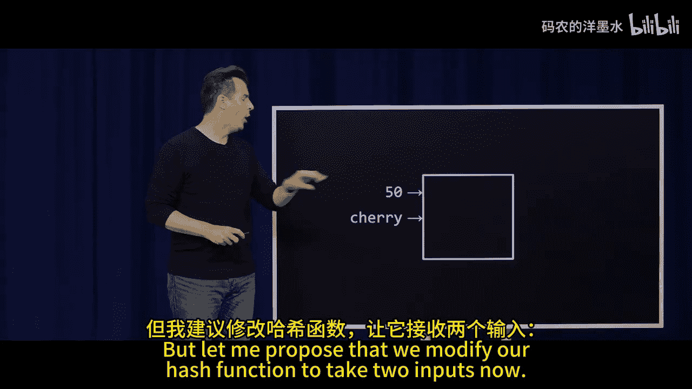

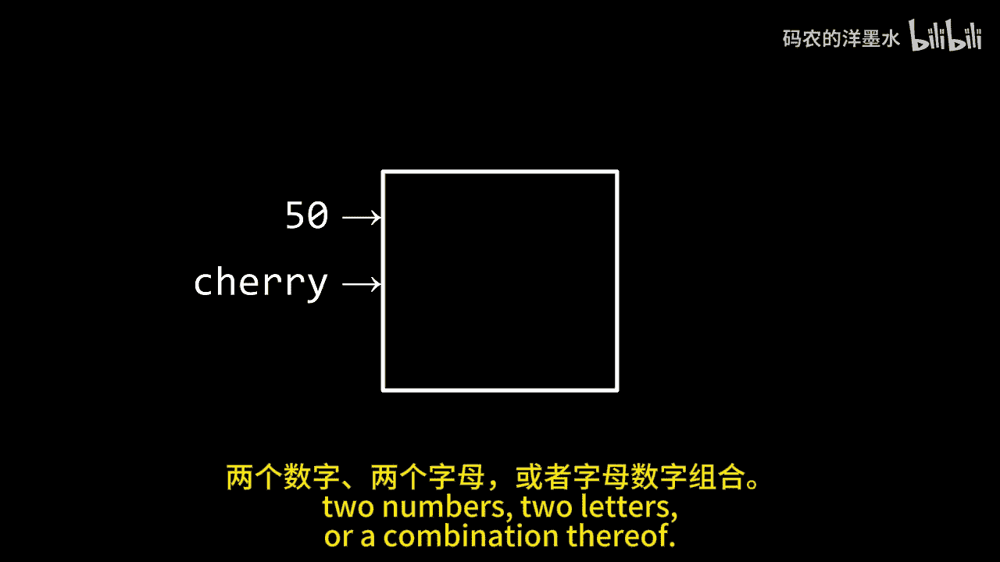

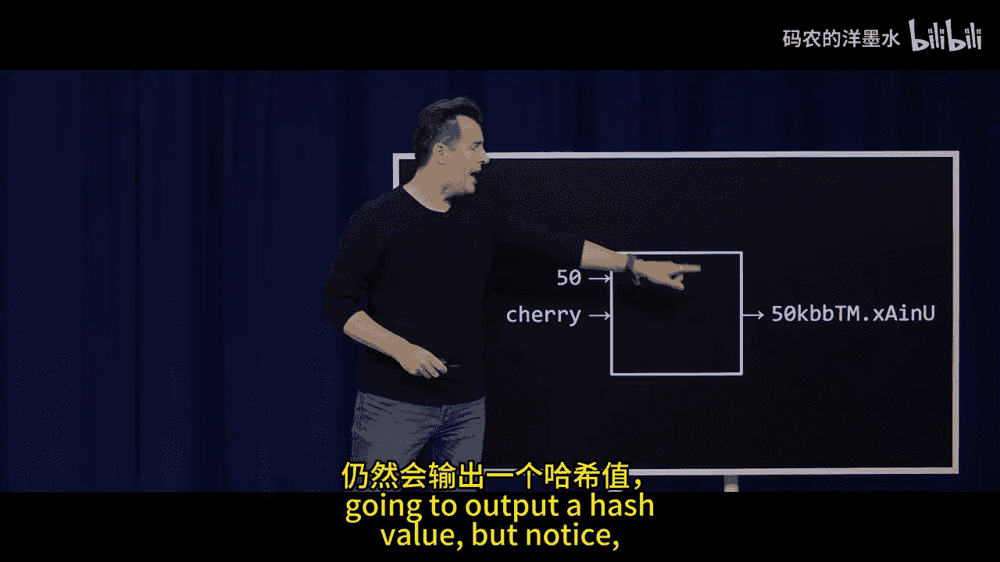

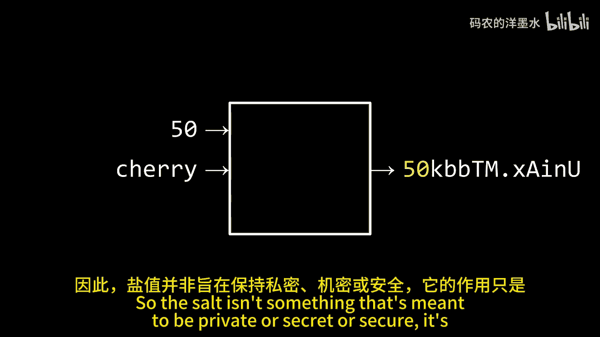

Users should have different salt values just in case they choose the same passwords。

 So instead of 50 in cherry， supposeose that Charlie uses the salt value of， say，49。

49 is not a number that Charlie or you or me have to pick。

 This is all done by the server automatically picking a random  two characters like 4，9 or 5，0。

 But notice what just happened。 If I rewind to cherry with a salt of 5， this was the hash value。

 the first two characters of which are the salt。 If though I change the salt from 50 to 49。

 the hash changes completely。 and it prefixes it with now，49 instead of 50。

 This ensures that even if Carol and Charlie have the exact same password， there's no way I。

 the adversary am gonna know by looking at it。 because indeed。

 what ends up in the file now are these two values。 One is prefixed with 50，1 is prefixed with 49。

 the rest of the hash values clearly are completely different。 So again， the upside is this approach。

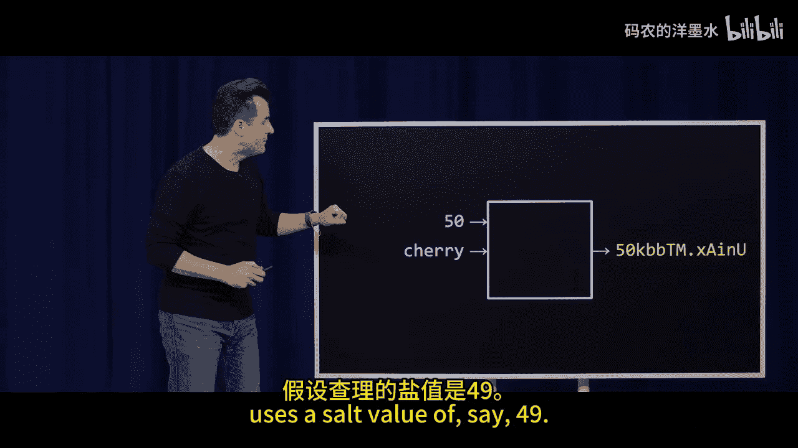

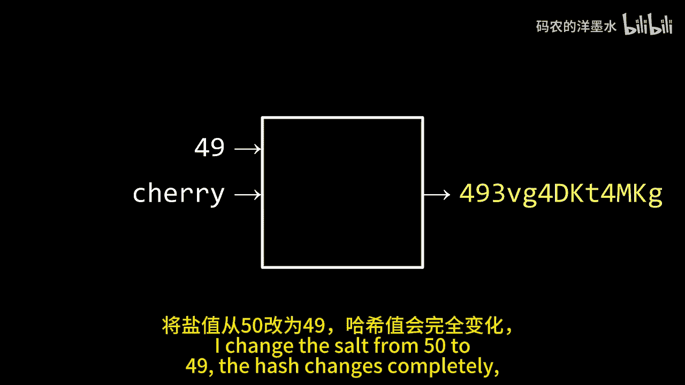

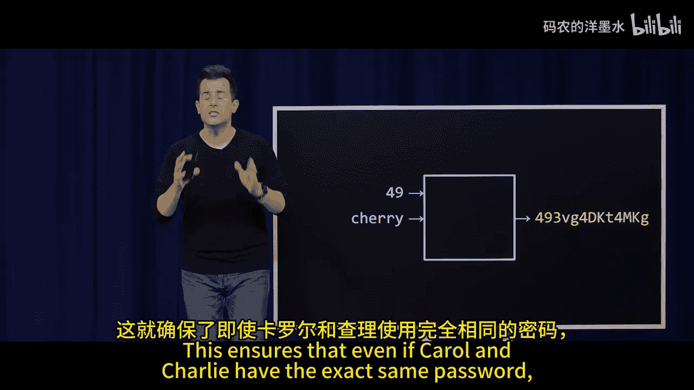

Where the hash function takes two inputs， the password and assault。

 and then outputs one hash value means that we're not leaking information except except there is a corner case。

 if， by chance， By bad luck， the system chooses the same salt for both Carol and Charlie。 Yes。

 there might still be information leaked。 And honestly， that may very well happen。

 if you've got thousands， millions of users， then you're going to run out of two character possibilities。

 you're going have to reuse salt。 But the idea is that we're just trying to put downward pressure on the probability of being attacked successfully。

 We're trying to equivalently raise the bar to the adversary so that they are not as likely to gain access to my data or in turn my account Que now on salting。

Or hashing itself。 Oh， I'm curious， Where do we store the salt？ So where do you store the salt。

 The stall is actually stored in the hash value itself。

 According to this algorithm in the first two characters。

 and the value of storing the salt in the first two characters of the hash is as follows。

 The next time Carol logs in。 She types in her username， Carol and hits enter。 The server now knows。

 Okay， I'm expecting a password from Carol， let's see what she types in。

 supposeuppose that she types in correctly， cherry。 Now， the system is not storing cherry。

 So it's not going compare literally what Carol typed in。 but it is going to hash cherry。 but first。

 the systems going to check what is Carol's hash what is Carol's salt。

 and it's going to infer as much by looking at Carol's hash value and looking only at the first two characters by convention。

 Then what the server is going do。 It's going to take whatever Carol typed in。 cherry C H E， R R Y。

 It's going to pass in 5050。

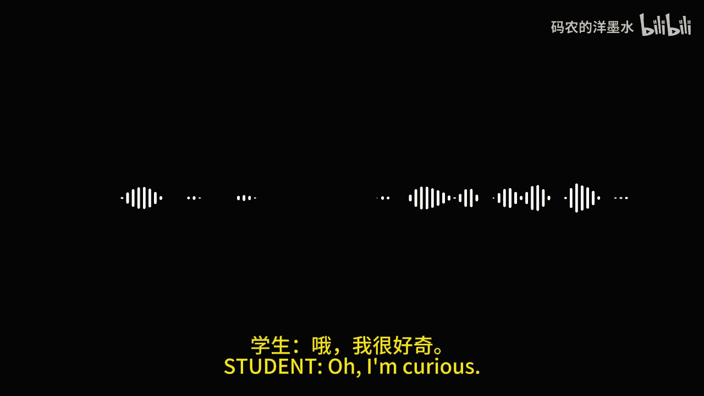

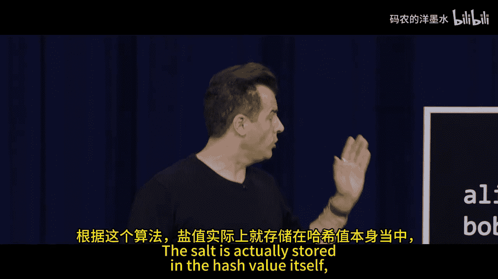

And then hopefully， it's going to get back this same value here， this whole string in yellow。

 And if those are correct， then。The carol will be considered authenticated。 By contrast。

 if the username happens to be Charlie and Charlie hits enter。

 then what the server is gonna do is look at Charlie's hash value。

 grab the first two characters for Charlie's salt， use that salt and cherry as the input to the hash function。

 And hope that the result is Charlie's value， not cars Really good question。

 Other questions on salting or hashing。 I there any sense in rehashing a password。

 So hashing it first a first time to get string， then rehashing it for a second string or it just impracical。

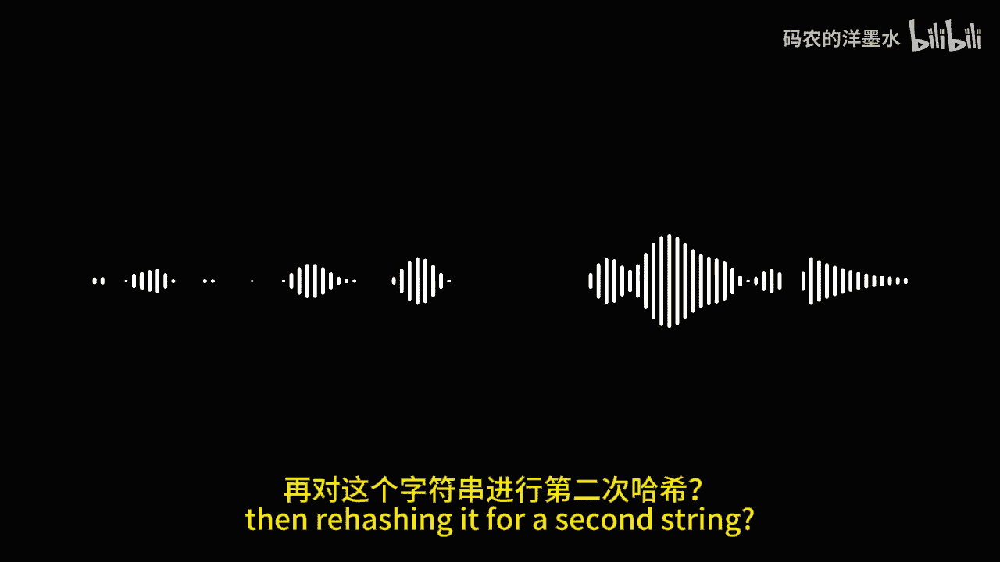

No， you could certainly hash the value multiple times。

 but a good hash function should not require that of you。

 especially now more recent modern hashes that one of which we look at in a moment。

 they should have sufficiently calculated and proven characteristics that allow you to hash it just once and you will get a seemingly random string that represents whatever that input is and here too is where I should emphasize that when it comes to this world of hashing and salting and today's other topics ultimately。

 these are not wheels that you or I should be reinventing unless you are the researcher or the company that's actually developing the algorithm。

 stress testing them， analyzing them theoretically and practically so often in industry or the real world when people like you and me invent our own systems for storing information we just haven't spent nearly as much time or we' just not nearly as sharp as some of the security researchers out there who have really given some thought so when it comes。

😡，Do all things security。 Let me get on my soapbox here and say。

 you and I should not be solving these problems unless it is your full time job or calling in life。

 There's just too many corner cases unless you're collaborating with a smart team。😡。

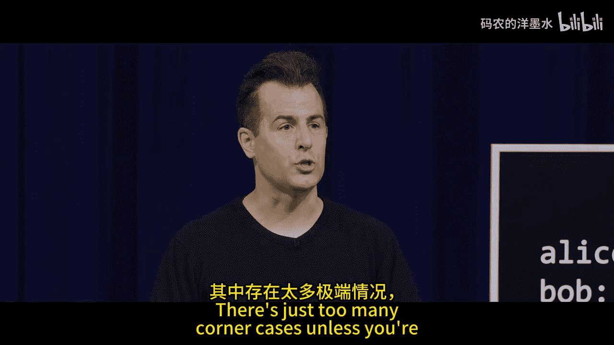

All right， with that said。Here is what hashes generally look like nowadays in practice。

 For the sake of discussion， I deliberately chose a fairly simple hash function that was using a fairly short salt。

 just two characters and a fairly short hash value as output here in a smaller font know less。

 is how Alices and Bobs and cars and Charlie's passwords would probably be stored nowadays。

 using a more recent modern hash function that notice by the sheer length of the text on the screen。

 outputs a much larger value。 if you're familiar from computer science with the notion of bits。

 zeros and ones that are used to store information in systems， These hash values use many more bits。

 many more zeros in ones。 you and I， as humans are seeing them as alphabetical letters and as numbers but underneath the hood。

 these are just more and more zeros and ones that the computers is storing。

 which means it's much much less likely that someone who steals this kind of file is going to be able to figure out efficiently what those original。

😊，Ws wereAnd you can see， too， that for both Carol and Charlie。

 even though their passwords are still cherry， these two strings along the bottom。

 look completely different， except in one location here， it turns out that the scheme。

 a lot of systems have adopted， is that if you look between dollar signs at the beginning of what seems to be the hash value。

 you'll see a code like why or why or why or why or other numbers or letters as well。

 that's a little cheat sheet that tells the system exactly what hash function was used to generate the rest of it。

 And that's in the documentation that you can read online for any number of hash functions。

 So that is to say， when you create an account on some new website or app。

 if they are doing things well， in a manner consistent with best practices。

 and they are being mindful of your security， they are probably in a file or in a database or some other mechanism。

 Storing values that look quite like these based on whatever password you actually typed in。 In fact。

 just to give you a sense of how easy。

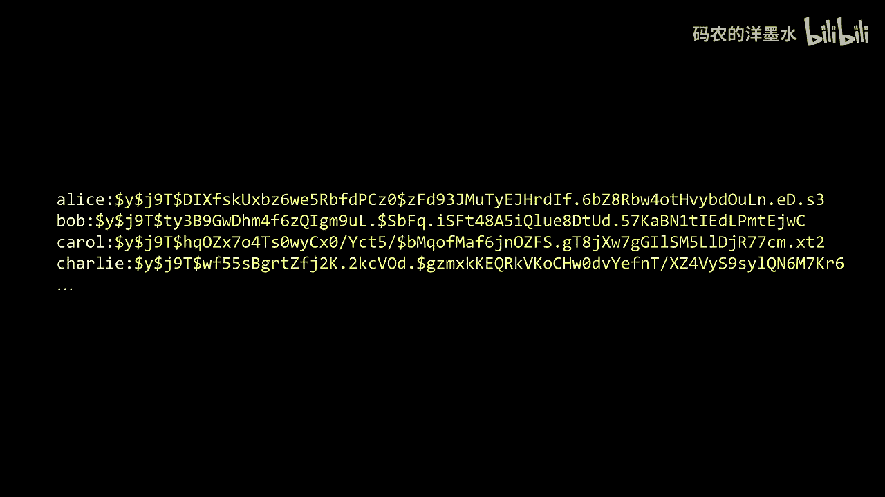

Or difficult。 It might be to crack passwords。 That is figure out what they are based only on these hashes In the case of our first hash function。

 whereby we had a fairly short hash value being outputed with or without the salt turns out there's 18quintillion possible hash values。

 Now that's a lot。 that's bigger than last time's quadrillion value。 but with enough time。

 enough money， enough cloud computing， those early hash functions can be broken。

 that is with enough time and energy， you can probably figure out what someone's password is。

 if you fast forward to the other strings that I showed you on the screen the much longer ones that use more bits so to speak。

 then you have this many possible hash values nowadays。

 and I actually did look up how to pronounce this。 but based on reading it on my screen。

 I wasn't actually sure how to say the word since this is a really big number that my mathematician colleagues could do a better job pronouncing。

 but given how many digits are on the screen， given how many commas are on the screen here。

This is a really big number such that you and I probably don't need to worry about an adversary using brute force figuring out and still being able to figure out by the end of time what the corresponding password might be unless there are other weaknesses in the system。

 Now， speaking of weaknesses。 has anyone ever forgotten your password。 Yes， of course。

 but have you ever gone to a website or app clicked that link that says forgot password question mark in hopes of getting an email of some sort so that you can reset the password。

 I mean， odds are almost everyone here has experienced that but has anyone ever clicked on that link gotten back an email that actually contains your password so that you're just immediately reminded what it is。

 I'm seeing a few nods of the head。 you can copy， paste it then into the website do not use that website anymore。

 that is evidence of that is a symptom of a website or application， not practicing best practice。😡。

This is why Well， if it is the case that the website can email you your password。

 that means they can see and they know what your password is。 that means this database。

 this text file we've been talking about is probably vulnerable to some hacker eventually getting into it and stealing all of those usernames and passwords in the clear。

 no less。 because recall what these hashes are they're generally meant to be irreversible when you take as input。

 Apple， Ban and cherrry， the output looks completely different with no obvious relationship to what those original passwords actually were And so if that's what's being stored in the database。

 the company who made that website， the person who made that website or app。

 they should not be able to reverse that process either otherwise surely the adversary can。

 So it is the case and I've experienced this myself often from sort of smaller shops or companies that maybe haven't really invested a lot of time or Karen or their website if they are able to email you your original password it is by definition。

😡，Not secure。 And it's certainly not up to today's standards。

 It's just too easy for it to be compromised。 So maybe minimally stop using that service and make sure you're not using that password anywhere else。

 Maximally， maybe send them a note explaining your concern and maybe linking them to some reference online。

 maybe this video in which you explain why you have that concern。

Questions then onforttting passwords。Or hashing or salting。So as you said。

 some companies may not be practicing these hatchhees and maybe be practicing something very bad。

 so if I were let's say company and I because of my practices I had a leak of passwords and all the data do I as a company have any obligations or responsibility for what happened since I have all the customer data and all their passwords do I have any obligations or。

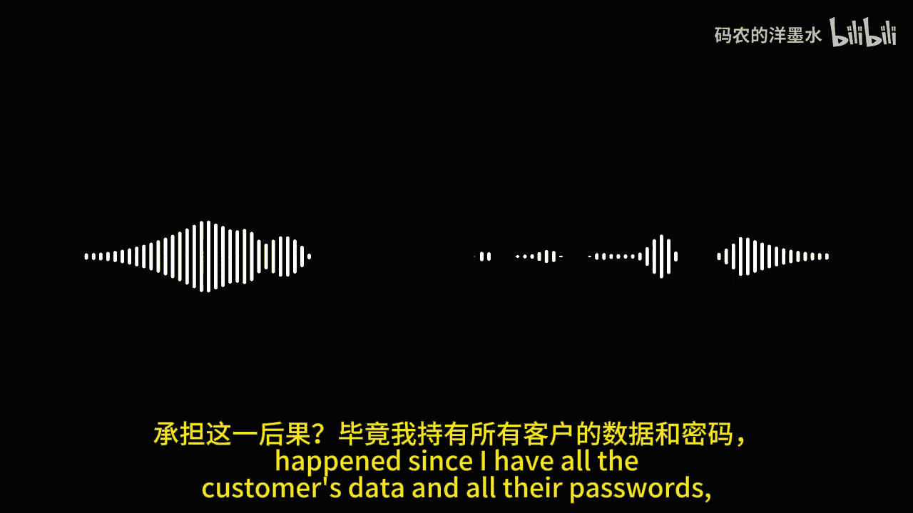

Responsiities it's a really good a really noble question。

 The answer to that ethically is probably yes， you should。 quite simply。 However。

 the more nuanced answer is that it's probably going to depend on the industry that you're in the country that you're in any regulatory requirements that your company faces。

 which might oblige you to report out in that way。 So I would read up on the context that's specific to you yourself。

 and I will say， unfortunately， it is not that common in the world。

 I dare say that companies document and detail publicly when there have been security exploits。

 they might announce that something indeed has happened。

 but it is rare that companies will go into any amount of detail。

 Now this is understandable because one， therere already embarrassed or if not in legal trouble or financial trouble because that has happened already。

 but they probably typically don't want to provide other adversaries。

 other future attackers with more information about their systems and the weaknesses that those systems。

The downside， of course， societally is that if each of us is sort of secretly getting attacked in ways we didn't expect learning things that would be ideal to share with others in the world this itself is actually a big question in the world of cybersecurity just how much and how often to share especially when you discover a bug or a mistake in someone's system do tell them privately do tell the world publicly these are ethical questions that will touch on indeed in the coming days as well。

 Allow me to propose that separate from these concerns here。

 we can come back to some of those recommendations that we started the class from NIST。

 the National Institute for Standard and Technology notice that this was one other quote we did not share last time。

 a recommendation from NIST is that verifiers shall store memorized secrets in the form that is resistant to offline attacks。

 memorized secrets shall be salted and hashed using a suitable oneway key derivation function。

 their purpose。

To make each password guessing trial by an attacker who has obtained a password hash file expensive and therefore the cost of guessing attack of a guessing attack high or prohibitive So when I refer to best practices I'm really referring to actual documentation like this either from the United States from other countries from other companies。

 there are indeed these best practices and among our goals for this class is to expose you to some of those both on the consumer side。

 you and me as individual computer users but also on the corporate or the academic side as well as to what you should be doing when you are in a position of being responsible for someone else's data as well Now。

 as for the actual hash functions to use nowadays， these are just some of them that are generally recommended nowadays that can be categorized as Sha2 and Shaw3 these refer to fairly sophisticated mathematical functions that take as input typically a password or some input more generally and then。

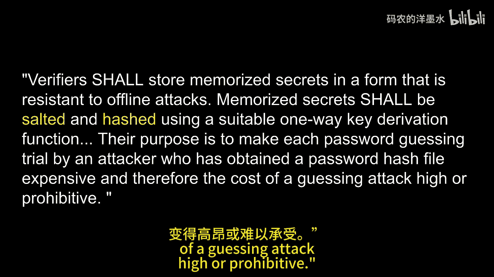

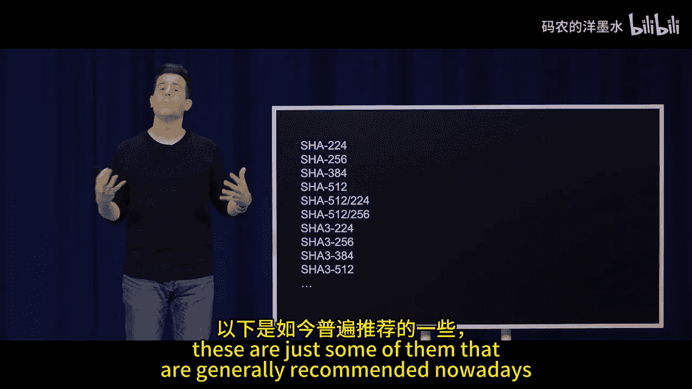

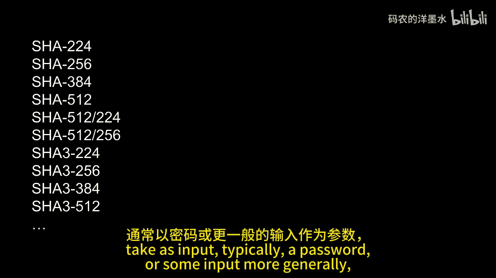

A hash value thereof。 There are other algorithms， too。

 that can even be used to verify the authenticity and integrity of messages as well。 In fact。

 today will also focus on how we can use primitives like these to ensure that data was not actually changed in transit。

 When you sent it over the Internet from one person to another。 But ultimately。

 what we've been focusing on and what you've seen on this list here。

 what are generally known as one way hash functions。 That is these are mathematical functions。

 or in the context of programming， these are functions written in code。

 languages like Python or otherwise that take as input， a string of arbitrary length。

 That is a password that's this long， maybe this long， maybe this long。

 But what's key to these cryptographic functions is they output a hash value of fixed length that is always this many bytes or characters or this many bytes or characters。

 that is， doesn't matter how short or how long the password is。These cryptographic。

 these one way hash functions are one way in the sense that they take a potentially infinite domain。

 If you know this term for mathematics and condense it into a finite range。

 that is a huge number of values， all possible passwords in the world to just a finite list of possible hash values。

 It might be a long list of possible hash values， But indeed， no matter how long a string of text is。

 if it's of some fixed length，16 characters，32 characters， something else。

 there's only a finite number of those values。 Now， there's an implication of this。

 when you take a really large input space or domain mathematically and map it to a smaller finite range。

 so to speak mathematically， It turns out that if you do try to reverse the process。

 there will be multiple inputs that yield the same output。 Think about it this way。

 if you've got 100 possible passwords in the world。😊，But you only have 10 possible hash values。

 So 100 passwords，10 hash values。 you have to figure out how to put all of those passwords into 10 buckets。

 so to speak。 So surely some of those passwords are going to be in the same bucket。

 Think about it in terms of the English alphabet。 If we stuck with that original hash function where a was one。

 B was2， C was3， presumably Z was 26。 There's more than one fruit that starts with a Apple avocado and so forth。

 So there too， you were going to have multiple fruits， mapping to the same finite range of values。

 hash values， one through 26。 What that means is that if an adversary。 or even you。

 the owner of the system， look at that hash value and C the number one。

 You don't know if the password was Apple or avocado or some other word that started with a。

 And so that's what we mean by one way hash functions。

 you cannot reliably reverse the process by any means。No definitively what the original input is。

 Now， there is a catch that technically means on some systems。

 it might be possible to log in with Apple or avocado or more generally your actual password and some other seemingly random password that might make no sense to you。

 but just because mathematically， it has the same hash value。

 that password2 might let you into the system。 But the idea is。

 especially as we're using really large numbers of bits， really long hash values。

 the probability of you or me figuring out or an adversary。

 even guessing what that other hash value or what those other inputs passwords might be。

 is just so small that we tend not to worry about it as well。

 the algorithms we looked at on the board here are also known as cryptographic hash functions。

 which means they have utility in the world of cryptography or the world of cryptography is all about the practice in the study of securing data。

 Seuring。

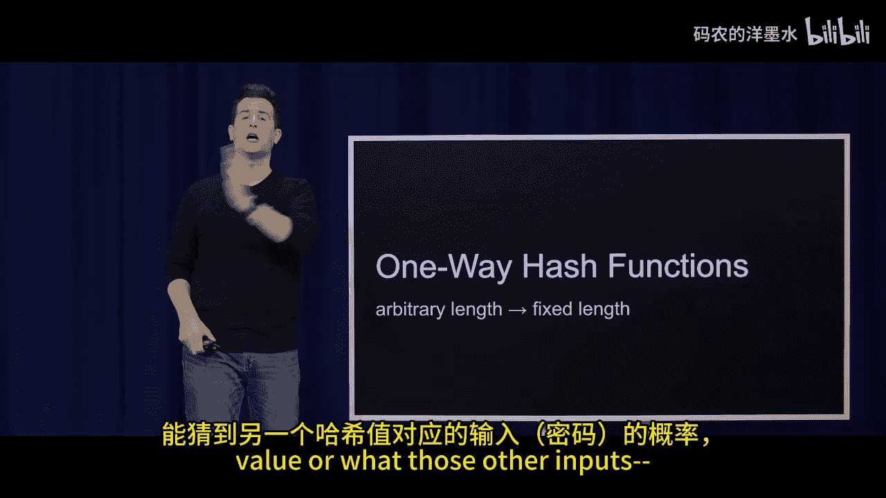

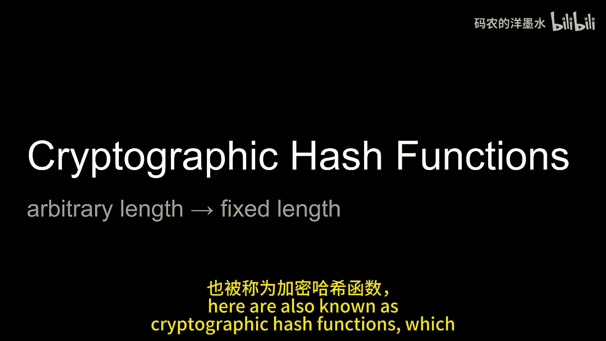

while in transit from one point to another or while at rest on your own system。

 let's go ahead here and take a five minute break。 And when we come back。

 we'll explore precisely that world of cryptography with respect to our data。Alright， we're back。

 And indeed， cryptography is all about the practice and study of securing our data。

 particularly when we want to transmit it from one person to another。

 So cryptography can be broken down into a couple of different categories。

 one of which are codes and codes are not the type of code that you might write in Python or the like。

 it has nothing to do with software， but rather a mapping between what we call code words and the actual message or true reading that those words represent here。

 for instance， is an actual book from over 100 years ago that was used to map these code words in the left column to these indeed messages or true readings on the right。

 the idea is that if that one party wanted to send a secure message to another party。

 they wouldn't just write it out in plain English。 Why。

 because if that message written on a piece of paper or parchment were intercepted by another human。

 that other human， assuming they to know English could just read the actual message。

 the so-called plain text in a。Though you can convert the words that you want to say to code words that make no sense necessarily to someone who's intercepted the message in and of itself。

 unless they， too have this book。 Now， you can imagine this being a fairly time consumings process。

 because when the recipient receives that message。 unless they've memorized all of these pages。

 these code words and the meanings thereof， they have to do quite a bit of work flipping through their copy of the book in order to figure out what that message is。

 But the fact that they have a copy of the book to is a potential threat。

 because if one party or another had their codebook stolen。

 then any of the messages they've sent can now be decoded。

 so to speak by looking them up retrospectively， and any future message is。

 if the owners of the book don't realize that codebook has been taken。 So too。

 could those messages be translated。 not to mention the fact it's fairly cumbersome。

 this alone is page 187， And so that's quite a bit of codes and quite a bit of work just to。

achieveieve this layer of indirect。 But there are some terms of art here that you are worth knowing。

 and you might actually use in everyday context， but not necessarily for the same purpose。

 So in code， what do we mean by that， it means taking a plain text message。

 be it in English or any human language and taking that as input and producing as output code text。

 So the code text might be a short succinc sequence of words that might actually be English words。

 but they're not meant to mean what they normally mean。

 They're meant to be looked up in the codebook to figure out what the message is actually trying to say。

 Meanwhile， decode， as you might expect is the opposite。

 You take as input the code text that you have received as the recipient。

 you use that same codebook to look up the code words and figure out what the actual message is in order to get the original plain text。

 be it in English or any other human language that the code book is designed for。

 But there's an alternative to codes。 If only because those code books can get very。

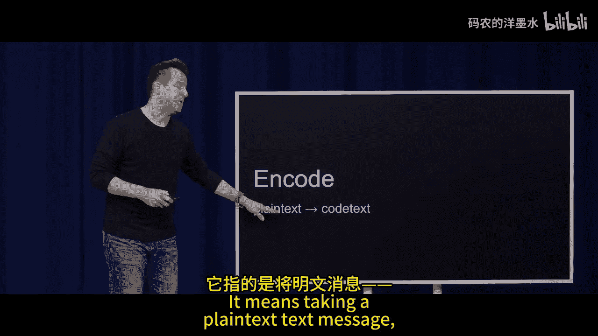

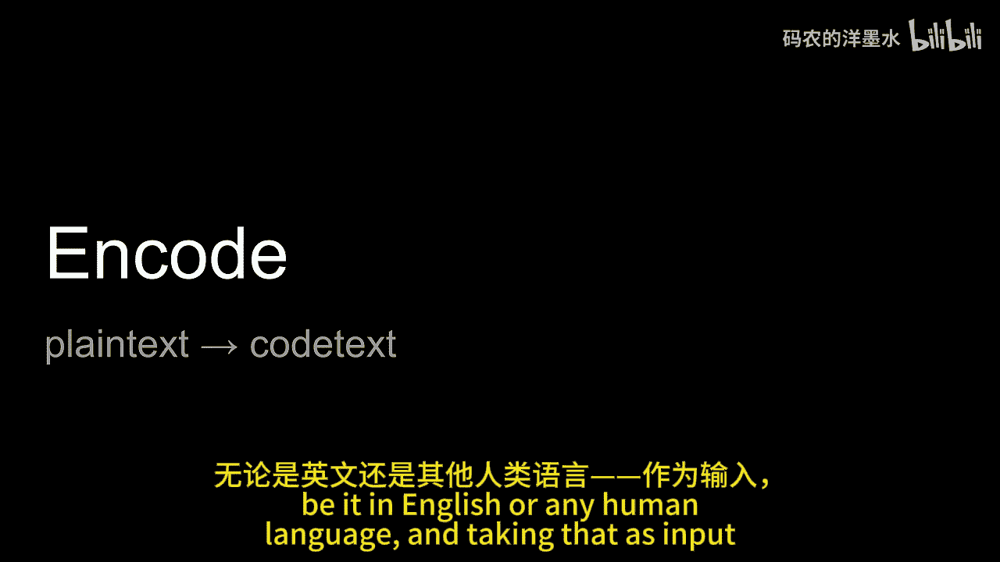

umbbersome indeed， they can be taken and compromised in the like。

 So it's not necessarily the best system in that you need to physically keep something like that secure。

 let alone do so efficiently when converting。 So there are also what we'll call ciphers and ciphers are more algorithmic in nature。

 So if you have taken a computer science or programming course。

 you already have the predisposition to thinking algorithmically and taking a big problem and breaking it down into smaller pieces and then applying some kind of logic。

 sometimes again and again in order to solve some problem。 So ciphers focus on exactly that。

 they don't focus on maybe words or phrases， they might focus on individual letters instead or even bits。

 if it's in the context nowadays of computers。 So in the world of ciphers。

 you might have actually seen them in popular culture。 So here， for instance。

 is just one frame from a famous film known as a Christmas story， at least here in the US。

 it plays like every day all day long on a couple of TV channels around。😊，but this here is Ralfi。

 one of the main characters in the movie and in his hands here is this secret decoder pin that he tried so hard to get through the mail and the secret decoder to pin was from little orphan Annie herself and what it does is implement mechanically a cipher converting one letter to a number and back。

 But the thing twists left and right， so that you can actually figure out what the mapping might be。

 So this is more of a cipher because it's operating at a lower level， not an entire words or phrases。

 but one letter at a time。 And it's a repeatable process that Ralfi in this case can apply again and again to all of the letters of the secret message in World War2。

 the Germans， for instance， had the enigma machine that you might have read about or seen depicted in films。

 And this was a mechanical implementation of this same idea of a cipher。

 but instead of using mathematics or gears turning just this way and that it was much。

Mechanical was with rotors and lights and the like。 But it， too。

 was implementing a cipher and could be configured with different inputs in order to influence exactly what the output would be。

 but that too is a physical device and we'll focus here for the most part。

 though on things more digital things that you can ultimately， for instance。

 nowadays implement much more readily and much more scalably in software。

 But the words we'll use are pretty much the same to in cipher a message means to take that message in English or any other language are socalled plain text and convert it not surprisingly。

 to cipher text as output。 Meanwhile， the reverse rather an equivalent term here that you might know as well。

 is to encrypt same ideas， synonyms for our purposes plain text to cipher text to cipher or to encrypt nowadays encrypt is probably the more common of those terms。

 Meanwhile， decipher would be the opposite of that to actually take the cipher text that someone else has sent to you run it through an algorithm or cipher and。

Back the plain text。 Meanwhile， decrypts would be a synonym for that phrase。

 which refers to exactly the same process of taking ciphert text as input and outputting plain text as output。

 So how do we configure these cipher so that you and I can use the same algorithm。

 but customize them not only with our own messages。

 but also with our own setting so that just because you and I might want to send the same plain text doesn't mean that the cipher text has to actually be identical and indeed in the world of cryptography。

 it's quite recommended that you and I use public and well documented well tried and tested algorithms publicly but we do keep one piece of information secret so that our use of that cipher。

 that algorithm is specific to us and this customization。

 this configuration are generally known as keys Now key is much like a physical key to unlock lock on an actual door to your home a key is what sort of unlocks the capabilities of this cipher。

 but it's a key。

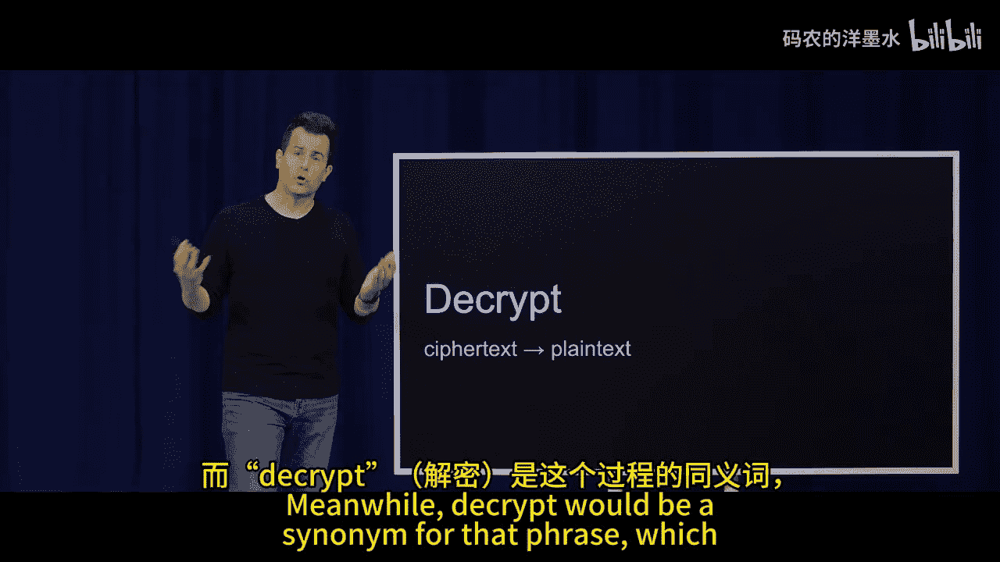

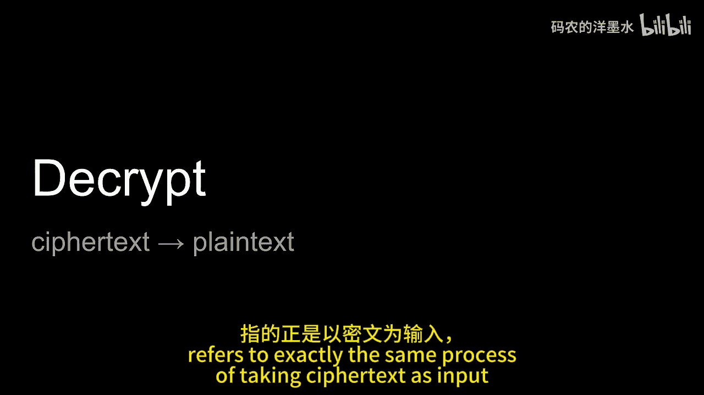

NesTo be known and used not only by you typically， but also by the recipient。

 so that by having copies of the same key， you can not only encrypt messages or incipher them。

 but you can also decrypt or decipher those messages， too。 Now， what are these keys in practice。

 They're not physical objects in the virtual world， But really just really big numbers。 And often。

 there's some mathematical significance of these numbers。

 And sometimes those numbers don't even look like numbers。

 they might be presented on your phone or your laptop or desktop actually as letters of an alphabet And maybe even with some punctuation too。

 But at the end of the day， they're really just numbers， or， of course。

 if you know a bit of computer science already， they're really just zeros and ones。

 But it's perhaps helpful to think about them metaphorically as akin to these physical keys。 Now。

 how are these keys actually used。 Well， within the world of cryptography。

There are different types of encryption。 And the first we'll look at is known as secret key cryptography。

 The presumption is that the security of your data relies on the secrecy of some key。

 So if a wants to send a message to B， then A and B must keep secret。

 whatever key they are using to configure their choice of algorithms。 So what do we mean by that。

 Well， secret key cryptography， specifically in the context of encryption and scrambling data is also known as symmetric key encryption。

 for the reason that both a and B in this story are going to use the exact same key。

 and we'll contrast this in just a bit with asymmetric key encryption。

 which solves other problems as well。 So let's consider the process of encryption。

 much like the process of hashing as being this black box。 somehow or other。

 this black box is going to encrypt information for me。

 taking is input my plain text and hopefully outputting is output。

 my cipher textex that I can actually。😊，Over the Internet or some other channel to a recipient as well。

 So in the context then of secret key encryption， the picture looks a little something like this。

 Not only do you pass input to the algorithm， your plain text message in English or any other human language。

 you also pass a key。 And for now， just think of that key is a number that you and the other person have somehow agreed upon in advance。

 that algorithm then will ultimately output the cipher text。 And to be clear。

 the motivation for that key is to ensure that if I and you and you and you and you are all using the exact same encryption algorithm。

 It's not going to be obvious if and when we're sending the exact same message， because that， too。

 per our discussion of passwords would leak information maybe you don't care about the information being leaked。

 but it's probably not a good thing if just because someone else is something some message that makes it more likely that an adversary can infer what it is。

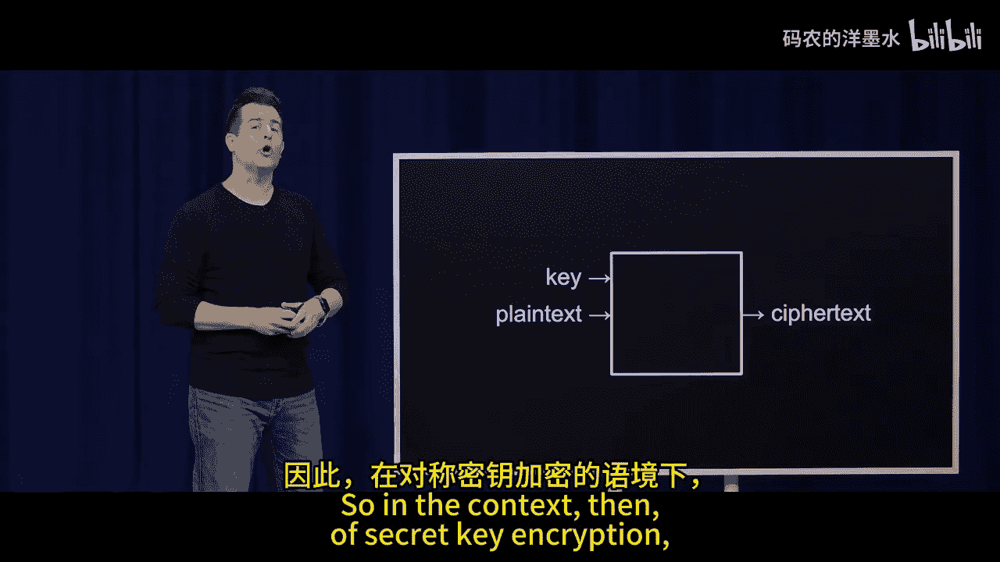

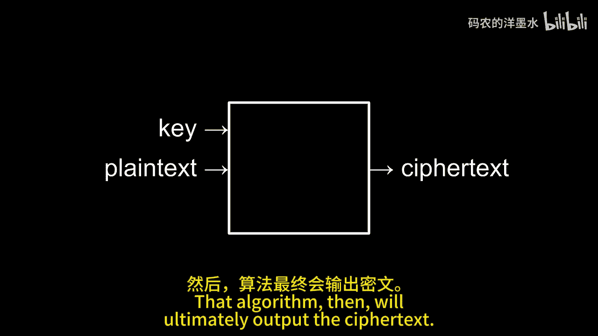

You sent because the cipher text just so happens to look the same。

 We want our cipher text to be unique to each of our transmissions。 So let's consider a simple。

 simple example。 Suppose that the message I want to send is just as short as the capital letter A and suppose that the key that I want to use is as simple as the number one。

 These are not good， best practices， but will use them for the sake of discussion。

 Let me propose that the simplest algorithm， I can perhaps think of is actually one that would take a as input and one is input and output B。

 and you can perhaps infer where this is going。 If I instead provide B as input and one as input for the plain text and key respectively。

 then the output is C。 So believe it or not in yester year。

 Julius Caesar was known to use an algorithm like this by Lord。 whereby this algorithm。

 Caesar cipher is what's generally known as a rotational cipher because you're sort of rotating the letters of the English alphabet A。

Becomes B， B becomes C。 And I bet if we continue this logic。

 we can go around from Z becoming A as well。 Now， this， of course。

 is being applied at the moment to very short messages that are not that useful。

 sending a or B or C is not particularly useful in general。

 but it's demonstrating how we can incipher or encrypt or plain text into our cipher text。 However。

 when someone receives this message， they need to know not only what algorithm I used to encrypted in this case。

 Csar cipher or a rotational cipher more generally， but they also need to know what the key is。

 and the key might not be as simple as one here， for instance， is an example of 13。

 If your key is 13 in your plain text is a， then your cipher text should be N。

 because that is 13 places away from a。 And so now the algorithm seems a little less obvious。

 13 is also representative of something that's long been known on the internet is Ro 13。

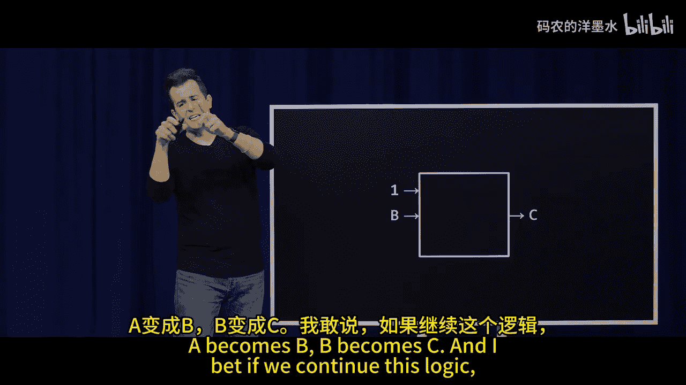

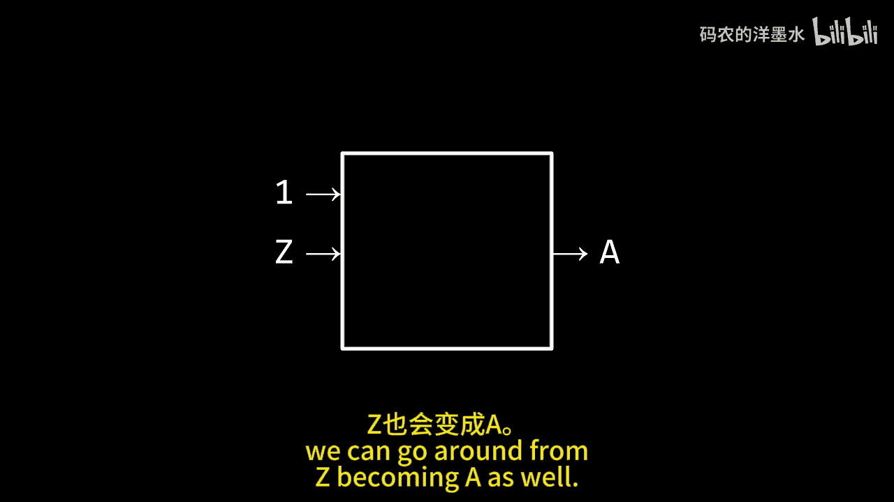

For R O T13， rotate 13 places， it's a very popular way of scrambling information。

 but not in a way that you intend to be secure。 His。

 it was often used for like movie spoilers online。 if you want to make something a spoiler before there was CSS and blurring effects on websites and whatnot。

 you could just scramble it so it looks completely encrypted。

 but it's very easy for someone else with a click of a button even to just decrypted。 However。

 I would recommend that you not use a key of 26。😡，Because why， well， at least in English。

 there's only 26 letters of the alphabet， capital A through capital Z in this case。 So a key of 26。

Is going output for your cipher text The exact same thing as your plain text。

 So there's another joke on the Internet whereby know Ro 26 is twice as secure as Ro 13 because 13 times 2 is 26。

 And obviously， that's not the case deductively here。 Now， of course。

 this particular algorithm and keys of this small size 1 through 26， not at all secure。 why， Well。

 honestly， I don't even need a computer to crack this cipher。

 I can probably take out a piece of paper and pencil and just try all possible numbers from1 to 25。

 I don't need to even waste my time with 26 and just figure out via a brute force。

 What keys someone might have used to send a message using this algorithm。

 not on even single letters， but maybe it operates on every individual letter of their message wouldn't take me that long to probably figure this out by brute force by hand。

 And with code。 My gosh， I could write some python code Probably that does it even faster than that。

 So here on this。

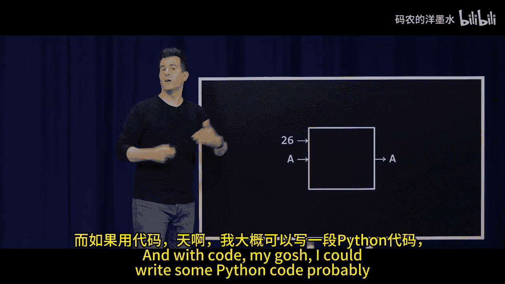

am is some cipher textex that I created in advance。

 And I'll stipulate that this cipher text was in ciphered using that same rotational cipher。

 but I'm not going to tell you just yet what key I actually used。

 It was originally an English message in all capital letters。

 So the task at hand now is to decrypt this。 I dare say。

 whether you are the intended recipient of the message or maybe maliciously you've intercepted my transmission with this message in it and now you're trying to brute force your way through by trying and by the looks of some heads going down and some scribbling one or two or three。

 I bet we could also brute force our way through this algorithm。 But how Well。

 how does the decrypting process work。 It's really just the same thing in reverse。

 if this now is our picture and you have cipher text as your input。

 you should be able to pass the same key as input1， for instance， or 13。

 or with no good reason 26 and get back out the plain text。 But of course。

 the decryption algorithm is indeed the opposite， because you don't want to just add one。

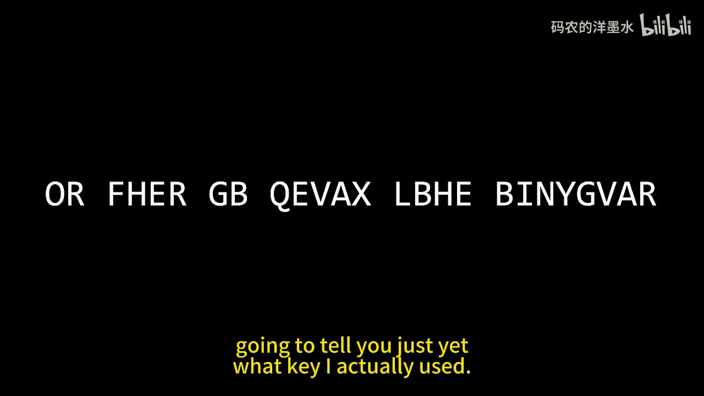

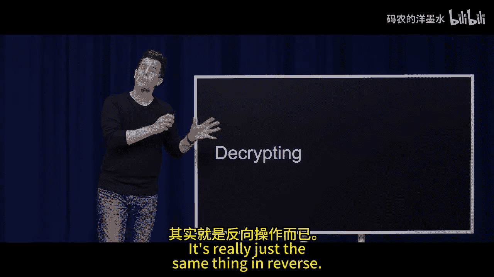

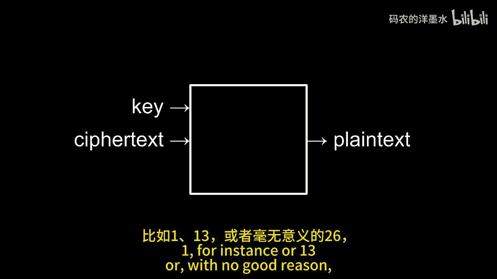

Position or add two positions or three positions。 You want to subtract one or2 or3 or 13。

 You want to go in reverse， so to speak。 And so if I were to pass in B as the cipher text。

 and one as the key。 Well， the plain text。 decrypted should of course， be a。

 And that holds now for all of the other letters of the alphabet。

 assuming I'm reversing this process。 in order to decrypt。

 And now I'll let you glance at the screen here for just a moment。😡。

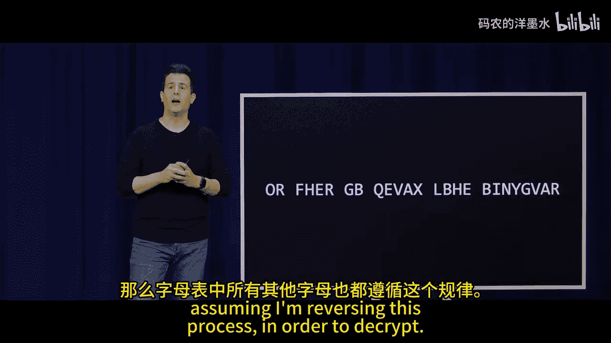

And see if you yourselves can't figure out what this ciphertext is trying to say。

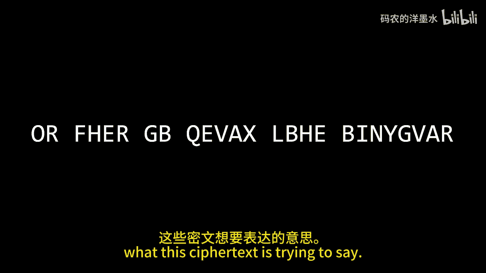

And if you like the idea of figuring this out， if you want to get better at this particular skill。

 you are an aspiring cryptana。 I dare say focusing on this world of crypt analysislysis。 And this。

 too itself is a job。 I dare say， particularly with governments trying to decrypt messages that might very well have been encrypted。

 Now， hopefully the world is using more secure algorithms than these simple rotational ciphers。

 And what do I mean by secure， hopefully they're using keys that are much bigger than small numbers like one through 25。

 Hopefully they're using much， much much larger numbers， many more bits。

 if only so that it takes you and me， when we try to apply crypt analysis to cipher textext。

 it takes us way， way longer than this particular algorithm alone。😡，Now。

 I don't want to keep you in suspense， but I also don't want to spoil this if you'd like to try your hand at this。

 So go ahead and close your eyes if you don't want to see the answer to this。

 or I suppose you can just look away from your screen。 But in 5 seconds。

 I'll reveal what the plain text actually is。 And some of you， if you've seen that movie I mentioned。

 willll know immediately why this is the way it is。 But otherwise。

 you might just see this as an advertisement of sorts。 So here we go。

 your chance to close your eyes in 5，4，3，2，1。From some faces。

 some of you have seen this movie around the holidays。

 But now I've taken it off the screen and we'll move on now with some actual algorithms。

 If you'd like to come back on replay and actually see what the answer is， will， of course。

 leave it on demand。 So what are some of the actual algorithms used nowadays for encryption that are best practices。

 This rotational cipher that I described earlier。 Caesar simple one is not to be recommended。

 It's wonderful for demonstrations sake and discussion sake。

 but it's not something you should be using in practice。 unless， for instance， you're in。

 say middle school trying to send a message on a piece of paper through your classroom of classmates and worried that the teacher might intercept it and the teacher probably doesn't have the instinct to or the care to actually brute force their way through it and figure out what the key is。

 but that's the level of security you're getting with something like that rotational cipher。

 But in the real world with our phones and desktops and laptops today generally used are AE S or triple D E S。

 both of which are popular。😊，riths that have been vetted by the world and are very commonly used as secret key encryption ciphers or symmetric key encryption ciphers。

 which to be clear require that both the sender and the receiver know and use the exact same key。

 And for our purposeses today， let me just stipulate that the mathematics of these two and other algorithms much more sophisticated and documented in textbooks。

 but therefore it makes it much harder for the adversary to figure out as by trying 25 different keys what the actual key in use might be。

😡。

Questions now about secret key cryptography。Or any of the primitives we've just discussed。

So its possible that if someone has the gets to know about the hash the hash function of the company that it is using。

 he might be able to use the hash values and use like find any those function and then get the passwords for that。

 A good question。 I wouldn't worry mathematically about someone reversing the hash functions。

 if only because with all of the ones that are in popular use today in modern systems。

 there are a lot of smart mathematicians， computer scientists。

 professionals who have kind of vetted if not proven mathematically that these things work as expected。

 However， if the passwords that have been hashed are relatively easy to guess。

 or if the adversary just gets lucky with whatever technique they are using。

 it is absolutely possible to find at least a password a input that maps to that hash value。

 but often not without significant effort。 And so generally a company does not want to should not try to keep proprietary or secret。

😊。

What hash function they're using， what encryption algorithm they're using if anything。

 I dare say it should be reassuring to the public if and when companies are using best practices and de facto standards。

 all of these algorithms are designed to keep secret， not the algorithm itself。

 which literally can be found in like university textbooks nowadays and on Wikipedia and beyond but rather to keep secret the thing that's designed to be secret。

 which is the key and now if you're using too small of a key like I did originally。

 well then you're just using the algorithm poorly perhaps but so long as you're adhering to best practices and picking a really big recommended size key。

 then things mathematically should be trustworthy an attack other than like basically cracking a hash or cracking an algorithm wouldn't it be easier to just try and access the basic7 database and access the hash function like generated code So other access how the specific algorithm。

😡。

Works that way。

They can basically just device engineer it Everything you described is possible。 However。

 I would push back on this assumption that the company should try to keep its hash algorithm secure or hidden you should trust in the mathematics of what we're discussing today。

 both in the context of hashs and in the context of encryption and I've pulled back up on the screen here。

 the number of possible hashes that exists when using one of the most modern standards for hashing passwords。

 this is such a big number， I dare say I don't remember how many atoms are in the universe。

 but I'm gonna to guess it's fewer than this， maybe the idea is intuitively that if the search space of possible hash values or the search space of possible keys is so darn big both you and I not to speak darkly are going to be dead before the attacker actually figures out what that word or that hash。

isSo that's generally the presumption。 Most of what we do today in terms of security all boils down to probabilities and trying to drive the probability of being exploited way。

 way， way down， even though if your password is still 00，0，0，0，0，0。

0 doesn't matter if there's this many or more possibilities if the adversary tries that one first。

 So keeping algorithm secret， keeping cipher's secret is generally not best practice。

 You should be trusting that the math and the probabilities will protect your data if you are using these algorithms correctly。

 And how about one more question before we resume。 how cipher work worth not number like if worth how it work how we can cipher crypgraph。

Let our later was， not the number。 how it can work。 Okay， so if your key is a word and not a number。

 let me first say that generally when it comes to encryption。 the keys are not words。

 These are not passwords， they're not meant to be used in quite the same way。

 These keys are generally generated by the computer for you。

 And so as such they're just random numbers for the most part。 with that said。

 even if it is a word like Apple， there are ways。 and you you would learn this in a class like Cs50 itself to convert a word to the underlying numeric representation。

 there's a system called ASI or UniIode。 So capital A is actually the number 65 in most systems。

 Capital B is the number 66。 but we can go one level deeper。

 there's actually a pattern of zeros in ones that represent A's and B's and C's and so forth。

 So we can convert everything in the world of computers to numbers。

For that， let me encourage you to take CS50 X online。

 So that then is secret key cryptography or symmetric key cryptography。

 but it doesn't solve all of our problems because I've kind of taken for granted throughout this whole discussion that the sender and the receiver have a shared secret between them。

 whether it's a simple key like one or two or 13， hopefully not 26 or hopefully some much bigger value。

 but there's kind of a chicken in the egg problem there so to speak in English。

 whereby how do you actually establish a shared secret between parties A and B。

 if A and B have never talked before， in fact， So for instance。

 if you're visiting Amazon co for the first time， a popular ecommerce-commerce website or Gmail co for your email ideally and you probably know this already from just living in the real world nowadays。

 ideally you want that connection to Amazon or Gmail to be encrypted to be scrambled in some way why？

Well， you don't want your password being stolen by someone。

 You don't want your credit card number being intercepted by someone。

 You don't want your personal emails being read by other people。

 So it stands to reason that encryption is generally a good thing And you've seen this perhaps in the URL bar via something called HttPS or the S literally is meant to mean secure but odds are you don't know anyone personally at Amazon co And you don't know anyone personally at Gmail co。

 So what key are you going to use to communicate securely with these websites not to mention new websites that don't even exist today but might come online tomorrow。

 how do you establish a shared secret with someone else。

 So that sort of a fundamental gotcha or caveat with symmetric key or secret key encryption is that assumes that you have a shared secret between you and the other person but the chicken in the egg scenario comes in whereby the only way to establish a shared secret would be to send it to。

😡，The other person securely。 but if you can't communicate securely。

 you can't even send them the secret you want to use。 So you're sort of caught in this deadlock。

 thankfully， thanks to math， there are ways that we can solve this too via not symmetric key cryptography。

 but public key cryptography otherwise known as asymmetric key cryptography and among the algorithms here might be these something called diiffy Heman MQV RSA and others as well。

 And I dare say on this list， maybe RSA is among the most wellknow is perhaps an acronym you've actually seen in the wild。

 Now， what do we mean by public key cryptography or more specifically， public key encryption。 Well。

 in the world of public key encryption or asymmetric key encryption。

 the asymmetry is implying that you actually don't use one key between the two people， A and B。

 you actually use two keys in the world of public key encryption。

 everyone in the world has both a public key and a private key。

And these two are just really big numbers。 There is a mathematical relationship between these numbers。

 the public key and the private key。 but that's a relationship that your phone or your laptop or your desktop figures out when generated these values for you。

 So unlike our previous discussion of passwords， which you and I as humans do choose and memorize or store in our password managers when it comes to keys。

 these are generally in the world of public key crypttography generated for you。

 And as the name suggests the whole purpose of these keys， is to tell the whole world。

 if you want what your public key is。 It is not in any way secret。 you can literally email it out。

 you can put it in the signature of every email you can post it on your website on social media。

 the whole point of the public key is to make it indeed public。

 but suffice it to say the private key should be kept secret by you private by you on your own device that should never be shared with anyone else。

 But the cool thing。😊，About public key cryptography and the mathematics underlying it is that if you share your public key with someone else on the Internet。

 they can use that public key to encrypt a message and then send it to you over email or chat or any other technology。

 And if you had to guess， what is the only key in the world that can decrypt a message that has been encrypted with your public key。

 The only key in the world that can decrypt a message that has been encrypted with your public key is your private key。

 That's what the mathematical relationship ultimately does for you。 So pictorially here。

 if this is our algorithm that implements this idea of public key encryption。

 let's see what the inputs and output should be。 If the goal is to send a message to you and you have shared with the world。

 your public key， whoever is sending you this message uses your public key their plain text message and out of that comes cipher text that then is how。

metric key encryption works。 Meanwhile， when you receive that message。

 you can use your own private key and the cipher text you've just received to get back the plain text。

 And this is what we mean by asymmetric。 unlike secret key cryptography or symmetric key cryptography where you're using the same key back and forth plus one or minus-1 in the case of the rotational cipher with asymmetric encryption you are using one key for one process and another key for the decryption process。

 So that's what's fundamentally different。 RSA is one of the most popular algorithms for this。

 The browsers you probably use every day or probably using some variant of RSA underneath the hood。

 we won't get into great detail about the mathematics。

 but one of the most important details about RSA is that it relies on really big prime numbers。

 In fact， in a nutshell， what happens with RSA is your computer or your phone chooses a really big prime number。

😊。

Called P。 It then chooses a really big other prime number called Q。

 Then it multiplies them together to get a new value。 We'll call it n。

 and it uses that value N in the resulting mathematics That's the algorithms authors came up with dot dot dot The presumption here is that when you take a really big prime number and multiply it against a really big other prime number。

 it is really hard to figure out from the product of those numbers。 what the original P and Q were。

 And if you're a little hazon prime numbers， it's a number that can be only that can only be divided by itself and1 And indeed we can use those coming up with two big ones。

 multiply it together in order to get this value N that is subsequently used in the rest of the mathematics。

 What are the rest of those mathematics。 In essence， this。

 And this will be the scariest looking formulas you perhaps see over the course of this class。

 the value N I just described is used as。

To divide values ultimately， if you're unfamiliar with mod here， this means to， in this context。

 take the remainder of some value。 So what are we doing。

Here is a quick summary of how encryption and decryption works with RSA。

 If you have some message M that you want to send to another person and you have come up with somehow via the dot dot dot process earlier that I alluded to you've come up with your own public key E there。

 Well， then someone can take their message encrypt it by raising that message to the power of E。

 the exponent of E， and then divide it， divide it， divide it。

 divide it by N and figure out what the remainder is when dividing by N。

 that then gives you a value called C for cipher text。 when you then receive that message C。

 you can use your private key known here as D。 and you raise the cipher text。

 its numeric value to the power of D， that is the exponent of D。

 and you divide divide divide by N in order to figure out that remainder。

 which will give you back the original message。 Now that is a significant oversimplification。

Of what's going on。 But that's the essence of the algorithm。

 It has to do with picking two very large prime numbers。

 multiplying them together to get that value n， and then using n。

 as well as other values that dot dot dot are generated by the algorithm for you E and D in order to encryptpt and decrypt messages ultimately。

 And this is what's generally known as modular arithmetic。

 It involves lots of division and division division in order to come up with these remainders。

 but ultimately， it is a very secure way to asymmetrically share information without having to agree on one shared key in advance。

 but rather using a public and a private key instead。😡，Now。

 there are other techniques that come with this world of public key cryptography and another technique is that of key exchange。

 So by contrast， if you do actually want to establish some kind of shared secret。

 There are alternative algorithms that different humans have invented over the years。

 So there are alternatives to one algorithm or another。

 and one of these alternatives is actually called diiffy Heman named after another pair of authors here。

 So here is the essence of the mathematics for this algorithm。

 the goal of which is indeed key exchange to figure out using fancy mathematics。

 how both a and B can come up with the same value that they can then use as a shared secret。

 But without anyone who intercepts any of their messages being able to figure out what is that shared value。

 That shared secret。 So what's the essence of the math here。 Well， you first pick a value G。

 which is called a generator， it can be as simple as the number two。 and you pick a big。😊。

number call it P here。 And those are agreed upon in advance。 Meanwhile， person A。

 say Alice picks her own private key A， which is another really big number。

 and then she does this math。 G to the power of a mod P。 And again。

 Mau refers to taking the remainder of some value。 Meanwhile。

 B or Bob still uses the same G still uses the same P picks his own private key called B。

 and raises G to the power of B modo P， and that gives him back this value。 capital B。

 whereas Alice had capital A， then turns out that Alice and Bob can send those values across the Internet。

 A one way， B the other way， and thanks to some fancy modular arithmetic here 2。

 Alice can take Bob's B value and raise it to the power of her A value。

 which effectively gives you G to the power of a times B， mod P。 Bob， mean。

 can take Alice's a value that was sent to him。😊。

It to the power of his private key B and then mod P。 So calculate the remainder with respect to P。

 The end result。 And it's totally fine if these mathematics are uncomfortable for you or who just know that thanks to some basic principles of mathematics。

 this results in both Alice and Bob having the exact same value， we'll call it S for shared secret。

 even though the value never went across the internet in its entirety。

 Alice sent part of it this way。 Bob sent part of it this way。

 But because Alice and Bob held on to private value。 the little A and the little B。

 they kept that to themselves， they are able to do these mathematics that ensure that they both came up with the same value。

 even though you or I， if we intercepted any one of those messages。

 we could not figure out what it is。 And now that they have a shared secret S。

 they can use that using any of those other symmetric ciphers we talked about earlier。

 AesS I put on the board。Briefly， triple D E S， I put on the board briefly Heck。

 We could even use this in a rotational cipher if we really wanted to， but not indeed best practice。

 So again， don't worry so much about focusing on the mathematics。

 But if you were to take a higher level class and theoretical computer science。

 these are intellectual rabbit holes that you could go down to better understand how the software works。

 And now， to my comments earlier about not trying to invent your own cryptographic functions。

 like this is the kind of reason why this is the degree of sophistication that you and I take for granted in our phones。

 our laptops and desktops that have been vetted by industry and academics alike。

 generally best practices to rely on standards that have been tried and tested rather than try to come up with your own creative crypt systems。

 so to speak， that may very well have faults that you yourself do not know And the icing on the cake is that this is ultimately。

 if curious as to the underlying mathematics， what value ultimately， Alice and Bob or both。

Calulating G to the power A times B， mod P。 but more on that in a higher level mathematics course。

 if indeed of interest。 How about one final building block that you get from this world of public key cryptography。

 And this is one that's going to be increasingly omnipresent， I do think in our world。

 especially as we move away from very archaic paper pencil signatures。

 that you might write with a pen on a paper and rather moving to what we'll call digital signatures as well。

 It turns out that once you're comfortable with the idea of public key cryptography。

 generally involving a public key and a private key， the first of which is literally public。

 you can share it with the world， the second of which is meant to be private kept only to you。

 And if you can take at face value， my claim that through appropriate mathematics。

 there's a relationship possible between these two numbers that whereas one can encrypt data the other can decrypt。

 even if you don't care to get into the specifics of the mathematics。

You just agree that， okay， that sounds reasonable to me that that math can work。

 We can now use that building block of a public key and a private key to solve other problems as well。

 not just encrypt messages from point A to point B and back but rather to sign information。

 S documents even and say， yes， this was signed by David or someone else。 So how does this work。

 in the world of digital signatures， Here's a few more acronyms of algorithms that are commonly used。

 even though we'll continue to simplify them in our discussion。 DSA， ECDSA。

 RSA and others can be used to give you the ability to sign documents or other pieces of information digitally。

 So what does it mean to sign something digitally。 It's not at all like this with a unique signature。

 It's all mathematics involved。 So here then might be our algorithm for digitally signing some document or piece of information。

 And I claim that the input to this process is a message。

A letter that you've written， a contract that you want to sign something that you want to put your digital signature on。

 And the output of this message initially is going to be a hash。

 so we can use any any number of hash functions。 we talked about earlier that take as input an arbitrary length input。

 like a message， a document， an essay， contract and produce as output a fixed length hash value。

 So we've seen that， and we've stipulated that that is indeed possible。

 similar in spirit to our password discussion earlier。

 You can even do it for larger inputs than passwords。 you can do it for entire documents as well。

 Once you have that hash。 Here's how you digitally sign the document。 You use your private key。

You pass that as input as well as the hash value。 you just computed a moment ago into the digital signature algorithm。

 and the output of that process is a signature。 So if you think about this intuitively。

 What are we doing。 Well， we're taking an arbitrary size document。

 Maybe it's a letter that you've written。 Maybe it's a contract that you've written that you need to sign that might be short or it might be really long。

 Here's where the value of cryptographic hash functions come in。

 recall that a cryptographic hash function， by definition。

 takes an arbitrary size input and reduces it to a fixed size output。

 So it doesn't matter how big the original was， you can distill it into a distinct representation that's shorter。

 So per this diagram。 If you take that hash value。 and you encrypt it with your private key。

 What we say is that the output of that process， which is just a really big number or some sequence of weird looking text is your digital signature。

 Now， this is a little weird because。

What we're doing now is the opposite of public key encryption with public key encryption。 remember。

 someone else used your public key to encrypt a message to you and you used your private key to decrypt it。

 But in the case of digital signature， the story gets flipped upside down you use your private key and a hash of your message to digitally sign your document and the output of that is a signature again。

 a number or some string of text。 and you send that signature to the recipient saying this is my digital signature。

 you can verify it now if you so choose and they should So that invites the question。

 how does the recipient verify your digital signature。

 How do they know that this weird looking sequence of characters or numbers actually was by you Well。

 recall that you have not only a private key but a public key as well。

 And that public key is accessible to everyone including that recipient and so what happens is this。

 when that recipient gets your document and。😡，Digital signature， so to speak。

 they probably want to and should verify the digital signature to confirm that yes。

 you signed off on that document or contract。 So what does that box look like。 Well。

 they have received not only the document itself， the so-called message They've also received your digital signature。

 So you've sent them two things。 and the digital signature。

 You can think of it like a human signature， but it's， of course， a big number or string of text。

 but they've sent you two things。 the document and that signature。 So what do you do。

 You take the document you've received， and you run it through the exact same publicly available hash function。

 because the document might be long。 So you want to collapse it into a short hash representation thereof just like our use of passwords。

 So that you can just do easily no private information involved。 but then what do you do。

 You then take the public key of the person who signed this document。

 You take the signature that they claim is their signature and you decrypt their signature with their public key。

That should output the exact same hash that you just calculated。 So to summarize the message itself。

 the document in this story is public。 It's not encrypted。

 It's not something you really worry about being private。

 What you really care about in this story is that it was signed by a specific person。

 So if that message， that document is available to both the sender and the receiver。

 both of them do this first process of hashing the message。 Hahing the document。

 just to get some succinct representation thereof。 So it's not this big。 It's this big。

 makes the math quicker and easier。😡，However， what the recipient does is upon receiving not only that message。

 which they just hash， but also your claimed digital signature。

 they try to decrypt your signature using your public key and here too。

 just as the private key can reverse the encryption done by a public key so can the public key reverse the encryption done by a private key。

 so if the recipient mathematically gets the exact same hash after decrypting what you sent them。

 it must be the case mathematically that the only person in the world who could have signed this document is。

 in fact you because they have your public key and maybe some third party some registry。

 some company has said yes， that is David Main's public key。

 you can trust that and so if David Main's private key has not been compromised。

 you can trust that any signature that you can decrypt with my public key must have been encrypted。😡。

With my private key。And it takes a while， I think for these ideas and certainly the mathematics to sink in。

 But for now， if you just trust that there's two big numbers in the world， one public， one private。

 there's a mathematical relationship between them， such that one can reverse the effects of the other in either direction。

 we humans can use this now， not only to secure our messages per our discussion of encryption。

 we can also use it to authenticate messages and a test， yes， this came from David Main or did not。

 And unlike a human signature on a piece of paper that can obviously just be photographed。

 duplicated， traced over the secrecy of digital signatures relies on keeping your private key private。

 And that notion does not exist in the world of human signatures。 And so in that sense。

 digital signatures are objectively better than our old form human ones。😡。

Questions now。 and I know that's a lot。 And it's okay if it didn't all go down at once。

Questions on digital signatures， public key encryption or decryption， or anything prior。

Would these public and private keys be attributed to at your IP address？

A good question to what are they attributed。 not to your I address。 typicallyyp。

 They are typically stored in a registry， like a central registry that knows that this is Vlad's public key。

 This is David's public key and so forth。 and it relies on a system of trust and transitivity。

 So if you trust this third partyy company that is storing all of our public keys。

 then you can trust whoever it is they are， in turn trusting or it can be more distributed。

 Your public key can literally be distributed in the footer of your emails。

 It can be posted on your website。 It can be on your LinkedIn profile or the like。

 And so long as other people in the world trust your emails or your website or LinkedIn。

 they can trust that that is， in fact， your public key。

 So different ways to implement that system of trust。 Other questions。

Hashing uses a mathematical function and encryption uses a mathematical function plus a key like the Caesar cipher basically the simple function plus plus the key。

Is that analogy correct， Yes， that is correct。 And if it helps you， this is an oversimplification。

 but it's generally helpful， I think， to think of hashing is one way。

 so you can only convert a value to a hash value， but not the opposite， but。

Encryption is like two way。 It's reversible hashing。 so to speak。

 the output still looks weird and random， but you can undo the process。

 And one way to think about this is in the world of hashing because I claim that you can take like an infinite domain。

 like any possible message you want to send and convert it to a finite range， For instance。

 all a words could be a hash value of one。 All B words could have a hash value of 2。

 That simple example already captures The reality that if you only have the hash the hash values，1，2。

 I have no idea what the original input is。 And it doesn't matter how hard I try。

 I'm never gonna figure it out because it could be Apple or avocado or something else that starts with a。

 So hashing in that sense， one way hashing throws away information such that it's not recoverable。

 but encryptption。Does the opposite。 It would be pretty useless if encryption threw away information。

 because the whole point of encryption is to secure messages and information we want to send。

 So encryption is reversible。 Hahing in general is not。And as you note， the key。

 no pun intended to encryption is necessary so that you can reverse the process in a way that remains secret to other people。

 How about one more question， and then we'll take a short break and then well come back and wrap up。

 Is there any possibility to s the signatures。 short answer。 No。

 like so long as you are using a standard that we believe to be correct and not compromised so long as your private key has not been stolen by someone or no one's taken it off of your phone or your computer。

 They should not， it should not be possible to forge it。 The probability is so so， so low。

 it should be the least of your concerns。 Is the idea。

Now， it turns out there is yet one other application of this world of public key cryptography that solves a problem from last time。

 recall that we ended our first class on a note of emphasizing that passwords and password managers can improve our security if used properly。

 But there's another technology that's becoming increasingly available and it's colloquially called pass keys or more technically it's an implementation of a standard called web authentication And it turns out that these pass keys。

 which are available on certain platforms and certain websites and ever more will be available soon quite surely。

 they too rely on public and private keys as follows。

 And thankfully now as fancy as the mathematics we're alluding to today's sound。

 There really aren' only two ways to use these public and private keys to either encrypted with one and decrypt with the other or vice versa。

 So we have just a fairly basic building block that we can use in one direction or another。

 So how do pass key。😊，work in the near future， as you will find。

 when you go to certain websites or applications， you probably will not be prompted as frequently to type in a username and pick a password。

 which is to say you don't have to generate a hard to guess password。

 you don't have to memorize a hard to guess password。

 You don't have to even store a hard to guess password in a password manager because pass keys eliminate passwords。

 It moves us more toward a world of passwordless accounts。 Now。

 how can that be because up until now we've been using usernames and passwords to authenticate ourselves。

 Well， it turns out we humans have been getting really good at this math。

 even if it doesn't feel like it today。 we've been getting really good at using mathematics to solve these problems as well。

 So imagine the following scenario when you go to a website in the future or app rather than being prompted to create a username and password。

 you'll just be prompted to create a password key。 What that means is your laptop or desktop or phone。

 Well probably prompt you。Some form of factor， they'll ask you for your fingerprint。

 or they'll ask you for a scan of your face， or maybe a pin code。

 a short number that you type in just to demonstrate with high probability that you are authorized to be using this device and creating this account。

 What then will your device and the website do。 Your device will generate a public key and a private key just for that one website or app。

😡，Your device will send the public key to that new website along with your user ID or username。

 some identifying information so that they know your David or someone else。

 but you don't send a password you only send to the website or app， your public key。

 and you keep private within your browser or some other piece of software。

 yourre corresponding private key。 And to be clear。

 this public private key pair is used only for this one website。

 you'll do this repeatedly but automatically for every other website in the world in this model。

 So what happens when you not register for that website， which you've just done。

 but you want to log into it tomorrow next week or next year。 Well。

 assuming you still have that same device or you're using some kind of cloud service that synchronizes all of your past keys。

 your public and private keys across devices， So you haven't lost these past keys。

 here's how you would log into the website tomorrow next week or next year。😡。

The website would send you when you visit a challenge and a challenge is like some little message。

 It's like a number or a word or a phrase。 It's some piece of randomly generated data that the website wants you to digitally sign。

 Well， how do you digitally sign information I proposed earlier that you can use your private key and pass that key and that challenge。

 which is just a random input given to you by the website into your digital signature algorithm。

 this black box and the output of that as before， is your signature， And what is your device do。

 it sends that signature for that challenge to the website。😡。

And if you followed along earlier well enough， you might now realize where we're going with this。

 How does the website now verify that that is， in fact， your signature。

 that this did come from David's device and not some adversary online the website because it stored yesterday。

 last week， last year， your public key， it will use your public key to decrypt your signature using the same algorithm to get back hopefully the same challenge value。

 and if the output of this verification process matches the challenge the website sent you a second before。

 it must be the case mathematically that you are， in fact。

 who you claim to be because it was your device that registered for this website a day。

 a week a year ago as well。 So again， if we trust in the mathematics here and we trust that these algorithms allow us to encrypt information and decrypt it using a public key and private key。

😡，Or conversely a private key in public key， we can with very， very high confidence。

 Probabilistically say yes， this is David Main。 I'm going to allow him back into this account。

 So what's the implication of this passwordless world that uses pass keys or web authentication more technically it means that we're getting out of the business potentially as a society of having to remember dozens or hundreds or thousands of different passwords for all of our accounts。

 It does require though that we don't lose the device or the device that registered for these websites or apps。

 but again， increasingly is the world providing cloud services。

 whether it's with Apple or Microsoft or Google or others that presumably can synchronize your pass keys across devices and well conclude ultimately today by talking about how they can be synchronized securely。

 even without Google and Microsoft and Apple knowing what your own pass keys are so long as they provide us with a certain technical guarantee。

😊，Upside of this is we can move away from passwords and you can even share these pass keys with other people。

 if you so choose the catches right now， they're not omnipresently available on every website out there it's probably gonna take some time for the world to come on board。

 but I do dare say in the coming weeks， months and years。

 you will see pass keys increasingly offered to you， And so indeed。

 the next time you visit a website that asks you hey。

 do you want to register with your fingerprint or with your face or with a pin code and you're never even asked for a password。

 odds are it's using this pass key technology instead。😡，Well。

 let's go ahead and take one more five minute break here。 And when we come back。

 we'll talk about securing data as it's moving back and forth and sitting on our own systems。Alright。

 so we're back and allow me to claim that we now have a bunch of ways to hash data and also encrypt data and also now decrypt data。

 So how can we use these building blocks to solve some other， perhaps familiar problems。 Well。

 there's this notion of encryption in transit， which is a fancy way of saying that you and I probably prefer nowadays that our data be encrypted whenever it's traveling from point A to point B。

 whether that point B is Amazon do com Gmail do com Whatsapp or any other service that we're communicating with。

 we ideally want no one in between us， some machine in the middle， so to speak。

 to be able to get at that same data， because in particular。

 what you should be worried about is a scenario like this。

 where if Alice is trying to communicate with Bob， you might worry that there's some eavesdroppers。

 so to speak， named Eve between Alice and Bob， and maybe this is via wires nowadays on the Internet。

 maybe it's somehow wirelessly， maybe Eve actually represents a company that Alice and Bob are。

icating between like Gmail or outlook or the like。 So encryption and transit， though。

 is important to distinguish from other forms of encryption in particular here。

 Alice might very well have an encrypted connection not to an eavesdropper per se。

 but just a third party like Gmail。 So assume that Eve here is Gmail。 And mean， Bob。

 when checking his email account has an encrypted connection to Eve as well。

 which in this story now is Gmail。 So Alice has a secure connection to Gmail and Bob has a secure connection to Gmail as well。

 but that does not mean necessarily that Alice has a secure connection to Bob。

 Security does not really work through transitivity so to speak。

 this might very well mean that the data is only encrypted while in transit from a to E and from B to E but that doesn't mean that Eve or Gmail in this story。

 can't be reading all of Alices and Bob's emails。 And indeed， that is technical。

Possible on Google's end。 they， of course， run all of the servers that your Gmail accounts might be on。

 There's nothing technically probably stopping them from reading anything and everything。 Now。

 hopefully they have policies， hopefully very few humans actually have the privileges or the authorization to even do anything close to that。

 But technically speaking， just because Alice has a secure connection to Gmail and Bob as a secure connection to Gmail that doesn't mean that their communications will be encrypted entirely between a and B。

 and there are lots of examples of this as well。 Zoom for instance。

 when it comes to video conferencing， you might have an encrypted connection to Zoom I might have an encrypted connection to Zoom that does not necessarily mean that Zoom couldn't be Eve in this story listening and watching everything that we're saying while video conferencing as well。

 So encryption and transit is good in that it at least keeps random people out of the picture because they don't have access to these。

Incrypted channels。 But if there is this third party。

 this machine in the middle or company in the middle。

 even they might have access to data that we do not want them to have access to。

 So what then is a stronger alternative increasingly possible。

 increasingly available and something you as a user should be looking for with greater frequency is what we call end to end encryption。

 This is a stronger guarantee whereby you can trust that Alice's connection to Bob is in fact secure。

 even if not pictured here， there are one23，4 machines in the middle companies in the middle。

 Eavesdroppers in the middle。 if you use encryption properly and to end。

 you can ensure that the only thing Eve or Google or zoom can see is just your cipher text。

 the seemingly random strings of text or zeros and ones that represent your encrypted data。

 but without your key。They have no idea what that data actually is。

 So end to end encryption isn't necessarily in most companies best interests why。 Well。

 companies like Gmail tend to presumably mine our data。

 whether it's for advertising purposes or otherwise。

 And so it sometimes in companies' interest to have access to your data to keep it secure on their servers but still in a way that they have access to it。

 Now that might be not comfortable for you。 And so there are alternatives， for instance。

 eye messagesage for Apple users and whatsapp internationally is known in particular for offering end to end encryption。

 which if implemented truthfully and technically correctly。

 should guarantee that even though your messages might be going through whatsapp servers。

 no employee at Whatsapp can actually see your messages because it's encrypted all the way from A to B。

 even though it's going through what potential eavesdroppper。

 but that depends on exactly what form of encryption you're using。 And if it's not end to end。

Only be encrypted in transit such that Eaves that eavesdroppper might indeed have access to the data。

 So as to how you can use end to end encryption。 it's an option that a service must provide to you in this case。

 or you must choose services that offer it。 It's not necessarily something that's always available but it is increasingly available and different software。

 So let's now consider a fairly mundane operation， but one that has implications for these same technologies and solutions that is deleting a file。

 be it on your Mac or your PC or your phone or some other device。 Now。

 where is data stored in your devices。 Well， generally， it might be in a device like this， a large。

 somewhat older， but large hard drive that can store lots and lots of files and folders。

 or perhaps something smaller known as a solid state drive that might store information entirely digitally without any moving parts。

 and even smaller might be something like this that you carry around like a USB stick and they are even smaller nowadays。

 thats similarly stores some data。Now， how do we go about deleting files from a computer or any of these devices。

 Well， you typically click it and drag it somewhere。

 or maybe you right click it or maybe you tap and drag it to some trash or the like。

 there's any number of user interface mechanisms for deleting files。

 But let's consider for our purposes。 What happens underneath the hood。

 So let me stipulate that your hard drive， your solid state drive。

 your USB stick just contains ultimately a whole bunch of zeros and ones and those zeros and ones represent your files and folders。

 So when you go about deleting a file by dragging it to the recycle bin on Windows or dragging it to the trash can on Mac。

 What actually happens。 Well， it turns out not anything at all， really。

 when you recycle a file on Windows or when you trash a file on Mac that doesn't actually get deleted in the sense that you and I might expect by delete it。

 I mean， it's gone。 I don't want to be able to find it anyway。 Okay， wait a minute， though。

Of course we all know by now， at least on computers。

 you at least have to empty the recycle bin or empty the trash can。 So okay。

 maybe I missed that step。 But even then contrary to what you might expect， emptying the recycle bin。

 emptying the trash can also does not generally delete the data。

 And here's where I'd again emphasize， Wait a minute when I delete a file。

 I want it gone removed from my computer altogether。

 But what Mac and windows and operating systems in general tend to do instead。

 when you even empty the recycle bin or trash can， they don't actually get rid of the file per se。

 they just forget where it is somewhere in the computer's memory。

 there's like a spreadsheet of sorts， some kind of database or table with at least two columns。

 one of which has the name of your file or the location of your file。

 the other of which has some kind of reference to which zeros in ones on your actual computer implement that specific file。

 maybe these zeros in ones are for one file， these zeros in ones are for another file。And so forth。

 So somewhere your computer is keeping track of what is where physically on your computer。

 But when you delete a file by emptying the trash or recycle bin。

 the computer just forgets where it is。 and more importantly， it frees up the space。

 So it can be used later。 So what do I mean by that。

 Well suppose I do go ahead and delete a file and empty the recycle bin or trash can and suppose that these yellow zeros and ones represent the file that I no longer care about。

 Well， what's actually going to happen underneath the hood so to speak of the computer。 Well。

 eventually some of those yellow zeros and ones might just get reused for other files。

 In other words， these zeros and ones highlighted in yellow represent a file that used to be there。

 but is not that is equivalent to saying some other file can now use those same zeros and ones。

 And so here's some random zeros and ones that maybe overwrite some of the file but not all of it notice there's still a bunch of yellow zeros and ones here in my depiction of my。

CompSo it turns out that over time， yes， your file will probably get actually deleted。

 What do I mean by that， Eventually， those zeros and ones will be repurposed。

 changed from one to zero changed from zero to one such that your file for all intents and purposes is actually gone because it's been repurposed that space altogether。

 But notice at least at this point in time and shortly after you delete a file。

 even if you've created or downloaded new files， there might still be parts of your files around。

 which means that sensitive word document or Excel file or images that you had on your computer。

 there might still be remnants of them， just a few lines from any of those。

 So you should realize that deleting a file doesn't really get rid of it in the way you might expect or hope to do that。

 you need to be a little better with practices。 Now， what do I mean by this。😡。

Secure deletion is another beast altogether。 And typically when we delete files。

 they're not deleted securely。 They're not deleted typically in a way that you would hope。

 So secure deletion does what you might really hope for get rid of this file altogether。

 So if we go back to the original contents of my computer with all of these here。

 zeros and ones and suppose that I want to delete this file here at the top of the screen， you know。

 in an extreme ideal world， those zeros and ones would just be gone。

 right Like that's pretty darn secure。 Those bits， those zeros and ones。

 they don't even exist anymore。 Now， this is probably not the best way to securely delete information because if I just got rid of those zeros in ones somehow like my hard drive is getting like literally smaller and smaller in terms of how much stuff I can put on it。

 if I don't have as many bits or zeros and ones available。

 So that's probably not the best longterm solution because it's expensive。

 It's like getting rid of some of my capacity。 So we don't actually do that。

 But how might we securely delete。I don't think we want to just wait and hope that those zeros and ones eventually get reused by the system because we might still be left with some remnants。

 which might not be ideal。 So what we can do when securely deleting a file is something like this。

 change all of the zeros and ones that we don't care about anymore or one， change them all to zeros。

 And this will effectively securely delete the file because now the ones that were previously there that represented some piece of information are just completely gone。

 or equivalently， I could change them all to ones。 or I could even change it to random zeros and ones。

 The point is to securely delete a file you should change all of the zeros and ones to at least some other pattern so that the file is effectively gone。

 Now， how can you use this to your benefit。 Well， some operating systems nowadays。

 support which's called full disk encryption。 And this is good for a number of reasons。 One。

 if you enable a feature called full。😡，This encryptryption。

 which is actually a specific incarnation of an idea known as encryptryion at rest。

 Enncion in transit refers， of course， to your data going back and forth from point A to point B。

 Enncryion at rest means it's just sitting there on your device in your pocket or on your lap or on your desktop sitting unused。

 maybe on or off。 So when it comes to full disk encryptncryion or encryption at rest。

 you ideally want all of your data somehow encryptrypted on your Mac on your PC on your phone。

 And only when you log in with your password or maybe your fingerprint or your face should that data be decrypted automatically。

 and this can be this can happen pretty darn fast nowadays with modern hardware。

 Should the data be unencryed。 So you can actually use it and interact with that device。

So why is this advantageous？ Well， one， if your device gets stolen so long as you're not logged into it so long as it's locked。

 so long as the lid is closed， so long as it's unplugged or any other number of scenarios。

 at least if someone takes your laptop from the table in Starbucks or the cafe。 Well， hopefully。

 if you have a good password or good biometrics， they're not gonna be able to get any of your data。

 they can maybe delete all of your data and they can sell your computer， they can use your computer。

 but they probably if you're practicing best practices。

 don't have access to the data that's on the system， why because it's completely encrypted at rest。

 and they don't know your password， they don't have your fingerprint， they don't have your face。

 they should not be able to decrypt that data。 So in other words。

 if this is my unencrypted data the way I want it and need it when I'm using my computer。

 full disk encryptryion， at rest would change my entire computer to look random。

 These are random zeros and one。Now that I generated by using， for instance。

 my password or my fingerprint or my face。 And this is what your hard drive or your solid state drive should look like when the lid is closed。

 when the power is off when you are logged out of it， it should be random zeros and ones。

 And the upside of this now is that again， if it's stolen while in this state there's no data to be used by the adversary。

 because it looks like random zeros and ones better yet if you deliberately want to get rid of the device。

 because you want to trade it in for resale value， because you want to donate it to someone else。

 because you want to sell it to someone online， when using full disk encryption。

 the upside is that so long as you had a really hard to guess password。

 your data is for all intents and purposes， securely deleted already because only if the new buyer figures out or knows your password or has your same fingerprint or has your same face。

 they're not gonna to be able to access any of your data anyway。 And this is important nowadays。

Because it turns out with modern hardware， even if you might want to change all of the zeros and ones to all zeros or all ones or all random data。

 it turns out that today's hardware can fail over time。

 So even little USB sticks or solid stage rise over time can kind of wear out。

 but they're smart enough thanks to software known as firmware inside of it as soon as the device realizes wait a minute。

 that those bits over there aren't working properly anymore。

 the device might not let you change them to all zeros or all ones or a random zeros in ones anymore。

 it might just leave them as is forever。 which is to say it's even more important to start using full disk encryption encryption at rest when you first get a device。

 because that way， you can trust that even if parts of the device degrade over time。

 all of the data that's there and has been there was at least encrypted with one of your passwords or one of your biometrics in the past。

 So this is the kind of feature2 to。Look for in your Mac。

 your PC or your phone to ensure that it is somehow enabled。 Thankly。

 once you log back in with your password， it goes back to the original data and you can use it。

 Of course， then an implication of this best practice is that if you lose your laptop or your phone or your desktops password or your fingerprints somehow change or your face sufficiently changes。

 you might be locked out of all of your data too， But again。

 that's just another example of this tradeoff between usability and security as well。 Now。

 a downside， an evil side to full diskconption is ransomware。

 which is how adversaries are monetizing attacks。 it's not uncommon nowadays for hackers for adversaries。

 when they get into a system， whether it's your laptop or， for instance。

 a corporate network or in some cases， hospital systems or city's own computer networks to not try to do any damage or just do something like spam or cryptocurrency mining。

 But to actually encrypt all of the data。On these systems， they somehow accessed online。 Why， well。

 if they encrypt all of the data， they can then ask for a ransom and say， listen。

 if you don't give me this many bitcoins， I'm now going to give you the key that I use to encrypt your data。

 And if you poke around online， there have been many examples of this， unfortunately。

 where hackers have gotten into systems that were not very well protected。

 all of the data they're in was encrypted。 and this is an opportunity for the adversaries to try to extort。

 say financial gain from a situation by then only handing you the keys， if ever。

 once you've actually paid up。 And there， too， there's the risk as in any ransom scenario where who even knows if they're gonna give you the proper key in the end。

 But this is increasingly a concern for municipalities for companies for universities and the like。

 So just as we have some upsides here， there， too， is this tradeoff in what you can do。And lastly。

 we thought we'd end on a note about the future because this is a topic that will come up and has come up over time。

 this topic of quantum computing。 So for those less familiar， we've been talking a lot about bits。

 zeros and ones today。 And at the end of the day， that's how today's computer systems are implemented。

 Pattterns of zeros and ones to represent numbers and letters and colors and videos and sounds and everything we've been discussing today。

 data more generally Now， typically in our world now， a bit。

 a binary digit can either be a0 or it can be a one as per the diagram we had on the screen in these examples either a0 or a one in the world of quantum computing。

 thanks to some very fancy physics and quantum mechanics in particular。

 it is possible it seems physically， for us to implement the idea of bits a little bit differently using quantum techniques。

 And there's this idea of not just a bit but a quantum bit or cube。

Whose power derives from the reality that physically you can implement a qubit in such a way that it is representing both a0 and a one at the exact same time。

 So it can be not in just one states， so to speak， one condition at once， but two states at once。

 And if you have two qubits， they can be in four states at once， if you have three。

 they can be in8 states at once。 if you have 32 of them， they can be in 4 billion states at once。

 Now， what's the implication of this， Well， when we talk about cryptography。

 when we talk about hashing， when we talk about just very large numbers and trying to figure out via brute force or some other mechanism。

 what some input to a function was if you have exponentially more computing capabilities by not being able to do one or two things at a time with individual bit。

 but two or four or 8 or 4 billion things at once， it stands to reason that if adversary。

Have access to quantum computing before you and I do。

 then all of the security you and I now rely on that we've talked about today could suddenly become insecure。

 because we're trusting right now that it's just gonna to take the adversary a lot， a lot。

 a lot of time， maybe money， maybe resources， maybe risk to attack our accounts。

 But if they have exponentially more resources than you and me， then our data really is at risk。

 and all of the mathematics we've been trusting need to be hardened instead。 Now。

 hopefully you and I will have access to quantum computing at the same time as or ideally before all of these adversaries。

 So hopefully our algorithms for securing information will continue to evolve along with these technologies。

 So this isn't necessarily something you need to worry about for now， indeed， I think after today。

 we have more than enough to worry about。 So for today， that's all， we'll see you next time。

。

