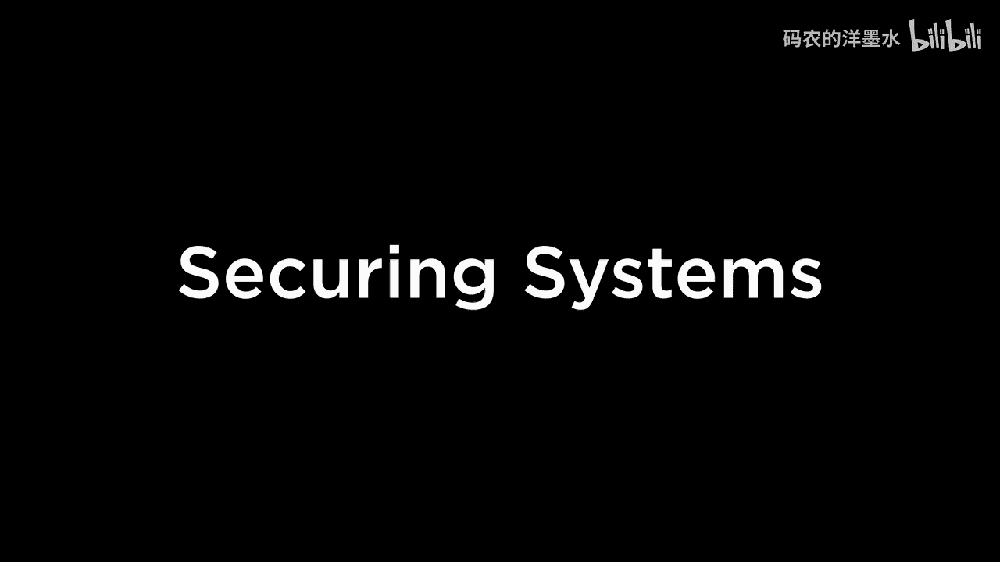
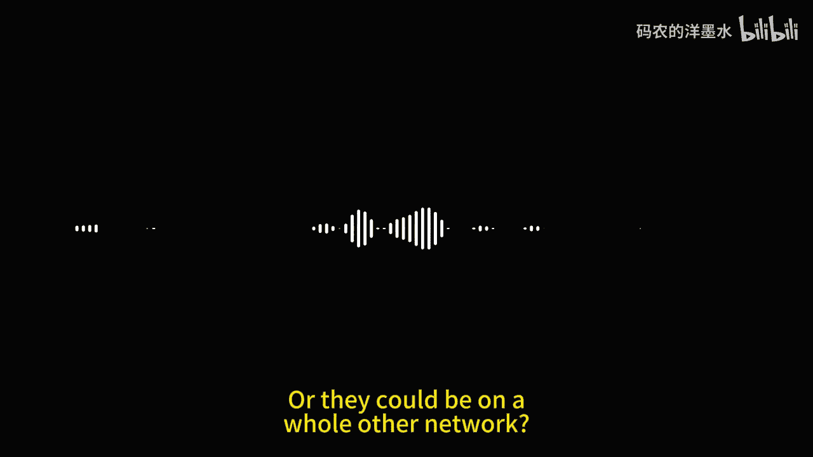
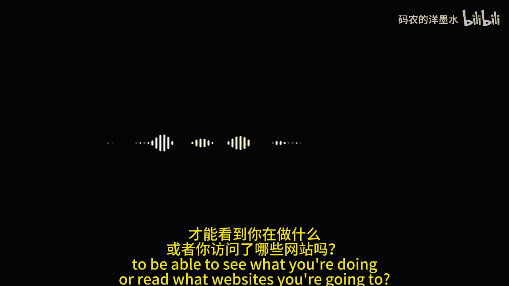
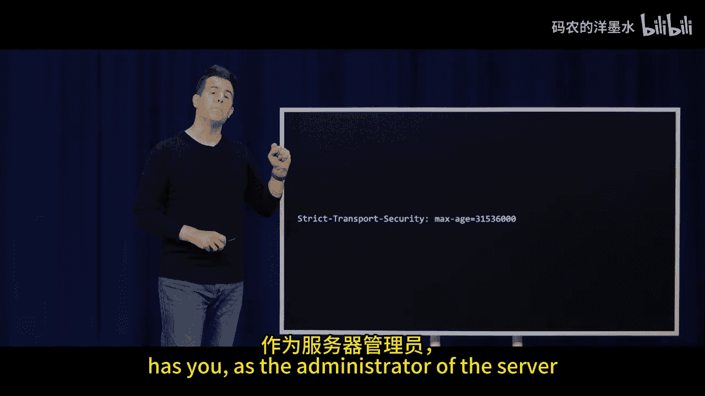
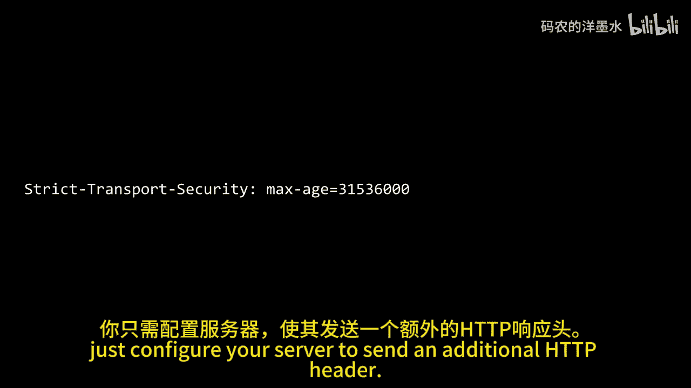
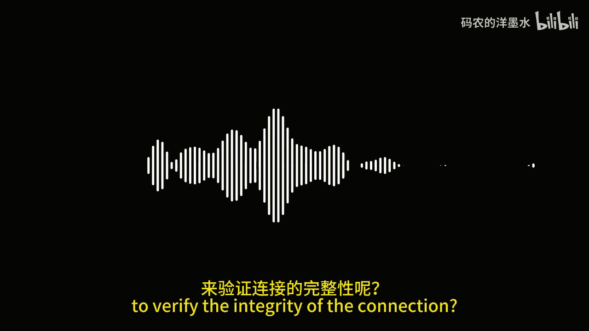
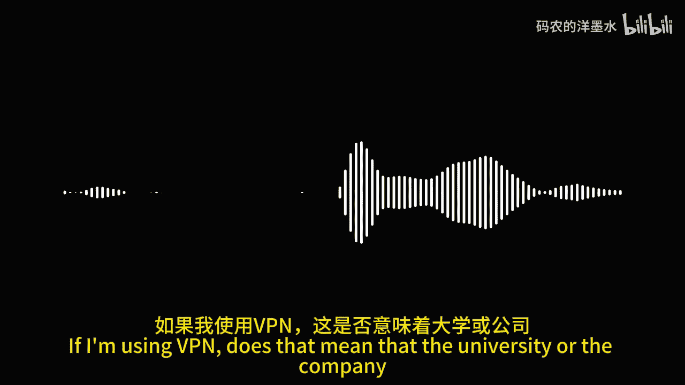
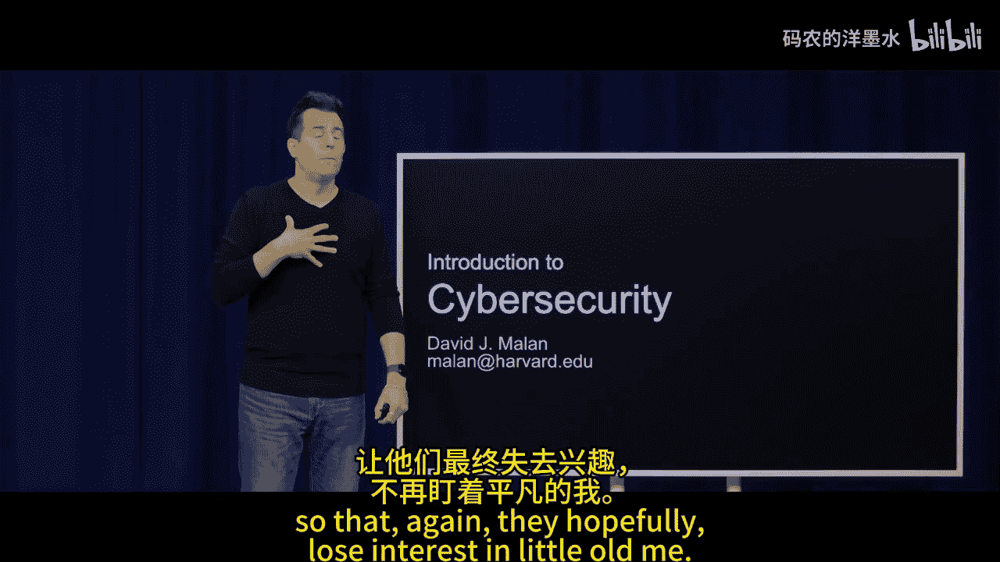
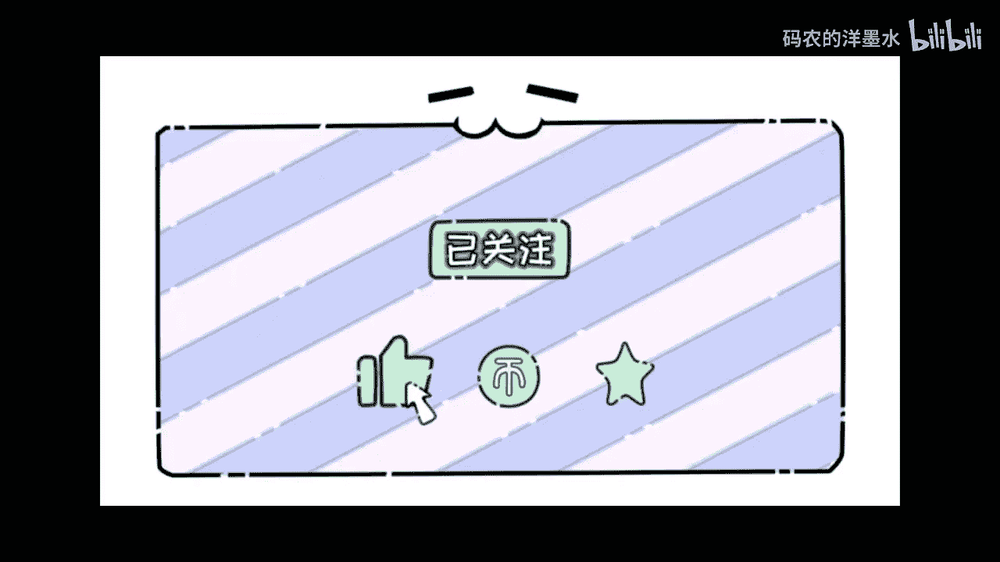

# 【全集】哈佛大学CS50 & 网络安全 中英字幕 课程附完整课件 p04 Lecture 2 - 保护系统 -BV1wJy3BLEe7_p4-

Alright， this is C S 50's。 Inuction to cybersecurity。 My name is David Main。 And this week。

 let's focus on securing systems， particularly those that are somehow networked or even interneted as well。

 Now， recall from last time that we present encryption。

 Its really the solution to a lot of our problems。 And that's gonna be a building block that we continue to use to solve a lot of our concerns around the security of not only our accounts are data。

 but now also our systems。 For instance， let's consider something that you yourself are perhaps using right now。

 which is wfi， somehow connected via wireless technology to the Internet and beyond So probably by now。

 you realize that when you're on wfi， you have to first choose your network and you might choose your network from a dropdown menu on your computer or the like or it might autoselect。

 but there's at least two types of networks。 One that are unsecured and then two which are secured in some way。

 And odds are you recognize and you've already been taught through practice to recognize the little padlock icon on your phone or laptop。

😊，top as signifying that your wifi connection is indeed encrypted Now， what does that actually mean。

 Well， in particular， in this context， it would mean that any of the traffic。

 any of the internet packets of information so to speak like envelopes of information going from your device off onto the Internet are somehow encrypted at least encrypted until they reach whatever device your device is talking to wirelessly So you have a encrypted connection between that wireless device often called an access point Now what is the actual technology that's being used to secure wifi networks nowadays hopefully you're using among the latest versions of this Wifi protected access or WPA and this has evolved over the years and there have been a few different versions。

 And so in general， whenever you can a phone or whenever you configure a laptop or desktop ideally you're connecting to a device nowadays that supports this technology and the latest version thereof and in a nutshell what that ensures is that indeed your traffic from your。

Phone， laptop or desktop is somehow scrambled between you and that other device。 And that device。

 in turn， is probably connected to devices called routers。

 computers that route left right up and down information on the Internet which might then connect to other routers until it finally reaches its destination。

 So for our purposes， though Wifi protected access and using a secure wfi network is only technically encrypting your traffic between you and whatever device is maybe on the wall on the ceiling nearby。

 the little thing with antennas， perhaps that you yourself are actually talking to。

 So why do we care about this。 Why do you want even your wifi connection for instance to be encrypted。

 Well， it turns out a lot of what you and I do on the Internet isn't necessarily encrypted already for us。

 Now， fortunately， this is decreasing the case。 The world has gotten better about using more and more encryption in various products and software and applications that you and I use。

 but not necessarily because odds are even some。You are probably in the habit of typing http colon www。

exle co or whatever domain you're actually trying to visit now maybe you don't type even that。

 but you're certainly familiar with this prefix this acronym HtTP。

 which stands for hypertext transfer protocol which is a fancy way of saying that this is a protocol。

 a language that computers use when talking on the world web or web for short。

 So what do we mean by that， well， if you're sitting down at a browser on your phone or laptop or desktop and you're visiting a URL that starts with HttP your device is about to communicate with some remote server using this protocol。

 this language， really a set of conventions for talking between each other but the catches per last week when we focused on the security of our data the information or the packets of information that we're sending from browser to server and back or vulnerable to eavesdropping potentially if you're only using。

HTTP。 Well， why is that？ Well， H TTP， by definition is not encrypted。 It's just text messages。

 often English like in nature， but they're not at all scrambled。

 which means if Alice is sitting at her desktop or laptop or phone and trying to visit some website here represented as our friend Bob。

 there could be some third party Eve whose eavesdrop in between a machine in the middle so to speak。

 that could be looking at every request， Alice is making and every response that Bob is sending if again。

 Alice is the user in the story and Bob is the web server in this story。 So you're vulnerable。

 if you're only using HTTP and certain other protocols or technologies to these machine in the middle attacks and the attack in this case might just be someone knowsily trying to know what it is you are doing on the Internet。

 but worse， they can even manipulate what you're sending or receiving if these systems are not using some form of encryption。

 So let's take a specific example。 when you visit。Website on the Internet。

 you are downloading effectively a language called Hml hypertext markup language。

 If you take a course like CS50 itself or an introduction to web development。

 you'll actually learn a language that looks a little something like this。

 And I've shown only the highlights using ellipses here dot dot dot to wave my hands at details that won't matter。

 but this is the kind of text or language that we get back from a server when you visit something like httP colon www example co。

 but notice that this doesn't seem to be scrambled。

 even though it might look cryptic to you if you've never written or seen htl before。

 it doesn't look like random zeros in one certainly it looks pretty intelligible and in fact it looks somewhat English like with words like body here。

 Well， the catch is if this is the response coming back from a web server to a web browser for instance。

 Alice's own what could happen is that some eavesdrop or some machine in the middle could actually inject。

HTML code into the web pages that you and I and Alice are downloading。 Now。

 what is this representative of。 Well， this is another feature you might learn in a course on website development。

 but let me highlight just one key phrase here， because this is a common use case。

 it is possible therefore， for a machine in the middle to inject something like advertisements or were something actually malicious that tries to steal your data in some way。

 But a common scenario for this machine in the middle attack is when your Internet service provider or the coffee shop whose wi-fi you're using or whose wifi you're using wants to inject advertisements into maybe each and every web page you are visiting even if those web pages weren't even designed to have advertisements。

 these things might be prepened to the very top of the page， for instance。

 Now the reason that machines in the middle are able to do this， though。

 is simply because if you're not using encryption and Alice and Bob are communicating inecurely in that sense。

 Well， there's no。Heling what they could add to the responses that are coming back from this Web server。

 Let me pause here before we move on to get other threats to see if there are now any questions on this particular attack。

 How do you Ma in the middle and get rid of it， a really good question。

 So how can you detect a machine in the middle and get rid of it。

 that certainly should be a worthy goal。 Short answer is you cannot necessarily detect it。

 It is possible that a machine in the middle can be doing all of this without your own knowledge。

 How do you get rid of it。 Well， that， too， is going be the focus of today。 Naly。

 encryption is going to help us push back on exactly this threat。But first。

 let's consider some additional threats or concerns that we might have。

 And one of them technically is called packet sniffing。 So again。

 a packet is a virtual envelope of sorts that you might use when sending data on the Internet。

 And so in fact， here is a pretty standard envelope in which in the human world。

 I might put a letter and then write something on the outside and send it off to someone through the mail system。

 Well， you can think of packets in the context of computer systems as being analogous to this whereby this is an envelope whose purpose in life is to get data from one point A to another point B。

 So from Alice to Bob and inside of this packet is the actual message that Alice is sending to Bob and Bob is hopefully sending back to Alice。

 So it might not all fit in one packet。 So indeed， the internet tends to use multiple packets like these。

 but that's an appropriate metaphor to think about what it is we're doing here， otherwise digitally。

 So packet sniffing then is kind of like trying to get a sense of what's going on inside of these envelopes。

 And indeed， if the contents of these envelopes are not。Enncrypted， scrambled securely in some way。

 Well， then any machine in the middle can technically take a quick glance inside of these envelopes。

 so to speak， see what's inside of them， even change what's inside of them if we've seen and then pass it along。

 So what are the implications for what this makes possible there for if you are vulnerable to packet it sniffing by again。

 not having your systems use encryption when they are talking to one another。 Well， here。

 for instance， is one example of what could be inside metaphorically an envelope like that。

 This is the kind of message written mostly in English that represents a browser requesting a web page from a server。

 In particular， when you visit a search engine， for instance， and type into the search box。

 what it is your're searching for， maybe you're searching for cats。

 What happens is your phone or your laptop or desktop， creates a virtual envelope like that。

 opens it up， puts inside of it a message that looks like this closes the envelope and then sends the envelope off。

To the internet to a web server that conversely is going to open the envelope。

 read this message and hopefully send you back a whole bunch of search results about cats。 Now。

 most of this is arcane detail that we don't particularly care about。

 including where it is we're visiting for this story。

 I'm using example com is just something generic， but you could imagine it being Google or Bing or the like Here you have a command get。

 which means literally get me a web pagelash search is implying that I'm searching for something。

 but here's the interesting part。 What I'm searching for is a query for cats where a query is a question or search request of of yours and cats of course。

 is what I'm searching for。 So this is to say inside of this envelope。

 whether you're searching for cats or dogs or anything else。

 There is some mention of that search query inside of the message inside of that envelope that's being sent from Alice to Bob or from you to Google or Bing Lastly。

 there's this mention here， which is referring to exactly the same protocol。T TP， in this case。

 perhaps version 3。 But in ultimately， it's the yellow highlighted text here that mention of cats that's worrisome。

 If some machine in the middle， some adversary can sniff this packet and see what's going on inside。

 Now， there's other threats similar in spirit。 When you request pages on the Internet。

 you don't sometimes just search for information like cats。

 which I don't really care about if people know since everyone else on the Internet is searching for cats。

 But what if I'm trying to check out on some website like Amazon and buy something with a credit card。

 Well， then what is inside of this envelope is some text that looks fairly similar。

 We still have a host in the story of example dot com。 I'm still using H T TP。

 I'm not getting information per se， I'm posting information akin to uploading my credit card to the server。

 and in particular down here is a representative of how my credit card might be stored inside of this virtual envelope。

 And if I highlight that， indeed， you'll see a credit card number that hopefully doesn't actually work。

 but it is the right length。If anyone sniffs this packet。

 they might actually be able to find my credit card and maybe my name and my address and the little code that you need and more with respect to whatever it is I'm checking out for。

 So it's that easy if the data is itself not encrypted。Let me pause here then too。

 and see if there are any questions。

If someone is performing an attack from a mission in the middle。

 does the person actually have to be like connected to the same wfi network as you or they could be on a whole other network。

 A really good question。 So in general， they would be connected to the same wfi network so that they are general。

 they would be connected to the same wfi network， but even that is not necessary。

 So long as they are within a reasonable proximity to you and their laptop or their device has an antenna that can receive all of the wireless packets that are around you。

 They don't necessarily have to have access to that same network。

 especially if it's unencrypted and in fact， there exists software that can listen to all possible networks that are around you。

 And so that， too， is a potential threat。

Other questions on this here。 Do people have to know your I address in order to be able to see what you're doing or read what websites are going to。

 A really good question for those unfamiliar in IP address is a unique identifier that every computer on the Internet has much like you have a postal address to which humans can send mail。

 short answer， Mahal is no， like someone does not need to know your I address in advance for at least these wireless attacks because they can simply。

 as per my other response， Listen to all of the wireless traffic nearby。

 and they can actually see the IP addresses of senders and receivers flying by， so to speak。

 throughout the air。

So what's another threat we should be mindful of。 Well。

 it turns out that most any time you visit a website nowadays is one or more cookies are installed in your computer。

 Now， what do I mean by that when you actually visit a website for the first time。

 particularly one that you need to log into and therefore that needs to remember you when you click click。

 click on different pages。 for instance， to access different emails add different things to your shopping cart what the server actually does is a little something like this。

 the server response to your request， for instance。

 after logging in with an H TTP response that first says 200。

 which is code for okay it's a socalled status code， similar in spirit to the 404。

 you might have seen in the real world。 But 200 means okay And then in additionally sends this line of text inside of a virtual envelope that gets sent back to you set dash cookie colon and then this key value pair so to speak a wordlike session than an equal sign than a value。

 Now in practice， the value is actually pretty big and random with numbers and letters。

 but I pick something easier to pronounce for today's purpose。😊，This is 1，2，3，4， ABCD。

 And what this is similar to， actually， is as though when you visit this website。

 your hand is being stamped right after you've logged in， the server is now sending you browser。

 this piece of message， just say the equivalent of。Your hand has now been stamped。

 And so the next time you click on a link on that same website。

 it's as though you present this hand stamp again and again and again。

 instead of having to input your username and password again and again and again。

 This is a more seamless way， supported by HttP。 to just remind the server。

 I'm still David I'm still David I'm still David by having virtually stamped my hand and that's implemented by way of this cookie so to speak。

 So the cookie is exactly what's in yellow here。 and a session is just a concept that refers to the ability of a server to remember who you are。

 it's like your shopping session in the context of a website like Amazon co or you might have a shopping cart that you want to keep adding things to the website wants to remember what's in your cart。

 therefore the website needs to remember who you are Therefore the websites gonna check your hand stamp much like an amusement park。

 a bar or club might once you've already shown them your ticket or your I Now subsequently when your browser visits the same。

ite again and again， it， of course， doesn't have a hand to show like this。

 So rather it sends its own message via H TTP inside of its own virtual envelopes back to the server Every time you click another link add something to your cart to open a new email on the site into which you've logged in。

 So here I'm just getting the homeage of this server。 then I'm sending not set cookie but cookie。

 This is the textual equivalent。 and H TTP of my presenting my hand with that stamp。

 I'm sending the exact same value as before session equals1，23，4 ABCD。

 That's how the server knows at this moment in time that this is me， David， and not you。

 for instance， even if you have logged in separately on your computer because you on your computer would have a different value for this cookie。

 Now， this cookie might be generally stored in memory temporarily。

 or it might actually be installed longer term on your computer for a day for a week， a year。

 depending on how the server has been configured。 But the catch with these cookies。

 even though they do solve a very useful problem of retaining。😊，That is remembering who you are。

 They make you vulnerable potentially to what's called session hijacking at least if you're not using encryption。

 that is Https because if you're using HttP， all of the contents of those envelopes。

 including the set cookie line and the cookie line are just being sent back and forth in the clear without any encryption at all Now what's the implication of that Well。

 if an adversary is somehow listening in on your internet traffic wirelessly or via wires and they see your unencrypted HttP traffic going back and forth and they see in this traffic inside this virtual envelope Oh。

 Davids session cookie happens to be 1，2，3，4 ABCD there's nothing technically stopping an adversary now from sending its own request like this to that same server but copying your cookie and essentially pretending that that cookie is the adversaries and not just mine。

 the implication therefore a logic。Is that when I visit that website， I might still be logged in。

 but when the adversary visits that website by using this technique。

 they might be logged into but as me。 So here too， the solution really is just to ensure you're using encryption。

 namely H T TPS in this context to ensure that not only are all of the contents of these message encrypted that you care about going back and forth So are these lower level details that you might not have even known about namely these cookies that are going back and forth。

 Now， what is H Tps doing for us。 Well， it's ensuring that the connection between Alice and Bob is completely encrypted that is scrambled so that even if there are other machines in between Alice and Bob。

 as there would be on the Internet， none of them should be able to see what is inside of those virtual envelopes going back and forth。

 In fact， that's a good way to think about it， recall that as Alice sends one of these virtual envelopes to Bob and Bob might send a virtual envelope back to Alice。

 there may very well be identifiable information on the outside like。

IP address of Bob or the IP address of Alice， but HTTPS ensures that what's inside of the envelope is indeed encrypted so that even if some other machine in the middle intercepts one of these virtual envelopes。

 they can't understand what's inside of it。Now， how is that done？ Well。

 it turns out that there is another protocol in the world that handles precisely that process of encrypting H TTP traffic Aka HtTPS。

 and the most recent version of this protocol is called T LS。

 which funny enough is perhaps an acronym that many people have still not heard of。

 but you might have heard of SSL， which is essentially an earlier version of it。

 but TLS is essentially the new and improved version of SSL and what modern browsers should now be using what does this do to go about encrypting your traffic。

 Well it turns out it relies on our focus from last time of public key cryptography And this principle that if you give two parties A and B。

 each their own public and private key using that， you can solve that chicken in the egg problem and actually communicate securely。

 even if in advance， you don't have a shared secret to recall that asymmetric cryptography allows us to establish a secure connection。

Even if you've never visited some website or some app before now So what does it mean for a browser to be using TlS and thus Https to communicate securely with a web server。

 Well the web server in this story now has what we'll call a certificate。

 a digital certificate and you can think of this for now is really a public key that has been signed by someone else。

 So the website has a public key and a private key and the private key as always stays private。

 but in this case， the web server has a public key that's also been digitally signed by some third party And for now。

 let's assume that there are some big third parties out there companies really。

 that we all or at least the browser manufacturers。

 the Google is the Microsoft the apples of the world all trust on our behalf and they are the ones signing off on the legitimacy of the so-called certificates。

 Well， the certificates technically or over type called x。

509 if you're curious about the type of protocol being used but this is just the standard format in which。

Certificates live， but you can think of a certificate really as almost a printed piece of paper with some interesting information on it。

 like the name of the website and how long the certificate is valid for and also the public key。

 which we said last time is really just a big number that has a mathematical relationship with that private key as well Now。

 who are these big players， these big companies that are doing the signing of these website certificates。

 well you might have heard this phrase at some point if you set up your own website。

 perhaps these are called certificate authorities or CAs and these are these are a collection of companies and entities whose purpose in life is to digitally sign certificates and the various browser manufacturer of the world。

 Apple， Microsoft， Google， Mozilla and others have gotten together and included in their browsers like Edge and Firefox and Safari and Chrome a list of certificate authority。

😊，That they trust。 And if the idea is that if you trust Apple and you trust Google and Microsoft and Mozilla and other browser manufacturers。

 then by transitivity， you should trust any of the certificate authorities that they in turn trust。

 So what actually happens when your browser visits a website。 Well。

 it first downloads the certificate from that website assuming you're using Https。

 Your browser then calculates a hash value for that certificate by looking at certain fields within it。

 using a special hash function that produces a fixed representation of the certificate。 Now。

 what does it bother doing that。 Well， the next step that your browser does is it does this。

 It takes a look at the on that certificate， it uses the certificate authority who signed that certificates public key and then it uses that Ca's public key the signature from that server certificate runs it through this algorithm here。

 effectively decrypting the signature with the public key and that。😊。

Should produce the exact same hash value。 That is to say if you visit a server and it's presenting you with a certificate。

 and it says that that certificate has been digitally signed by a certificate authority。

 Your browser can use the certificate authorities public key to decrypt that signature And by way of these hashs confirm or deny that。

 yes， that server certificate was indeed signed by the certificate authority。 And again。

 if you trust Google， if you trust Microsoft， Apple， Mozilla。

 and that's another question all to itself。 But if you trust them， and they in turn。

 trust these certificate authorities， the presumption is that you should trust your secure connection with this particular website Now。

 with that said， does H TTps and in turn， TlS keep you secure。Mathematically， yes。

 but you and I as the humans are again the potential weakness here。

 Why there's another attack called SSL stripping for historical reasons。

 but now it refers also to Tls and what this attack involves is tricking the user into thinking they have a secure connection to a website when they might actually have not an encrypted connection to that website and worse yet。

 they might actually have an encrypted connection to a third party。

 a machine in the middle's own website， So how might this work。 Well。

 if you and I are in the habit of only typing still URLs as Http colon www doex co or maybe you are an I and are in the habit of just typing www doex co enter into our browser or maybe more likely you and I are in the habit of just typing example co enter in our browsers Well if you watch the URL bar the address bar in your browser。

 you've probably noticed over time that even if you type the most succinct of those。

Inputs it eventually gets converted converted into a longer URL with the HttP。

 maybe with the wwW and perhaps even more characters as well and that's because your browser is just trying to be helpful technically to visit a website you need to use a URL and a URL in this case should start with Http colon or maybe https colon but your browser is trying to be helpful so if you don't even type any of those it might first try httP and then it might try Https even but the catch is that if you start your interaction with a web server using http that alone might be enough of a window of opportunity for an adversary to do something malicious with the packet of information you're sending to the server and then maybe send you back a response that tricks you into ending up at some other website altogether or perhaps just the adversary's own website and they might be super clever and make you think that you have a secure connection。

The original website that you visited。 So what do I mean by that if inside of your browser's virtual envelope is an HttP message like this。

 which is just saying get me the homeage of example com。

 But suppose for the sake of discussion that you are not using Https。

 you just typed HttP or nothing at all and you're trusting your browser to fill this in for you。

 What might come back from the server。 Well， the server could respond with a message that says this HttP version 3307。

 which is another status code， which means redirect the browser to a different URL。

 This is the browser's way of saying detour go to this other URL instead。

 what location is that URL at Well， perhaps this one here。

 But the catch is that if you're using HtTP and therefore your request is unenrypted and suppose for this story that there is a machine in the middle waiting there listening to attack you it could actually be that this response is coming from that machine in the middle。

And not the actual website that you intended to visit why， because if Alice is trying to reach Bob。

 but Eve， the Eavesdroroppper is in the middle， it could actually be Eve in the middle that's responding with this request So Bob doesn't even know what's going on in the story but the catch is here notice that this eavesdroppper this machine in the middle is particularly clever because they're suggesting that you'd be redirected per this status code 307 to HttB colon s and odds are you and I are probably in the habit of at least making sure that our browser says secure or that at least you're at an HttB URL so you might think good everything is the way it should be now this is very。

 very subtle but what if I draw your attention to the actual URL I'm being sent to here。😡。

At least on a US English keyboard using this particular font。

 This is no longer example dot com E X A MP， L E dot CM。 This is now indeed E X A MP1 E dot com。

 So this is a particularly subtle attack whereby the adversary in this story seems to have bought a domain name that looks very similar to example dot com with an L。

 but they instead use the number one， which in some fonts and on some screens looks so close to an L that are you or I really gonna even notice this difference。

 The implication， though， of this subtle T is that you might very well have a perfectly encrypted connection using H T T P S to a server。

 but it's not Bob server in this story。 It's now Eves server in the middle。

 So SS L stripping in this case refers to an attack whereby you're sort of stripping out what would be an H TPS redirection to the right place and。

😊，Maybe you never even end up at HTPS and the Eavesdroppper in the middle always keeps it as HTTP。

 but an even more malicious adversary might take it one step further and actually redirect you to their own HTTPS site at which point you might be vulnerable to the phishing attacks that we've discussed before where you might provide information into a website that is not actually legitimate。

😡，So how can you mitigate this kind of attack Well， one， if you're a user， a consumer。

 you could just get into the habit of always typing out HttPS colon and then the domain name that you want to visit I will concede that that can get tedious quickly but that is hands down the most paranoid solution to implement here because you know you will end up at Https hopefully the website actually supports Https but most websites nowadays certainly do with that said。

 if you're on the flip side of the story and you're actually the designer of the website。

 the business owner running the website or you have control over not the browser， but the server。

 there's a few different things that you can do and in fact。

 you can use a protocol called HST which is to say you can actually configure your server to provide hints to browsers that you know what they should always use Https when talking to the server。

 no matter what the human。😡，Decided an HS T S here for hypertext secure strict transport security has you as the administrator of the server。

 Just configure your server to send an additional HttP header。

 That is to say an additional line of text inside one of those virtual envelopes that just informs the server that we really want to be strict about our transport security。

 That is we want to be using TlS。 We want the user to be using Https。

 And here the server is telling the browser assume that this is the case that I want you to use strict security for at least one year。

 This is the number of seconds in a 365 day year。 for instance。

 that's just a really long time telling the browser that yes。

 I'm gonna keep my security on for at least a year， which should be the case anyway。

 but you can further configure your server to not just output this response in every one of those virtual envelopes going back to browsers。

 you can even more protectively say use strict security for subdomains as well。 So even if my。

User is at example do com。 Also make sure that their browser uses HttPS for something like www doexle dot com。

 where in that scenario， Www can think of as a sub domainomain because it's part of the example do com domain itself。

 And so what is this telling the browser specifically。Even though you might accidentally。

 conveniently visit a website for the very first time using H T TP colon slash slash because you typed it or you let your browser automatically fill that for you。

If the server responds with this message， the whole point of HS T S is that the second time。

 the third time， the 300th time， the 300th time that your browser visits that exact same domain in the future up until at least a year from now。

 it will automatically switch you to Https and it very protectively won't even let you visit the HttP。

 even if that's what's in the URL bar， It's just going say， nope I've been told to use Https instead。

 and that therefore decreases the window of opportunity for adversaries to just that very first request that you might make accidentally conveniently that's using HttP。

 but every subsequent request from your browser According to this model will now be Https instead。

 and you can go one step further too。 if you're the administrator of a server。

 you can also include the keyword preload in this message that's inside of all of these virtual envelopes and what that will。

Further tell the world is that if the browser manufacturers would like to preload this information into Chrome into other browsers that humans download。

 you can even eliminate that first window of opportunity because you can have your domain name included essentially in the source code for browsers like Chrome so that when people download Chrome itself。

 visit your website like example co， your browser will already know that they should not use HtTP with this website。

 they should use HtTPS。😡，Questions， then。On HTTP on TLS on HSTS it's a lot of acronyms but realize that some of these defenses are available to you as a user and some of you more technical。

 these defenses are available to you as system administrator So you mentioned that there is such websites as exam 1。

 co and they very similarly look to example co and I know that registers by against phing websites like this and whenever somebody tries to register a domain that's looking a little bit suspicious it usually marks it as fraud and supendense it so how do such domains still exist and why is it so common that's a really good question and that's great that registrars who are the companies in the world that sell you or rent you domain names nowadays are being more vigilant when it comes to your buying a domain that could be maliciously used in this way because it's so similar to a brand name or in exist。

Website， however， there's a lot of registrars out there。

 and I would conjecture that not all of them are as good as others at doing that detection。

 There are hundreds of tople domains nowadays， T LDs。

 which means that you could even choose example that something else potentially and that too might not be caught in this way。

 Now， eventually maybe especially when you use it maliciously， you would eventually get shut down。

 but maybe it's enough to attack one person or two or 10 or 100 before it's actually shut down。

 So these remain theoretical and actual attacks。 but there are certainly ways to push back on this。

A good question， others。From the group， I would like to know that is H TTP is the。

That solution for cookies and super cookies to prevent from attack。

 Or should I clear the cookies frequently。 A good question。 Unfortunately， super cookies。

Cannot be stopped at the browser level。 Super cookies refer to a type of cookie that's embedded by your company。

 your university， your Internet service provider， and you would have to opt out at that level。

 So for context for Americans in the group A and T and Verizon started doing this a few years ago where they were injecting cookies into cell phone customers HttP requests。

 you literally and stupidly and obnoxiously have to log into your Verizon do co or your A and T co account via the web or the app and opt out of this。

 So wanting to your question here super cookies are actually super annoying super difficult super dangerous in that sense。

 because they can happen without your knowing。 however。

 if you are using HtTPS that should decrease the probability of this happening。

 because if your data is encrypted your company， your university。

 your Internet service provider can't insert the cookies。Into those encrypted messages and。

 and we'll talk a bit about this more later， unless you have given permission to your company or university to install special software on your Mac or PC。

So in short， simplest advice is always use HPS and if you have a cell phone provider Google around。

 find out if they might be doing this to you and if so figure out if you can opt out about one more question here question will be from a macro perspective will it be feasible way there are machine the middle in the like you know a request from let's say so many to server will packet get like the integrity of the potentially the catch is and if I'm understanding the question correctly the catch is you we don't control all of these machines in the middle when it comes to routers so it's possible to do what you're doing but there just isn't coordination at that level and so per。

cus last week of end to end encryption in general， it's best that the sender and receiver worry about doing the encryption because that way you don't have to trust anyone in between you。

 any machines in the middle so long as you are using a protocol that supports some form of encryption end to end。

😡，So how else can you keep your system secure， particularly when they're communicating with others Well。

 another technology with which you might already be familiar is this a VPN or virtual private network Now。

 whereas Https only secures your web traffic between browser and server。

 a VPN is dare say a more powerful technology because it encrypts all of your internet traffic between you and whatever VPN server to which you're connecting So how does this work。

 a VPN allows Alice and Bob to establish a encrypted channel that even if there are machines in the middle。

 routers or otherwise， that shouldn't matter because Alice and Bob are using cryptography to encrypt all of the information going in between points A and B Now how much you use this it's very common if you work for a company that itself has servers that you might need access to。

 whether it's email or files or anything else， you might from your laptop have to buy policy at that company connect to your company。

😡，Svers via a VPN， virtual private network。 That is to say your Mac or PC or your phone have special software that you start up。

 you probably log into using minimally a username and a password maybe using a twofactor code。

 maybe using a USB device that you have to connect to your computer。

 you have to somehow authenticate to that VPN。 And once that software is up and running and authenticated against the VPN server run in this case by your company。

 all of your internet traffic thereafter should be encrypted between you point A and the company point B。

 The motivation for that is that this way， the company can sure that no matter what services you are accessing inside of the corporate network be it email or files or maybe video conferencing or something else altogether no matter what by nature of that VPN。

 all of that traffic is encrypted。But you should realize， too， that VPNs have a few side effects。

 perhaps good， perhaps bad。 When Alice connects to Bob。 If Bob is the VPN server。

 she has this encrypted tunnel。 This is what we mean by a private a virtual private network。

 She has this encrypted tunnel to Bob， which typically makes it appear as though Alice's I address。

 her Internet address， her unique identifier on the Internet is actually that of Bob。

 and not her own。 That is to say if Alice connects to her company's VPN server。

 she then gets another I address from her company's own VPN server effectively。

 So if Alice then visit Gmail dot com or Amazon do com or any other website。

 those websites will actually think that Alice's I address I that of Bob and not Alice。

 So this is very commonly used if you're in one country and you want to masquerade as though you're in another。

 And this might be because you need to in order to access company resources， Perhaps from。😊。

Of smiles， this might be because you want to access a streaming media service that you don't have access to when you're in one country or another。

 The point， though， is that you have this encrypted connection between points A and B。

 And thereafter you can visit any website， any service as though you are physically at location B。😡。

Beyond that， there are other technologies that you can use to encrypt communications。

 And this one's a little more technical and used by programmers and system administrators alike。

 There's a protocol called SH for secure shell。 And this is a technology via which you don't necessarily encrypt all of your traffic between point A and B。

 although you can use SH to create the equivalent of a virtual private network or VPN。

 But SH is all about connecting to a remote server and executing commands on it。

 So not executing commands on your own machine ultimately。

 but on some other machine that's maybe inside of your company。

 your university or somewhere else in the world。 So for instance， if curious as to how this works。

 you might recall that in a previous class， I wrote some code on my computer。

 And then I opened up a terminal window that started with this prompt， a dollar sign。

 It doesn't mean currency， it's just a tradition that the dollar sign means type your commands here。

 But at the time， I was typing them on my laptop here on a local server， if you will。 if。😊。

Though want to use a computer to remotely connect to another and then remotely run a command。

 It might work like this。 Here I am。 Let's pretend on my own computer。

 And suppose I type out one command like the date command。's not surprisingly。

 this will tell me what the current date is。 So suppose that where I am on my own computer。

 it is Thursday， January 1， at midnight， Eastern time in the year1970 for instance。

 if though the next command I run is not date again， but I use S H and I connect for instance， to oh。

 how about our friends at Stanford University。 So I'm gonna S H into Stanford do Eduus server as soon as I'm at that server now。

 I get another prompt in this case， But if I now run the date command。

 what you'll see is that the date is now apparently slightly in the past。

 at least if I type this quick enough so that the seconds weren't off Wednesday， December 31。

9 PM Pacific time in the year still1969。 So this is。😊。

SSH is actually a very common technology used in the world of software engineering system administration。

 when you want to control one server from another。 And what's powerful about it is that everything I just typed after that S H command。

 even as innocuous as the date command is on Stanford server would be encrypted。

 So no one between these points A and B would be able to know what I'm controlling or what commands I have typed。

All right， let's go ahead and take a five minute break。 and when we resume。

 we'll look at some other building blocks of systems that both solve problems。

 but also create vulnerabilities for us as well back in a few。Al right。

 let's talk about now what's actually been on the outside of these virtual envelopes that's helping these envelopes get from their source to their destination。

 So it turns out that on the outside of these envelopes minimally is what we'll call a port number。

 which is literally just a unique number that the world has decided on that uniquely represents the type of service that that envelope is destined for。

 So for instance， if you at your browser， we're going to pull up a website like HttPlash www example do co on the outside of that envelope would not only be some mention of www example co but also a socalled port number。

 namely 80 by convention， which means that this envelope should be opened。

 not by the other server's email server or chat server。

 but by its web server specifically Now if the web server were to respond to us by saying we want you to use Https instead essentially redirecting the browser to a secure。

version of the website。 My browser would then have to send a second request to the server this time still mentioning www do example do com。

 But on the outside of that envelope， among other details would be a different port number， namely 4。

4，3。 Now， these aren't the kinds of things you have to memorize。

 but the computers certainly know what they represent。 And in fact。

 a common numbers include 80 for H T TP 4，4，3 for H T Tps 22 for SH and hundreds。

 if not thousands of other numbers as well， that humans decided on but the computers actually rely on to know what piece of software on a computer should actually expect and open up these virtual envelopes。

 these things we call packets。 So what's the problem or danger here。 Well。

 it turns out that your computer can be listening for Internet traffic on none of these ports。

 in which case it's completely disconnected from inbound connections。 But very often computers。

 especially servers aren't listening。 so to speak。For envelopes， desin 4， maybe port 22。

 maybe port 80， maybe port 443， maybe others as well。 So you might think， well。

 that's not great because if these numbers are standardized。

 then adversaries could maybe try to access my server via those port numbers because they too know what they are。

 So you might think， all right well， let me run my web server on a number other than 80 or number other than 443 and just use a random number between like 0 and 65000 or so because the odds that the advers is gonna guess that are much lower SSH you might consider doing the same But unfortunately it's all too easy for adversaries to wage this kind of attack known as port scanning and recall that we did our own brute force attack in classes passed on our own passwords for instance trying to figure out all possible passwords that might be locking a phone and it's not that hard to use code very much like that with a loop of some sort that just tries every possible port number between some range roughly zero。

65000。 so port scanning refers to the equivalent of accessing knocking on the door of every possible port number on a server Now most of those doors might be closed and no one might be home。

 That is they might not be expecting any traffic or visitors on those numbers。

 but by writing software that tries all of those port numbers。

 you can essentially discover services that are running on certain computers Now。

 hopefully that and of itself is not a problem because most likely the purpose of these services is to be on the internet。

 but hopefully these services too are using encryption， hopefully they're using authentication。

 but that's not always the case。 So security through obscurity so to speak。

 running services on random or arbitrary nonstandard port numbers is not really a good practice unless you're additionally defending against all of these common attacks。

 Now in the world a port scanning them it's a specific example of what we might call penetration。

More generally， penetration testing or pen testing is actually a skill， a technique。

 a job even whereby you or hopefully not an adversary。

 but hopefully a wellpaid consultant whose purpose in life or whose vocation in life is to actually try to penetrate someone's network or penetrate someone's system And what do I mean by that。

 Well， maybe quite simply you try scanning all of the ports on their servers just to see if there are ports that are open that is listening that shouldn't be because no sense in opening a door if no one's meant to go through it or you might try to penetrate their network or system in some other way。

 maybe you might try to brute force your way through passwords。

 maybe you might try to socially engineer the employees of that company or the like So penetration testing is all about someone who for good purposes is trying to find possible weaknesses in your infrastructures so that hopefully you can pay them and thank them but then fix those problems。

Actual adversaries tried to exploit it for malicious purposes instead。

 So this might also be referred to as ethical hacking。

 where you get all of the cache of being a hacker and really good with computers but the upside of doing it ethically。

 which is to say that if you are in the business of trying to find faults with systems。

 you don't have to do it for for illegal financial game。

 But for very much legal financial gain instead， as in someone will pay you to find faults in their system so long as you tell them and only them first。

 so that they can actually fix the same。 And in fact， in this world。

 there's a gamification of it of sorts in certain companies where you might have a red team whose purpose in life in this game is to actually try to penetrate the network or find some faults。

 and then the blue team， so to speak， whose purpose in life in the story is to defend the systems against those attacks。

 And so that too has often yielded better results for some folks。

 given that it helps them find weaknesses before。😊，So， who don't work for them do。

So how might you keep these attacks out and how might you keep even penetration testing out in a good way to demonstrate that you know what we are actually pretty secure。

 Well， there's this technology with which you might be generally familiar by name。

 namely a firewall which actually comes from the real world typically in buildings that might have multiple stores。

 there might literally be a firewall between two of the stores so that if there's a fire in one store。

 it doesn't somehow propagate next door to the other store now in the virtual world。

 a firewall is essentially a piece of software between you and the outside world or between you and some other network that keeps data in the network that you don't want to leave it and it keeps out from the network data that you don't want coming in。

 So for instance， if you might within your company or university or home have some sort of local chat service or intercom system or the like none of that traffic ideally should end up on the public internet so you might want your firewall to block。

Any intentional or accidental attempts to transmit that data outside the network。 Conversely。

 if you have a private network that you only use for home computing and watching streaming media and the like。

 you are not yourself a server and you certainly don't want random on the people trying to connect to your laptops or desktops or servers in your home。

 You might want your firewall to keep all Internet traffic out。 Now， with that said。

 there are some problems when you want to use services where you do need to talk to someone on the outside world。

 maybe like a zoom call or the like， but there are technologies that help mitigate this。

 So these firewalls are not necessarily absolute， you can open them up or poke holes in them。

 so to speak to allow certain services through。 So how might these firewalls actually work Well。

 they might simply block traffic。 That is Internet packets based on I P address because recall on the outside of those virtual envelopes is not just port numbers。

 but also not quite the domain name like www example com on。

Outside of those envelopes is actually the unique address of a server to which you're sending a packet and the unique address of a client that is expecting some response there too。

 So an IP addresses is just a numeric unique address for let's say every computer on the Internet。

 It's a bit of a simplification， but it's very similar to the postal addresses that you and I use to send mail oldcho style or postcards throughout the postal system as well。

 So you could quite simply， if you as a parent， for instance。

 don't want your kids accessing social media within the home。

 you could just configure your homes firewall to prevent access to the IP addresses of known social media sites。

 And so if the kids are trying to use the laptops or desktops in the home to connect to those IP addresses。

 it would effectively be blocked and not allowed through So long as the software in question the firewall can knows or can figure out what those IP addresses are Now that said。

 it's not failproof。 All it takes is for someone in the home to have some out of band。

Like a cell phone that uses the mobile phone network and then of course you circumvent the firewall that might be based only on your home network so you have to keep in mind exactly what it is you are firewalling in which networks they're in now you might not want to block access to sites based solely on their IP address but perhaps based on those port numbers so for instance。

 if you wanted to block all internet traffic in or out of a network you could just use your firewall to block all of those port numbers。

 but if wait a minute you realize that you still want to be able to remotely control a computer or server in that network。

 you could open up just one port number， for instance 22 if you want to allow SSH back and forth or whatever port number your preferred VPN software uses instead so you can use firewalls to block traffic based on IP address based on port number or even more sophisticatedly via deep packet inspection which is a big way of saying that even the most sophisticated of firewalls can actually open up the。

ically， these virtual envelopes and see what's actually inside them。

 And this way you can even more reliably block certain sites by their domain name。

 not just their IP address， but by their name， you could， for instance， via a deep packet inspection。

 Keep an eye out as to who is emailing whom， for instance。

 corporations that are very concerned about their intellectual property ideas and products that they have internally。

 they might use deep packet inspection to make sure that you and I are not emailing the press about some new product under development or emailing the competition or anyone in the outside world about some product because by a deep packet inspection。

 you can pretty much look at everything inside of this envelope， be it the sender， the receiver。

 the contents of the message， but you can also use this too。

 not just for confidentiality and the like， but also， for instance。

To check for malware and malicious software。 that is to say maybe attachments that you don't want to allow through。

 And we' consider exactly what those threats might be in just a moment as well。 Now。

 how might a company a university or even a home implement this kind of firewalling or more deeply this deep packet inspection。

 Well， we're essentially describing a technology that you would call a proxy。

 And a proxy is very often a server， though it doesn't have to be an actual physical server can be a piece of software running in your network。

 A proxy is a device that essentially implements a potential machine in the middle， a。

 but it's not quite an attack in this way， It's by design。 A proxy is a device。

 a server or piece of software that sits between two other points。 So in this case。

 Alice might be someone on the inside of a network。

 Bob might be someone on the outside of a network and Eve in this case。

 is eavesdropping literally because her role in this story is to be that of a proxy。

 And the proxy takes data from one side and。Maybe hands it out to the other。

 but this proxy might indeed be eavesdropping might be a little nosy。

 And so as a packet comes in this way from Alice might look in the packet and decide。

 we're not gonna to send this to Bob， and then it might just be dropped or effectively deleted。

 So companies， universities， even home networks can use proxies to decide yes or no whether or not to allow certain traffic through。

 So in that sense， they're very similar to a firewall。

 but sometimes proxies or something that have to be configured even for your own devices because there might be only one path out of a company network。

 only one path out of a university， but the catch here is that literally all of that traffic by design now is going through this middle point。

 And here's where things can get troubling。 especially if you do attend a university or you do work for a company where they may be issued your laptop or desktop or phone。

 So if your company or your school has given you。Laptop or desktop or phone。 know。

 that might be nice that this is one of the perks to have this hardware。

 But if they have preconfigured it with software， realize that there are implications of that。

 you might have your own username and password on that laptop or desktop or phone。

 but they might have installed administratively with root access。 so to speak。

 some kind of software that could actually be monitoring everything you're doing on that computer。

 and this is not uncommon in the corporate workplace， but they can also do things more technically。

 like they could install their own certificate authority on your laptop or desktop or phone。

 essentially adding to the list of certificate authorities that Microsoft and Google and Apple and Mozilla have baked into their own browsers。

 The implication of this is that even if you think that you as Alice。😊。

Can securely communicate with Bob。 And maybe Bob in this story is Gmail co or Amazon co or Facebook do co。

 even if you think that Alice and Bob you， Alice can communicate securely with Bob and establish a connection between HtTPS。

 slash slash Gmail com。If your browser， that is your phone or laptop or desktop。

 has a certificate installed by your company or university that's acting as a CA or certificate authority。

 essentially your computer could be tricked into thinking that you're connecting to the real Gmail co。

 but you're actually connecting to the company's proxy server。

 but because you have this additional certificate on your computer。

 even though the company is masquerading， pretending to be Gmail co。

 you're actually connected to their proxy server and they might actually be forwarding your traffic somewhere else。

 but this is a definition of a machine in the middle attack。

 but it's facilitated by someone else having used our technologies that we talked about earlier to trick really your local device into thinking that this is the real Gmail co。

 whereas is the math might actually be based on the company certificate not on Gmail zone。

 So be mindful of that again whenever you're using a device。

That has left your control or has not always been under your control that you do not necessarily know what is installed on it。

So how else might a accompany a university be observing or keep painting an eye out。

 either for good or evil purposes， Well， they actually might also be doing something that we might call URL rewriting。

 So if you have a company or school email address via what you receive mails from the outside world。

 you might notice that whenever an email contains a link。

 if you hover over the link and look in like the bottom corner of your browser。

 It might actually not go to the actual link destination that you think it does。

 It might actually go to a URL like this， maybe Htps Col s examplet com question mark URL equals something。

 And the implication of this here。 is that what companies and schools might do to combat malware。

 maybe malicious software that could be accidentally installed or sent your way via URLs or to prevent you from accessing phishing websites that are trying to steal your or the company or the school's information。

 they might。Aally through some kind of proxy server acting in this case on email。

 change every URL in an email you receive to be example com and then embed at the end of that example co URL。

 the actual URL so that you can still reach your destination。

 But the implication of this is that if you click on this link here。

 you're first going visit example co。 That's going to include some data from that proxy server that has added URL equals something where something might be Gmail co Amazon whatever the actual URL is。

 But because the company or the school in the story controls example co。

 They know what URL you're trying to visit Now， one。

 they could minimally just log that information and know that David seems to be visiting Gmail again。

 or they could actually check in their database is Gmail do co or whatever this URL is known to be malicious。

 Is it known to be a phishing website and they can just prevent you from accessing it all together。

 So this is another form of。😊，ingThat's actually very explicit because you're embedding the machine in the middle quite literally as example。

 co or whatever your university or your company's domain name is。

 but it's all toward an end of trying to help protect you from potentially malicious fishing type website。

 but the implication too is that now the company， the school。

 the machine in the middle knows every link you're clicking on as well。😡。

Let me pause here and see if there are now any questions about these techniques of。Proxying。

 I just want to know what's the difference between VPN and also To network in a higher level like。

 you know， just the difference because what I do know is that these two networks are used to encrypt or anonymize our activity or you know the data that we're sending the second question is that let's say that I'm using a network at a university or a company and they also have their own。

 you know CA， which means that they've got their own databases like which websites I can get in and which websites I cannot get into if I'm using VPN does that mean that you know the university or。

The company know what I'm doing。Good question。 So Tor is the anonymization software I was alluding to a moment ago in my previous answer。

 and we'll talk about that in our final lecture。 Tor really is about privacy preserving。

 So it's about covering your track so that kind of like the Hollywood movies when you're here。

 your data is bouncing sort of across all of these different servers in the world and it's sort of difficult to trace it back to its origins by design。

 So more on that in a couple of weeks time， VPN is an encrypted connection just between 1 point A and another point B。

 So even though they can't see what you're doing， it is very obvious where your data is coming from thereafter。

 so legally， for instance， if the VPN server or company were to be subpoed。

 they might have to disclose information about you and so it's not quite as privacy preserving it secures your data。

 but it doesn't preserve your privacy in the same way。

 on your other question about what you're doing especially when you're on a VPN if you if someone has installed with administrative privileges software on your computer。

 like all bets。You should not cannot trust the device。

 So if they've installed their own certificate on your computer or a CA to the list of trusted things。

 anytime you use that browser， for instance， like you are vulnerable to a machine in the middle attack or at least a proxying type implication beyond that。

 And but honestly at that point， if they've installed special software on your computer。

 they could be monitoring everything you do on the Internet anyway。

 So sort of all bets are off So what is it we're trying to keep ultimately out of our systems。

 I dare say malware is perhaps one of the biggest threats。

 So malware or malicious software is just software that someone has written that can do malicious things and that sort of the nature of software if you've never programme before。

 it turns out that it's not that hard to write a program that if you run it like deletes all of the files on your computer or maybe starts sending out spam or maybe starts mining Bitcoinco or anything else。

 like software can do anything and whether it's malicious or not is really up to the。

Han who wrote it or the person who's using it。 Now。

 you might have heard of specific types of malware。 for instance， a virus。

 A virus is a piece of software that attaches itself to a host。

 just like in the human physiological world。 The with a virus in the digital world is that you。

 the human usually have to do something to get infected。

 you have to open a file that's infected with the virus and start running it on your computer and loading it into your computer's memory and CPU or brain you have to click on an attachment in an email that's perhaps infected。

 So viruses generally require human intervention and really human mistakes。

 you're exposing yourself unintentionally to a piece of software that can now do anything。

 And then virus can literally do anything that a piece of software can。

 So it can delete all the files on your hard drive。 It can send spam。

 it can start Bitcoinco mining can email all of your files to an adversary。

 like once you have a piece of software running on your computer， all bets are off。

 So you might wonder then well what's the line between a virus and like。

Microsoft Word or some Spotify or some other piece of software you install on your computer。 I mean。

 really， it's ethics at the end of the day。 We are trusting that Microsoft word in Spotify and other software。

 you might install on your Mac， your PC or your phone， just isn't doing bad things。

 because very often， once you have a piece of software on your computer。

 it technically can do anything that the operating system。

 Windows or Mac O or ios or Android make possible thanks to those manufacturers and it really is a code of ethics。

 it really is perhaps capitalistic pressures that ensure that companies aren't necessarily infecting us with software that's doing bad things。

 Why probably bad for business， if nothing else， if they're caught doing something malicious。

 But with that said， for historically， it's quite possible for software to be written。

 even within the constraints of an operating system that does bad things。 And heck。

 maybe it's even accidental。 It has absolutely been the case that sometimes software deletes。

Things that it shouldn't， because some human made a mistake。 Now， with that said， gradually。

 the world is getting better at designing better and better operating systems that try to sandbox things。

 And ios， which runs on iPhones and iPads in the like is actually particularly good at this。

 whereby sometimes annoyingly， apps can't do something without your explicit permission。 Now。

 you and I might not give much thought。 You're just saying， okay， okay， okay。

 because we want the software to do its thing。 but more so than operating systems past you and I are increasingly being allowed to weigh in on whether some piece of software can use the network can turn on the camera。

 can turn on the microphone。 So thankfully， we're getting more and more building plots to mitigate some of these concerns。

 But there are still viruses in the world。 and you can be infected by them。

 whether it is some file you've downloaded and run or some email attachment you've clicked。

 But more worrisome is another type of malware that we might call a worm and a worm is very similar in spiritual a virus and that it's just malicious software。

 can do anything。😊，But these things can travel from computer to computer even without interaction by humans Now。

 how does this work Well， a worm theoretically， once it's installed on one computer。

 having infected it and running， well it could do that technique called port scanning from earlier and maybe it can use that infected computers。

 internet connection and just starts scanning the local network or a broader network for IP addresses of other computers and ports of other computers and if one of those computer's port happens to be listening and for unfortunate reasons。

 that computer is not using encryption， it's not using authentication and it's vulnerable somehow theoretically that worm can travel from computer to computer to computer by making these network connections via these ports at these IP addresses and that is quite often how they have spread it's the result of mistakes in software。

 it's the result of there having been holes in our firewalls in。😡。

Systems by allowing them through via these techniques。 So what's the downside， really， Well。

 beyond just wreaking havoc on your own computer by deleting all of your files， spamming people。

 Bitcoincoin mining and the like。 actually what adversaries have increasingly been doing over the years is creating botnet。

 so to speak。 That is， it turns out it's more valuable to an adversary。

 not to completely disable your system， because that doesn't really serve them long term。

 but maybe to install software on your computer， that's just constantly running。

 And it's not actually doing anything bad to you。 None of your files are deleted。

 No spam is being sent， but you are infected。 and there's just some piece of software constantly running on your computer。

 but maybe this adversary has somehow figured out how to infect not just your computer。

 but my computer and your computer and your computer and your computer and hundreds。

 thousands of other computers in the world。 Now， if this software is smart。

 And it's constantly listening for commands attacker can。some kind of command。

 not unlike those virtual envelopes to this entire botnet of computers and say。

 okay computers now everyone at the same moment start attacking some server or everyone at this moment start sending emails everyone at this moment start mining Bitcoin and so you can leverage the network of hundreds or thousands of computers all at once and have a much more powerful attack therefore possible And what form do those attacks take。

 well quite often what we'd call a denial of service attack or do and this is exactly is the name suggests sometimes adversaries's goal in life is just to deny service to everyone else。

 whether it's for political reasons， financial reasons or the like it's one thing for me on my laptop or my phone to maybe visit maybe I'm a little annoyed at Google today So I go to Google co and then I keep hitting reload reload reload reload or faster reloadload reload I'm trying to deny service to other people but realistically Google has。

wayay more resources than me。 So a denial of service attack only really works if you have a lot of resources yourself。

 more resources than the site you're attacking。 But with botnets。

 when you control multiple computers， you can actually wage a distributed denial of service attack whereby again。

 you send a command to this whole network of infected computers and you say。

 all right everyone go visit Google do co right now and reload， reload， reload。

 And when it's hundreds or thousands of computers doing it to Google。

 or maybe not someone as big as Google， but maybe a small business that they're annoyed at or they're competing with。

 you can via a distributed network， try to deny service to actual customers or users of that site。

 Why Well， a computer long story short， only has so much memory only can do so much per unit of time。

 And if you completely distract a computer or server by all of these requests that are sort of bogus。

 then the good requests from the real users， the real customers can't necessarily squeeze in。

You're denying service to other people and distributed is particularly malicious why Well once a company figured out what's happening like Google。

 they could just block with their firewall， my IP address， for instance。

 coming from my phone or my laptop or other device once they know where the attack is coming from they can just deny or they can block service there but if it's distributed if it's coming from all of us or thousands of people。

 thousands of IP addresses then it gets a little harder like technically they could just block all of our IP addresses。

 thousands of IPs but very often you and I share IP addresses if we're on the same campus on the same corporate network。

 even though locally we might have unique addresses to the outside world。

 we might all share one public address from our whole company or school。

 and at some point it's not gonna be in Google's best interest in this story to block all of those IP addresses because then we might be denying service to actual good people on this campus at this company who just happen to be on。

The same network as this attacker or as this infected computer。

 And so that's really the value of attacking computers nowadays。

 It's not just one thing to get at your computer individually。 It's what your computer represents。

 You are a node， a potential ally on a network of systems。 So it's just as well。

 that we try to keep this kind of software out altogether instead。So how how do you keep it out。

 Well， for years you've probably heard about Maybe you've been using antivirus software。

 And that's exactly what it does。 Antivirus software， software， you either download for free。

 maybe pay for， install on your computer， and it's generally constantly running or maybe it runs on a schedule to check are there any known viruses or worms on this computer。

 And if so， let's delete them let's somehow remove them safely and maybe you have to reboot to get them out of memory。

 but then maybe you're back in business to be fair。

 that might be too late because the emails the spam might have been sent。

 the files might have been deleted but it least gets it out of there for the future time。

 at least but there's a problem with antivirus software alone in that it has to actually be current for the attacks that you're facing。

 That is to say the antivirus software to work has to know about the virus has to know about the worm。

 Now， how can you make sure you're always current。 when you can enable automatic updates with your antivirus software or even。

Operating system more generally。 And in recent years。

 the world has kind of realized that even though there are downsides of automatic updates。

 it's generally proving to be， it seems and that positive for society。 Why。

 because it ensures that you and I and everyone else are generally running the latest versions of software。

 which generally means we fixed security holes。 that is security related bugs in previous versions so that at least we're not vulnerable to yesterday's mistakes。

 know， we're still vulnerable to today's and tomorrow's mistakes when people continue to write software that's buggy。

 but at least we're staying current。 This also ensures， too。

 that companies can focus their resources generally on the newest versions of software。

 and they don't have to worry about being backwards compatible in spending time and effort and distraction on software that might be older and older and older。

 So enabling automatic updates is generally proving to be a good thing。 I dare say。

 but there are downsides。 know， Google， Microsoft， Apple and others they're not perfect。

 And it has definitely been the case that they are companies have。😊。

An update that actually breaks your computer or mine in the sense that now I can't access it or something went wrong。

 And so generally automatic updates are not something you do to all of your customers all at once。

 but maybe a few then a few more and just to make sure that we're not going to break or brick a whole lot of our users' computers。

 But generally speaking， turning on automatic updates。

 at least in that you're not vulnerable to problems the world has already solved。

 And this is a good thing because there's nothing worse than realizing。

 I've been attacked and there was something you could do about it。

 You could have updated your software already。 But the catches that there are also these attacks known as zero day attacks。

 And the problem with antivirus software in general and even automatic updates is that there's still humans involved in this process。

 whereby they have to realize， there's a new virus in the world。 there's a new worm in the world。

 we made a mistake。 You have to fix it。 You have to update the antivirus software to detect those new threats or those new viruses。

 those new worm。So a zero day attack is an example of attack where an adversary maybe writes their own virus。

 their own worm gets it out into the wild， maybe on enough computers that they can do something。

 particularly destructive or valuable for them with it。

 And the world just doesn't have time to catch up So even if you have antivirus software installed automatic updates might still take a day a week for the companies who design that software to update those products for you。

 So even then you're still vulnerable。 And that's why security really is going to be this multipronged approach。

 especially when it comes to our systems。 It's not enough to just use antivirus software。

 It's not enough just to have a good password， it really is a layered defense so that you create this gauntlet of defenses ultimately that adversaries have to get through。

 And if they get through one， hopefully you're fine if they get through two。

 hopefully you're still fine。 they get through3。 maybe then you should start worrying。

 but security really is this absolute， recall from where we began， we really just want to。

Raise the bar。 raise the cost， raise the the risk to the adversary so that again。

 they hopefully lose interest in in little old me。 So that's it for today's focus on systems。

 hereafter， we'll focus on software specifically on what you can do。

 whether you use or write software。 and thereafter， will'll take a turn to privacy as well。

 All that next time。

Yeah。

。