# 【全集】哈佛大学CS50 & 网络安全 中英字幕 课程附完整课件 p05 Lecture 3 - 保护软件 -BV1wJy3BLEe7_p5-

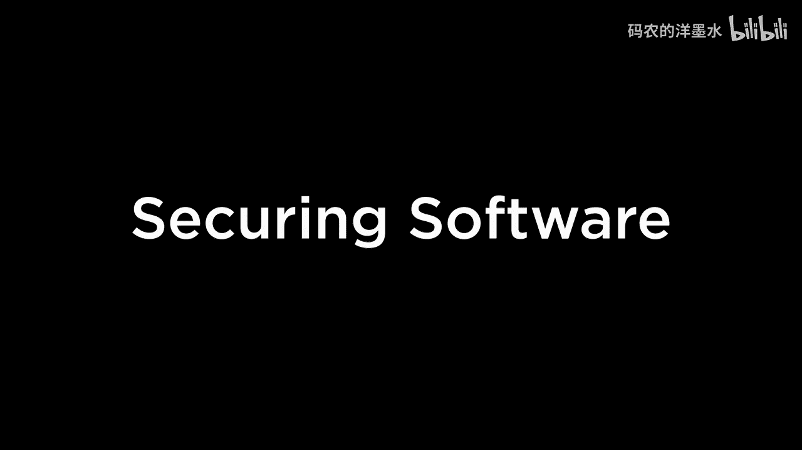

Alright， this is C S 50's introduction to cybersecurity。 My name is David Main。 And this week。

 let's focus on securing software， whether it's the software you use or whether it's the software you write as a programmer。

 Consider， for instance， one of our topics from earlier in the class。 namely phishing。

 that's attempt by an adversary to fish or obtain information from you。

 Let's consider today how you might go about implementing this kind of attack and equivalently how you as the user might go about noticing an attack like this。

 Well， here again， is a language called Hml hypertext markup language。

 and it's the language in which web pages are written。

 This is maybe the simplest example that we could put together that represents the kind of text that a web server would send to a web browser when it wants to display information on your screen be it the day's news。

 your email inbox or anything else that is web based dot dot dot is where I've put placeholders just to represent where some additional code might actually go like the content of this actual web page。

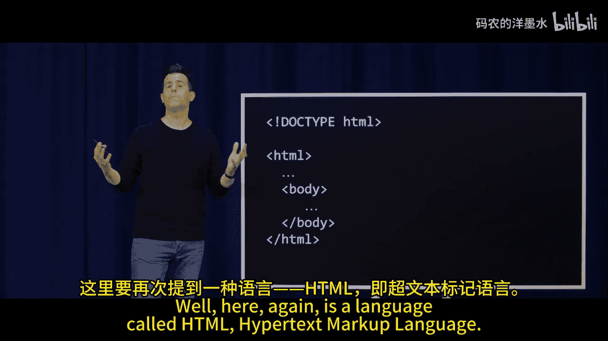

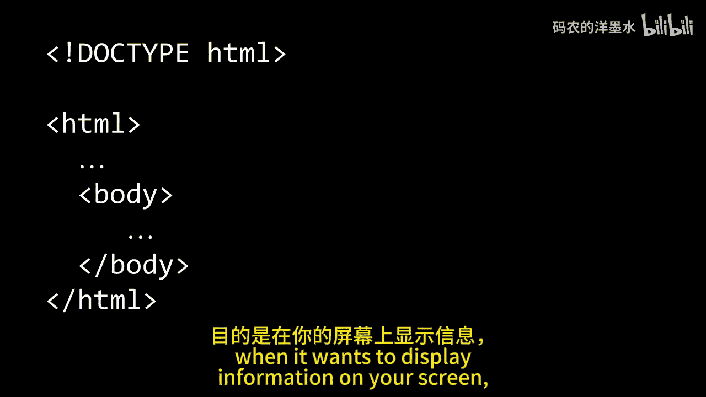

For instance， suppose that we consider in the abstract。

 just a simple example of these so-called tags and in fact。

 recall that everything that you just saw sort of had these open brackets。

 but also the same words again and again。 For instance。

 if we wanted to have a paragraph in this language called Hl we would have this thing here called a tag or an open tag or a start tag and then this thing here at the end。

 a end tag or a closed tag and those are meant typically to be symmetric。

 This one sort of begins a thought for the browser。

y browser here comes a paragraph and this one here with the forward slash inside of those angle brackets means hey browser。

 that's it for the paragraph。 So anytime you see HTMLm in a file it's really telling the browser what to start doing and what to stop doing So here is how a browser therefore might know that it needs to display a paragraph of text maybe separated by some whitespace by other paragraphs of text Here for instance。

 is how a browser might know that there's some code。😡，Inside of the web page。

 typically written in a language called jascript。 So this script tag opening here。

 and this closed script tag here would be hey browser。

 here's some code to execute do dot dot and hey browser that's it for the code to execute。

 So how might there actually be a threat or an opportunity here for an adversary to fish information from you。

 Well， here， for instance， is how you might in this language called HTMLm， create a link。

 otherwise known as a hyperlink in a web page。 and it too uses an open tag and a closed tag。

 This a tag represents an anchor like anchor some hyperlink， some link in the web page right here。

 And this tag here means okay that's it for the link。 And if we want to link， for instance。

 to Harvard's website in between that open tag and close tag。

 would you actually put the text of what the link is meant to be。

 So if you want the user to see a link on the page that says Harvard。

 you would put literally Harvard between this open tag and close tag。

 But that's not actually enough to link to some other page。

You have to tell the browser what URL or what file you want clicking on Harvard to actually lead the user to。

 So for that， we need to introduce one other concept in this language called Hm namely an attribute So H ref stands for hyperreence and it's a fancy way of saying this is what I want the browser to link the user to when they click on that word Harvard Now at the moment I've just done a dot dot do but that would for instance。

 be the URL of Harvard's own website。 So consider this very specific example now whereby we still have our anchor tag opening here we still have our anchor tag closing here we now have an H ref attribute that's telling the browser that when the word Harvard is clicked I want the user to end up at Https colon Harvard do E So that all seems fine and good and this is the way the web is supposed to work and this is what links in your own web pages will look like if you poke around underneath。

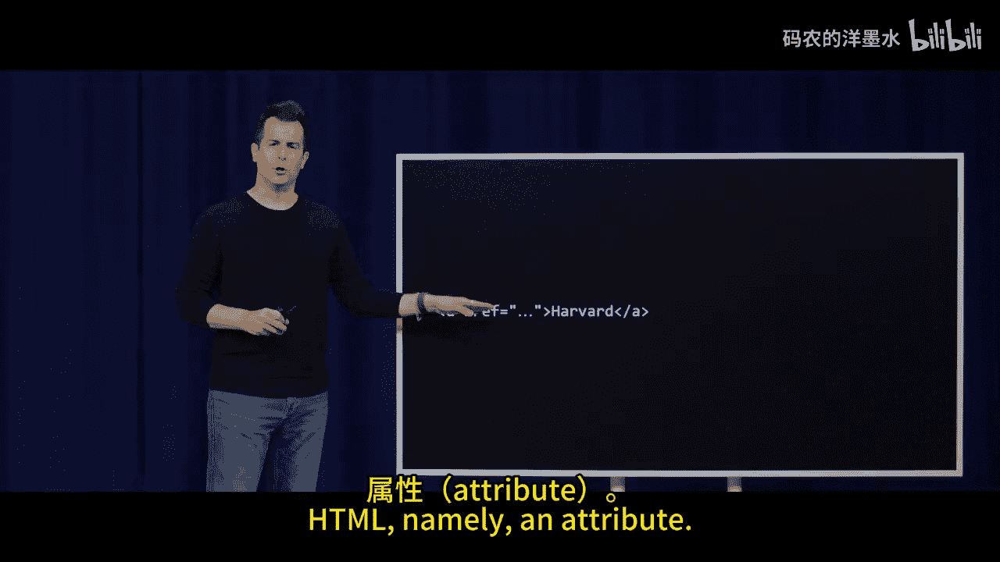

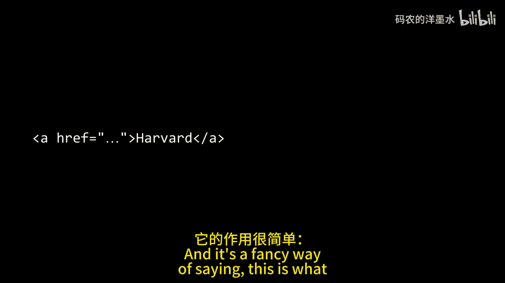

The hood， So where's the actual danger Well， hopefully there is none and hopefully when you open this kind of HTML in the context of a larger file with even more tags than just this anchor tag。

 you'd see a browser window that looks a little something like this you'd see a link typically underlined though not necessarily to Harvard and then and only then if you hover over that link can you see where you will go。

 even if you don't actually click the link。 So suffice it to say if you just click the link you're gonna end up on Harvard's own website but if you a little more cautiously with a bit more parannoia。

 a bit more consciousness now of cybersecurity hover over that link and focus in your browser serves bottom lefthand corner typically at least on a laptop or desktop you'll actually see the URL to which you will actually be whisked away when you click on that link So this actually looks okay the word here is Harvard the URL it's going link me to is https colded So I think all is well。

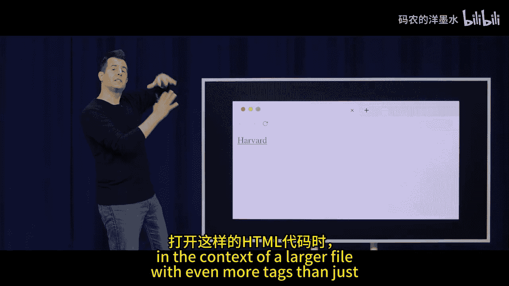

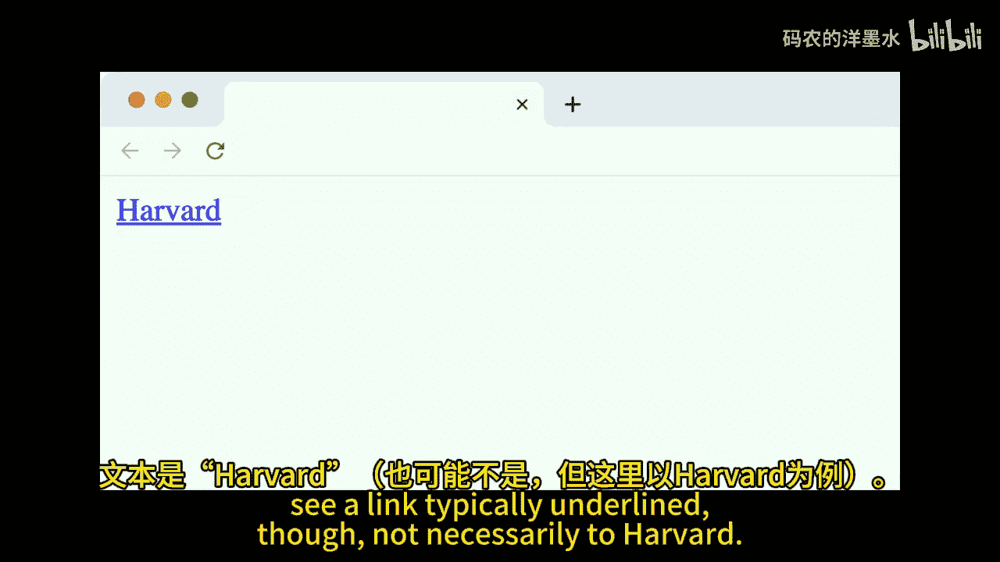

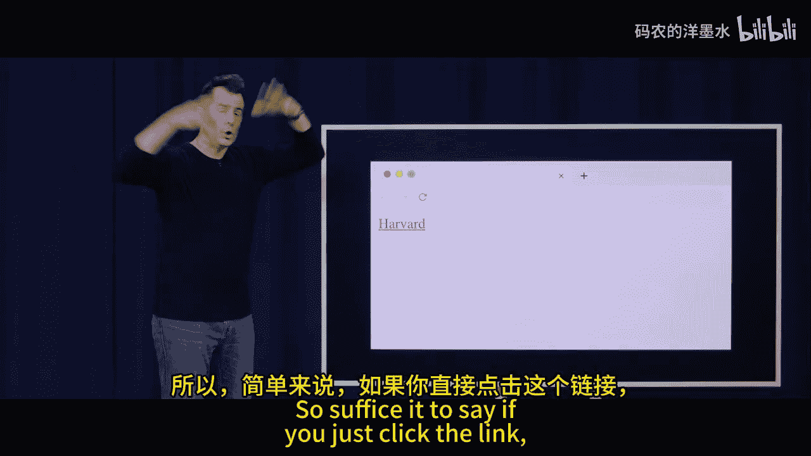

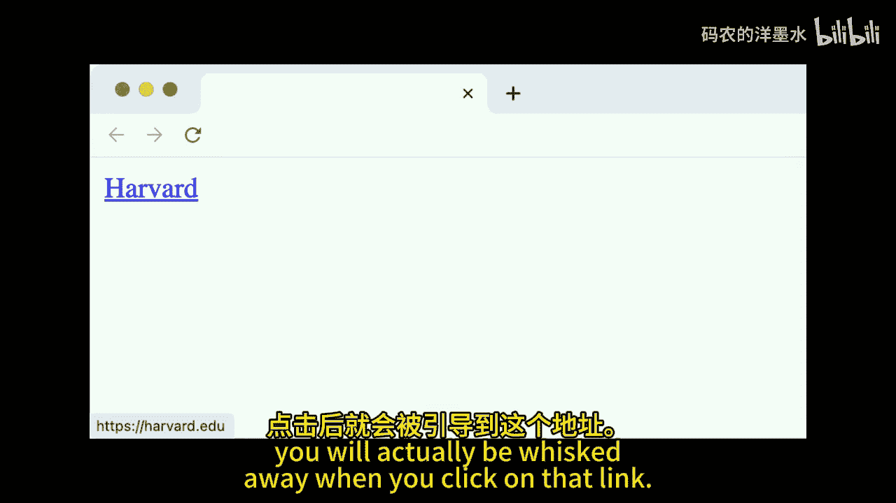

In the world。 And indeed， you can do this on most any web page on your laptop and desktop if you want to proactively preemptively see where it is you're gonna to go before you actually click on that link。

 So where's the danger。 Well let's get a little more specific and a little more malicious if I may。

 So here we have the exact same Hl as before。 let's go ahead now and not just say Harvard inside of this open tag and closed tag。

 So that for whatever reason， I want the user to see a little more obviously the URL to which they are going to be linked。

 So I might change Harvard capital H to Harvard Edu。

 So the actual domain name that I want the user to be led to here is now what the user would see。

 So it's a little more obvious that it's Harvard edu and not some other Harvard website And indeed if we hover over that we'll see that it still is going to the same URL。

 All right， so that seems fine and it's not all that enlightening， let's go one step further。

 suppose that you really want the user。

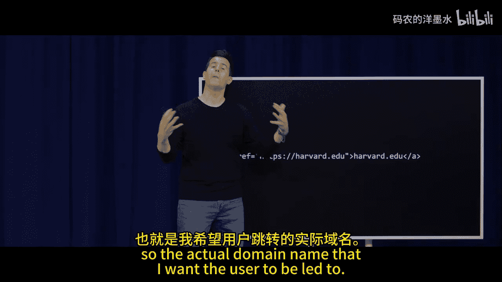

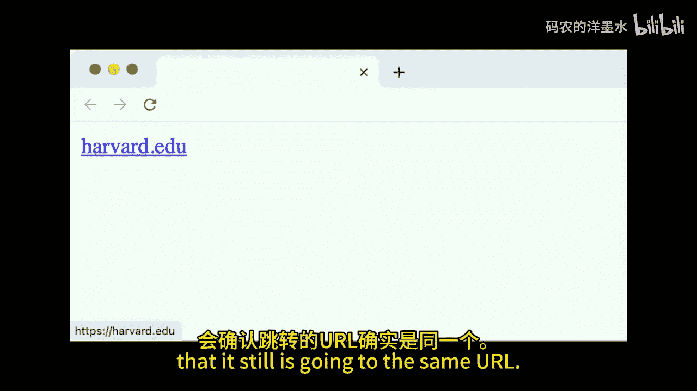

To see a URL in the body of the web page。 So now I'm actually going put in between the open tag and the close tag https colonlashhar doedduu。

 Now notice this looks a little redundant and it is in some sense because I literally have the URL in two different places。

 but that's because those two values serve different purposes。

 the one in between the open tag and close tag is what the human sees the one inside of the quote marks the so-called value of the HR attribute is where the user will actually end up。

 So if you want them to be equivalent， you have to type the exact same thing twice in this case。

 So now， of course， if I go back to the webage， the human is now going to see literally this URL。

 and if they hover before clicking， they'll see confirmation as much。😡。

So where are we going with this。 Well， heres among the lessons of the course is to think about now。

 how can you take a perfectly reasonable technical solution to a problem。

 creating a link in a page in this case。 And how might an adversary abuse it。

 How might you as the end user be vulnerable in this case to a so-called phishing attack。 Well。

 there's nothing stopping me from putting anything I want in either this value or in this name of the link。

 So you know what， why don't I be a little malicious here and why don't I tell the user that they're going to Harvard dodu。

 But they're actually going to Yale doeddu instead another school down the road。

 So what is the human see now， if we go back to the browser。

 they still see what appears to be Https colon s Harvard do Eduu。

 But if they hover over it And only if they hover over it， Well。

 they see this little clue that you're actually gonna be whisked away to Yale Edu。

 And if they click on the link， they'll actually find themselves at the actual Yale Edu website。

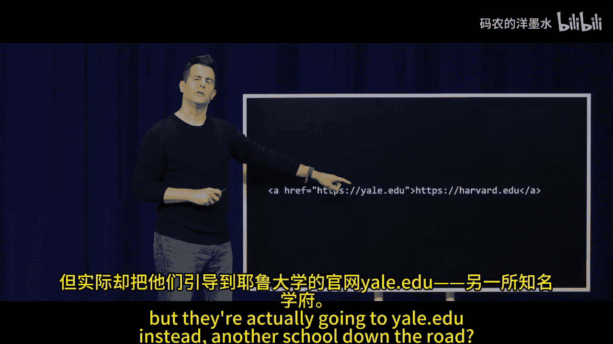

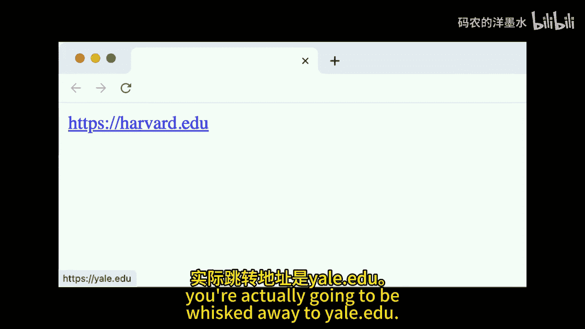

So what's the big deal。 Well， this might just be a silly prank in which case it's probably inconsequential。

 And if you do link from one's website to a completely different one。

 it's not necessarily a phishing attack。 It might be confusing because the user thinks they're going to Harvard。

 but they find themselves at Yale， but there's not necessarily any danger in that mislead But what if the adversary in this case doesn't link to a very common popular website like Yale Edu。

 but maybe a website like Harvard Edu where just one of the characters is slightly misspelled as we've discussed in the past。

 So that you and I unless we really， really look carefully。

 we might not even notice that we're not at the real Harvard E。

 And what if further the adversary went through the trouble of copying all of the Hml that implements Harvard's website and pasts it into their own fake version of Harvard's website that lives at again。

 a URL that is almost the same here is now where there's a phish opportunity because if。

YouThink you're going to Harvardedduu and you click the link and it looks like you're at Harvardeddu and you don't notice a subtlety like wait a minute that's not quite the right URL。

 You might now be inclined to and comfortable with maybe logging in to the fake Harvardeddu website with your username and your password in Now the adversary has that information from you。

 and it doesn't have to be Harvard。 It doesn't have to be Yale。 It might be your bank。

 it might be Paypal com or something where you could actually lose money or some other asset you care about。

 And so that's really the essence of the implementation details of a phishing attack。

 at least in the context of web pages and or emails。

 It all boils down to these primitives of Hl being the language in which web pages are written and adversaries by knowing HTML also now logically can misuse Hl by understanding how these basics work。

 So let me pause here and see if there's any questions about phishing。😡。

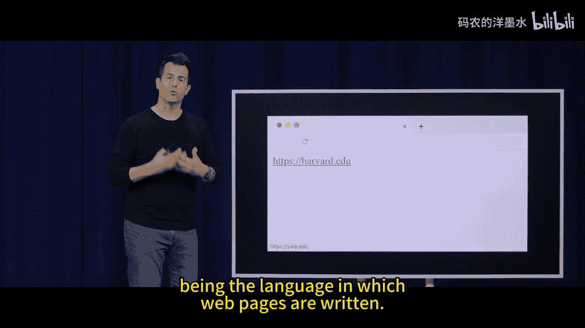

Or Hml or this convergence of the two when it comes to this form of social engineering。

 as we called it before， Would it be possible to write my IP or some other means to get to their website and not the URLs short answer yes。

 if you have access to dedicated IP addresses， which are these unique identifiers you can use for servers on the internet。

 you can absolutely have a URL that is like HttP and then the IP address Now。

 typically it would be httP and not https when using an IP address in which case that might be a clue to the user that wait a minute。

 this is making me nervous that this isn't legitimate。 But honestly。

 I think we can all think of people in our lives who wouldn't have the instincts to notice Wait a minute。

 What is this weird numeric address and my browser bar and stop what they're doing That's indeed among the goals of the class like this is to give you those instincts and that training to be a little suspicious when you see something like。

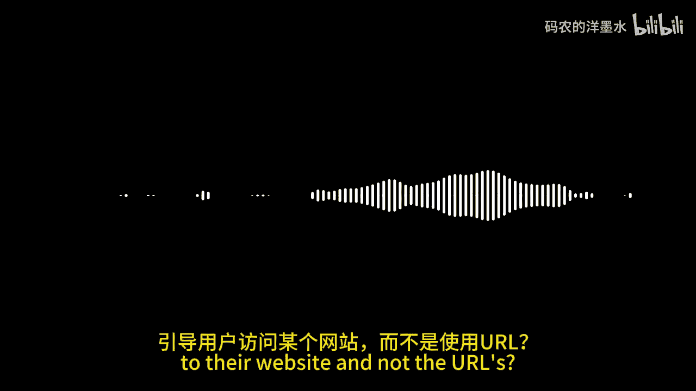

A raw I address in the browser。 technically， there's nothing wrong with it。

 but it's a little bit of a weird branding or marketing decision for a website。

 And I think a corollary of this then， Loly is that if you are running a website of your own if you're running a business with a website of your own。

 you should really avoid using many different URL format or many different domains or having any sort of curiosities or weirdness is in your domain names because you're really just teaching users implicitly that your URL format might change from time to time and certainly you never want to use just an I address because you're going to train people to expect that And so standardizing on one or very few domain names or subdomains is generally best for that So what are some other attacks that we should be mindful of when it comes to our own software Well。

 a class of attacks or category of attacks or generally known as code injection。

 which is an opportunity for an adversary to somehow inject code into your software and often。😡。

Trick your software into executing that code， even if you yourself didn't write it。 Well。

 let's consider one example of this。 a common attack on the web in particular too is what's known as crosss scripting or XS for sure crosss scripting refers to this potential opportunity for an adversary to trick one website into executing code that they again themselves did not write。

 So what form might this actually take。 Well suppose that you yourself visit Google co and suppose that Google isn't aware of this particular attack。

 They certainly are nowadays， but suppose that they weren't yet aware that this attack exists。

 And so when someone like you or I goes to Google co and searches for something like cats suppose they do the following。

 They show you a whole page of search results。 and I won't bother showing the actual results。

 But as of today， there were 6 billion420 million cats on the Internet that Google knows about and they would show up。

 of course， down here。😡。

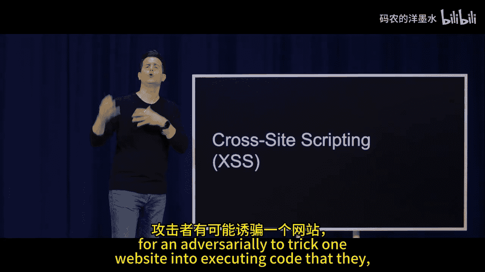

Notice a few characteristics about Google do com as it typically behaves。 Well， one。

 you still see a text box containing what it is you searched for so that you can change it。

 or at least see what it is。 And notice too， that in smaller text here in this particular version of Google。

 it tells you not how not only how many results there are， but specifically how many cats there are。

 So that is to say if Google is using your own input not only to remind you of what you searched for in the search box。

 but also in the body of the web page， that very simple idea is vulnerable to an attack。 Why。

 because who wrote the word cats CAT。 wasn't Google per se， it was me Now， fortunately。

 cats in and of itself is not dangerous， but suppose I knew a little something about H TMl and browsers and how the Internet works。

 And suppose that I now an adversary did something like this。

 And knowing that Google is probably inside of their web page rendering。

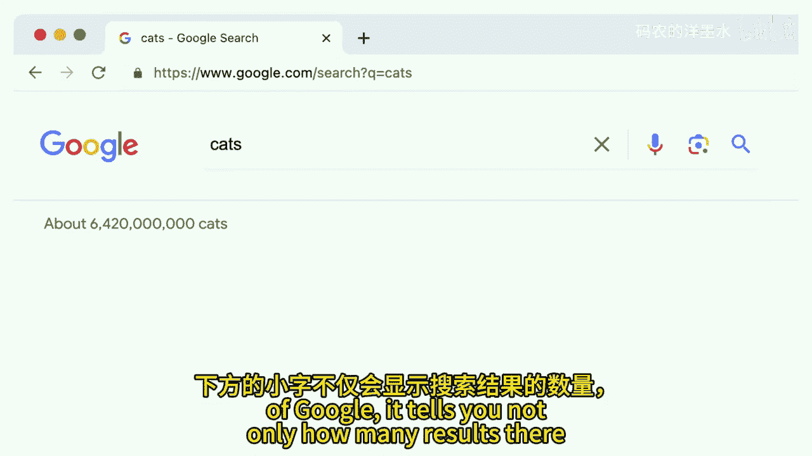

That looks like this， a paragraph of text per the open paragraph and closed paragraph tag and an English sentence like this。

 about 6420 million cats。😡。

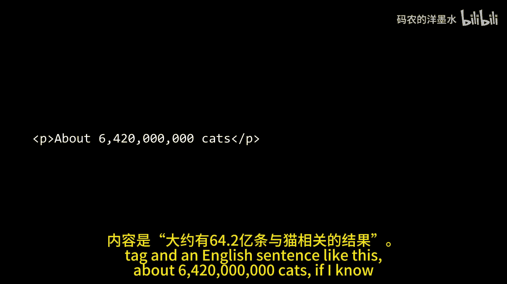

If I know they're putting my input cat into Hl that looks like this。

 let me see if I can try to trick Google into outputting something that they might not have anticipated。

 So instead of cats， let me type something of a little weird that looks like this。 Now。

 what are we looking at。 We're looking at now an Hml tag， the script tag。

 both opened and closed here and a little bit of code in a language called jascript。 Now， thankfully。

 this in and of itself is not actually a compelling attack。

 it's literally just going to display attack， quote unquote on the screen。

 So it's just meant to be representative I claim of how I could potentially trick a website like Google into executing code that I wrote not that they wrote。

 So what do I mean by that。 Notice that I've got this open script tag here and the closed script tag here。

 which means everything in between there is script that is jascript， this particular language。 Well。

 it turns out this particular language and the context of browsers comes with a function。

 a feature known as alert。

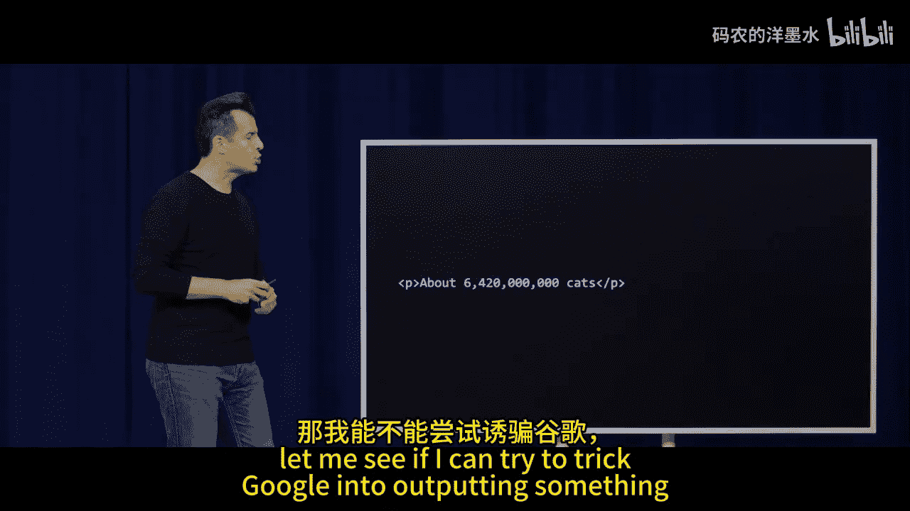

And if you want to alert the user with some message， you literally write the word alert。

 and then an open parenthesis and a closed parenthesis on the left and right。

 And then inside of single quotes or double quotes。

 you put whatever word or words that you want to alert the user to。

 So this is often used for displaying messages to the user， not actual text， but useful messages。

 And there's more elegant ways to do this as well。 But this is the simplest representation of an attack that I could propose here。

😡，Now， I haven't yet hit enter on this page because indeed。

 we still see that we're on the page relating to cats as my search result。

 But as soon as I hit enter after searching for this string of jascript code or really HTML inside of which is ja code what might happen。

 Well， this could potentially happen。 Now again， this is not a bad thing in this specific case。

 it's just throwing up an alert to the user。 And in this sense， too。

 I'm really only attacking myself because if I'm the adversary。 and this is my browser。

 and I've just tricked Google into executing some jascript code such that a popup appears saying attack。

 well， I'm just like hacking myself。 So this is inconsequential。 but again。

 it's representative of how we could potentially trick a website into executing code that they did not intend。

 Now， why is this displaying。 but notice no more cats and no input here that I typed myself last time when I searched for cats。

 I saw the word cats here。 But now I'm。😡。

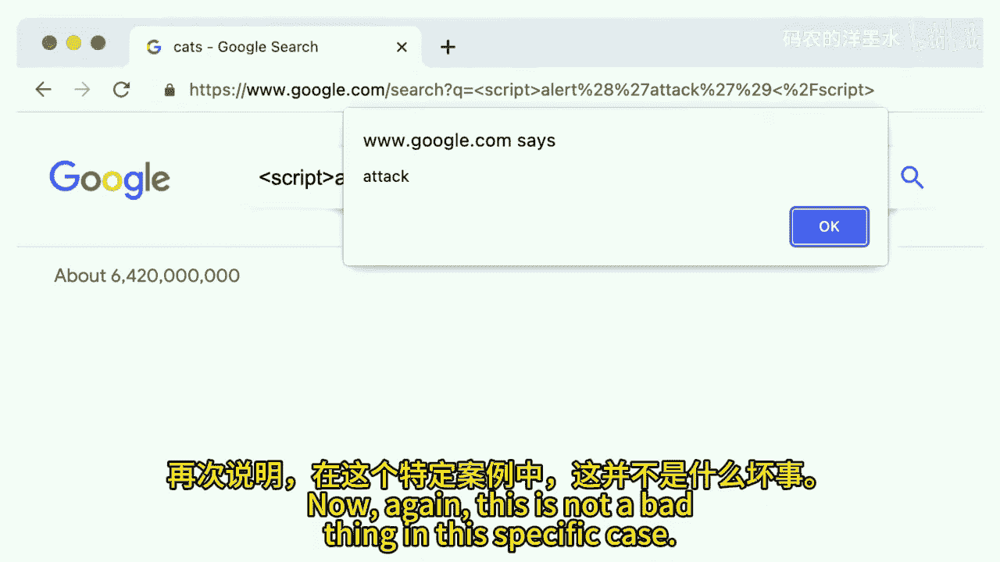

Seeing nothing at all。 Now， why is that？ Well， underneath the hood previously。

 I claim that Google was probably rendering HTMLl like this， a paragraph of text， open tag close tag。

 and then the sentence about 6 billion420 million cat。

 So Hml and they were just plugging in whatever I the human typed in。 Well。

 this time I conjecture that if I typed in what looks like and is HTMLml with a bit of scary jascript code in between what Google is probably going try to output in the body of the web page they sent to my browser is this an open paragraph tag and a closed paragraph tag。

 still the beginning of a sentence assuming that there are this many attacks in the world 6420 million。

 but notice this because I， the user literally typed in the script tag and the closed script tag And then that jascript code in between the browser doesn't know that that came from me and not Google。

 So the browser is just going read this as hey， browser start a paragraph。

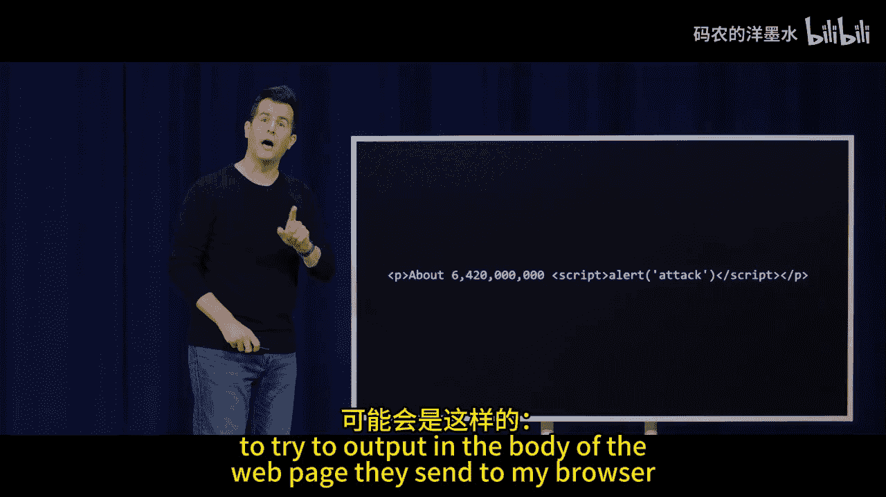

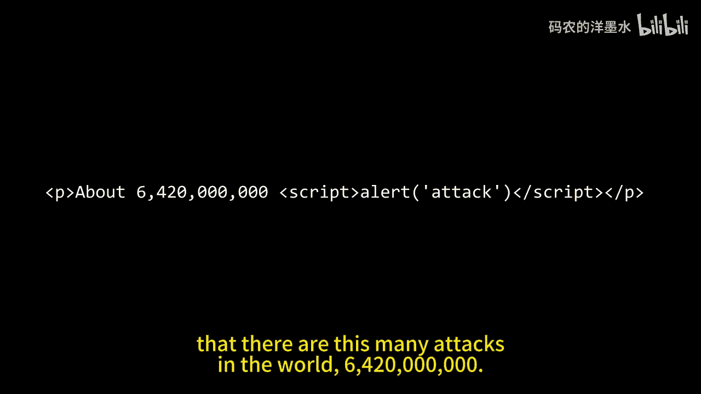

About 6 billion420 million。 Hey browser Here comes a script that is a program that you should execute。

 What do I execute， alert， quote unquote attackt。 Hey browser， that's it for the script。 Hey browser。

 that's it for the paragraph。 So if Google is just blindly copying and pasting what I。

 the human in typing in I might trick Google into rendering Hml that Google did not intend and the side effect in this case is that I see this alert。

 but really that's indicative of a potential exploit in Google's website。

 if they were not detecting this on their own。 So this is the code that's dangerous。

 And what then is the fundamental problem， they are just literally outputting what I the adversary typed in to their page。

 So how do we go about mitigating something like this to avoid this kind of attack。 Well。

 let's first propose that what we want the effect to be is something a little more like this。

 assuming again， that there are 6 billion420 million attacks。😡。

In the world what I want to see is literally that English sentence here。

 I don't want any sort of popup。 So this I would propose is the correct behavior。

 assuming we see more search results down below。 I have searched for this。

 Google is telling me or reminding me what I searched for but there's no popups in this case So somehow or other based on this screenshot alone there must be a way of ensuring on Google's end that even if the human types in Hml with perhaps some jascript code in the middle that they don't actually treat it as HTMLml and jascript code in the middle。

 they just display it literally character by character。

 whatever I the user typed in So what is our concern with this particular symptom。 Well。

 it turns out that an adversary can wage what we would call a reflected attack whereby we could leverage this symptom in such a way that maybe we could construct a URL that if clicked by a user actually triggers this kind of behavior。

 but moreover doesn't just trigger this fairly innocuous behavior like alerting。😡。

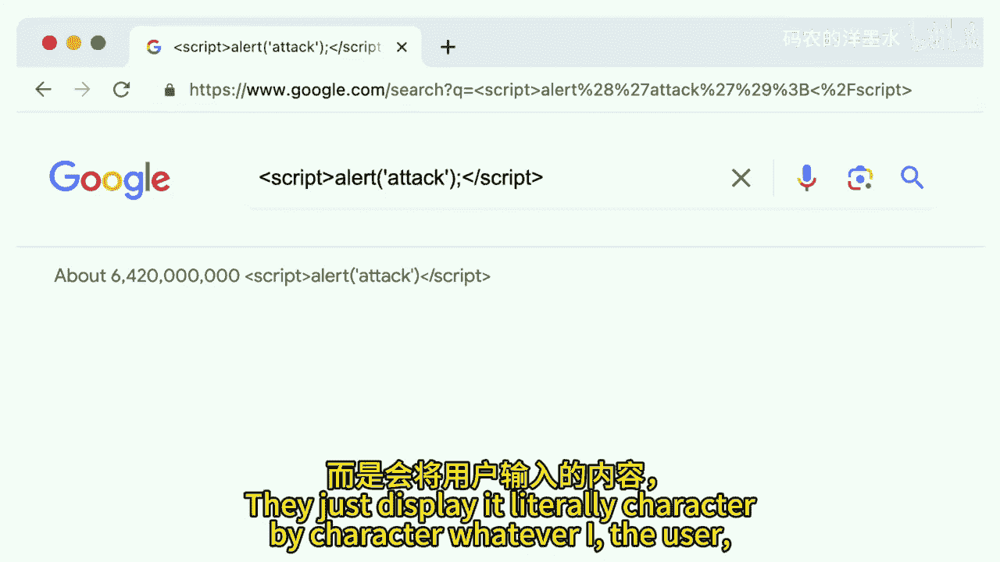

The user with a message like attack just to scare them。

 But what if we wrote even more malicious jascript code that maybe steals their cookies or does something more than that。

 Well， how do you wage what's called to a reflected attack， Well。

 it's first consider what a basic link in a web page or an email looks like。 It's again。

 an anchor tag that starts and ends。 it has an Hf attribute that's represents the URL or file to which we're gonna link the user and then some text that the human will actually see in the web page。

 And now let's notice when we correctly search for cats as we did before。

 that not only do we see cats in the text box here。

 Not only do we see cats in the body of the web page， but notice now the URL。

 It turns out when you search for something on Google。

 you end up at a URL that looks essentially like this， it might actually be a little longer。

 but a lot of those parameter， so to speak in the URL aren't strictly necessary。

 So this is the shortest possible URL that will work on Google， if you want to search for cats。

 and notice what it is Https。

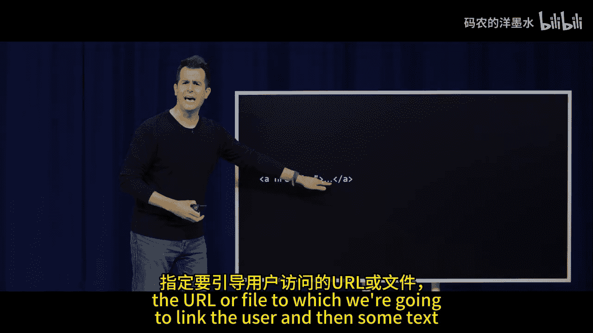

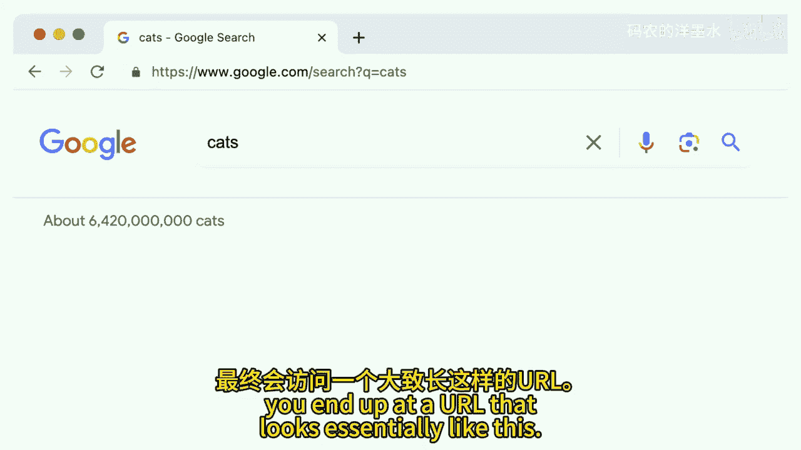

lash w Ww do Google dot com slash search question mark Q equals cats。

 So this is to say that the way Google works is that if you want to search for cats。

 you simply visit a URL that looks like this。 if you want to search for dogs。

 you visit a URL that looks almost like this。 but instead has Q equals dogs。

 which is to say there's just a very standard format on Google do com and a lot of other websites too for searching for things or really sending input to a web server。

 And this web form or this text box that you typically use to type in cats or dogs or anything else is just generating a URL that looks like this。

 and then Google knows what to do with it。 So how can we leverage now that reality a little more maliciously。

 Well， let's go back to our Hl。 And let's again zoo that the adversary is trying to construct some Hl for their own email or for their own website in order to attack some unsuspecting users。

 Well， instead of the dot dot dots。 let's be more specific。😊，Let's actually， in a good way。

 in an honest way， say that we're gonna let the user click on a word cats。

 which is in between my open tag and close tag。 And if they click on that。

 they're going to end up at the legitimate Google website where it's Htps colon s www do Google dot com slash search Que mark Q equals cat。

 So this is correct。 This is not yet an attack。😡，But what if I am a little malicious and instead of using the legitimate URL there for searching for cats。

 suppose I canstruct something a little more cleverly that says we're going to give them cats。

 but actually we're going bring them to this URL Now this is a bit of a mouthful。 and in fact。

 it wraps onto two lines this time。 but notice the URL starts the same hgps colon slashlash www go co slash search question mark Q equals。

 and then some weird text， percent 3 C script， percent3 e alert wrapping onto the other line and so forth。

 So I dare say you're seeing some familiar phrases now script and alert。

 but there's also some weird syntax there as well。 Now that weird syntax is just a representation of URL escaping。

 It turns out that certain characters and URLs like angled brackets and other syntax is not good to include in URLs because it might be mistake。

😡。

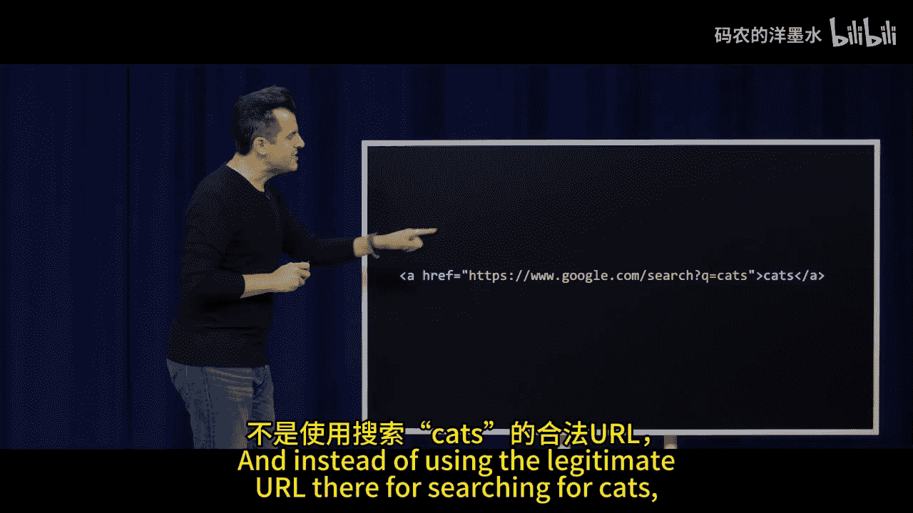

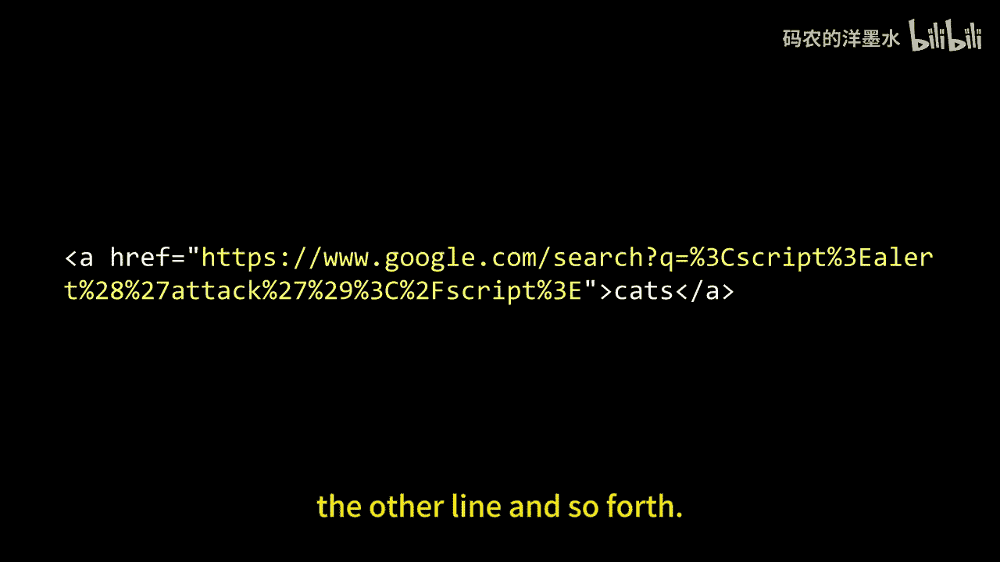

By the browser for something else。 And so URLs typically escape punctuation symbols and other characters using this percent syntax。

 Now， it looks a little weird to the user。 but what's more worrisome is what this is going to be used for on Google's end。

 if the Q value。😡，Equals this whole bunch of text。 and it's just the browser that's encoding those special characters in this way。

 What Google's really going to see on its end is the actual script tag with the actual alert and the actual closed script tag that you and I constructed earlier。

 that is to say what Google' is going to receive from that URL is no longer cats quote unquote。

 but this quote unquote， because the servers aren't going automatically convert the percent signs and those weird characters back to the original automatically。

 that's how URL encoding works。 So with the server is going to receive is this。 And again。

 if the server is vulnerable to naively just outputting。

 literally whatever the human typed in the risk is that they are going to now execute that code。

 And what if the code isn't just an alert， maybe it's something like this。

 which still isn't in and of itself a bad thing because it's just an alert。

 But this is actually some jascript code。

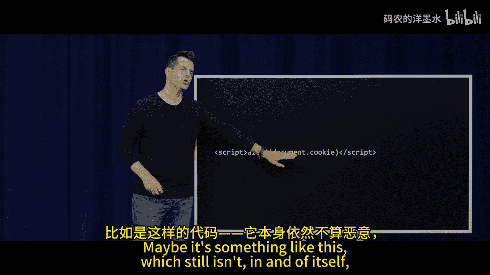

Now alert， open parenthesis， document cookie closed parenthesis that would actually throw up a dialogue window that shows the user the value of the cookies they have there on Google's website。

 not such a big deal， it's not all that all that different from just saying quote unquote attack but what this means is that in ja。

 you have access to all of the cookies for a website。

 at least those that are made available to jascript And if an adversary doesn't use the alert function。

 but maybe uses a little more code to send the value of document cookie to their own website or to somehow send other information from the webage。

 the user's username or any other personally identifying information。

 suffice it to say that by being able to write code in ja and by being able to trick a server like Google in this story into executing that code。

 you can effectively by transitivity trick a user's browser。

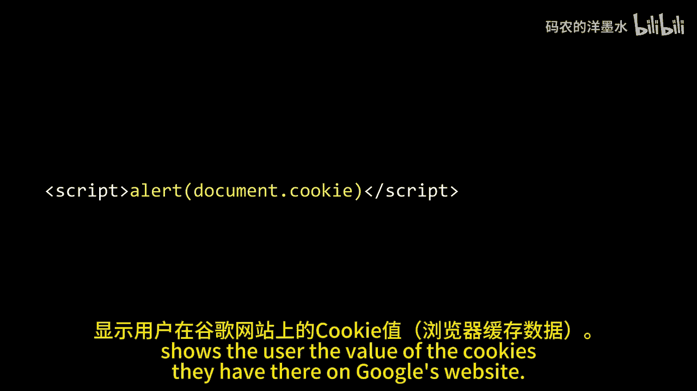

Into executing that code for you。 So the adversary is sort of sending the code into Google and it's being reflected back to some user if they click that same link in an email or a website and at this point。

 things like their own cookies might be vulnerable And again， to be clear。

 this in of itself should not hurt you， I'm just using alert as demonstrative of what could be possible。

 but you could do any number of other things with document cookie or other values from a webage as soon as you have this ability to write jascript that's reflected back into someone else's browser。

😡。

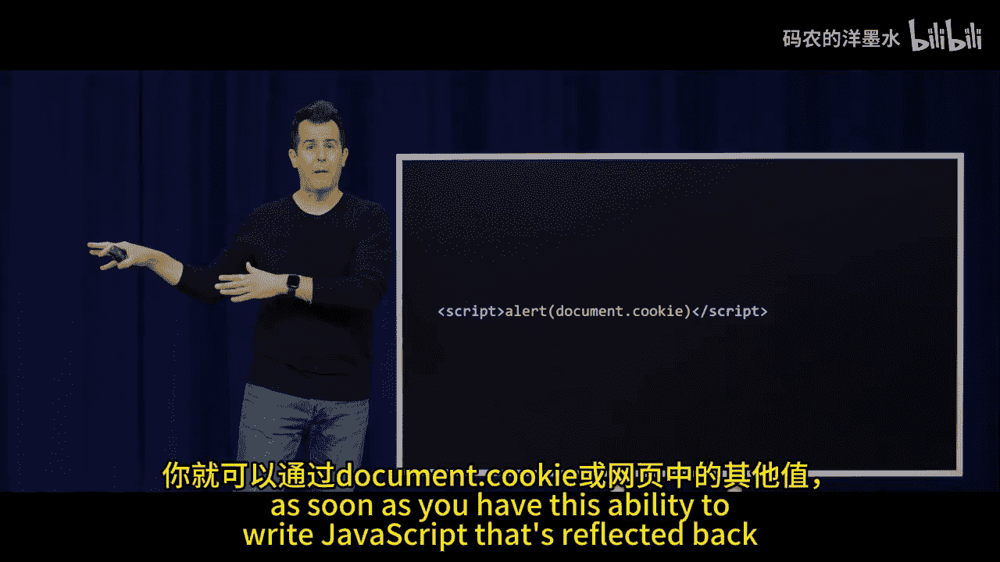

Any questions then on this particular attack I just wanted to ask a question about the jascript block because many of the browsers uses to block the jascript。

 how can use the website and browser Vi blocks the jascript without getting picked into the ja。

 It's a really good question。 and the short answer is nowadays that that's not really the best technique to just block jascript。

 The reality is in this point in time， so many websites， Most websites there， say use。

 if not rely on jascript to do any number of features or render their own content。 And so it's just。

 I think not realistic to just disable jascript in order to protect yourself from these kinds of attacks in a bit。

 will'll discuss ways to mitigate this kind of attack where you disable some jascript， but not all。

 But in general， I don't think that's a realistic solution， at least on most websites nowadays。

 So how else might these same principles be misused。 Well turns。

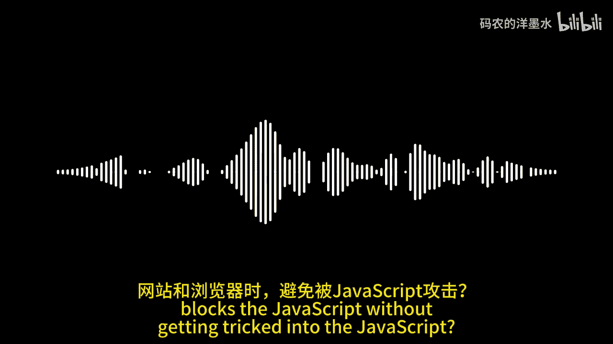

There's another class of attacks known as a stored attacks whereby the adversaryaries input isn't just immediately reflected back from the server to some unsuspecting user as it might be when you're using the URL to contain the code。

 but suppose that a website were vulnerable to actually storing the user's input。

 even if the user's input includes HTMLl with some jascript inside that would be a stored attack and it might work as follows at the risk of picking on Google。

 suppose that when using Gmail， suppose that you if you sent someone an email with that exact same code whereby you're just alerting quote unquote attack again。

 that and of itself isn't gonna hurt anyone but it's representative of what you could do with code。

 Now， presumably when you send an email in Gmail or outlook or any other server。

 that email is going to be stored on a server until it's read and until it's deleted perhaps by the user and if it's never deleted。

 it's gonna stay stored on the server。 So this type of attack assumes that the server might actually be saving。

😡。

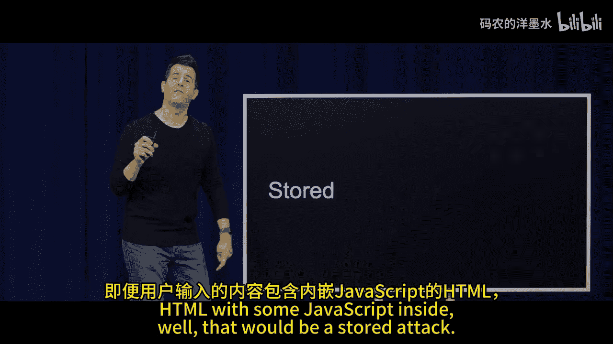

Da or file somewhere the user's input。 Now， suppose that here too。

 Google didn't know about these kinds of crosss scripting attacks。

 and they just allow you and me to input HTMLml and jascript into an email and they just blindly save it into their database。

 and then when the recipient opens this email。 they just show the recipient the contents of that email。

 Well， what could go wrong。 Well， if the recipient opens that particular email and Google is literally rendering the script tag with the javascript inside the recipient of that email when they open their inbox may very well suffer some kind of an attack。

 again， it just says attack on the screen， but it represents being tricked into running code that someone else wrote。

 And in this case， someone else sent you ideally， what we would want to have happen instead is not have Google show us the attack message here。

 but rather I would like my inbox to show me the code I was sent but not executed。

 That is just like I want。😡。

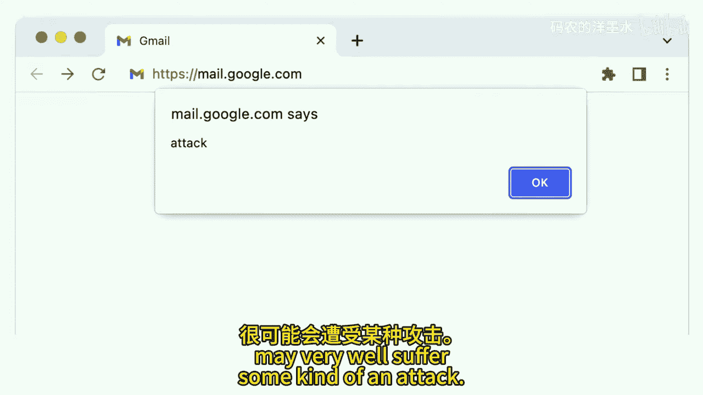

To know that there are 6420 million cats among the search results。

 so would I want Gmail to just show me what it is the adversary typed in without actually interpreting it or executing it as HTML with some JavaScript inside。

😡，So that could be a stored attack and would be a stored attack if thankfully。

 Google weren't actually protecting us against this， which they are。

 So how do you go about preventing an attack like this in software， Well。

 the general answer is character escapes。 That is taking any characters in users input that might potentially be misinterpreted at best or at worst might be dangerous to the users。

 Now， what characters might be worrisome Well in something like HTML。

 anything with an angled bracket， a less than sign would probably potentially be mistaken for the beginning of an H tag。

 So I dare say that a less than sign is a dangerous character。

 similarly might a greater than sign represent the end of attack tag。

 So that too might be something to give us concern。

 And there's probably a few other characters as well。 So what should servers be doing。

 What should software be doing to avoid this kind of cross。😡，ing attacks。

 whether reflected or stored。 Well， ideally， something like this would not just be blindly outputted by Google or by Gmail。

 but rather it would be escaped in this very weird looking way。

 but let me highlight just a subset of these characters highlighted in yellow now are only the character escapes to which I'm referring。

 it turns out that this language Hl has standardized some special sequences of characters that represent the less than sign that represent the greater than sign they are a little more verbose to type。

 you have to type out like four characters in this particular case but browsers are designed to know that when they see Ampersand L T semicolon。

 they should not show on the screen Ampersand Lt semicolon， they should show a less than sign。

 And similarly when browsers see Ampersand G T semicolon。

 they should display not literally that but a greater than sign。

 So this is to say if Google were smart。 they would take any user。

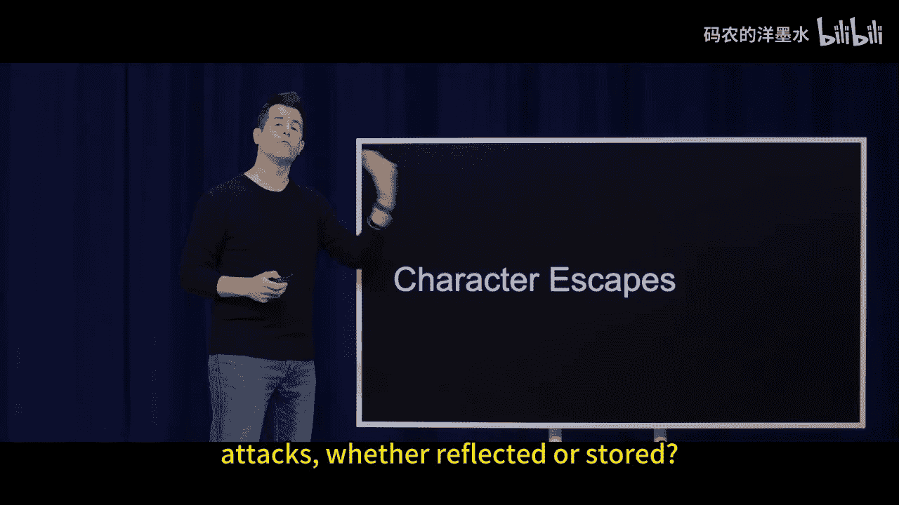

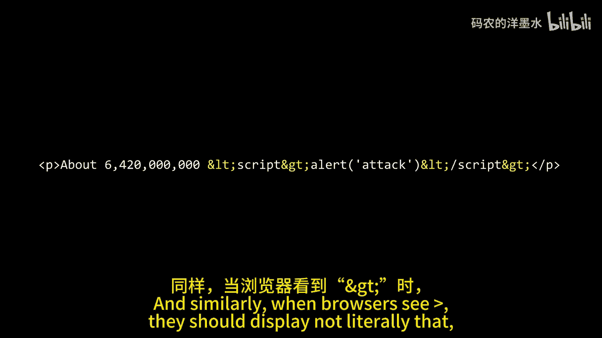

In you and I give them， but they would make sure to escape any potentially dangerous characters with these kinds of escape sequences。

 so to speak。 And Google's got to look it up in a book or on a website or in the specification to know what escape they should use。

 but these are very well documented and standardized。 And indeed， we have one here，1。

1 here for the open script tag and then another here and here for the closed script tag。

 But notice we don't have to escape all of the punctuation like the slash or the English letters in the tag name or the like We're only escaping a certain list of these characters。

 Well， what is that list here or the5 that minimally。

 we should generally be escaping depending on the context。

 the less than sign should be ampersand Lt semicolon， the greater than sign。

 the ampersand sign for the very reason that we're now potentially creating a new problem。

 If we're using ampersand all over the place。 What if the users input has an ampersand。

 We don't want to confuse the ampersand。In the user's input for a character escape。

 So there actually needs to be a more verbose way， Ampersand A semicolon to represent literally an ampersand。

 then there's one for a double quote Ampersand Q U O T semicolon and a single quote or apostrophe。

 ampersand Apo semicolon。 And there's more as well。

 but generally these are the five that could otherwise get you in trouble。

 So all of the examples we've seen thus far where Google is somehow reflecting back or storing potential attack code will not happen if Google is just smart。

 whereby they're escaping that input from a user before sending it back out as output to Google do com search results or to Gmail inboxes。

😡，So how else might we actually prevent attacks like these Well we can also put in place other measures as well and recall from past classes we discussed this notion of HttP headers and an HttP header is a line of text that stored in those virtual envelopes that get sent from browsers to servers and from servers to browsers inside of the envelope typically is the actual request for a web page or the actual contents of the response for a web page but also in those envelopes or additional information namely these HttP headers which are key value pairs that provide additional instructions if you will to the browser or server So for instance。

 suppose that we want to ensure that this kind of reflected or stored attack isn't possible whereby were accidentally embedding script tags in our own websites H well suppose that the website in question now isn't Google specifically but more generally example co and suppose that example cos web server is configured to。

😡，Put always in those virtual envelopes in HttP header。 that is content dash security policy colon。

 So that string of text is the key。 and the value of that key is script dash source。

 then the URL that we want to allow scripts from only。 So what does this mean， albeit fairly cryptic。

 if you configure a web server with this HttP header This will ensure that you can only load javascript code from actual files typically ending in do Js that are sent separately from the server to the browser This line of an HtP header prevents inline script so to speak。

 whereby it allows the browser to execute any old script tag in the web page。

 this prevents that default behavior。 So as such， even if Google。

 even if example co messes up and forgets to use character escapes when rendering user input that came。

😡。

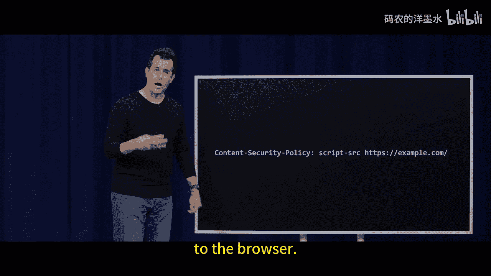

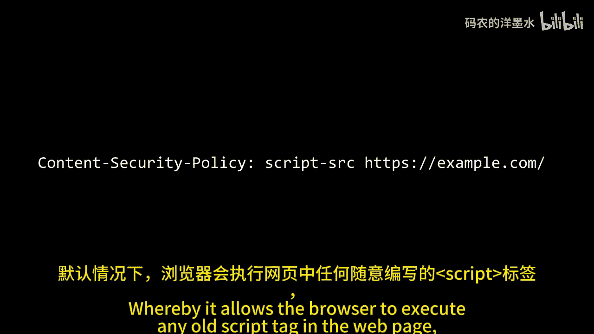

From a URL or came from an email or any other source， this header should at least tell the browser。

 at least newer browsers， even if you accidentally see a script tag with some jascript inside of it in my web page。

 don't execute it only allow me to execute ja code that came from a separate file the only type of jascript that will now be allowed is if I have a tag that looks like this in my HTML。

 which is an alternative version of the script tag。

 but instead of embedding any code inside of the open tag in the closed tag itself。

 it refers to the source of abbreviated SRC some file， typically again， ending in doj。

 So if this do dot dot where the URL of a file that contains jascript code that would be allowed because the presumption there is that if someone went through the trouble of creating that file on our own server example co presumably that code is safe。

 But what this line in our header does is it。that we can only execute jascript code if it comes from example com in a separate file using an Html tag like this。

 it will prohibit thatttP header， any script tags that are inline in the body of our actual web pages。

 What else can we do Well， it turns out and we haven't talked about it in this class。

 there's other languages that you can use in the context of web pages， not only Hml。

 not only jascript， but also a language called Cs or cascading style sheets。

 which is generally used to style your page if familiar or if you take a course on web development know that there's similarly a mechanism。

 whereby you can specify that only Cs from a specific server like example co should be allowed either not inline style tags with which you might be familiar as well。

 So here， instead of script source， we see style source。

 which is just another way using this HtP header mechanism to just that the browser。

 at least if it's new。ough willll not blindly execute script tags in the first case or style tags in the second case。

 when these kinds of headers are present。 It's an additional layer of dispense against these kinds of reflected or stored attacks。

 Indeed， that particular HtTP header would only allow us to conclude CS in our webp page if it uses a tag like this。

 namely a link tag with an hf value， the dot dot dot of which in this case would be the URL of a dot css file on the particular server example do com。

 the relationship of which is to the page that of this thing called a style sheet。

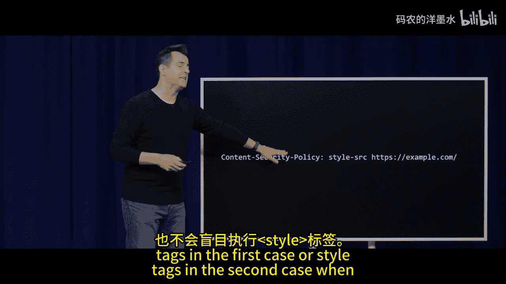

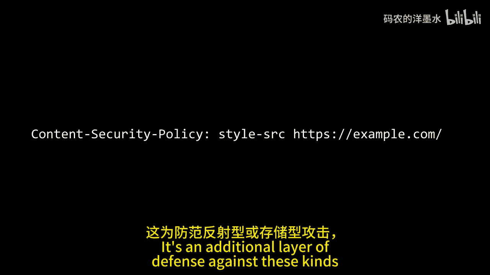

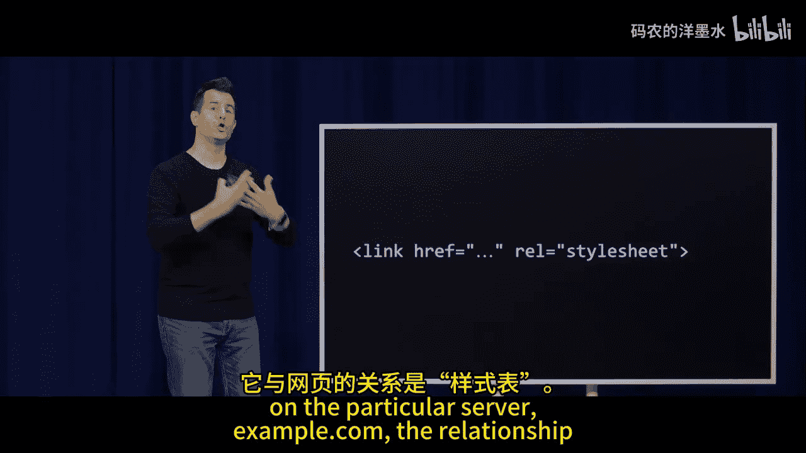

Questions then on this use of HttP headers to prevent these kinds of stored or reflected attacks or anything else thus far。

 What do the backlash D and backlash is cap do backlash P and oh。

 in the Hm So recall that a lot of our tags have open tags and close tags and the slash it's actually a forward slash。

 not a backslash the forward slash here just finishes the thought for the browser So this starts the tag。

 This ends the tag。 and you use the same word script in this case。

 script in this case or a or P as you describe， that is what closes or ends the tag in question so that you know where the tag ends or where the paragraph ends。

😡。

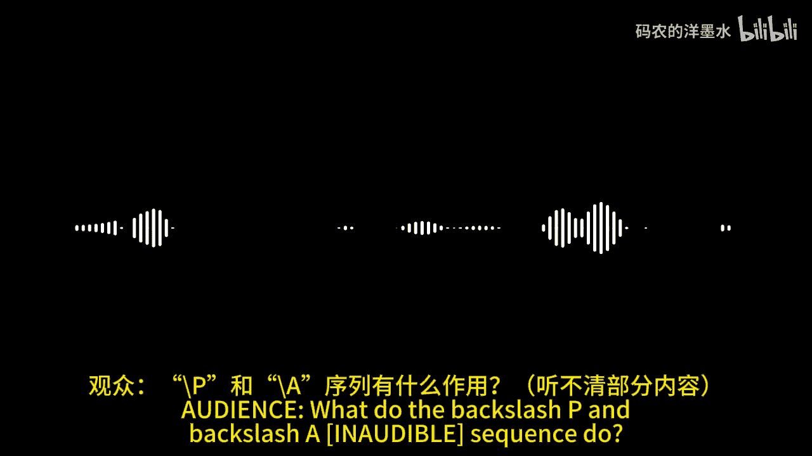

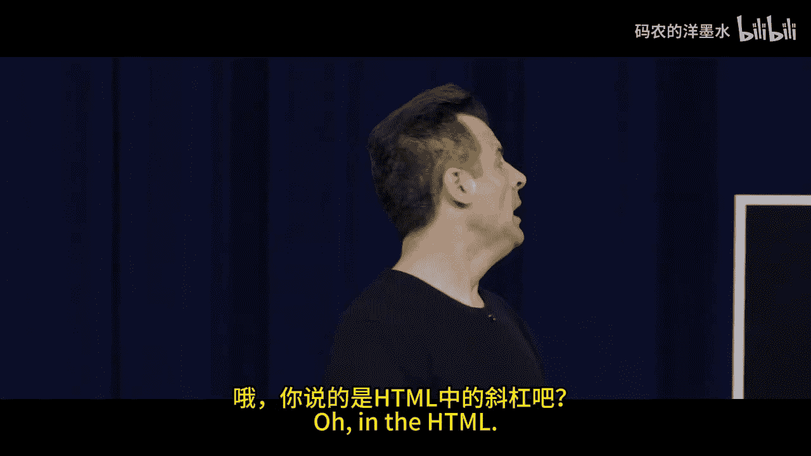

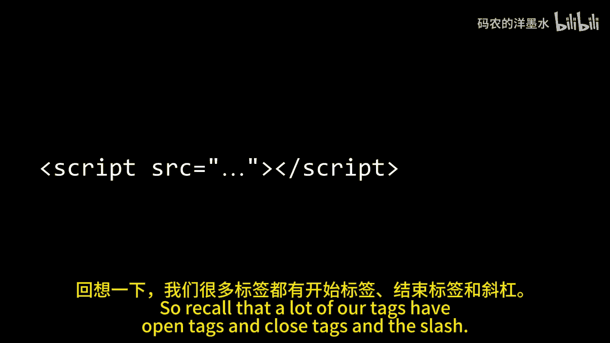

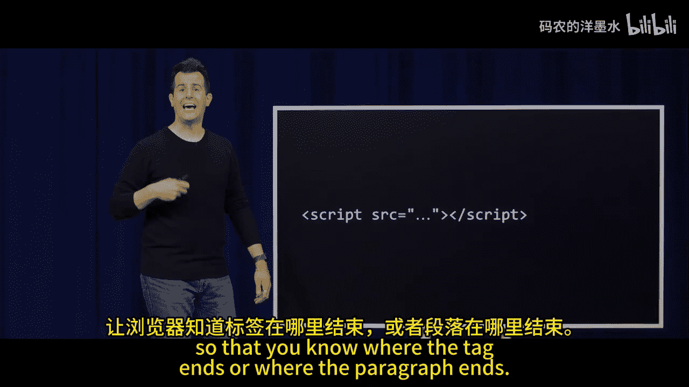

Other questions。Ptainending the react framework， as far as I understand on theSX format。

 you use intertengeibly both JavaScript and HTML how that isn't a security risk for this kind of attacks。

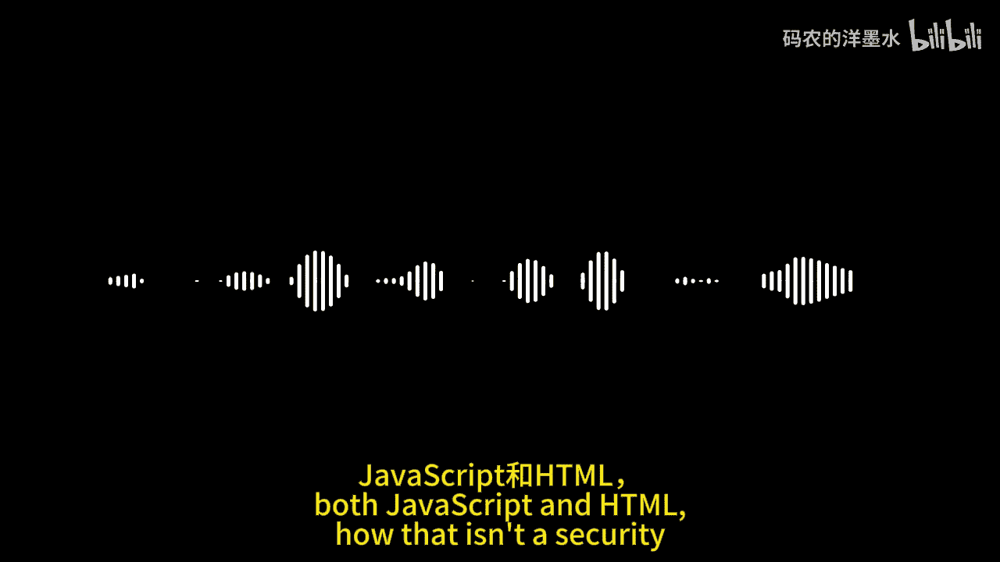

Really good question beyond the scope of this class for those who don't have a programming background。

 However， yes， react and other frameworks use a technique called Jsx。

 which combines javascript with Hml with Css that are rendered by the browser in that case， though。

 Mattteo， the browser is running jascript code that comes from the react library that is reading as input that Jsx code and converting it to the resulting code that should be executed within the browser so long as all of that code comes from do js files or dot css files or the like all as well。

 But if you just in line it and you outputting headers like this， it won't execute at all。

 So the same rules apply。 you would have to use an external file。 So when it comes to code injection。

 there are other types of attacks， particularly in the context of what's called SQL or structured query language。

 which is a language that's typically used with databases。 So again， on a server。

 So let's consider how you might。😊，Also trick software into executing SQL code that is code written in this particular language when it comes to databases specifically。

 Well， here， for instance， is some representative code in this language called SQL whereby you have a line like select star from users where username equals quote unquote and then username and curly braces。

 Now， consider this to be pseudocode of sorts， because I'm mixing some SQL syntax with some Python syntax in this case。

 because it turns out that when you're using this language SQL or SQL。

 you typically use it in combination with some other language。

 be it Python or PhP or Java or something else。 And you use that other language typically to construct queries dynamically based on values that humans have typed in。

 So for instance， if you're logging into a website and you type in your username and hit enter very often。

 if that website is implemented in Python or PP or Java。

 it might use one of those languages to construct a。

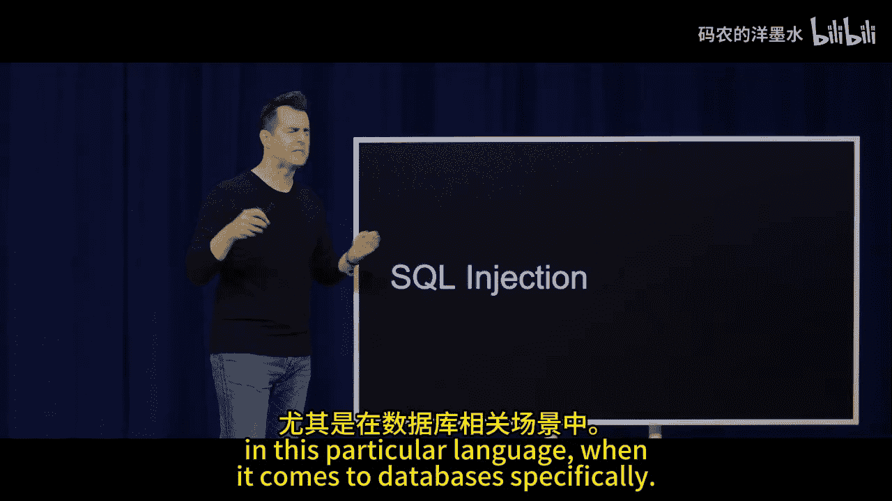

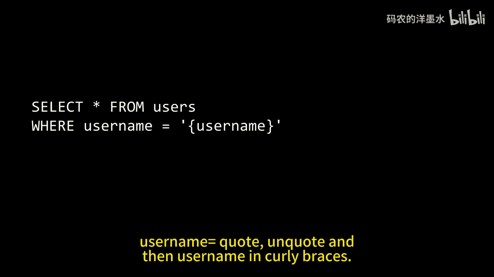

Query that is then actually sent to the database to look up that specific user who's trying to log in。

 So what I have here then is mostly SQL syntax， except for in these curly braces。

 some Python specific syntax。 and what this curly brace with username inside of it represents is Hey server。

 plug in whatever the human typed in as their username into that part of the string。

 So the curly braces and the word username should be replaced with literally something like mailin。

 if that is the user who's trying to log in。 and that will then resulting the resulting code will be sent to the database to select everything we know from the user's table。

 so to speak in that database about that particular user name。

 So what could potentially go wrong here。 Well， it all has to do with， again。

 trusting input from the user。 and that should now be emerging as a theme。

 you should generally always mistrust input that comes from user。 you should do something with it。

 but you。Sanitize it or scrub it in such a way that any potentially dangerous characters are somehow escaped。

 And that's exactly what the solution was to those crosssite scripting attacks。

 whereby so long as we escape to the user's input and change the less than sign and the greater than sign and maybe some other symbols as well to the equivalent character escapes all was well。

 So here too， is an example now in the context of database is where a bit of paranoia will go a long way to keeping your software secure。

 Why Well suppose that my username is indeed mailin。

 But suppose that's not what I type into the website when trying to log in， for instance。

 So instead of typing just my username。 suppose I am suspicious as the adversary that this website is probably using a database。

 and that database is probably using this language SQL。

 So what could I do to kind of mess with the owners of this website and try to trick their database into executing my code and not just their own。

 How do I inject code of。Well， instead of mailin， let me a little crypptically type this in to the website where I'm prompted for my username。

 Now， this does look cryptic。 and odds are an adversary。

 It's not going know exactly what to type the very first time， they try to hack into a server Rather。

 it's through trial and error very often that an adversary might eventually realize this is what I could probably type into that website to inject some code of my own。

 So to be clear， what if I typed， I've still typed my username， M。

 but then I've typed a single quote。 And then a semicolon。

 and then delete from users and then another semicolon and then a dash dash。 Now。

 if you don't know SQL and you are not expected to know SQL for this course。

 this looks weird probably。 but each of these symbols。

 each of these punctuation symbols in particular means something specific and serves a particular purpose。

 Now， what might that be， Well， let me go back to the original query。

 And now let me assume that in yellow here。 the curly。

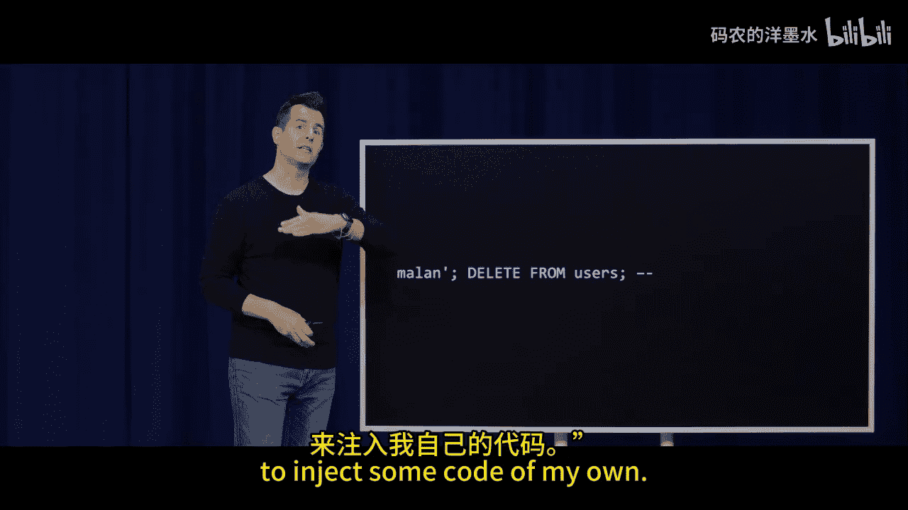

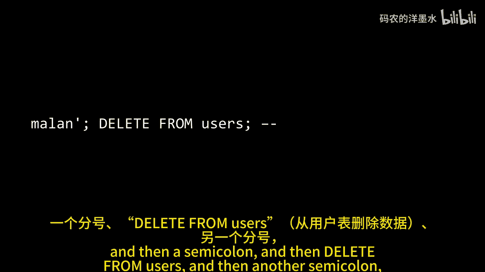

With username is where my username is supposed to go。 And my username is supposed to be mailin。

 But what if I type in that long sequence of cryptic text。

 here's what's gonna to happen on the server because it's using a language like Python or PhP or Java this yellow value is going to be interpolated。

 that is replaced with whatever the human typed in。 So let's do that。 Let me paste in what I。

 the adversary typed in and notice I've kept yellow， the user's input。

 So everything in white is still the part of the SQL query that the designers of the database came up with in advance。

 But everything in yellow is what came from like a form on the web an adversary in my case。

 And this looks a little cryptic still， but even if you've never seen SQL before。

 you might have an intuition for what could go wrong。 because I。

 the adversary typed not only maillin， but a single quote here。 notice that， oh my goodness。

 that perfectly lines up with the single quote that。

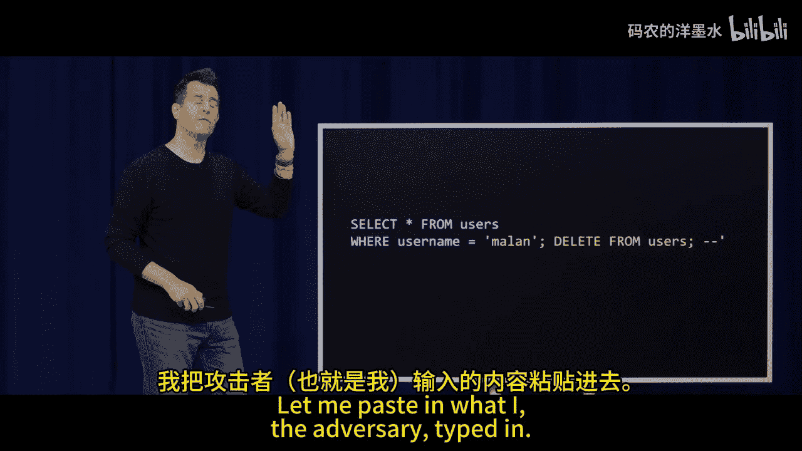

Daatase designer used in their query and so even though this white quote is meant to be closed by this white quote way over here。

 notice that grammatically in this language not to mention in English and other human languages this single quote here or apostrophe because it comes first will be presumed to close this single quote or this apostrophe here the semicolon it turns out in this language SQL ends a thought it's like a period in English and so anything after a semicolon is like a new command altogether so notice that delete from users semicolon is like a second command that came entirely from me the adversary and then dash dash it turns out and this is very clever dash dash in a lot of versions of SQL represents a comment and a comment in a programming language means ignore everything after this because a problem right now is that that single quote that apostrophe was meant to surround the user's username。

😡，But because I， the adversary， Hardy gave you a single quote to use accidentally as closing this thought。

 Well， we don't need this single quote at the very end anymore。

 So this is why the adversary or me in the story is doing dash dash that's just going to tell the server okay ignore everything after that including the single quote that we do not need grammatically So let me reform at this a bit it。

 I'm gonna to go ahead and add some new line， some white space just to make it a little more readable What you see on the screen here right now is equivalent to this Notice that I've moved the delete command to its own line just for readability。

 sake I've gotten rid of the final apostrophe， the single quote because it was after a comment which means by design it's meant to be ignored So what I have done is the adversary because I presumed or inferred or figured out that this website is using single quotes and they're just blindly interolating that is replacing those curly braces and username with literally anything I type in。

😡，I can trick the server into finishing this first command by saying select star from users where username equals quote unquotemein semicolon and worse。

 I can trick this particular database into executing a second SQL command， which even if again。

 you've never seen SQL Deleting is probably a bad thing It's probably a destructive thing that you don't want some random adversary on the Internet being able to do on your server。

 So what's the goal of these lines here。 Well， the original intent of the first query。

 presumably I claim was just to search for the user in the database so that they could log in。

 So when I type in mailin and hit enter， I am somehow able to log in。

 probably after typing also a password， maybe a two factor code or the like。

 But select star from user where username equals mailin fine。

 that's probably going to retrieve the information that it was supposed to retrieve。

 The dangerous part here。 is not I trick this server into executing a second command and this one looks destructive。

 De from user semicolon means delete all of。😡。

TheUse from the system。 so it doesn't help the adversary in this case。

 get into the system or do anything with the mail and account other than delete it and literally every other account in the system。

 So this is bad， this is representative of a SQL injection whereby I。

 the adversary wrote code that you， the designer of this database accidentally naively treated as part of your own command。

😡。

So how else could things go wrong， Well， not only could you do something destructive like deleting data from the database。

 but suppose that the user prompted at the same time for a username and a password now in this story。

 and suppose therefore that the query in the software is this。

 select star from users where username equals quote unquote username and curly braces but one more phrase。

 and password equals quote unquote password。😡，Based on whatever the human typed in is their password。

 So again， to be clear， in this story， the users prompted for a username and a password and the SQL command that's going to use those two values looks like this。

 But here， too， we're setting the stage for an injection attack Y。

 because based on these placeholders with the curly braces around username and password。

 It looks like we're just gonna blindly plug in to this。

Command exactly what it is the human had typed for their username and password respectively。

 So what could a more sophisticated adversary now do， Well。

 maybe instead of typing in mailin and then whatever Mein's actual password is。

 supposeose that they just want to get into someone's account。

 Maybe mailin's maybe someone else is altogether。 What if the adversary doesn't just type mailin。

 not to mention Mein's password。 But what if they type in this specifically for mailin's password。

 Now， this is weird。 And I'll tell you now， this is not， in fact， my password。

 But what has the adversary typed in a single quote。

 the word or then another single quote with a one and a single quote equals a single quote and a one。

So this looks very， very weird。 But let's see what happens。 And again。

 most adversaries wouldn't figure this out the first time they try odds are they'd be trying a whole bunch of techniques and juistics to figure out what might actually work for them。

 So we're fast forwarding to the end of the story where the adversary has figured out that this weird sequence of characters can hack into this server by tricking it into executing code that wasn't intended。

 So here again in yellow， is exactly what the adversary has typed in。 Main。

 which may very well be a legitimate username。 But then for the password in yellow。

 single quote or single quote1 single quote equal single quote1。 And based on our previous example。

 you can perhaps see what's starting to go on here， we finished the mailin thought naturally。

 like we didn't type anything malicious for the username this time。

 but we did type something seemingly malicious for the password。

 And the first single quote in yellow， quickly finishes the password thought。

 quote unquote nothing in between。 then were。Or quote unquote 1 equals quote1 why Well。

 the adversary in this case kind of figured out or new or guessed that the SQL command ends with a single quote itself。

 So the whole point here is even though this too probably looks very cryptic is that grammatically what the adversary has typed in not only perfectly aligns with the username field because it's just mailin。

 nothing special there， but very cleverly， the adversary has finished the thought of this single quote and also finished the thought of this single quote。

 So we've made everything balance， just like you would not only in SQL。

 but in a language like English。 So let me go ahead and clean this up a little bit too to make clear why this is dangerous。

 This command now， once formed by the server based on that adversary's input is really the same as this。

 And I'm just going to add again a new line in some white space just to help us wrap our minds around what's going on。

 So I've just moved the or line to the bottom。 And just like in math class years ago。

 let me go ahead。Put parentheses around things here that makes clear what the precedence is of things like and and or。

 it turns out that and like multiplication binds at a higher precedence。 It's more important。

 you're supposed to do it first， So I'm gonna to add parentheses now to this first expression。

 They're not strictly necessary。 they're implied， I'm just making them explicit now to show you just like in math class the order of operations。

 Now what is this mean， this means that the database is gonna say select star from users。

 So select everything from the user table where the username is mailin and the password is quote unquote Now that is probably not my password。

 My password is definitely not nothing， it's not empty but that doesn't matter now。

 why because even if this first clause where username equals mailin and password equals quote unquote。

 even if that doesn't find anyone in the database with the username of mailin and a password of quote unquote it doesn't matter because we've trick the database command into including an or。

 which is so stupid。

That it's always true or one equals one。 Well， one always equals one， which means that now logically。

 this query is going to return everything we know about users from the database。

 and why is this problematic Well when you're logging users into a database logging users into a website or application。

 you're typically searching for them in the database。 And typically。

 if you get back one or more users， you're going to assume that the very first user is the one that you want。

 And maybe in this case， it's mailin。 but it's also very common in servers for the very first user that was created to be you。

 the person that designed the site。 and you probably have administrative privileges。

 that is access over everything in the system。 And so if a query like this is returning all of the users。

 including you is the very first one， if there's additional code in the system that we won't put on the screen here or bother hypothesizing about it means that you could be now letting the adversary login。

 maybe as mailin。😡，Maybe as you all because you trusted user input。

 but you should never trust that your users， if called Main are going to type in just mailin。

 you should always assume that there's someone out there very annoyingly。

 very maliciously that's going to try using some single quotes。

 some semicolons or in HTML we saw less than sign a greater than sign you should always expect that someone on the internet will have enough time and interest in hacking your website or application that this might indeed happen to you and your software。

😡，So what's the solution then how do you avoid a query that's equivalent ultimately to this。

 Because if there's no maillin with no password， it's still the same as asking for where one equals one。

 which is anything， and to be clear， I didn't have to use one。

 I could have used two or three or four， I could have used cat or dog or anything else so long as the thing on the left equals the thing on the right。

 and I typed that into the application the same thing would certainly equal itself is the point here and one is just the simplest thing we could think of。

😡，So what is the solution here to SQL injection attacks specifically Well。

 it's very similar in spirit to the notion of character escapes， but in the world of SQL。

 there tend to be standard ways of escaping dangerous characters you don't have to do it yourself and much like security in general with encryption specifically you probably should not be writing code yourself to solve problems like these that hundreds。

 thousands， millions of people before you have already had to deal with and have probably solved correctly do not reinvent wheels when you don't need to in the context of security So this is to say in the world of databases。

 most databases support， what are called prepared statements。

 which is a fancy way of saying that you provide the code for your SQL query。

 you provide placeholders for wherever you want user input but let the database itself replace or interpolate those placeholders with the user's actual input and let the database handle escaping anything。

😡，Dangerous， and we've seen that things are dangerous， like apostrophees thus far。 So， for instance。

And instead of writing a single apostrophe and this is weird admittedly in the world of SQL。

 the way you typically escape an apostrophe is not like HTML。

 You don't do ampersand Apo semicolon you don't like in some language is put a backslash in front of it。

 typically the way weirdly， you escape a single quote or an apostrophe in SQL is very often by putting two of them in a row。

 So why we'll defer that to another day， but this is just the convention。 Now。

 this means that you could write code that changes any single quote to two single quotes， but again。

 don't bother doing that。 Use functionality that comes with the database or library you're using。 So。

 for instance， if we go back to that very first query that was vulnerable to being injected with something like delete from users。

 What if we now do this。 Let's change our pythonbased placeholder using curly braces in yellow here。

 And let's change that and get rid of the quotes and just put a question mark。😡。

This is one of the common conventions in prepared statements where you put a question mark。

 not because you don't know what to put there， but because you want the database to replace that question mark with a user's own input。

 Then what happens。 Well， if the user types in that dangerous command with the delete inside of it notice what happens。

 Here's the single quote， here's the closed single quote。

 and the database has given that to you automatically。

 the prepared statement adds those single quotes for you。 noticeice that even though I。

 the adversary only typed in mail in single quote。😡，Semicolon。

 the prepared statement has gone ahead and escaped a single quote or apostrophe with two of them instead。

 and nothing else here thereafter is actually too worrisome。

 that alone is sufficient to solve the problem。 Now， this looks a little weird right。

 because it kind of looks like logically。 Well， you still have this quote in this quote。

 which line up。 And you still have this quote in this quote which line up。

 So it looks like we haven't really fundamentally solved the problem。 but we have。

 it turns out in SQL databases， anytime they see two single quotes back to back。

 they don't try to pair them with something to the left or something to the right。

 they just treat it as one special escape sequence。 So to speak。 So that would then fix this query。

 And if we go back to the second query， which had two placeholders。

 username and password using this Python syntax， let me go ahead and change that to prepared statement syntax using in this case。

 Que marks without quotes and trust that the database itself， will add any necessary quotes。

Escape any potentially dangerous characters Now， what did the adversary type in in that second scenario。

 Well， it was just innocuously mailin。 And so that comes back from the prepared statement as being prepared with quote unquote on the outside。

 no problem there。 but this other input from the user from the adversary's password。

 which was very cryptic with lots of single quotes。

 notice that every single quote in the advers' so-called password has been escaped so that the single quote here becomes two the single quote here becomes two。

 the single quote here becomes two。 the single quote here becomes to。

 and the prepared statement automatically adds a final single quote at the very end。

 But I've kept highlighted in yellow， everything that represents the user's input now that it's been properly escaped because again。

 even though you might try mentally to paired this with this one this one with this one。

 this one with this one and so forth， that's not what the database does whenever it sees in this case two apostropphes back to back。

 they are treated as special escape sequences。

And so the only quotes that ultimately are treated as lining up are the two around the username and the two around the entire password here。

 so the characters are still in there， but they've been escape。

 sanitized or scrubbed so to speak in such the way that now the database is smart enough not to mistake those for quotes that should be matched with ones that we might have otherwise written previously Now there is another class of attacks that similarly involve injection into your software。

 particularly command injection those of you familiar with a command line interface in the context of a terminal window or the like might be familiar with how on a system you write you type commands as opposed to always using your mouse to point and click on menus and buttons The problem with command injection is that it's all too easy in a lot of today's programming languages to write code that invokes commands on systems whether it's to copy files。

 delete files， move files， execute other commands。😡。

Together and that's because a lot of programming languages come with functions that is a feature called system。

 which is literally a feature of some programming languages that allow you in your program to execute a command on the underlying system。

 a command on the underlying operating system then that might be useful for you because in addition to writing your own code in some higher level language。

 you can occasionally run a command on the system itself。

 but the problem is that if you the programmer somehow take user input and you just blindly pass that user's input to the command line。

 so to speak to the terminal window to the underlying operating system that is yet another context in which potentially dangerous characters like semicolonons or the like could accidentally finish your thought but then start a completely new one from the adversary so that they too on your system can not only delete things like data from your database but even files from your file system。

😡，They could perhaps send email or spam or do anything in a command line environment that you yourself could do on the same in other programming languages。

 the same idea exists in the context of another function called eval which evaluates whatever you pass to it So there too if you're in the habit of using system or eval taking user input and passing that user input as part of the input to system or eval without having sanitized it or scrubbed it or more generally escaped potentially dangerous characters you're putting your entire system at risk and any in other any and all software that's installed on or running on the same So what's the solution here in any of those programming languages to which I'm alluding that have functions like system or eval。

 they almost always come with another function or built into these functions way of escaping the user's input so I would always take care to read the documentation if you yourself are or want to become a programmer。

😡，That whenever you take user input， you always figure out and think to yourself， Wait a minute。

 How can I escape this properly so that I can't be tricked into executing some command。

 some SQL or some Hml and ja within my own software。 Allright， that's been a lot。

 let's go ahead here and take a five minute break。 And when we resume。

 we'll look at a whole other category of potential attacks on software。😡，Al right， we're back。

 Let's go ahead and return to this world of HML and the web。

 if only because so much of today's software is actually webbased and indeed even on your Mac or PCcs or phones。

 what looks like a native application， so to speak。

 might actually still be implemented in Hl with that other language jascript and CS。 Well。

 it turns out in the context of a browser， there's very often a feature called developer tools。

 And indeed， if you've done any web development of your own， you might have played with this feature。

 and these developer tools， which might be called something slightly different across different browsers。

 allow you to poke around the Hm， the Cs and the jascript that compose some web page。

 either that you yourself of me or that someone else has made and you have downloaded or accessed via your own browser。

 Let's consider now， though， what you can do if you have access to these developer tools。

 So for instance， here is some Hl using a tag called input， which would create a checkbox on a web。

 We haven't seen this one yet， but it's similar in。

to the paragraph tag and the anchor tag in which case it is interpret as the browser is meaning Hey browser。

 here comes a checkbox。 The only thing different that's worth noting here is that some HTMLl tags don't actually need a close tag because whereas a paragraph starts somewhere and then end somewhere else after some number of words a checkbox is either there or it isn't there。

 So there's really no conceptual notion of it starting and stopping。

 So some HTMLl tags don't even need end tags or close tag。 This then is one of them。

 This then is an input tag that gives us a type of input namely a checkbox。

 and another curiosity about this is that some HTMLl attributes don't need values。

 We saw the h attribute for the anchor tag earlier， and that of course。

 had a value in quote was the URL that you want to link to here we see that same paradigm type equals unquote checkbox to give us specifically a checkbox type of input but you'll also notice here。

 another attribute specifically for this input tag。

That's literally called disabled and strictly speaking。

 you don't need to give it a value because it's either there or it isn't。 And if it is there。

 that just means that this checksbox is exactly that disabled。

 which means you can see it but it's not checked and you can't actually check it It's disabled and lightly grayed out typically on a browser So why might this be well maybe there's some feature in the browser that you don't want to give some users access to maybe based on who has logged in they should or should not have access to some feature the problem though with HTML and CSS and jascript or really anything that is webbased or using those languages is that you're sending this HTML to the user's own device to their browser on their phone or laptop or desktop which means they can not only see this HTML code but theoretically they can edit it they can't edit it on the server because that's your own copy assuming they can't hackens。

😡，The server， but they can edit their own copy thereof Now usually that's not such a big deal because what's the worst that can happen。

 They can hack themselves by changing HTML on their own computer or phone。

 but it is problematic if you are using HTML or even jascript to try to prevent certain user interactions with your server So for instance。

 if you simply don't want a user to be able to check this box so that when they submit a form。

 they're not agreeing to something or they're adding something to their shopping cart by using this checkbox well。

 you might rely therefore on this HTML attribute disable just prevent them on the client in the browser from checking this box。

 but it turns out with developer tools which are accessible usually via a menu at the top of the screen or by right clicking or control clicking on a web page and then selecting an option。

😡，A user with access to H can change any and all of that H on their own computer。

 which means they could just remove this disabled attribute in their own copy of your HTML on their computer and effectively enable that checkbox by getting rid of it。

 Now， what does this mean。 Well， there's no problem yet。

 But if they do now check that checkbox and you didn't want them to be able to and they submit the checkbox to the server as by clicking a submit button in a web form。

 you on the server， if you're not paranoid enough， might just trust that if I see a checkbox being submitted by a form。

 they must have been allowed to do it。 so I will trust them。

 but no here too is an example of where you should never trust users input。

 because if you're trying to disable them from doing something on the client they don't have to respect that。

 They can override the HTML in their own browser， remove any such defenses and then send the checkbox to you anyway。

 The takeaway here。😡，Is that you really should never rely on client side validation alone。

 And this disabled attribute is just one minor incarnation of that where you're relying on the client to ensure that the button is that the checkbox is disabled and its value can't be sent to the server。

 But client side validation is really on the honor system only because if someone knows how to use these developer tools and removes the disabled attribute。

 or if they know how to use developer tools and maybe disabled jascript altogether for your website on their computer any form of client side validation and Ht or jascript that you wrote on the server。

 but that your server sent to their browser and that's therefore executed by their browser is vulnerable to simply being turned off。

 So the catch is that even though client side validation tends to be nice in terms of user experience。

 The button is obviously disabled。 So I should not be able to click on it or my email address is improperly formatted。

 So I should not be allowed to submit the。Any forms of client side validation tend to give the user immediate and often very useful visual feedback。

 But if it's not accompanied this client side validation by server side validation。

 your server software is still vulnerable to attack in some way。

 So what else what other form might this take。 Well， here's another example of an Hl input。

 This type this time it's of type text， which means it's a text box on the field。

 supposeose that you really want them to provide that value。

 Maybe this text box represents the user's name or their email address or their password or something like that。

 And so if you know a little bit of Hl you know that there's not only a disabled attribute available to you。

 but also a required attribute。 And it doesn't have an equal sign or quote mark。

 you don't need that it suffices just to say this input is required。

 but the catch here is too if a user doesn't want to give you a name doesn't want to give you an email address doesn't want to give you a password or some other value。

 Well， they can use the so-called developer tools， click。And on their browser。

 remove the required attribute。 andvoila now they do not need to submit that value。

 Now that and of itself is not a problem because again， they're only hacking themselves。

 but if they're then allowed to submit this form to your server and your server just trusts or assumes that every user will send you a username and email address。

 a password or the like that's where things can break if you're trusting client side validation alone to ensure that the user's input is as expected。

 So if they're allowed to get rid of something as simple as this required attribute effectively making the input like this。

 you might be missing some value and so you must therefore use server side validation again。

 and we won't get into the particulars of how you do this because it will completely depend on the type of server software or you're using the programming language that you're using And so it's really the principle today that's important the client side validation whereby the browser or the user。

😡，copy of your software tries to preempt mistakes and require or disable certain inputs。 That's fine。

 That tends to give good， immediate， useful user feedback。

 But it must still be always accompanied by serverside validation so that you have the final say over what the user input looks like and if and how it's actually stored into your system。

 Again， the particulars of how you do one or the other is the topic for an actual programming class or a class on web development specifically。

 But for now， it's this principle just because you have client side validation doesn't mean you shouldn't also have server side validation。

 And in fact， if you've got to choose one or the other， always choose serverside validation。

 client side validation is really just icing on the cake。 It adds to the experience。

 but it's not the prerequisite one。

Questions then on these so called developer tools。😡，Or these kinds of threats。

 when it comes to validating。The user's inputs。 Yeah。

 So my question is motivated to SQL and command injections for a second。

 Isn't it really easy to just not run the users' commands with adminar routes to delete certain records from database or something。

 Yes， another defense would be to make sure that whatever user name you're using to execute the SQL commands does not have the ability to delete anything at all。

 However， some threats only need select access。 So the second example I showed you。

 whereby we trick the database into just selecting star from users where one equals one。

 that was an example of one where permission wise， it probably would work and it might allow the adversary still to log in。

 But your suggestion is a good one as an additional defense， not an alternative。

 Let's consider another class of attack to which your code might be vulnerable if it's on a server using the same language。

 H TM L。 namely cross site request forgeries or C SRf。 So this one's more of a mouthful， but it to。

To a mistake you might otherwise make when writing software on a server if you're not already familiar with this kind of threat。

 So first HttP， recall is this protocol， this convention by Wi web browsers and servers communicate。

 Well， it turns out there's different ways that browsers can get information to a server。

 And one of those ways is literally called get by convention。 In other words。

 inside of that virtual envelope is typically literally this word get followed by the file name that the browser wants to get from a server。

 But more importantly for our purposes， is that whenever using this get method to send information to a server。

 all of the information that you want to get is embedded in the URL itself。 So what does that mean。

 consider， for instance， this sample link in Hm， Here's my anchor tag beginning。

 Here's my anchor tag ending。 notice here is the text by now。 Well。

 let's suppose that you're in the US here and on Amazon com in the US。

 there's actually this feature where you can buy now。😡。

To say when you visit the page of a product on Amazon's website in the US， if not beyond。

 you can skip the steps of having to add an item to your shopping cart and check out and choose your payment method。

 and then some number of clicks later actually buy the product Rather if you can figure your account in advance。

 you can go to any products page literally click a link or a button that says buy now and that's it in a single click for better or for worse。

 that product will be shipped to your home So how might Amazon be implementing this， well。

 they might indeed be using a link like this。 the hre value of which is a URL like https colon www do Amazon co Dp B07 Xl Q2 FSk In other words。

 that seems to be enough information in the URL alone via which to buy the product whose unique identifier is apparently that string of text at the end。

 Now that's all fine and good。 And that's actually seems very user friendly because with a single click。

On buy now， I can indeed buy that product。 But the danger here is that if this link is not just on Amazon do com。

 but is in some advers website， or maybe in an email that is sent to you。

 if it's that easy to buy something now， you could trick someone potentially into buying things that they didn't actually intend in this case or doing anything else on a web server into which they're already logged in if get is the method being used to get something from that server。

 Well， why is this exactly that this URL is problematic。 Well， consider， for instance。

 the following Hml instead。 supposeose that you visit an adversary site who just likes to create havoc in the world。

 and that adversary site doesn't even have an anchor tag or a link that they want you to trick。

 So it's not even as deliberate as a phishing attack that they want you to click some link。

 supposeose they're using something like an image tag， which it turns out in Hl。

IMG for short is how you embed an image on a web page and how do you specify what image you specify the source thereof SRC for short。

 the value of which can be the URL of or the name of the image you want to display but strictly speaking that URL doesn't have to actually lead to an image it could actually lead to an Amazon product page but the way images work on web pages recall is that typically when you visit a webage the images automatically load you don't have to click or do anything typically for the images to appear on a web page maybe in emails and that's an antifishing mechanism but in web pages you typically don't have to click on anything to see the images that is to say the value of the source attributes are just automatically downloaded and displayed to the user now in fairness is not an image but the browser doesn't necessarily know that from the get go and so if this HTML is in some adversary's web that you've somehow been tricked into visiting。

You don't even click a link you just visit that web page that means this image tag is going to try to download this source and even though it's not gonna get an image。

 it is gonna buy that product for you why because if you're logged into your Amazon account even though this isn't another tab it's as though your browser requested that URL via that get method because all of the relevant information for buying that product is in the URL alone So it turns out that using get is actually not a good thing when it comes to changing state on the server to get technical the get method is meant to be safe safe whereby it does not change any state or values on the server so it would actually be incorrect or definitely bad practice by Amazon if they were implementing their buyow button simply with a simple URL and a simple get request it should not be that easy。

😡，To buy things on the Internet， let alone change state on the server in other ways。

 So there are thankfully other methods。 But even these are potentially vulnerable to this kind of attack。

 There's a post method which is typically used by browsers when you want to post your credit card information or your password to a server。

 You don't want your credit card， you don't want your password typically ending up in the URL of your browser for privacy sake。

 So rather post will kind of hide it more deeply in that virtual envelope to which we keep alluding Post might also be used if you want to upload images or video files to a server because those don't really fit in URLs。

 it would seem and so post is an alternative that is meant to change state on the server。

 For instance， buy products for you。 But even this can perhaps be abused。 Well。

 let's take a look how Here is now some Hl and it's more HTMLl than we've seen thus far。

 But we'll wrap our minds around each piece of it。 That is represents an alternative implementation of the buy now button on Amazon。

That's no longer a simple anchor tag with everything that's needed in the URL。

 This is more of a traditional web form。 And it's fine if the form is super short and only has a single button。

 it doesn't need text fields or anything like that， but there's a lot going on here。 So let's see。

 So here's the form tag。 the opening tag。 Here's the closed tag。

 So everything in between must be implementing this form。

 the action of this form I claim is going be to submit the information to this Amazon do com URL here。

 but the method that we're gonna use is explicitly post。 So it turns out in an Hl form。

 if you don't specify a method。 it will use get by default。 So explicitly。

 I'm at least using post because I don't want everything to be in the URL alone。 Well。

 I've got two inputs here， one of which is of type hidden。 Well， what's going on here。 Well。

 it turns out that an Hl form， you can create like keyvalue pairs to send input to a server。

 So if you recall previously I use the Dp part of the URL as separating Amazon。😊。

Com from the product I。 And here and now I'm making this up for the sake of discussion。

 I' am supposing that Amazon supports a web form name called Dp's whose type is hidden because it can bet the user doesn't need to see this。

 But the value is that same product I So this is an alternative to embedding that product I in the URL。

 instead I'm saying there's an Hml there's an HP parameter called Dp。

 the value of which will be this， but it's hidden so the user doesn't even see it。

 which is fine because the whole point is a nice simple by now button。 How do we get that button。

 we use a button tag in Hml， the type of which is to submit because it's purpose in life is to submit this form。

 and the text that the user sees for this button is indeed by now。 So what am I doing。

 This will make more sense admittedly to those of you whove already studied a bit of web development who have written Hl yourself。

 But I'm essentially making it harder for an adversary to automate an attack on a user。😊。

Amazon account why， because I am not just using a link anymore that the user might click or a URL that could be subtly hidden in an image tag。

 Now I have an actual web form。 And at least based on my naive understanding of HTML at the moment in this story。

 This would seem to require that a human click in actual button。 Like。

 I cannot use this as the source of an image。 It's not a URL。 It's all of this complexity。

 So if you're familiar with get versus post。 You might be inclined to think that， okay。

 post surely solves the problem by using this web form because you have to。

 you make sure in this way that someone clicks the button before they can buy anything。Now。

 why is that indeed naive。 Well， it turns out using not just HTML。

 but this language we've seen a little bit of today， namely jascript。

 can be used to automate the process of submitting a form。

 So if an adversary now has this HTML in their website they don't have to wait and hope that someone like you or me is going come along and click the button explicitly because that would be a little weird to click a button thinking you're going to buy something now。

 but it's not on the actual Amazon co that alone doesn't matter if the adversary can just trick you into visiting their website and their website contains this HTML and this additional jascript。

 they can immediately submit this form for you to Amazon without you clicking a thing。

 Why well inside of this script tag that I've added down below。

 I've simply said document forms bracket 0， So this means get me the first form on the page and I'm presuming there's only one。

😡。

The story and then submit it。 So this is to say in jascript。

 not only can you do things like trigger alerts on the screen， those dialogue windows。

 you can similarly through code automatically submit forms So it doesn't matter that you're using post。

 It doesn't matter that you have a actual button that must be clicked it doesn't have to be a human that clicks that button。

 it can be their browser automatically executing this jascript code in the adversaries website that just submits that form for them So this is the essence now of a cross site request forgery if HTMLml like this exists in the adversaries website。

 some other website you can nonetheless trick users into executing operations across websites on Amazon com in this case。

 even though the users themselves are not on Amazon co So that's the crosss aspect of these attacks and it's a request forgery in the sense that it's sending all of the right。

😡。

InBut it's forged by the adversary。 It's not coming from the Amazon com developers themselves。

 but it is this simple because if Amazon does not defend against this attack。

 there is nothing stopping you or me or any adversary from including code like this on our websites。

 somehow tricking users into visiting our websites and boom having products sent to them automatically。

 assuming they have an Amazon do com account。 And they're already logged into it in another tab or at least earlier in the day。

 for instance。All right， any questions now on this particular attack。

 these cross site request forgeries， whether implemented using get with simple URLs or even implemented with post using actual forms token A than quantum computing change that look at cyber a quantum computing。

 let me address that another time because I dare say that's a bit far from today's goals。

 but quantum computing is bad if the bad guys have it and you and I don't I'll put it that way。

 All right， so how can we defend against this threat。

 even when there's javascript code automatically inducing submission of these forms。

 which have enough information in them in order to buy something on our behalf。 Well。

 it turns out that we could include something like a special token。

 And it turns out a common way to address this problem is by having the server not just output a simple Hl form but to output an Hl form that additionally has。

Another value often hidden as well。 And by convention in some worlds， it's called the CSRF token。

 which is just a fancy way of saying in an extra value。

 but its value is typically meant to be random。 And I've chosen something fairly pronounceable here。

1，2，3，4， ABCD but assume that that value is randomly generated by the server。

 and it might have a bunch of numbers， a bunch of letters in it。

 but the point is that it's randomly generated by the server。 Now， why is this important。

 The implication of this mechanism by having a web server。

 output not only the product Id and also the button inside of a form that they might be using to implement this by now feature。

 The point is that the server should also be generating some secret。

 randomly generated piece of information in that server as well in that H as well。

 And the server should remember that value， as by using its own database or some other mechanism。

 The point here， though， is that only the server。😊，azon co in this case。

 knows what that value should be for you， a specific user。 And so an adversary。

 even if they trick you into visiting their website where they have HTML that looks quite like this。

 the adversary unless they've hacked Amazon co， which is not part of this story。

 they would have no idea what this random value is that Amazon co is using for your buy now buttons because again。

 if it's just an adversary on the internet， they haven't taken over Amazon co。

 they haven't taken over your computer itself， they are just trying to trick you into visiting a web page of their own that has H like this。

 they won't know what value to put there。 Now they can try to guess and maybe they could guess 12。

312，3，4 ABCD。 but assuming it's more random than that。

 the odds that that adversary guesses your CRf token value is just so small and low probability that it's just not going to happen realistically。

 So now even if you visit a web page that。

tains this H， even if it has some jascript that automatically submits the form。

 because the adversary doesn't know the value of this CSRf token。

 Amazon com can just ignore the request to buy that product now。

 and they can throw up an error message or say something went wrong or the like。

 But the point is that only the real Amazon com should be able to generate and remember this CRf token value。

 And so therefore they can validate server side， that it's indeed you who intends to buy something now。

 The adversary if they put a blank value there or any other value。

 it's not gonna be validated server side because the server realize this that's not the value I'm using for David。

 that's not the value I'm using for you。 So this is a very common technique。

 It does require a bit more complexity on the server。

 very often programming languages like Python will come with libraries。

 thirdparty libraries or code that other people have written that allow you to add this functionality to your own software。

 but you have to know that the thread exists。 and you have to look。

For a solution there too， or implement it yourself， if need be， but almost always as a library。

 the answer to this problem。 There's another way you can solve this same problem。

 which doesn't involve outputting any Hl at all， it is also possible to send these kinds of tokens as H TtP headers as well。

 as might commonly be the case when a website is very heavily using jascript and is using jascript to talk directly to a server without even any Hl。

 Well the same values can be sent via this other mechanism as well。

 So if you're interested in these kinds of webcentric attacks。

 especially you might find it interesting to explore the open worldwide application security project。

 which has documentation of discussion of recommendations for all of these kinds of webcentric attacks and more。

 So now， though， let's go ahead and take a short break。 And when we come back。

 we'll look at problems that go beyond the world of the web。

 specifically the software that you might have running on your own Mac PCcs or phones。

Al right， we're back。 Let's now consider a class of attacks that is particularly common when it comes to software that's running on your own Mac or your PC or your phone。

 So not webbased but local instead。 And the first of those is generally called arbitrary code execution。

 The potential for an adversary to somehow trick your own computer into executing code that you。

 the adversary have written and that's not embedded in the actual software that's meant to execute it。

 This is an example more generally of what might be called remote code execution。

 whereby this same attack can happen， even if the adversary is somewhere else in the world perhaps connected to you somehow via the Internet。

 And how might these attacks be possible， very very common mechanism for waging these kinds of attacks whereby an adversary tricks your own system into executing code that the adversary wrote。

 is through something generally known as a buffer overflow。 Now to be fair。

 this is a topic you would explore in more detail。 in a class on programming specifically。

Computer science more generally， but will' give you a high levelvel sense of what the threat is as it relates to software that might very well be running on your own computer。

 So what is a buffer overflow。 Well， for this， we need a mental model for what's going on inside of your computer when running a program。

 And when you double click a program on your Mac or PC or your phone and it opens up and loads into the computer's memory the memory you can think of is that this big rectangular region that represents all of the bytes or megabytes or gigabytes that are in your Mac your PC or your phone and the computer or device more generally use different parts of this memory for different purposes。

 And this is just because humans came up with conventions years ago to lay out the computer's memory in this way using some of it up here for one purpose using some of the memory down here for another purpose instead So for instance。

 if this big rectangle represents your phone or your computer's memory。

 let me just propose that at the top of it so to speak。

 although memory doesn't have a top bottom left or right because it totally。

Depends on how you're holding it， but assume conceptually that at the top of your computer's memory is the machine code for the program you're running。

 So long story short， when you write software at the end of the day。

 zeros and ones are involved and the zeros and ones represent the instructions or commands that that software wants to execute on your computer when you click an icon or double click an icon and load a program into memory。

 the actual program's machine code， the zeros and ones， if you will。

 are stored up here in your computer's memory。 Meanwhile， while a program is running。

 it might need more or less additional memory as it executes instructions they are in。

 So what does this mean Well， if the program is prompting you for input。

 or if it needs to load a new level from a game， it might need more and more memory。

 But eventually it might not need that memory anymore。

 So the memory requirements of a program tend to go up and down all the time based on what you。

 the human are doing with the software and based on what the software is designed to do。

So computers typically use this bottom area of the computer's memory for a socalled stack。

 very similar in spirit to any physical thing that you might stack one on top of the other。

 like clothes in a closet or trays in a cafeteria， stacking means literally from bottom on up。

 But the weird thing is about a computer's memory。 is that by convention。

 when the computer needs memory。 it first uses some memory from the very bottom。

 And then if it needs more， it uses more above that when it needs more， it uses more above that。

 So instead of just going top to bottom， it actually deliberately by design goes bottom up for reasons we won't get into in this course。

 but just take on faith than indeed the stack of memory grows upward The catch， though。

 is that sometimes software doesn't necessarily know in advance or predict correctly in advance how much input you。

 the human might give it。 So for instance， a computer program might decide to take up this much memory at the bottom but then not realize。

That wait a minute。 What if the human types in a really long name or a really long essay or just gives me more keystrokes as input than I。

 The programmer who wrote this software anticipated。

 That might mean that even as you allocate what are called frames of memory on this stack。

 the user's input might not stay confined to that particular frame。

 if they type in too many characters at their keyboard。

 what's supposed to go here might end up going down here。 So overflowing these frames of memory。

 So the computer or the programmer makes hopefully an educated guess as to how much input the user might have。

 But if they're wrong， that input might be too tall and therefore overlap other parts of the computer's memory。

 Now， there are ways to defend against this。 So the scenario we're worried about here is often when programmers don't know how to anticipate this or when you are using software written by programmers who didn't anticipate or implement the solution properly。

 So what might go wrong。 Well， for instance， when a program first starts running。

One of the first things it does， if it's calling another routine or another function。

 when you click on a button， when you start typing keystrokes。

 the computer might start using some of this memory and it might be moving around among these zeros and ones。

 executing different instructions。 If you click this menu option， it'll use this code。

 if you click on this menu option， it'll use this code。 So in other words， the computer logically。

 it kind of moving around among all those zeros and ones and executing them accordingly。

 So one of the first things your computer does when a program is running is it just jots down at the bottom of the computer's memory。

 What is the address to which I should return after doing this。

 So it's kind of like in the real world if you go off and do something over there。

 eventually you want to remember to come back over here to pick up where you left off。

 And that's what we mean by return address。 It's a little reminder to yourself that no matter what you go off and do right now。

 you got to come back and resume where you left off and what this return address then does。

 is it refers to some specific。Location in the machine code。

 some specific pattern of zeros and ones that eventually the software should come back to to pick up when the user leaves off。

 So， for instance， if you open the file menu and go to print and you go through the steps of printing a document。

 the return address might be to go back to whatever you were doing in that document before you initiated the print command。

 So the software is constantly jumping around in this sense。

 Suppose now that the user click some button within the software to search for something。

 Maybe it's like cats。 Well， because this is a new function that's being called the search function。

 what the computer might do inside of its memory is this。

 it might put a little note to self to say go back to this location in the machine code once the user is done searching just like the user might be done printing。

 And then suppose the user types and cats。 Well， cats is stored in the computer's memory just above this frame on the stack。

 because again， I said by convention， whenever the software uses memory it starts at the bottom。

 then goes up， then goes up， then goes up So。

After now this software is done searching itself for cats。

 then that frame on the stack is sort of removed because we don't need to know about cats anymore。

 We're done searching for them。 So the last thing in memory is this reminder go to machine code。

 and this is how the software knows to go back to a particular location and code or maybe it's just sitting there waiting for me to click some other menu option instead。

😡，But what if an adversary is the one at the keyboard so to speak and it's not a good user just typing in short phrases like cat。

 but maybe it's an adversary who's typing something more。

 So suppose that an adversary actually pulls up the search feature and in general。

 therefore the software is going remember to put the return address there so specifically something like go to this location in the machine code。

 but suppose that the adversary doesn't type in cats doesn't type in dogs but types in for the sake of discussion。

 some pattern of zeros in ones that represents actual code。

 maybe it's the pattern of zeros and ones that represents delete everything from a server or starts sending emails or the like or maybe more cleverly maybe it means skip whatever menu keeps prompting me to register or activate my software In other words。

 the adversary wants to trick this software into running zeros and ones that didn't come with the software Now in practice you can't just type zeros and ones at the keyboard it would be a different way that the adversary inputs this data。

😡，But for the sake of discussion， assume that the adversary is not typing in cats。

 but is typing in these zeros and ones and they know enough about binary zeros and ones that they know what patterns to choose to choose Now suppose that this code。

 this so-called attack code is way longer than CAT TS and it's many more characters or bytes long。

 it is possible by definition of how memory is used。

 that this attack code might be so big that it takes up not only this space that's been allocated for。

 but it overflows other things in memory， you can now think of this frame。

 this rectangular region on the stack to which I keep referring is like a buffer。

 a room for some amount of information， but if the adversary provides so much information。

 so much attack code zeros and ones， that it overflows that buffer。

 it might actually overrite that note to self with dot dot dot， something else。😡。

And what's clever here， though， is that if the adversary is smart enough and this is often through lots and lots of trial and error。

 they don't often just get it the first time。 If the adversary is ultimately clever enough。

 they can actually put not just some random zeros and ones there。

 but they can put the equivalent of a note to self that says go to attack code In other words。

 instead of typing in cats， they type in two things that are pretty long one or the zeros and ones that represent some form of attack like circumvent the registration or the activation for the software so I can use it for free or do something else that's malicious。

😡。

And if the second thing they provide in just so happens to be cleverly。

 the address of their own attack code， which they can figure out mathematically。

 perhaps through trial and error， the adversary can trick the computer into not going back up here and running the machine code that came with the software。

 the adversary can trick the software into executing code that the adversary themselves injected。

 Now what does that mean if you are running the software under your username。

 whatever you can do on the software and the system， be it your Mac or PC or phone。

 So now can the adversary and maybe they'll now delete all of your files。

 Maybe they will now register the software， maybe they will now start sending spam anything at all is possible based on what the adversary has passed in here。

 So if you've ever heard of a website called stack overflow com。

 which is a popular website for programmers to ask questions and get answers of a community that specifically is。

😡，The allusion to exactly this kind of bug or mistake whereby if not programmed properly。

 the stack can overflow。 And if the software or programmer does not anticipate or detect it。

 bad things can happen， you can have arbitrary code executed or you can have remote code executed if the adversary isn't even at that keyboard。

 but is somehow sending this code into your software via some network connection。 What then。😡。

M this mean。 So if you've ever heard of the term cracking。

 which typically refers to figuring out someone's password or in this case， breaking into software。

 cracking might refer to eliminating the need for a serial number or an activation code or the like。

 because if you can inject any software any code that you want into someone's software you could tell that software to just skip the lines of code。

 the zeros and ones that represent asking you for that activation code or they can do something much more malicious。

 So this is an example in some sense of what we might also call reverse engineering。

 reverse engineering refers to the ability for someone to figure out how something was engineered how it was built。

 Now at the end of the day， most of the software that you and I install on our Mac or PCs or phones is pretty much just zeros in one。

 So it's very non-obous to an adversary， even what is actually going on。

 But with certain techniques with certain trial and error。

 they can actually figure out what those zeros and ones represent。 and depending on the。

Language that was used to generate that software。 They might be able to glean even more information than that。

 Now， there's a good side of reverse engineering， whereby if you and I are in the business of figuring out how malware was implemented so that you and I can contribute solutions to antivirus software in the lake。

 Well， malware analysis uses these same kinds of techniques。

 trying to figure out what's going on underneath the hood of software as by reverse engineering it。

 So using trial and error， maybe injecting some code of Iran own to figure out exactly what instructions or embedded among all of those zeros in ones。

Now， how might you hedge against these kinds of threats of remote code execution。

 arbitrary code execution with software of your own？ Well。

 you could start using open source software。 For instance。

 open source software just means that the code that implements that software be it in Python or PP or Java or C sharpp or C plus plus or any number of other languages is itself open source。

 That is you and I and anyone on the Internet typically can read the source code and see exactly what instructions will be executed on your computer or phone。

 Now， that doesn't necessarily mean that the version of the software that you are running is exactly the same as the open source version。

 There's still a threat whereby the code might be open source but maybe you were tricked via some phishing email or some malicious website into installing a fake version of some software that actually has malicious code in it。

 So malware might still be a problem。 But a lot of folks think that open source tends to be a good thing。

 because you can audit。Smart people on the Internet can audit the code and make sure that there are no backdo or malicious instructions that might do things that you wouldn't expect the software to do。

 Now， again， that's not necessarily the case that the version you're running doesn't still have some form of infection。

 but this might give you at least a bit more reassurance。 Now the flip side though。

 is that if code is open source， even if it's devoid of anything malicious。

 it might still have bugs mistakes that per human programmers accidentally made。

 which might very well make open source software or any software vulnerable to attack。 I mean。

 you're literally giving the adversaries， the plans to your software。

 It's like the plans to the Death star and Star Wars。

 such that they can probably figure out what the weaknesses are in your software because you're giving them the blueprint there for。

 So on alternative to open source software is perhaps the default which is closed source software。

 So any software that you might download or buy from companies that it's not open source is typically closed source。

 which means only。Only their employees have access to it。 Now， the downside is that you。

 the user do not have access to closed source software。 only the authors therefore do。

 but the upside arguably， is that now so do adversaries on the Internet not have access to it。

 So maybe the probability that that software not only has mistakes， but those mistakes are exploited。

 is perhaps lower。 And so this is perhaps more of a debate and you yourselves。

 as you consider this might have require your own opinions on open source versus closed source。

 but another argument in favor of open source is often that when so many people around the world having eyes on software。

 perhaps that actually increases the probability that we will detect bugs or detect potential exploits because so many more smart people are looking at it and therefore weighing in the downside。

 of course， if one of those smart people is an adversary。

 they find it and don't tell anyone then we're back to a problem from a previous class where and we discuss those zero day attacks。

 but this is one way。😡，One mental model you might have for evaluating just how secure your own software might be that you're either using as a user or developing as a company。

 What's another way that you might gain some assurance that the software you're installing and using is not infected with some form of vulnerability or malicious intent。

 Well， you could download all of the software that you use only from an approved app store。

 be it's in the world of iPhones or Android devices， Mac， Windows or the like。

 whereby you have some other entity like a Google and Apple or a Microsoft。

 a big company that is at least analyzing the applications that are being uploaded to these app stores before theyre allowed to be distributed to people like you and me。

 Now， that's not to say that Apple and Microsoft and Googles or others are perfect。

 there have absolutely been many cases where even applications in these app stores has some malicious feature that they only realize after the fact。

 But again， it's probably in。Preing the probability that some smart people or automated software is going to detect those things first before it even reaches your device。

 and therefore， it makes it harder for the adversary， raises the bar。

 raises the cost raises the risk to them to even get something like that distributed。

 So what does this mean when you install software in your computer。

 perhaps you should get it only from Microsoft or Google or Apple and not from some random website and certainly not from some random email that someone sent you with a link to download some piece of software。

 Now， that's not always going to be the case and particularly if you yourself were an aspiring programmer。

 a software developer， you might need to be in the habit of installing sort of unauthorized software for which you might have to jump through some hoops and change some settings in your phone or in your Mac PC to even allow you to install unauthorized software。

 if you know what you're doing， But these kinds of mechanisms。

 even though they create dissatisfaction with this idea of a walled garden。

 whereby you need some corporate entities permission just to distribute your software。

They do serve a good purpose as well。 So there， too。

 you might fall on one side or the other of that sort of argument too。 Now。

 how do those app stores enforce the fact that you can only install the software。

 if it is in the app store itself， Well， it turns out we can revisit some of our primitives from past classes whereby we talked about encryption and also hashing and also digital signatures。

 the latter of two are particularly germane here， it turns out that cryptography really is the solution to a lot of the world's current problems when it comes to cybersecurity。

 if we use these primitives， Hahing encryption and digital signing as building blocks to solutions。

 So for instance， when you develop a piece of software or some company does this for you。

 and they upload their software to Apple or Google or Microsoft distribution。

 what are those companies doing Well， first， you as the as the author of the software are first use。

Your own public and private key， which you came up with in advance。

 and you are running your software through some special function or algorithm and getting back a hash thereof。

 again， a hash is this fixed length representation of your software So even if you wrote a really big program。

 you have this unique identifier or highly probably unique identifier called a hash。

 and what you can then do with that hash is use your private key and sign that hash giving you a digital signature that signature can be verified by Google or Microsoft or Apple as being okay I know that David Main wrote this software because I know that only he has that private key and so long as I。

 David Main registered my public key with Apple or Google or Microsoft in advance。

 they can assume that okay this new version of the software or this new program came from David Main enough from some random person on the Internet pretending to be David Main。

😡，Conversely， what Google and Microsoft and Apple and others can do is the same thing once you have uploaded your software to their app store。

 they can ensure that they run the software through the same function getting back a hash thereof a unique representation thereof they can use their own private key from their own app store to take that hash's input and produce a digital signature this time signed by Apple or Microsoft or Google whoever else is running the app store and then when you or I install that software on our Mac and RPRP or on our phones。

 our phones and devices can ensure that any software you and I are installing on our device was digitally signed by that app store by Google or Microsoft or Apple or the like。

 So again， just by using this basic building block of digital signatures and hashing in this case。

 you can both a test in wonder。😡，That I am David Main。

 trust my software is written from me Conversely when people install my software。

 they can trust if Apple or Google or Microsofts or others trust that software that they should indeed be allowed to double click it and it's only when you download some unauthorized software from the internet typically that you get often nowadays on your screen and alert saying this is not been signed or this is from an unauthorized thirdpart developer or the like if they're not playing nicely in the same ecosystem。

 but again， digital signatures take us a long way there。 So another mechanism you can consider。

 which is similar in spirit， but typically terminology that's used in the world of Linux computers or similar or package managers and different programming languages also come with an ecosystem of libraries。

 thirdpart code that people write and they make freely available， often is open source。

 but their standard ways by which these package managers can let you and me install the software on our own Mac PC phones。

Or the like， And it's using tools like PP for Python， Ge for Ruby， NPM for no JS。

 and there's others as well， apps for Linux。 These package managers。

 though typically adopt a very similar mechanism whereby they are digitally signing these packages so that you and I can have our computers verify those signatures before they're actually allowed to be installed and in general。

 this involves operating systems as well， the operating systems that you and I are running nowadays。

 at least if you stayed current and are in the habit of automatic updates or frequent manual updates。

 Os are today's more modern operating systems are increasingly building in native support for these kinds of checks。

 Downside is it's getting a little more difficult， a little more annoying to install third party software on our devices。

But the upside is that if you trust these app stores， these package managers， then by transitivity。

 you can with higher probability trust the software being distributed there too。 Now this too。

 though is not fail safe and it is often happened that even once software has been uploaded to these app stores or package managers and made available to folks and version1 might be perfectly safe version 2 might be perfectly safe version3 might be malicious for some reason maybe the developer finally decided to do what their intention was all along。

 maybe the developer and this has happened to sold their software to someone else。

 and the third party now is adding ads or something malicious to it。

 or someone has hacked their computer or account and gained access to their private key and not just their public key and therefore masquerading as them。

 So even now you can't necessarily trust the software you're running on your computer but again that brings us back to some of our earliest lessons in the class where what we're really trying to do is raise。

😡，The bar to the adversary， increase the cost， increase the risk to them and conversely decrease the probability to us that any one of these pieces of software might actually be malicious。

Now there are models that the world has been experimenting with over time to try to figure out how best to reduce these probabilities further and there's this notion of bug bounties。

 whereby some companies will actually steer in to the reality that there are people out there with the skills。

 not only to do malicious things with their software， but also good things as well， for instance。

 people who might very well want to try to find bugs in software。

 particularly ones that relate to security， if they know that the company in whose software they're discovering these bugs is willing to pay for and not in a ransom sense。

 not in a malicious ransom sense but in a bounty sense， whereby there tends to be this marketplace。

 for some companies and some products， whereby if you do discover a bug in their software。

 and you disclose it only to the designers of the software。

 at least during some window of time before you tell the world about it。

 they will pay you so that once they can therefore fix the bug， then pay out。😡。

Because it's a net positive for everyone。 win， win， you have benefited。

 they have benefited and hopefully no adversaries have found it first。

 and depending on the severity of these bugs， you might get paid more or less based on the same。

 And so the idea here of these bug bounty programs is try to leverage the collective intelligence and technical skill of people who。

 frankly， without these programs， maybe would be using their skills for evil and trying to hack these systems and monetize them through ransomware。

 but perhaps we could channel those funds instead toward paying people to do this kind of work。

 So this too is something to consider not so much as a user using software。

 but perhaps a company developing software。😡，So where can you learn more and what has the world come up with to keep track of like all of these possible threats and what we focused on today really are representative attacks using some languages and technologies that are quite omnipresent and fairly accessible。

 at least at the level we've explained them， but it turns out that there is a whole inventory a vulnerabilities that have been detected over the years。

 common vulnerabilities and exposures or CVE， such that a lot of the kinds of attacks we've been talking about today。

 and more specifically bugs and flaws in specific software and versions thereof are often assigned a unique identifier。

 a CVE number， that system administrators， companies and even end users can keep track of to make sure they are always current with the latest threats out there。

 there is also a common vulnerability scoring system or CVSS。

 which is a standardized way of assigning a score to the severity of a vulnerability。

 I it a big deal or is it not so much a big deal， It might still be a vulnerability， a bug。

 but is it that problem。😡，And so there's this scale so that you can prioritize， for instance。

 given limited resources or time， which of the bugs you should be fixing。

 which of the software you should be updating or maybe which of the software you should not be using。

 at least while it's vulnerable to something that's highly severe。

 There's an exploit prediction scoring system out there， ES。

 which refers to what do people in the real world think the probability is that this particular bug or mistake in software will be exploited is And this then might give you a sense of just how problematic it is。

 even if there's something very severe， Is it more of a hypothetical threat or an actual threat。

 something that I people might indeed take into account when designing how to respond to some system。

 And then there's a known exploited vulnerability catalog AV。

 which refers to all of these kinds of bugs that are known to have been exploited。

 So suffice it to say here we're now seeing evidence of just how big of a world。

 how big of a space cyber。Security is that we have all of these lists and taxonomies for keeping track of things。

 because if you're feeling a little overwhelmed with just some of the concepts。

 imagine just how many hundreds， thousands of actual threats and vulnerabilities there are in the actual wild。

 Allright， so that's a whole lot of threats to the security of your software。

 whether you're using it as a user or writing it as a developer。 But hopefully。

 by way of today's examples of how software works， how adversaries can take advantage of it and how you can defend against it。

 you have a much better sense of how to manage those threats up ahead is how we might now preserve our own privacy。

 more on that next time。

。

