# 【全集】哈佛大学CS50 & 网络安全 中英字幕 课程附完整课件 p06 Lecture 4 - 保护隐私 -BV1wJy3BLEe7_p6-

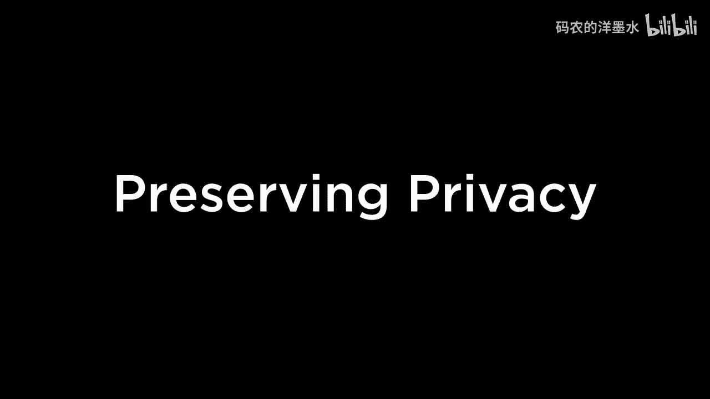

Alright， this is C S 50's introduction to cybersecurity。 My name is David Main。 And this week。

 let's focus on preserving privacy。 Indeed， over the past several weeks。

 we focused on securing your accounts， your data， your systems。

 your software and all of that is really about keeping communications between points A and B。

 for instance， secure so that no one in between， can actually access the information you're trying to share。

 But what if you， a don't even want B to have some of that information。 So indeed， today。

 let's focus on some of the technologies that you and I use every day and some of the technologies that underlie the software and applications and more that you and I are going to use tomorrow and beyond and consider exactly what information we're sharing now。

 perhaps even without our knowledge and also empower you with certain mechanisms via which you can perhaps restrict all the more of this information。

 if you indeed do not want to share it beyond yourself。 So let's consider first。

 some of the obvious features that you。😊，I probably use every day like your web browsing history。

 whether you're on a laptop or desktop or mobile device odds are you know by now that your browser tends to keep track of pretty much everywhere you go on the World web that is to say if you click on your URL bar you can sometimes browse through the past few URLs that you visited if you go up to your browser's history via some menu you can probably see everything you've done earlier today yesterday last week last year or perhaps even the entirety of your history particularly if you're logging into your Google account。

 Microsoft account or something else。 So the web browsing history is sort of both a concern when it comes to your privacy but also a feature Well let's first consider the feature Well why is that useful Well one I mean even I occasionally go back through my history trying to find some web page that I know I was looking at earlier in the day or yesterday or some previous time in the past。

 because it just helps me find information more quickly so in that sense it might solve a problem for me。

Moreover， you probably have noticed that your web browsing history is often used for features like autocomplete。

 So when you start typing a URL or maybe even a keyword that was in the name of a page。

 your browser might remember much more quickly what it is you're looking for you so you can just hit enter or click and voila you're at that same page。

 but of course this is a concern potentially for your privacy。

 whereby you might not want someone else who has physical access to your device to start poking through where it is you've gone you might not want someone else to have access if you just so happen to visit that website or those websites on maybe computer in a lab environment or an internet cafe or the like。

 So you can imagine quite a few scenarios in which this is， yes， a feature。

 but quite a few other scenarios in which this is not really a desirable feature because it invades your privacy in some sense or at least puts it at risk for being invaded by someone else。

 So we'll consider how we might at least sanitize this history or remove it altogether together in ways that you might already。

know about for instance， you're probably already familiar with some option in your browser whereby you can clear your browser history and that forgets。

 therefore all of the places that you've been in been all of the cookies that you might have accumulated all of the usernames and passwords that might have been remembered by your browser。

 although that tends to be a fairly heavy handeded solution because when you clear your browser history。

 assuming you check all those boxes like all of it is gone。

 and that might mean negatively that you're now logged out of Google。

 you're now logged out of outlook or some other account that you actually still want to use。

 even if you just wanted to clear your history from something else altogether So it will consider then what else might be a concern when it comes to your privacy beyond your own browser and in fact。

 it doesn't even matter if you sanitize your own web browsing history and delete the entirety of it because it turns out that typically any website you visit is itself on the server side also keeping track of a lot of that same information。

😡，Say that servers typically have logs and these are not only for diagnostic purposes in case anything goes wrong。

 the I staff can use those logs to sort of reconstruct history and figure it out。

 figure out who was doing what and when and how that might explain some problem it might be used for auditing purposes if they want to keep track of exactly what was accessed on a system。

 it might be used for advertising purposes or analytical purposes more generally to kind of mine or analyze that data to figure out how we might monetize it or do something else with that same information。

 But what do we mean concretely when we say that information is logged on a server。 Well。

 it's very similar to your own web browsing history， But it's an even more detailed。 So here。

 for instance， is a representative piece of configuration that captures what it's a very common convention for information that servers log web server specifically when you visit them with a browser。

 and I'll highlight just a subset thereof This log format。

 socalled combined format indicates to me that it's very common for a server。 when。

ItSome web page on it that the server will log that is remember your remote address。

 otherwise known as your IP address。 It will remember the day and time at which you access that page。

 It will remember exactly what you requested。 So the name of the file or folder on the server specifically that you sought to download or look at it'll remember the refer。

 that is the URL from which you came and it will even remember the user agent that you use。

 That is to say your browser。 So perhaps unbeknownst to you every time you use your browser to visit some website inside of that virtual envelope is quite a bit more than just the request that you're making of the browser of the server rather。

 it includes yes， your IP address on the outside of the envelope as we've described it in the past。

 It includes some number of HttP headers as we've discussed in the past。

 but in particular it includes information that you might not want being stored on servers in perpetuity。

 and you have no control over deleting necessarily。

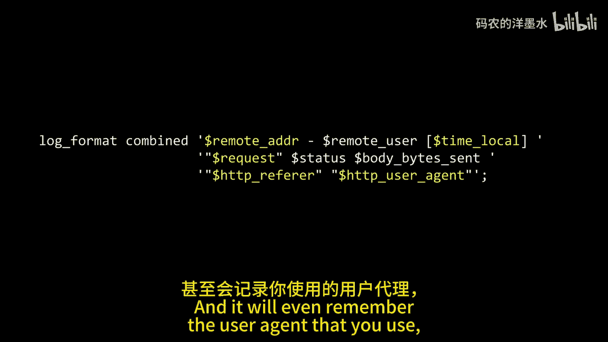

Unless there is some regulatory requirement or law that requires that the server delete it for you on some schedule。

 you have much， much less control over this information。

 So let's consider in a bit more technical detail what some of this information is and how you might at least exert some control over just how much of that information is being shared。

 So let's revisit first this building block of H TTP headers that we keep coming back to。

 if only because in the world of systems and software nowadays。

 things on the web are just so common using Hml， Cs， jascript。

 using web browsers and web servers that's driving a lot of today's interactions with technology。

 whether it's in native applications or whether it's with multiple websites or desktop websites or the like。

 So H TTP headers recall， are just like key value pairs that are inside of those virtual envelopes that indicate some kind of setting or some kind of piece of information that the browser sending to the server or that the server sending to the browser。

For instance， if I go on Google do com and I search as I often do for cats。 Well。

 what might be going on underneath the hood。 Well， in that web page that Google gives me with like 10 or 20 or 30 or 6 billion240 million cats。

 there might be Htl that looks like this。 and recall that this Htl。

 which I'm proposing exists somewhere in Google search results is an anchor tag for a link there's the end tag over there。

 the hyperre for this link or H ref attribute has a value of Https cold example com， for instance。

 and the word that the human will see is cats literally in this case。 Now。

 I'm assuming for the sake of discussion that today， example do com is a website full of cats。

 And that's why it might be appearing among Google search results when I search for cats as my keyword。

 But when a user like you or me clicks on that link on Google do com because that is literally where you're looking at the search results in this story。

It turns out that your browser not only goes and requests that web page。

 your browser includes an HtTP header like this in that virtual envelope that's specifically called refer。

 that's the key in this case， the value of which is the URL from which you came。 So for instance。

 if I have just gone to Google do com and I've searched for cats and I've hit enter。

 recall as in past classes I proposed that the shortest version of the URL that you might see in your browser upon searching for cats is this Https colon slashlash www do Google do com slash search question markq equals cats。

 Now that is what you'd see in your URL bar below that you'd see the 10 or the 20 or the 30 or the 6 billion to240 million cats。

 each of which has a link that when clicked leads you to a search result。

 But the implication of this HttP header is that by default， perhaps unbeknownst to you indeed。

 your browser is telling the whole world。

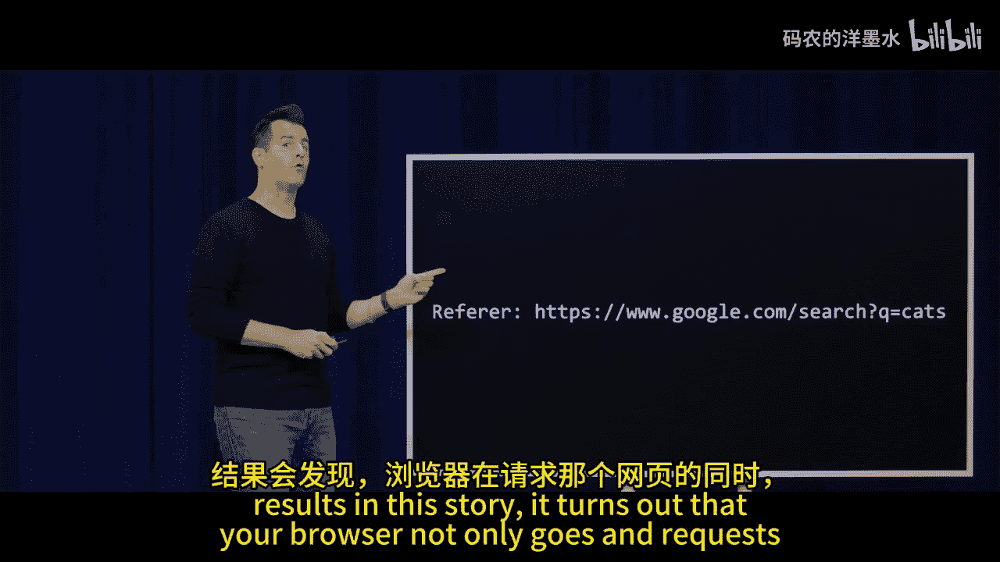

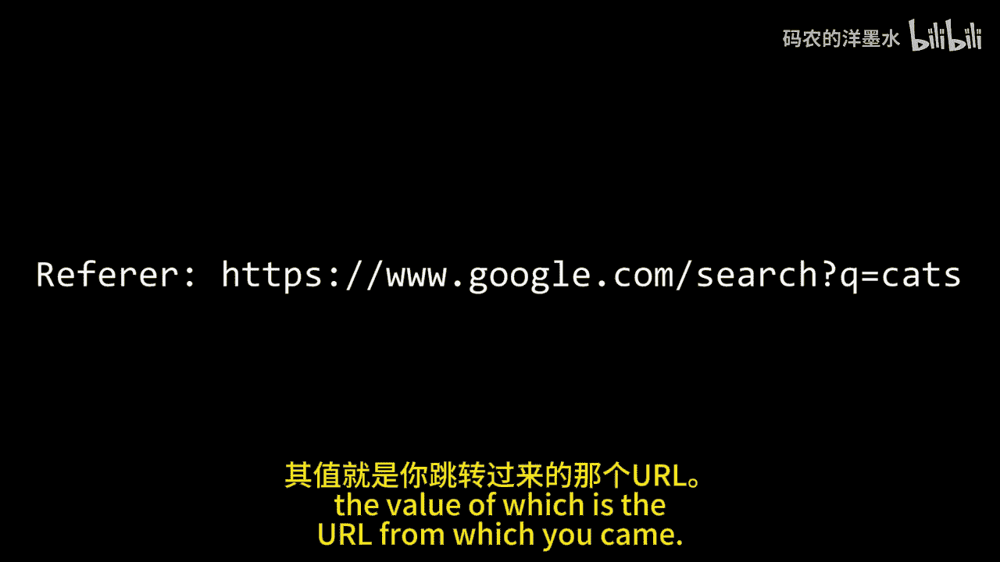

From which web page you came when you visited some other webage via a link Now。

 why in the world is this compelling。 Well， it's actually useful for the website at which you end where because it might be useful for their analytics。

 they might want to know well how are people finding my website。

 How are people finding my business on the Internet， Oh， it looks like I'm getting a lot of users。

 a lot of customers， perhaps from Google com specifically when someone searches for cats， not dogs。

 not something else but cats。 So you can imagine especially in the world of commerce。

 that just being useful information to know how people are finding you or conversely how people are not apparently finding you But this is very invasive because now this website。

 even though it's arguably none of their business， they know I use Google instead of Bing or some other search engine perhaps and you can imagine that there could be links on CS50's own website on any number of other websites in the world。

 And just because you happen to visit them and you click a link， now they're broadcasting。

Your business to whatever website you're ending up on by revealing where you came from。

 from where you were referred， so to speak。 But this has long been a feature of H TTP。

 And this has long been a feature that's enabled by default。

 unless the website or perhaps you as the user turn this off or somehow moderate its response。 Now。

 some of you might be noticing that there's a bit of a ty on the screen。

 And I promise this isn't actually mine。 in English。

 at least this is not typically how you spell the word refer。

 And this is actually a fun fact in referer， there should be four R's in total。

 It should be R E F E R R E R。 However， fun fact years ago。

 when the specification for this standard was being written。

 The poor individual who wrote the specification made a typo that has been immortalized in history for years to come。

 And so this is what browsers and servers have been using and expecting for years。

 There other variance of this header the typographical error has been fixed in。

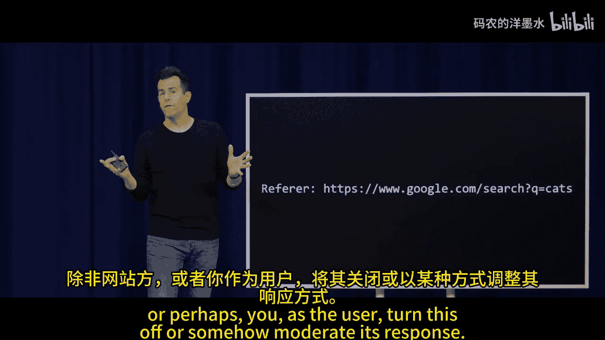

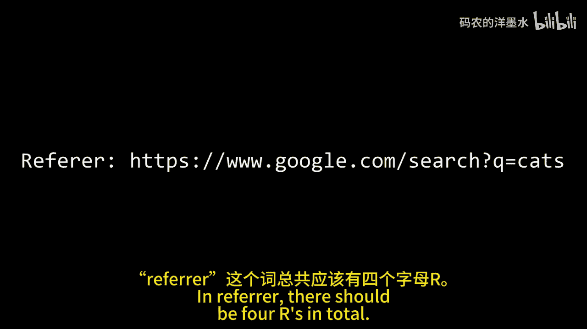

But it's sort of a fun fact from our Internet history。

 But this is indeed what you might see going from your browser to your server。 So ideally。

 we'd send less information， at least right I'd be a little more comfortable if example co。

 which is this website for cats told them， okay， fine。 I came from Google， that's not a big deal。

 but I'd rather you not know what I was looking for if only because that seems unnecessary。

 It seems invasive And who knows what kinds of cats I was looking for。

 maybe I don't want you to know exactly what my preferences are in cats or dogs or whatever types of breeds there might be in this case of searching for animals。

 So just feels like it's unnecessary information to share， but better still， I dare say。

 would not be to even tell example co where I'm coming from and essentially just get rid of this all。

 So how might a website go about moderating just how much output comes from the browsers that the server's request。

 or maybe how might you with special software suppress some of this information to preserve all the more of your private。

😊，And what it is you're doing online。 Well， for instance。

 this is a common tag that web pagess can put in their own H code that indicates to the browser that yes。

 you may send the referring address but only send the origin that is Https colon www Google dot com and that's it。

 No search path， no question mark Q equals cats tell them the website you came from。

 but not the specific page or not the specific search query or search results。

 Notice here in the world of Hl， the typographical error has been fixed。

 there's two r is in the middle there， but otherwise this is an hml solution to the problem。

 The browser assuming it respects this hm will therefore send and refer HttP header。

 but with less information， not the whole URL， but just the origin。

 So really the domain name itself and a bit more like the protocol。

 If you don't want any of that to be sent for your users。Your customers， you could do this instead。

 Now， Google does not do this。 Google currently actually sends origin。 So part of the URL。

 But if you want to be an even better citizen and not make it easy for browsers to send more information than need to。

 you can include this Htl in your page instead informing the browser that you can send don't send a refer at all。

 because the value of this meta tag。 so to speak， is actually none instead of origin。

 And there are other values as well that allow you a bit of range of opportunities when it comes to these settings。

 but these are perhaps the most common or ones to consider。 there's an alternative to。

 if you happen to be a little more technical and you have control over the web server and not just the Hml on the server。

 you can actually configure a refer policy， HttP header that goes from the server to the browser So in this case。

 the refer policy can indicate that you only want the origin to be sent。 For instance。

 the shorter form of the。Or you can actually indicate that no refer should actually be sent in this particular case。

 So a second mechanism for actually controlling the same。Let me pause here and see。

If there's not only some concerns， perhaps now that you understand better。

 hopefully how the Web works， at least by default， or how we might mitigate this concern with your privacy。

Is there a way that is like easy enough for us to。

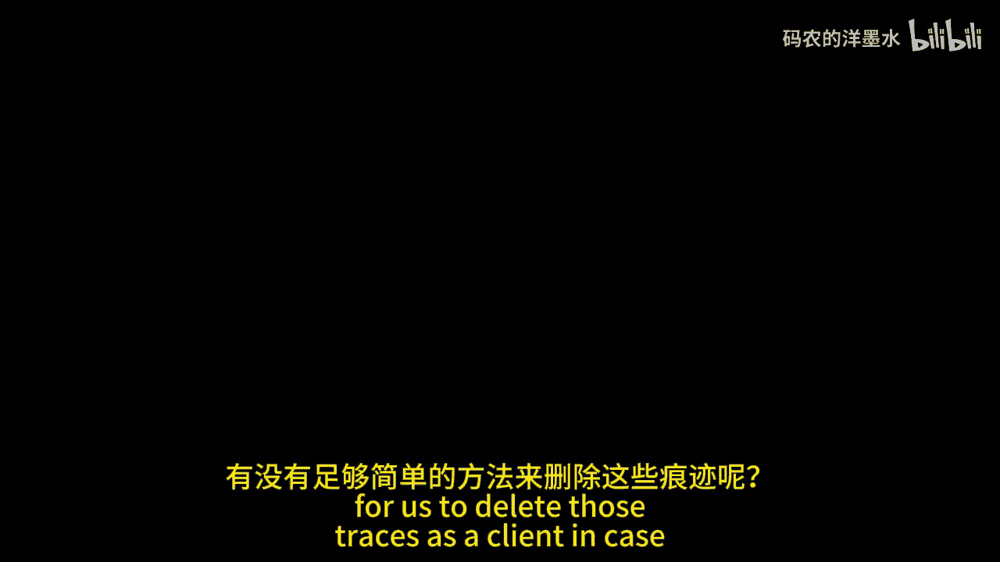

Delete those traces as a client like in case that we don't want to be tracked or something like that。

 A really good question。 We'll refer you to some URLs outside of the context of class itself。 But。

 yes， there is actually client side software that you can install on your own Mac or PC typically that will scrub some of this information so that when your H T TP request go from your browser to servers。

 You can ensure that this third partyy software removes a lot of that information automatically for you。

 because in that way， you don't have to trust that the website like the Googles of the world will actually reduce the amount of information for you。

 You can instead do that for yourself through client side software and will provide a few links online。

 Other questions on the same by using a private browser such as for example。

 using a temporary operating system like Ta does this remove all of traces on the Internet。

 or does it leave some on the client side or the server side。

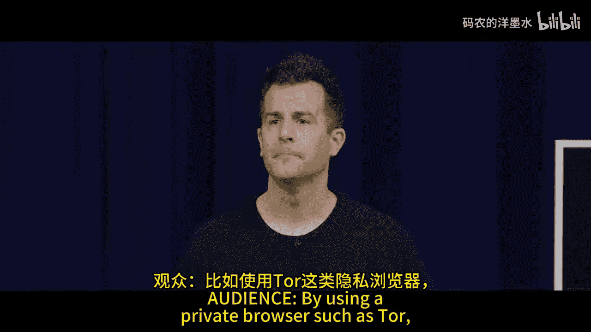

A good question， short answer is that it does leave some evidence on both the server side and the client side but we'll come back to To in just a little bit as well。

 All right， have about one final question you said previously about the third party software that's used that's supposed to be used in order to scrub the information from being submitted to the server side。

 what if that program itself is used to even drop on what we do in the computer。😡。

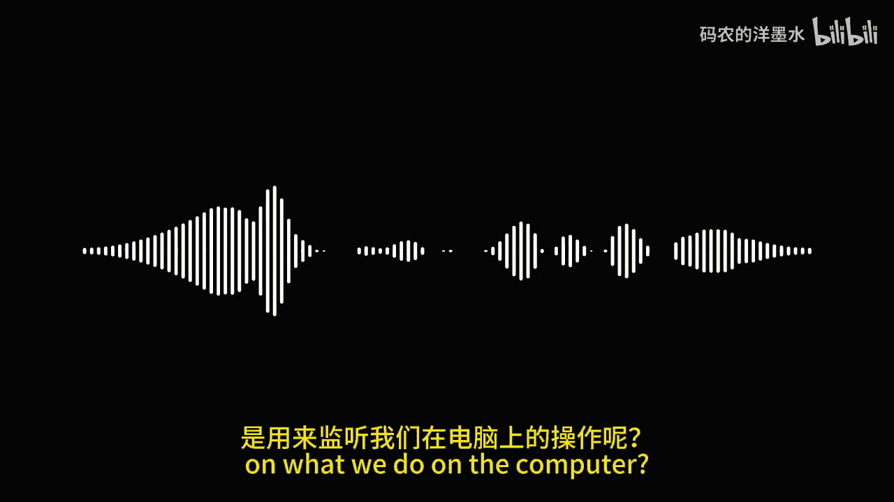

That is a very valid concern。 It is absolutely possible In general。

 What is working in your favor is either open source software。

 where if you're using software that other people can see the source code of presumably it's less likely that it's doing something malicious Capitalism often helps you here too。

 whereby it is often not in a company's own interest to be violating the privacy of the users because presumably that would create some form of backlash。

 which would not be good for business。 But beyond that， there is a lot of trust on your part。

 in my part whenever it comes to installing software。 So that is indeed very much a risk。 Now。

 it turns out there's other information that your browser might be sharing without your realizing that it's making it available。

 And that information is enough via which servers can even fingerprint you so to speak。

 That is to say there's this technique， generally called fingerprinting。

 But in the context of the web means to take as input a whole bunch of characteristics of the request from the Internet that's coming in and see。

If you can use those characteristics to create a profile of sorts for the user via which you can uniquely identify that user Now that doesn't mean you'll know specifically that that user is David Main。

 but you will know according to this system if it's the same user today as you see tomorrow as you see the next day because you can use this information to infer with high probability that okay we saw that exact same browser configuration again and again and again。

 odds are it's the same person and not some twin on the Internet who just happens to have precisely those settings now how might this be implemented or chief technologically well the simplest mechanism。

 perhaps it's just to rely on something like your IP address。

 recall that anytime you're doing something on the Internet。

 those virtual envelopes we keep talking about have your IP address on the outside so to speak as well as the IP address of the destination to which you're trying to send information your IP in that case is the return address。

 which means you're literally telling the remote server when using certain。

Calls where you are in the world or at least what your I address is Now。

 that IP address might not alone uniquely identify you because it turns out on campuses， in homes。

 in corporate networks， you might actually share one I address with many other people。

 but at least narrows the scope of whose I it might be even if it's shared among a few people。

 But your browser inside of that virtual envelope is sharing other information as well。

 another HttP header that is typically sent by browsers to servers is called user agent。

 And this is just a unique string of text that uniquely identifies typically the browser that you're using and the version thereof and the operating system that you're using and the version thereof。

 So， for instance， a standard format might look a little something like this。

 it's deliberately overwhelming and it's just meant to capture how much detail might be leaked in this headers value。

 But within this big string of text that doesn't even fit onto one line。

 It's wrapping here onto three lines is some indication of what。

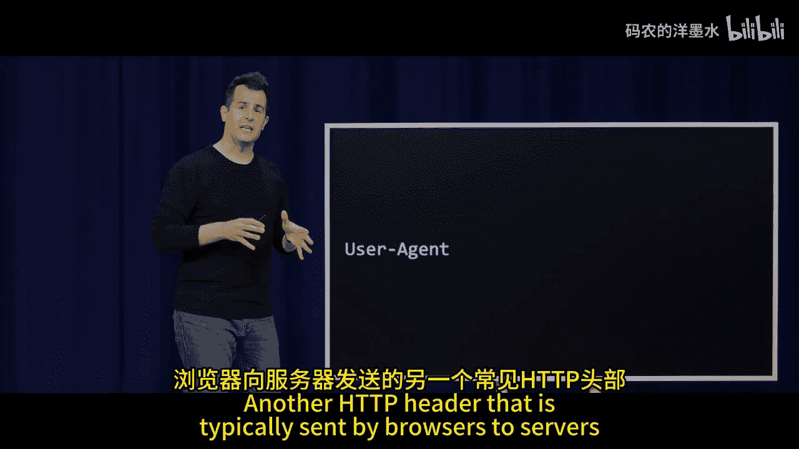

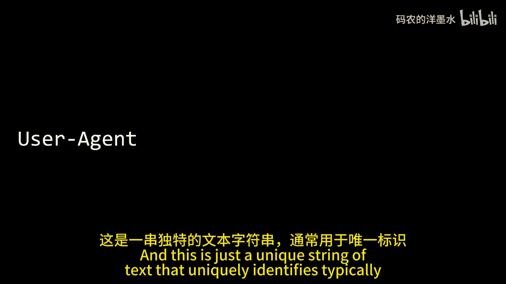

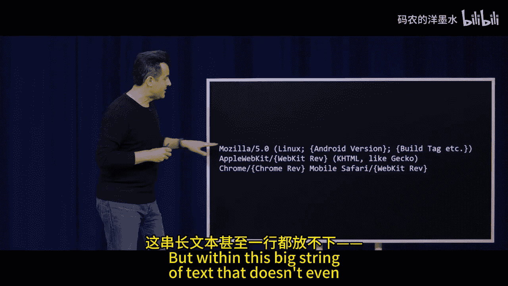

Browser you're using， be it Chrome or something else。 And what operating system you're using。

 be it Android or something else on a phone， a laptop or a desktop。 Now， of course。

 a lot of people in the world presumably have the same browser installed。 So that， too。

 even with Ip address might not be enough information to uniquely identify you。

 at least with high probability。 So what else can servers do。

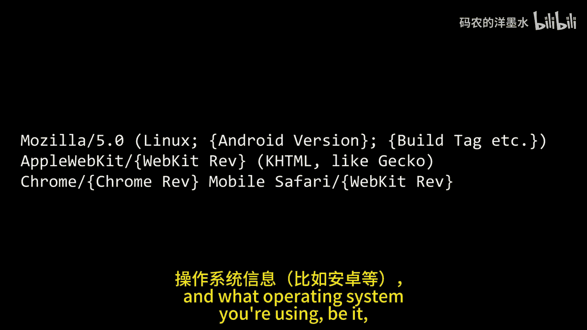

Well， if the server has the ability to send some code to your computer， for instance， some H。

 some CsS and some jascript， servers can effectively interrogate the browser and ask it certain questions。

 for instance， a server could figure out what the resolution is of your screen。

 Now this might be practically useful so they know how to render information on the screen。

 but that alone might be enough， especially if you're in the habit of full screening。

 your browser and you always use the same resolution on your monitor。

 that might be another ingredient with which to identify or fingerprint you。

 The server might be able to figure out what fonts you have installed on your system。

 The server might be able to figure out what time zone you are in because that's also a value available within the context of a browser and there's yet other values still that collectively with high probability can be used to fingerprint you and me。

 So even if you're not even logged in， even if you're using various privacy enhancing software products to try to remove。

Some of these HP headers and the like， you're still leaking other information。

 including the extensions or plugin sometimes that your browser might have installed。

 So if you're in the habit of using the same computer again and again and you're in the habit of not changing a lot of these settings that alone might be enough for a website to effectively track you Now it might be innocuous。

 they might just use this for statistical purposes to get a sense of how many users or customers they have。

 but it could be for more invasive purposes， like serving you targeted advertising based on your behavior of these websites or really just tracking you specifically。

 And the catch is that if you ever log into this server just once if the server has been logging all of your traffic based on that fingerprint for days for months for years。

 at that point retroactively with high probability， they can infer wait a minute。

 if the user on this day was David， and we think it was the same user on all of these previous days now by transitivity。

 they know a lot more about your browser history as well。

 So even unbeknownst to you and even without explicit。

Heer values being sent that identify you the collection of attributes or characteristics that our browsers have and our browsing behavior has can still be enough to uniquely identify most of us quite a bit of the time。

 Let me pause here and see if there's any questions on fingerprinting or these implications for privacy。

Would you seem like a VPN prevent browser fingerprinting？

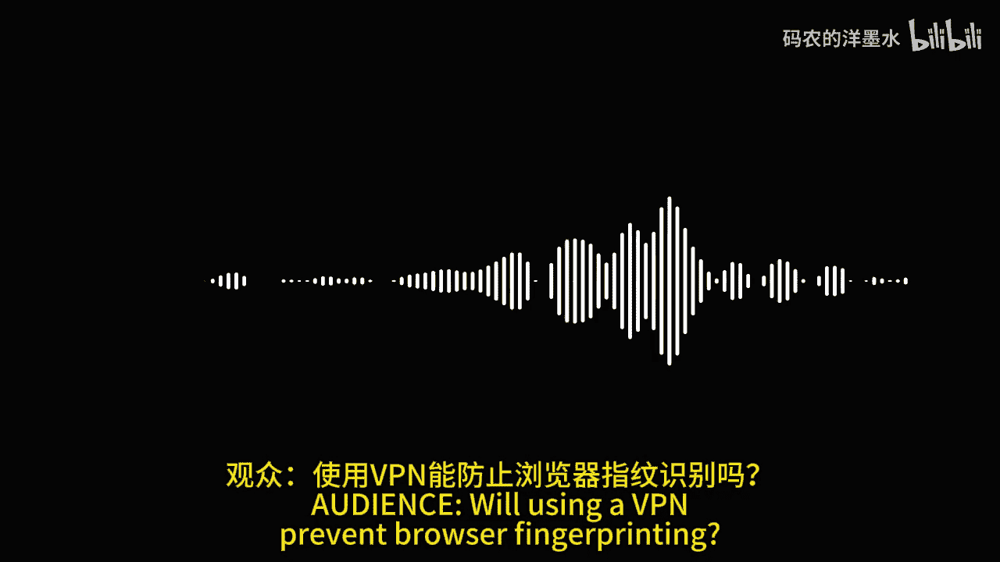

A good question。 And we'll talk about VPNs a bit more soon。Short answer。 No。

 So VPNs will typically mask your I P address， but that's about it。

 If you still use your browser as usual with your user account as usual。

 all of that same information is gonna be leaked。 It's just gonna change one piece of it。

A good question。 Other questions on fingerprinting and privacy。

 Is it possible that hacker can still fingerprint and use it for their own bosses。

 And everything will look like it was my computer that perform certain actions。

 Sos like still identity。

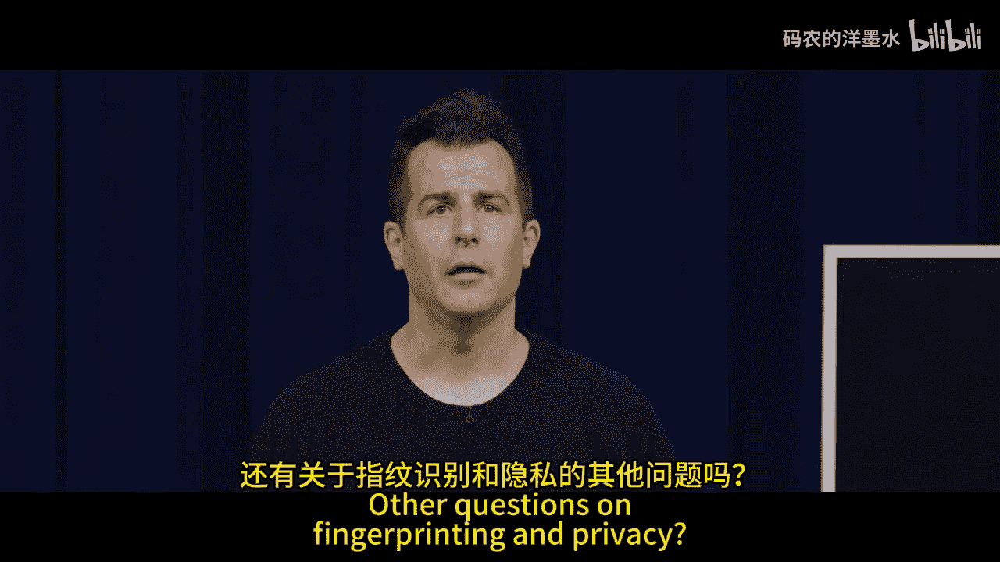

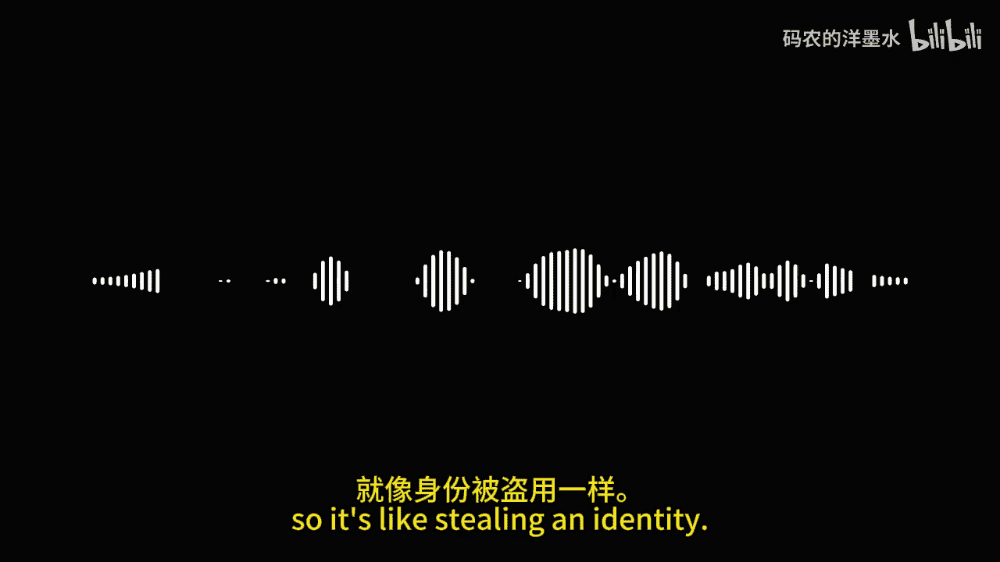

A short answer。 yes， if the hacker has access to the same information。 If though。

 if we rewind to our focus on encryption a couple of classes ago。

 if you are accessing websites only via H T T P and nothing is unencryed。

 then it's gonna be a lot harder for a hacker in between you and that server to glean any of the same information because almost all of it is encrypted。

 IP P address is not。 But anything inside of the envelope is including these headers， the H T L。

 the jascript and the CS。 If though the hacker has somehow infiltrated your own laptop or desktop or phone or the server。

 then all bets are off， and they could absolutely identify you。

 according to the same pieces of information。Other questions。

 I was just curious to understand the difference。 perhaps when you are on mobile。

 My understanding is that they can even get much more information when you are on mobile。

 It's a fair question。 I don't think I would answer yes to that。

 I'm hard pressed to imagine what more your phone is doing。

 than the browser is doing except that there are I suppose I could argue that your phone tends to have additional features nowadays。

 like GPS like accelerometers， gyroscope， perhaps so other hardware features that theoretically can be interrogated by jascript code。

 typically on an optin basis。 So you， the user could deny access to these pieces of information。

 but those characteristics， I suspect， could be used to identify you a bit more uniquely。

 because laptops， at least today， have less of that functionality。

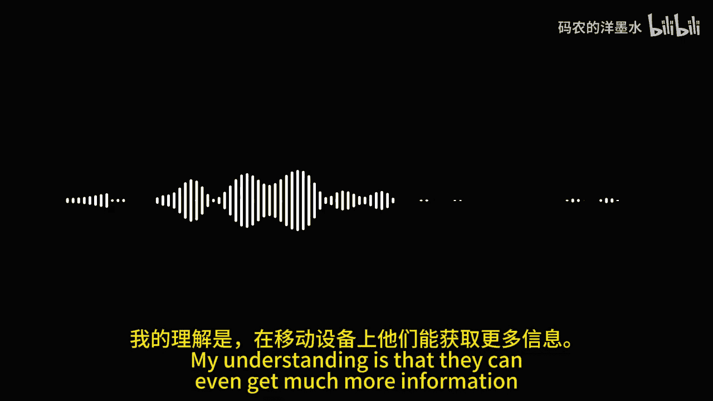

Other questions when storing and retrieving data on the front end。Is it more secure to use cookies。

 local storage or another alternative。

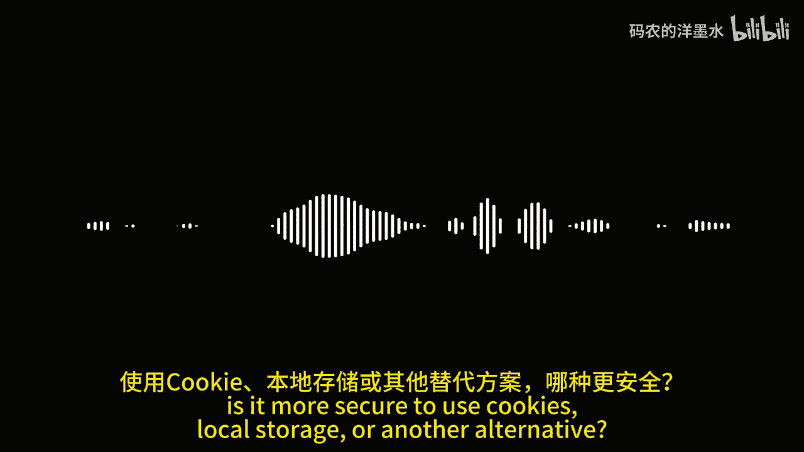

A really good question。 And we will come to this subject literally in like one slide。

 cookies in general， local storage because cookies by design are meant to be sent back and forth。

 back and forth between browser and server， theoretically that should not be a concern if everything is encrypted。

 but we've talked in the past already how mistakes can be made。

 you might start on HttP be redirected to Https。 So in general storing things in local storage。

 at least prevent things from accidentally leaking out over the browser connection。 That said。

 if you're storing things in local storage， they are literally available locally。

 So if you have a colleague， a friend， a sibling who gains physical access to the device。

 let alone an adversary， then they could see all of the information in not only your cookies。

 but also local storage。 So at that point， physical access generally all bets are off when it comes to your privacy。

All right。 How about one other question。 There were calls being made from people's local phone numbers on cell phones to other local numbers。

 Obviously， the people weren't making the calls。 And it happened to me too。

 And I was wondering how that kind of works or if that's related to this at all。

 It is we weren't planning to talk about it today， but in a nutshell。

 it is very easy to spoof telephone numbers。 And this is how a lot of spam calls are sent。

 particularly internationally or abroad where they might not be regulated in the same way as someone's home country it's very common to for if your number starts with your own phone numbers starts with 55。

5， for instance， very often you'll get fake calls from other numbers that also start with 55。

5 because the presumption by the adversary that， oh。

 Sabrina is probably more likely to pick this up if she thinks it's a neighbor with a similar looking phone number。

 but unfortunately， with the phone system， it's all too easy to fake phone numbers and this is yet another reason。

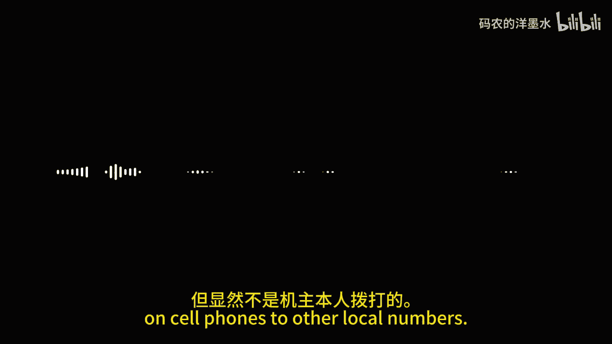

And why using phones， using S M S is not a recommended approach for our earlier topic about multifactor authentication。

 It's just not a secure network。 That's not how Edison and others designed it 100 plus years ago。

 This is why systems that use cryptography in some form are much safer when it comes to that information。

Alright， so beyond this user agent header， there's other headers that your browser is often sending back and forth with the server。

 and one of these we've talked about and one of these you probably came into the course knowing about namely cookies。

 But there are different types of cookies。 But recall that in general。

 a cookie is a piece of information that a server puts on your computer to help remember who you are。

 So in the absence of these fingerprints and the absence of specific headers like these。

 it can just put a small random value with numbers and letters of the like on your computer or maybe even a bigger value。

 if it has lots of users， and it uses that value to uniquely identify you if you return again and again。

 to the website。 It doesn't necessarily know that I am David。

 unless I log in at some point at which point， then it can realize， oh， wait a minute。

 David's cookie is this value。 Now I know who this user is。 But in general。

 there are different types of cookies in different settings for cookies that are worth knowing a little something about。

 So we talked previously about what we'd more properly call session cookies。 So。Cook are used。

By servers to maintain state。 so to speak between the server and the browser。 That is to say。

 without getting too technical， H TTP is typically stateless。 whereby when you visit a page。

 the browser icon might spin for a bit。 and then it stops because the transaction between the browser and the server is complete。

 But if you want to remind who the user is， Therefore， the second， the third。

 the fourth time the browser contacts the server， the browser had better remind the server who it is。

 And this is why we use the metaphor of the virtual hand stamp。

 whereby that hand stamp is like the browser's way of reminding the server， you've seen me before。

 don't make me log in again。 I am David， I am David。

 even though it's just relying on this virtual hand stampamp or really some unique identifier that's going in the cookie header from browser to server。

 So a session cookie allows browsers and servers to maintain sessions， this kind of state。

 a little more concretely， it allows them to maintain things like shopping cart。

 So if you're shopping on an Amazon com or the like the。Cook is what remembers who you are。

 or at least that you're the same person。 so that every time you poke around on the website。

 Amazon shows you the same contents of your shopping cart again and again。

 so that they don't lose your business by accidentally deleting it when you simply change the page。

 So how does session cookies work。 Well， when you first visit a website that wants to plant a cookie on your computer。

 the response might look a little something like this。 H T TP 200 is the status code。

 which recall means okay， all as well， it's not something like 40，4， which would mean file not found。

 So 200 is okay。 But the server might also respond with this key value pair。

 this H T TP header set dash cookie colon， So that's the key。 the value of which is session equals 1。

2，3，4， ABCD， And that's the same value we used previously when we talked about cookies in this context。

 And the point here is that the name of this cookie is session and it's value equals in this case，1。

2，3，4， ABCD。 Now， if you visit the same website。

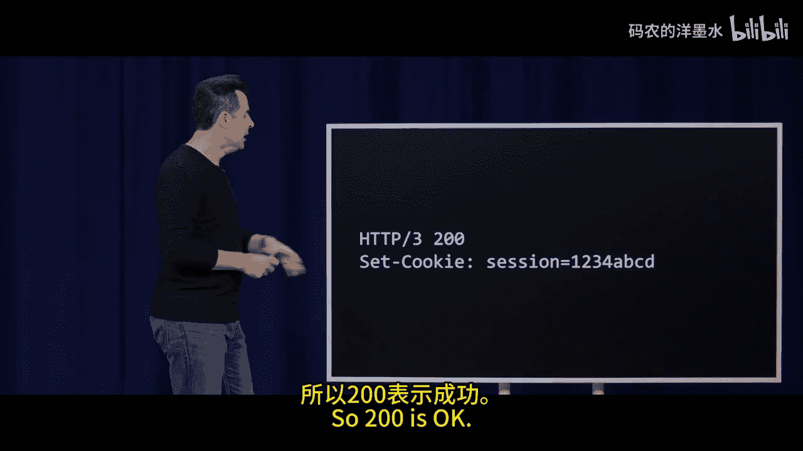

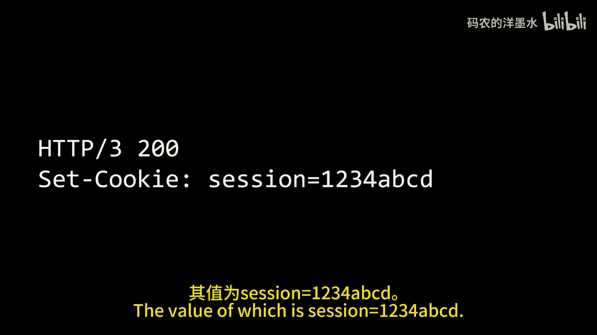

And you and you and you， we would all have different， seemingly random values for those cookies。

 And so this number， this sequence of letters and numbers would be different for each of us。

 That is to say we have different hand stamps that we're presenting each time。 Now。

 this is a session cookie and it's a session cookie in the sense that it is supposed to expire when you close the browser。

 when you quit for the night when you reboot or anything else。 Now with that said。

 that's a bit of an overstatement because browsers nowadays。

 will frequently preserve your tabs for you。 They might go to sleep。

 you might have to wake them back up。 but increasingly sessions are living longer than they once did。

 But the idea is that this is not meant to last for like a year or forever。

 it has a much shorter life frame lifetime by design。

 when your browser has received that cookie and you click on some other page。

 you visit some other product on Amazon co。 your browser might say something like this。

 get slash and then cookie colon that exact。Same value。 So recall from our previous class。

 This is how the browser just reminds the server what its hand stamp is or what its cookie value is。

 But again， the idea is that when the browser is closed， you reboot for the night。

 then you should not have the same session cookie tomorrow， at least in this model。

 That's not true for all websites， but according to cookies as we are currently using them。 Now。

 that's pretty good for your privacy。 because if the cookie is by design。

 meant to be a session cookie， and it sort of expires pretty soon when you're done with that browser tab or done using the browser for the day。

 then that's pretty good， because it means if you go back to the same website tomorrow。

 that cookie might not exist anymore。 So you might as well look like or be a brand new user。

 So they can't correlate perhaps by default as much information about you。

But these are the cookies that you read about being bad for you and bad for your privacy。

 tracking cookies， which are the exact same idea。 key value pairs that are sent from server to browser to remember who you are。

 or at least that you're the same person。 even if we don't know that you're David Main specifically just yet。

 But as per the name， tracking cookies are really designed to track you and me。 Why well。

 maybe analytical purposes， maybe debugging purposes so that they know where users were in case something breaks。

 maybe advertising purposes so that you get served different ads for me so that they can maximize their revenue by serving up ads that you and I are each more individually likely to click on So tracking cookies are the ones that get a bad rap and rightfully so。

 So let's consider an example of a cookie that's designed to track your behavior on a particular website here。

 for instance， is they set cookie header that Google specifically might send to your browser。

 In fact， they use a cookie that by convention is called underscore G for Google Analytic。

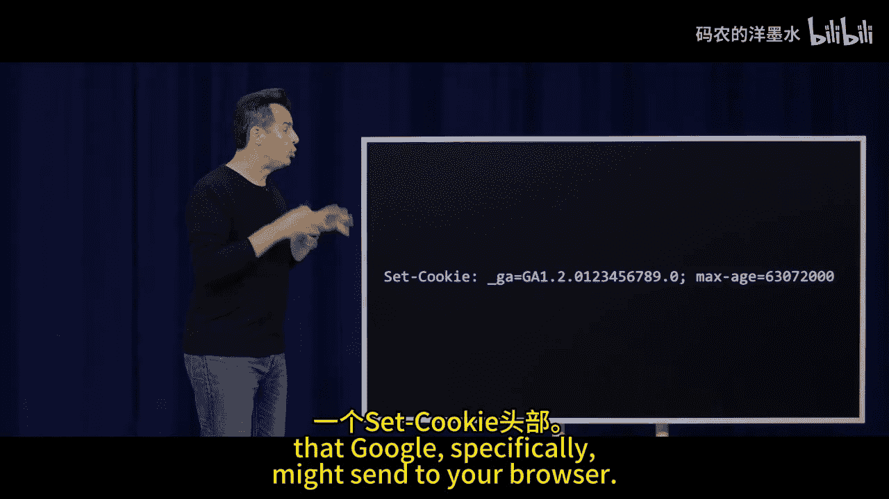

Wwhich they use for analytical purposes and its value looks a little something like this。

 And the point of this value is that it's generated on a per website basis。

 if that website is using Google Analytics and Google Analytics is a tool that allows website designers to track who is clicking on what browsers they're using what operating systems they're using and generally giving them a sense of the demographics of their user base。

 but unlike session cookies， which are meant to expire after a day after the browser closes or the like。

 Google's analytical cookie here has a maximum age of this many seconds。

 which if you do out the math is by default two years。

 which is to say if you visit some website that is using Google analytics by embedding a bit of Google's jascript code in their website whenever that Google code is pulled from Google's website。

 Google has an opportunity to plant this cookie on your computer。

 and you'll get a unique I based on you visiting for。😊。

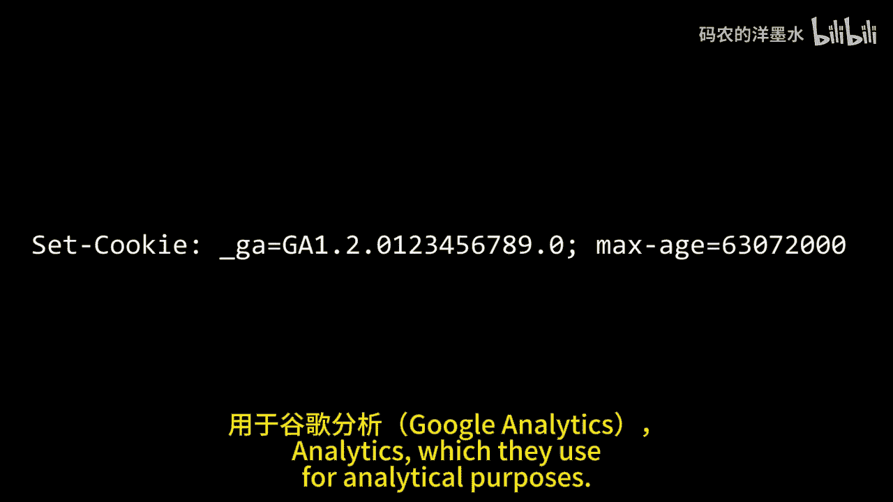

First time based on the specific website that is embedding Google Analytics and that cookie is going to live in your computer according to this HttP header for as long as two years。

 Now that's useful for Google， it's perhaps useful for the website。

 It's perhaps a little more invasive for me and you Now Google has many other cookies that they use too。

 but this is perhaps one that you should keep an eye out for and indeed in the coming weeks or months if you poke around some of your own browser settings。

 you might very well see values like this。😊，But what else might servers use to keep track of us。

 especially if you and I are in the habit of deleting our cookies or clearing your history。

 which would re counterproductive for Google or websites that are trying to track you in this way。

 But a plus for you and for my privacy if you're behaving in this way。

 But it turns out there's other ways servers can track us， including through H TtP parameters。

 tracking parameters。 So parameters are the key value pairs that often appear in URLs that are sent via get requests typically。

 So we've seen one of these if you recall when we've searched for cats on Google before。

 you might recall that the URL with something like H Ttps colon www Google colash search question mark Q equals cats。

 Anything after a question mark in a URL is indeed an httP parameter。

 but it could be used not for innocuous， helpful purposes like searching for cats。

 but also to track you。 And in fact， if you see ampersands in URL that might mean that you have。

Second or third or more parameter up there。 And sometimes these the purpose of these parameters is simply to track you as some person。

 So， for instance， here is a representative URL。 It's a long one。

 And this is taken from example do com having a path of a underscore engagement question mark。

 and then I'll highlight here。 click Id equals And then this long， seemingly random string。

 But there's a second H TP parameter in this particular URL。 Ampersand campaign I equals 23。

 So the campaign Id is certainly with such a small number is not meant to track you that's meant to be sufficient input to the website to know what types of ad should be served to you。

 What ad campaign should be served up。 But this click Id。

 which is sort of a euphemism for tracking cookie or tracking parameter in this case is what's actually keeping track of you specifically because different users are going to find that whatever link they click。

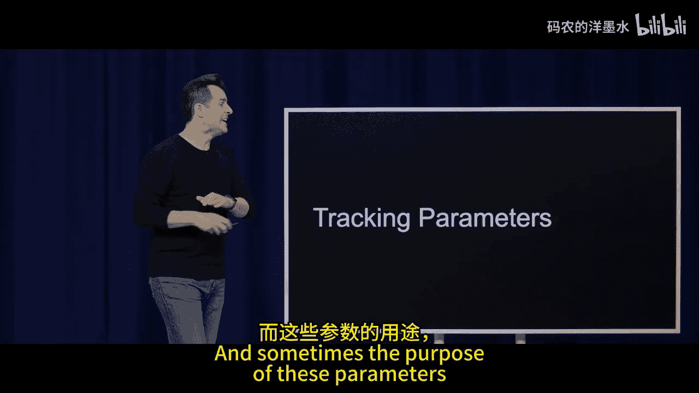

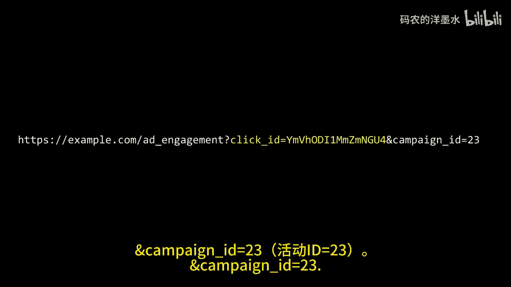

Has a slightly different value for click I。 So recall that a tracking cookie is something that's sent by an HttP header。

 And so it's harder for you and me to see it unless we're more comfortable with our browsers and can poke around some underlying settings。

 But these tracking parameters are right there in front of you。

 at least if you click on the URL in your browser and take a look at its entirety。 Now。

 wonderfully at least for us end users who are concerned about privacy browsers and even thirdpart software are increasingly removing values like this for us。

 as soon as the browser manufacturer or as soon as the thirdpart software developer knows that wait a minute。

 click I has no good purpose other than tracking our users they can simply automatically it for you。

 after all， when you visit a web page and you get the Hml that represents that web page。

 the browser could certainly poke around there before you even have a chance to click on anything。

 and it could scrub or sanitize these kinds of tracking parameters now to。😊。

Fair if the browser manufacturer doesn't necessarily know what the tracking parameter is called or if maybe the website is constantly changing the name or trying to mix things up。

 this might not work so well， but it's at least an attempt to try to put downward pressure on this very commonplace technique of chiing track of you and me。

 Now， why is this parameter able to track us well， this too can end up in those server logs because this would be。

 for instance， the web page that I am requestinglash ad engagement question mark click Id equals dot dot dot that could very well be logged by the server stored in a database even。

 and they could use that information to know exactly which pages I have clicked on because I visited those links and even what ads I have seen。

 And maybe that's a good thing commercially because now they know what types of ads I'm clicking on now they can serve even more of them to me。

 And that might be great for them， but probably not so great。

 if not annoying or invasive for me and you So something else to keep my eye out for。

and something else that might guide your decision making in the days and the years to come when it comes to picking your browser。

 you don't necessarily have to nowadays， use the one that comes with your phone。

 comes with your laptop or desktop， you can if more comfortable， install something else。

 and increasingly you and I are having more and more options。😡。

Questions now on these tracking parameters。Or anything prior with respect to our privacy。

Are the cookiesies the ones that track or are the ones that have been track。

The cookies are values that are being used to track you。

 So recall that a metaphor for the cookies is like that virtual hand stamp。

 And so if all of these web servers are putting ink on your hands and on my hand。

 And because of H TTP。 you and I， our browsers are in the habit of presenting these cookies。

 these hand stamps to every website we visit that value is being used to track us。

 So cookies in and of themselves are just a technology。

 It's a very simple idea storing a big random value on your computer in mind。

 just to uniquely identify us， they are necessary to give us features like logging into websites。

 maintaining shopping carts， but very quickly， especially since the Internet from the get go has been largely free to use once rather a lot of the Internet has been free to use once you have a connection。

 at least they've been used or in some views abuseed by the advertisers。

 the faces and the others of the world。 So another way to think about tracking cookies is to。

Consider them to be third party cookies because indeed， even in the Google example。

 that's how they're being used。 if a website like example co is embedding Google Analytics and therefore some kind of HTMLl tag that mentions Google co Well then example co is the first party in that story so to speak and Google co is the third party in that story。

 What that means is that your browser might get cookies from both example co and Google。

 But the most important ones presumably are the first party ones from example because that is the website you chose to go to and whose functionality you want to use The thirdpart functionality like tracking your clicks and your Internet behavior on that site via Google。

 that's thirdpart And so very commonly do browsers nowadays。

 certainly offer options via which you can disable third party cookies and that tends to be good for privacy sake。

 because it means that you're blocking thirdpart like Google from keeping track of you via cookies but that doesn't。

😊，arily mean the website isn't still using tracking parameters in some way。

 And you would only know that by actually looking more closely at the URLs you're clicking on or that are embedded in the webp page itself。

 And that's where now browsers and thirdparty software are additionally helping by helping us remove not only those cookies。

 but even those parameters。 But let's consider a more concrete scenario of what thirdpart cookies are。

 and why they allow companies not only like Google to track your behavior on one website but even companies like Google or other advertisers to track your behavior on multiple websites。

 And in this sense， third partiesies have increasingly been more powerful， more omniscient。

 for instance， then the firstpart websites that you and I are actually visiting， why， well。

 if there's a lot of popular thirdparties out there。

 Google being one of them for advertisements and for analytics， Well。

 if lots of different websites are using them， maybe Harvard's using them， Yale's using them。

 Stanford's using them。 then that third。Party very quickly becomes more powerful than even any of those individual parties alone。

 Why， Because that third party， if it is being embedded in Harvard， Yale and Stanford。

 that third party， Google， for instance， kind of has eyes into all three websites。

 And if it sends the same cookie to you on all three websites。

 Google might actually know that you're poking around Harvards and Yas and Stanford's website when Harvard might have no idea you're checking out Yale and Stanford and Stanford might have no idea you're checking out Yale and Harvard。

 So what does this mean concretely。 Well， consider some Hml here。 such as we've seen before。

 And I've highlighted a couple of salient characteristics in this particular example。

 noticeice that I've given in this web page， not only a body， which contains the body。

 the bulk of the webage， I've also included a head for the webage。

 inside of which is another tag called title。 And I'm doing this just to one。

 demonstrate there are more tags than we have seen in this language thus far。

 And specifically this I。

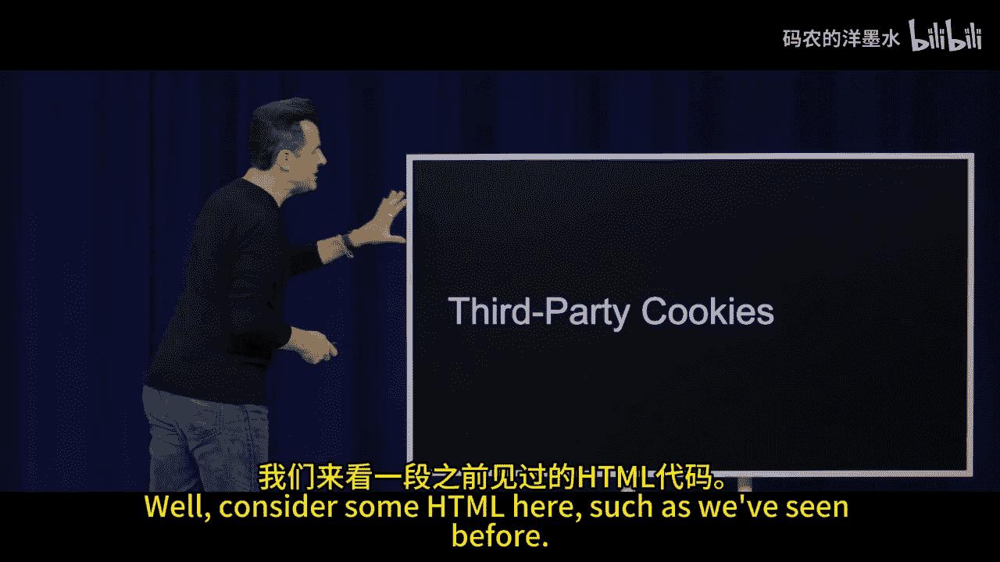

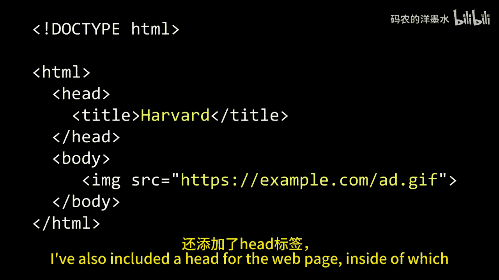

Is meant to represent Harvard Eduu's own website， the title of which would be Harvard。

 like in the tab along the top of the screen and inside of the body of this page for simplicity。

 let's assume that for now there's just one big advertisement。

 There's no content in for the sake of discussion， There's just one advertisement。 Well。

 where is that advertisement coming from。 It's coming from in this case。

 example do com or our friends at Google specifically a file called a do g。

 And this particular URL is being used as the value of the source attribute of an image tag。

 So what do I mean by this。 Well， if you visit Harvardeddu in the story。

 what you are seeing is a big advertisement， a big g a graphic that is coming from example co。 Now。

 what is the implication of that， Well suppose that Yale is doing the same thing。 So here now。

 for the sake of discussion is the exact same Hml， except it lives at Yale E。

 So the title of the page has now changed to Yale。And more， just to make things really interesting。

 let's add Stanford to the mix。 Sam exact page。 So the point of this story is that Harvard and Yale and Stanford are all using the same third party example com in this case。

 or maybe someone like Google in the real world。 And they're requesting moreover， the same g。

 And so the same file is being accessed。 But that even alone isn't a strict requirement。

 the same website is being accessed by all three of these first parties。 So what does that mean。

 supposeuppose that you open up your browser， and you first visit Harvard E D。

 your browser is going download the H Tml for Harvard's website。 It's going see that oh。

 there's an image tag in there。 And that image tag wants to show this a g from example dot com。

 So your browser is automatically by nature of how browsers work going to send a second H T TP request。

 This time requesting a do g from the host example do com And just to tie today's stories together。

 It's going to include probably a。😊。

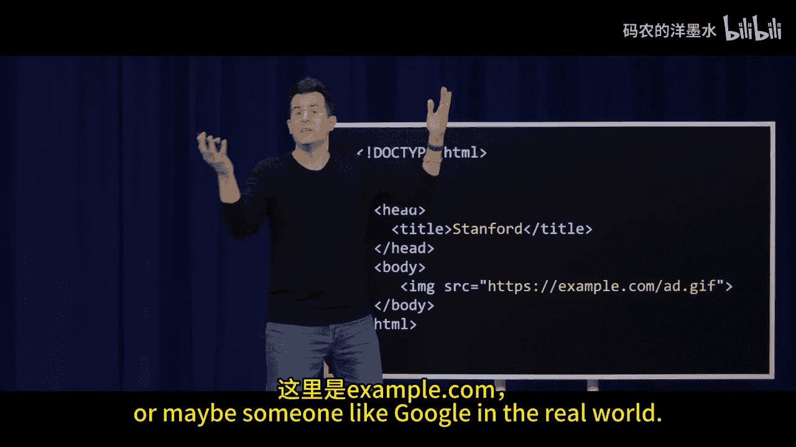

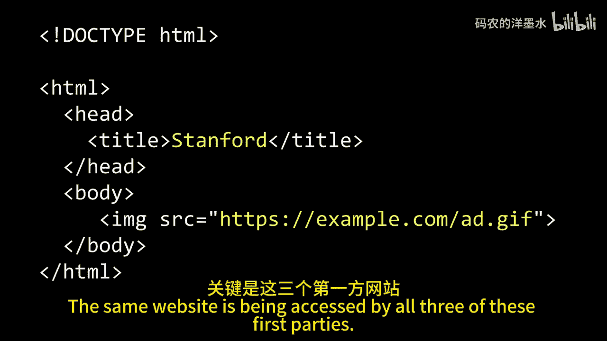

F HtTP header that specifies where I'm coming from。

 and that's useful for our purposes because it puts these requests into context。

 Now that server example co or Google in the case of the real world is going probably respond with 200 okay like okay。

 here is the advertisement and it's going include not only the image but also in HtP header of its own。

 And this is our old friend set cookie where in this case for the sake of discussion。

 I'm gonna propose that it's setting a cookie on my computer called Id because this is gonna be my unique identifier for example co It value is going be the one I keep using for discussion sake 1。

2，34 ABCD。 but that would be some big random value for each of us。 And my gosh。

 this thing is gonna last a year。 That's the number of seconds in 365 days。

 So this cookie is being planted on my computer by example co because I visited Harvard E。

 So Harvard is the first party example co is the。Third party in this case。

 But here now is the concern When I visit Yale Edu with that same browser。

 my hand has been stamped by example com already。 And so what happens is that my browser now presents that hand stamp to example com sending the same I and the same value that is the same hand stamp。

 The host is as before example co。 But this time the refer happens to be Yale。 So in other words。

 after I visited Harvard and my hand has been stamped with this tracking cookie。

 this third party cookie from example co my browser。

 when I visit Yale Edu is going present that same hand stamp again this time to example com with this refer the next time I use my browser to visit Stanforddu。

 the same message is going to be sent from my browser to example com to request that same ad this time now from Stanford E's website。

 Now， what's the implication via these three HtTP requests。

Example co knows that I'm visiting Stanford and before that Yale and before that Harvard and none of Harvard or Yale or Stanford necessarily know that I'm visiting any of those other websites。

 the third party is the more powerful it's the more all seeing simply because example co or in the real worldor Google is just so darn popular that it's embedded in so many darn websites。

 Google and others know almost everything dare say about what you and I are doing on the web because these ads are all over the place in this way。

 So we've seen a very simple example but it's simple because cookies and HGTP really are relatively it's once you realize how they work that you can use them not only to solve compelling problems for all of us S and shopping carts and the like but also can be used to monetize the Internet and has been used historically to monetize the Internet or even worse perhaps for us。

😡，To track our individual clicks and behavior。 So let me pause here and see if there's any questions now on third party cookies and why therefore。

 it's perhaps so compelling for you or me to opt into disabling them or better yet to use browsers that are starting to block them for us。

 the browser are more secure among other considering tracking parameters。 Sure， a quick tweak。

 I wouldn't say that some browsers are more secure than others in this context。

 I would say that you want browsers that are more privacy conscious or privacy preserving because that's what we're talking about today。

 hopefully all of them are just as secure when it comes to H T Tps and the encryption that's just keeping our data protected between points A and B。

 So generally safari has been pretty good when it comes to privacy and they are the ones that very recently that you're using now。

 announce that they're gonna to start giving people the feature of removing tracking parameters from URLs In fact。

 the。

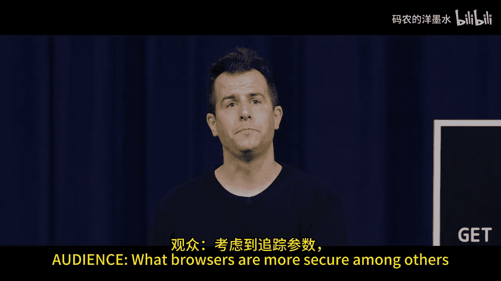

UR I gave was actually from Apple's recent announcement about exactly that。

 Duck duckuck Go is probably the most popular third party browser that is very privacy conscious and tries to disable a lot of these tracking behaviors。

 another one is brave， Perhaps the worst offender is probably Chrome。

 even though I myself am guilty of using it myself。

 because it's so integrated into Google's ecosystem。 But Google， of course。

 has made their business on monetizing your behavior and mine。

 So that is perhaps one toward the bottom of the list。 if you're concerned about this。

 So that's kind of how I would rank things。 And there's yet others。

 But I think those are some of the most popular。 And then of course in the Microsoft ecosystem。

 there is edge and Firefox too， has actually， I should have put them higher on the list。

 They are more privacy conscious， I do believe than Google。

 So with all of these mechanisms for tracking in mind。

 What can we do to protect all the more of our privacy， Well， you might already know of this feature。

 Private browsing。 So you don't necessarily have to delete all。😊。

your browser history and delete all of your cookies。

 you can instead on occasion open up a special type of window which most of today's browser support that puts you into private mode or incognito mode。

 and you can think of this as giving you just a different chunk of memory in the computer that doesn't know any of your past browser history that doesn't have any of your past cookies that doesn't remember any of your past username and passwords。

 you're starting fresh so that everything you do in that window is brand new The catch though is that everything you do in that window still works exactly as the web works as we have been describing So you're still might have tracking parameters you still might have tracking cookies you still might have server logs but when you close that private window or you close that incognito mode at least the information is discarded from your computer so that if tomorrow you do the exact same thing and open up an incognito window again then it's as though you're starting fresh with that server except for the reality。

As per our past discussion that fingerprinting is still a possibility。

 your IP address can still be factored in as can be other information that your browser might still be leaking。

 but what you're not doing is contaminating so to speak your general browsing history with specifically what you're using that window for what you should realize too that private browsing or incognito mode is entirely client side so particularly those logs that we have mentioned are still being stored by the server。

 they might be storing perhaps a different tracking cookie or parameter for you because it doesn't necessarily recognize you when you're in private or incognito mode。

 but it doesn't mean that your tracks are completely absent from the internet。

 rather it's really just scrubbing them from your local computer and decreasing the probability but not eliminating the probability that a server still knows that it's you so I would use with care but with that said。

 if you take a course in web development or you already design your own websites using private browsing or in。

😡，E mode can also be useful for development purposes because it's a way of opening a brand new window that has no recollection of maybe past bugs that you had or past web pages that you clicked on。

 and it's very commonly used as part of development tools to actually facilitate and mimic the idea of starting fresh with some site。

😡，Super cookies， though， these sound delicious， but these two are kind of the worst of cookies that we've discussed already。

 We saw session cookies for maintaining state。 We saw tracking cookies for tracking you super cookies are not so superre。

 These are cookies that are typically injected by a third party like your company。

 your university or your Internet service provider into your HttP requests。

 which is to say if you from your browser， visit some website， that traffic， of course。

 goes from your laptop or phone through some Internet service provider。

 whether it's on campus or home or wirelessly in the real world。

 and if whoever is providing you with that Internet service。

 can see the contents of that virtual envelope， there's technically nothing stopping them from opening up the envelope。

 so to speak and adding one or more HtTP headers of their own。 And so mobile phone carriers。

 for instance， in the past have been known to do this whereby if you are just requesting。

Website like example com from your phone， they might halfway between you and that server。

 they might inject a cookie of their own for the sake of discussion。

 I'm going to use the same name and value as before Id equals 1，2。

34 ABCD but what's noteworthy here is that that value is not coming from your phone It is not coming from your browser you can clear all of your cookies。

 you can clear all of your history。 you can use incognito or private mode on your phone。

 you're not gonna to see any trace of that client side because the darn thing is being injected into your traffic between you point A and the server point B。

 So this is sort of a canonical example of a machine in the middle attack but your internet service provider in this telling of the story is doing it because they want to track you or they want because of advertising relationships they might have with some websites they want to make sure that you can be tracked by that website even if you have opted out or have been clearing proactively。

Your very own cookies。 So suffice it to say these have been particularly controversial and thankfully you and I do have a pretty good defense here。

 just never use HtTP without encryption。 If your URLls are always Https colon and then something theoretically this attack or this feature of your mobile phone carrier should not be possible why because if the contents of the envelope or encrypted。

 not only can't they see what's actually inside they can't add anything to the mix because they don't have the key that's being used to encrypt that information so simply using always Https is one solution to this problem and also at least in the US some of the mobile phone carriers got a lot of backlash for this but so you can occasionally log into your cell phone providers's website go through a bunch of menus find an option to opt out of this feature but I will say from experience that they typically bury these options to and so it's not necessarily even the easiest thing to find。

😡，But again， this is just a natural result of the underlying technology that we're using being used or if you prefer abused for alternative purposes。

 All right， let me pause here and see if there's any questions now on these super cookies which indeed are not so super or anything prior given that cookies store passwords and emails can the adverary person another person by copying that cookie and pasting it into it his own computer and visiting that website a good question So cookies can be used to store username。

 email addresses， even passwords， though I would generally not recommend doing this but they theoretically should be secure。

 even if you're storing those values and cookies， because they're going back and forth between the browser and the server using encryption if HttPS is indeed in use a danger though is that if someone has fix access to your computer it's very easy to poke around your own browser's cookies。

😡。

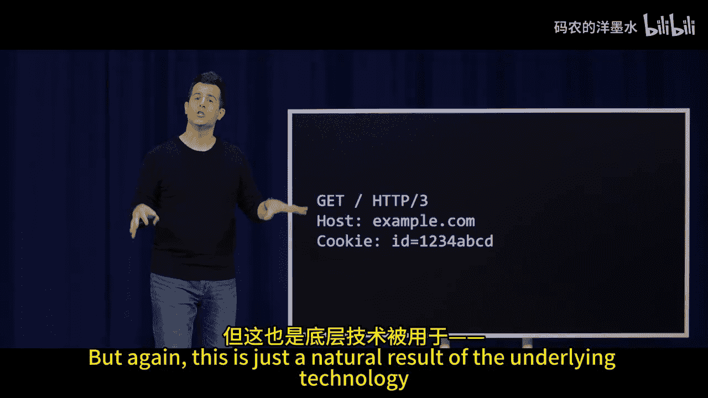

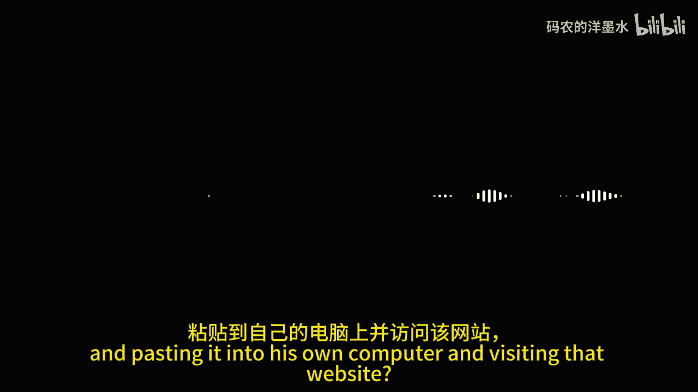

At which point they're going to see your password， which is probably not a good thing。

 So on an alternative would be， for instance， for a browser to encrypt the cookie or minimally digitally sign it so that it can be identified as belonging to that same server。

 but even better， I dare say， would be for servers to only plant big random values as cookies on your computer like this virtual hand stampamp。

 and then store recollection of your username， email under a password on the server。

 So stamp my hand to remember who I am and that I'm logged in。

 but don't bother expecting my browser to send my username， my email address。

 my password again and again。 it should suffice to send that just once。😡，Other questions here。

 I've heard that it's possible， for example， if I'm writing a text to someone。

 it's possible to intercept， alter my text and send it on my behalf。

 So it's going to be a different message。 So it's possible to ask maybe for a sensitive information。

 So I was wondering， don't those messengers use something like cookies， how can this be possible。

 a good question。 So S M or traditional texting is generally insecure。

 It is very easy for someone to forge your phone number。 And in fact。

 if you've gotten a lot of spam via text that might be exactly what is happening。 or worse。

 it's also possible recall to steal your Sim card essentially or port it to another carrier so that someone can intercept all of your actual text。

 So in general， nowadays， you should be reducing， if not eliminating your usage of S M。

 at least for anything important or anything you want to keep private。

 when it comes to other messaging tools like eye message like。

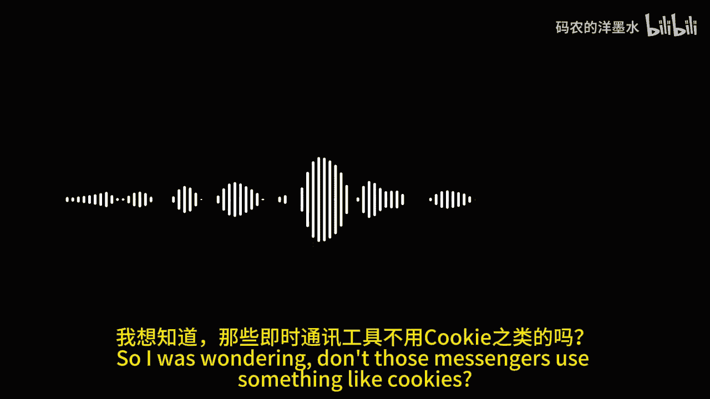

Whatsapp， signal， Telegram， there's a lot of products nowadays。

 third party or otherwise that use end to end encryption。

 which recall we discussed a couple of classes ago and in that case。

 even though the data is going through a company like Facebook theoretically assuming they're behaving honorably and have implemented end to end encryption properly。

 then even they cannot see the message going between their servers and that is independent of cookies。

 cookies have no part of that solution， that solution entirely thanks to cryptography and encryption with digital signatures。

😡，Alright， let's consider one other threat to your privacy that you might not necessarily have thought about that doesn't really just to the web。

 but really your use of the internet more generally， namely DNS， the domain name system， thankfully。

 even though computers on the Internet all have I addresses these unique numeric addresses that we've discussed you and I don't have to remember what servers IP addresses are because servers typically have domain name。

 something like Harvardedduu， Yaleedduu Stanford e， Google co Amazon co and others。

 But how then when you type in any of those domain names into your browser or into any piece of software on the Internet。

 how does your browser or your computer know what IP address to contact。 Well。

 it turns out that there's a domain name system in the world and this is a system deployed throughout the world on the Internet whose purpose in life is to translate domain names to I addresses so that on the outside of those envelopes can。

Need go the I addresses of source and destination， but you and I as humans don't need to know or remember exactly what those IP addresses are。

 You can think about this back in the day of when we were in the habit of typing in phone numbers to actual analog landline telephones was actually pretty hard to remember lots of people's numbers and you might even had an address book that you looked up people's numbers in or there were certain mnemonics。

 for instance， in the United States， there was a number 1800 collect COL LECT。

 which was just much easier to remember than the actual numbers for making a collect call。

 The equivalent on the Internet is DNS， which just automates this process for us so that every website。

 every service can have its own unique name， but it's translated automatically for us via DNS servers throughout the world to the corresponding I address But why is this problematic Well。

 it turns out that DNS servers are typically in a few different places。

 One you probably have one in your home。or your company or your university and it probably is built into if in your home。

 the router， the device that you're using just to connect to the internet but your internet service provider also tends to have a DNS server and that DNS server probably knows about way more IP addresses than your own home does because why would your own home network know about all of the IP addresses in the world but with that said。

 why would your internet service provider know about all of the possible IP addresses and domain names in the world well suffice it to say for our purposes there's a hierarchical system So even if your home router doesn't know even if your internet service provider doesn't know there's some other server on the internet that can eventually give you the answer to a question like what is Harvardedduu's IP address what isle Yaleedduu's IP address and so forth and for efficiency once that answer has been figured out somewhere then your internet service provider might remember or cash the answer and even your home router？

😡，And heck， even your device or your browser might remember the same answer for efficiency so we don't have to keep asking the same question and it turns out by convention DNS uses port 53 if you recall our discussion of also using unique numbers to identify things like HttP or 80 or https or 443 or 22 for SS DNS tends to use 53 but the catch is that the traffic used for DNS is typically unencrypted which means that when your phone or your laptop or your desktop is asking your home device or maybe your internet service provider or someone else what is the IP address for Harvardedu or yaleedduu or the like you're actually announcing to the world what website you are about to visit why because you're waiting for a response from the DNS server to actually tell you the corresponding IP address So this isn't great and moreover your Internet service provider therefore no。

😡，All of this information about you， because every time you ask for a new website that you've never been to before。

 your home network probably doesn't know the I address。

 So you have to ask your Internet service provider。 And again， they might ask someone else。

 but the Internet service provider is gonna know now that you asked。

 So your Internet service provider， be it for your home network or for your cellular phone pretty much knows every website you've ever been to。

 assuming they're logging this information， which they probably are。

 unless there are regulatory or legal requirements that say they can't or they can't for very long。

 Now， why is this the case， Well， the domain name system essentially requires that we ask these very questions。

 And if the Internet service providers remember these answers， Well。

 they can keep track of everywhere we've been at least at a high level。

 DNS only gives them back a translation from the domain name to the I address。

 what it does not include is the specific page that you're looking at the specific URL。 The folder。

 the file that you're looking。So your Internet service provider might know you're visiting somewhere on Harvardeddu because you asked。

 of course for its IP address， but they don't know what department you were looking for or what course you were looking at or the like。

 but there's still a decent amount of invasion therefore of your privacy if you'd rather that ISP or someone else just not know that information So increasingly there are alternatives to the standard DNS functionality。

 one of which is called DNS over Https or DH for sure。

 this means exactly that instead of just sending out DNS requests unencryed on port 53 to the local DNS server。

 now they're sent potentially if you enable this over Https and what this means is that they will be sent using the HtP protocol。

 which we've talked about endlessly in these virtual envelopes but securely using TlS。

 which is the encryption protocol that ensures that no one else can see what's going on inside of that envelope。

 including your Internet service。Now， someone is going still know what domain name you're looking up because after all。

 to whom are you sending this request， maybe you're sending it to Google。

 maybe you're sending it to some third party， but you are sending it to someone。

 but at least goes the thinking it's not your Internet service provider who really doesn't need to know this information So that's one way of thinking about。

 And there's an alternatives to this。 There's actually something called DNS over Tl Dot。

 which is very similar in spirit， but it doesn't even bother using HttP。

 but it is still using encryption。 So this is something that's increasingly common。

 It's not necessarily the default on a lot of systems。

 but it's yet another feature of today's technology that you can increasingly look for， seek out。

 enable proactively if this too is a concern that you don't necessarily want a third party like your ISP to know what it is your accessing。

 And it might not even be your own ISP if you're on the road and in a coffee shop that gives wfi or an airport that gives wfi at that point。

net service provider is effectively that coffee shop or that airport and do you really want them knowing everywhere you're going。

 you might be depending on your comfort level， prefer you might be preferring that at least all of your DNS requests go to some other central party that you do trust for whatever reason。

 so you're not just informing every different wi-fi hotspot that you might be using around the world Let me pause here and see if there's any questions now about DNS。

😡，And this concern whether respect to your privacy or these solutions there too Abute so DNS itself can also be used for evil purposes if you control the DNS server you don't have to give an honest answer。

 if youon asks you for the IP address of Harvardedu。

 you could give them the IP address of some completely malicious server that you control。 However。

 if the user like Ryan in this case is using Https。

 the whole point of Https is to encrypt the data between browser and server and presumably the browser is going to try to request the Tls certificate of Harvardedu in this case。

 but if the IP address returns the wrong certificate that wasn't signed by the right website then the connection might fail and you'll be given a warning that you can typically ignore in your browser。

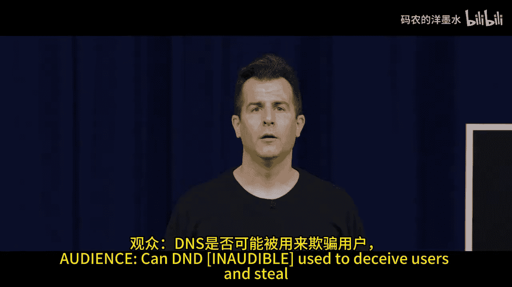

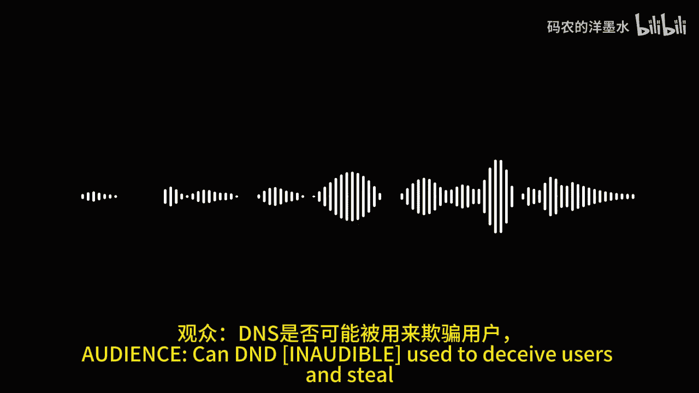

But this should be preventable because you should at least be warned that that is not working correctly。

 And ISP is actually do this quite often。 if you make a typographical error sometimes on home networks or coffee shops or airports。

 you might actually still see a website of like search results or worse advertisements。

 and that's because even if you made a typo in the domain name。

 the coffee shops or the airport's DNS server is still going return to an IP address of their server so they can at least push some content。

😡，At you。So let's consider some of the mechanisms via which we can push back on some of these more invasive privacy practices。

 and one is something we've talked about before， namely a virtual private network or VPN。

 which is increasingly familiar technology， but it's worth knowing exactly what problems it is solving for you and exactly which problems it is not。

 particularly if you're using such a service to protect your own privacy。 Well， what is a VPN。

 it allows us recall to connect from point A to another point B。

 using in completely encrypted tunnel， So it doesn't matter if there are machines in the middle。

 as indeed， there will be on the internet， all of the traffic between a and B on a VPN is encrypted or scrambled。

 So what is this do， This allows you to access sometimes a corporate network or a university network that might have servers or services that are only accessible if you are on physically or if you are on virtually that particular network。

 This ensures that even if you're at home。😡，Or in a cafe or an airport。

 at least you have an encrypted， more secure connection to the campus or the corporate network at which point the campus or company might be more comfortable with you accessing those services。

 Now this does not prevent you still from being hacked because if you're running malware on your own computer accidentally。

 doesn't matter if you have an encrypted connection to the company or campus。

 you might very well have an infected connection now to the company or campus if you yourselves are infected。

 VPNs can also be used to create the illusion that you're actually in one country and not another。

 why， well， if point A is where you are and point B is somewhere abroad。

 well to the rest of the world， if you start using this VPN， this virtual private network。

 you will appear to have an IP address that is in that foreign country because all of your Internet traffic for chatting video conferencing。

 the web will be sent through that VPN by design。 That's what a VPN is for and it will come out the other end。

Foreign country and then continue on its way to the chat service， the email service。

 the web service or the like。 So each of those services will think that you live or are physically in that foreign country。

 even if you are not actually。 So what's the implication of this。

 a virtual private network only guarantees that the connection between you and that point B is encrypted It doesn't necessarily mean that once you're out of that VPN。

 it's gonna stay encrypted， especially if you're using still HttP and not Https。

 but it does at least encrypt everything between points A and B。

 It also does change what your I address appears to be so that you will indeed appear to have an I address that's from that foreign country and not your domestic I address。

 which might have some value in covering your tracks or decreasing the probability that you'll be identified。

 but again， we've seen so many other mechanisms today whereby your browser can be fingerprinted and the context of the web that someone might still be able to realize that。

Okay， your I is a different today， but this still looks like you。

 even if they don't necessarily know that you or David Main or you yourself。

 but it at least does solve at least one problem， which is encrypting end to end all of your traffic。

 Well， there's another piece of software that's been popular for some time called To。

 the Union router。 So this is a piece of software that you can install on your own Mac or PC or other device。

 And this uses encryption to solve the problem a different way using additional encryption to try to give you a higher probability of privacy。

 And here's a picture that Tore themselves puts on their website。

 And it has depicting here you on a very old school PC connecting to a whole bunch of nodes inside of this tour network connected to ultimately。

 maybe the websites that you're visiting。 And what happens here is that when your computer is running the Tor software。

 The Tor software first figures out， okay， who else in the world is using the Tor。

SoftwareBecause it's gonna use those other computers to route your traffic up down left and right and kind of like the movies or TV where you see a map of the world and the traffic is bouncing back and forth and back and forth。

 That's kind of the spirit of tour。 And what happens is if your computer here wants to send a request to a website that's maybe over here。

 and it decides， for instance， to route it through one to three computers。

 What the tourr software will do is encrypt the request at least three different times。

 whatever web request you are sending whatever email you are sending whatever chat message you're sending whatever service you are using between point a on the left and point B on the right is going to be encrypted with this nodes public key with this nodes。

 public key with this nodes public key。 And so here's the onion in tour， the onion router。

 you are encrypting layer upon layer upon layer of data。So that mathematically。

 recall per our discussion of public key cryptography， only this node can peel off one layer。

 Only this node can peel off one layer。 Only this node can peel off one layer using their own respective private keys。

 which undoes the effect of your having encrypted your traffic。

 So what you're really doing here by choosing perhaps a different path every request。

 a different path every day is you are with Tor effectively covering your tracks in some sense。

 And by design， the Tor software doesn't remember much information at all。

 So it doesn't have the sorts of logs that I propose can be worrysome。

 at least in the context of web servers by design， Tor is meant to preserve your privacy with higher probability。

 And so by design， it just doesn't keep nearly as much information around。 Now。

 this isn't to say that if you're doing this for malicious purposes trying to evade the authorities。

 This isn't to say that this computer， this computer， this computer couldn't be subpoenaed。

 so to speak by some government entity and they could reconstruct。The path that your data took。

 But the point is that it's generally quite laborious by this time all of that data has disappeared from those interior nodes and so they don't have much information to share。

 And so increasingly it does provide you with some higher probability of privacy by layering your requests with encryption encryption encryption and sort of trusting that these interior nodes are going to relay it to the final endpoint So something to consider if of interest。

 but realize too that because of how the intranet with IP addresses because of how the Internetnet works with port numbers。

 it's still possible on a network to know who is using Tor， for instance。

 So if you happen to be the only person at home， the only person on a company or on a university network who's using To at the moment it's being used for malicious purposes。

 odds are you could be targeted as the source of that attack and so realize in particular that this just raises the bar to detection it raises the bar。

😡，to your privacy being invaded， but it does not， does as do none of the technologies we've discussed give you an absolute protection of these same properties。

😡，So there's one final mechanism when it comes to preserving one's privacy that's thankfully increasingly available to us on devices on desktops and laptops and especially on phones。

 and that's this notion of permissions， which isn't anything new。

 but as i and Android and other operating systems have evolved。

 increasingly you and I are being asked by our operating systems， do you want to allow this。

 not only do you want to allow this program to run。

 but do you want to allow this program to access your camera， for instance。

 do you want this program to access your microphone for instance。

 do you want this application to access your contacts for instance， So on the one hand。

 we're being given much more fine-grained control， which is a good thing presumably at the same time。

 it's also just pushing the decision onto you and me and very often with these applications as you've probably found。

 Well， if you don't enable the camera and give access to the app。

 it just might not work because they have some code。

In their application that says if camera is not on， then do not do anything useful。

 so there's this tension between usability and privacy in this case。

 but thankfully there's finer grain controls too on iOS for instance you might be prompted。

 do you want to give this app access to this feature always or only while using the application or never and that's certainly a good thing for something like the camera or the microphone where it would be nice to trust that when you close the app and put your phone in your pocket that it's not still listening to or trying to watch you from this built in hardware Now there is some feature that might need to run all of the time which includes locationbased services。

 which is to say that our phones especially nowadays can pretty effectively track our location using GPS or w-fi or some other technology now that's of course useful if not necessary for using mapping applications like mapps or Google Maps or the like that help us get physically from point A to point B but very commonly these application。

 at least by default。Ask for access to your geographic location always。

 which means just by walking down the street， even if you're not following a map on your phone。

 means that the app can still be tracking where you're going。

 And certainly among the Googles and the apples of the world nowadays or other manufacturers。

 they certainly know pretty much everywhere you and I are going if we leave these locationbased services on by default。

 So this is an example of something of which you should be mindful if only because here is yet another example of information that logically。

 when you think about it， okay， obviously， that makes sense。

 they must be keeping track of like my location， Otherwise。

 how could they provide me with mapping services， but pause and think now。

 perhaps exactly what the implications are for you for your privacy and just walking around 24。

7 with these radios now in our pockets。So even though there are quite a few threats to our privacy online。

 especially， at least there are these mechanisms that you and I can enable to at least preserve some of the same。

 Well， what have we done over the past few weeks， we began with a look at how we can secure our accounts。

 then our data， then our systems， then our software and today of course focusing on preserving our privacy and by way of the various technologies we've looked at the stories we've told the principles that we've introduced。

 we hope that in the days， the weeks and the years to come。

 you can use all of these first principles and these ideas and these building blocks to extrapolate to how new technologies work to how new threats might affect you and to what questions you should be asking of either the software you use or the software you develop to ensure that not only your communications are secure but also that it has these privacy preserving properties that you and your users and your customers might want this then with CS50's introduction to cybersecurity。

😡。

And this was CS50。Yeah。

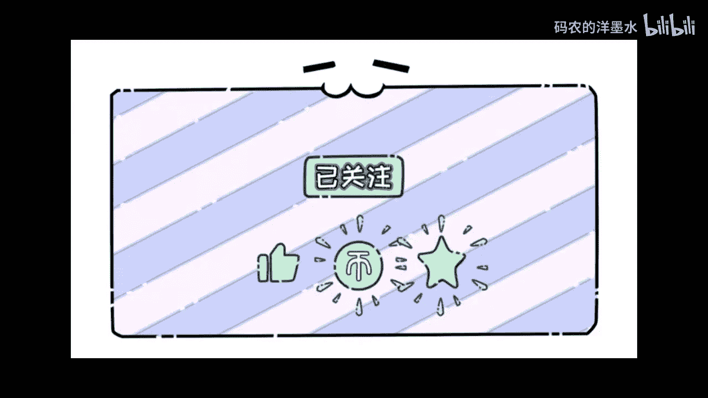

。