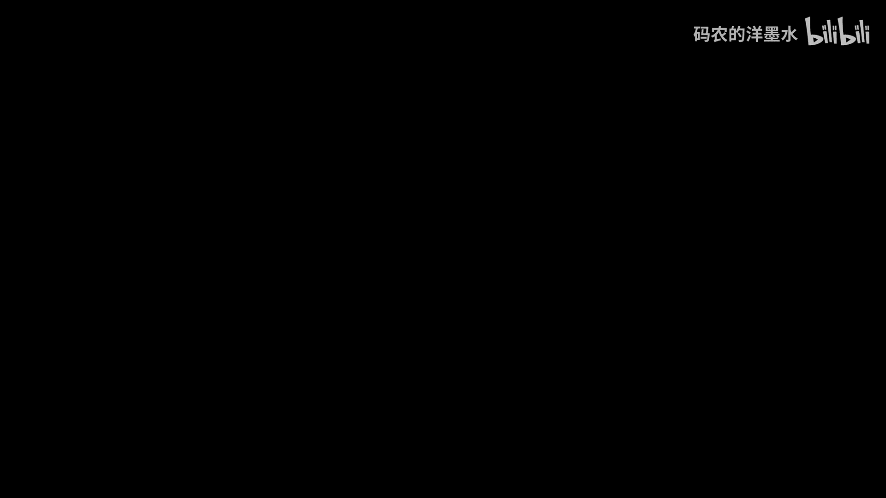
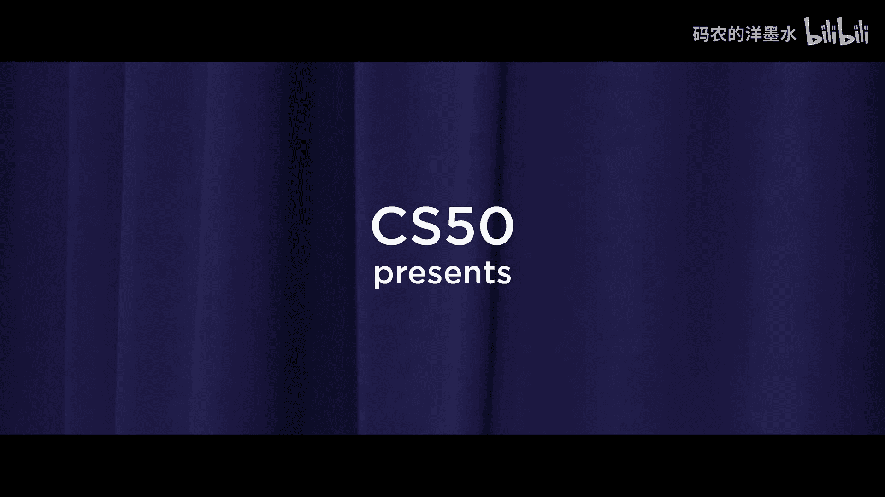
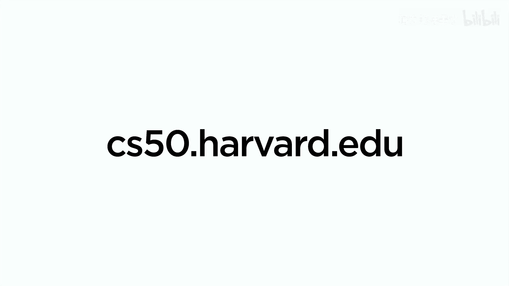

# 【全集】哈佛大学CS50 R语言编程  零基础入门 中英字幕 附完整课件 p01 课程介绍 -BV1mQywBhE2m_p1-

Hello world， this is CS50's introduction to programming with R。

 a popular language for statistical computing and graphics and data science and other domains My name is David Main and my name is Carteranki where is CS50 otherwise known as CS50X focuses on computer science and programming more generally this course CS50 R is entirely focus on R you can take CS50r before CS50X during CS50x or after CS50x In this course we're first to explore 100% data in this language called R learning structure for data called vectors and data frames well then graduate to transforming data in particular filtering with these things called logical expressions that you can use in my subsets of data that you have。

Let consider out how to transform our data using functions and loops and religious paradigms like functional programming。

From there， we'll stand on the foot of those who've written our code before us all the pursuit of tidying our data and making it easier to analyze。

Then once our data is tidy， we able to visualize it more easily too。Toward the end course。

 we'll test our programs， soon as they behave as we intend， and once they do， we'll package them up。

This course thing will take you from nothing about R to sharing your knowledge of R with the world。

 we're excited to see what you will create。 This is your50s Jackson programming with R。

