# 【全集】哈佛大学CS50 R语言编程  零基础入门 中英字幕 附完整课件 p04 Lecture 3 - 函数的应用 -BV1mQywBhE2m_p4-

嗯。

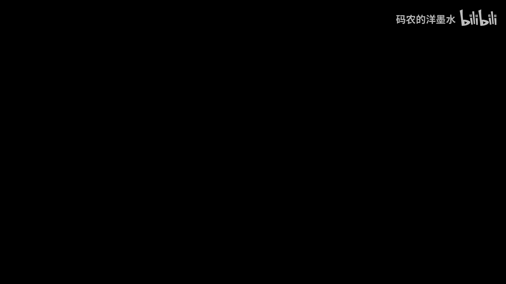

Well hello， what in all and welcome back to CSu' deion to programming with R。 My name is Carterzenki。

 and this is our lecture on applying functions。 We'll take a look at functions in particular。

 writing some of our very own and we'll also learn about loops how to repeat certain segments of code over time towards the end of lecture will combine these two ideas dip our toes into this thing called functional program。

 So let's begin let's start by actually looking at another program we had from before。

 one called count do R。 And if you remember this program was designed to count up some number of votes we typed in in the console。

 So if I click source here I can run this program and I'll enter in 100 votes for Mario。

 let's say and 150 for peach and 120 for Bowser and I'll see that all in all I typed in 370 votes。

 So this same program from before and argue this program is correct。 It works just fine。

 But there's an opportunity for improved design here。 I could write this code a little bit。😊。

Better and one thing I noticed in particular is on lines 1，2 and 3。

 I'm repeating some functionality over and over and over again。 I'm asking the user for some input。

 converting that to an integer。 I'm doing the same thing on line 2 and the same thing on line 3。

 And when you find yourself repeating this kind of functionality over and over and over again。

 it's a good clue that defining your own function might help you。

 So we want to define a function here。 But how do we do so， we've certainly used functions before。

 but to create a function is something else entirely。 Well， to create a function in R。

 We're going to use this keyword called function followed by some parentheses。😊。

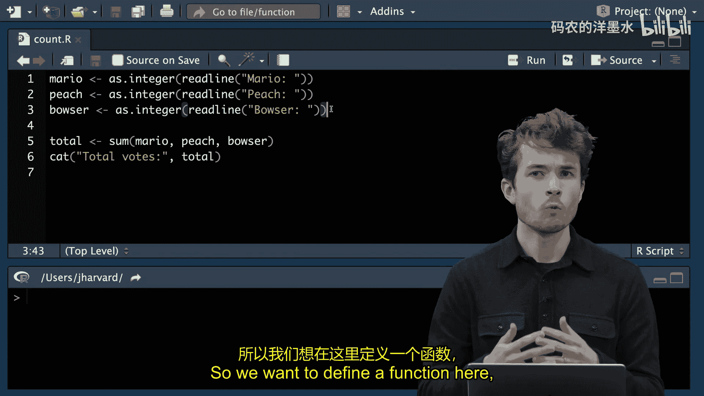

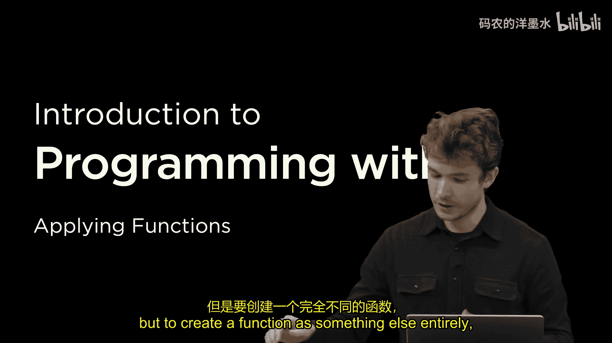

Now， you might also think， well， I want to give this function some kind of name that I could reuse the I program。

 so to give a function a name， I could use this syntax here。 maybe get votes is assigned。

 this function here， So get votes now will be the name for my function because I want this function to。

 let's say get some votes from the user。Now， this is pretty good。 I have a name for our function。

 but what wed also probably want is the ability for our function to take some input。

 some arguments and run with those arguments。 So if I wanted to change how my function runs。

 I could supply parameters inside of these parentheses here。

 I could supply any number of them separated by commas。

 But then even with a name and some parameters， our function needs to do something。

 So it's just like what our function actually does。

 we'll use these curly braces here in which we can define our functions body that is the lines of code that will run when our function is run and down below towards the end of these curly braces。

 we'll say what our function should return to us the programmer after it finishes running。

 So with this syntax here， let's actually go ahead and define our very own get votes function that can ask the user for some number of votes。

 come back to our studio here。 and let's write this function called get votes。

 I wanted to have the same function essentially what I'm doing。

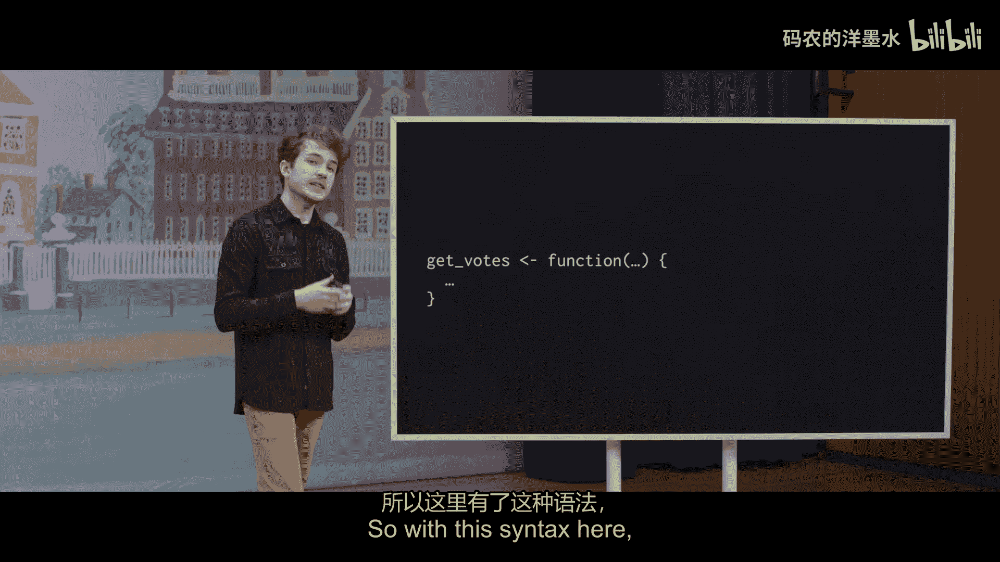

Onlines 1，2 and three here， but to define it， I'll first do at the top of my program here。

 so I define it first and foremost， and then I can use it later on in my program。

 So I'll type like we saw get underscore score votes。

 That's the name of this function and I'll assign it to be some new function here。

And I'll provide a function body just like this。 So now I have my very first function in R albeit' an empty one。

 right， So I want this function again to get some votes from the user。

 So inside these curly braces inside the functions body。

 I should define what code I want to run when I call or when I use this function later on in my program。

😊，Well， the thing I want to do is very similar to lines now，5，6 and 7。

 I want to maybe ask the user for an integer， prompting them with something like。

 let's say just enter votes for now， just like that。

 and all maybe assign the result to this object called votes that is now visible inside of this function for me and once I get those votes from the user well I want get votes to return them to me the programmer so I can assign them to some object like Mario Pecher Bowser down below So to return some value from a function。

 I can use the keyword return an inside pregnancies。

 say which object value I want to return So here in total is now my function on line2。

 I'm asking the user to enter some votes converting that to an integer and storing it in this object called votes inside of this function and then on line3。

 I'm returning the value of votes so I can reuse it later on in my program。

So now I think I've implemented line 6，7 and8 here as its own separate function。

 I should feel free to use that function now on line 6。

 I'll actually not use as integer and read line， I'll instead use get underscore votes and call it using prelaes here。

😊，I'll do the same for line 7。Get underscore votes and line 8 as well。

 And now before I run this program again， let's walk through top to bottom what I've just done on line1。

 I have defined this function called get votes。 I've told R exactly what inputs it takes in this case none I've told R exactly what it should do when I call this function first line 2。

 then line 3。 and I've given it some name get votes here。 So now on line 6，7 and 8。 I can call。

 get votes。 every time I do R will effectively go back to these lines 2 and3。

 run those and return to me the value that I've asked it to return for each of Mario Peach and Bowser。

So now let's run our program。 I'll click source here and enter in some number of votes。

 I think we had 100 first from Mario so I'll say 100 and then 150 for peach and 120 for Bser and now I see this same functionality but now in my own function。

 So congratulations， this is your first function in R。 But if I'm doing this。

 I actually think I have lost some functionality because if I run this program again。

 I'll see enter votes And before we had this nice ability to prompt the user with some particular prompt that we wanted to。

 So how could we get that back。 one thing we could define now is a parameter to this function。

 some input that changes how it runs。 And if you saw it。

 we can define those parameters inside these pregnancies here after our function keyword。

So one thing I want to do is be able to change the prompt that I prompt the user with。

 so I'll call this parameter prompt just like this。

 and now my function can take this input called prompt。Well when I do that。

 maybe I also want to use that particular prompt the user has entered。

 that either the framework has entered as the input to get votes and prompt the user with that instead。

 so now inside this function， I have access to this parameter。

 this argument called prompt that I can then use to prompt the user on line to here。

So let's try this。 I'll now give as input to this function， Mario。

 like we had before and peach like we had before and Bser like we had before each time I call this function。

 I'm setting this character string Mario equal to prompt and then prompting the user with that prompt now let's see what happens。

 I'll click on source and now instead of enter votes。 I'll see Mario。

 I'll type in 100 150 and 120 and I'll get back the same result。

 So pretty handy here to be able to define parameters for our functions and change them over time。

 Now one optimization still we could make is that on line 3。

 I'm explicitly return votes from this function but it turns out that in R by default。

 the last computed value in this case votes will be returned automatically for me。 So on line3。

 I actually don't need to explicitly say return votes， I could omit that and R will by default。

 return the last computed value。Inside this function， which is votes。 So syllistically。

 we often want to avoid typing return when R by default actually does that for us for the last computer value here。

 Let me you run this program again。 I'll click source。 I'll type 100 votes for Mario，1，50 for Peach。

1，20 for Bser。 And now we're back in business。 We have 370 votes in total。

Now let's say I get a little bit lazy as a programmer and maybe sometimes I forget to enter in some value for this parameter we defined called prompt。

 right I could go back to what we had before using these functions without any input。

 but now because my function is defined as taking this parameter called prompt。

 I think I run into some trouble if I click source here， I'll see like an error。

 error in get votes argument prompt is missing with no default。

 So if you're defining a function and you want the user or the programmer to need to define some argument to that function。

 well you're going to need to do exactly what we did here where if I define this parameter and don't give it a default。

 the user or the programmer must supply some value for it。

But if I'm being a little bit nice and I want to maybe catch somebody doing this and provide them with some default value。

 I could do that too in the appear in function。 I could say prompt and give it some default value。

 maybe set it equal to initially， enter votes just like this。 So now。

 if me or somebody else doesn't provide some input。

 Well the default value for prompt will be enter votes。 Let me try this。 I'll click on source。

And now I'll see no error。 I instead see enter votes。

 So even though we didn't supply some input to get votes here。

 we defined some default value that is used instead。 So prompt when there's no value supplied。

 is going to be equal now to enter votes， as we've seen down below。 So pretty good。

 If I want to override this， as I might often want to do。 I could do it as follows。

 I could go back what we did before and type in some input like Mario or like peach。

 or let's say like Bowser just like this。 And because this is the first input I've given to my function and prompt is the first parameter。

 Well， Mario will override， let's say the default value of prompt and same for peach and same for Bowser。

There are a few ways to supply arguments to functions we've seen so far。 One is positionally here。

 notice that the very first argument to get votes becomes the value for the first parameter prompt。

 if though I had more than one parameter and more than one argument。

 I could define them separated by commas， so maybe this would be my first argument here。

 Mario followed by a comma， I could then provide some other value for the next argument if I had one in my function here。

 but I don't， so I won't。The other way I could define the argument for particular parameter is by actually using the parameter's name。

 So this name of this parameter is prompt here。 I could override that and make sure to explicitly say that this prompt is going to be equal to Mariio using syntax like this。

 I could say that get votes I know explicitly has this argument parameter called prompt that also equal now to Mariio and same for peach and same for Bser。

 So now I'm AO here to run this code by supplying or overriding the default value now of prompt。

So I think this is a pretty good first function if I clicked source and I click Ronock and do 100 votes from MariO。

 150 for Peach， 120 for Bser， getting that total back。

But what's interesting that I noticed now is if I go to my environment on my righthand side。

 I'll see a few different objects that I have。 I see Bser， I see Mario， I see peach in total。

 I see get votes， the function which we defined but what I don't see is this votes object or prompt and actually if I go down my console and ask are to give me the value of votes as it currently is。

 Well I'll see error object votes not found。 Now why is that Well this has to do with what we call in programming。

 this idea of scope。 and scope tells us in what context。

 objects like these are defined to visualize this， let's think about our environment here and think about what scope we have in terms of our objects in that environment So here as representation of our environment。

 we have those four objects we saw earlier。 Mario， Peach Bowser in total， these are accessible to me。

 the programmer pretty much at all times。 We also have， of course， are function。

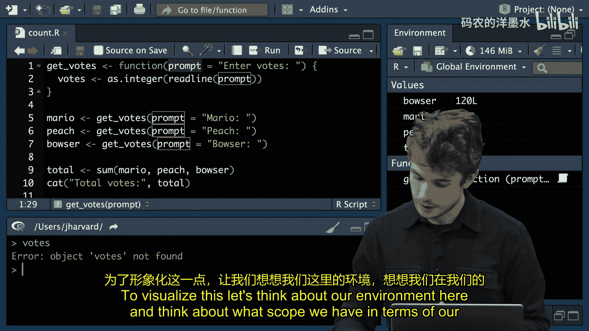

get votes。 But get votes is kind of best viewed as this black box。

 I don't exactly know what's going inside of it when I call that function。

 if you think about calling a function like some or mean。

 you likely don't know exactly what code was defined to compute those values。

 You just know that kind of works。 You give some input and you get that output back。 Now。

 the same thing now， with our own functions。 we just have to trust that we ourselves have to find these functions。

 take some input and produce an output for us， and we。

 the programmer can't actually access those object we define inside the function。

 if we want to use those， when you kind of metaphorically zoom in or go inside that functions context to then be able to use and see those values like votes and prompt。

 But for our sake， as the programmer， these objects are only defined inside the scope of now our function。

 which is why we can't see them in our global environment as we saw in R。

So we have now defined our first function， we've taken some input， so we've returned some values。

 we've also seeing this question of scope here， let me ask what questions we have so far on scope or on defining our own functions。

What if the user enters a string or a character as an input？ Is there any way to handle errors Yeah。

 really good question。 So up until now， you've been kind of being a good user。

 we've been supplying numbers to the actual program here but we need to think defensively as programmers and think about what could happen if we entered in something that wasn't a number for instance。

 So let's see what might happen here。 I'll come back to my computer let's go back to our program called count R and let me close my environment but now think a little more maliciously as a user。

 What can I do to break this program。 one thing I could do is enter in some value that I don't think the program expected to see So if I click source now to run the program again let me enter in something funny like a duck for Mario or quack for peach or cat for Bser and these are certainly not number。

 So if I hit enter now this is some pretty bad output。

 So what I see down below is total votes is now。😊。

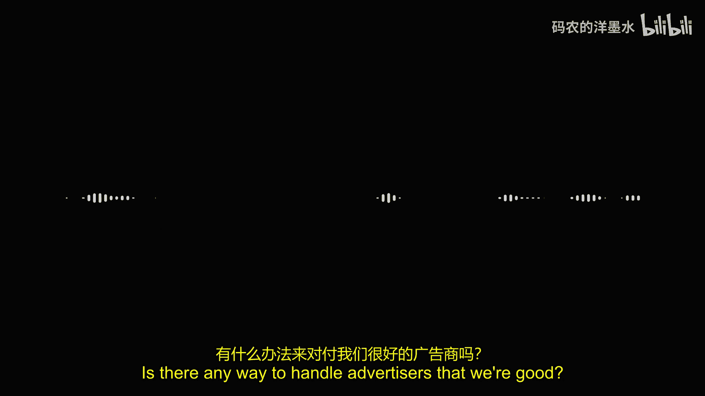

To NA， this value means not applicable。 And I see some warning messages。 Now。

 if I look at this particular one in get votes prompt equals Mario， NAs introduced by coercion。

 Well what does that mean， Well， we saw a little while ago that coercion is this process I which we convert some storage mode to some other one。

 And it seems like we do that on line 2 on as or integer。

 we convert some character string the user gave us via read line to some number or some integer in particular。

 But what might happen。 if I did something like I did here。 I gave cat instead of an actual number。

 Well， as integer will say one， I don't know what the heck you want me to do with that。

 So I'll give you NA instead。 and it will also give me whats called a warning， telling me that， look。

 I couldn't do what you wanted me to do with the input you gave me。

 So this is why now we see this value NA as opposed to let's say cat or duck or quack instead。

So what could we do to fix this。 I think one thing we could do is try to catch this process。

 like if we see inside this function that we actually gotten an NA value for votes。

 well we could return something else entirely。 We could start there。

 So let's go after our program and make that happen for us。

 We could use what we saw last time called conditionals。

 where conditional sort of test for something and take some particular action because of that test。

So here， let's say， let's assume the user enters in some bad value like duck。 And now votes is NA。

 Well I don't want to do what we did before， which was return votes automatically。

 I'd rather first ask is votes and， and if it is， let's go ahead and not return the actual NA value。

 why don't we return something like0， maybe just just kick things off。

 if I say if now if votes is NA。 Well， then inside。

 I could return some special value like0 saying that look， we couldn't count your votes。

 But otherwise， let's say， we could go ahead and safely return votes。 So if votes is not NA。

 we can go ahead and return votes instead。 And I think this will be a little bit safer for us。

 if I go ahead and click on source now， I go ahead and type in duck for Mario quack for peach and cat for Bowser and。

So I seem to have gotten total votes being zero， like that's a little bit better。

 It's no longer NA A。 We seem to have just not counted like cat， duck or quack。

But I still get these warnings。 Now， these warnings willll see a little bit more depth in a future lecture。

 R does have warnings and errors that are more known as exceptions。 But for now。

 we can handle them using a function called suppress warnings。

 Sed warnings allows me the programmer to say， look， I know something went wrong。

 but I'm handling myself。 I know how to do this。 So let's see if we could tell as an integer to not give us a warning anymore because we're handling it a little bit later。

 So come back to our studio here。And I could use， like we said。

 this function called suppress warnings， where suppress warnings takes as input a function that could give us a warning in this case like as dot integer。

 So now if I give as input this particular function like this， suppress warnings。

What I'm effectively saying is that as you take the user's input and you convert it to an integer。

 if you encounter a warning， don't give me that warning， just kind of suppress it， keep it low。

 and I myself， the programmer will handle it later on as well。 So let's try this now。

 I'll click source and they'll do 100 votes for Mario。

 150 for peach and 120 for Bowser and I think now we're back in action。

 although that was actually that was some good input， so let's try the bad input。

 let's go ahead and do duck for Mario quack for peach and cat for Bowser and now we see total votes being0。

 but now no warnings being raised thanks to suppress warnings。

 so we'll see this in more depth in a future lecture。

 but for now just think about suppressing those warnings kind of silencing them because we the programmer know how to handle those in our own code。

There's one more improvement I see here， which is that this block from line3 to line 7。

 this if else could be simplified， could be converted to one line of code。

 and in fact if you have an if else statement where inside the if and inside the else。

 you're simply returning one value or another， where you could simplify this and use a function called if else。

 just like this， where the first argument to if else is the logical expression to test in this case is votes and A。

 just like this。And if that expression is true， if votes is N A。

 well the second argument will be the thing we return， the value we get back from if else。

 And then the third argument will be when we get back if this logical expression is false。

 It's the else in if else。 So I'll say votes here instead。So now to be clear。

 line 3 is doing exactly the same work as lines 5 through9， but it's much shorter。

 I would argue more readable and so I can now get rid of lines 5 through 9 and shorten this function even more and because R will return to me the last computed value if else。

 whatever it returns will be the return value of my function itself。

 So if votes is NA if else will return 0 but so will my function and same with votes as well。

 So let's try this again I'll click source and let me go ahead and say something like duckuck for Mario I will enter in maybe 150 for peach and cat for Bser and now we see our total votes is 150 and I think we've really simplified this function for ourselves here。

Now， as we've done this， I think you're seeing the power of putting this functionality inside of a function。

 If I hadn't done this， if I had had to repeat this code over and over and over again。

 my code would have been much longer， you could imagine myself repeating that same conditional。

 if else， if else， if else， through all I prompt to the user but by converting that code into my very own function。

 I can modularize things， I can make things easier to maintain and update。

 which is why in the first place we would write functions like these。

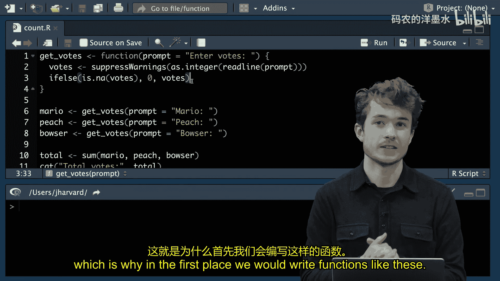

So we've seen how to write our very first function in R to handle some errors our user could present us with。

 What other questions do we have about defining these functions。

If we had the first version of our function gap votes and that we were still not checking for na values by coerion。

 Would we need to actually store our computation in the votes object or could we just return the value directly。

 Yeah， a really good question。 I think something gets shortening this program even more。

 if we go back rewind a little bit to maybe not handling these nas it could be introduced。

 but instead just returning， let's say whatever the number user gives us is。

 I could probably shorten it even more。 So let me go back to our studio and show you that could look like。

 I will maybe get rid of this if else here。 And I'll instead maybe do this。

 I'll go back to what we had before which was assigning this object votes。

 whatever number the user types in。 Now I think you were asking。

 could we just get rid of this object votes。 Could we simply have this， that integer read line。

 given some prompt。

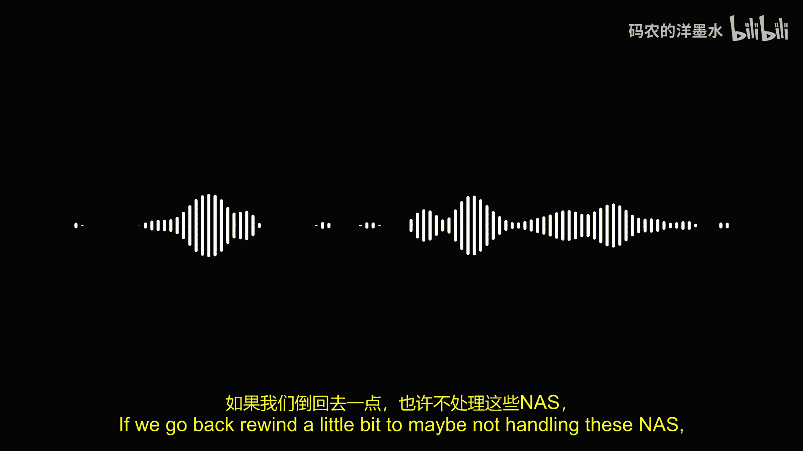

I think we could because as an inger will still return for us。

 whatever number the user has typed in and therefore because the last line of my function。

 my function will instead return that value as well。

 So I'll click on source to run my program I'll type 100 from Mario150 for peach and 120 for Bser and now I see the same result we wanted I would argue though because we want to keep this value and test its actual its value later on was it NA or was it number。

 we might want to actually store in a separate object and then test that value a little bit later like we did here。

 but a great question and a good optimization to。Okay， so we our program is better。 Like。

 it's certainly better than it was before。 But there's still one thing I think that's missing。

 which is I click source now， and I type in maybe quack for Mario， I've。

I've missed my chance now to enter Mario's votes。 Wouldn't it be nice if instead my program could reprompt me every time to enter in a number for Mario。

 and it won't stop， let's say， until I do comply， enter in the number for Mario's votes。

 Well for that， we'll actually need some new structure。 one called a loop。 and in just a few minutes。

 we'll come back and talk about how to implement these loops in our code。 We'll see you all in five。

 Well， we're back and as promised we're going to learn together out these things called loops。

 these structures let us repeat some code， some number of times。 Now for this part along a friend。

 the CS duck de buger， which is great to talk to my code is about theillogic in my thoughts。

 but also great for thinking about loops in particular。

 if you have a duck or any kind of object to squeeze。

 you can use that to think about how loops work underneath the hoods。

 let's go ahead and jump in and see what this duck can teach us about loops。

 So if you come back to my code over here in our studio。

 I have a program that kind of simulates me squeezing this duck three times。 for instance， like this。

😊，It's a bit more of a squeak than a quack but we'll go with it for now if I type source here。

 click source， I'll see quack quack quack me squeezing this duck now three different times。

 so putting what we just did physically now into text so let's visualize this code in terms of a flowchar and see what it looks like well here at the top of my program I start it I click source my program begins and the next step then is to say quack every arrow now indicates some next step of my program after I say quack one time I squeeze once。

 what will I do but say quack again just like this and I'll quack again just like this and now I'm at the end of my program I stop entirely。

😊，But let's say I want to quack my duck or squeeze it more than three times。

 If I have only this to work with， what might quickly become my problem。

 if I want to do this five times or 10 times or even more。

 Well I probably need to do a lot of copying and pasting。

 If I can to come back to my code here to show you what I need to do if I want to simulate squeezing this duck。

 not just three times， but five or six or 10 or more， I need to copy line 3， put it on line4。

 copy line 4 put it on line 5 and so on and so forth to repeat this code some number of times。

 Now thankfully， we don't have to do this in R。 And in fact。

 as programmers used to be looking out for cases like these and thinking I could probably use a loop instead。

 So let's see what kind of loops or offers what kind of keywords we could use to make loop and to repeat this code。

 some number of times。 one of the first loops we have at our disposal is one called repeat。

Repeat allows us to repeat whatever code is inside of its curly braces。

 infinitely whatever how many times we want it to so let me go ahead and go into my Rt again and I'll type repeatat now this keyword。

 and I will then inside of those curly braces， put this function cat which will print to the screen quack and before I run this code。

 let's visualize its flowchar to see how it might work。Well here on my screen， I have this program。

 I'm going to start that program， and then I'm going to quack or squeeze my duck and then I'm going follow the arrow and quack just like this and then I'm going follow the arrow and quack just like this and I'm going go follow the arrow again and I worry I might be stuck here for a very long time because it seems like our next step is always to go back and quack and to quack and to quack again。

 So before we dive into fixing this。 let's talk a little bit of vocabulary。

 Now what we've created here is in fact a loop， we're repeating this code over and over and over again Now each time we repeat this set of code we're calling that one iteration。

 So in other words， when I loop again and again and again， I'm iterating again and again and again。

 one iteration means one segment of my code top to bottom inside of that loop。

 and I think what we've created here is something called an infinite。Lo。

 one that will never ever end because there's no condition telling us when to stop looping so we need to figure out how to break out of this kind of loop and figure out what we could do to get out of it Now thankfully R does offer us some keywords to do just that。

 so let's explore them now in R I come back to our studio Well want to introduce these two keywords here break and next break symbolizes break out of some loop when R encounters that break keyword it will end that loop entirely will'll stop wherever it is and end that loop。

Next on the other hand says wherever you are in this iteration。

 go ahead and start the next iteration from the top so let's try these out now in R。

 if I come back to my program duck do R I don't want to repeat this quack over and over and over again。

 but let's say I just I do maybe accidentally I click source now and my computer is just stuck saying qua qua quack quack over and over infinitely forever。

 I could， if I wanted to exit this program， if I type control C that means stop this program whether're in a loop or we're not so that can save us control C but ideally I should consider a stop condition before I go ahead and repeat something infinitely many times。

Now， what could I do if I wanted to quack， let's say three times one thing I could do is think about counting。

 like maybe beyond my fingers。 if I want to quack three times， I could maybe start at three。

 And if I have three here， I could quack。 I could go down to2 and quack again。

 go down to one and quack again and then finally， at 0， I'm done。

 I shouldn't squeeze my duck anymore。 So one thing we could do is try to put this idea of counting now in code。

 Well， I could create an object to store the number of times I want to squeeze this duck。

 I could by convention， call it I， and that will keep track of the number of times I want to iterate in this loop。

So on line 1， I'll say I'm going to assign this value I to be 3。

 It's kind of similar to be holding up my hands and saying three fingers， for instance。 And now。

 as I repeat this code， I don't want to repeat it infinitely。

 I want to have some condition under which I break out of this loop。

 And as we saw before with my fingers， maybe the condition is if I is equal to 0。 Well。

 at that point， I want to break this loop。 I want to exit it and not loop anymore。

But I shouldn't run this code just yet because while I've set I equal to3。

 like I have my fingers here， what I haven't done is made a mechanisms for actually dropping fingers going from 3 to 2。

 from 2 to 1， from 1 to 0。 So maybe after I quack， I'll go ahead and adjust the value of I I'll set equal to I minus1 just like this。

And then let's say maybe in the case that I is zero， eventually we're going to break out of a loop。

 but if it's not， why don't not go ahead and go to the next iteration when we see the next keyword we'll stop our current iteration and go to the top again to repeat our code top to bottom just like this。

So the flow chart for this code looks a bit more like this。

 I'm going to start my program and I'm forced going to set I equal to three kind of like I did on my fingers here。

 then I'm going to squeeze the duck， going to quack。

 subtract one from I and ask a question is I equal to zero。If it's not。

 well I'll go back up and I'll squeeze the duck again。

 I'll subtract one and ask that same question and if I ever get to ask that question and the result is true。

 well then I'll stop my program So let's visualize this here using some interactive stuff I have my iPad here that can count let's say from three just like this。

 whoops three down to zero， let's say， so currently when I is3， what do I do， I squeeze my duck once。

Just like this。 I'll then subtract one from I where I is kind of this iPad here where I subtract one now and now I is two。

 I'll go back up and I'll squeeze again。 I'll subtract one from I now I is one。

 I'll ask the question is I equal to zero it's not so we'll go back up again。

 I'll squeeze the duck one more time and I'll subtract one again and now I is equal to zero。

 so we'll stop our program， there will be no more squeezing of this duck So this is one way to approach the problem of creating some loop and having it repeat a certain number of times。

 but R comes with other kinds of loops to。 a repeat loop is great when you want to do something at least once。

 I want to squeeze this duck at least one time but if I only want to do it if some condition is true where while some condition is true。

 I can use another kind of loop as well This loop is called a while loop。 a while loop。

 let's just repeat some set of code while some condition is true。

So let's see what that looks like now in R。 I will remove what I currently have and instead implement this while loop。

So if I want to make a while loop， I can use while just like this。

 and I'll make a condition to repeat under as long as this condition is true。

 I will repeat the code inside this while loops curly braces。

 so I could say maybe while I is not equal to0， I want to repeat whatever code is inside of this while loop。

Well I want to quack， so I'll say cat quack just like before back slash n， make a new line。

 And then why don't I go ahead and add back this kind of helper object I had called I I is assigned the value 3。

 and after I quack well I'll subtract1 from I just like this。 I is now assigned the value I minus-1。

 So a bit shorter than I'll repeat loop but I argue and do the same exact thing now。

 So let's visualize what's happening in this program。Well。

 the first thing we do is we set I equal to3， just like this。

 And then we ask the question before we do anything else， we ask the question， is I not equal to 0。

 if it's not equal to 0。 If that is true， we're gonna squeeze our duck and subtract one from I and then we'll ask a question again I I not equal to 0。

 And if ever in our loop， that question is false。 That is this condition is no longer true。

 we will stop exit our loop entirely。 So let's visualize this now， I was first set to 3。

 So I'll set I here to 3。 And now the difference is before I do anything。

 I'm going to check this condition now， is I equal to 0。 or is I not equal to 0。 Well， I is 3。

 So yes， I is not equal to 0， I'll go ahead and quack just like this， and I'll subtract one from I。

Now I'll go back to the top of my loop and ask that question again。

 is I not equal to0 I is2 so it's not equal to0， I'll go ahead and squeeze my duck。

 subtract1 from I and then ask the question again is I not equal to0 Yes。

 it's not equal to zero I'll squeeze subtract1 from I but now when I ask the question is I not equal to0 Well I is not not equal to0。

 In fact it is0， so I will exit my loop altogether squeezing my duck now three times in total。

So let's visualize this。 I'll come back to our studio now， and if I run this code by clicking source。

 I will have quacked exactly three times counting down from three，2 and one。Okay。

So just as we have counted down， we could also imagine counting up， maybe I start I at one。

 and my condition now is to loop so long as I is less than or equal to3， like I could imagine1，2。

 three times but not four， so I'll say while I is less than or equal to3。

 I want to keep clacking but now I need to actually increase I as I go on each iteration of my loop on each run from the code top to bottom。

 I want to increase I by one。And now let's visualize what this is doing in terms of a flowchar。

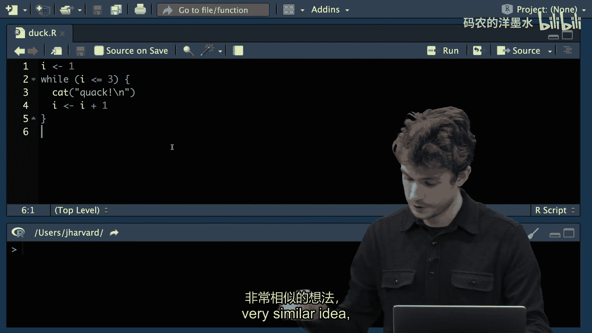

Here， very similar idea but we're starting now from one I equals1 and we'll ask this question is I less than or equal to3 if it is。

 we'll squeeze our duck and add one to I if it's not as we go back and approach that question again at top of our loop if it's ever not the case that I is less than or equal to3 we'll stop we won't loop anymore so again let's visualize this。

 but now I is first set to1 so before we do anything we ask the question is I less than or equal to3。

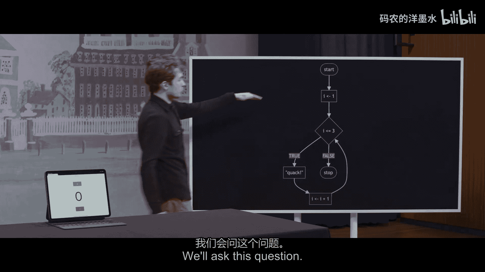

It is， we'll squeeze our duck， add one now to I， and ask the question again。

 is I less than or equal to three？It is I'll squeeze。

 add one to I now it's three is3 less than or equal to3 well it's equal to so I'll go ahead and squeeze add one to I and well now it's4 and4 is not less than or equal to three so we'll go ahead and stop our loop and not loop anymore。

 I'll come back now to our studio and I will show you what this looks like now if I click source I'll see quack quack quack again quaing three separate times。

So we've seen now two kinds of loops in R one called a repeat loop and one called a while loop let me ask what questions do we have of these loops so far How could we decide when do you use repeat or when to use while or it doesn't matter Yeah。

 earlier your question so in general， as we'll see a repeat loop tends to be good when you you want to do something at least once you want to quack at least once。

 you want to prompt the user at least once and then check if you should repeat or not a while loop is good at the very beginning before you do anything else。

 you want to check some condition and you want to repeat that code while some condition is true so you can think of a repeat being like do this once。

 but then check if you should do it again whereas a while loop is more like if our condition is true。

 we should be repeating this code over and over again。

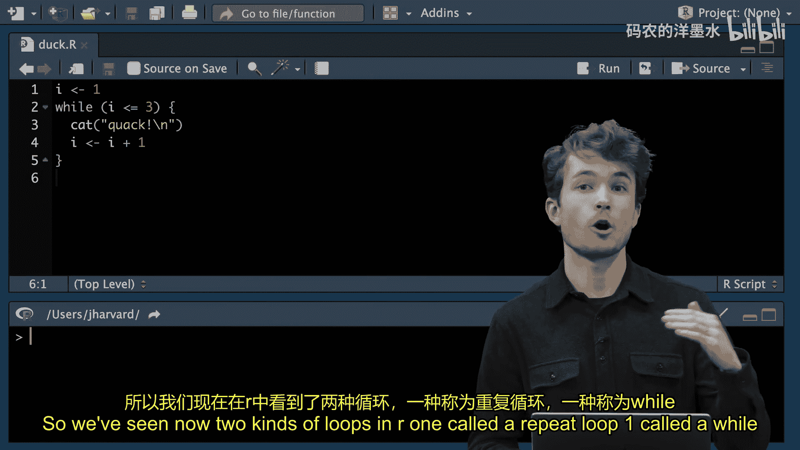

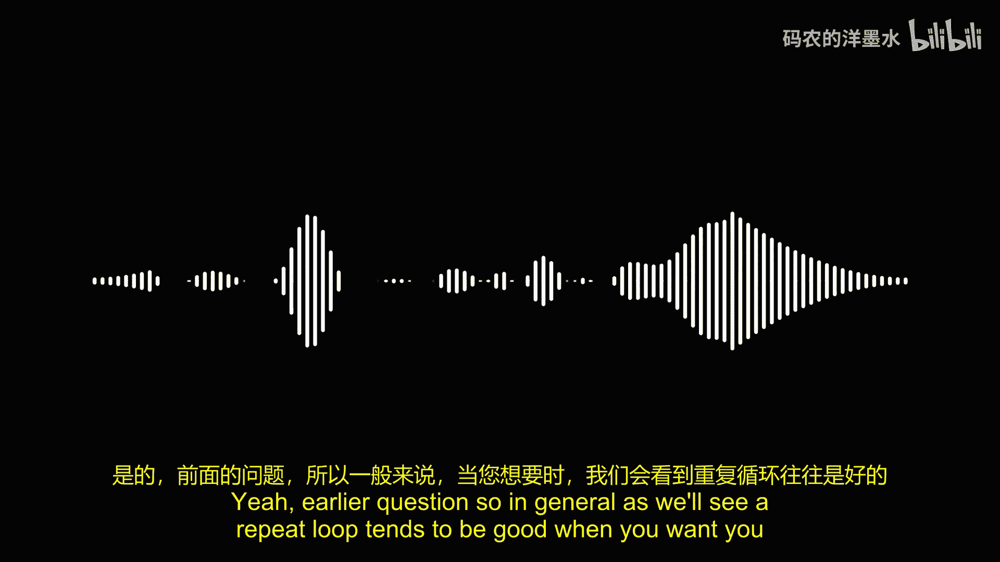

Really good question there。Allright， let's keep going。

 And one more loop we have available to us in R is one called a four loop。

 A four loop lets us do some piece of code for each element in some list or vector of elements。

 So instead of now using the while keyword。 I could use the four keyword。 I could say four。

 and it turns out that inside of the parentheses of a four loop。 I need a few different components。

 I need still some kind of help or object。 Keep track of each iteration。

 but I also need some vector of element。 So do some piece of code for each vector in that element。

 or each element in that vector。 sorry so I'll say four I in and then have a vector here。

 let's say one，2 and3。 And now I have at the same before， my body of this loop where inside of it。

 I want to quack just like this。Now notice there's no need for me now to increment or decreement I to add or subtract one because this is all taken care of thanks to our4 loop what the for loop will do is first set I equal to1 and then it will say quack and then set I equal to 2 and then quack again and then set I equal to3 and quack again but then at the end of this vector once there are no more elements to iterate over well our4 loop is done So I as it iterates kind of assumes the value of1 and then2 and then3 and if I were to click source now I would see quack quack and quack down here in my console。

I could simplify this just a little bit more。 I could maybe make a vector that's going to be a little more dynamic than this。

 like I can imagine myself typing in 1，2，3，4，5，6，7，8，9。

10 to quack 10 times now if I were to click source here but that's going to get really tedious if I want to quack more than let's say three or four times so what I could do instead is use our syntax to give me some vector that is between certain numbers so one colon 10 for instance would say give me a vector that includes one through 10 inclusive which I can show you in my console here。

 one colon 10 gives me one through 10 inclusive。With this could I actually change how many times I loop if I click source。

 I'll see 10 quacks， if I change this to one colon 3。

 well now I'm able to see quack quack quack down here in my console so a four loop is going to be the tool for you。

 if you have some list， some vector elements to loop over and then you want to do some piece of code for each of those elements there。

Okay， so now we've seen the three kinds of loops in R， we've seen repeat loops。

 we've seen while loops， and we've seen four loops。

 our next step will be to apply these same loops to improve the design of our programs we'll come back in five and do just that。

 see you all soon。

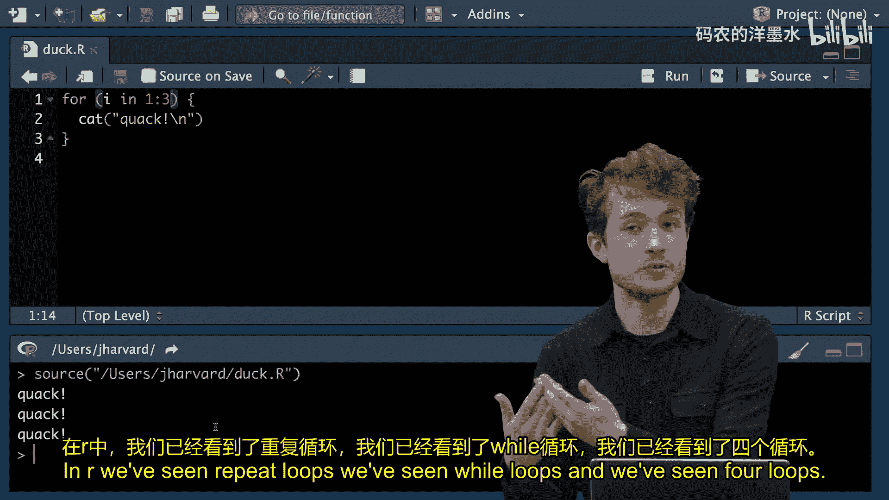

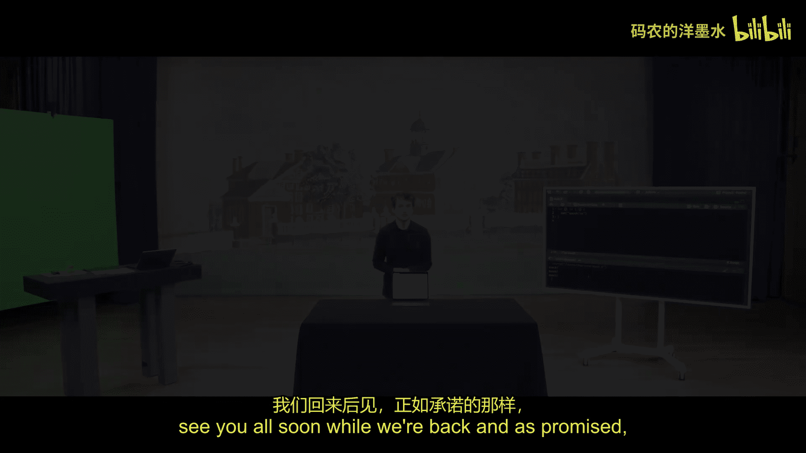

Well we're back and as promised we're now going to explore how we could apply functions to make the design of our programs even better。

 so let's pick up where we last left off writing this program called count do R and we left off with this idea of wanting to reprompt the user any number of times until they comply with whatever kind of input we want in this case a number so we saw just a little bit ago that a repeat loop is a great loop to use when we want to do something at least once and then check if you should do it again or breakout of the loop。

Now in this case， I do want to prompt the user at least once。

 I want to tell them to input some number at least once。

 and if they don't comply well then I'll loop again， but at least I want to do it once。

 so I could use a repeat loop here and I could use it in the same way we just saw using the repeat keyword followed by some prelases or some brackets just like this and then inside those brackets inside of this loop's body。

 I could be sure to prompt at least once just like this。

 I will ask the user for some number of votes and store it in this object called votes。

But now I don't want to run this code because this will make an infinite loop。

 I'll be constantly asking the user to enter in some number of votes。

 so I need some condition under which I would break out of this loop。

 and I think that condition might be if if the votes we receive is not NA if we get back。

 some valid number of votes， that will be not equal to NA if we do get some weird input like duck though that will be NA in which case we should keep looping So ask the question is votes in this case。

 is it not equal to is votes not equal to NA just like this and if it's not well we're going to break out of this loop。

 we're going to say， look， we're done， votes is not NA。

 we don't need to ask the user anymore alternatively if votes is NA。

 we could continue on to the next iteration。There's one improvement here， which is that technically。

 when we get to the bottom of this repeat loop， get to its last curly brace in the body here。

 it will automatically go back up to the top， do the next iteration from the top of its body。

 so I'd argue that this extra next here isn't really needed。

 we're going to go to the next iteration regardless if we don't break out of this loop altogether。

And now I think we have a good loop going， I'm going to ask these are for their votes if。

 in other words， this is a valid vote， a valid number， we're going to break out of the loop。

 not prompt them anymore more and what can we do Well now we don't need to check if votes is NA because if we get down to line 8。

 we know votes is not NA I could simply return votes overall。

So here I think is a better implementation， one that will prompt the user again and again until they enter some number of votes that we actually want。

 let me go ahead and click source and let me type 100 votes for Mario。

 but now maybe I'll type Duck for Peach。And I'm reprompted。 Okay， maybe I type quack for peach。

 I'm reprompted。 Maybe I'll now comply。 I'll say， okay， 150 votes for peach。

And now we move on to Bsers。 So this seems to be working here。 I'll go ahead and type 120。

 and now I'll see my total votes was 370。Now one more improvement is that it seems to me a little extraneous to break out of this loop and then return because a return actually signifies that no matter where we are in our function。

 we're going to stop the function altogether and return the value we have so it seems to me like I could move this return from line 8 to inside of this if statement and now if votes is not NA。

 if we have some valid number of votes， we'll not just break and return。

 we'll go ahead and just simply return because a return would by nature。

 break us out of the loop anyway， we're going to stop this function altogether。

So let's try this again， I'll save my program， click source， I'll type 100 for Mario， 150 for peach。

 120 for Bowser， and now I think we're in good hands if we have good input， but if I type source。

 let me go ahead and do D for Mario， and I prompt it again， maybe quack for Mario。

 maybe 100 for Mario， now I think we're doing well with invalid input as well。So pretty good。

 one other thing we could do though is think about these lines 10 through 12。 Well。

 it seems to me like for each candidate that I have， I want to get some number of votes for them。

Notice how I said for each candidate， Well， if we want to do something for each candidate。

 for each item in some list or some vector， well a for loop might be a great tool for us here。

Why don't I go ahead and try to make a for loop now， I'll say for as we saw before。

 this helper object called I for I in。 Well， I want to prompt the user for every candidate that I have and although we just saw four loops being used with numeric vectors。

 vectors that include like one，2，3，4 and so on， we can also use for loops with nonnumeric vectors。

 I can give a vector of the candidate that I have and know that a four loop will loop over each candidate in that vector。

So I could do something like this。 I could say for I in a vector of my candidates， Mario。Peach。

 and then Bser。And then I'll provide the body of this for loop。

Now what do I want to do in this loop Well each loop I will first be assigned some new element to my vector first will be Mario。

 then peach， then not Bsword， Bowser just like this and then I want to in this case ask the user for some number of votes on each iteration first for Mario。

 then for peach then for Bowser so I could probably simply call get votes just like this。

 and maybe store it in some object called votes like that。But now the question is， how would I。

Show the user the right prompt。 Like I can't type in Mario here because then Mario which open the prompt on every iteration of my loop。

 I makes more dynamic than that。One thing I could do。

take advantage of how this object I is actually assigned the value of each element on each iteration。

 So on the first iteration， I will be equal to Mario on the second iteration I will be equal to peach on the third iteration I will be equal to Bowser。

 So I think I could use that to my advantage。 I could take the candidate name。

 let's say and maybe add in dynamically this colon space with let's say paste0 like we've seen before。

 I could say paste0， I want to paste together the candidate's name followed by colon space。

 So now on each iteration， I will first be equal to Mario。

 will' get votes for Mario by prompting the user for Mario's votes。 Then on the next iteration。

 I will be peach will prompt the user for peach's votes followed by a colon space and then the same thing for Bowser。

😊，So I think I could get rid of， let's say， this code down below here。What am I left with， Well。

 it seems like on line 14， I was summing up Mario， Peach and Bowser。

 but those objects don't exist for me anymore。 I only have this one value now called votes。

 which seems to get changed every iteration。 Like the first it will be Mario's votes。

 The Next iteration， it will be Peach's votes。 The next it will be Bowser's votes。

What ideas do we have for how to solve this problem？

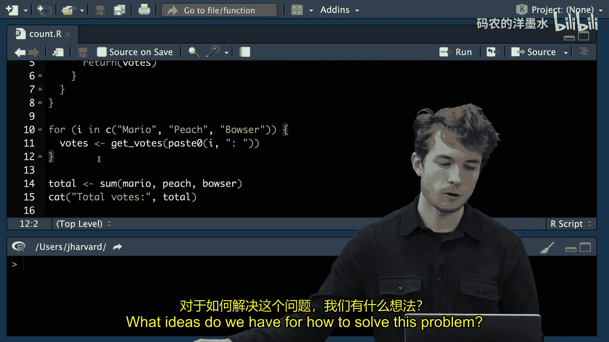

Any ideas for how we could。we count up these votes while we go through our loop。

First we I think we should put it inside the for loop or return the sum Yeah， so a good idea。

 like we still want to return their sum。 and like what you're thinking about trying to do this within the for loop one thing that comes to mind is maybe trying to keep a running sum that is let's first get Mario's votes。

 add them to our total then get peach's votes， add those to our total then get Bowsers' votes。

 add those to our total and at the end of our loop。

 we will have a total number of votes to count up So let's see this in action in R I'll come back to our studio here and if I can't have separate objects now for Mario Peach and Bowser well。

 no problem what I could do instead is start my count a little bit earlier maybe I'll set total initially equal to0 So before I loop I assume well there are a zero votes but then on each iteration of my loop what will I do I'll ask the user4 some number of votes for the candidate whether it's Mario peach or Bser and then。

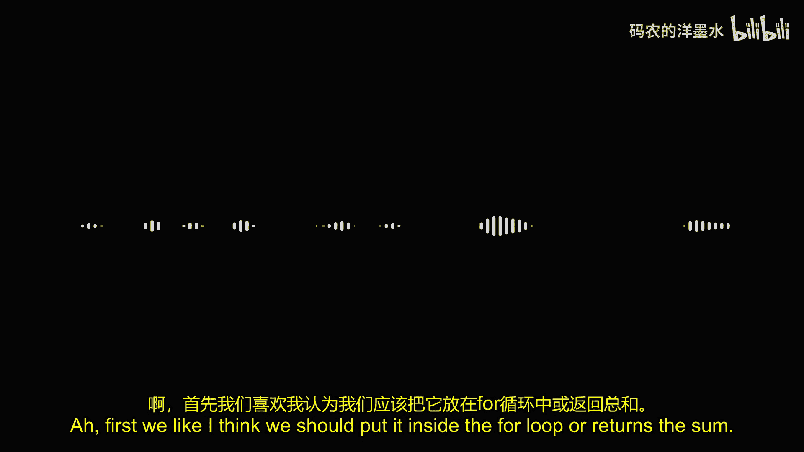

Below I'll add those votes to the total I will update total to be in addition to include the total plus the new votes we've received。

So I think I could get rid of now line 16 and let's think through what this is doing line by line here。

 well， first total is0， and if I go into my loop now。

 I will first be equal to Mario on this first iteration。

So I'll prompt the user for Mario's votes and store them in this object called votes。

 Let's say it's 100。 On line 13。 I take this object called total and update it。

 I add Mario's votes to it。 If Mario had 100 votes， total will be now，100。 Then I'll move on。

 I will then become peach。 and I'll ask for peache's votes now。 Well。

 if peach's votes is 150 on line 13， all again， say 100。

 which is the current value of total plus 150， that's the new value of total。 So 250。

 And you can see how we're kind of keeping a running track of our number of votes for each candidate。

 We'll do the same for Bser。 And I think at the end of this。

 we will have a total number of votes for every candidate。 So let me go ahead and click source now。

 And I'll see if I type in 100 for Mario，150 for peach and 120 for Bowser。

 we still now have our total， but now using this loop。

 So I'd argue we've made our program a little more efficient using these loops and easier to read easier to change。

😊，As well。Now， what questions do we have about this program as we've written it。

 we've added in a few loops， if repeat loop and a for loop。

What other questions do we have about this program？Seeing none so far。 so let's keep going here。

 And one thing that else we can do with these loops is think about how we could apply them to other problems。

 So one problem we saw a little bit earlier was this problem of working with a table of data that had our candidate votes in it So if you recall we had a table looked a bit like this where for each candidate we had the number of votes they received at the polls this physical location and the number of votes they received in the mail So it seems like Mariio received 37 votes at the polls。

 the physical location and 63 votes at the mail， But then our question was， well。

 how many votes did each candidate receive that is for each candidate what was the sum of their votes。

And then for each voting method like poll or mail， well。

 how many votes do we receive overall in those columns too。

 so to visualize let me grab my clicker over here to visualize。

 let's say that we wanted to find Mario's total votes。 Well。

 we would just sum up the row for Mario here。And then if we wanted to define the total number of votes we receive at the poll or in the mail。

 we would solve each value in these columns here。So notice how again we're saying for each candidate or for each column。

 we want to sum up those votes， Well we could probably use a for loop to accomplish this same task now。

 Let's go back to R and see how this could work。 I'll come to our studio。

And let's make a new program， one that is called tabulate let me go ahead and actually I think I might have it open already。

 I'll put Cl tabulate here and I'll see a blank file called tabulate。 R。

 Now my goal is to read in this CSv of votes that we have one called votes。

 csv So I'll use read do CSsv and try to open Vos。csv。

 if you look in my file Explorer here you'll see I do have a file called votes。 csv。

Now let me click source here to run this program， and I should now be able to view votes。

 the data frame。So a similar thing that we've seen earlier。

 but one thing is now different notice how in a prior lecture we saw we had a column called candidates well now we've done as we've decided that the row names for this data frame are the candidates themselves So Mario is the name of this first row peach the name of the second and Bser the third。

 this allows us to define our data frame as exclusively numbers we could sum like 37，63，43，107。

 and moreover， it allows us to better subset our data frame as we'll see in just a bit。

So let's say my goal at first is to sum up the number of votes for each candidate across both the poll and the mail well in tabulate R I could start by doing that by making a for loop。

 doing something for each candidate so I could say for for candidate。

 let's say in row names votes just like this and get a body for this loop。

 and what I've done here is I've decided that I no longer need to call this value I。

 I could call it candidate， I call it really anything I want to and I could use that inside of my loop here。

The other thing I've decided is that instead of defining a list of the candidates， like in this case。

 Mario， Peach and Bowser， I could be more dynamic than that。

 I could decide to tell R that it should tell me what my row names are。

 what my candidates are and allow it to iterate over those。

 so I'll get asked for the row names of the votes data frame and if I actually see them down my console below。

 I'll see that I get a vector of Mario Peach and Bowser。So the same structure for our loop now。

 but different ways of asking for a helper object to iterate with and an actual vector of。

 in this case， candidate names。So now we have a loop to go over every candidate's name。

 and our next goal is to find out how many votes each candidate received across all of their columns here。

Now the first thing to do might be to subset my inframe to figure out for each candidate。

 which rows correspond to that candidate。Now we saw last time ways to subset data frames using the subset function。

 but now that we actually have this row name being equal to the candidate's name。

 we can make this even more efficient let me visualize this for you here if we have our data frame called votes and I want to find all of Mario's votes。

 well if Mario is the row name for one of my rows in my data frame。

 I could simply use the name Mario in the place I would normally put the rows index for instance。

 like this。 if I say votes bracket Mario as a character string because Mario is the name of one of my row names all then get back the row corresponding to the name Mario and same thing with peach and same thing with Bser。

 so we're very quickly now subsetting our data to find each candidate's rows and their number of votes across all the columns here。

Let's come back and try this out， I will show you in the console that indeed if I do type votes。

 votes， bracket， Mario， and then comma space to say。

 I want all columns but only the row associated with the name Mario。

 while I'll get back a single row from the data frame that includes Mario's votes。

So if I can do this， at least in my console now with particular names。

 I bet I could do it in my for loop where candidate will stand in for any given candidate's name。

 first it will be Mario， then it will be Peach， then it will be Bowser on each successive iteration。

So to subset this data， I could use votes， the data frames name， followed by brackets。

 followed by the row name， in this case， candidate on each iteration updating。

 and then comma space saying I want all columns for whatever row corresponds to this candidate's name on whatever iteration it is that we're on。

So now that I have this working for me， I could probably put this into the function sum to get back the total number of votes across all the columns。

 If you give sum a data frame of one row， it will sum up all the values in that given row。Okay。

 so now I seem to have the sum for each candidate's votes。

 but I still need some place to store it to look at it later。

 so one thing I could do is make this object called total votes just like this。But。

What's the problem now？How to run this code top to bottom。What might I lose， and a question here is。

 what might the value of total votes be if I were to look at it at the very end of my loop？

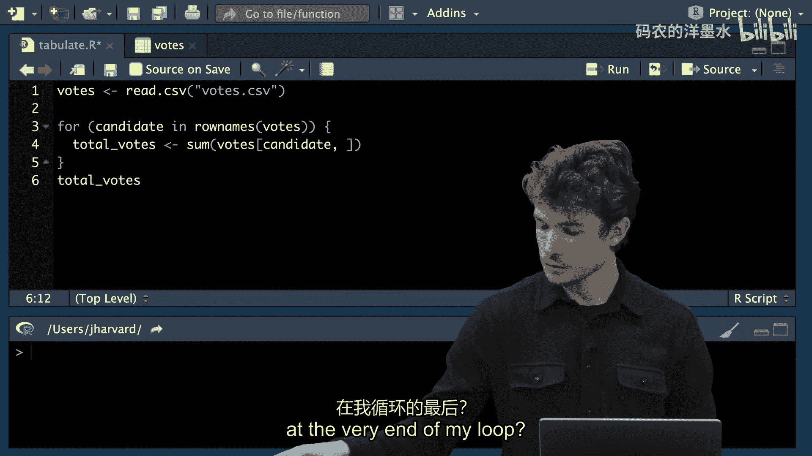

Any ideas here？Why can't I just leave my code like this？

And what might be the last value of total votes do you think the last value would be that votes the last candidate that we have in our list will be the final value of total votes so let's actually test this out if I go back to our studio here and why don't I run this code by clicking source and now let me check on the value of total votes just like this total votes seems to be 120 who had 120 votes seems like it was Bowser but why is total votes equal to Bowser's total votes let's think about this going top to bottom through our loop first candidate is equal to Mario and we'll subset our data frame to find Mario's votes we'll sum those up across all the columns and store it now in total votes but then we'll go on to the next iteration candidates will next be peach and we'll subset our data frame to find peach's votes。

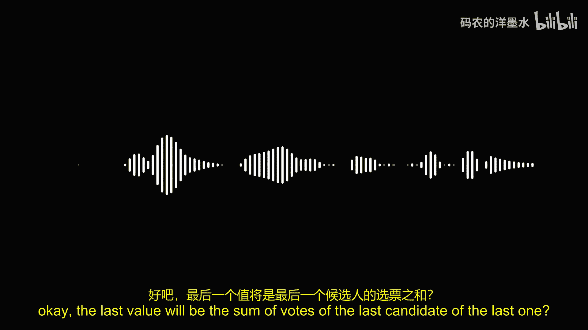

across all the columns and effectively overwrite Mariio's votes with peaches。

 so now total votes is peache's total votes， but then when Bowser comes along well Bowser will also overwrite peache's votes at the end of our loop。

 what do we have well only one candidate's votes and not all of them。

So it seems like we need some way of making a vector of these actual total votes。

 and we could do that using some new syntax in R。 One thing I could do is initially make an empty vector just like this。

 total votes and set it equal to this C filed by some parentheses。

 This is that same C function we saw earlier， but it means the empty vector。

 nothing at least at first。And then in my loop， I bet we could add to this vector so we get back at the end。

 not any single candidate' votes， but a whole vector of their votes。

 Now I'll need some new syntax for this and some new feature we haven't seen yet in R。

 but let's visualize what we could do with that syntax。

 So here is a visualization of the empty vector， total votes。

 There's nothing here because there's an empty vector right now。

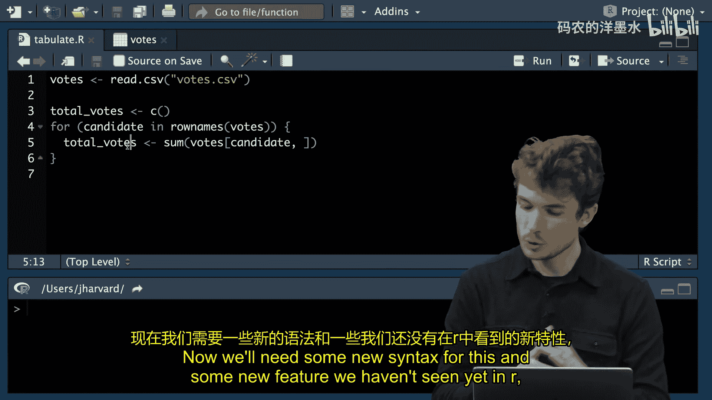

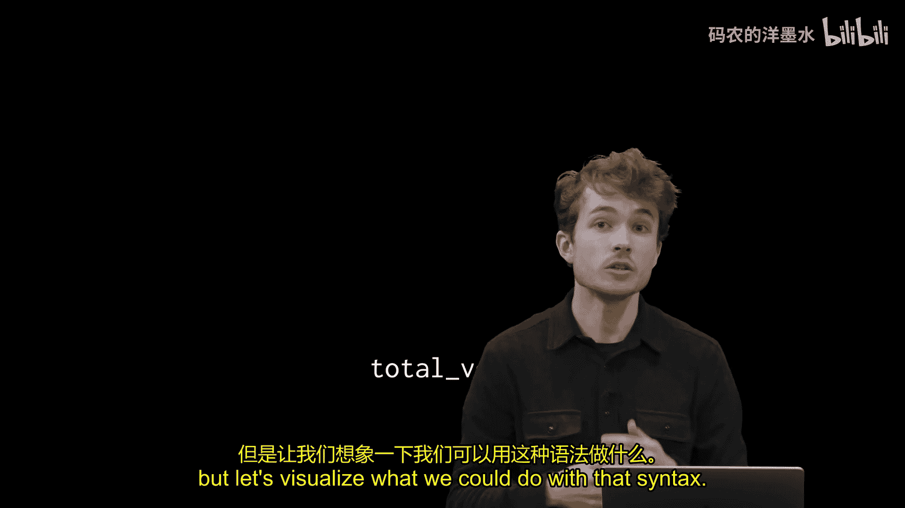

But if I wanted to add some new element to it and not just add the element， give it some name to。

 I could certainly do that。 I could say total votes。

 bracket and the name I want to give this element and then assign the value for that element。

 so if I want to add to this vector， total votes， an element named Mario that has the value 100 well I could do it using this syntax here。

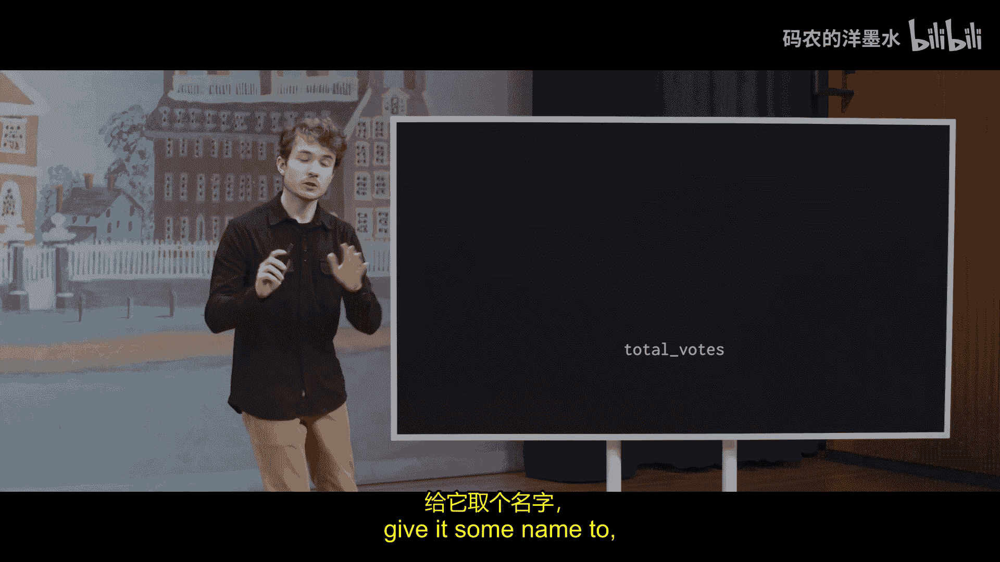

Well， what if I want to later add peach's votes， So's imagine this is the next iteration of our for loop。

 I would say total votes， bracket peach， and that would then make a new element of my vector called peach with the value 150 and same。

 let's say for Bowser on my next iteration I will add Bowsers' votes。 and now at the end of my loop。

 let's say I now have a vector of Mario Peach and Bowsers votes altogether now。

So let's try welcome back to our studio here， and let's try using this process of adding named elements to our vectors well on line five。

 I might say that I want to add to total votes。A new element whose name is， well。

 whatever the candidate's name is on any iteration， so I'll say total votes， bracket candidate。

 meaning that whatever the candidate's name is on this iteration。

 I want to add a new element with that name， and I'll give it the value of the sum of their votes。

So if I click source and now I go ahead and inspect the value of total votes by typing in my console。

 and enter。

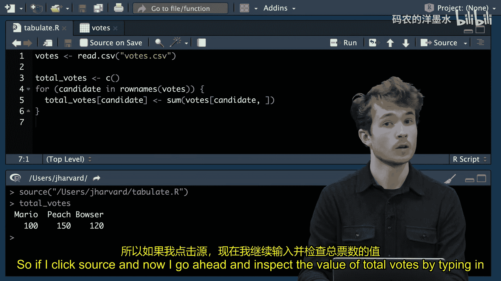

I'll see a much better output， I actually see each candidate's name in my vector。

 and I see the value now that they were assigned， 100 for Mario， 150 for peach， and 120 for Bowser。

So what questions do we have about this program as it exists now。

 Could we instead of adding the totalvols in a named vector。

 Could we add a new column to our votes data frame。

 We absolutely could so we could decide instead to make a new vector and add that as a column to our data frame。

 Just depends on what kind of output you want to do。 So here we wanted this output of a named vector。

 but we could change this to let's say not supply a named to each element and instead just add new element after element much like this。

 let me show you that real briefly here， I'll come back to our studio and let's say。

 I don't want to give it some name。 I just want to kind of add in successive elements here。

 I could say total votes。

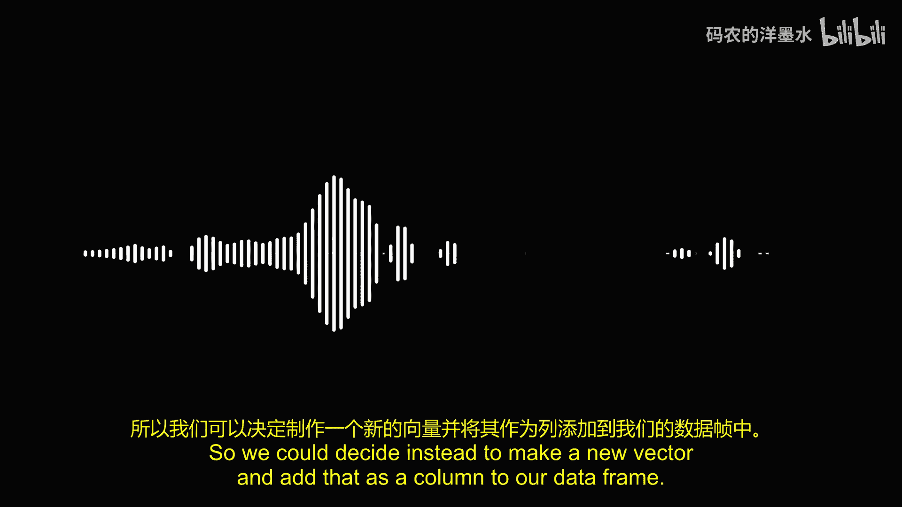

Becomes the combination of the current state of total votes。Adding in this new element here。

So a little bit tricky to par， but let's see what happens here， I'll click source。

 and I'll show you the value of total votes now， just like this。

And what do I get back well a total votes vector that is Mario's votes， then pe's votes。

 then Bowser's votes， and I could， if I wanted to add this as a column in my data frame。

 I could say votes total， let's say， and then I could say make that the value of this vector here。So。

 now， if I run。Sour， so I click source， I should see that I have this new column called total。

 and effectively， what I've done here is if I remove this part first is I've decided to start with this empty vector and then on each iteration。

 I want to take whatever is in that current vector and simply append or add on some new element。

 which will be the sum of the current candidate's votes。

 So on the first iteration we'll add our very first element to this empty vector here。

 but then on the next iteration， we'll have a vector of one element and we'll add in one more element on the third add the third and the fourth and the fourth and so on。

 So a good way to add vectors together using C as well。I hope that helps。Okay。

 so let's go back to what we had before here。 Let me do command Z a few times to go back to our named vector。

 and let's see what else we could do。 So if I click source， I'll see。

Total votes again is exactly what you want it to be。 But what if I wanted to sum up the columns too。

 to figure out for each voting method， how many votes do we receive。

 That is for each poll and mail column， how many votes were there in those。 Well。

 I could really just change my for loop instead of using row names。

 I could iterate over column names。 So call names will tell me if I under the console。

 call names will tell me。What columns do I have inside the data frame and I could then change my loop appropriately。

 instead of calling each column candidate on each iteration。

 I could call it maybe like voting method for the polling or the mail in ballots。

 and then I could change how I subset my data frame。Instead of subting by a row。

 I could subset now by column like this， and I could then update the name of each of these elements to instead be the same name as the method we're counting so pretty much the same idea。

 same flow， which different process across columns now， if I click source。

 I'll see in total votes that I've now counted up the total number of votes for each column。Okay。

So it turns out that this method of doing things in R， this kind of analysis。

 applying some function for every row and every column is so common in R。

 we actually have some family of functions we can use to do that same analysis and as we move from this world of writing procedures that is specifying a loop like this and specifying everything we should do inside that loop to relying more on functions we'll enter into this world called functional programming。

 where in functional programming we actually use functions to do the work of iteration for us。

Now one common hallmark of functional programming is applying some function across these individual rows as individual columns。

 so R gives us this function called apply and if I want to have the same result。

 we just saw with our for loop， but now using this function， I could use the following syntax。

 I could use this function called apply and give it three arguments。

 The first one is the data frame to work with in this case， votes as we see here。

The next one is one called margin and margin stands for。

 do I want to apply this function across all of the rows or all of the columns here when margin is one。

 that means apply some function across all of the rows when margin is two。

 that means apply this function across all of the columns here。And then finally。

 the third argument to apply is a function itself。 and this is a hallmark of functional programming。

 we can pass functions as input to other functions。 in this case， we're telling apply。

 here is the function I want you to use to basically work across all of these rows and all of these columns here。

 So when margin is equal to one what will happen when I apply the function sum or for every row。

 I will get back a sum of every element in that row。😊，When margin though， is two， what will I get。

 I'll get back the sum of every element inside each of these columns here， storing it。

 let's say kind of at the bottom of our data frame here。So let's see this in action。

 I'll come back to ourud here and let's try to use these apply functions instead of doing things more procedurally typing a loop and then everything want to do inside of that loop。

 I argue I could actually write all this code in terms of a single function call using apply。

Well I want to apply this function on a given data frame， votes， as we just saw。

 I want to apply it across all of my rows that is for every candidate that I have in my data frame and the function I want to apply is the sum function。

 I want to take all of these rows and for each row I want to sum up all of those values。Now。

 if I run this line of code on line two， what will I get？The same exact result。

 I'll get now a named vector， Mario， Peach and Bowser。

 these three elements here with Mario being 100， peach being 150 and Bowser being 120。

 notice how if I go back to my data frame， this is the same thing we had or for every row。

 I've now found the sum and apply has returned me the name of that row and the result of summing all the values in that row。

Let's think about this too What if I changed margin to2 Well this would find me the sum of every individual column。

 all the values within those individual columns， whereas before we had to change row names to column names and change various other objects now I can simply change one to two to work on columns here and they click source and now I'll see if I go ahead and hit line two command enter now I get back that same result the names of each of my columns and the result of suming up all of their values here。

Okay， so we've seen a much better way now to approach this same problem instead of doing things procedurally writing a loop and saying exactly what should happen in each iteration of that loop。

 I can rely on a function like apply， do a lot of that work for me， and moreover。

 I can pass a function as input to apply for it to use on each iteration that it goes through in my native frame。

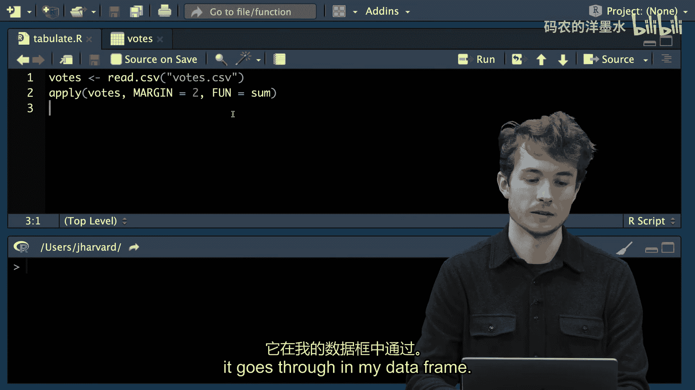

Now let me ask here。Having seen these apply functions and how they work。

 what questions do we have about them。My question instead of using the procedural approach of like sorting or unsing are there any like existing function that I can use it on the data frame for sorting the datas in the rows like our columns a good question so one thing you might want to do is sort your data R just going the function called sort that can do just that let me show you a little bit of it here if I come back to our studio let's say I want to sort this vector I'm given from apply I could call this vector something like total votes just like this and let me run line1 and then line two now I have total votes being this vector of named elements across my columns let's say I wanted to sort these let me say I could use the sort function here and I could type total votes inside as the input to sort and now if I hit command enter on sort I should see well it's kind of already in sorted order at least going low to high but now if I type question。

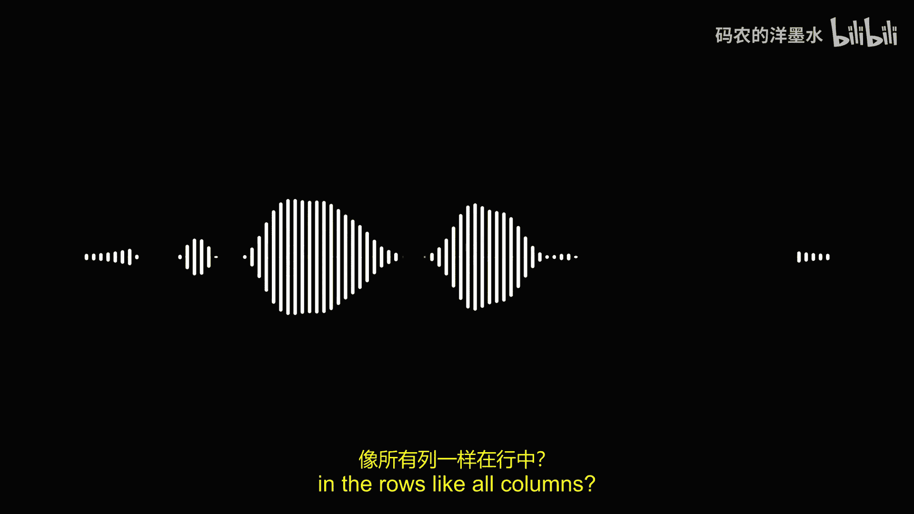

Mar sort to see how I could change the order here。 I might see that sort has this parameter called decreasing。

 which is initially false， which means that we're going to count up to set of down。

 But now if I want to sort going low to high or increasing order。

 I could set decreasing sorry know if I want to if I want to set the vector going from high to low。

 let's say instead of low to high， I could set decreasing go to true and then we'll see this vectors now in sorted order。

 I can do the same for the every candidate that I have。

 let me update total votes across the columns let me now online line3 run sort。

 and now I have my candidates in sorted order as well。

 So a cool trick if you want to sort your data now using this sort function and you can change whether it goes up or down using this decreasing parameter here。

 So we've seen a lot today。 we've seen how to define our very own functions。

 we've seen how to write our own loops to repeat code。

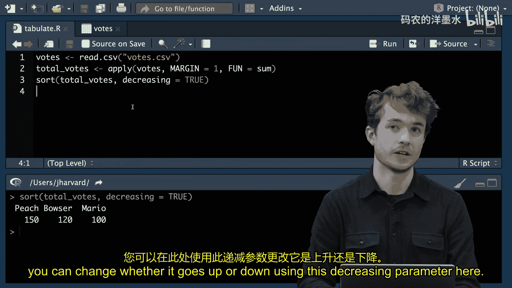

ultiple times。 And we've seen how to combine these two ideas。

 dipping our toes into functional programming。 that is using functions do the work of iteration for us。

 We come back next time。 We'll actually see how to clean up our data， how to tidy it。

 to make analyses like these even easier。 All that and more。 next time。 See you soon。😊。

