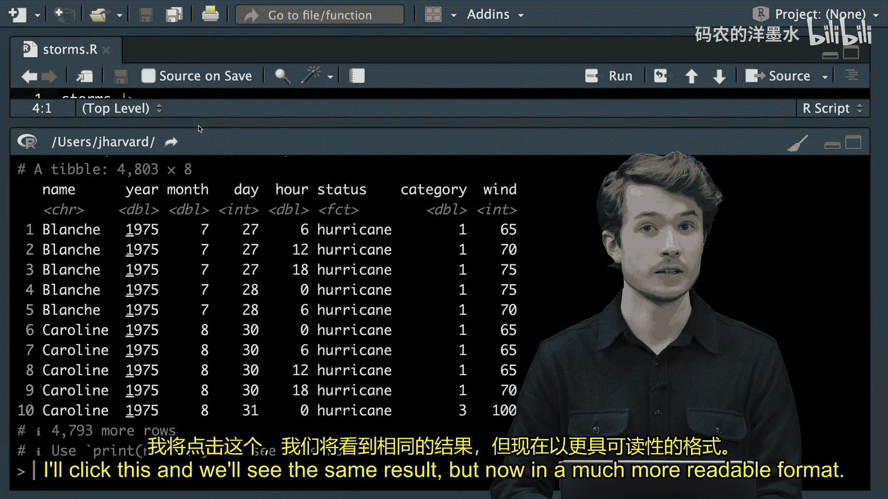
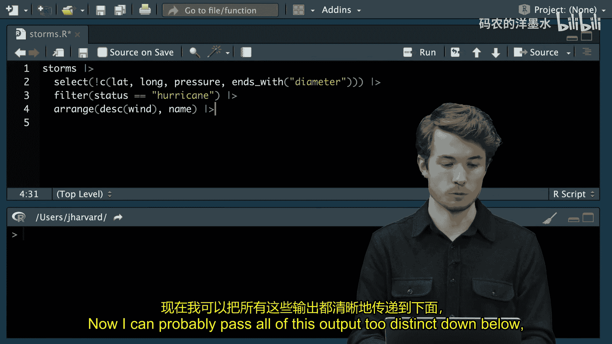
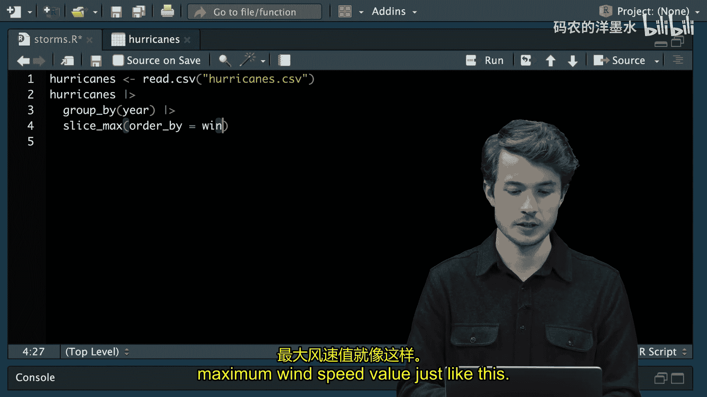
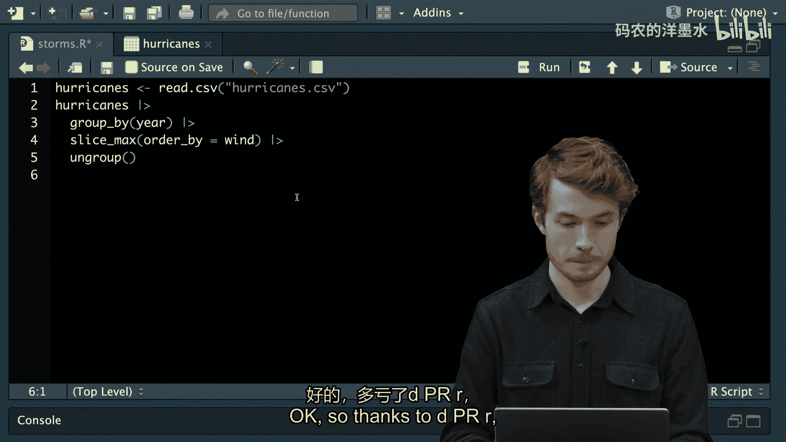
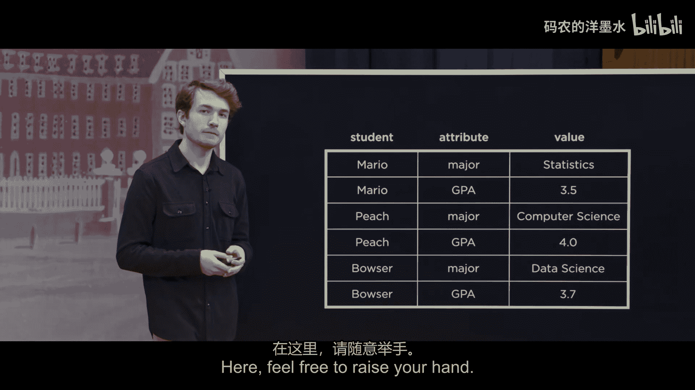
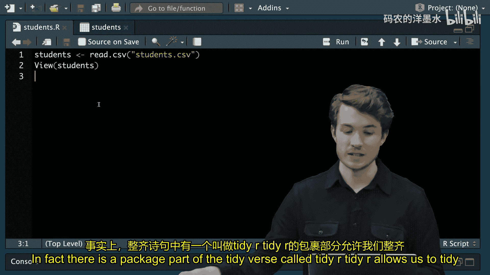
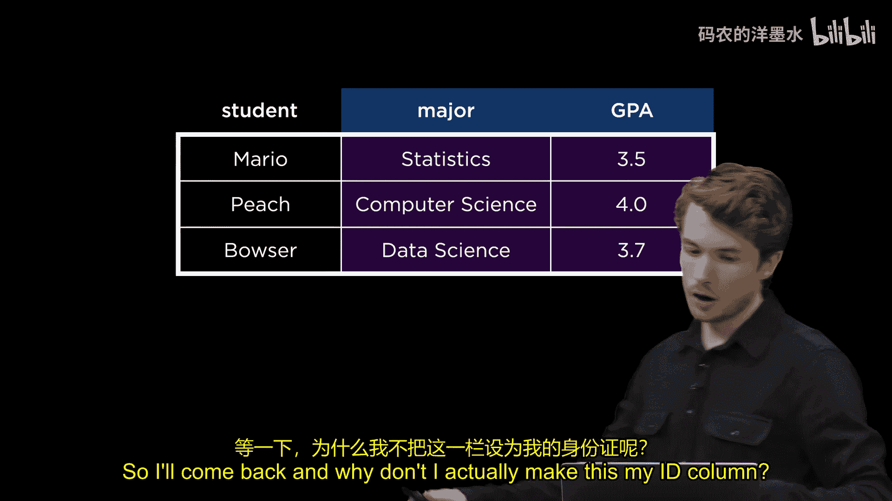
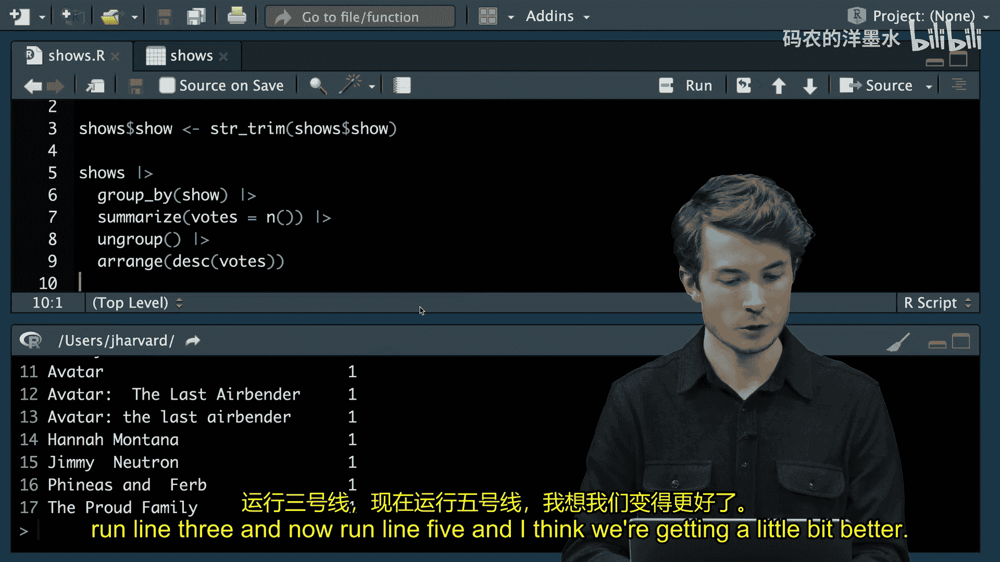
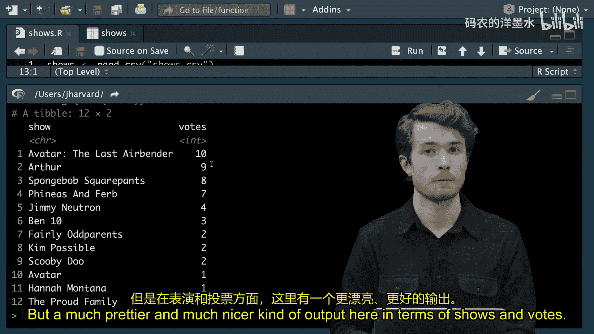
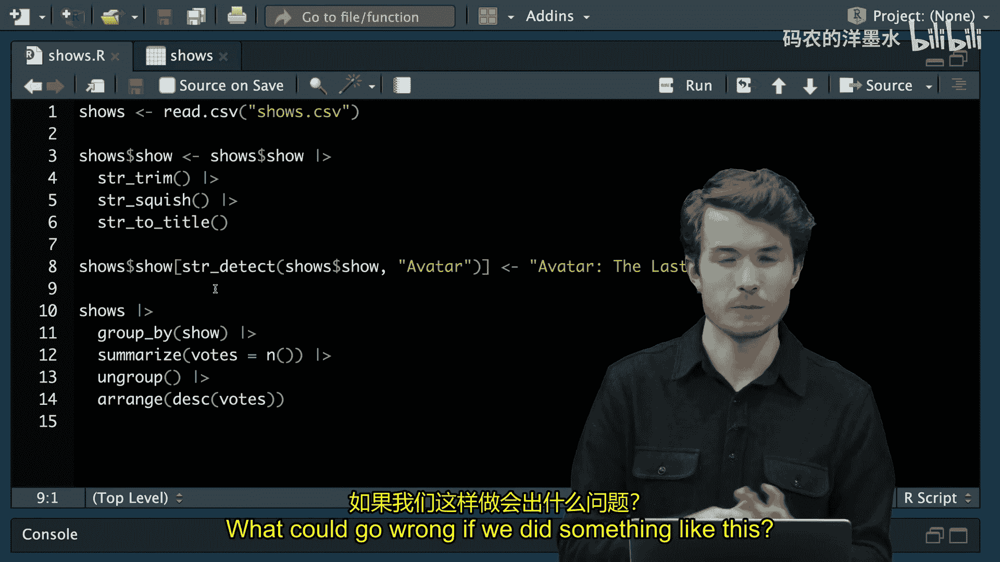

# 【全集】哈佛大学CS50 R语言编程  零基础入门 中英字幕 附完整课件 p05 Lecture 4 - 数据整理 -BV1mQywBhE2m_p5-

Well， hello one and all。 and welcome back to CSF's introduction to programming with R。

 My name is Carterzenke。 And this is our week on tidying data。

 Now Oz are you seen just how messy data can get。 Maybe your data is in the wrong format or your table is the wrong shape or maybe you have characters where you don't want them to be。

 Well they will give you some tools to solve those problems and more by standing on the shoulders of those who've come before us。

 In fact， this problem of tidying data is so prevalent in R that many have solved it already。

 we can use their solutions in our own code。 This code。

 somebody else is written and that we can use is called a package and we get packages that we can use from the cran or the comprehensive R archive network。

 You also download the R code from the Cran itself。 Now， focus today on the tidy verse。

 which is a package or really a collection of packages among them these one called D plier to transform data。

 one called Gpl2 to visualize data。😊，One called string R to work with character strings and one called tidy R to actually tidy R data in the underlying structure that it might have。

 So let's go ahead and jump right in。 we can actually install packages like the tidyverse using these functions here。

 install packages and we can then load them later on to use them in our programs using this function library。

 So let's try it out and come back to our studio here I'll go over to my computer and let's open up our studio where I have my console open So if I want to install a package like the tidyverse or collection of packages like the tidyverse I could do so with install dot packages and then passing in the name of that package quotes so for instance。

 I could type tidyverse quote just like this and if I were to hit enter here I would install tidyverse on my own computer。

Now， once it's installed， I need to load it so I can use it so I can use this function here called library library just like this to pull the tidyverse from my library and load it into my own computer。

 So I can use its functions and everything else therein。

 Now you may have heard this term library before。 we have programmed in R。

 we call packages this code somebody else has written that we can use。 And the library。

 the place with packages are stored on our own computer。

 So some tight difference in terminology there。 but I can load this package now using library tidyverse。

 And I've already done that here。 So won't it myself， but you can try it at home。Now。

 let's begin by thinking through what we can do with packages that come in the tidyverse and we said before there is one called D plier。

 D plier whose name is a bit of a play on these pliers。

 So maybe you've used pliers in the real world to bend something into shape to make it the shape you want to be。

 What's a similar idea with D plier， but now what you have and are not these physical pliers。

 but actual functions we can use to manipulate and transform data。

 So let's see exactly what those functions are， we're going to have six of them actually。

 one called selectors we can use to select certain columns from our data frames。

 one called filter to filter rows， one called a range to sort those rows。

 one called distinct to find unique rows and one's group by and summarize to find groups in our data and summarize data in those groups。

 let's take a look at all six of these functions in turn in the context of some data set that comes built into D per。

 one that involves storms。

Particularly strong storms in the Atlantic Ocean region。Now。

 this data comes from a group called NOAA， a US government agency that tracks storms and how they evolve。

 So we'll see in this data that we have not just individual storms。

 but observations of those storms of how they evolved over time and grew So we ourselves can understand how they grow and how to better prepare for them too。

 So let's jump in and see what this dataset looks like。 I'll come back to our studio here。

 and let's open up this storms data。 Now because it comes built into D pr。

 I can use it by some way typing its name。 So my console here， I'll type storms， the name of my data。

 and I'll hit enter just like this。 And this is a lot of output。

 So let's walk through it step by step。😊，Now， the first thing I see is that this seems to be what's called a tibble。

 I haven't heard that before。 So this seems to still be a table。

 I certainly have data in rows and columns， but this in particular seems to be what's called a Tibble Well。

 a tibble is a tidiverse creation。 one that is similar to a data frame， but more specialized。

 Give us some features we can use to see this data better and work with it more easily。 Now。

 one of the features is this prettier version of printing out what's inside our table here I can see a lot of rich information about this data set So let's dive in and see what we're seeing here。

 Now it looks like this tibble。 after I see a tibble here。 I see 19537 X13。 And what does that mean。

 Well， this means I have about 19000 rows in this data set。 Well， what are those rows。

 It seems like they are individual observations of certain storms and how they grew over time。

 So here I see the first 10 rows looks like maybe a storm Amy。😊。

And we have observations in the year 1975 and various months and hours and so on。Now I see X 13 here。

 which means I have 13 columns of data to work with， namely the name of the storm， the year， month。

 day and hour of the observation， the latitude and longitude is the location of the storm around the world and then one called status。

 where status tells me what type of storm was this， Was it a tropical depression。

 a more minor storm or was it a full on hurricane， One of the strongest storms we could have。

 I also see this category column， which tells me for hurricanes in particular。

 was it a category 1 hurricane or a category 5 hurricane where5 is the strongest and one is the weakest。

I see too this column called wind， which tells me the wind speed in this nautical term called knots。

 and I see pressure， which tells me how strong this storm was and I still see that this might not be 13 columns there are some that got cut off down below so I'll see them at least named down here。

 two more variables one looks like tropical storm force diameter and hurricane force diameter。

 these other terms that mean how strong this storm was on this particular observation So this is our data set in terms of rows and columns and notice too that the tibble shows that the type of these columns as well。

 So name seems to be a character day and integer status of factor like we saw last time there's lots we can glean from this particular output of a tibble here。

So let's jump in with a problem。 And I'd say my problem is。

 I want to try to find the strongest hurricanes and sort them from the highest wind speed to the lowest。

 Now， let's begin by my solving this problem in little baby steps。

 working our way towards getting to that kind of data we ultimately want to see。

 So I'll come back to our studio here。 And let's think through what we could do first。 Well。

 I want to write a program， do this work for me。 So I'll make a new file。

 I'll call file do create and then storms do R just like this。😊。

I'll go over to my file Explorer and click on storms。or and open up this file for me here。

 if I type storms， even in this file， I should have access to that same data set so long as I have loaded the tidyverse using library。

Now， if I looked at this table again， if I click enter here and see it。

 I think there are probably some columns I don't really want or need。

 Like I probably don't need latitude and longitude to figure out the ordering of the storms terms the wind speed。

 I probably don't need pressure or these other ones called tropical storm force diameter or so on。

 So I want to get rid of them。 and I can do so using a functions part of D plier。

 So let me go back to my file here called Sts do R。 and let me think through how I could do that。

 Well one function called select actually lets us determine which columns we want from our table and which ones we don't。

 So I'll use select here。 And because it comes from the D plier package。

 one thing I could do is tell R explicitly use the select function from the D per package as follows。

 I'll type D plier first， the package name followed by two colons and the name of the function I want to use just like this。

So now this is saying I want to use the select function that is part of the D plier package。

 this is not built into R， it's part of some package I downloaded， installed， and loaded here。😡。

Now the first argument to select is the data frame we want to work with in this case storms。

 so I'll put storms here is the first argument and the next one is a vector of the columns I either want to keep or remove if I want to keep the columns I can simply use C just as it is here。

 but if I want to drop some columns or remove them。

 I could select them inside this vector and use either exclamation point or minus to say I don't want those。

 I want you to remove them overall。So let's actually go to the exclamation point here and select the columns we actually don't want anymore in our data set。

 We said before we don't really want la and long nor pressure。

 nor one called tropical tropical storm force diameter。

 Nor one called hurricane force diameter and my goodness， this line is getting really long。

 So I think what we should do is stylize our code a little bit。

 One thing we could do is put each of these arguments on its own line here。

 Let me move the first argument to its own line the next as well to its own line still separated by comms now。

 I'll put the final closing curly brace for select on its own line as well。

 So this at least makes it a little more readable。And now， if I run this line of code。

 let's see what happens。 Well I'll get back。 still my tibble。 But now with those columns removed。

 So select has then dropped those columns for me and simplified my data frame。

But as you might have guessed， I was kind of annoyed I had to type out all of this tropical storm。

 force diameter or hurricane， forced diameter。 There is actually a better way。

 and select comes with a few helper functions we can use to select some of these columns。

 So for instance， some of them look like this。 We have one called contain。

 which we could give a character string， and it will select for us all columns that contain that character string or ends with or starts with。

 which might select columns that end with or start with some given character string。😊。

And one thing I noticed， if I go back to my code here is that both of these long column names end with diameter。

 so I could probably use ends with here as a helper function for select， So why don't I do that。

In my vector of columns to select， why don't I use ends with and pass in the character string I want to match。

 So maybe in this case， it will be diameter。 And now this function ends with。

 willll match and include any columns that end with diameter。 but of course， in this case。

 we're actually going to remove them because of our exclamation point here。

 and we should see that if I run this line top to bottom， we have the same result。

 but now in much fewer lines of code。Now， what should we do next。

 we have our columns chosen that we want them to be。

 but maybe the next thing is to work only with hurricanes。

 So I don't really care about tropical depressions or tropical storms。

 I want hurricanes in this data set。 that's a great job for filter。

 I've removed all the columns I want。 Now I should remove some rows。

 So filter is good for removing rows and finding subsets of our data。

 it works very similar to subset like we saw last time but a different kind of function name here。

 So why don't I try using filter and I'll do so like this。

 maybe I want to type D pr because part of the D per package here。 and then filter。

 and the first argument to filter is the data frame I want to work with similar to select。

 So maybe what I could do is pass in this updated data frame as the first argument to filter just like that。

 And now as the next argument， the second argument to filter。 I can supply a logical expression。

 Any kind that involves the data frames column。So if I looked at my my table again。

 I would see that the status column tells me what kind of storm this was so I could write a logical expression to say I only now want those rows where the status is equal in this case to hurricane。

 Let me go ahead and run this and see what if it works。 I'll run this top to bottom。

And now I see I've subset my data frame now to only those that include hurricane in the status column。

 very similar to subset like we saw in an earlier lecture。Now。

 this is a good amount of typing so far。 I have many functions involved really just two。

 but it looks like a lot。 I could probably simplify this in two ways。

 The first one is I don't strictly need to use this syntax that tells are which packages these functions come from I really only need to do this if I have two packages that have a function with the same name because if you have two packages loaded that have functions with the same name R won't know which one you want to use if instead though。

 select is the only function I have in all my packages。

 I don't need to tell it that comes from DPier explicitly。

 so I could remove this as well as this up here because filter and select are only part of DPr R can assume they come from that package。

But I think a larger problem here is that if I were to want to do more with this data set。

 I need to keep nesting and nesting and nesting my code and it's not exactly what I want to do already I have to read from the inside out。

 I first select my columns and I pass that to filter versus maybe from left to right， top to bottom。

 which is what I'm more used to now So thankfully there is a solution in R and this is called the pipe operator。

 The pipe operator looks like this。 So one of these two options here either the top or the bottom and it allows us to pipe some value on the left hand side as the first argument into a function on the right hand side。

Now， there are two versions of the pipe operator。 The first one was this one down below here。

 which is part of a package called the Maggratar package。

 and that allowed people to use this pipe for the very first time in R's community。

 and people loved it so much。 They actually built it into R itself using this version up here。

 So nowadays， the most common version to use is this top one。

 but you might still see code using this bottom one for R purposes they are effectively equivalent。

 Now， let's see an example of using this pipe operator here。

 Let's say I'm selecting some columns from storms and I want to maybe do it like this like did before。

 I have storms as the first argument。 I could rewrite this code as follows。

 I could take the storms data set and pipe it into select。

 So now it is implicitly the first argument to select。

 and I can still name all my other arguments after this first one here。

 So storms is going to be passed into select。 and I can still name the columns now I want to keep or drop。

😊，But this gets really powerful when I want to chain functions together。

 So here I'm going select some columns。 What if at the same time， I wanted to filter some rows。

 Well I could do this。 I could say first pass storms to select。

 pipe it to select as the first argument， select the columns we want。

 and then pipe that result now to filter， which will filter through the rows we want to。

 And in the end， I'll get back they I was hoping for。 Now I can read top to bottom left to right。

 as opposed to from the insidemost function to the outside most。

 So let's try this now and rewrite our code to be much more readable using these pipe operators。

 I'll come back to our studio。 and let's try this out as opposed to nesting these functions。

 Why don't I use the pipe operator。 I'll take storms again， just like I had。

 and I'll pipe it into select Now， as we said， storms will implicitly become the first argument to select。

 So I no longer need to say storms anymore。 I'll know that is the first argument to。😊。

What I can instead do is to start supplying the second or the third arguments here。

 I could say I want to select early drop these columns， la， long pressure。

 and all those that end with diameter in this case and now I want to pipe that result the columns I have actually kept now from storms into filter and of course that will implicitly become the first argument of filter now I just apply the second argument which is the logical expression so in this case where the status column is equal to hurricane just like this。

 let me go ahead and run this code， I'll click this and we'll see the same result。

 but now in a much more readable format。

So pretty cool what we can do with the pipe operator。

Let me pause here and ask what questions we have on these packages， on the pipe operator。

 or select or a filter。Is there any kind of joins like in SQL。

 So a good question about joins like we have those in SQL。

 And if you're familiar with joins and with SQL， you'd know that you can take different tables of data and combine them kind of column wise if they have two columns that reference one or the other。

 Now， it turns out you can do just that in R with a function called merge。

 There are also packages in R that you run SQL statements inside of your R code。

 But we won't focus on that in this lecture today。 Let's take one more。😊。

I wondered what output like CHR and DBL and the output of the Tbble represents Yeah。

 great questions let's go back and look at our Tbble again I'll come back to my computer over here and let's see a little bit more this output from our Tbble I'll run line1 again and we'll see the resulting Tbble which is a table of data here let let me full screen as we can see it at large。

😊。

As we said a little bit before， we have some output on the kinds of data we're storing in each of these columns or the storage mode of these columns。

 Now name seems to be storing characters。 CHR is short for character DBL here。

 the short4 double or some floating point value， some decimal value。

 even though we don't quite see it here in the output underneath the hood year is storing actual floating point values or decimal values。

 Sam with month day seems storing actual integers like hold numbers。

 And let's see status here seems to be storing factors like we saw last time。

 so this data can have categories built into the vectors as well。

 So these are different abbreviations for the storage mode of whatever kind of data we're storing in each of these columns。

 But a good question to clarify the output of our tippo here。Okay， well， let's keep going。

 And I think Ive argue we've gotten pretty far already using just select and filter。

 But the next thing to do would be to arrange our rows in terms of the highest wind speed to the lowest。

 So let's see how we could do that。 Now if I want to arrange our data or sort it a will be the tool for the job built into D pr。

 So let's see what that could look like here。 I could simply pipe my result currently after filter into this function called arrange。

 And by default， the first argument to arrange is the table to work with。

 But now the pipe operator takes care of that for us。

 the next arguments then to arrange are simply the columns we want to use to sort our data。

 So if I want to sort by the wind column， maybe highest wind to lowest wind value。

 I could give as input to arrange the wind column just like this。 No quotes nothing。

 just the wind column name。 Let me go ahead and run this now and see what we see。

Let pull this up again， and we'll see。嗯。😊，Certainly seems to be arranged by wind。

 but these seem to be some pretty low wind numbers。

 So I think what's happened by default is a range has taken the wind column sort ars by it。

 but done so in ascending order from the lowest wind value to the highest all the way down below what we really want is descending wind order。

 So the highest wind values first and the lowest later on。

 So let me go ahead and go back to my program here and let me try instead doing this DC see around wind just like that。

 and that will take the wind column and make it in descending order。

 which will pass to a and now arrange we'll be able to sort our data set in descending order by the wind column let me go ahead and run this now and we should see we have what we wanted wind now the highest values at the very top and we see we go lower and lower and lower as we go lower in our data set。

 at least in terms of the wind column。So pretty good。 we're getting there。

 One thing I still see though， is that let's say some hurricanes have the same wind speed like Gilbert。

 Wilma and Dorian have Well it would be nice if when within hurricanes that have the same wind speed。

 we also sort by name。 So ideally like Dorian would be first in this group and then Gilbert and then Wilma。

 we can still do that with a range as well。 we could give a range not one column to sort by but two as well。

 maybe first sort by wind， like we just told it to do。

 but if any two observations of hurricanes have the same wind speed。

 what we could tell it now to sort by the name column and by default it will sort alphabetically by name。

But if I wanted to do reverse alphabetical order， I could do D ESC with name as well。

 So let's do alphabetical order just like this。 And now I suspect we'll see that our rows will be first arranged in descending order by wind value。

 And then if any two rows or observations have the same wind value We'll sort those alphabetically by name。

 Let me go ahead and run this line here and pull it up and we'll see exactly that。

 So it seems like those observations that had a wind value of 160。 Those are now sorted。

 those now sorted by name as well。 Dorian then Gilbert then Wilma。

 So we're making some pretty good progress here。😊，One last piece， though。

 before we get to our final output， which was the hurricanes sorted by highest wind speed to lowest。

 and maybe you notice it too。 So here what I really want our single hurricanes。

 But what I have are observations of hurricanes。 I have many observations per any single hurricane。

 and it seems like I have duplicates here。 I have Dorian here at least twice。

 I see Allen here many times。 And so my goal is to really remove those duplicate values and end up with one observation for each hurricane。

 Now we've seen how to select some columns， how to filter our data， how to arrange the rows。

 but if I want to remove duplicates。 We need to rely on a new function， one called distinct。

 which is also part of D pr Now I can probably pass all of this output to distinct down below。

 but I think it's worth visualizing first what exactly distinct is doing for us。

 So let's do just that with some。

。Over here， we've seen this distinct function。 but what can it do。 Well， here。

 let's consider this example data set that includes two distinct storms。

 one named Anna that happened in the year 1979， and one named Anna that occurred in the year 1985。

 These are two distinct storms。 and it seems like we have three observations for each of these different storms。

Now， I could use the distinct function to get back ideally the two distinct storms in here。

 One row for each of the two distinct storms。 Now， I could pass， like we saw before。

 this storm's example table，2 distinct。 And if I were to run it， Well， what would happen By default。

 distinct tries to find duplicate rows in my data。 But then the question is。

 how does it know which rows are duplicates。 Well， by default。

 distinct looks at all the values in all the columns and determines of a row as duplicate when it finds all those values in all the values of another row。

 So let's do step by step here， row1， Anna 1979，50。

 Do I see all three of those values anywhere else in this table on a single row。I don't。

 Let's go to the next one then。 So， Anna，1979，40， do I see all three of those values elsewhere in this table on any given row。

I think I do。 I see I think I see them on this next row here By chance， Anna 9，79 and 40。

 all three of those values across all the columns match。 So this would be a duplicate row。

 according to distinct。 I see also these two down here， which seem to be the same thing。

 These two could be duplicates because they have the same values across all of their rows。

 So these would be our duplicate values。😊，Now distinct will find these duplicates and return to me only the first one it has encountered。

 So to be clear， this row in this duplicate group and this row in this duplicate group and what we'll get at the end is a table looks a bit like this。

 Only one row for each of those sets of duplicates。 and we now have at the end well。

Not exactly what I wanted。 I mean， I have two values now for each of my distinct storms。

 but I really only wanted one。 So distinct seems to have failed at least at this first pass here。

Well， thankfully， we can actually tell distinct how to determine if any given row is distinct or not。

 we can pass in as an argument， the column we want it to look at to determine if any row is distinct or not。

 so let's try the name column if I pass distinct the name column would look only at the name column now to determine if rows are distinct。

But。What might be the problem here。 So if I look only the name column。

 do any of these rows seem distinct， Probably not， right。

 They look all the same like they have the same name。

 So distinct would say I found you an entire set of duplicate rows here。

 which I will then return to you the first one from So this top one here。 And I mean。

 that's not what I want either。 So it turns out that what makes storms distinct is the combination of their name and their year。

 So let's then give distinct those two columns。 Let's say distinct。

 I want you to look at both the name and the year columns and use those to determine if any given row is distinct。

 So distinct will look only now at name and year。 and looking at only those two values。

 what do you see。WellI think I see two sets of duplicates。

 These are duplicates here and these are duplicates here and distinct will find those for me when it runs and find these two sets。

 returning for me for each set， the first row， So I should get back actually。

 what I was hoping to get back one row for each distinct storm。

 thanks to this function called distinct。 So let's try it out now in our studio。

 I'll come back over here。 and why don't I use distinct。

 but now give it both the name and the year columns to determine if some row is distinct。

 I'll go ahead and run this code here。 and。😊。

I think I have distinct storms like I don't see Allen in here any other times。

 I don't see Dorian or Gilbert or their combination of name and year。

 but I'm missing on their columns so it turns out in distinct。 We need to tell it No no。

 we also want you to keep the other columns too and we do that with a argument called dot keep all and set back equal to true this dot might be a little bit new it essentially differentiates this argument from any column names so notice here how we're passing in his arguments like name and year。

 these column names， the tidyverse craters thought it would be unlikely that your columns begin with a dot and so decided that one to control how distinct works will be include a dot at the beginning here。

 So let me run this again and we'll see I now have all my column back thankfully and I do see distinct hurricanes or distinct hurricanes where each one is distinct by both the name and the year。

So we've seen now a range and distinct。What questions do we have on those two functions in DPR。

Allright， seeing none， so let's continue on and our next task will be to look at how we could well actually。

 our next task would be to kind save this data like I think we're kind of done with how it's hit results here。

 So why don't I try to save this data now as its own CSv I'll take the storms data that I have and why don't I store it in an object called hurricanes like this So now I can keep it and reuse it later on in my code and why don't I try to now write what I have as its own CSv I could do so by using the pipe operator。

 I'll take the hurricanes data set now， which should be clear is the same table we just saw and why don't I maybe first simplify the columns I'm choosing for it when I write it to a Cv。

 I'll select now maybe just the year and let's see the name and the windspe columns and I think that will make things a little simpler for me I'll then pipe that into right do CSV implicitly it will be the first argument。

 I'll then type hurricane。csv is the name of that CSv file and I'll tell write docv that I don't want any row names we've seen in the past。

 and now if I click source， we'll hopefully see if I go over to my file Exper that I have this file called Hurricanes。

cV， which includes all that data in that Tbble but now as part of its own file。

So what else could we do， Well I think we've solved our first task。

 but one other one I would find interesting is trying to figure out you know what was the strongest storm。

 the strongest hurricane in each given year， so let's start there now I'll kind of remove what I have in Sts。

 R so far and I'll instead load what I now have in hurricanes。 csv。

 I'll make a new object called hurricanes and I'll read in my hurricanes CSsv and now if I view if I view hurricanes。

 well I'll see all my data in this data frame here。Well， I want to find ideally the strongest storm。

 the strongest hurricane for each year。 and if I visually sort this data top to bottom using the year column I might notice that every year has well several hurricanes。

 So 1975， for instance， seems to have had roughly six of them。

 1976 here seems to have had also about six of them and my goal is really to end up with a table that looks a bit that looks a bit like this one here。

 I have one row for every year and in that row I have the storm。

 the hurricane with the strongest wind speed if you're new to programming new to R in general。

 it might not be quite obvious how we get from our data frame we just saw to this data frame here。

 but we can think about it first conceptually。 So let's try that I'll come back over to our studio and let's just think through what we would want to do。

 how we to do this by hand。 Let come back to our studio and look at our table here。Well。

 I might notice that for each value of year， I have some number of rows， like let's say from 1975。

 I have one，2，3，4，5，6 rows。Now how we're doing this by hand。

 I might look at all the rows that fall into this group of rows that have the year 1975。

 and I might then choose the one that has the highest wind speed like Gladys it seems here。

 I could then do the same thing for 1976， I could look at this next group of rows， if you will。

 1976 and look at those six rows that have that value， 1976。

 I might then pick out the one hurricane that had that strongest wind speed。

 which seems like be in this case。😊，So we're thinking a little bit in terms of groups。

 I would group my data by the value of the year column， look at rows for each value of year。

Now it turns out that in R， we cannot just think in terms of groups。

 we can actually use some syntax to apply groups to our data set。

 and we do so using this function called Group by which we'll visualize here together。

So here is our group by function and we'll see how it works together using an example data set here。

 So let's say I have this table of hurricanes and in this case I have hurricanes in the years 1975 and 1976 Now as we saw kind of conceptually back in our studio it would be nice if I could think of groups in this data where those groups are determined by the value of the year column Now group by can actually do just that for me。

 I can take the hurricanes data set here and pipe it into group by and tell it which column I want it to use to determine what groups there are in my data if I give it the year column what will it do it will find for me all the groups of rows for each value of year in this case will see well two groups one where the year is 975 and one where the year is 1976 these are now my groups of data based on the value of year。

😊。

Now this gets really powerful when I apply a function by each group which I can do after grouping by here。

 I could then pipe the result of these grouped rows into a range and a would normally sort my entire table top to bottom now I'm in descending order by wind but because I've grouped here it will actually arrange these rows within each of their groups。

 for instance I would get back the following。Notice how each of these rows are sorted。

 but they're sorted within their groups。 A range has been applied to every group that was bound by group by and then for the final flourish here。

 I could take each of these groups and pass them into this function called slice head。

 which basically means take the first row you see in each group and will I get back。 Well。

 the single hurricane now that had the strongest wind speed in any given year。Pretty cool。

 So let's try this out now in our studio and see what improvements we could still make。😊。

Come back over here and let's try to use group by so group by we said can take my data frame。

 my Tbble， whatever it is and apply groups to it。 I'll group now by the year column I want to find groups in my data by the value of the year column and then for each of those groups I want to arrange them。

 I want to arrange them in terms of descendending order by the wind value okay and then for each of those groups。

 I want to slice the head off。 I want to take the first row I see from each of those groups so now if I save this file and run line2 I should see。

Well， only one value per year， and it should be the hurricane that had the strongest wind speed in that year。

Now we've seen a function like slicelic head here and it turns out there are others that are useful to us too。

 they're often used with groups， among them are these we have slicelic head。

 which turns to us the first value in any given group， slice tail。

 which gives us the last value in any given group， and ones that are more advanced like slice max and slice min。

 where I can actually give slice max a column and it will look in each of those groups and pick for me the highest or lowest value of that column and return to me the row that has that value。

So I think I could actually rewrite this using maybe slice maxs because I'm looking for in this case the value that has the highest that has the highest value in the wind column。

 and they come back to our studio here， and let me try not arranging and slicing the head。

 but allowing slice max do that work for me， allll group by year and slice max for every row for every group I'll try to find in this case。

 the one that has the highest wind value。😊，And to determine which value to use in slice max。

 I use this argument called order by that says for each group。

 order it by the wind and then take the highest value in this case。

 the order that has the highest value for wind。 if I run this line here。

 I should see the exact same result， but now I'm letting slice max do a bit more of the work for me。

All right， what else can we do with these groups？ Well， let next you first pause here and ask。

 we've seen how to group by now。 We've seen how to order within groups。

What questions do we have if any about these groups？Okay， sir in the first， when we declify a filter。

 and the first is two or three sections， we bought integrated filter for each database。

 Can we use it now。

A good question so we saw earlier we could kind of filter some rows out of our data and we kind of do that earlier on in our pipeline of this pipes going back and forth。

 if you will， we could still though apply a filter here so let me go ahead and try this out now I'll come back to our studio and let's say I now have at least it seems to me this data set that includes one hurricane per year but I could still filter this data。

 I could maybe find those that occurred maybe between 1980 and 1990 so I could go ahead and say let's filter this result here and try to find those where maybe the year is greater than or equal to 1980 and let's say the year is less than or equal to 1990 that would give us a subset of my data where the year is between 1980 and 1990 inclusive let me go ahead and run this and we should see that my dataset has been shortened a little bit it now includes 11 rows from 1980。

To 1990 so we can apply a filter at any point in our pipeline。

 but it will apply to whatever we pass to it as or through this pipe operator here。AGood question。

Okay now there's one more thing we can do with these groups and one more question I think is interesting to ask so in the hurricanes table actually what we have now is we can still see kind of our old value。

 the hurricanes CSV here and one question I have is well for each year how many hurricanes occurred in that year it seems like for 1975 there were 1。

2，3，456 same for 1976 but we want to figure that out for each and every year or for each and every group so we're effectively doing is summarizing our data trying to find some number in this case the number of roads we have in each particular group。

Now， a good way to summarize your data by group is to use the summarize function after you group by some particular value。

 So let me go ahead and try this。 I'll say summarize and I'll pass in a function I want to use to summarize those groups。

 Now it turns out I can use functions like mean for instance I ask for the mean maybe wind speed for each group but I might need to ask for something else here。

 I want the number of rows in each group which in this case will be determined by n where n is a function that finds for me in every group how many rows there are So I'll pass as input to summarize this function N and summarize will apply for each group this function N returning to me the number of rows in each of those groups。

 let's try it out I'll enter here and now we should see I still have all my years those groups now but I'll see only a single value for each one I've summarize them in some way in this case I've summarized them using the n function。

 which。How many values there were in each of those groups。 So it seems like to translate now in 1975。

 there were six storms。 and in 19， let's say， 82， there were two hurricanes。

Now I could make this a little prettier， arguably I could actually go back down here and I could change this from n to simply to hurricanes equals n and this is allowing me to name the resulting value so if I then run this again。

 what do we see well I see a named value the named column now called hurricanes so I'm still doing the same thing。

 I'm still applying this n function over each of my groups。

 but because I've now typed hurricanes equals n， I'm naming the resulting column in the data frame that I get back。

So pretty cool to summarize now our groups altogether。

 Let's go ahead and just see one more thing in terms of groups。

 let's go back to what we had before of grouping by year and I'll slice now the row with the maximum wind speed value just like this。

Let me show you again the Tbble we had。Notice how in addition to the column names and their storage modes。

 we also have this here， which has groups， and it seems like we have the very thing we grouped by the year column So if I were to save this tibble as its own object and reuse it later。

 it would still be grouped by year， which may be good or it may be bad。

 maybe I only want to group by year in this particular analysis so you should know about and least be careful about knowing which groups are in your data and if I wanted to ever remove some groups I could do so using the ungroup function。

 I'll come back over here and show you what that looks like。

 I'll go back to my storms R file and I will then take this code， I'll pass it into ungroup。

 which if I run this now will allow me to have a tibble but now there are no more groups。

 I temporarily grouped by year and while you're group by year。

 I sliced the maximum value in terms of wind for each。

Group and then I ungroup so I can save this Tbble and reuse it later while applying some new groups that don't have anything to do with year now。

Okay， so thanks to D PR， we've seen how to transform our data in all kinds of ways。

 When we come back， we'll see how to tidy our data even better using a new package called tiDR。

 See you all in five。

Well， we're back。 And so we've seen how to organize data and transform it when that data is already pretty well organized。

 but odds are， you'll be given some data sets that aren't as well organized。

 It'll be your job to ti them up and turn them， at least in the right format。 Now。

 what is the right format for our data。 Well in R， we have this idea of tidy data where and it is tidy should adhere to three principle So we're going to walk through this principle step by step here。

 The first principle is this that each observation is a row。 And each row is an observation。

 But what does that mean， Well， if I look at this table here of hurricanes。

 We know that because this is a table of hurricanes are observations are individual hurricanes。

 so it stands to reason that every row in this table should be about a hurricane and as a corollary。

 we shouldn't have any rows that aren't about hurricanes。 So here I seem to have maybe met。guideline。

 my first column here or my first row here。 that seems to be a hurricane。 my next row。

 that seems to be a hurricane as well and so on down the line。

 I also don't have any rows that aren't about hurricanes。

 So this seems to adhere to that very first principle of tidy data the next one though has to do with columns where each variable is a column and each column is a variable let's show an example again。

 So if we have this table of hurricanes， it stands to reason that these hurricanes could vary in some way maybe they happened in different years。

 maybe they have different names maybe they have different wind speeds。

 well the way these hurricanes can vary， those should be the columns of our tables and more importantly we should only have the ways a hurricane can vary as our columns we should not have columns that aren't away that a hurricane could vary and I think that this table satisfies that second constraint of tidy data I have here one。

For theOne column for the name and one column for the wind speed of each of these hurricanes。Now。

 our third and final principle of tidy data in the R universe is this that each value is a cell and each cell is a single value。

 Now let's see an example again here I have this same table and the values now are something things like a year like 975 or a name like eloise or a winds speed like 110 here。

 and notice how each of these values is in its own cell and each cell has no more than one value inside of it。

 So I think that this table here also satisfies that third constraint。 So this is。

 I would argue an example of tidy data， but odds are you won't always have tidy data and the process that which you might actually do to make it ti is a process known as normalizing converting your data into the standard format that makes your analyses just so much easier。

😊，So let's see an example of data that isn't quite so tidy。 here is a table looks like of students。

But I want you to look at it for a few seconds here and think， why might this data not be very tidy？

What principle might it violate or what do you think would be better designed about this data here。

 Feel free to raise your hand。

Why might this data not be as tidy as it could be？Okay， I think because there is computer signs。

 which has two words or two variables and there is a float number。

 I don't know if it concludes in this particular rule。

Yeah， good observation， so we have computer science here。

 which is maybe it has a space in the middle we also have some floating point values and actually like your thinking that this value column seems to have different kinds of data like on the one hand it has a 3。

5 which is this kind of floating point value at decimal value but it also has character strings too so that is one example of why this data isn't quite so tidy one of the main ones I'm thinking of though is this attribute column so it seems like the ways a student can vary are not so much columns as they are values in these rows so a student could vary based on their major。

 maybe they major in statistics or they major in computer science。

 they major in data science and they could vary in their GPA or their grade point average how well they're doing in their classes Mario seems to have a GP of 3。

5 peach seems to have a GP of 4。0 and Bser seems to have this GPA of 3。

7 but if these are ways a student can vary。😊，Well， shouldn't they be columns instead so I'd argue that this data is not very tidy at all and what would make this data tidier is if it was in this format here。

 notice how the ways a student can vary by major or GPA are now our columns and for each of those columns we have the values and to Ahmed's point earlier。

 notice how we now have columns all of the same type because we converted those rows now into columns are major is all the type character and our GPA is all the type numeric so this I would argue is tidier data。

Now let's see how it could take data like we just saw before， that's not very normalized。

 not very tidy and converted into this example of tidy data here。

 I'll come back to our studio and I already have open this file called students。

 R and it will load for me this CSV called students。 CSv let me go ahead and load it here。

 I'll hit enter and command En again and now I'll see this data set here。

I should see a similar format that has those same concerns we had。

 namely the value column seems to have conflicting kinds of data types。

 both numbers and characters and the attribute column。 Well。

 really this has values that should be columns of our data set。 So thankfully。

 we actually have functions we can use to help us accomplish this task of tidying up this data。

 notice need to do it by hand anymore。 In fact， there is a package part of the tidyverse called tidy R tidy R allows it to tidy up R data and make it adhere to these tidy data principles。

 Now， let's see an example here。 We can use an example function called pivot wider and pivot wider is going to serve us well because pivot wider takes columns that have values that have row values that actually should be columns themselves。

 So for instance， let's see this table here。 notice how the attribute column has values in these rows that should be column name。

😊。

Like we saw earlier， we want major to be a column name， we want GPA to be a column name。

 Well we've seen these are in a column here and pivot wider can help us take this long column of column names and convert them now to be column names themselves。

Notice too that for every column we might want to make。

 we have a value for that column for any given student we have。 so for instance。

 in Mario's major column， we'd like to see statistics in Mario's GPA column we'd like to see 3。

5 and so given a column that has values which should be column names and a column that has values for those columns themselves pivot wider can take those and make a table that looks a bit like this。

Let's focus now first， just on Mario to see this visualization happen dynamically。

 let's look at Mario here， notice how Mario's major column should have the value statistics。

Let's see what pivot Wi does。Major becomes its own column And what's the value for Mario statisticsistic。

 Let's look now at the next one。 Let's go back one or more。 See Mario's G column should be 3。5。

 What happens with pivot wider Well G becomes its own column and Mario's value is in fact3。

5 So let's see now in our studio what pivot wider can do for us。

 come back over here let's take a look at what pivot wider can do。 I have my students' table。

 which looks a bit like this。 It's not very tidy， not very normalized， but I can use pivot wider now。

 So I'll use pivot wider as follows。 I'll type pivot wider and then I'll take as input the very data frame I want to work with in this case。

 students。 So I'll type students here as the data frame I want to work with and the next argument to pivot wider is going to be one called IDd underscore calls and this is asking me effectively for when I pivot。

This table， which column is going to be the column where I should only have one value for each student。

 So in this case， students is telling us what kind of unique row we want to have。

 if I look again at this tidy data。 notice how I currently have two values for each student。

 but I only want one。 And if I go back to this visualization of our ti data。

 notice how in every row I had only one student。 This is our Id column the ultimately we want to end up with only one row for each of these students here。

 So I'll come back and why don't I actually make this， my I column。

 I'll go back to students R and say my I column is the student column I ought to end up with a table that has only has unique values for student in it。

 let's say。

Now the next thing to specify is where should I get my column names from in this new table Well we said before that the attribute column here had the values we want it to be column names in the end like major and GPA so the attribute column then should be given to names from。

 which tells pivot wider that when it pivots this table it should take the column names from this column here。

 one that has both major and GPA inside of it and the final thing to tell pivot wider is， well。

 where should I get those columns values from values from is another argument here and we'll tell it that we should get the column values from well the column currently called value here。

Notice how when we change these two columns， we want Mario's value for major to be statistics。

 we want Mario's value for GPA to be 3。5， so we'll say this value column is where we get those values from。

 so I'll type value here。And now I think pivot wider has enough information to go off of it knows which row and the end table it should make unique in terms of the values in it。

 It knows which column it gets the column names from those new column names to create and it knows where it gets those name those values from for each of those columns now let me go ahead and run pivot wider and we'll see we successfully have created a pivoted table that now adheres to these principles of tidy data and if you want a mnemmonic kind of think about how our table here was quite long。

 it had many values for each student here all we've done is we've taken those long sets of values and converted them to be a little bit wider now in terms of columns and our table in fact。

 is a little bit shorter but it is wider as well we have a column for major and a column for GPA。

So this is an example of pivoting our data， but why would we do this Well because our data is now tidy。

 we can do so much more with it I could maybe for instance try to find the average GPA across majors and I'll do an analysis here I couldn't do if my data hadn't been tidied let me ahead and go back to my source here and then save this pivot wider version as the new version of students and now I could use all those functions we saw in DPR to transform this data and find let's say the average GPA for each major I'll take my students's table and I'll group it now by major because for each major I want to find in this case the average GPA。

So I will for each group summarize， summarize the group and find the average GPA just like this now to be clear。

 I'm grouping my major， all fine probably say three groups because we have three majors and for each of those groups I will then find whatever the average GPA was let me go ahead and run line9 here and。

What do we see column major is not found。 Let me go ahead and try to save this first。

 line  two and then line 9。 and I think。Well， now we have a new error， which is this。We have a tior。

😡，With major， but GPA being NA。HLet's see。 I think we might have seen this error before。

 argument is not numeric or logical， returning an A。 If we go back to our tibble here。

 we can take a peek。 Let me look at students again。And let me show， whoops， let me show students now。

What do you think might have gone wrong？

In GPA。We were trying to find the average， the mean GPA， but what is the Tbble telling us。

 it seems like the GPA here is a character value。 It's not a numeric value。

 It's a character value instead。 So I think I need to first convert this before I can do any kind of grouping and finding the average GPA for each of those groups。

 Let's go back to our studio here and do just that， I will maybe pivot wider。

 which just like I did before， and then once I do that。

 why don't I make sure the GPA column is numeric， So I'll say students the GPA column within it。

 will be the numeric version of the GP column in students。

 I'm coercing coercing this column called GPA to be numeric now， and if I run this top to bottom。

And go ahead and run line 11。 Now， we should see successfully we have found the average GPA for each major group。

😊，Okay， so we've seen now one example of pivoting our tables to get some tidier data and the kinds of analysis we can do now that we have tidy data。

 I'd argue I couldn't do this analysis earlier when me was not very tidy。

 but let me ask now what questions do we have on this program as it stands or on pivoting our tables to be a little bit wider than they were before to adhere to these tidy principles。

So my question is， what happens if one of the attributes is missing？

For example， if for Mario， what happens if you don't have GPA in the。

In the column。 Yeah， really good question。 If you have data is particularly untidy。

 that might happen to you。 Why don't we actually just try it out and see。

 So I'll come back to our studio And why don't I modify my CSV。 So you said， you know。

 what would happen， let's say if actually let me go back and look directly in my CSV now。

 I'll open students dot CSV。And you asked what would happen if we didn't have a GPA value for Mario。

 so Mario's row looked a bit like this， where Mario only had a major in our untidy data from before？

Well， let's try it out。 I'll load。 this CSV now has no GP no GPA value for Mario。

 and I will then try to pivot wider and see what happens。 oops， that's the wrong。

Did it my cursor in that place， I will run line two。And it seems like everything went okay。

 but let's see now what students looks like。seemss like Mario simply got an NA value for GPA so very handy。

 if Pi widerer didn't find a value to give to Mario's GPA column it will instead put NA。

 I from before that NA means not available， there was no value to place here even though there could have been so pivot wider can handle all kinds of untidy data and handle them effectively to telling us when something is not going to be available for us。

Now there is also as well a function called pivot longer， which can in this case。

 take columns that should instead be row values and we can make that happen instead。

 I'll save this one though for you to work on your own if you want to explore more about pivoting tables For now。

 thoughll take a fivemin break and come back to see how we can actually tidy the values of the data itself when those are messy as well。

 We'll see you all in five。 Well we're back and so we've seen how to transform our data and to convert into a tidyier structure but sometimes you'll get data where the values themselves have straightray characters and it'll be your job to clean up those values themselves。

 Now we're gonna to take a look at this package called string are that helps us work with character strings helps us more importantly。

 clean those up。 So we have an example of data set here of votes given to us for people's favorite children's TV shows。

 and I have a program here that counts up those votes notice here how it first reads in this file called shows csv。

😊。

And I'll show you exactly what's inside that CSV here notice how I have at least a single column called show and underneath our individual votes for in this case。

 people's favorite children's TV shows and now in shows that are once I read in this data set well I will view it to show you what I have I'll view shows and here I have all of those votes for people's favorite shows now down below my program I have a way to count up those votes I'll say let's group by the unique values of shows So for every show we have try to find the groups therein。

And then let's summarize them to make this column called votes that will be how many rows we have in each of those groups。

 so if we had， let's say three rows inside of the avatar。

 the last airbender group that would be three votes for avatar we would then ungroup and why don't we arrange then by this vote column in terms of descending order。

 so if I run line3， what will we see I'll see now these shows now ranked in terms of their number of votes from my CSV。

So I'd argue we're getting there， but I think there might be a few problems with our data。

I mean， if I were to say that Arthur is clearly the most popular children's TV show。

If you're looking astutely。What might you notice， What have we done wrong here？Any ideas？

What is not tidy about our data？Yes that all of the movies have different names。

 even though they are the same movie or the same show， for example， Avatar。😊。

We could argue that it's the same show but they're spell different or have most places so we have to tie it up Yeah I like what you're thinking so if we grouped by the show name well group by needs to see that the value is exactly the same and here I mean I seem to have avatar the last Airbender right here on row3 but down here on line 10 I also have avatar the last Airbender。

😊。

The only difference is that this one has a little bit of a space in front of it。

 And this happens all the time。 if you're getting input from users。

 don't like typos at extra white space。 and you just have to handle those things that happen in your data。

 So now we should clean this up a little bit before we start counting these votes here。

 and let's first handle this white space。 We don't want。

 So there's like an extra space from an avatar。 let's get rid of that on that row and all the rows as well。

 Now string R comes with some functions to handle trimming white space around our character strings。

 Now one of these functions is called stir underscore trim to trim the white space on either side front or back of our character strings。

 let's go ahead and try that。 I will take my program here again。 And before I count up these shows。

 Why don't I take the show column in shows。 and I will then trim using stir trim the values therein。

 So I'm now taking that show。😊，Show trimming off on the front and back of each character string。

 any extra white space。 And I'll store that now as the new values for the show column in the show's table。

Now let me go ahead and click， let me go ahead and run top to bottom， I'll read shows。

 run line three， and now run line five， and I think we're getting a little bit better。

But I think there's still something I noticed。NoA extra white space on the front or the back now。

 thanks to stir trim。 but I see Avatar， the last airbnder and。Avatar colonant space space。

 the last airbender， so somebody did typo inside the character string and that's just so frustrating。

 but what we could do is use a function called stir squish。

 which looks at all the white space inside of our character strings and tries to reduce them to a single space character So let's use stir squish here St squish is spell exactly like this STR underscore SQ UIS H and I'll go ahead and go back to my source file here and why don't I in the same breath as I remove the the front and back white space from my shows why don't I remove any extra internal white space so I'll take the shows。

 the show column of shows and I'll pipe that into stir trim triming off the front and back white space on either side of my character strings and then I'll pass that result in to stir squish which can take care of for me any internal extra white space like the double space we saw in avatar colon space。

Space the last airbnder， and it'll convert that to a single space。

Let me go ahead and run from top to bottom one。Three，7， and now we should see。

Getting a little closer still。 I see my shows column and my votes column。

 And now I don't think I have any extra white space deal with。 So pretty good， but。

What is still wrong with this data set？If we look closely。

What kinds of typos or things like that have we not taken care of yet。Let ask our group。Diane。

 what do you think？I see a lot of。Capitalization mismatches。 Yeah， good idea。

 So capitalization is an issue here， too。 If group by looks at avatar colon。

 the last Airbnder all in title case， it won't consider that to be part of the same group as avatar underscore avatar all in lowercase。

 the last airbnder。 So we need to standardize on some capitalization for these character strings too。

 Now， luckily， string R does have functions to actually help us standardize the casing of these particular values。

 So let me come back now to my computer。 And let's try looking at a few of these among them to handle capitalization are stir to lower to convert everything to lower case。

 stir to upper to convert all characters to uppercase and wont be good for us called stir to title。

 one that would help us actually put our characters in title case where each word itself has a beginning capital letter。

😊。

Let's go ahead and try this out。 I'll go to source and then I will'll go to my file hole again and why don't I try to standardize now maybe on uppercase so I could take first gonna trim the white space。

 squish the internal white space and now I'll take these strings and make them all uppercase I'll go ahead and run line3 or run top to bottom again。

1，38 and now now I'm kind of yelling when I have these these show names。

 I think we've standardized at least on the case， but this isn't very pretty so I probably want to use now stir to title。

 which will title case everything converting their first character to uppercase。

 stir to title instead and now if I run top to bottom again what do we see but a much prettier and much nicer kind of output here in terms of shows and votes。

So now we're getting even closer。 but I wonder if there's still something that we need to fix。

Any ideas for what we need to fix in this data？Let's go to Ammed。

Gubby is the first word or the first sentence in the section of show's name。 Yeah。

 so I think think if this iss what you're thinking about here。 So I noticed that in row 1。

 we have avatar call in the last airbender。 and that doesn't seem to be matching with it was done here on row 10 avatar So because this is a votes for children shows I think we could assume that avatar means avatar the last airbender。

 but somebody didn't type out the whole the actual show name So it'll be up to us now to figure out how do we find these other versions of the avatar name and standardize those Well string R comments function to help us do just that。

 Let's come back and take a look at those over here we have one called stir detect among others that can actually look at strings values and try to find some value within them So stir detect takes as an argument first。

 the character string to look at。 and next， a character string。😊。

Tect or find in the very first character string。 So let's try this。

 I'll go ahead and go over to shows do R。 And let me try this。

 I think we might enter a new row for this， I'll try to use stir detect and look in the show column of shows。

 And for every character string for every element in this vector。 I want to ask， do you see。

 do you detect the word avatar inside of it。Let's try it out。 I'll go ahead and run line 8。

 and I'll get back a logical vector。 So I see here some true values and some false values。 Now。

 the true values are those values for you detected this character string avatar inside of them。

 But to make this little more apparent。 Let me do what we did in a prior lecture and take a subset of our vector here using this logical vector。

 I'll take my shows。My show column of shows and subset it using this logical vector that looks at each value and asks do you detect the character string avatar in those values。

 Let me run line 8 now and I'll see I get back a subset of that data that now includes all the strings where it detected in this case。

 the word avatar。So now that I've done that， I think I could take these values and standardize their name any show that has the word avatar in the title。

 why don't we make it avatar colon， the last airbender in title case I could do that now by simply assigning this subset some new value。

 I'll go ahead and assign this subset， a new value， which will be avatar colon。

 the last airbender to standardize now on this given title。

 let me go ahead and run top to bottom now， I'll read in my shows， I will then remove white space。

 standardizing capitalization， and for the special case here where somebody typed in a show that isn't the full name。

 I'll go ahead and find all shows that mention avatar and now name them avatar， the last Airbender。

I'll run line 8， and now let me run line 10 here and we should see。Hopefully。

 I think we've standardized all of our votes。 There are no more here to work with。Now。

 what we did here with avatar。Let's think through。Some edge cases here。What could go wrong？

What could go wrong if we did something like this， whether it's for avatar or something else。

What should we be considering？As we use functions like Ser detect， any ideas。For what could go wrong？

Let's go to Hetan。 The name could be subset right so it can be named for another movie or another show in this case。

 right and we might end up replacing that。 For example， Avatar is also a movie。 Yeah。

 it is a children's TV show， but it's also a movie and a pretty popular one。

 So maybe the person who entered Avatar， Maybe they actually meant avatar the movie。

 and now you've overridden their vote with avatar， the last airbnder。

 So it's important to be cautious and to be intentional about which strings you use to match。

 and particularly those you used to override in the end。

So here we have seen many ways to tidy up our data， we've seen how to subset our data。

 we've seen how to transform it using Dplliers tools。

 we've also seen how to tidy our data using tidyR and now we've seen how to clean up these character strings as well with our tidy data we' able to do so much more like visualizing it too so we'll focus on that next time we'll see you there。

