# 【全集】哈佛大学CS50 R语言编程  零基础入门 中英字幕 附完整课件 p08 Lecture 7 - 程序打包 -BV1mQywBhE2m_p8-

嗯。

Well， hello， one and all， and welcome back to C50's introduction to programming with R。

 My name is Carteranke。 And this is our lecture on packaging programs by which we can share them with the world。

 Now， together today， we'll make a package called duckuck say and the goal of duck says。

 take as input some character string and output a text representation of a duck saying that character string。

 So for instance， if I typed in hello world， I might see in my console now。

 this duck saying hello to the world。😊，Now， if you're familiar with C S 50 or programming more generally。

 you might have heard of a package or a program called cowosay。 And Kaosay is very similar in spirit。

 Take some piece of text and outputs in your terminal a cow saying that text。 Now。

 Kaosse is not in our package， but we will take some inspiration from it to make our own package。

 one called Duckse。To do so， we need to learn more about packages。 up until now。

 we've been users of packages。 We have seen how to install how to load and how to use functions inside of packages。

 but what we haven't seen is the source code behind our packages。 How are they made。

 Well it turns out when you download a package from something like the cray。

 what you get is a single binary file。 but thankfully。

 you yourself don't have to write binary to create a package。

 you can instead use a old call source code the individual dot R files and folders that compose your package。

 and what it comes time to share your package with others。

 will'll take this source code and build it or compile it into some single file you can share around the world。

😊。

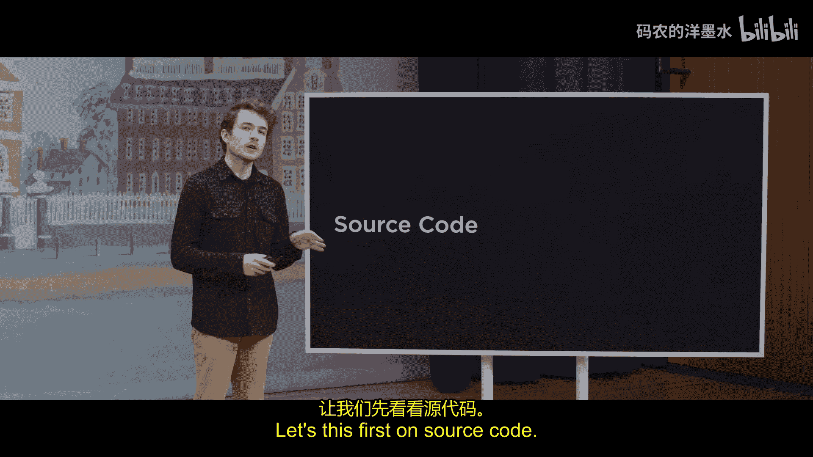

But let's focus first on source code。 I'll come back now to our studio to make some source code for this package。

 and by convention， we write the source code for some package inside a folder that has that package's name。

 So if I want to make a package called Duck say， I should first create a folder in my working directory called Duckay to do so。

 I can use this function here， D do create to create a directory in this case called Duckay I'll hit enter here。

 and notice how my file Exper。 I see a new folder called Day。😊，Well。

 I want to make all my future files and folders inside of this folder here， my future package。

 so I'll set now my working directory to DuckSa， and now it's a bit of equivalent to me going inside of this folder by clicking on it and seeing this blank slate in which we can begin writing the source code for our package。

Now， this blank slate is a bit scary at first， but thankfully。

 there's a structure to how packages are organized in R。

 Let's take a look at what a typical package might look like。 So in general， making a package in R。

 you will tend to have these files and folders here。 One。

 first of all called description in all caps which describes your package。 What is the name of it。

 what version number is it， who wrote it and so on。 youll also have a file called namespace。

 which you'll use to define the functions in your package。

 some end user might be able to use And then you have some folders here。

 one called man which stands for manual， you'll put inside that folder。

 a documentation for your functions， some instruction how to use them。

 And here we have an R folder to， we' actually place your R files that have your function definitions inside of them。

 And of course， we' need some tests to test our code， well put those in this folder called tests。

 Now if you only have more advanced package， you might have other files and folders to。

 But these are the core ones that say。😊。

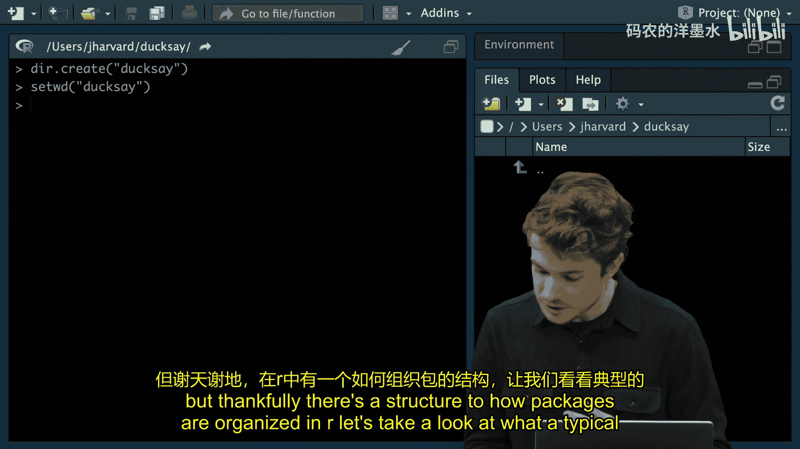

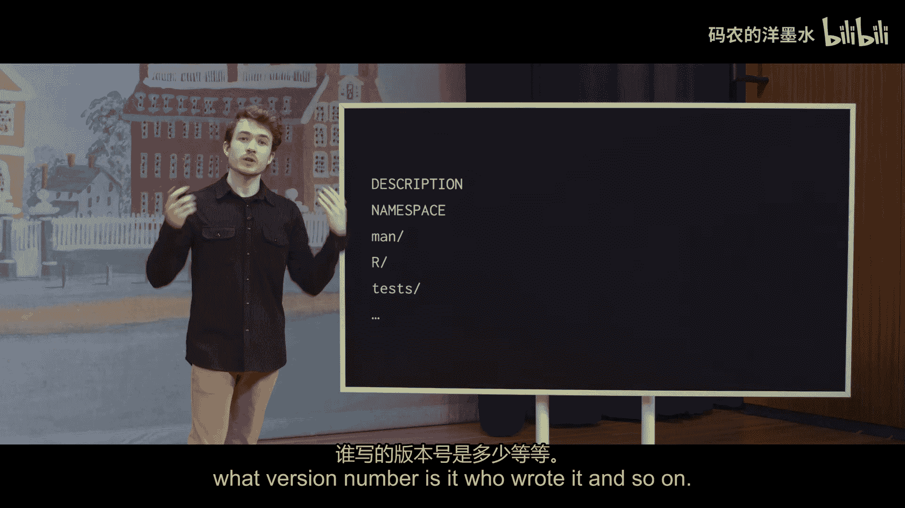

This folder here is an R package。So let's begin， let's because our description file and describe the package we want to create。

 I'll come back now to our studio and create for this folder here， a description file。

 I can do so with file do create and I'll choose to make a description file in all caps with no file extension。

 notice how now insidea folder， I have this file called description。

 which I can open up and see well， another blank slate。 And so it turns out here too。

 there are some conventions on how to organize our description file。 In fact。

 our description file will be composed of individual fields that tell us some information about this package。

 what are those fields。 Well the ones you need to know about you need to include in your file are these here。

 One called package， which is the name of our package as we want somebody to install it。

 We've seen install dot packages and often include the name of the package we want to install as the input to that function。

 Well， this is the name we want to use。😊。

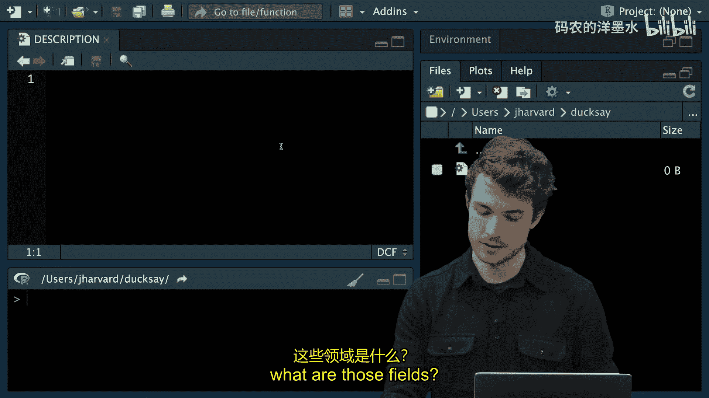

Type in to install do packages to install our package。 We also have to say the title of our package。

 which is a bit more English friendlyri。 You could capitalize things， includes spaces and so on。

 But a similar idea to the package field as well。 We have here description as well。

 What is the description of our package， What does it do and so on。 and a version number。

 What version is it if we change over time is version 1。02。03。0 or so on。

And then finally here we have some information on the authors， who wrote this package。

 what was their role， and then a license file that is what is the legal terms in which you can actually use the code if you want to install this package and use it yourself。

😡，So let's now add these fields to our description file and make it in our package。

 I'll come back now to our studio。 and let's go ahead and start by naming our package。

 we said before our package will be called Duckay。 So in the description file。

 I'll add this package field followed by a colon， and I'll say that our package is named in this case。

 Duck say， there's some English text here。

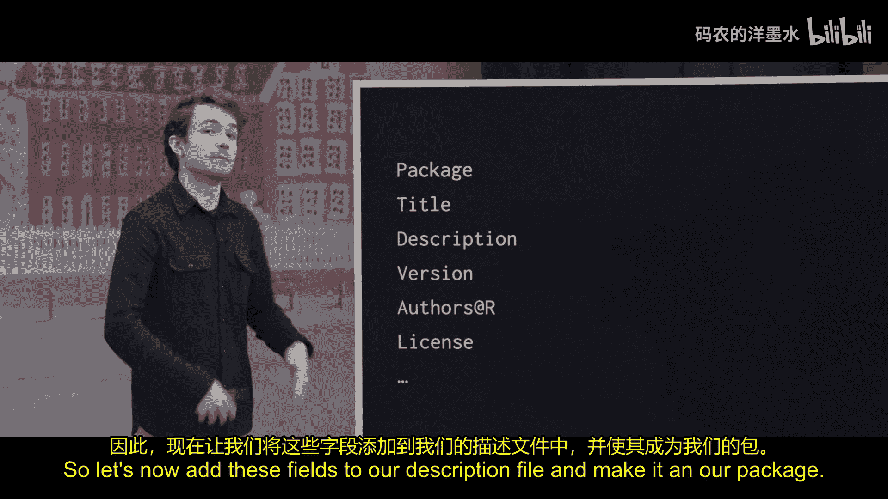

Then I'll add the title and I'll choose to maybe title case or a package here。 I'll call it duck。

 say just like this， and I'll give a description to it as well。

 I'll say the description of this package is going to be say hello with a duck。

 the purpose is to say hello with a duck。 and this is the first version of the package I'm just starting out on my journey of developing this package。

But now I need to include some more information to who wrote this package and what are the legal terms in which we can actually use the package too。

So to define who wrote the package， I could use this field called authors@ R。

 and whereas up above we've been using some English text。

 just regular old characters and so on in this field we can actually use an R function to define who wrote the package and what role they played。

😡，Now to add a new author to this package， I use a function， one called person。

 and if I look at documentation， I would know that the first argument to this person function is the person's first name。

 so my first name is Carter and the second argument is their last name So in this case。

 my last name is Cki and there are a few other parameters as well this person can have namely an email I could say my email here is Carter at cs50harv。

edduu and says people know if they want to contact the package author they can email me at this email here。

And then we should also specify what role each person played。

 so there's a parameter here called role as well。Now because package authors can play more than one role。

 role will take as input a vector of roles， and there are actually a defined set of roles。

 which you can learn if you look at the documentation here， but I'll focus on a few in particular。

 one role is an author of the package， somebody who contributed to it in full and we denote somebody as an author by typing in A U T abbreviation here for author。

 So in this case I'm saying that me Carterzenki， I'm an author of this package。

Now there's more roles to， one role that is important as well is the curator of the package。

 which we note with CRE， this areviation for creatorator。Now。

 creatorer and author seem pretty similar in meaning， but in a， they have two distinct meanings。

 An author is anybody who at any time contributed to the package。 A creator， though。

 is the person who now maintains the package。 They are in charge of updating it。

 making sure it's up to date and so on over time。 These two are distinct。

 and there has to be at least one creator of some package， a person who's maintaining it over time。

See these are two main roles。 there's one more as well。

 I should also say that I am the copyright holder for this code。 I own it。

 and I'm the person who owns a license that I will then specify underneath myself here。

So these three roles， author， creator and copyright holder are the ones you'll need to create a package in R。

But now let's think through the license field， license down below。 Well， if you're a lawyer。

 you could maybe write your own license。 but in general。

 it best practice to rely on some standardized license that already exists。 And in fact。

 if you want to share your code for free online。 Other to use freely as well。

 There's a whole community that has created very various licenses。

 one called the free and open source software community。

 This community has created several licenses that you can just use and adopt or adapt to share your software online for free。

 among the typical licenses are these， the MIT license about by your friends down the road and the Ga new general public license。

 similar in spirit to the MIT license as well。

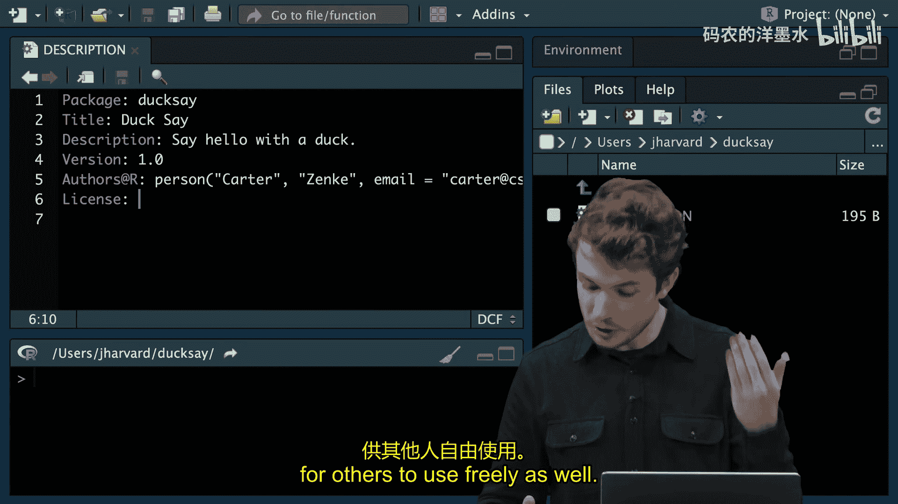

Now the MIT license begins as follows。 permission is hereby granted， free of charge。

 any person taking a copy of this software， basically to deal on the software without restriction So saying you can share this code freely and you can use it freely as well。

 So I might want to adopt this license for my software here。

 I'll go ahead and say that in my description file as well。

 I'll come back over here to our studio and say I want to build on top of the MIT license。

 I want to license my software under this language here so I could simply type in MIT as the template for my license now。

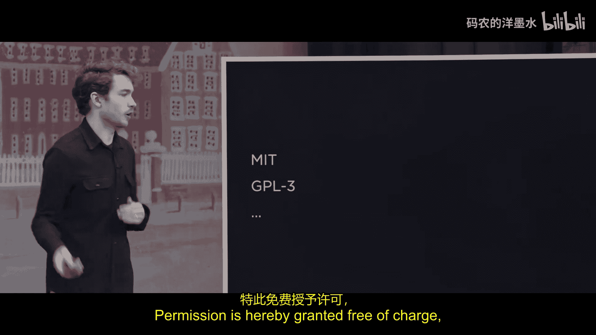

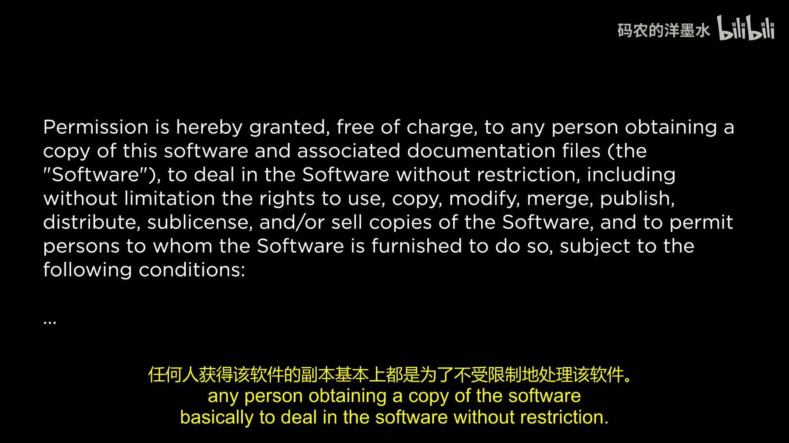

But it turns out that in R， there's a bit more meaning to specify here。

 I should also specify the year， which I created this software and who the copyright holder is inside the license itself。

 which is particularly to MIT license as well。 So if I want to add on to this MIT license。

 I can take MI T as my template， but then add on some of their file。

 it gives some more information about this license。

 I could say MIt plus file and then license in all caps。 And this is convention。

 if I want to add on to my license， I do so with a file called license in all caps。

 And now this says the entire license for my software is the MIT license as the base plus some file that I'll include called license。

😊，Well， let's create it now， I'll get on my console here and say file dot create。

 I'll create a file called license， no extension here， open it up。

 and now add in some placeholders that I should fill for the MIT license in particular。

 I need to say again， what year it was that I created this software So I'll say year in all caps and the year I created the software and then the copyright holder as well in this case I'll say to the do say authors referencing again this authors' field in my description file。

So now we have the basic bare bone structure for our package called Duxay。 We have a description。

 a license， authorship and so on。 Let me ask what questions do we have so far on packages in R and creating those of our very own。

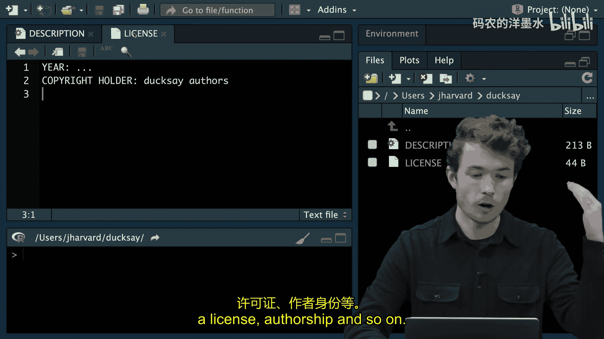

We try the best practices to enumerate the version number and when do we choose when to increment the number to the left of the point and the one to the right of the point。

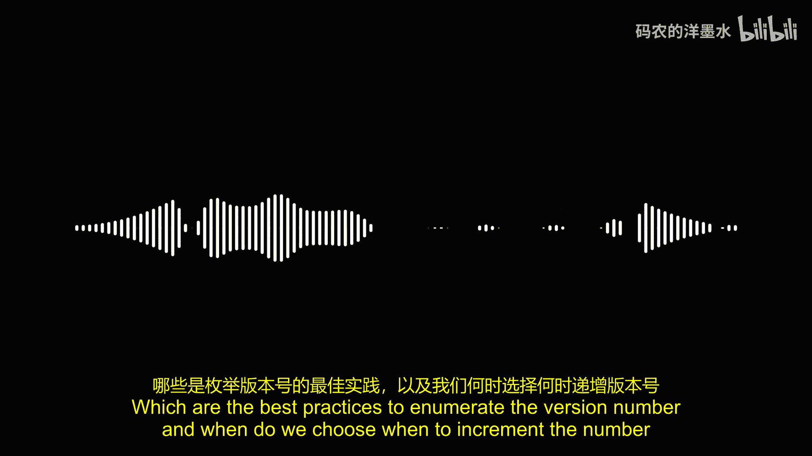

So a good question about version numbering I'm going to change the version number that we're using。

 Let me show you what we're doing now and show you another process called semantic versioning2 I'll come back over here and here I'm using just 1。

0 for simplicity but actually it turns out some of in the R community use a convention known as semantic versioning and that versioning system actually allows for three numbers here Now by convention。

 each of these numbers has some certain meaning In this case。

 this last number is known as the patch version。 if you make some bug fix。

 you would increment this number here。This middle number is known as the minor version。

 if you add in some new feature， like a new function， for instance。

 you would increment that number too。But it turns out that this first number like one here is not the major version。

 you would only increment this if you made some change that broke the conventions you prior used in your package and somebody who's relying on your package which actually have to update their code to to still use your package so this is one set of conventions for versioning here will go back though and use 1。

0 just for simplicity。Okay， so we have here now our basic bare bones are package。

 but our goal is to also add some source code and we can do it in the same way we've usually written source code before by first writing some tests。

 writing our code and write documentation for our code。 Now we saw before。

 if I want to test inside of my package。 I want to run some unit tests as well。

 I should write them inside of this folder called tests。

 and we could certainly create this folder ourselves。

 But as we get into the weeds of structuring our package。 We might want some help。 So thankfully。

 there is a package that helps you write packages in our one called dev tools。

 This package helps us give us some tools to write our very own package。

 and among the functions it has for unit testing are these one called use test that。

 So we saw test that last time， it's package for unit testing our software。😊。

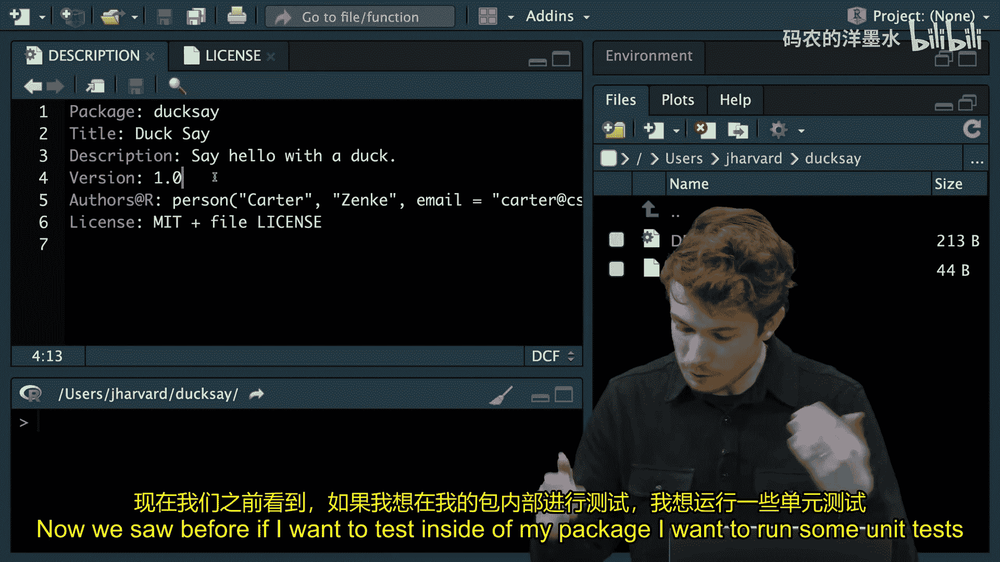

If I want to use the test that package， test my code。

 all I have to do is use use test that and then once I've done that。

 if I want to create some testing file for a function。

 I could simply use use test and that will create for me a new testing file for my function and then finally once I have all those tests written if I want to run those tests。

 All I have to do is run the test function as well。

 so very helpful for us for our package and running our unit tests too。😊。

So let's begin by writing some unit tests for our Dc site function。 I'll come back now to our studio。

 and let's try to use use test that。 Well because this function is part of the devtool package。

 I'll first need to load， if not install the devtools package。 So here down below。

 I'll use library dev tools to load the dev toolsol package assuming it is install。

 I'll hit enter here And now let's use use test that to configure our package to run tests with the package test that Well I'll use down below here。

 use test that and I'll hit enter and we'll see a few things have happened actually I'll see in my console down below Now the first thing I see is that my descript file has been added to。

 I see now this new field called suggests and as part of suggests I now see test that This means when somebody installs our package。

 it will be suggested that they also install test that at a version greater than or equal to 3。0。

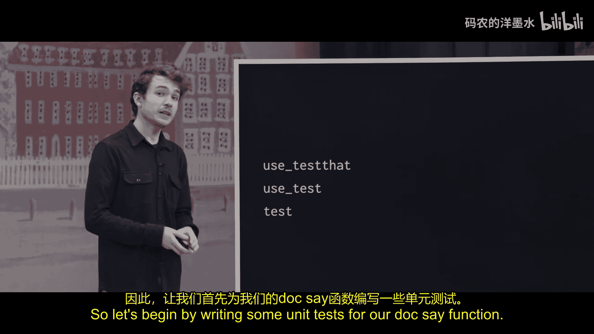

Well， why would we suggest test that Well， maybe user wants to test our code themselves in which case they'll need to use test that because we use it ourselves as well。

 If you want somebody though， not just suggest some code or actually suggested to user code。

 you could also make it required They install some other package as well so I can make a field called require like this and list any packages。

 I want to require the user to install to use my own package Now the user here likely won't be testing our software for us。

 so only suggest it， not require it， but if you do want to require some code some package。

 you can actually use requires a field in your description file as well。

also see here config/lash test that/ edition， this just means that when our tests are run。

 we'll be sure to use the version3 of test that。But a few other things have happened as well。

 if I look down below my console here， alsos created some new folders for me。

 namely one called tests over here。 if I click on tests， I'll see a new file， test that。

 R and a folder also called test that if I open up test that。

 R this is a file that was automatically created for me and include some configuration for test that as I run my tests inside of this package we'll leave this alone for now。

 but notice how I also have a folder called test that and it's inside this folder I will actually write my unit tests themselves similar to what we saw last time。

Now， that this structure been set up。 I actually write my tests now and see what it's suggesting that I use use test to create my very first unit test for my function。

 Well， here I want to use test。 And I want to create a test for in this case。

 a function called duck say。 So I'll enter as input to use test the functions name。

 D say just like that。 I'll enter now。 And I'll see a few things happen again。1。

 I now have this new file called test dash duck say dot R， which is inside my test that folder。

 which itself is inside my test folder。 And now I can modify test duck say dot R。

 It's given me here some basic you structure for my test file。

 but I don't want want to use this so far。 I'll just remove it。

 And now I want to think about how I could describe duck say。

 What do I want it to do in this testing file。 we saw last time we could use some code a bit like this to describe how I want to。

😊，How we want D se to run， I could say describe and then use Duckay here to say。

 I'm going to describe how I want Duck se to run。What do I want it to do。

 I think the first thing I want to do is to work with cat。

 So I could say it can print to the console。With cat。

 And now I'll include some tests to see if Dx A can print with cat。

 And what do mean by this is as follows。 if I use cat here and gave as input Dcay。

 I should see the output of Day in the console。Duck say will simply return to me some character string。

 but cat will take care of outputting it to the console。Now， how could I make this a test。

 I have the code I want to have run， but I want to test that it's doing what I want it to do。

Well it turns out that similar to expect equals， which you saw last time。

 there is a function called expect output that can expect when I run this code。

 I get output in my console， so I'll use this function， expect output。

 part of test that to say I expect when I run this code， cat with Duck say。

 I'll see some output in my console， anything at all。

And that seems to be our first description now for Duckay。

But I think we could still do a little better， get more specific if we will。

 So here we could say it prints the console with cap。 but what should it print。

 What should print hello world， at least。 So I'll go ahead and say it can say hello to the world。

 That's another feature now of Duck say。 And I'll say that well， when I want Duckay to run。

 I expect to see hello world in the output。 And we saw last time one called expect equal one called expect equal with Duckay here。

 And I could say， I expect that Duck say will return to me a string is equal to hello world。 But。

I argue this might not work as I intended to， because if you look at our output here。

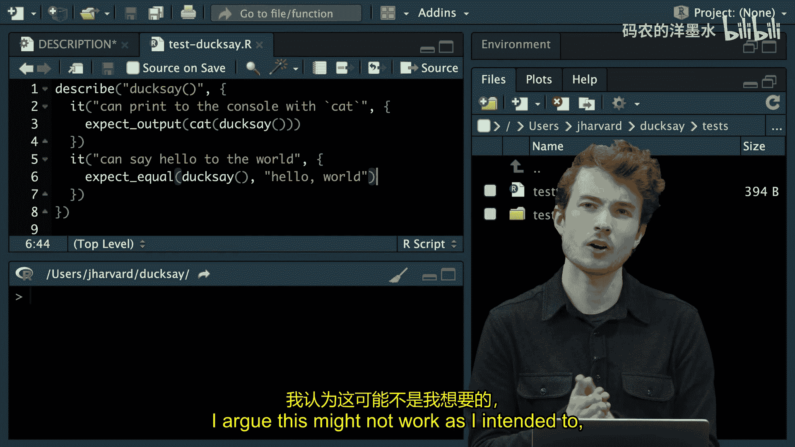

Here's our intended output of Duck say， why might it not work if we were to say。

 I expect this output to be equal to Ho world。

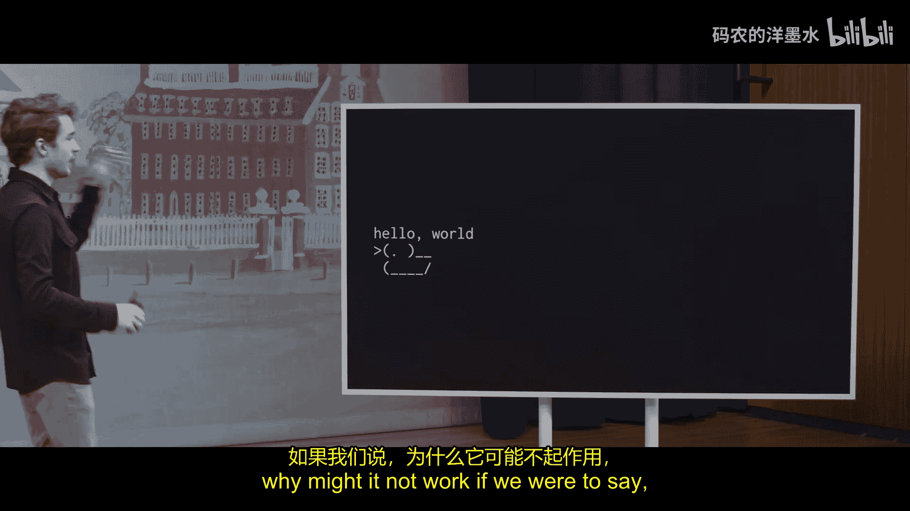

Well， it seems like this is not strictly equal to hellello world， I have hellello world。

 and then some duck at the end。 So what I would rather do is ask a different question。

 is hellello world somewhere in this output we've gotten back， not is it equal to Hello world。

 but is hellello world somewhere inside of it。Now， thankfully。

 there is another function besides expect equal one called expect match。

 I can expect to find a match of hello world inside this output of duckuck say。

 think I can try it out， I'll come back over here and I can use expect match like this。

 I say expect match now between the return value of duck say and this character string hellello world and that will treat this as a pattern。

 hellello comma space world。 and if it finds that pattern inside the return value of duck say。

 well this will be true。 no errors at all。 if I can't find that pattern。

 though in D say will raise an error and our tests will fail。 So again。

 expect match is good trying to find this pattern。 hellello world inside the output of D say right here。

😊，So I think these tests are in pretty good shape。 I now know exactly what I want Duck say to do。

 It should work with cat， and it should print out some output that says hello to the world。

But now that we have our tests， we need to write our actual code。

 and to write the function Day itself。 and for that we saw we could use this folder called R in general。

 we' working with the packages。 We're going to write all of our dot R files inside of a folder called R。

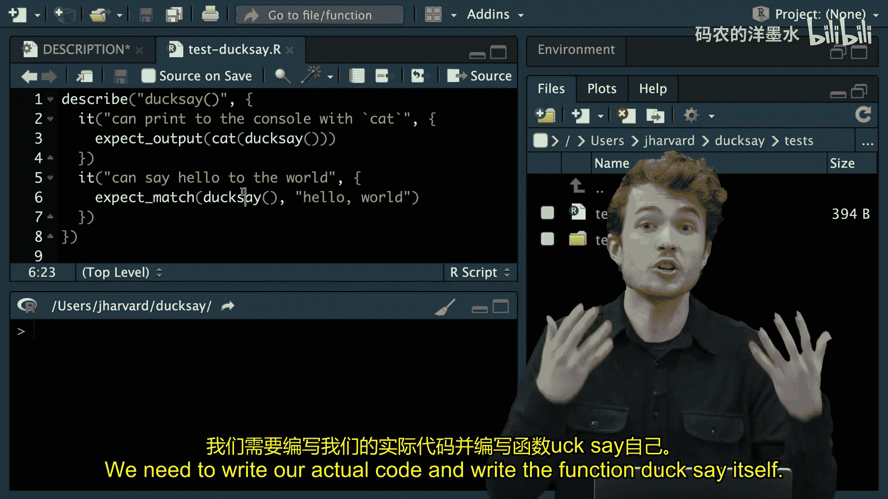

But again， rather than trickuring this ourselves， we could rely on dev tools to do it for us。

 I could use a function in dev tools called use underscore R and pass in the function name I hope to create。

 and then I'll get a dot R file to write my function definition in。

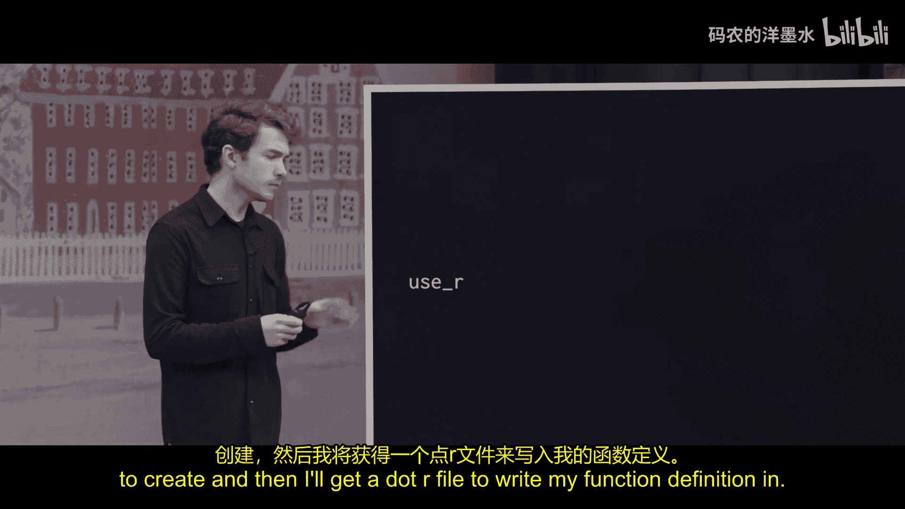

So let's try this now Now we've written our unit tests。

 I'll come back now to our studio and let's see if I can use use R to create for me the function Duc say and the file I should define it in。

 Ill go of my console now and use use R and then go back up my file Explorer to Day as the folder here and I'll try to create now this file to define Ducay in。

 I'll say I want to create this new function Day and the R file for it。

 I'll hit enter now and see a few things happening。1。

 I see I have a folder called R brand new thanks to use R and I also see I have a new file Ducay R which has been created inside of this R folder to keep things organized in this case。

 I going close my description here and may save it first。

 and then I'll go ahead and remove test Day here and focus now on Duxay do R。Well。

 how should I write， Duck say， if I look at my output here。

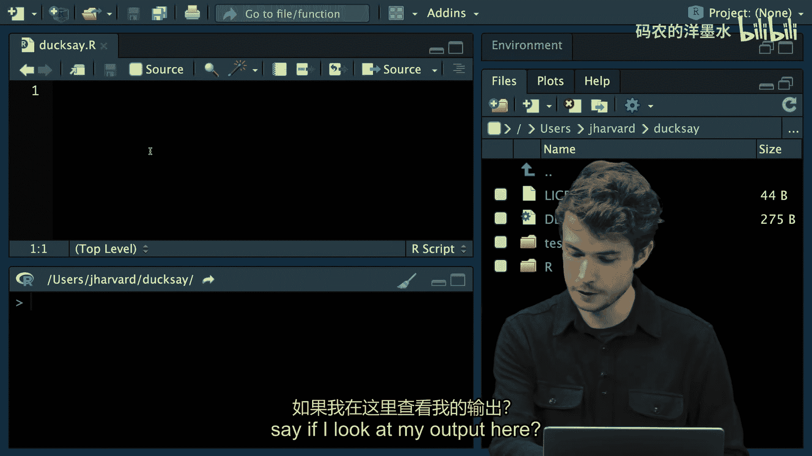

Here I have my intended output。 I notice that I really have three lines of output。

 I hope to return from this function。 I have hello， comma space world。

 the top half of my duck and the bottom half of my duck。 And these are all character strings。

 So Im actually ask our group here。 What function we've seen so far。

 Do you think it help us combine these strings。😊，If I want to have three different lines here。

 hellello world。Top my duck。Botom my duck。What function could I use to combine these strings and perhaps to return them from my Dx se function。

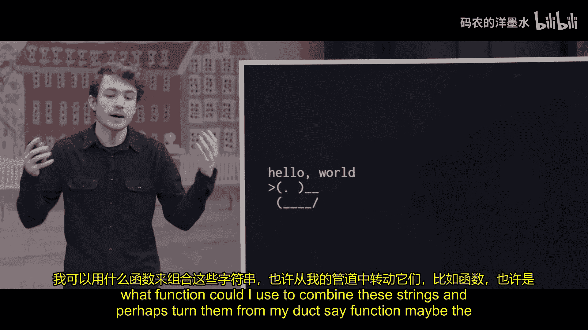

Maybe the paste function。 Yeah， maybe paste。 So we saw before that paste is good for combining different strings。

 And we could actually use paste here。 but instead of separating now with spaces。

 we could separate with new lines， our backlash and escape character。 So let's try that out。

ll come back now to my file。 And let's define for ourselves the duck say function using paste。

 I'll say here， I want to make a new function called Duckay that currently doesn't take any input at all。

 But inside of this function， I will return the result of calling paste on three different strings。

 The first one will be my first string here， one called hello world， the very top of my output。😊。

And then the very beginning of my duck here， I could give it a little beak， some eyes。

 and now the top of its body here， and then underneath I could use the bottom of the duck。

 which will look a bit like this。Some underscores and then a forward slash。

 and now I think we have what looks to be our intended output thanks to paste。But as we said before。

 paste the default is to combine these strings using a space， and we want a new line instead。

 so I should change now the set parameter to paste we've seen before from a space to a backslash end。

 this new line character that says I want to separate each of these character strings by a new line。

 effectively hitting enter each time on my keyboard。So I'll save now this function。

 and when Day runs， it should now return to me this output。But I've defined Duckay here。

 and I want to use it。 turns out I can't do that just yet。

 We saw earlier this idea of a namespace file， which tells us which functions in our package and end user can use。

 And so now we've defined our Day function which should actually include it in our packages namespace。

 the list of functions that I end user could use in our package。

 So I now create this file called namespace。 I'll say file dot create namespace down below。

 and I can then see in my folder called Duckay， a new file called namespace。 I'll open this one up。

 and what should I include in namespace。 Well， by convention。

 we have a function here called export export export says take a function that I've defined and they could available to the end user who installs this package In this case。

 all export D say function just like this。し？So to be clear。

 I've now defined my DA function inside a file called DuxA。R。

 which itself is inside an our folder to keep things organized， and then once I've defined it。

 I want to make it available to a user which I'll do through the namespace file and say I want the DuxA function in particular to be available to our end users here。

😡，Now once I do that， I can make use of another dev tools function， one called load all。

 load all that says whatever functions I exported from my package like Duckay here。

 I want you to load them so I can use them right here in my console I'll go ahead and load all and I'll see this is loading the Duckay package now what I can do now is use Duckay in my console。

 I could say I want tick cat the result of calling Duckay just like this and let's see what we get fingers crossed。

We got a cute duck saying hello to the world。And now we could test our code more thoroughly， too。

 I could run test as well in my console。 And now I'll run those tests I created。

 Let me open up inside my tests and test that folder here。😊，Here were those tests， if I now run。

 test the function， thanks to dev Tools， I'll be able to run all the tests I defined in this file。

There's one more thing here too， last time we used source at the top of our file to give this file access to a function like Duxay in Ducay。

R。But now that we've used load All and exported this function from our package。

 we can simply load all and then run the tests and they will have access to that function called DuckSa。

 no more using source so long as we're inside a package that we've exported our functions from。Okay。

 so we've seen now how to define unit tests for our package。

 how to write code that adheres to those tests， let me ask what questions do we have on what we've seen so far。

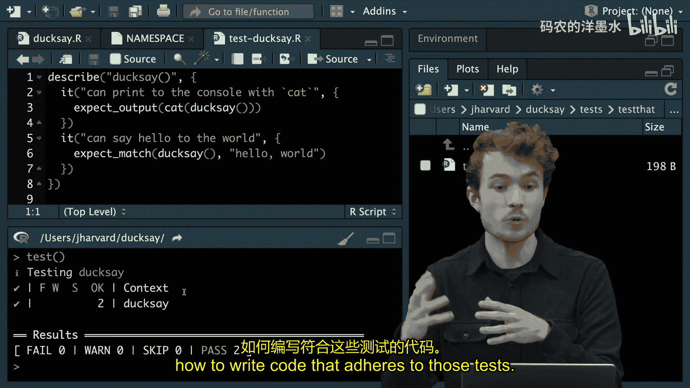

Either on testing our code， writing our functions， or defining our package more generally。

When you run the test program on the terminal， what's the meaning of the colored letters， F WS。

 good question。 So if I look over here in the console， I'll see some pretty output。

 let's say from test that。 And let me walk step by step here。 So here I see testing duck say。

 that is the function we are testing， right， I'll also see F W S and O。 Now。

 these are different kinds of results we can get from our tests here。

 It seems like F corresponds to fail down below。 fail。 We didn't pass this particular test。

 W stands for a warning。 We saw last time how our test sometimes raise warnings was we the number of tests that gave me a warning in this case。

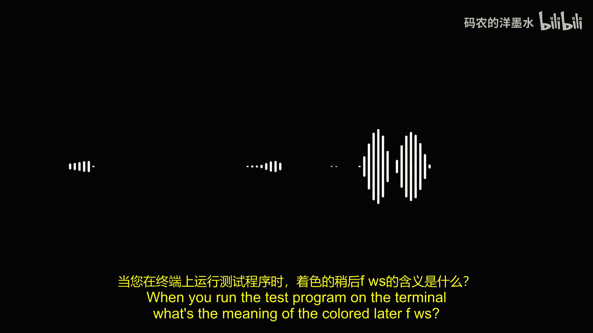

S stands for S。 It turns out you can skip tests if you want to。

 And then okay means this test passed with flying colors。 So here I see these two tests。

 they both passed， and I'll see a two in the okay and a two total that are passing down below。

 If I had more than one function to test。 I might see more than one of these and see the total number of ones that were passed。

 skipped warned about or failed overall down at the bottom of this results here as well。

 So I hope that helps clarify what exactly we're seeing as a result of using test。

 The great question there。😊，Okay， so I think we're in a pretty good place。

 but there's agu one more thing to consider now。 So I've seen that my code can both print to the console with CAt and it includes hello world in the output。

 but an important thing here too is does it include a duck。 So let's see that as well。

 I'll come back now to our studio and update these tests now， let me add a new one。

 a new test that says duckuck， say it can say hello with a duck just like this。

And I think I could probably use a very similar structure to what I used before with expect match。

 in this case， though， I could expect a match between the output of D say and the duck that I have to show to the user。

So I could use expect match like I did before， and then enter D say just like this。

 and now I want to expect a match between my duck pattern and whatever I see in the return value of D say。

But。Prob a new object for this duck。 I want to type in the whole duck as an argument here。

 I could go above here and define myself a new duck Some how we did it before。

 I'll paste together the top half of this duck with a cute little beak and a top here and then the bottom half of my duck。

1，2，3，4 underscores and a forward slash。 and that is my duck。

 So long as I separate each with a back slash n just like that。

And now I think what I could do is expect a match between the return value of Duck se and this。

 this duck I've created over here。Now， this， you think might work。

But I argue there's one more thing to consider here， which is， I told you earlier。

 expect match we'll take the pattern we've defined here and look forward in the return value of Duckai。

 in this case， this is our pattern。Well these patterns are more formally called regular expressions。

 and won't get into them today， but in general， one thing to know about them is that these characters。

 pretices and a dot， have a special meaning inside a regular expressions。

 they don't actually mean literally a prehesis or a dot， they mean something else entirely。

So if I want to treat this pattern， not as this thing called a regular expression。

 but exactly as I see it here。I set the other parameter equal to true instead， one called fixed。

 fixed says， I want you to treat these characters here not as part of some regular expression。

 but instead exactly as we see them here， a greater than sign， a prenasis， a dot， or a period。

So more on those another time， but for now， let's just say I want to look for exactly this pattern inside the output of Duck say。

 I'll leave this as is now and I'll go to below and run my tests with tests again。

 and now we'll see all three tests are passing， none are failing， none giving us warnings。

 none have been skipped， all in this case have passed。So we've fixed our tests。

 we've written our code， one next step is to document how to use our function。

 maybe a user is new to our package， I don't know what to do。

 we want to give them some guidance on how to use our functions， in fact。

 you've probably seen to access documentation you can use question mark followed by the name of some function and right now if I use question mark D say。

Well， I don't see anything。 There's no documentation for Ducke。 Well， let's go ahead and fix that。

 Thankly， I can define my own documentation for Duckay by putting it inside of this folder we saw earlier。

 one called man， where man stands for manual。

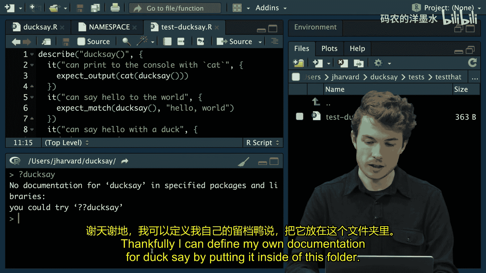

But what we'll go inside this man folder。 It turns out a variety of files all ending with dot R D or dot RD stands for our documentation。

 In fact， inside these files will write not just plain text。

 but willll actually write something called a markup language。

 Now markup language not a programming language。 There are no functions and loops and so on。

 Its that a language for formatting some text。 Now， for instance。

 Rs markup language looks a bit like this。 I can give each of my documentation files。

 some particular parameters like title description and usage here here title says what is the title of my documentation description says describe this function for me。

 and usage says how should I use this function too。 There are other commands will see here。

 but our dot RD files will look a lot like this。 and will then render them or convert them to those same files you're used to seeing when you use the question markdown in your。

感想？So let's try this out and I'll come back to our studio and try to make some documentation for Duckay。

 Well， I want to probably first create for myself that man folder to put my documentation inside of So I could use that same function we saw earlier dot dot create and I'll create for myself the folder called man short for manual and it's inside of this folder that I will store all of my dot Rd files I'll say file do create now man slash Day do RD and this is convention。

 I'm putting this file Ducay do Rd inside the man folder and I'm calling it giving it the same name as the function it should document So this file D say Rd should document the same function D say。

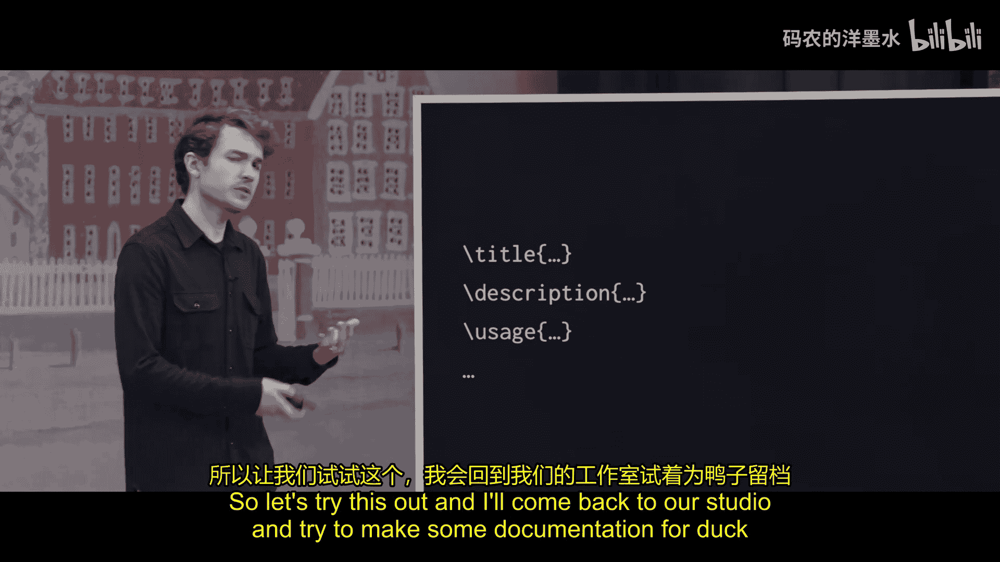

I'll go ahead now and create this file and if I open now my man folder， I should see DA。

RD right there inside I'll open it up and what do I see nothing yet。

 but I argue we could go ahead and use R's markup language to create some documentation now for Duckay。

Now I've read the documentation for creating documentation in R。

 and there are several different keywords you can use to create your documentation among the most important ones are these here。

 one is slash name and inside these curly braces here will include the name of our function。

 we're trying to document in this case Duck say， in particular。

 this is the name of the function we're trying to document。The next one。

 most important one is going to be slash alias slash alias is what you want the user type in in their console to see your documentation。

 For instance， if I go down my console now and I use question mark D say Well my alias is D say literally this right here if any user were to go to their console and use question mark D say。

 they could see this documentation that I have now created for them as long as they've installed my package。

 So I'll say my alias is similarly Day as well。And now here comes our title。

 What is the title of this function， kind of in more English characterization。

 like capitals and spaces and so on。 We'll call this function， duckuck， say。

 just like this and provide a description。 I'll say that this is a duck that says hello。

And just like that， with these four lines of Markup language。

 we can actually already see it being rendered or converted into our documentation file if I go on my console now and run question mark D say I'll see。

My very first， our documentation file。 Notice how here the name of this function is actually included in my documentation right up here。

The alias is also included what I used down here I said question mark Duck say and got this documentation file。

 the title is there to slash title Duckay， we see that right here and so too is a description。

 a duck that says hello。😊，So we could keep adding to this documentation using this same syntax here。

 There are other kinds of components we can add to our documentation file as well。 In fact。

 let's go ahead and add a few more， let's add one called usage which tells people how to use our function I'll use slash usage here and this will say how I want users to use it in fact so I'll say duck say here and by convention in usage we include the functions name some prees and if there are any parameters we include those in the functions prethees as well but currently there are no parameters。

I'll also include a section called value， which is the return value of this function。

 What does it return to us， Well， it returns to us really a string representation of a duck saying hello to the world。

And then finally， we can also include some examples of how to use this function in case people are unfamiliar。

 I could say examples here and provide some examples of how people could use D say。

 Maybe I want them to use it with cat， so I'll show them， look， you can use Day like this。

 take cat and pass input Duck A， just like that。And now with these other pieces of syntax here。

 I can say question mark D se。And see the new， let'm me save this file first。

 and then I'm question Mark D say， and I should see the now rendered version of what I'm seeing on the left hand side over here。

 notice how we have some new pieces， I see usage now， I see value。

 and I see some examples as well down below in my documentation file。

So we've seen now how to document our functions using these markup language here。

What questions do we have and how to document our code and how to render it in our console？Okay。

 seeing none， let's keep going then。 And I think we're now in a pretty good spot。

 We now have the ability to write our own functions。

 to test them and to write documentation for those functions。 So what should we do now， ideally。

 we want to package up and share it with the world。 And in fact。

 this process of taking what we have as source code and converting it into a single file has a particular name。

 This name is called building our package。 Build our package。

 taking it from source code into a single file we could share around the world。 Now。

 there are a few options for building our source code into that single file。

 Among them are these build， which is a dev tools function that takes our source code and gives us some single file at the end。

 but。😊。

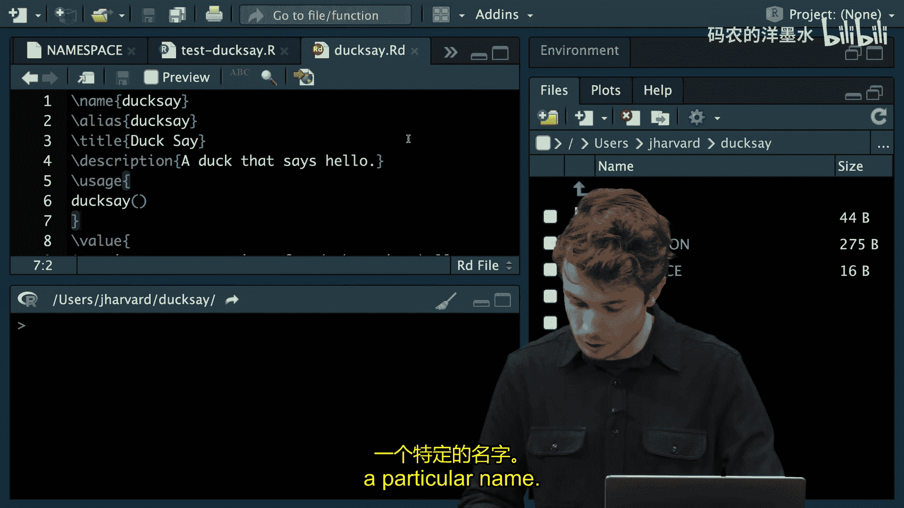

B， it turns out， is actually a wrapper on top of a base R command called RCD build。

 They have the same purpose。 RCmD build， though works in your actual computer's terminal。

 not in the R console。 So once I use build to keep ourselves inside the R console and build our package into a single file So we'll still rely on dev toolsol now and use their build function in particular。

 let me come back now to our studio and show you how this exactly works。

 So notice here I'm inside of my duckay folder， my Day package now， if you will。

 let me go ahead and close my previous file here， let me run this command called build to dev tools。

 if I run build， I'll see some output here。 and I'll see down below the file I have gotten from building this source code into a single file I can share with others。

 I see it's called Day1。0 tar do G Z。 And if I move up one level in。

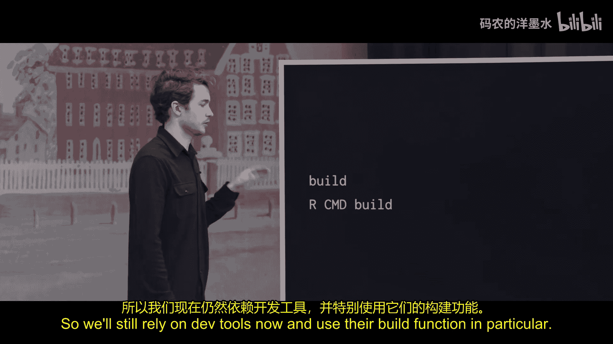

My folder structure。 I'll see this file actually right next to the D say folder D say1。

0 do tar do Gz。 And this is a funky kind of file name。 but this stands for essentially a zip file。

 if you will。 It's very similar in spirit。 It's also called a tar ball sometimes So this is basically a single file who can share our code。

 E up somebody posted online etc。 This is all that source code in our folder now in one single file。

So we've done pretty well so far。 but before I share this。

 I think I've forgotten kind of one important thing which is the duck actually only says hello world right now。

 it doesn't take as input any given kind of string so we probably want to update our code and rebuild this package again and again and in fact you'll find a package building process often iterative you build it。

 you add something new， you build it again， add something new， build it again and so on and so forth。

 So let's go ahead and update our package and rebuild our code let's go back now over here and consider how we could make this duck。

 say any given phrase that we have Well I'll go back to my duck。

 say a source code inside my folder here。 I'll go back to my tests folder。

 open up now my tests for duck say let me add one more description for each of these for this function here I'll come down below and I'll say I want to make sure that this can say hello。

😊，can say any given phrase rather Duckay can say any given phrase。 and now to exemplify this。

 I want to include this test here。 I expect a match between running。

 let's say D say with a given phrase like quack like that。

 I have to find quack anywhere inside of that given return value， just like this。So now again。

 I'm saying that Day should be able to say any given phrase。

 if I run it with Duckay and passes input quack， I should see quack inside of that return value。

So it's a good test， but I'm going to implement it now in code， I'll come back now to my DuckA。

 R file， going back to my main folder inside R， or going store our R files， open now DuxA。 R。

 and I'll see my function definition。Well I could do this， I could say Duckay now takes his input。

 a given phrase， just like that， and I'll make sure that instead of hello world。

 we say that given phrase。But now， per my tests， I still want to run Duckay or be able to run Dxay like this without any arguments whatsoever。

 And I still expect to see hello world when Dxay is run without any arguments here。

 So I could go back to Dxay now and say that phrase has a default value of hello world just like this。

 if I supply a value， we I'll see the phrase there。 hopefully， and if I don't supply a value。

 well I'll hopefully see hello world there instead。So let me test my code interactively now。

 I've updated my function here， so I should again run load all。

 I'm going to update my function after I've redefined it here and make it available to myself in my console I now have access to the latest version of Duckay I can run cat Day and then give as input quack and hopefully we'll see。

Quck on top of our duck。 So it seems to be working just right now。

 Let me go ahead and run test and see what I can see。I'll see that all four of my tests are passing。

So I've updated my tests， my source code。What else should I update？Well my documentation。

 I'll go back now to my Duckay package folder， open up Man， openup Duckite。RD。

 and I update my documentation， I'll then say now that the return value of DuckSa is no longer a Duck saying hello to the world。

 it's really a duck saying the given phrase。And similar。

 I probably update now my usage by convention， we include the functionss name， remember。

 some bright Cs remember， and also the parameters to this function。

 So one parameter now is this one called phrase， and I can a default value of hello worlds。

 This is by convention how I would write that out in my documentation。

 I would give the parameter and its default value with an equal sign separating them。

And then finally， down below my example here， I could give one more example of using Duckay underneath this here。

 I could say you can also if you want to give Duckay some input like quack， just like that。

So this I think， covers us in terms of our function itself， our tests and our documentation。

 I can test my documentation by rendering it question mark Duck say and now I'll see it on the right hand side。

 I will in fact see my updated usage， my updated value， and my updated examples down below。

So I think we're in a pretty good spot。Let me now rebuild this code。

 I'll simply use build again just like this， and now I should see my updated version of my package now in a single file and to be clear。

 if I wanted to share this code with somebody else。

 I would need to rebuild it every time I modify it to put all the updates inside of Duckay。

 this folder into this new file， Day 1。0。 tar。jeeey。

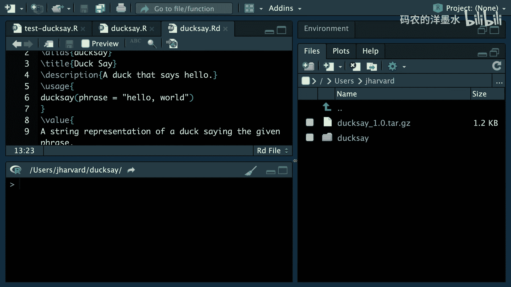

Okay， let me ask， what questions do we have on iteratively updating and now rebuilding our package over time？

Is there a command in R which rebuilds the package for us as soon as the file changes。

 A good question。 So are command R that res the package for us as we change it。

 Not that I am aware of。 So I'm familiar with dev tools in particular。

 And I don't think there's a function lets you do exactly that。

 I know other languages there can be functions like that， but not that I'm familiar with in R。

 A good question， though。

Let's keep going then。 And so we've rebuilt our package。 Now， have it is a single file。

 I think what's left to do now is to really use our package。

 So let's see if we can create ourselves a new program that uses exactly this package。

 maybe I will make a program called greet do R that will instead of giving a user as a plain old simple hello。

 give them a hello from a duck So I will move my working directory up one level out of my duckay folder。

 I'll use set WD and then in quotes here dot dot that means move me one level higher in my working directory。

 So I'm presently in Duckay， but now I'll be right next to Duck say， if you will。

 in the same view I have on the right hand side here。

 I'll now create for myself a new a new program called dot R just like this。

 and I'll see greet R show up over here。 I'll open it。 and now let's write this program together。😊。

Well， now that I have my very own package， one called Duckay。

 I could use library to load my function De， I could use library here and say。

 I want to load this library load this package called Duckay。And once I've done that。

 what do I want to do， I want to ask now the user for their name so I could use。

 let's say something like readline。I could say I want to ask the user for their name。

 I could use name， and then store inside Readline just like that and ask what's your name Readline。

 as you've seen before， will take their input and return it to us。

 storing it in this object called name。And I could create a greeting for them。

 I could say maybe let's have a greeting here， but the greeting will actually be the result of calling our function Ducke。

 which is inside this package called Ducke I'll use Duckay here and path has input in this case well the combination of hello and then let's say the user's name。

😊，And now down below， I could use CA， of course， to print our greeting。So top to bottom。

 I'm loading this package we created called Duckay， I'm asking the user for their name。

 I'm then using the function we defined as part of Ducke，' called Duckay as well。

 I'm going to pass in the concateated version of hello and their name and then I'm going to print the result of calling Duckay here。

But before I can do this。I have built my package， but what I haven't done is installed it。

 So I've built it。 I could share this file with others。

 but I still need to install it on my own computer。 And if anybody wants to use this package as well。

 like to install it on their computer2。 So thankfully。

 there are tools we can use to install packages in R。 We've seen one already。

 one called install dot packages。 In fact， you can use install dot packages to install packages。

 not just from the crayon， but also from an individual file， like the one we have here。

 you could also use a base R function called R CD install， you can use that in your terminal。

 but we'll stick now to using install do package that keeps us inside the R console itself。😊。

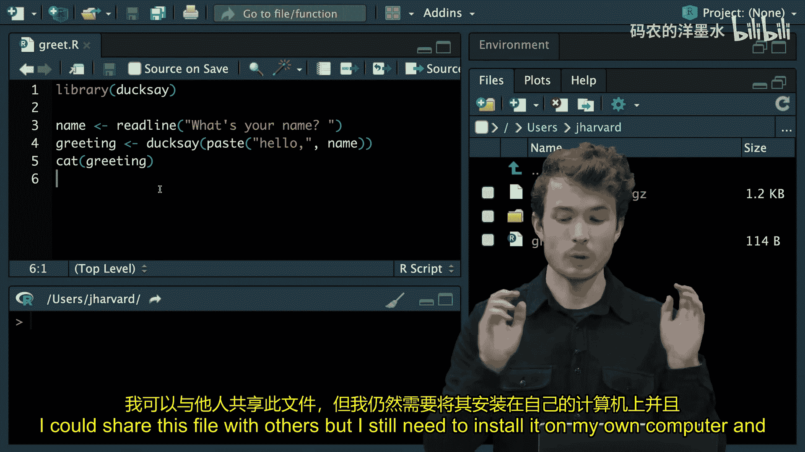

So let's now install our package with install dot packages。

 I'll come back now to our studio and I think I could use this single file I now have the compiled version of my package and I can install it now with install it packages I'll say install dot packages and I'll now use the file name itself duck say 1。

0 do tar do Gz this tar ball， this kind of like a zip file I can use to store my package contents。

 I'll install this here。

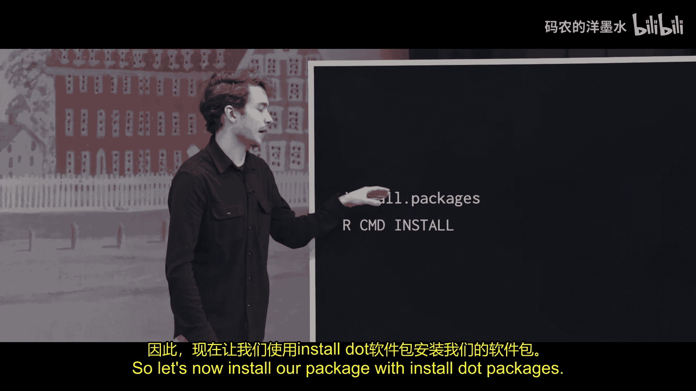

And now that it's installed， I see done， I can now run source in greet and type in Carter。Wila。

 I now have a duck that I can say hello to anyone who interested in their name。

 thanks to this package I made called Duck Sa。

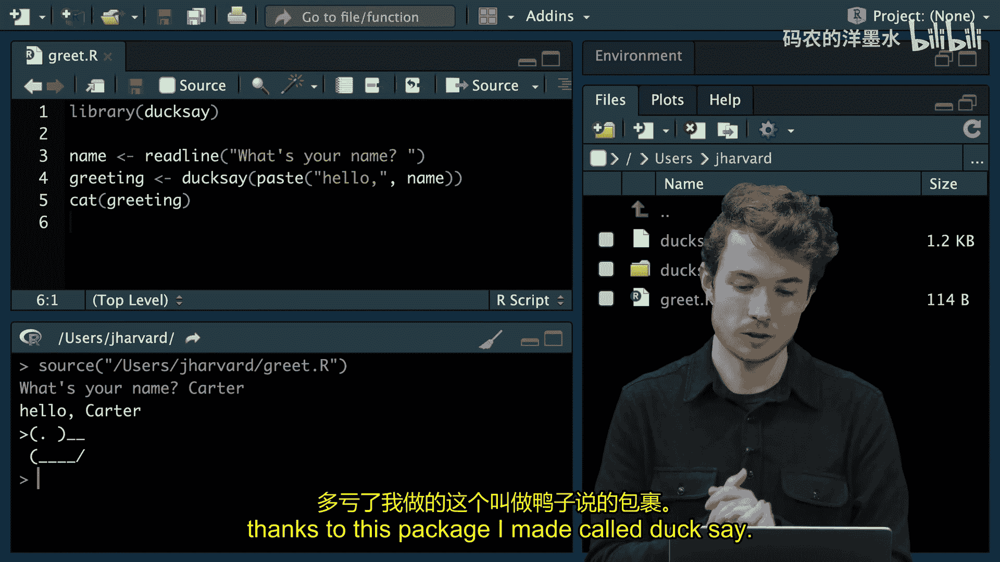

Well， we've seen now how to build our packages， how to install them and how to use them。 Now。

 the only thing I have to do is to share them with the world。

 So if you have to share your package with the world， you have a number of options。

 You can use the cran。 so long as you're packaged heres to their guidelines。

 You can use the service like Gitthub， which is a tool for sharing software and collaborating with others。

 You can even share your package over email with a friend。😊。

And however you choose to share your code， I hope you can be mind how much you've learned over the course of this course and how much you have to share with the world。

 In fact， you begin by learning how to represent data using vectors and data frames。

 you graduated to transforming data using subsets， conditions and logical expressions。

 you then saw to make your Nazi more efficient， using loops and functions and dipping your toes into this paradigm called functional programming。

In the second half of the course， you saw packages like the tidyverse and all they could do。

 how they could tidy your data， help you visualize it and help you test your programs to all that's left now is you take all you've learned。

 package it up and share it now with the world。 We're so excited to see what you'll create。

 This was CO50's introductionuction of programming with R。

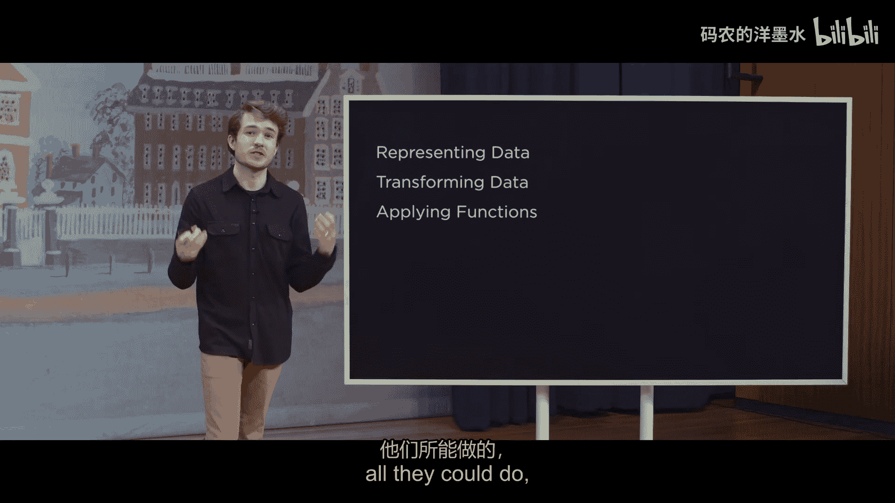