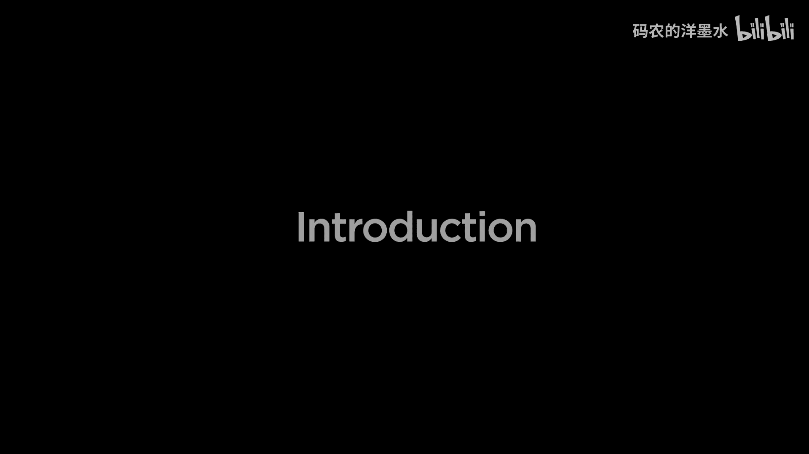
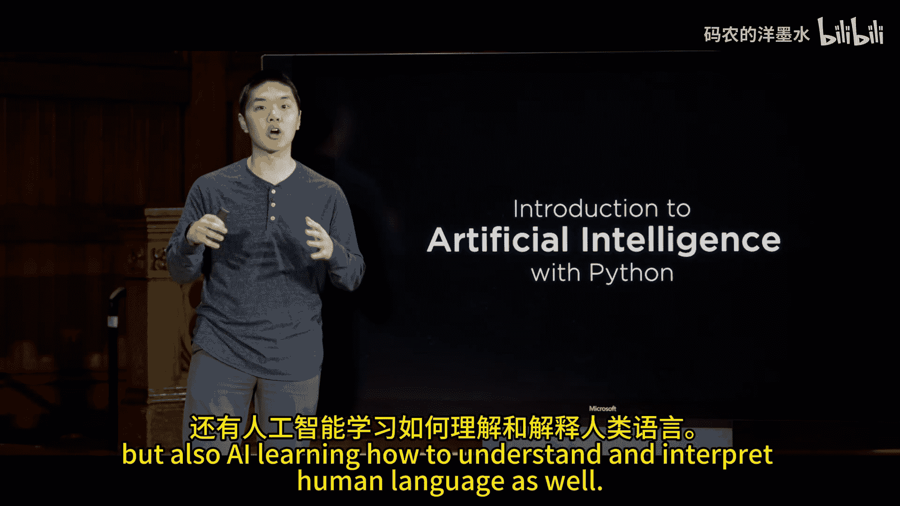
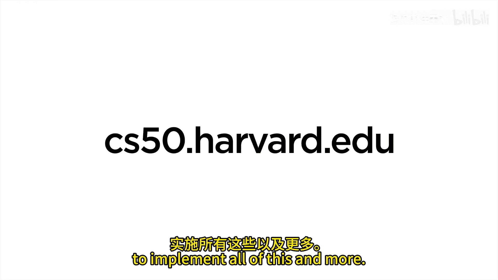

# 【全集】哈佛大学CS50 人工智能的概念和算法 中英字幕 课程附完整课件 p01 课程介绍 -BV1ABU5BeE3W_p1-

嗯。

Hello world， this is CS S 50， and this is an introduction to artificial intelligence with Python with CS50's own Brian you。

 this course picks up where CS50 itself leaves off and explores the concepts and algorithms at the foundation of modern AI We'll start with a look at how AI can search for solutions to problems。

 whether those problems are learning how to play a game or trying to find driving directions to a destination。

 We'll then look at how AI can represent information， both knowledge that our AI is certain about。

 but also information and events about which our AI might be uncertain。

 learning how to represent that information but more importantly。

 how to use that information to draw inferences and new conclusions as well。

 We'll explore how AI can solve various types of optimization problems。

 trying to maximize profits or minimize cost or satisfy some other constraints before turning our attention to the fastgrow field of machine learning。

 where we won't tell our AI exactly how to solve a problem。

 but instead give our AI access to data and experiences so that our AI can learn on its own how to perform these。

😊，🎼In particular， we'll look at neural networks， One of the most popular tools in modern machine learning。

 inspired by the way that human brains learn and reason as well。

 before finally taking a look at the world of natural language processing so that it's not just us humans learning to learn how artificial intelligence is able to speak。

 but also AI learning how to understand and interpret human language as well。

 We'll explore these ideas and algorithms And along the way。

 give you the opportunity to build your own AI programs to implement all of this and more。

 This is CS5。😊。

