# 【全集】哈佛大学CS50 人工智能的概念和算法 中英字幕 课程附完整课件 p03 Lecture 1 - 知识 -BV1ABU5BeE3W_p3-

嗯。

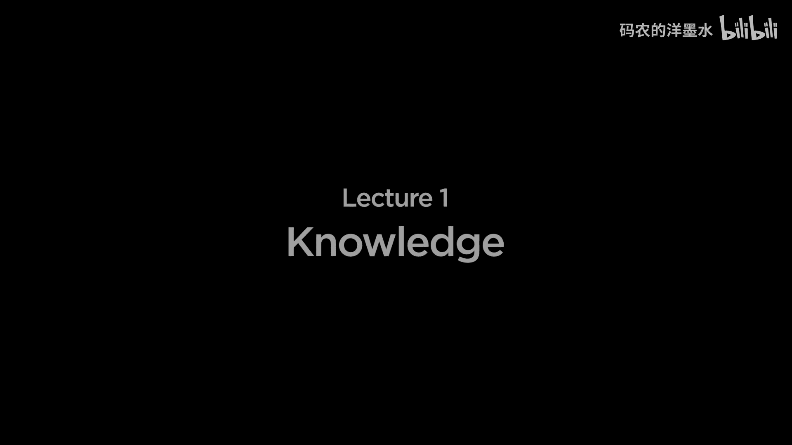

Alright， welcomele back， everyone， to an introduction to artificial intelligence with Python。

 Last time we took a look at search problems in particular。

 where we have AI agents that are trying to solve some sort of problem by taking actions in some sort of environment。

 whether that environment is trying to take actions by playing moves in a game or whether those actions or something like trying to figure out where to make turns in order to get driving directions from point A to point B。

😊，This time， we're going to turn our attention more generally to just this idea of knowledge。

 The idea that a lot of intelligence is based on knowledge。

 especially if we think about human intelligence。 people know information。

 we know facts about the world and using that information that we know we're able to draw conclusions。

 reason about the information that we know in order to figure out how to do something or figure out some other piece of information that we conclude based on the information we already have available to us What we'd like to focus on now is the ability to take this idea of knowledge and being able to reason based on knowledge and apply those ideas to artificial intelligence in particular。

 we're going to be building what are known as knowledgebased agents。

 agents that are able to reason and act by representing knowledge internally somehow inside of our AI。

 they have some understanding of what it means to know something and ideally。

 they have some algorithms or some techniques they can use based on that knowledge that they know in order to figure out the solution to a problem or figure out some additional piece of。

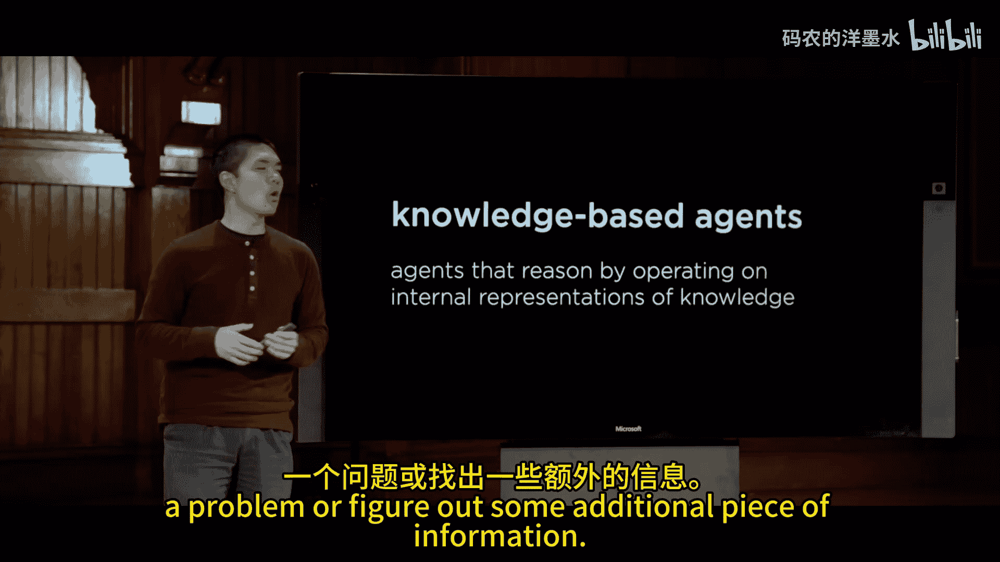

Information that can be helpful in some sense。 So what do we mean by reasoning based on knowledge to be able to draw conclusions。

 Well， let's look at a simple example drawn from the world of Harry Potter。

 We take one sentence that we know to be true。 Imagine if it didn't， if it didn't rain。

 then Harry visited Hagrid today。 So one fact that we might know about the world。

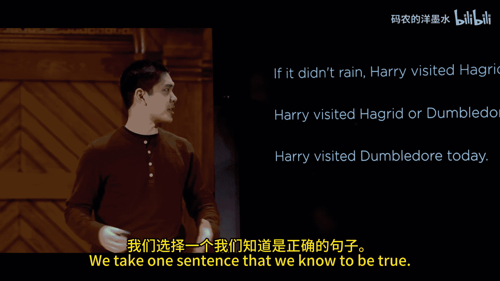

And then we take another fact。 Harry visited Hagrid or Dumbledor today， but not both。

 So it tells us something about the world that Harry either visited Hagrid。

 but not Dumbledore or Harry visited Dumbledor， but not Hagrid。

 And now we have a third piece of information about the world that Harry visited Dumbledore today。

 So we now have three pieces of information now， three facts inside of a knowledge base， so to speak。

 information that we know。 And now we as humans can try and reason about this。

 And figure out based on this information， what additional information can we begin to conclude。

 And we looking at these last two statements， Harry either visited Hagrid or Dumbledore。

 but not both。 And we know that Harry visited Dumbledd today。 Well。

 then it's pretty reasonable that we could draw the conclusion that you know what。

 Harry must not have visited Hagrid today， because based on a combination of these two statements。

 we can draw this inference。 so to speak， a conclusion that Harry did not visit Hagrid today。😊。

But it turns out we can even do a little bit better than that。

 Get some more information by taking a look at this first statement and reasoning about that。

 This first statement says if it didn't rain， then Harry visited Haggard today。😊。

So what does that mean in all cases where it didn't rain， then we know that Harry visited Hagrid。

 But if we also know now that Harry did not visit Hagrid。

 then that tells us something about our initial premise that we were thinking about。 in particular。

 it tells us that it did rain today， because we can reason if it didn't rain that Harry would have visited Hagrid。

 but we know for a fact that Harry did not visit Hagrid today。So it's this kind of reason。

 this sort of logical reasoning where we use logic based on the information that we know in order to take information and reach conclusions that is going to be the focus of what we're going to be talking about today。

 How can we make our artificial intelligence logical so that they can perform the same kinds of deduction。

 the same kinds of reasoning that we've been doing so far。Of course， humans reason about logic。

 generally in terms of human language that I just now was speaking in English。

 talking in English about these sentences and trying to reason through how it is that they relate to one another。

 We're going to need to be a little bit more formal when we turn our attention to computers and being able to encode this notion of logic and truthhood and falsehood inside of a machine we're going to need to introduce a few more terms and a few symbols thatll help us reason through this idea of logic inside of an artificial intelligence。

 and we'll begin with the idea of a sentence。 Now， a sentence in a natural language like English is just something that I'm saying like what I'm saying right now in the context of AI。

 though， a sentence is just an assertion about the world in what we're going to call a knowledge。

 representation language。 some way of representation knowledge inside of our computers and the way that we're going to spend most of today。

 reasoning about knowledge is through a type of logic known as propositional logic。

 There are a number of different types of logic， some of which we touch on。

But propositional logic is based on a logic of propositions or just statements about the world。

 And so we begin in propositional logic with an notion of propositional symbols。

 We will have certain symbols that are oftentimes just letters， something like P or Q or R。

 where each of those symbols is going to represent some fact or sentence about the world。 So P。

 for example， might represent the fact that it is reigning。

 And so P is going to represent be a symbol that represents that idea。 And Q， for example。

 might represent Harry visited Hagggriard today。 Each of these propositional symbols represents some sentence or some fact about the world。

😊。

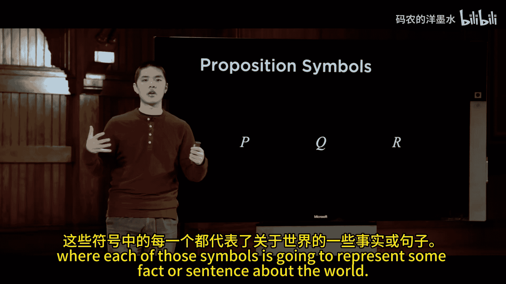

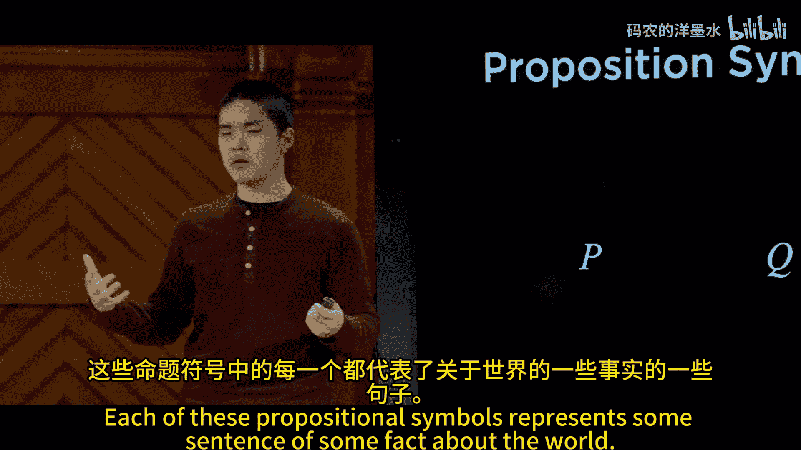

But in addition to just having individual facts about the world。

 we want some way to connect these propositional symbols together in order to reason more complexly about other facts that might exist inside of the world in which we're reasoning。

 So in order to do that， we'll need to introduce some additional symbols that are known as logical connectives。

 Now， there are a number of these logical connects。 But five of the most important。

 And the ones we're going to focus on today。 are these five up here。

 Each represented by a logical symbol not is represented by this symbol here and is represented as sort of an upside down V or is represented by a V shape。

 implication， and we'll talk about what that means in just a moment。

 is represented by an arrow and by conditional， again。

 we'll talk about what that means in a moment is represented by these double arrows。

 But these five logical connectives are the main ones we're going to be focusing on in terms of thinking about how it is that a computer can reason about facts and draw conclusions based on the facts that it knows。

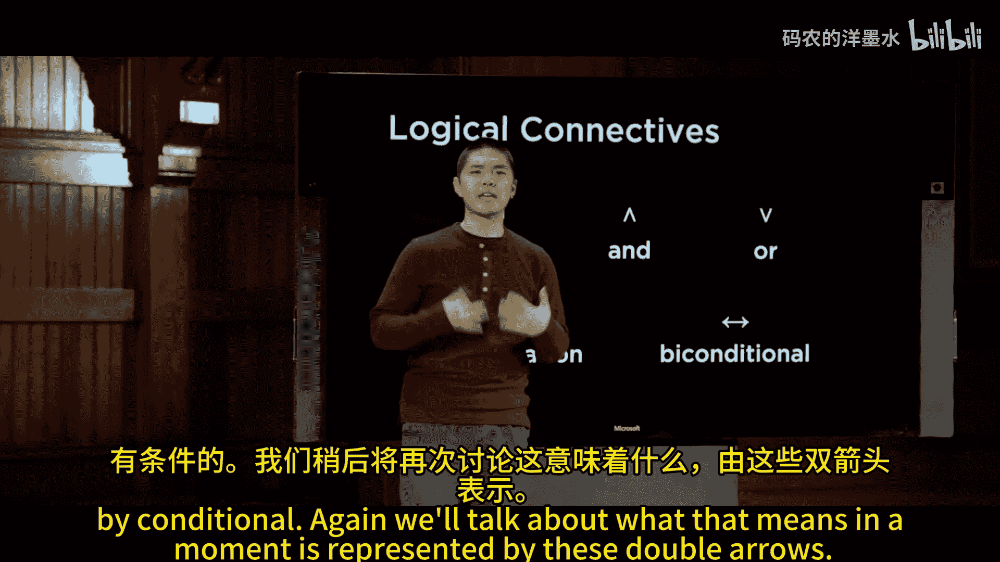

But in order to get there， we need to take a look at each of these logical connects and build up an understanding for what it is that they actually mean。

 So let's go ahead and begin with the not symbol。 So this not symbol here。

 and what we're going to show for each of these logical connects is what we're going call a truth table。

 A table that demonstrates what this word not means when we attach it to a propositional symbol or any sentence inside of our logical language。

 And so the the truth table for not is shown right here。 if P。

 some propositional symbol or some other sentence even is false， then not P is true。

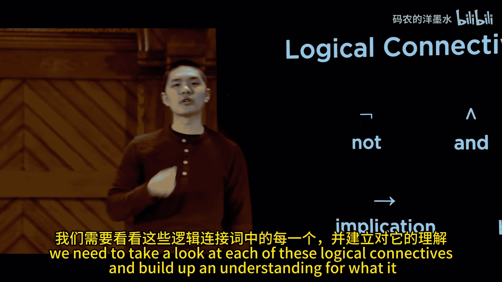

And if P is true， then not P is false。

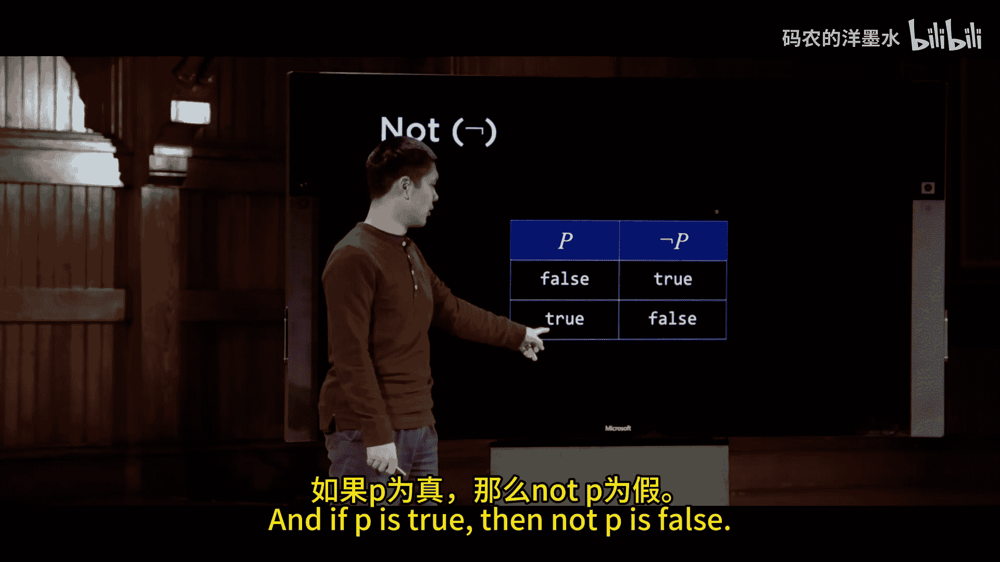

So you can imagine that placing this not symbol in front of some sentence of propositional logic just says the opposite of that。

 So if， for example， P represented， it is raining， then not P would represent the idea that it is not raining。

 And as you might expect， if P is false， meaning if the sentence it is raining is false。

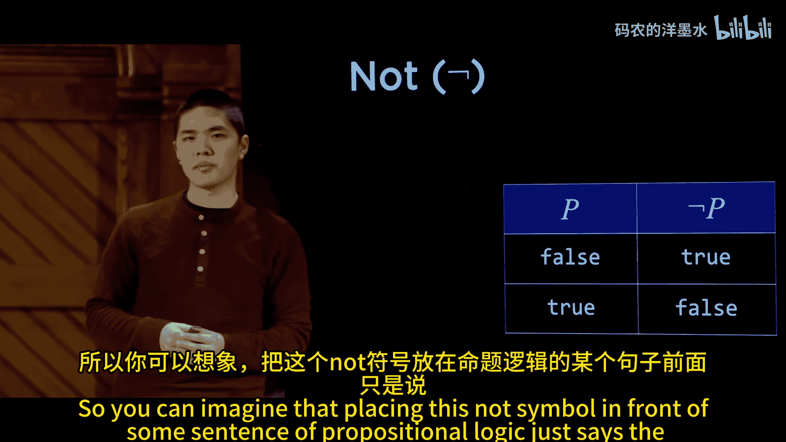

Well， then the sentence， not P must be true。 The sentence that it is not raining is therefore true。

 So not， you can imagine just takes whatever is in P， and it inverts it。

 turns false into true and true into false。 much analogously to what the English word not means。

 Just taking whatever comes after it and inverting it to mean the opposite。

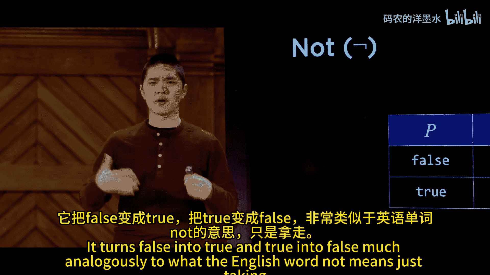

Next up and also very Englishlike is this idea of and represented by this upside down v shape or this point shape。

 And as opposed to just taking a single argument， the way not does。

 we have P and we have not p and is going to combine two different sentences and propositional logic together。

 So I might have one sentence， P and another sentence Q And I want to combine them together to say P and Q。

 And the general logic for what P and Q means is it means that both of its operarans are true。

 P is true and also Q is true。And so here's what that truth table looks like。 This time。

 we have two variables， P and Q。 And when we have two variables。

 each of which can be in two possible states， true or false。

 that leads to two squared or4 possible combinations of truth and falsehood。

 So we have P is false and Q is false。 We have P is false and Q is true。 P is true and Q is false。

 and then P and Q both are true。 And those are the only four possibilities for what P and Q could mean。

And in each of those situations， this third column here。

 P and Q is telling us a little bit about what it actually means for P And Q to be true。

 And we see that the only case where P and Q is true is in this forth here。

 where P happens to be true。 Q also happens to be true。 And in all other situations。

 P and Q is going to evaluate to false。 So this again。

 is much in line with what our intuition of and might mean。 if I say P and Q。

 I probably mean that I expect both P and Q to be true。Next up。

 also potentially consistent with what we mean is this word or represented by this v shape。

 sort of an upside down and symbol。 and or， as the name might suggest， is true。

 if either of its arguments are true， as long as P is true， or Q is true。

 then P or Q is going to be true， which means the only time that P or Q is false。

 is if both of its operaans are false。 if P is false and Q is false。

 then P or Q is going to be false， but in all other cases， at least one of the operarans is true。

 maybe they're both true， in which case P or Q is going to evaluate to true。Now。

 this is mostly consistent with the way that most people might use the word or in the sense of speaking the word or in normal English。

 though there is sometimes when we might say or where we mean P or Q but not both we mean sort of it can only be one or the other。

 It's important to note that this symbol here。 This or means P or Q or both that those are totally okay as long as either or both of them are true。

 then the or is going to evaluate to be true as well。

 it's only in the case where all of the operas are false that p or Q ultimately evaluates to false as well in logic。

 there's number another symbol known as the exclu or which encodes this idea of exclusivity of like one or the other。

 but not both， but we're not going to be focusing on that today。

 whenever we talk about or we're always talking about either or both in this case as represented by this truth table here。

So that now is not an and an or。 and next up is what we might call implication。

 as denoted by this arrow symbol， so we have P and Q。

 and this sentence here will generally read as P implies Q。😡。

And what P implies Q means is that if P is true， then Q is also true。

 So I might say something like if it is raining， then I will be indoors。

 meaning it is raining implies I will be indoors as the logical sentence that I'm saying there。

 And the truth table for this can sometimes be a little bit tricky。

 So obviously if p is true and Q is true。 then P implies  Q， that's true。

 that definitely makes sense。 and it should also stand to reason that when p is true and Q is false。

 then p implies  Q is false， because if I said to， if it is raining， then I will be out indoors。

 and it is raining， but I'm not indoors， will then it would seem to be that my original statement was not true。

 P implies Q means that if P is true， then Q also needs to be true。

 and if it's not well then the statement is false。

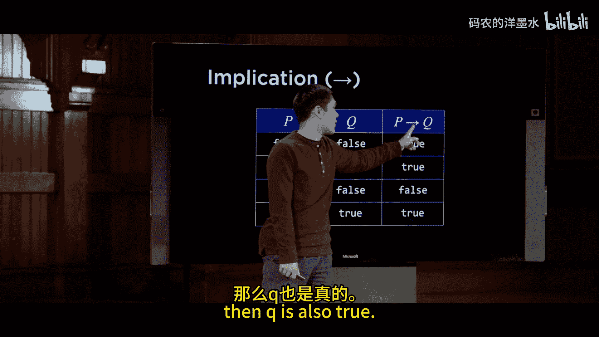

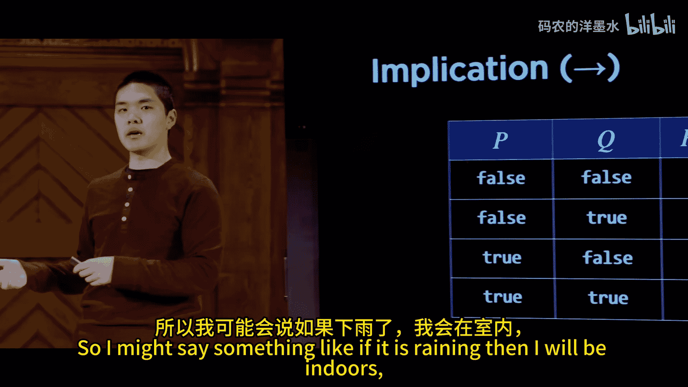

What's also worth noting， though， is what happens when P is false。 When p is false。

 the implication makes no claim at all。 If I say something like if it is raining。

 then I will be indoors， and it turns out it's not reing。 then in that case。

 I am not making any statement as to whether or not I will be indoors or not P implies Q just means that if p is true。

 Q must be true， but if p is not true， then we make no claim about whether or not Q is true at all。

 So in either case， if p is false， it doesn't matter what Q is， whether it's false or true。

 we're not making any claim about Q whatsoever， we can still evaluate the implication to true。

 the only way that the implication is ever false is if our premise P is true。

 but the conclusion that we're drawing Q happens to be false。

 So in that case we would say P does not imply Q in that case。Finally。

 the last connective that we'll discuss is this bicondal。

 You can think of a bicondal as a condition that goes in both directions。 So originally。

 when I said something like if it is raining， then I will be indoors， I didn't say what would happen。

 if it wasn't raining， maybe I'll be indoors， maybe I'll be outdoors。 this biconal。

 you can read as in if and only if So I can say if is I will be indoors if and only if it is raining。

 meaning if it is raining， then I will be indoors， and if I am indoors。

 it's reasonable to conclude that it is also raining。

 So this biconal is only true when P and Q are the same。 So if P is true and Q is true。

 then this biconal is also true， P implies Q， but also the reverse is true， Q also implies P。

 So if P and  Q both happen to be false， we would still say it's true。

 but in any of these other two situations， this P， if and only if Q is going to ultimately evaluate to false。

😊，A lot of truths and falses going on there， but these five basic logical connectives are going to form the core of the language of propositional logic。

 the language that we're going to use in order to describe ideas and the language that we're going to use in order to reason about those ideas in order to draw conclusions。

😡，So let's now take a look at some of the additional terms that we'll need to know about in order to go about trying to form this language of propositional logic and writing AI that's actually able to understand this sort of logic。

 The next thing we're going to need is the notion of what is actually true about the world。

 We have a whole bunch of propositional symbols。 P and Q and R and maybe others。

 But we need some way of knowing like what actually is true in the world is p true or false is Q true or false。

 so on and so forth。 And to do that we'll introduce the notion of a model。

 A model just assigns a truth value where a truth value is either true or false。

 to every propositional symbol。 In other words， it's creating what we might call a possible world。

 So let me give an example。 If， for example， I have two propositional symbols。 P is it is raining。

 and Q is It is a Tuesday。 A model just takes each of these two symbols and assigns a truth value to them。

 Either true or false。 So here's a sample model。😊，This model， in other words， in this possible world。

 it is possible that P is true， meaning it is raining and Q is false， meaning it is not a Tuesday。

 But there are other possible worlds or other models as well。

 There is some model where both of these variables are true。

 some model where both of these variables are false。 In fact。

 if there are n variables that are propositional symbols like this that are either true or false。

 Then the number of possible models is two to the n。 because each of these possible models。

 possible variables within my model could be set to either true or false。

 If I don't know any information about it。So now that I have the symbols and the symbols and the connectives that I'm going to need in order to construct these parts of knowledge。

 we need some way to represent that knowledge。 And to do so。

 we're going to allow our AI access to what we'll call a knowledge base。

 and our knowledge base is really just a set of sentences that our AI knows to be true。

 Some set of sentences in propositional logic that are things that our AI knows about the world。

And so we might tell our AI some information， information about a situation that it finds itself in or a situation about a problem that it happens to be trying to solve。

 And we would give that information to the AI that the AI would store inside of its knowledge base。

And what happens next is the AI would like to use that information in the knowledge base to be able to draw conclusions about the rest of the world。

 And what do those conclusions look like， Well， to understand those conclusions。

 we'll need to introduce one more idea， one more symbol。 And that is the notion of entailment。😊。

So this sentence here with this double turn style in these Greek letters。

 This is the Greek letter alphapha and the Greek letter beta。 And we read this as alpha entails beta。

And alpha and beta here are just sentences in propositional logic。

And what this means is that alpha entails beta means that in every model， in other words。

 in every possible world in which sentence a is true or a sentence alpha is true。

 then sentence beta is also true。 So if something entails something else。 if alpha entails beta。

 it means that if I know alpha to be true， then beta must therefore also be true。

 So if my alpha is something like I know that it is a Tuesday in January。

 Then a reasonable beta might be something like I know that it is January。

 because in all worlds where it is a Tuesday in January。

 I know for sure that it must be January just by definition。

 this first statement where sentence about the world， entails the second statement。

 and we can reasonably use deduction based on that first sentence to figure out that the second sentence is。

 in fact， true as well。 And ultimately， it's this idea of entailment that we're going to try and encode into our computer。

😊。

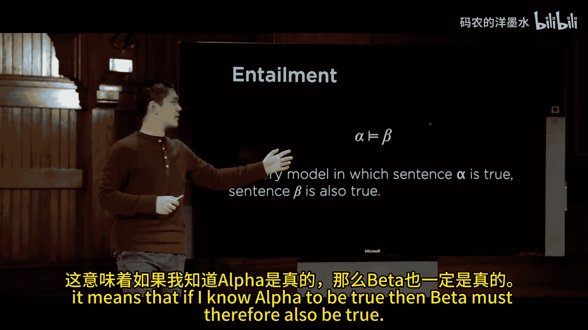

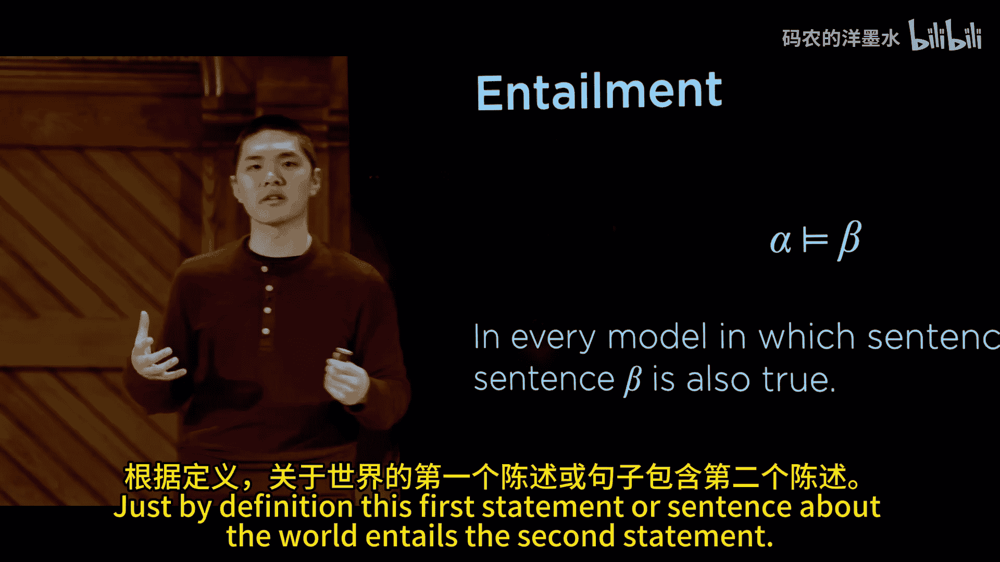

We want our AI agent to be able to figure out what the possible entailments are。

 We want our AI to be able to take these three sentences。 Sens like if it didn't rain。

 Harry visited Hagrid， that Harry visited Hagrid or Dumbledore。

 but not both and that Harry visited Dumledore and just using that information。

 We'd like our AI to be able to infer or figure out that using these three sentences inside of a knowledge base。

 we can draw some conclusions。 in particular， we can draw the conclusions here。

 that one Harry did not visit Hagrid today， and we can draw the entailment2， that it did， in fact。

 rain today。 And this process is known as inference。

 and that's what we're gonna to be focusing on today。

 this process of deriving new sentences from old ones that I give you these three sentences。

 you put them in the knowledge base in say the AI and the AI is able to use some sort of inference algorithm to figure out that these two sentences must also be true。

😊，And that is how we define inference。So let's take a look at an inference example to see how we might actually go about inferenceferring things in a human sense before we take a more algorithmic approach to see how we could encode this idea of inference in AI。

 And we'll see there are a number of ways that we can actually achieve this。 So again。

 we'll deal with a couple of propositional symbols。 We'll deal with P， Q and R。 P is it is a Tuesday。

 Q is it is raining。 And R is Harry will go for a run。

3 propositional symbols that we are just defining to mean this。

 We're not saying anything yet about whether they're true or false。

 We're just defining what they are。😊，Now we'll give ourselves or an AI access to a knowledge base abbreviated to KB。

 the knowledge that we know about the world。 We know this statement， right， so let's try to paris it。

 the parentheses here are just used for precedent so we can see what associates with what。

 but you would read this as P and not Q implies are。😡，All right， so what does that mean。

 let's put it be piece by piece P is it is a Tuesday。Q is， it is raining， so not Q is。

 It is not raining。And implies R is Harry will go for a run。

 So the way to read this entire sentence in human natural language， at least， is。

If it is a Tuesday and it is not raining， then Harry will go for a run。

So if it is a Tuesday and it is not raining， then Harry will go for a run。

 And that is now inside of our knowledge base。 And let's now imagine that our knowledge base has two other pieces of information as well。

 It has information that P is true that it is a Tuesday。And we also have the information， not Q。

 that it is not rating， that this sentence Q， it is rating， happens to be false。

And those are the three sentences that we have access to。P and not Q implies R， P and not Q。

Using that information， we should be able to draw some inferences。

 P and not Q is only true if both P and not Q are true。 Well， All right。

 we know that P is true and we know that not Q is true。

 So we know that this whole expression is true。 And the definition of implication is if this whole thing on the left is true。

 then this thing on the right must also be true。 So we， if we know that P and not Q is true。

 then R must be true as well。 So the inference we should be able to draw from all of this is that R is true and we know that Harry will go for a run by taking this knowledge inside of our knowledge base and being able to reason based on that idea。

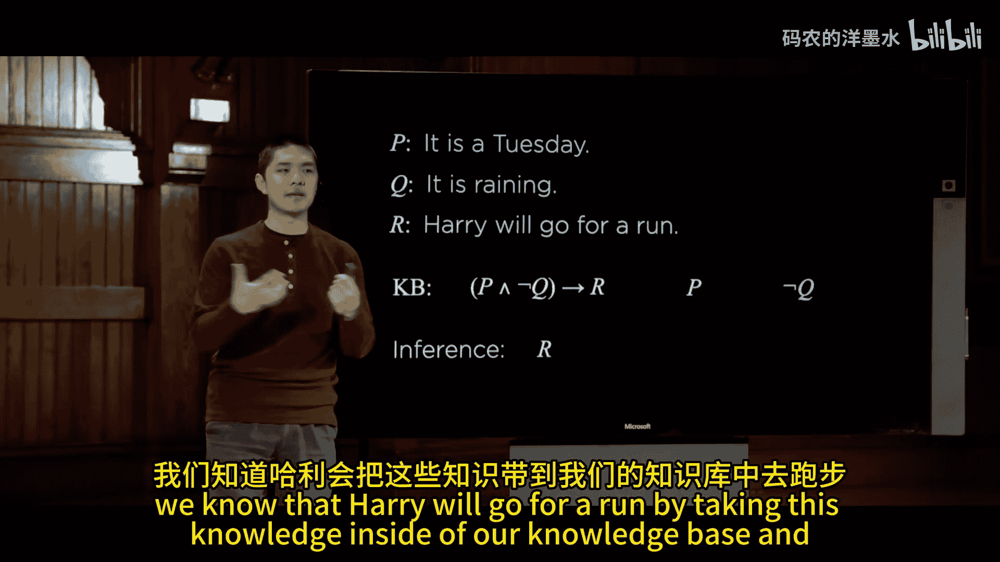

And so this ultimately is the beginning of what we might consider to be some sort of inference algorithm。

 some process that we can use to try and figure out whether or not we can draw some conclusion。

 And ultimately， what these inference algorithms are going to answer is the central question about entailment。

 given some query about the world， something we're wondering about the world and we'll call that query alpha。

 the question we want to ask using these inference algorithms is does K B that our knowledge base entail alpha。

 In other words， using only the information we know inside of our knowledge base。

 The knowledge that we have access to， can we conclude that this sentence alpha is true。😊。

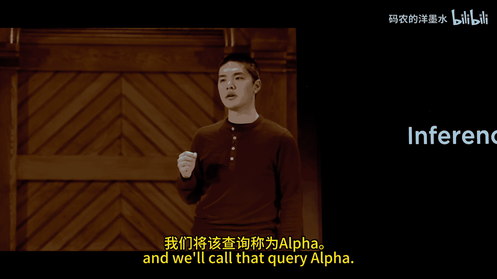

And that's ultimately what we would like to do。So how can we do that。

 How can we go about writing an algorithm that can look at this knowledge base and figure out whether or not this query alpha is actually true。

 Well， it turns out there are a couple of different algorithms for doing so。 And one of the simplest。

 perhaps， is known as model checking。 Now， remember that a model is just some assignment of all of the propositional symbols inside of our language to a truth value。

 Tru or false。 And you can think of a model as a possible world。

 that there are many possible worlds where different things might be true or false。

 And we can enumerate all of them。 And the model checking algorithm does exactly that。😊。

So what does our model tracking algorithm do， Well。

 if we want determine if our knowledge base entails some query alpha。

 then we are going to enumerate all possible models。 In other words。

 consider all possible values of true and false for our variables。

 all possible states in which our world can be in。And if in every model where our knowledge base is true。

 alpha is also true。 Then we know that the knowledge base entails alpha。

 So let's take a closer look at that sentence and try and figure out what it actually means。

 if we know that in every model， In other words， in every possible world。

 no matter what assignment of true and false to variables you give。

 if we know that whenever our knowledge is true， what we know to be true is true， that this query。

 Al is also true。 Well， then it stands to reason that as long as our knowledge base is true。

 then alpha must also be true。

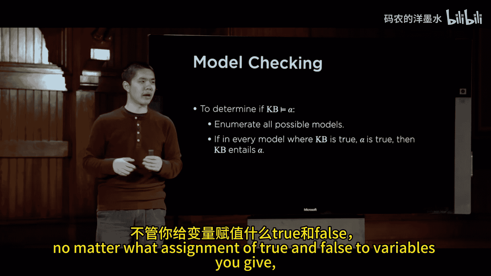

And so this is going to form the foundation of our model checking algorithm。

 We're going to enumerate all of the possible worlds and ask ourselves whenever the knowledge base is true。

 I alpha true。 And if it that's the case， then we know alpha to be true。 And otherwise。

 there is no entailment。 Our knowledge base does not entail alpha。Alright。

 so this is a little bit abstract。 But let's take a look at an example to try and put real propositional symbols to this idea。

 So again， we'll work with the same example。 P is it is a Tuesday。 Q is it is raining。

 R is Harry will go for a run。 Our knowledge base contains these pieces of information。

 P and not Q implies R。 We also know P。 It is a Tuesday and not Q。 It is not raining。😊。

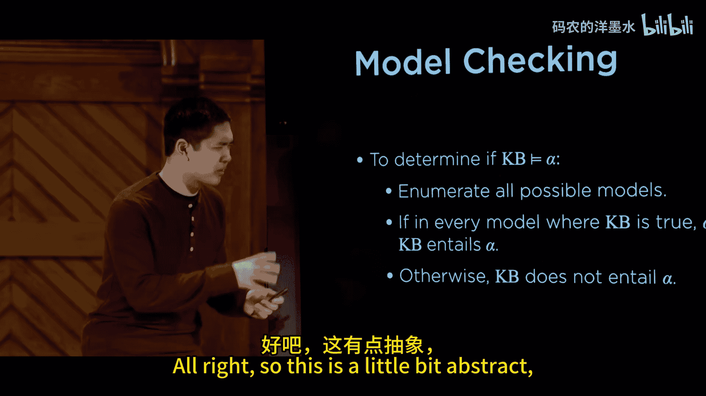

And our query， our alpha， in this case， The thing we want to ask is R。 We want to know。

 iss it guaranteed， Is it entailed that Harry will go for a run。

So the first step is to enumerate all of the possible models。

 We have three propositional symbols here， P Q andR。

 which means we have two to the third power or eight possible models， all false， false， false， true。

 false， true， false， false， true， true， etc， eight possible ways that you could assign true and false to all of these models。

😡，And we might ask in each one of them， is the knowledge base true Here are the set of things that we know in which of these worlds could this knowledge base possibly apply to in which worlds is this knowledge base true。

 Well， in the knowledge base， for example， we know P， like we know it is a Tuesday。

 which means we know that these four first four rows where P is false。

 none of those are going to be true are going to work for this particular knowledge base。

 Our knowledge base is not true in those worlds。 Likewise， we also know not Q。

 We know that it is not reigning。 So any of these models where Q is true like these two and these two here。

 those aren't going to work either， because we know that Q is not true。And finally。

 we also know that P and not Q implies R， which means that when p is true where p is true here。

 and Q is false， Q is false in these two。 then R must be true and if ever P is true。 Q is false。

 but R is also false。 Well that doesn't satisfy this implication here。

 that implication does not hold true under those situations。

 So we could say that for our knowledge base， we can conclude under which of these possible worlds is our knowledge base true and under which of the possible worlds is our knowledge base false。

 And it turns out there is only one possible world where our knowledge base is actually true。

 in some cases， there might be multiple possible worlds where the knowledge base is true。

 But in this case， it just so happens that there's only one one possible world where we can definitively say something about our knowledge base。

 And in this case， we would look at the query。😊，The query of R is R true。 R is true。

 And so as a result， we can draw that conclusion。And so this is this idea of model checking。

 enumerate all the possible models and look in those possible models to see whether or not if our knowledge base is true is the query in question true as well。

So let's now take a look at how we might actually go about writing this in a programming language like Python。

 Take a look at some actual code that would encode this notion of propositional symbols and logic and these connectives like and and or and not an implication and so forth。

 and see what that code might actually look like So I've written in advance。 a logic library。

 That's more detailed than we need to worry about entirely today。

 But the important thing is that we have one class for every type of logical symbol or connect that we might have。

 So we just have one class for logical symbols， for example。

 where every symbol is going to represent and store some name for that particular symbol。

 And we also have a class for not that takes an opera and So we might say not one symbol to say something is not true or some other sentence is not true。

 We have one for and， one for or so on and so forth。 And I'll just demonstrate how this works。

 And you can take a look at the actual logic do pi later on。 but I'll go ahead and call this file。

 Harry do pi。😊，I going to store information about this world of Harry Potter， for example。

 So I'll go ahead and import for my logic module。 I'll import everything。And in this library。

 in order to create a symbol， you use capital S symbol。

And I'll create a symbol for rain to mean it is raining， for example。

 And I'll create a symbol for Hagrid。 to mean Harry visited Hagrid is what the symbol is going to mean。

 So this symbol means it is raining。 This symbol means Harry visited Hagrid。

 And I'll add another symbol called Dumledore。For Harry visited。Dumbbleore。Now。

 I'd like to save these symbols so that I can use them later as I do some logical analysis。

 So I'll go ahead and save each one of them inside of a variable。 So like rain。

 hagrid and dumbumledore。That you could call the variables anything。

And now that I have these logical symbols， I can use logical connectives to combine them together。

 So， for example， if I have a sentence like and。Rain and hagrid， for example。

 which is not necessarily true， but just for demonstration。

I can now try and print out sentence dot formula， which is a function I wrote that takes a sentence and propositional logic and just prints it out so that we the programmers can now see this in order to get an understanding for how it actually works。

 So if I run Python， Harry dot Pi。

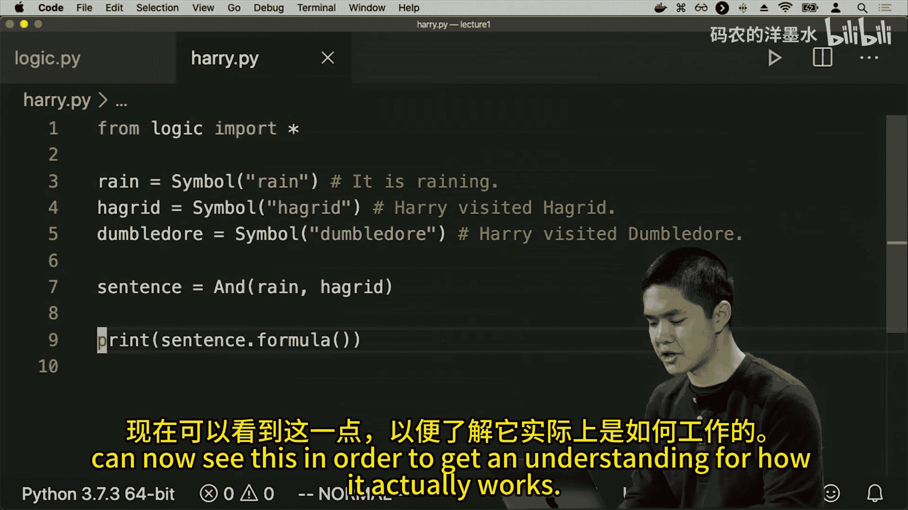

What we'll see is this sentence and propositional logic， Ra and Had。

 This is the logical representation of what we have here in our Python program of saying。

 and whose arguments are rain and Hagrids。 So we're saying rain and had by encoding that idea。

 And this is quite common in Python object oriented programming。

 where you have a number of different classes and you pass arguments into them in order to create a new and object。

 for example， in order to represent this idea。

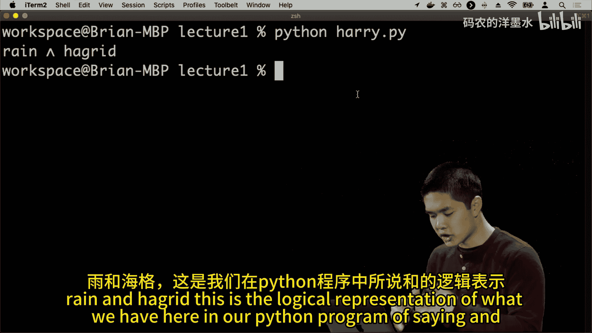

But now what I'd like to do is somehow encode the knowledge that I have about the world in order to solve that problem from the beginning of class。

 where we talked about trying to figure out who Harry visited and trying to figure out if it's raining or if it's not raining。

 And so what knowledge do I have。I'll go ahead and create a new variable called knowledge。

 And what do I know， Well， I know the very first sentence that we talked about was the idea that if it is not raining。

 then Harry will visit Hagrid。So allright， how do I encode the idea that it is not raining。

 Well I can use not。 And then the rain symbol。 So here's me saying that it is not raining。

 And now the implication is that if it is not raining， then Harry visited Hagrid。

So I'll wrap this inside of an implication。To say， if it is not rating。

 this first argument to the implication will then。Harry visited Hagrid。So I'm saying implication。

 the premise is that it's not raining。 and if it is not raining， then Harry visited Hagrid。

 and I can print out knowledge dot formula to see the logical formula equivalent of that same idea。

 So I run Python of Harry dot pi， and this is the logical formula that we see as a result。

 which is a textbased version of what we were looking at before。 that if it is not raining。

 that that implies that Harry visited Hagrid。

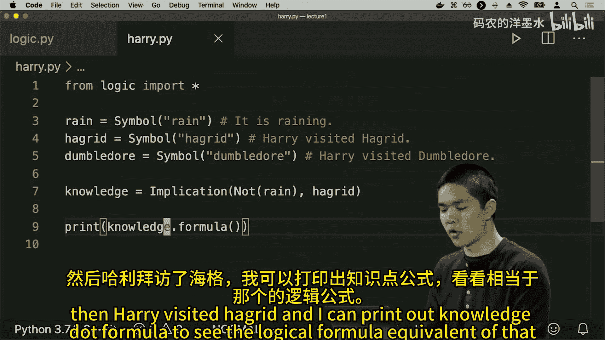

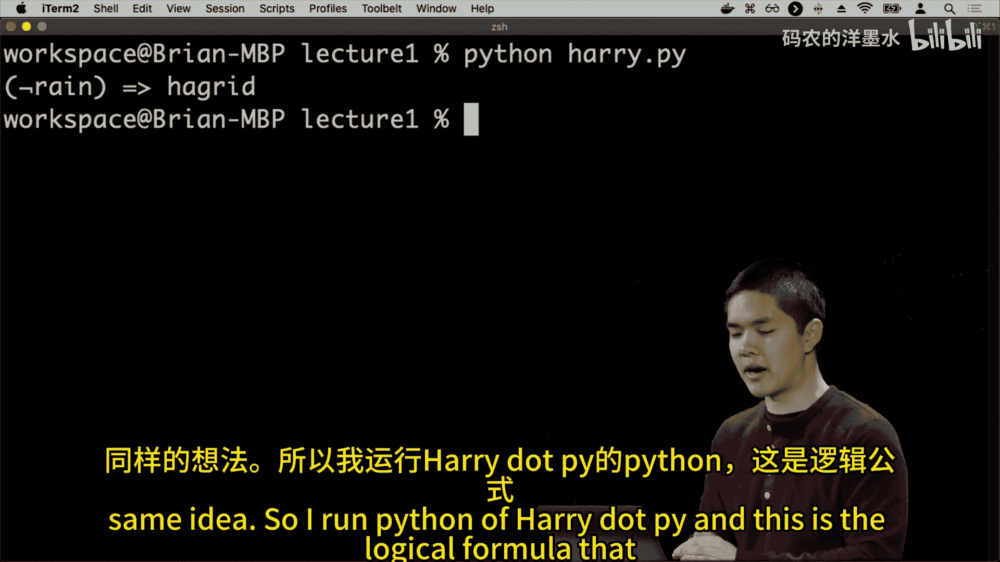

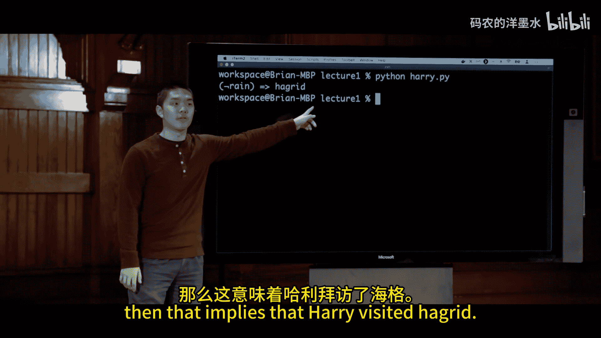

But there was additional information that we had access to as well。 In this case。

 we had access to the fact that Harry visited either Hagrid or Dumbledore。So how do I encode that？

 Well， this means that in my knowledge， I've really got multiple pieces of knowledge going on。

 I know one thing and another thing and another thing。

 So I'll go ahead and wrap all of my knowledge inside of an and。

 And I'll move things on a new lines just for good measure， but I know multiple things。

 So I'm saying knowledge is an and of multiple different sentences。

 I know multiple different sentences to be true。 One such sentence that I know to be true。

 I this implication that if it is not raining， then Harry visited Hagrid。😊。

Another such sentence that I know to be true is or hagrid。Doouble door。In other words。

 either so Hagrid or Dumledore is true because I know that Harry visited Hagrid or Dumledore。

But I know more than that。 actually， that initial sentence from before said that Harry visited Hagrid or Dumbledore。

 but not both。 So now I want a sentence that'll encode the idea that Harry didn't visit both Hagrid and Dumbledore。

Well， the notion of Harry visiting Hagrid and Dumledor would be represented like this and of Hagrid and Dumledor。

And if that is not true， if I want to say not that。

 then I'll just wrap this whole thing inside of a not。So now these three lines。

 line 8 says that if it is not raining， then Harry visited Hagrid。

 line 9 says Harry visited Hagrid or Dumleddor， and line 10 says Haard didn't or Harry didn't visit both Hagrid and Dumledore。

 that it is not true that both the Hagrid symbol and the Dumbledore symbol are true。

 Only one of them can be true。And finally， the last piece of information that I knew was the fact that Harry visited Dumbledore。

😊，So these now are the pieces of knowledge that I know。

 one sentence and another sentence and another and another。

 And I can print out what I know just to see it a little bit more visually。

 And here now is a logical representation of the information。

 that my computer is now internally representing using these various different Python objects。

 And again， take a look at logic dot pi。 if you want to take a look at how exactly it's implementing this。

 but no need to worry too much about all of the details there。

 We're here saying that if it is not raining。 Then Harry visited Hagrid。

 We're saying that Hagrid or dumbumled doors is true。

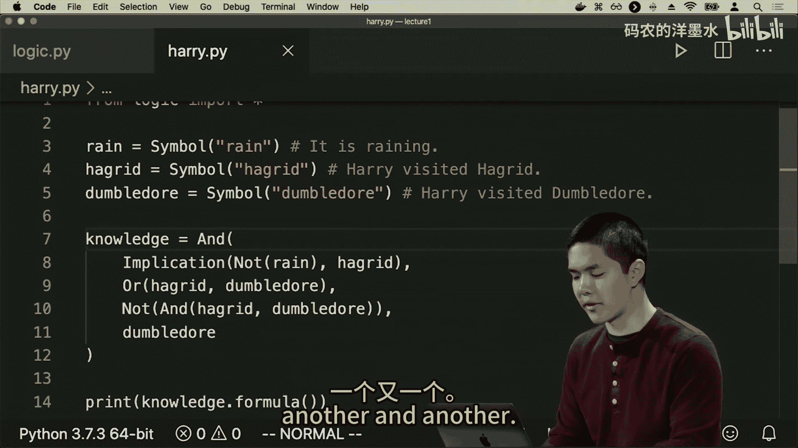

And we're saying it is not the case that Hagrid and Dumbledore is true， that they're not both true。

 And we also know that Dumbledore is true。 So this long logical sentence represents our knowledge base。

 It is the thing that we know。And now what we'd like to do is we'd like to use model checking to ask a query。

 to ask a question like based on this information， do I know whether or not it's raining。

 And we as humans were able to logic our way through it and figure out that， all right。

 based on these sentences， we can conclude this。 and that to figure out that yes。

 it must have been rating。 But now we'd like for the computer to do that as well。

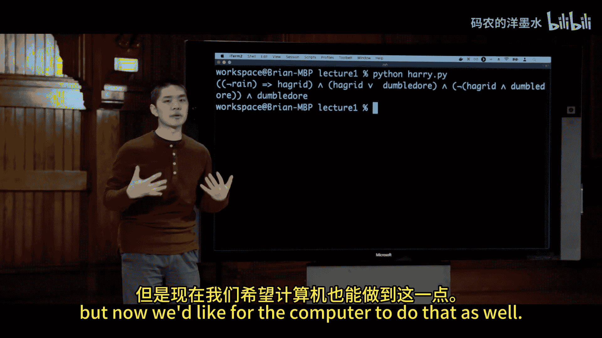

So let's take a look at the model checking algorithm that is going to follow that same pattern that we drew out in theater code a moment ago。

 So I've defined a function here in logic dot Pi that you can take a look at called model check。

Model check takes two arguments， the knowledge that I already know， and the query。😡，And the idea is。

 in order to do model checking， I need to enumerate all of the possible models。

 And for each of the possible models， I need to ask myself。

 is the knowledge base true and is the query true， So the first thing I need to do is somehow enumerate all of the possible models。

 meaning for all possible symbols that exist， I need to assign true and false to each one of them and see whether or not it's still true。

And so here is the way we're going to do that。We're going to start。

 so I've defined another helper function internally that we'll get to in just a moment。

 but this function starts by getting all of the symbols in both the knowledge and the query by figuring out what symbols am I dealing with in this case。

 the symbols I'm dealing with are rain and had and Dumledore。

 but there might be other symbols depending on the problem and we'll take a look soon at some examples of situations where ultimately we're going to need some additional symbols in order to represent the problem。

😡，And then we're going to run this check all function。

 which is a helper function that's basically going to recursively call itself checking every possible configuration of propositional symbols。

 So we start out。😊，And by looking at this check all function。 and what do we do。

 So if not symbols means if we finish assigning all of the symbols。

 we've assigned every symbol of value。 so far， we haven't done that。 But if we ever do。

 then we check。In this model is the knowledge true。 That's what this line is saying。

 If we evaluate the knowledge， propositional logic formula using the model's assignment of truth values is the knowledge true。

If the knowledge is true， then we should return true， only if the query is true。

 because if the knowledge is true， we want the query to be true as well in order for there to be entailment。

 Otherwise， we don't know that there otherwise there won't be an entailment if there's ever a situation where what we know in our knowledge is true but the query。

 the thing we're asking happens to be false。 So this line here is checking that same idea that in all worlds where the knowledge is true。

 the query must also be true。😡，Otherwise， we can just return true。

 because if the knowledge isn't true， then we don't care。

 This is equivalent to when we were enumerating this table from a moment ago。

 in all situations where the knowledge base wasn't true。 All of these seven rows here。

 we didn't care whether or not our query was true or not。

 We only care to check whether the query is true， when the knowledge base is actually true。

 which was just this green highlighted row right there。😡。

So that logic is encoded using that statement there。And otherwise。

 if we haven't assigned symbols yet， which we haven't seen anything yet。

 then the first thing we do is pop one of the symbols。

 I make a copy of the symbols first just to save an existing copy。

 but I pop one symbol off of the remaining symbol so that I just pick one symbol at random and I create one copy of the model where that symbol is true。

And I create a second copy of the model where that symbol is false。

So I now have two copies of the model， one where the symbol is true。

 and one where the symbol is false。 And I need to make sure that this entailment holds in both of those models。

 So I recursively check all on the model where the statement is true and check all on the model where the statement is false。

So again， you can take a look at that function to try to get a sense for how exactly this logic is working。

 But in effect， what it's doing is recursively calling this check-off function again and again and again。

 And on every level of the recursion， we're saying。

 let's pick a new symbol that we haven't yet assigned。

 assign it to true and assign it to false and then check to make sure that the entailment holds in both cases because ultimately。

 I need to check every possible world， I need to take every combination of symbols and try every combination of true and false in order to figure out whether the entailment relation actually holds。

😊，So that function we've written for you。 But in order to use that function inside of Harry D Pi。

 what I'll write is something like this。 I would like to model check。Based on the knowledge。

 And then I provide us a second argument what the query is， what the thing I want to ask is。

 and what I want to ask in this case is， is it raining。So model check again takes two arguments。

 The first argument is the information that I know， this knowledge。

 which in this case is this information that was given to me at the beginning。

And this second argument， rain is encoding the idea of the query。 What am I asking。

 I would like to ask， based on this knowledge， do I know for sure that it is rating。

And I can try and print out the result of that。

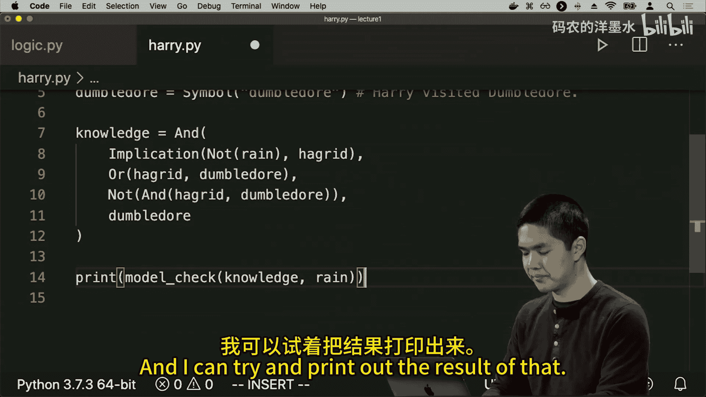

And when I run this program。I see that the answer is true that based on this information。

 I can conclusively say that it is raining because using this model checking algorithm。

 we were able to check that in every world where this knowledge is true， it is raining。

 In other words， there is no world where this knowledge is true and it is not raining。

 So you can conclude that it is， in fact， raining。😊。

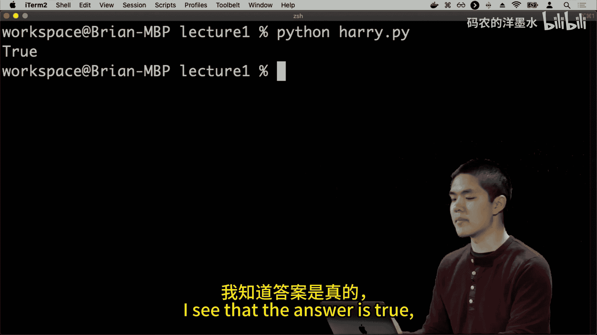

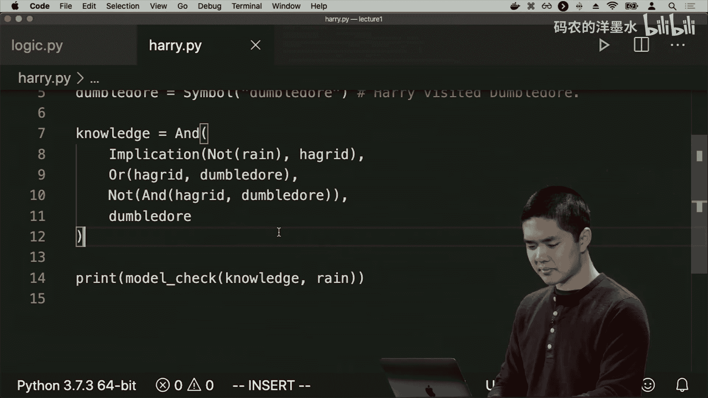

And this sort of logic can be applied to a number of different types of problems that if confronted with a problem where some sort of logical deduction can be used in order to try to solve it。

 you might try thinking about what propositional symbols you might need in order to represent that information and what statements and propositional logic you might use in order to encode that information which you know。

 and this process of trying to take a problem and figure out what propositional symbols to use in order to encode that idea or how to represent it logically is known as knowledge engineering that software engineers and AI engineers will take a problem and try and figure out how to distill it down into knowledge that is representable by a computer And if we can take any general purposese problem。

 some problem that we find in the human world and turn it into a problem that computer is know how to solve as by using any number of different variables will then we can take a computer that is able to do something like model checking or some other inference algorithm and actually figure out how to solve that problem。

Oh。So now we'll take a look at two or three examples of knowledge。

 engineering and practice of taking some problem and figuring out how we can apply logical symbols and use logical formulas to be able to encode that idea。

 and we'll start with a very popular board game in the U in the UK known as clue now in the game of clue。

 Theres a number of different factors that are going on。 But the basic premise of the game。

 if you've never played it before is that there are a number of different people for now we'll just use three Colonel Mustard professor P and Miss Scarlet There are a number of different rooms。

 like a ballroom， a kitchen and a library and there are a number of different weapon， a knife。

 a revolver and a wrench and three of these， one person。

 one room and one weapon is the solution to the mystery。

 the murderer and what room they were in and what weapon they happen to use and what happens at the beginning of the game is that all these cards are randomly shuffled together and three of them。

 one person in one room and one weapon are placed into a sealed envelope that we don't know。

 and we would like to figure out using some sort of logical process。Inside the envelope。

 which person， which room and which weapon。 And we do so by looking at some。

 but not all of these cards here， by looking at these cards to try and figure out what might be going on。

And so this is a very popular game。 But let's now try and formalize it and see if we could train a computer to be able to play this game by reasoning through it logically。

So in order to do this， we'll begin by thinking about what propositional symbols we're ultimately going to need。

 Remember， again， that propositional symbols are just some symbol。

 some variable that can be either true or false in the world。And so in this case。

 the propositional symbols are really just going to correspond to each of the。

Possible things that could be inside the envelope。 Mustard is a propositional symbol that in this case will just be true if Colonel Mustard is inside the envelope if he is the murderer and false otherwise。

 and likewise for a plum for Professor Plum and Scarlet for Miss Scarlet and likewise for each of the rooms and for each of the weapons。

 We have one propositional symbol for each of these ideas。Then using those propositional symbols。

 we can begin to create logical sentences， create knowledge that we know about the world。 So。

 for example， we know that someone is the murderer， that one of the three people is， in fact。

 the murderer。 And how would we encode that。 Well we don't know for sure who the murderer is。

 But we know it is one person or the second person or the third person。

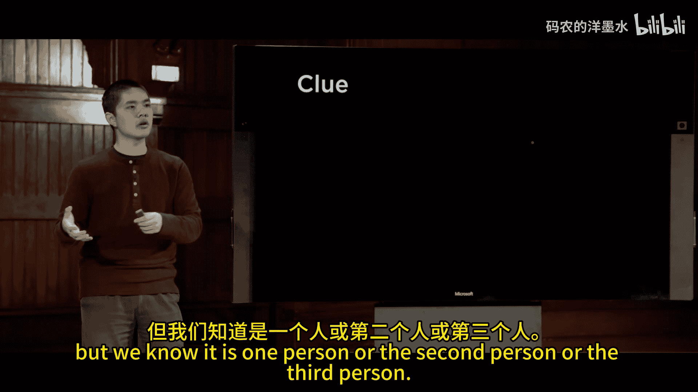

So I could say something like this， mustard or plum or scarlet。

 And this piece of knowledge encodes that one of these three people is the murder。

 We don't know which， but one of these three things must be true。

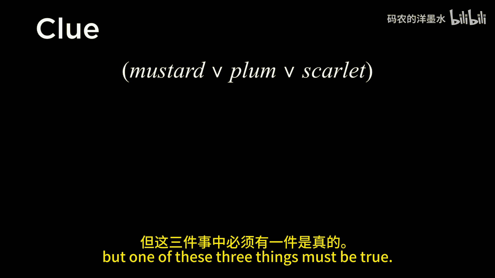

What other information do we know， Well we know that， for example。

 one of the rooms must have been the room in the envelope the crime was committed either in the ballroom or the kitchen or the library。

 Again， right now， we don't know which。 but this is knowledge we know at the outfit。

 knowledge that one of these three must be inside the envelope。 And likewise。

 we can say the same thing about the weapon that it was either the knife or the revolver or the wrench that one of those weapons must have been the weapon of choice。

 And therefore， the weapon in the envelope。

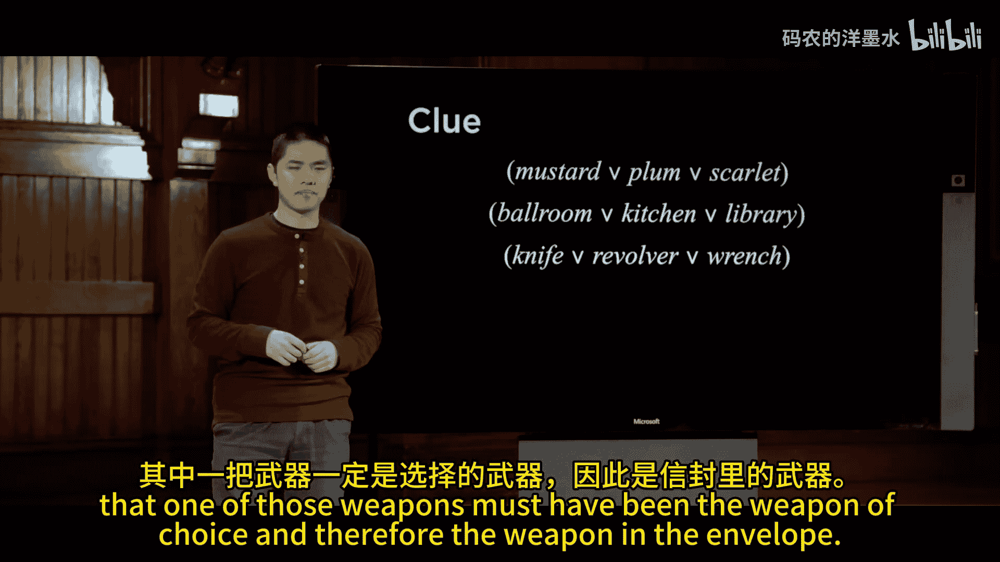

And then as the game progresses， the gameplay works by people get various different cards and using those cards。

 you can deduce information that if someone gives you a card。 for example。

 I have the professor plum card in my hand， Then I know the professor plum card can't be inside the envelope。

 I know that Professor P is not the criminal。 So I know a piece of information like not plum。

 For example， I know that Professor Plum。😊。

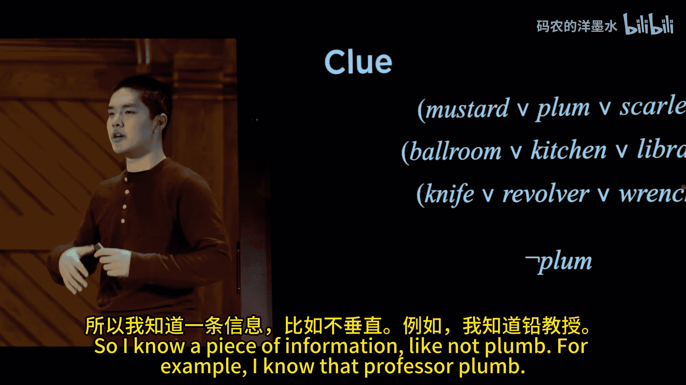

Has to be false。 This propositional symbol is not true。

And sometimes I might not know for sure that a particular card is not in the middle。

 but sometimes someone we a guess and I'll know that one of three possibilities is not true。

 like someone will guess Colonel mustard in the library with the revolver or something to that effect。

 and in that case a card might be revealed that I don't see but if it is a card and it is either kernelel mustard or the revolver or the library then I know that at least one of them can't be in the middle。

 so I know something like it is either not mustard or it is not the library or it is not the revolver now maybe multiple of these are not true。

 but I know that at least one of mustard library and revolver must in fact， be false。😡。

And so this now is a propositional logic representation of this game of clue。

 a way of encoding the knowledge that we know inside this game。

 using propositional logic that a computer algorithm。

 something like model checking that we saw a moment ago can actually look at and understand。😊。

So let's now take a look at some code to see how this algorithm might actually work in practice。

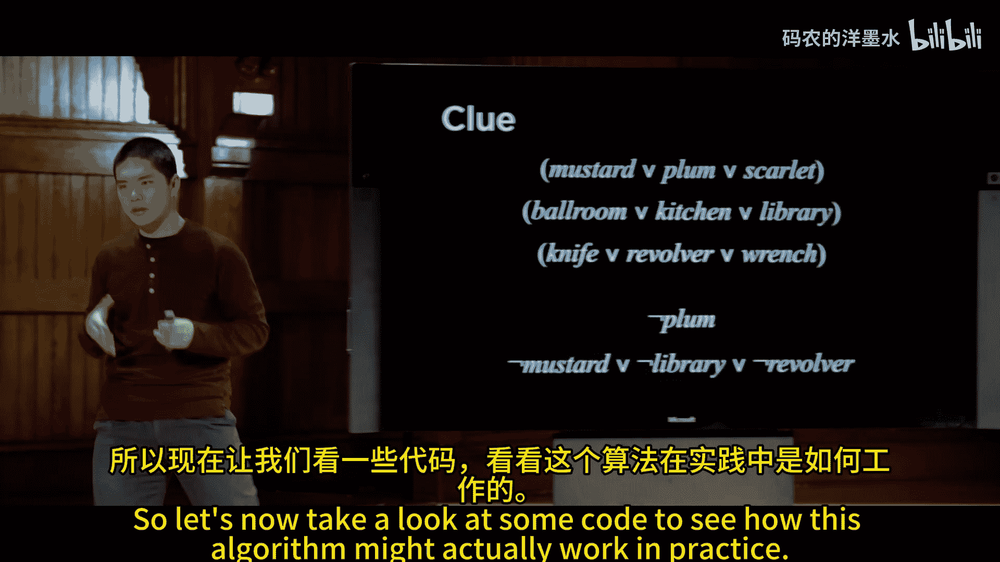

Alright， so I'm now going to open up a file called clue dot Pi， which I've started already。

 And what we'll see here is I've defined a couple of things。 I've defined some symbols initially。

 Not I have a symbol for Colonel Mustard， a symbol for Professor Plum， a symbol for Miss Scarlet。

 all of which I've put inside of this list of characters。

 I have a symbol for ballroom and kitchen and library inside of a list of rooms。

 And then I have symbols for knife and revolver and wrench。 These are my weapons。

 And so all of these characters and rooms and weapons altogether。 Those are my symbols。😊。

And now I also have this check knowledge function and what the check knowledge function does is it takes my knowledge and it's going to try and draw conclusions about what I know。

So， for example， we'll loop over all of the possible symbols and we'll check。

 do I know that that symbol is true and a symbol is going to be something like Professor Plum or then or the library。

 And if I know that it is true， In other words， I know that it must be the card in the envelope。

 Then I'm going to print out using a function called C print， which prints things in color。

 I'm going to print out the word yes， and I'm going to print that in green。

 Just to make it very clear to us。And if we're not sure that the symbol is true。

 maybe I can check to see if I'm sure that the symbol is not true。

 like if I know for sure that it is not Professor Plum， for example。

 and I do that by running model check again， this time checking if my knowledge is not the symbol。

 if I know for sure that the symbol is not true。😡，And if I don't know for sure that the symbol is not true because I say L if not model check。

 meaning I'm not sure that the symbol is false， well then I'll go ahead and print out maybe next to the symbol。

 because maybe the symbol is true， maybe it's not， I don't actually know。😡。

So what knowledge do I actually have， Well， let's try and represent my knowledge now。

 So my knowledge is， I know a couple of things。 So I'll put them in an and。

And I know that one of the three people must be the criminal。 So I know or mustard plum Scarlet。

 This is my way of encoding that it is either Colonel Mustard or Professor Plum or Miss Scarlet。

 I know that it must have happened in one of the rooms。 So I know or ballroom， kitchen， library。

 for example， And I know that one of the weapons must have been used as well。

 So I know or knife revolver， wrench。So that might be my initial knowledge that I know that it must have been one of the people。

 I know it must have been in one of the rooms， and I know that it must have been one of the weapons。

 And I can see what that knowledge looks like as a formula by printing out knowledge dot formula。

So I'll run Python clue up pi。 And here now is the information that I know in logical format。

 I know that it is Colonel Mustard or Professor Plum or Miss Scarlet。

 and I know that it is the ballroom， the kitchen or the library， and I know that it is the knife。

 the revolver or the wrench。 but I don't know much more than that。

 I can't really draw any firm conclusions。 And in fact。

 we can see that if I try and do let me go ahead and run my knowledge check function on my knowledge。

 Knowledge check is this function that I check knowledge rather。😊。

Is this function that I just wrote that looks over all of the symbols and tries to see what conclusions I can actually draw about any of the symbols。

 So I'll go ahead and run clue pi and see what it is that I know。

 And it seems that I don't really know anything for sure。

 I have all three people or maybes all three of the rooms or maybes all three of the weapons or maybes。

 I don't really know anything for certain just yet。

 But now let me try and add some additional information and see if additional information。

 additional knowledge can help us to logically reason our way through this process。

 And we are just going to provide the information。 Our AI is going to take care of doing the inference and figuring out what conclusions it's able to draw。

😊。

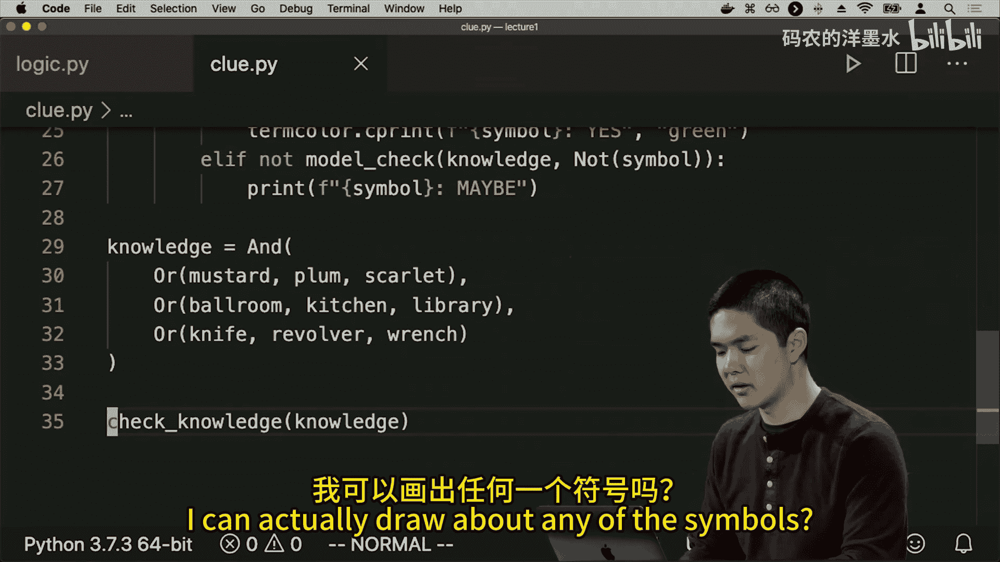

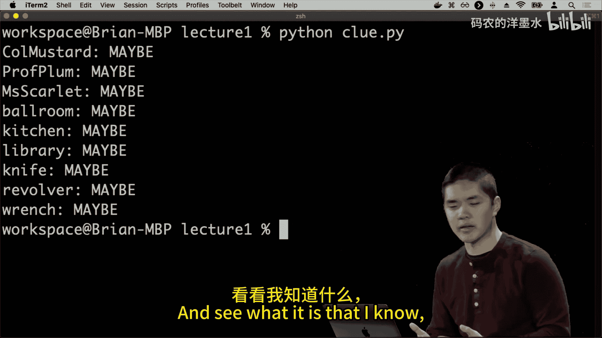

So I start with some cards and those cards tell me something。 so if I have the kernelel mustard card。

 for example， I know that the mustard symbol must be false。 in other words。

 mustard is not the one in the envelope， is it not the criminal so I can say knowledge supports something called every and in this library supports dot a。

 which is a way of adding knowledge or adding an additional logical sentence to an and clause。

 so I can say knowledge do ad， not mustard。😡，I happen to know because I have the mustard card that Colonel Mustard is not the suspect。

 and maybe I have a couple of other cards， too。 Maybe I also have a card for the kitchen。

 So I know it's not the kitchen。 and maybe I have another card that says that it is not the revolver。

So I have three cards， Colonel Mustard， the kitchen and the revolver。

 and I encode that into my AI this way by saying it's not Colonel Mustard。 It's not the kitchen。

 and it's not the revolver。 And I know those to be true。So now， when I rerun clue dot pi。

 we'll see that I've been able to eliminate some possibilities before I wasn't sure if it was a knife or the revolver or the wrench。

 knife was maybe a revolver was maybe wrench as maybe。

 now I'm down to just the knife and the wrench between those two。 I don't know which one it is。

 They're both maybes。 but I've been able to eliminate the revolver。

 which is one that I know to be false because I have the revolver card。

And so additional information might be acquired over the course of this game。

 and we would represent that just by adding knowledge to our knowledge set or knowledge base that we've been building here。

 So if， for example， we additionally got the information that someone made a guess。

 Someone guessed like Miss Scarlet in the library with the wrench。

 And we know that that a card was revealed， which means that one of those three cards。

 either Miss Scarlet or the library or the wrench， one of those at minimum must not be inside of the envelope。

 So I could add some knowledge。 say knowledge do ad。And I'm gonna add an orac clauseuse because I。

 I don't know for sure which one it's not。 But I know one of them is not in the envelope。

 So it's either not Slet or it's not the library and or supports multiple arguments。

 I can say it's also。Or not the wrench。 So at least one of those needs Scarlet library and wrench。

 At least one of those needs to be false。 I don't know which， though。 Maybe it's multiple。

 maybe it's just  one， but at least1 I know needs to hold。

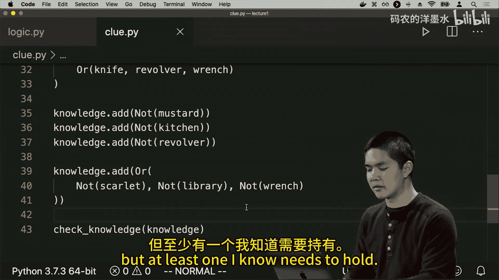

And so now if I rerun clue dot pi， I don't actually have any additional information just yet。

 Nothing I can say conclusively。 I still know that maybe it's professorfessor Plum。

 maybe it's Miss Scarlet。 I haven't eliminated any options。

 But let's imagine that I get some more information that someone shows me the professor P card。

 for example。 So I say， alright， Let's go back here。 knowledgeledge dot ad not。😊。

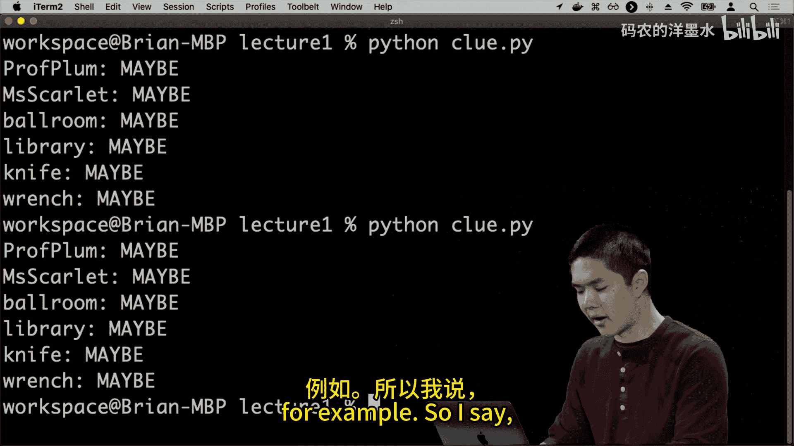

Plum。

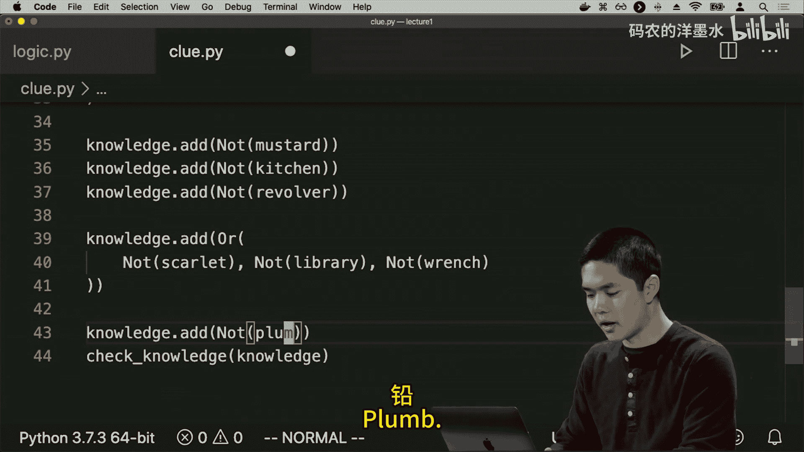

So I have the professor plum card。 I know the professor Plum is not in the middle。

 I rerun clue up pi。 And right now， I'm able to draw some conclusions。

 now I've been able to eliminate Professor Plum， and the only person it could left remaining be is Miss Scarlet。

 So I know， yes， Miss Scarlet， this variable must be true。

 And I've been able to infer that based on the information I already had。 Now。

 between the ballroom and the library and the knife in the wrench for those two。 I'm still not sure。

 So let's add one more piece of information。😊，Let's say that I know that it's not the ballroom。

 Someone has shown me the ballroom card。 So I know it's not the ballroom， which means at this point。

 I should be able to conclude that it's the library。 Well'll see。 I'll say knowledge dot ad， not。

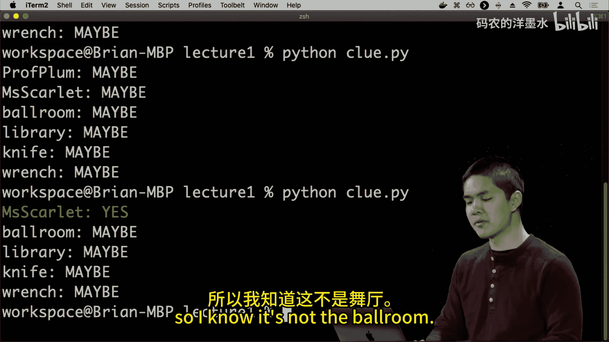

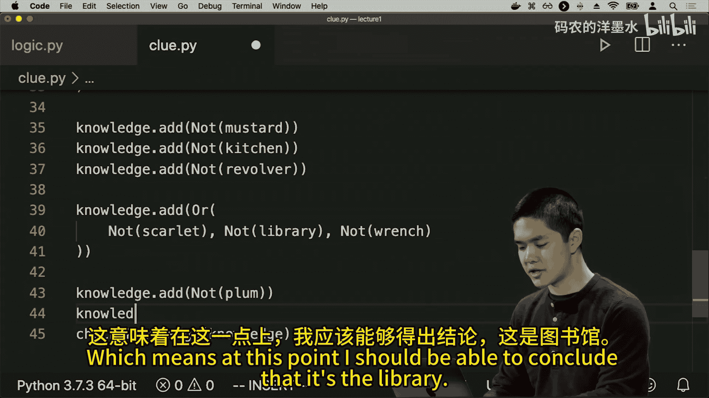

The ballroom。And we'll go ahead and run that。And it turns out that after all of this。

 not only can I conclude that I know that it's the library。

 but I also know that the weapon was the knife。 And that might have been an inference。

 It was a little bit trickier。 something I wouldn't have realized immediately。 But the AI。

 via this model checking algorithm is able to draw that conclusion。

 that We know for sure that it must be Misscarlet in the library with the knife。

 And how did we know that， Well， we know it。😊，From this ore clause up here that we know that it's either not Slet or it's not the library or it's not the wrench。

 And given that we know that it is Miss Scarlet， and we know that it is the library。

 then the only remaining option for the weapon， is that it is not the wrench。

 which means that it must be the knife。 So we as humans now can go back and reason through that。

 even though it might not have been immediately clear。

 And that's one of the advantages of using an AI or some sort of algorithm in order to do this is that the computer can exhaust all of these possibilities and try and figure out what the solution actually should be。

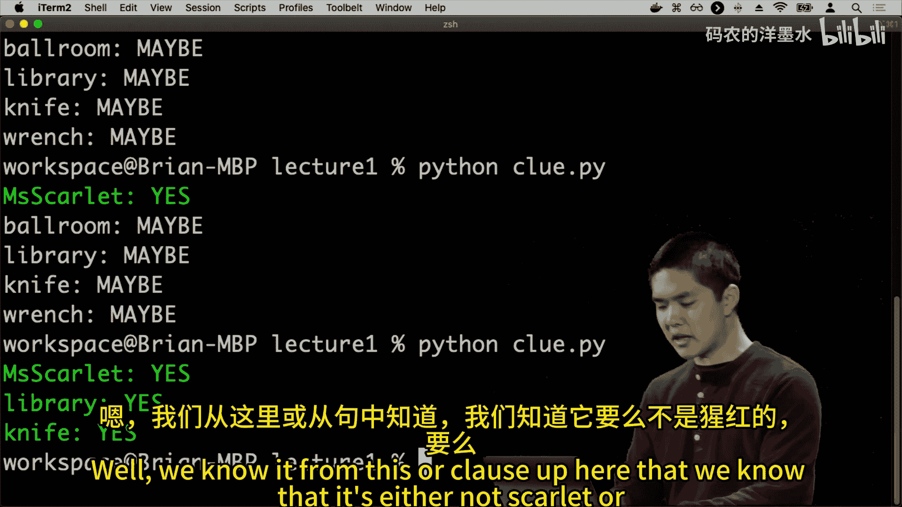

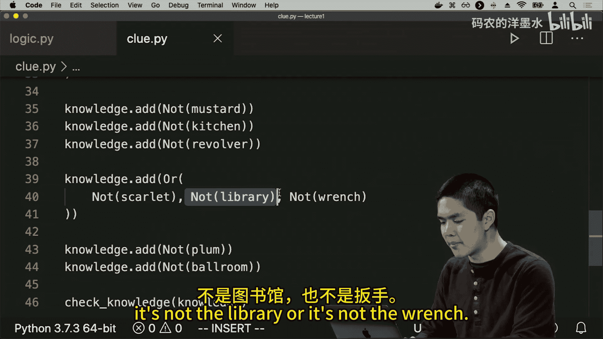

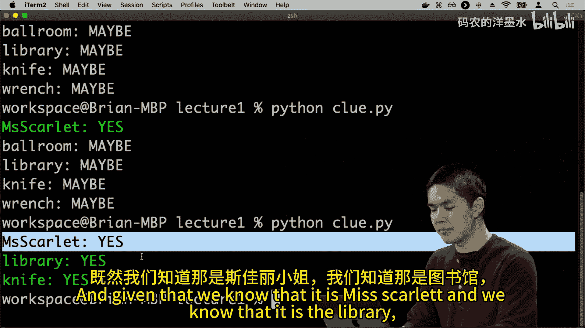

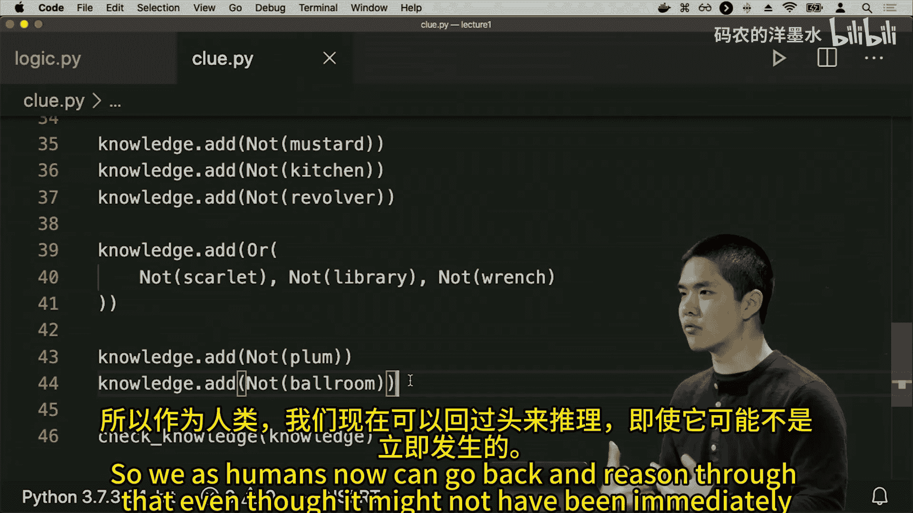

And so for that reason， it's often helpful to be able to represent knowledge in this way。

 knowledge engineering some situation where we can use a computer。

 to be able to represent knowledge and draw conclusions based on that knowledge。

 And any time we can translate something into propositional logic symbols like this。

 This type of approach can be useful。 So you might be familiar with logic puzzles where you have to puzzle your way through trying to figure something out。

 This is what a classic logic puzzle might look like。 something like Gildoroy Minerva。

 Pomona and Horace each belong to a different one of the four houses， Gryffinor。

 Hufflepuff Ravenclaw and Slitherren， and then we have some information that Gilderroy belongs to Gryinor or Ravencl Pomona does not belong in slitherin and Minerva does belong to Gryffinor。

 we have a couple pieces of information and using that information we need to be able to draw some conclusions about which person should be assigned to which house。

 And again， we can use the exact same idea to try and implement this notion。

 So we need some propositional symbols。 And in this case。😊。

Propositional symbols are going to get a little more complex。

 although we'll see ways to make this a little bit cleaner later on。

 but we'll need 16 propositional symbols， one for each person and house。 So we need to say。

 remember every propositional symbol is either true or false。

 So Gildoroy Griffindor is either true or false Either he's in Grffinor or he is not likewise Gildroy Hufflepuff also true or false。

 Either it is true or it's false。 And that's true for every combination of person and house that we could come up with。

 We have some sort of propositional symbol for each one of those。😊，Using this type of knowledge。

 we can then begin to think about what types of logical sentences we can say about the puzzle。

 that if we know before even think about the information we were given。

 we can think about the premise of the problem， that every person is assigned to a different house。😡。

So what does that tell us， Well， tells us sentences like this。

 It tells us like Pomona Slitherren implies not Pomona Hufflepuff。

 something like if pomona is in slitherin， then we know that Pomona is not in Hufflepuff。

 and we know this for all four people and for all combinations of houses that no matter what person you pick。

 if they're in one house， then they're not in some other house。

 So I'll probably have a whole bunch of knowledge statements that are of this for。

 that if we know Pomona is in slitherin， then we know Pomona is not in Hufflepuff。

 We were also given the information that each person is in a different house。

 So I also have pieces of knowledge that looks something like this。 Minerva Ravenclaw。

 implies not Gildroy Ravenclaw。 If they're all in different houses， then if Minerva is in Ravenclaw。

 then we know that Gildroy is not in Ravencl as well。

 And I have a whole bunch of similar sentences like this。

 that are expressing that idea for other people and other houses as well。😊。

And so in addition to sentences of these form， I also have the knowledge that was given to me。

 information like Gildoroy was in Griffindor or in Ravenclaw that would be represented like this。

 Gildoroy Griffindor or Gildoro Ravenclaw。 And then using these sorts of sentences。

 I can begin to draw some conclusions about the world。

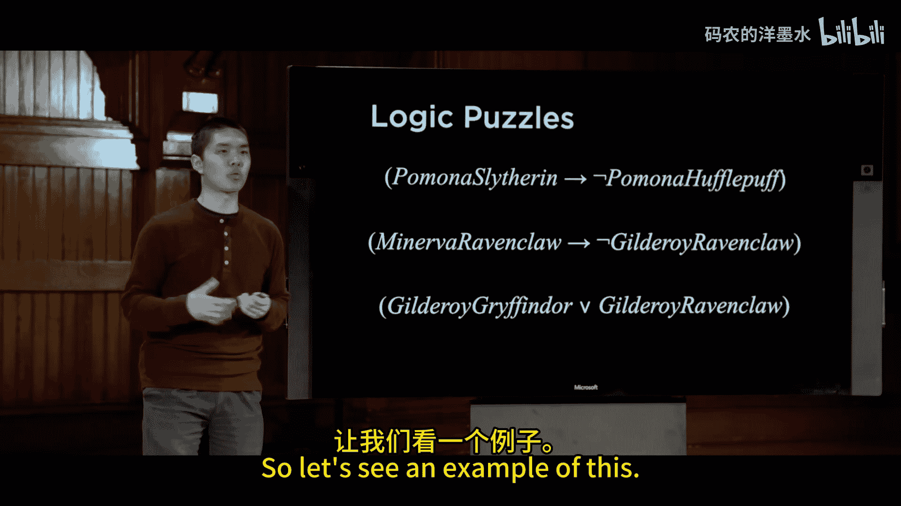

So let's see an example of this。 We'll go ahead and actually try and implement this logic puzzle to see if we can figure out what the answer is。

I'll go ahead and open up puzzle dot pie， where I've already started to implement this sort of idea。

 I've defined a list of people and a list of houses。

 and I've so far created one symbol for every person and for every house。

 That's what this double four loop is doing。 Loing overall people， looping overall houses。

 creating a new symbol for each of them。😊，And then I've added some information。

 I know that every person belongs to a house。 So I've added the information for every person that person Griffinor or person Huffle puffuff or person ravenclaw or person slithering that one of those four things must be true。

 Every person belongs to a house， What other information do I know。

 I also know that only one house per person。 So no person belongs to multiple houses。

 So how does this work。 Well， this is gonna be true for all people。 So I'll loop over every person。😊。

And then I need to loop over all different pairs of houses。

 The idea is I want to encode the idea that if Minerva is in Griffindor。

 then Minerva can't be in Ravenclaw。 So I'll loop over all houses H1。

 and I'll loop over all houses again， H 2。And as long as they're different， H1 not equal to H2。😡。

Then I'll add to my knowledge base， this piece of information， that implication， in other words。

 and if then， if the person is in H1， then I know that they are not in house H2。

So these lines here are encoding the notion that for every person， if they belong to house1。

 then they are not in house 2。And the other piece of logic we need to encode is the idea that every house can only have one person。

 In other words， if Pomona is in hufflepuff， then nobody else is allowed to be in huffle puffuff either。

 And that's the same logic， but sort of backwards。 I loop over all of the houses and loop over all different pairs of people。

 So I loop over people once， loop over people again and only do this when the people are different P1。

 not equal to P2。And I add the knowledge that if， as given by the implication。

If person one belongs to the house， then it is not the case that person2 belongs to the same house。

 So here I'm just encoding the knowledge that represents the problems constraints。

 I know that everyone's in a different house。 I know that any person can only belong to one house。

 And I can now take my knowledge and try and print out the information that I happen to know。

 So I'll go ahead and print out knowledge do formula just to see this in action。

 And I'll go ahead and skip this for now， but we'll come back to this in a second。

 let's print out the knowledge that I know by running Python puzzle do pi。 It's a lot of information。

 a lot that I have to scroll through because there's 16 different variables all going on。

 But the basic idea if we scroll up to the very top is I see my initial information。 Gilderroys。

 either in Griffinor or Gilderroys and Hufflepuff or Gililderroy and Ravenclaw or Gildroys and Slitherin。

 and and then way more information as well。 So this is quite messy more than we really want to be looking at and soon to。

😊，We'll see ways of representing this a little bit more nicely using logic。 But for now。

 we can just say these are the variables that we're dealing with。

 And now we'd like to add some information。So the information we're going to add is Gildroy is in Griffindor。

 or he is in Ravencl。 So that knowledge was given to us。 So I'll go ahead and say knowledge dot add。

 And I know that either or。Gildoroy Gryiffindor。偶尔。Gilderroy Ravenclaw。

 one of those two things must be true。I also know that Pomona was not in slitherin。

 So I can say knowledge dot ad， not this symbol， not the pomona slitherin symbol。

 And then I can add the knowledge that Minerva is in Grffindor。By adding the symbol， Minerva。Gffinor。

So those are the pieces of knowledge that I know， and this loop here at the bottom just loops over all of my symbols。

 checks to see if the knowledge entails that symbol by calling this model check function again。😡。

And if it does， if we know the symbol is true， we print out the symbol。

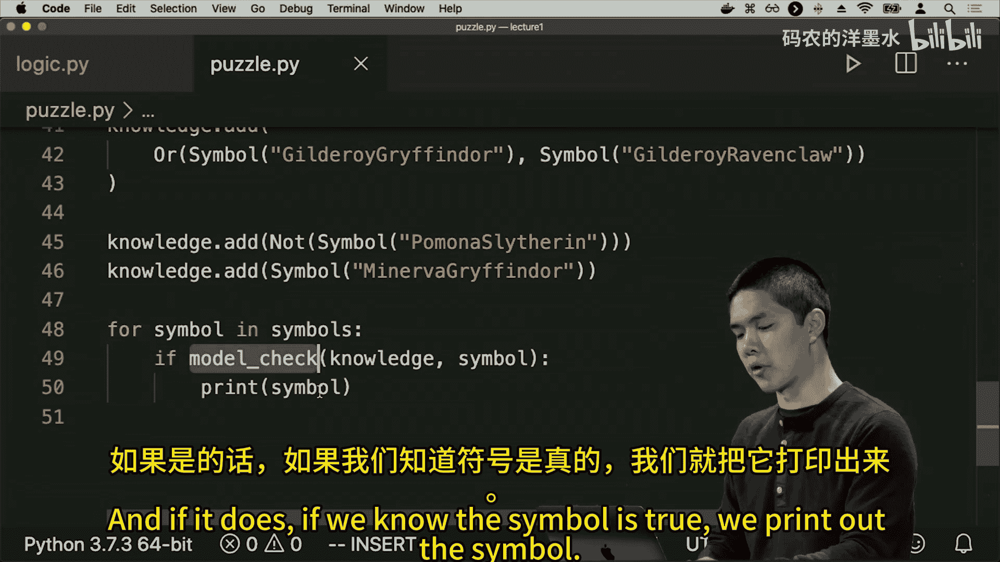

So now I can run Python puzzle do pi。 and Python is going to solve this puzzle for me。

 We're able to conclude that Gildroy belongs to Ravencl， Pomona belongs to Hufflepuff。

 Minerva to Griffindor and Horace to Slitherin， just by encoding this knowledge inside the computer。

 Although it was quite tedious to do in this case。 And as a result。

 we were able to get the conclusion from that as well。😊。

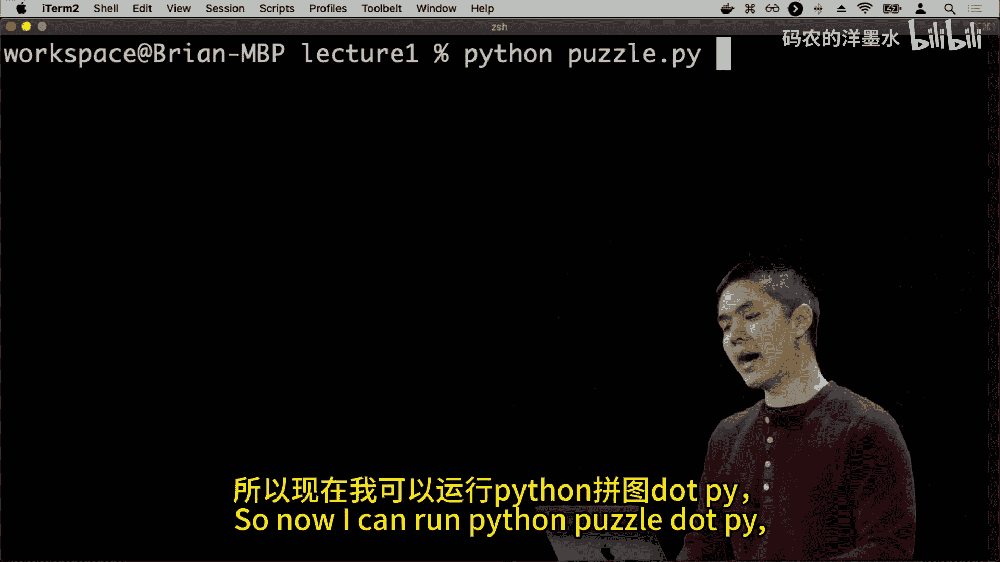

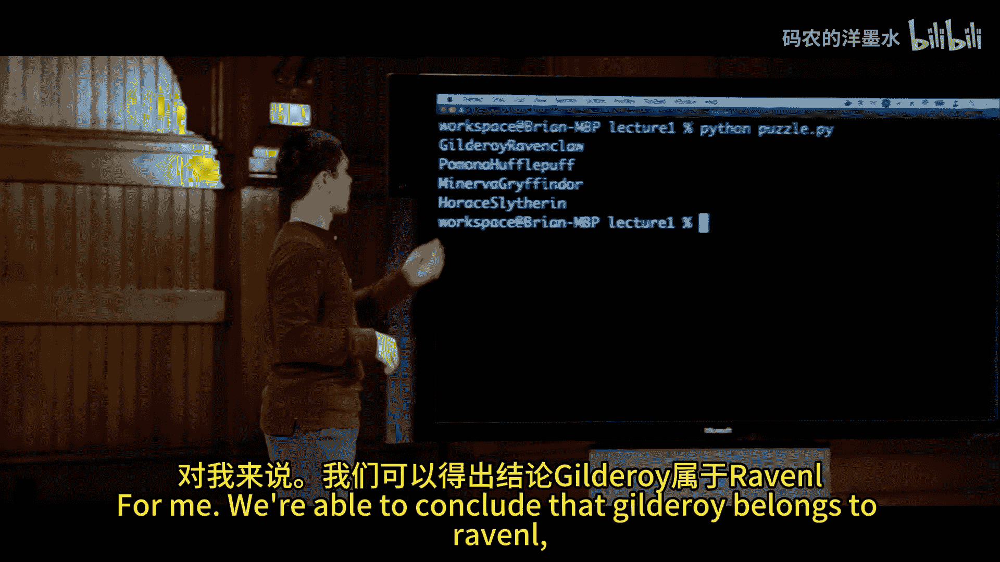

And you can imagine this being applied to many sorts of different deductive situations。

 So not only these situations when we're trying to deal with Harry Potter characters in this puzzle。

 but if you've ever played games like mastermind， where you're trying to figure out which order different colors go in and trying to make predictions about it。

 I could tell you， for example， Let's play a simplified version of mastermind where there are four colors。

 red， blue， green and yellow。 And they're in some order， but I'm not telling you what order。

 you just have to make a guess。 And I'll tell you of red， blue， green and yellow。

 how many of the four you got in the right position。 So a simplified version of this game。

 You might make a guess like red， blue， green， yellow。

 And I would tell you something like two of those four are in the correct position。

 But the other two are not。 Then you could reasonably make a guess and say， all right。

 let's try this。 blue， red， green， yellow。 Try switching to of them around。 And this time。

 maybe I tell you， you know what。 None of those are in the correct position。😊。

And the question then is， all right， what is the correct order of these four colors And we as humans could begin to reason this through。

 All right， well， if none of these were correct， but two of these were correct， Well。

 it must have been because I switched to the red and the blue。

 which means red and blue here must be correct， which means green and yellow are probably not correct。

 You can begin to do this sort of deductive reasoning。

 We can also equivalently try and take this and encode it inside of our computer as well。

 and it's going to be very similar to the logic puzzle that we just did a moment ago。

 So I won't spend too much time on this code because it is fairly similar。 But again。

 we have a whole bunch of colors。 and four different positions in which those colors can be。😊。

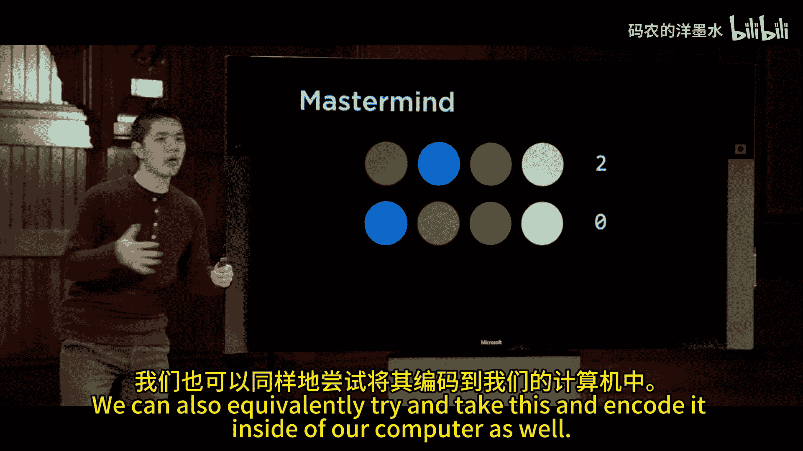

And then we have some additional knowledge。 and I encode all of that knowledge。

 And you can take a look at this code on your own time。

 But I just want to demonstrate that when we run this code， run Python。

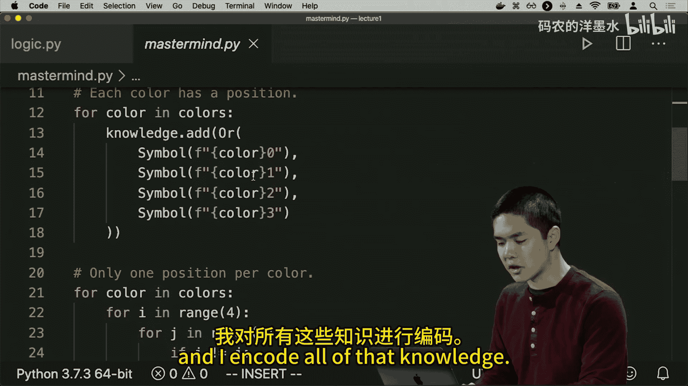

Mastermind dot pi and run and see what we get。 We ultimately are able to compute red 0 in the zero position。

 blue in the one position， yellow in the two position and green in the three position as the ordering of those symbols。

 Now， ultimately， what you might have noticed is this process with taking quite a long time。

 And in fact， model checking is not a particularly efficient algorithm。

 right What I need to do in order to model check is take all of my possible different variables。

 and enumerate all of the possibilities that they could be it。 If I have n variables。

 I have two to the n possible worlds that I need to be looking through in order to perform this model checking algorithm。

 And this is probably not tractable， especially as we start to get to much larger and larger sets of data where we have many。

 many more variables that are at play。 right here， we only have a relatively small number of variables So this sort of approach can actually work But as the number of variables increases。

 model checking becomes less and less good of a way of trying to solve these sorts of problems。😊。

So while it might have been okay for something like mastermind to conclude that this is indeed the correct sequence where all four are in the correct position。

 what we'd like to do is come up with some better ways to be able to make inferences rather than just enumerate all of the possibilities。

 And to do so， what we'll transition to next is the idea of inference rules。

 some sort of rules that we can apply to take knowledge that already exists and translate it into new forms of knowledge。

 and the general way will structure an inference rule is by having a horizontal line here。

 Anything above the line is going to represent a premise。 something that we know to be true。😊。

And then anything below the line will be the conclusion that we can arrive at after we apply the logic or from the inference rule that we're going to demonstrate。

 So we'll do some of these inference rules is by demonstrating them in English first。

 but then translating them into the world of propositional logic so you can see what those inference rules actually look like。

So， for example， let's imagine that I have access to two pieces of information。 I know， for example。

 that if it is raining， then Harry is inside。 for example。 And let's say I also know it is raining。

Then most of us could reasonably then look at this information and conclude that， all right。

 Harry must be inside。This inference rule is known as modis poents。

 and it's phrased more formally in logic as this。 If we know that alpha implies beta， In other words。

 if alpha then beta。And we also know that alpha is true。

Then we should be able to conclude that beta is also true。

 We can apply this inference rule to take these two pieces of information and generate this new piece of information。

 Notices this is a totally different approach from the model checking approach where the approach was look at all of the possible worlds and see what's true in each of these worlds here。

 we're not dealing with any specific world we're just dealing with the knowledge that we know and what conclusions we can arrive at based on that knowledge that I know that a implies B and I know a and the conclusion is B。

 and this should seem like a relatively obvious rule。 that， of course。

 if alpha than beta and we know alpha then we should be able to conclude that beta is also true。

 and that's going to be true for many， but maybe even all of the inference rules that we'll take a look at。

 You should be able to look at them and say， yeah， of course that's going to be true。

 but it's putting these all together， figuring out the right combination of inference rules that can be applied that ultimately is going to allow us to generate interesting knowledge inside of our AI。

😊。

So that's mods opponents this application of implication that if we know alpha and we know that alpha implies beta。

 then we can conclude beta。

Let's take a look at another example。 fairly straightforward。

 something like Harry is friends with Ron and Hermione。Based on that information。

 we can reasonably conclude Harry as friends with Hermii。 that must also be true。

 And this inference rule is known as and elimination。

 And the what and elimination says is that if we have a situation where alpha and beta are both true。

 I have information， Al and beta。Well， then just alpha is true or likewise， just beta is true。

 that if I know that both parts are true， then one of those parts must also be true。 Again。

 something obvious from the point of view of human intuition But a computer needs to be told this kind of information to be able to apply the inference rule。

 we need to tell the computer that this is an inference rule that you can apply So the computer has access to it and is able to use it in order to translate information from one form to another。

In addition to that， let's take a look at another example of an inference rule。

 something like it is not true that Harry did not pass the test。

Bit of a tricky sentence to parcel read it again。 It is not true or it is false that Harry did not pass the test。

 Well， if it is false that Harry did not pass the test。

 then the only reasonable conclusion is that Harry did pass the test。And so this。

 instead of being and elimination is what we call double negation elimination。

 that if we have two negatives inside of our premise， then we can just remove them altogether。

 They cancel each other out。 One turns true to false and the other one turns false back into true。

 phrased a little bit more formally， we say that if the premise is not， not alpha。

Then the conclusion we can draw is just alpha。 We can say that alpha is true。

We'll take a look at a couple more of these， if I have it is raining， then Harry is inside。😡。

How do I reframe this？ Well， this one is a little bit trickier。 But if I know if it is raining。

 then Harry is inside， then I conclude one of two things must be true。

 Either it is not raining or Harry is inside。 And this one's trickier。

 So let's think about it a little bit。 This first premise here。 if it is raining。

 then Harry is inside， is saying that if I know that it is raining， then Harry must be inside。

So what is the other possible case， Well， if Harry is not inside。

 then I know that it must not be raining。 So one of those two situations must be true。

 Either it's not raining or it is raining， in which case Harry is inside。

 So the conclusion I can draw is either it is not raining。Or it is raining。 So therefore。

 Harry is inside。 And so this is a way to translate if then statements into or statements。

 And this is known as implication elimination。 And this is similar to what we actually did in the beginning when we were first looking at those very first sentences about Harry and Hagrid and Dumleddore and phrased a little bit more formally。

 This says that if I have the implication， Al implies beta。

That I can draw the conclusion that either not alpha or beta。

 because there are only two possibilities。 either alpha is true or alpha is not true。

 So one of those possibilities is alpha is not true。 But if alpha is true。

 well then we can draw the conclusion that beta must be true。 So either alpha is not true。

 or alpha is true in which case beta is also true。 So this is one way to turn an implication into just a statement about or in addition to eliminating implications。

 we can also eliminate biconals as well。 So let's take an English example。

 something like it is raining。 if and only if Harry is inside。

 And if and only if really sounds like that bi conditional。

 that double arrow sign that we saw in propositional logic not too long ago。

 And what does this actually mean if we were to translate this。 Well。

 this means that if it is raining， then Harry is inside。 and if Harry is inside， then it is raining。

 that this implication goes both ways。 and this is。

We would call biconal elimination that I can take a biconal A， if it only if B。

 and translate that into something like this。 A implies B A B implies a。

 So many of these inference rules are taking logic that uses certain symbols and turning them into different symbols。

 taking an implication and turning it into an or or taking a bicondal and turning it into implication。

 And another example of it would be something like this。

 It is not true that both Harry and Ron past the test。Well，All right， how do we translate that。

 What does that mean， Well， if it is not true that both of them pass the test， Well。

 then the reasonable conclusion we might draw is that at least one of them didn't pass the test。

 So the conclusion is either Harry did not pass the test or Ron did not pass the test or both this is not an exclusive orb。

 but if it is true that it is not true that both Harry and Ron pass the test Well。

 then either Harry didn't pass the test or Ron didn't pass the test。😡。

And this type of law is one of De Morganorgan's laws。

 quite famous in logic where the idea is that we can turn an and into an or。

 We can say we can take this and that both Harry and Ron passed the test and turn it into an or by moving the knots around。

 So if it is not true that Harry and Ron passed the test Well。

 then either Harry did not pass the test or Ron did not pass the test either。

 And the way we frame that more formally using logic is to say this。

 If it is not true that alpha and beta。Well， then either not alpha or not beta。

The way I like to think about this is that if you have a negation in front of an and expression。

 you move the negation inwards。 so to speak， moving the negation into each of these individual sentences and then flip the and into an or。

 So the negation moves inwards and the and flips into an or。

 So I go from not A and B to not A or not B。And there's actually a reverse of de Morganorgan's law that goes in the other direction for something like this。

 if I say it is not true that Harry or Ron passed the test， meaning neither of them pass the test。

 Well， then the conclusion I can draw is that Harry did not pass the test and Ron did not pass the test。

 So in this case， instead of turning an and into an or， we're turning an or into an and。

 but the idea is the same。 And this again is another example of de Morganorgan's laws。

 And the way that works is that if I have not a or B this time， the same logic' is going to apply。

 I'm going to move the negation inwards， and I'm going to flip this time flip the or into an and。

 So if not a or B， meaning it is not true that A or B or alpha a beta。

 then I can say not alpha and not beta。😡，Moving the negation inwards in order to make that conclusion。

So those are de Morgangan's laws and a couple other inference rules that are worth just taking a look at。

 One is the distributive law that works this way。 So if I have alpha and beta or gamma。Well。

 then much in the same way that you can use in math。

 use distributive laws to distribute opera ends like addition and multiplication。

 I can do a similar thing here where I can say if alpha and beta or gamma。

 then I can say something like alpha and beta or alpha and gamma that I've been able to distribute this and sign throughout this expression。

 So this is an example of the distributive property or the distributive law as applied to logic in much the same way that you would distribute like a multiplication over the addition of something。

 for example。😊，This works the other way too。 So if， for example， I have alpha or beta and gamma。

 I can distribute the or throughout the expression。 I can say alpha or beta and alpha or gamma。

 So the distributive law works in that way too， and it's helpful if I want to take an or and move it into the expression。

 And we'll see an example soon of why it is that we might actually care to do something like that。

Alright， so now we've seen a lot of different inference rules。 And the question now is。

 how can we use those inference rules to actually try and draw some conclusions。

 to actually try and prove something about entailment。

 proving that given some initial knowledge base， we would like to find some way to prove that a query is true。

😊，Well， one way to think about it is actually to think back to what we talked about last time。

 when we talked about search problems。 recall again that search problems have some sort of initial state。

 They have actions that you can take from one state to another as defined by a transition model that tells you how to get from one state to another。

 We talked about testing to see if you were at a goal and then some path cost function to see。

 you know， how many steps did you have to take or how costly was the solution that you found。

Now that we have these inference rules that take some set of sentences in propositional logic and get us some new set of sentences in propositional logic。

 we can actually treat those sentences or those sets of sentences as states inside of a search problem。

 So if we want to prove that some query is true， prove that some logical theorem is true。

 we can treat theorem proving as a form of a search problem。

 I can say that we begin in some initial state or that initial state is the knowledge base that I begin with。

 the set of all of the sentences that I know to be true。😊，What actions are available to me。

 will the actions are any of the inference rules that I can apply at any given time。😡。

The transition model just tells me， after I apply the inference rule。

 here is the new set of all of the knowledge that I have， which will be the old set of knowledge。

 plus some additional inference that I've been able to draw。

 much as in the same way we saw what we got when we applied those inference rules and got some sort of conclusion。

 That conclusion gets added to our knowledge base and our transition model will encode that。😊。

What is the goal test， Well a goal test is， you know。

 checking the see if we have proved the statement we're trying to prove。

 if the thing we're trying to prove is inside of our knowledge base。And the path cost function。

 the thing we're trying to minimize， is maybe the number of inference rules that we needed to use。

 the number of steps。 so to speak， inside of our proof。

And so here we've been able to apply the same types of ideas that we saw last time with search problems to something like trying to prove something about knowledge by taking our knowledge and framing it in terms that we can understand as a search problem with an initial state with actions with a transition model。

 So this shows up a couple of things。 One being how versatile search problems are that they can be the same types of algorithms that we use to solve a maze or figure out how to get from point A to point B inside of driving directions。

 for example， can also be used as a theem improving method of taking some sort of starting knowledge base and trying to prove something about that knowledge。

So this yet again， is a second way， In addition to model checking to try and prove that certain statements are true。

But it turns out there's yet another way that we can try and apply inference。

 and we'll talk about this now， which is not the only way， but certainly one of the most common。

 which is known as resolution。 And resolution is based on another inference rule that we'll take a look at now。

 quitete a powerful inference rule that will let us prove anything that can be proven about a knowledge base。

 And it's based on this basic idea。 Let's say I know that either Ron is in the Great Hall or Hermione is in the library。

😊，And let's say I also know that Ron is not in the Great Hall。

Based on those two pieces of information， what can I conclude。Well。

 I could pretty reasonably conclude that Hermione must be in the library。 How do I know that， Well。

 it's because these two statements， these two， what we'll call complementary literals。

 literals that complement each other。 They are opposites of each other。

Seemed to conflict with each other。This sentence tells us that either Ron is in the Great Hall or hermione is in the library。

So if we know that Ron is not in the Great Hall， that conflicts with this one。

 which means Hermione must be in the library。And this。

 we can frame as a more general rule known as the unit resolution rule。

 a rule that says that if we have P or Q。And we also know， not P。Well， then from that。

 we can reasonably conclude Q that if P or Q are true and we know that P is not true。

 the only possibility is for Q to then be true。And this， it turns out。

 is quite a powerful inference rule in terms of what it can do。 in part。

 because we can quickly start to generalize this rule。

 This Q right here doesn't need to just be a single propositional symbol。 It could be multiple。

 all chain together in a single clause， as we'll call it。

 So if I had something like P or Q1 or Q2 or Q3， so on and so forth。 up until Q N。

 So I had N different other variables。 And I have not P。Well。

 then what happens when these two complement each other is that these two clauses resolve。

 so to speak to produce a new clause that is just Q1 or Q2 all the way up to QN。😡，And in an or。

 the order of the arguments and the or doesn't actually matter。

 The P doesn't need to be the first thing。 It could have been in the middle。

 But the idea here is that if I have P in one clause and not P in the other clause， well。

 then I know that one of these remaining things must be true。

 I've resolved them in order to produce a new clause。

But it turns out we can generalize this idea even further， in fact。

 and display even more power that we can have with this resolution rule。

 So let's take another example。Let's say， for instance。

 that I know the same piece of information that either Ron is in the Great Hall or Hermione is in the library。

And the second piece of information I know is that Ron is not in the Great Hall or Harry is sleeping。

So it's not just a single piece of information。 I have two different clausets。

 and we'll define clauses more precisely in just a moment。What do I know here， Well， again。

 for any propositional symbol like Ron is in the Great Hall， there are only two possibilities。

 Either Ron is in the Great Hall， in which case， based on resolution。

 we know that Harry must be sleeping。Or Ron is not in the Great Hall。

 in which case we know based on the same rule that Hermione must be in the library。😡。

Based on those two things in combination， I can say based on these two premises that I can conclude that either Hermione is in the library or Harry is sleeping。

So again， because these two conflict with each other， I know that one of these two must be true。

 And you can take a closer look and try and reason through that logic。

 Make sure you convince yourself that you believe this conclusion stated more generally。

 we can name this resolution rule by saying that if we know P or Q is true。

And we also know that not P or R is true。 We resolve these two clauses together to get a new clause。

 Q or R， that either Q or R must be true。😡，And again， much is in the last case。

 Q and R don't need to just be single propositional symbols。 It could be multiple symbols。

 So if I had a rule that had P or Q1 or Q2 or Q3， so on and so forth up until Q N。

 where N is just some number。 And likewise。I had not P or R 1 or R 2。

 so on and so forth up until R M where M again。Is just some other number。

 I can resolve these two clauses together to get one of these must be true。

 Q1 or Q2 up until Q N or R1 or R2 up until R M。 And this is just a generalization of that same rule we saw before。

😊，Each of these things here are we're going to call a clause where a clause is formally defined as a disjunction of literals。

 where a disjunction means it's a bunch of things that are connected with or。

 Disjunction means things connected with or conjunction。

 meanwhile is things connected with and and a literal is either a propositional symbol or the opposite of a propositional symbol。

 So if something like P or Q or not P or not Q。 those are all propositional symbols or not of the propositional symbols and we call those literals。

😡，So a clause is just something like this。 P or Q or R， for example。Meanwhile。

 what this gives us an ability to do is it gives us an ability to turn logic any logical sentence into something called conjunctive normal form。

 a conjunctive normal form sentence is a logical sentence that is a conjunction of clauses。 recall。

 again， conjunction means things are connected to one another using and And so a conjunction of clauses means it is an and of individual clauses。

 each of which has or's in it。 So something like this。 A or B or C and D or not E and F or G。

 everything in parentheses is one clause， all of the clauses are connected to each other using an and and everything in the clause is separated using an or。

And this is just a standard form that we can translate a logical sentence into that just makes it easy to work with and easy to manipulate。

 And it turns out that we can take any sentence in logic and turn it into conjunctive normal form just by applying some inference rules and transformations to it。

 So we'll take a look at how we can actually do that。😊。

So what is the process for taking a logical formula and converting it into conjunctive normal form。

 otherwise known as C and F。 Well， the process looks a little something like this。

 We need to take all of the symbols that are not part of conjunctive normal form。

 the biconals and the implications and so forth and turn them into something that is more closely like conjunctive normal form。

 So the first step will be to eliminate byconals， those if and only if double arrows。

 And we know how to eliminate by conditionals， because we saw there was an inference rule to do just that。

 Any time I have an expression like alpha， if and only if beta。

 I can turn that into alpha implies beta and beta implies alpha based on that inference rule we saw before。

😊，Likewise， in addition to eliminating bicondals， I can eliminate implications as well。

 the if then arrows， and I can do that using the same inference rule we saw before too。

 taking alpha implies beta and turning that into not alpha or beta because that is logically equivalent to this first thing here。

Then we can move knots inwards because we don't want knots on the outsides of our expressions。

 Conjunctive normal form requires that it's just clauses and clauses and clauses and clauses。

 Any knots need to be immediately next to propositional symbols。

 But we can move those knots around using de Morgangan's laws by taking something like not A and B and turn it into not A or not B。

 for example， using de Morgangan's laws to manipulate that。 And after that。

 all will be left with are ands and or's and those are easy to deal with。

 we can use the distributive law to distribute the or's so that the or's end up on the inside of the expression。

 so to speak and the ans end up on the outside。 So this is the general pattern for how we'll take a formula and convert it into conncive normal form。

 And let's now take a look at an example of how we would do this and explore then why it is that we would want to do something like this。

Here's how we can do it。 Let's take this formula。 For example， P or Q implies R。

 and I'd like to convert this into conjunctive normal form。

 where it's all ands of clauses and every clause is a disjunctive clause。 It's or's together。

 So what's the first thing I need to do。 Well， this is an implication。

 So let me go ahead and remove that implication。 using the implication inference rule。

 I can turn P or Q into P or Q implies R into not P or Q or R。😊，So that's the first step。

 I've gotten rid of the implication。And next， I can get rid of the knot on the outside of this expression。

 too。 I can move the knots inwards so they're closer to the literals。

Themselves by using de Morganorgan's laws。 And De Morgangan's law says that not P or Q is equivalent to not P and not Q。

 again here， just applying the inference rules that we've already seen in order to translate these statements。

And now I have two things that are separated by an or where this thing on the inside is an and。

 what I'd really like to move the or's so the or's are on the inside because conjunctive normal form means I need clause and clause and clause and clause and so of do that。

 I can use the distributive law。 if I have not P and not Q or R。

 I can distribute the or R to both of these to get not p or R and not Q or R using the distributive law And this now here at the bottom is in conjunctive normal form。

 It is a conjunction and and of disjunctions of clauses that just are separated by or's。

 so this process can be used by any formula to take a logical sentence and turn it into this conjunctive normal form where I have clause and clause and clause and clause and clause and so on。

😡，So why is this helpful， why do we even care about taking all these sentences and converting them into this form。

 It's because once they're in this form where we have these clauses。

 these clauses are the inputs to the resolution inference rule that we saw a moment ago that if I have two clauses where there's something that conflicts or something complementary between those two clauses I can resolve them to get a new clause to draw a new conclusion and we call this process inference by resolution using the resolution rule to draw some sort of inference。

 and it's based on the same idea that if I have P or Q this clause。

 and I have not P or R that I can resolve these two clauses together to get Q or R as the resulting clause。

 a new piece of information that I didn't have before。😡，Now。

 a couple of key points that are worth noting about this before we talk about the actual algorithm。

 One thing is that let's imagine we have P or Q or S。 and I also have not P or R or S。

 The resolution rule says that because this P conflicts with this not P。

 we would resolve to put everything else together to get Q or S or R or S。

 But it turns out that this double s is redundant or S here and or S there。

 it doesn't change the meaning of the sentence， So in resolution。

 when we do this resolution process will usually also do a process near as factoring where we take any duplicate variables that show up and just eliminate them。

 So Q or S or R or S just becomes Q or R or S。 the S only needs to appear once。

 no need to include it multiple times。Now one final question worth considering is what happens if I try to resolve P and not p together If I know that p is true and I know that not p is true。

 well resolution says I can merge these clauses together and look at everything else。

 Well in this case there is nothing else。 So I'm left with what we might call the empty clause I'm left with nothing and the empty clause is always false。

 the empty clause is equivalent to just being false and that's pretty reasonable because it's impossible for both P and not p to both hold at the same time。

 P is either true or it's not true which means that if p is true then this must be false and if this is true then this must be false there's no way for both of these to hold at the same time。

 so if ever I try and resolve these two It's a contradiction and I'll end up getting this empty clause where the empty clause I can call equivalent to false。

😡。

And this idea that if I resolve these two contradictory terms， I get the empty clause。

 This is the basis for our inference by resolution algorithm。

 Heres how we're gonna to perform inference by resolution at a very high level。

We want to prove that our knowledge base entails some query alpha that based on the knowledge we have。

 we can prove conclusively that alpha is going to be true。How are we going to do that， Well。

 in order to do that， we're going to try to prove that if we know the knowledge and not alpha。

 that that would be a contradiction。And this is a common technique in computer science more generally。

 This idea of proving something by contradiction。 If I want to prove that something is true。

 I can do so by first assuming that it is false。 and showing that it would be contradictory。

 showing that it leads to some contradiction。 And if the thing I'm trying to prove if when I assume it's false。

 leads to a contradiction。 then it must be true。 And that's the logical approach or the idea behind a proof by contradiction。

 And that's what we're going to do here。 We want to prove that this query alpha is true。

 So we're going to assume that it's not true。 We're going to assume not alpha。

 and we're going to try and prove that it's a contradiction。If we do get a contradiction， well。

 then we know that our knowledge entails the query alpha。 If we don't get a contradiction。

 there is no entailment。 This is this idea of a proof by contradiction of assuming the opposite of what you're trying to prove。

 And if you can demonstrate that that's the contradiction， then what you're proving must be true。

But more formally， how do we actually do this， How do we check that knowledge base and not alpha is going to lead to a contradiction。

 Well， here is where resolution comes into play。To determine if our knowledge base entails some query alpha。

 we're going to convert knowledge base and not alpha to conjunctive normal form。

 that form where we have a whole bunch of clauses that are all added together。

And when we have these individual clauses， now we can。

Keep checking to see if we can use resolution to produce a new clause， right。

 We can take any pair of clauses and check。 I there some literal that is the opposite of each other or complementary to each other in both of them。

 For example， I have a P in one clause and a not P in another clause or an R in one clause and a not R in another clause。

 If ever I have that situation where once I convert to conjunctionjunctive normal form and I have a whole bunch of clauses。

 I see two clauses that I can resolve to produce a new clause， Then I'll do so。

 This process occurs in a loop。 I'm gonna keep checking to see if I can use resolution to produce a new clause and keep using those new clauses to try to generate more new clauses after that。

😊，Now， it just so may happen that eventually we may produce the empty clause。

 the clause we were talking about before， if I resolve P and not P together。

 that produces the empty clause and the empty clause we know to be false because we know that there's no way for both P and not P to both simultaneously be true。

😡，So if ever we produce the empty clause， then we have a contradiction。

 And if we have a contradiction， that's exactly what we were trying to do in a fruit by contradiction。

 If we have a contradiction， then we know that our knowledge base must entail this query alpha。

 We know that alpha must be true。And it turns out， and we won't go into the proof here。

 but you can show that otherwise， if you don't produce the empty clause， then there is no entailment。

 If we run into a situation where there are no more new clauses to add。

 we've done all the resolution that we can do。 and yet we still haven't produced the empty clause。

 than there is no entailment in this case。And this now is the resolution algorithm。

 And it's very abstract looking， especially this idea of like。

 what does it even mean to have the empty clause。 So let's take a look at an example， actually。

 try and prove some entailment by using this inference by resolution process。😊。

So here's our question。 We have this knowledge base。 Heres the knowledge that we know。

 A or B and not B or C and not C。 And we want to know if all of this entails A。

So this is our knowledge base here。 This whole long thing。

 in our query alpha is just this propositional symbol， a。So what do we do， Well， first。

 we want to prove by contradiction。 So we want to first assume that a is false and see if that leads to some sort of contradiction。

 So here's what we're going to start with。 A or B and not B or C and not C。

 This is our knowledge base。 And we're going to assume， not A。

 We're going to assume that the thing we're trying to prove is， in fact， false。

And so this is now in conjunctionjunctive normal form。 and I have four different clauses。

 I have A or B。 I have not B or C。 I have not C， and I have not A。

And now I can begin to just pick two clauses that I can resolve and apply the resolution rule to them。

And so looking at these four clauses， I see， all right。These two clauses are ones I can resolve。

 I can resolve them because there are complementary literals that show up in them。

 There's a C here and a not C here。 So just looking at these two clauses。

 if I know that not B or C is true。And I know that C is not true。Well。

 then I can resolve these two clauses to say， alright， not B。 That must be true。

 I can generate this new clause as a new piece of information that I now know to be true。

And all right， now I can repeat this process。 Do the process again。

 Can I use resolution again to get some new conclusion， Well， it turns out I can。

 I can use that new clause I just generated along with this one here。

 There are complementary literals。 This B is complementary to or conflicts with this not be over here。

And so if I know that A or B is true。And I know that B is not true。 Well。

 then the only remaining possibility is that a must be true。 So now we have a。

 That is a new clause that I've been able to generate。

And now I can do this one more time I'm looking for two clauses that can be resolved。

 and you might programmatically do this by just looping over all possible pairs of clauses and checking for complementary literals in each。

 And here I can say， all right， I found two clauses， not a and A that conflict with each other。

And when I resolve these two together， well， this is the same as when we were resolving P and not P from before。

 When I resolve these two clauses together， I get rid of the A's and I'm left with the empty clause and the empty clause we know to be false。

 which means we have a contradiction， which means we can safely say that this whole knowledge base does entail a。

 that if this sentence is true， that we know that a for sure， is also true。

So this now using inference by resolution is an entirely different way to take some statement and try and prove that it is in fact true。

 instead of enumerating all of the possible worlds that we might be in in order to try to figure out in which cases is the knowledge-based true and in which cases are query true instead we use this resolution algorithm to say let's keep trying to figure out what conclusions we can draw and see if we reach a contradiction and if we reach a contradiction that tells us something about whether our knowledge actually entails the query or not。

 and it turns out there are many different algorithms that can be used for inference。

 what we've just looked at here are just a couple of them and in fact all of this is just based on one particular type of logic it's based on propositional logic where we have these individual symbols and we connect them using and and or and not and implies and by conditionals but propositional logic is not the only kind of logic that exist and in fact we see that there are limitations that exist in propositional logic。

 especially。We saw in examples like with the mastermind example or with the example with the logic puzzle where we had different hogwars house people that belonged to different houses and we were trying to figure out who belonged to which houses。

 there were a lot of different propositional symbols that we needed in order to represent some fairly basic ideas。

 So now as a final topic that we'll take a look at just before we end class today is one final type of logic。

 different from propositional logic known as first order logic。

 which is a little bit more powerful than propositional logic and is going to make it easier for us to express certain types of ideas in propositional logic。

 if we think back to that puzzle with the people in the hogwars houses we had a whole bunch of symbols in every symbol could only be true or false we had a symbol for Minerva Griffinor。

 which was either true of Minerva within Griffinor and false otherwise and likewise from Minerva Huvelp from Minerva Ravencl and Minerva Slitherren and so forth。

😊。

But this was starting to get quite redundant， that we wanted some way to be able to express that there's a relationship between these propositional symbols that Minerva shows up in all of them。

 and also， I would have liked to have not have had so many different symbols to represent what really was a fairly straightforward problem。

So first order logic will give us a different way of trying to deal with this idea by giving us two different types of symbols。

 We're going to have constant symbols that are going to represent objects like people or houses。

 and then predicate symbols。What you can think of as relations or functions that take an input and evaluate them to like true or false。

 for example， that tell us whether or not some property of some constant or some pair of constants or multiple constants actually holds。

 So we'll see an example of that in just a moment。 But for now。

 in this same problem are constant symbols， might be objects， things like people or houses。

 Some Minerva， Mona， Horace， Gildoroy， Those are all constant symbols， As are my four houses。

 Griffindor， Hufflepuff， Ravenclaw and slitherin。😊，Predicates， meanwhile。

 these predicate symbols are going to be properties that might hold true or false of these individual constants。

 so person might hold true of mineerva， but it would be false for Gryindor because Griffindor is not a person and House is going to hold true for Ravencl。

 but it's not going to hold true for Horace， for example， because Horace is a person。😡。

And belongs to， meanwhile， is going to be some relation that is going to relate people to their houses。

 and's going to only tell me when someone belongs to a house or does not。

 So let's take a look at some examples of what a sentence in。

First order logic might actually look like a sentence might look like something like this。

 person Minerva with Minerva in parentheses and person being a predicate symbol。

 Minerva being a constant symbol。 This sentence in first order logic effectively means Minerva is a person or the person property applies to the Minerva object。

 So if I want to say something like Minerva as a person。

 here is how I express that idea using first order logic。Meanwhile。

 I can say something like house Griffinor to likewise express the idea that Griffinor is a house。

 I can do that this way。 And all of the same logical connective that we saw in propositional logic。

 Those are going to work here too。 So and or implication by conditional， not。 In fact。

 I can use not to say something like not house Minerva。

 And this sentence in first order logic means something like Minerva is not a house。

 It is not true that the house property applies to Minerva。😊，Meanwhile。

 in addition to some of these predicate symbols that just take a single argument。

 some of our predicate symbols are going to express binary relations。

 relations between two of its arguments， so I could say something like belongs to and then two inputs。

 Minerva and Gryinor to express the idea that Minerva belongs to Gryinor。😡。

And so now here's the key difference or one of the key differences between this and propositional logic In propositional logic。

 I needed one symbol for Minerva Gryffinor and one symbol for Minerva Hufflepuff and one symbol for all the other people's Gryffinor and Hufflep variables。

 In this case， I just need one symbol for each of my people。 and one symbol for each of my houses。😊。

And then I can express as a predicate， something like belongs to and say belongs to Minerva Grffinor to express the idea that Minerva belongs to Grffindor House。

 So already we can see that first order logic is quite expressive in being able to express these sorts of sentences using the existing constant symbols and predicates that already exist while minimizing the number of new symbols that I need to create。

 I can just use eight symbols for people for houses instead of 16 symbols for every possible combination of each。

😊，But first order logic gives us a couple of additional features that we can use to express even more complex ideas。

 And these more additional features are generally known as quantifiers。

 And there are two main quantifiers and first order logic。

 the first of which is universal quantification。 Univer quantification lets me express an idea like something is going to be true for all values of a variable。

 like for all values of X， Some statement is going to hold true。😊。

So what might a sentence and universal quantification look like， Well。

 we're going use this upside down a to mean for all。 So upside down A X means for all values of X。

 where X is any object， this is going to hold true。

Belongs to X grinor implies not belongs to X Hlpuff。So let's try and parse this out。

 This means that for all values of x， if this holds true， if X belongs to Gryindor。

Then this does not hold true。 X does not belong to hoverlepo。So translated into English。

 this sentence is saying something like， for all objects， X， if x belongs to Gryinor。

 then X does not belong to Hlepuff， for example， or phrase even more simply。

 anyone in Grffinor is not in Hufflepuff， simplified way of saying the same thing。

 So this universal quantification lets us express an idea like something is going to hold true for all values of a particular variable。

In addition to universal quantification， though， we also have existential quantification。

Whereas universal quantification said that something is going to be true for all values of a variable。

 existential quantification says that some expression is going to be true for some value of a variable。

 at least one value of the variable。 So let's take a look at a sample sentence using existential quantification。

 one such sentence looks like this。 There exists in X。 This backwards E stands for exists。

 And here we're saying there exists in X such that house X and belongs to Minerva X。 In other words。

 there exists some object X where x is a house and Minerva belongs to X。

 or phrased a little more succinctly in English。 I'm here just saying Minerva belongs to a house。

 Theres some object that is a house and mineerva belongs to a house。

 And combining this universal and existential quantification。

 We can create far more sophisticated logical statements than we were able to just using propositional logic。

 I could combine these to say something like this。😊，For all x， person X implies there exists a y。

 such that house Y and belongs to X Y， right， so a lot of stuff going on there， a lot of symbols。

 let's try and parse it out and just understand what it's saying here we're saying that for all values of x。

 if x is a person， then this is true。😡，So in other words， I'm saying for all people。

 when we call that person X， this statement is going to be true。

 What statement is true of all people， Well， there exists a Y that is a house。

 So there exists some house。And X belongs to Y。In other words。

 I'm saying that for all people out there， there exists some house such that X。

 the person belongs to Y the house。So phrased more succinctly。

 I'm saying that every person belongs to a house。 that for all X， if X is a person。

 then there exists a house， that X belongs to。 And so we can now express a lot more powerful ideas。

 using this idea now， a first order logic。 And it turns out there are many other kinds of logic out there。

 There's second order logic and other higher order logic。

 each of which allows us to express more and more complex ideas。

 But all of it in this case is really in pursuit of the same goal。

 which is the representation of knowledge。 We want our AI agents to be able to know information to represent that information。

 whether that's using propositional logic or first order logic or some other logic。

 and then be able to reason based on that to be able to draw conclusions， make inferences。

 figure out whether there's some sort of entailment relationship as by using some sort of inference algorithm。

 something like inference by resolution or model checking or any number of these other algorithms that we can use in order to take information that we know and translate it to additional conclusions。

 So all of this has helped us。😊。

To create AI that is able to represent information about what it knows and what it doesn't know Next time。

 though， we'll take a look at how we can make our AI even more powerful by not just encoding information that we know for sure to be true and not to be true。

 but also to take a look at uncertainty。 to look at what happens if AI thinks that something might be probable or maybe not very probable or somewhere in between those two extremes all in the pursuit of trying to build our intelligent systems to be even more intelligent。

 We'll see you next time。