# 【全集】哈佛大学CS50 人工智能的概念和算法 中英字幕 课程附完整课件 p04 Lecture 2 - 不确定性 -BV1ABU5BeE3W_p4-

。

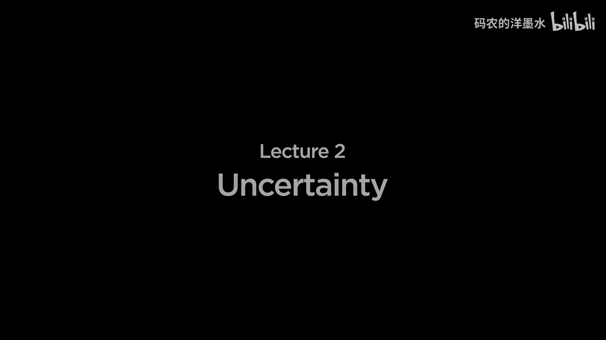

Alright， welcomecome back， everyone to an introduction to artificial intelligence with Python。

 And last time we took a look at how it is that AI inside of our computers can represent knowledge。

 We represented that knowledge in the form of logical sentences in a variety of different logical languages。

 And the idea was we wanted our AI to be able to represent knowledge or information and somehow use those pieces of information to be able to derive new pieces of information via inference to be able to take some information and deduce some additional conclusions based on the information that it already knew for sure。

😊，But in reality， when we think about computers and we think about AI。

 very rarely are our machines going to be able to know things for sure。

 oftentimes there's going to be some amount of uncertainty in the information that our AIs or our computers are dealing with。

 where it might believe something with some probability as we'll soon discuss what probability is all about and what it means but not entirely for certain。

 and we want to use the information that it has some knowledge about。

 even if it doesn't have perfect knowledge to still be able to make inferences。

 still be able to draw conclusions。 So you might imagine， for example。

 in the context of a robot that has some sensors and is exploring some environment。

 it might not know exactly where it is or exactly what's around it。

 but it does have access to some data that can allow it to draw inferences with some probability。

 theres some likelihood that one thing is true or another。

 or you can imagine in context where there is a little bit more randomness and uncertainty。

 something like predicting the weather where you might not be able to know for sure what tomorrow's weather is with 100 percent certainty but you can probably infer with some probability what tomorrow's weather is going to be based on maybe today's。

😊。

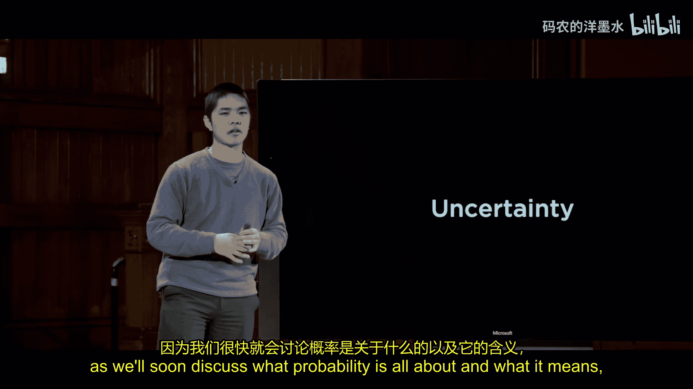

Weather and yesterday's weather and other data that you might have access to as well。

 And so oftentimes we can distill this in terms of just possible events that might happen and what the likelihood of those events are。

 This comes a lot in games， for example， where there is an element of chance inside of those games。

 So imagine rolling a dice。 You're not sure exactly what the di roll is going to be。

 But you know it's going to be one of these possibilities from one to 6， for example。😊。

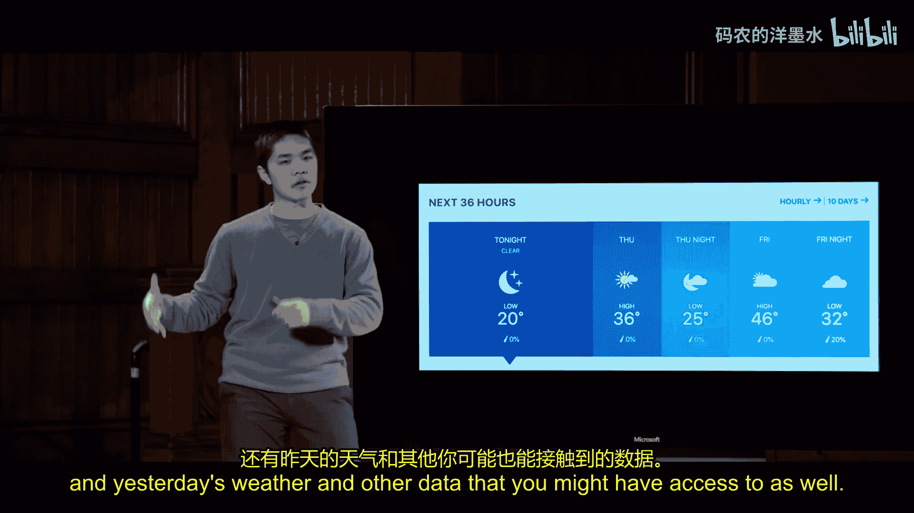

And so here now we introduce the idea of probability theory。

 and what we'll take a look at today is beginning by looking at the mathematical foundations of probability theory。

 getting a understanding for some of the key concepts within probability。

 and then diving into how we can use probability and the ideas that we look at mathematically to represent some ideas in terms of models that we can put into our computers in order to program an AI that is able to use information about probability to draw inferences。

 to make some judgments about the world with some probability or likelihood of being true。

So probability ultimately boils down to this idea that there are possible worlds that we're here representing using this little Greek letter omega and the idea of a possible world is that you know when I roll a die。

 there are six possible worlds that could result from it。

 I could roll a1 or a two or a3 or a4 or a5 or a6 and each of those are a possible world and each of those possible worlds has some probability of being true。

 The probability that I do roll a1 or a two or a3 or something else。

 and we represent that probability like this using the capital letter P and then in parentheses what it is that we want the probability of So this right here would be the probability of some possible world as represented by the little letter omega。

Now， there are a couple of basic axioms of probability that become relevant as we consider how we deal with probability and how we think about it。

 First and foremost， every probability value must range between 0 and one inclusive。

 So the smallest value any probability can have， is the number 0， which is an impossible event。

 something like I roll a die and the die is a 7 is the role that I get。

 If the I only has numbers 1 through 6。 The event that I roll a 7 is impossible。

 So it would have probability 0。😊，And on the other end of the spectrum。

 probability can range all the way up to the positive number one。

 meaning an event is certain to happen。 that I roll a die， and the number is less than 10。

 for example， That is an event that is guaranteed to happen if the only size on my die are one through 6。

 for instance， and then they can range through any real number in between these two values。

 Were generally speaking， a higher value for the probability means an event is more likely to take place and a lower value for the probability means the event is less likely to take place。

And the other key rule for probability looks a little bit like this。 This sigma notation。

 if you haven't seen it before， refers to summation。

 the idea that we're going to be adding up a whole sequence of values and this sigma notation is going to come up a couple of times today because as we deal with probability。

 oftentimes we're adding up a whole bunch of individual values or individual probabilities to get some other value。

 So we'll see this come up a couple of times， But what this notation means is that if I sum up all of the possible worlds omega that are in big omega。

 which represents a set of all the possible worlds。

 meaning I take for all of the worlds in the set of possible worlds and add up all of their probabilities。

What I ultimately get is the number one。 So if I take all the possible worlds add up what each of their probabilities is I should get the number one at the end。

 meaning all probabilities just need to sum to one。 So for example， if I take dice， for example。

 if you imagine I have a fair die with numbers 1 through 6， and I roll the dieme。

 each one of these roles has an equal probability of taking place and the probability is one over 6。

 for example， So each of these probabilities is between 0 and 1，0。

 meaning impossible and one meaning for certain， And if you add up all of these probabilities for all of the possible worlds。

 you get the number one。😊，And we can represent any one of those probabilities like this。

 The probability that we roll the number two， for example， is just one over six。

 Every six times we roll the I。 We'd expect that one time， for instance。

 that I might come up as a two。 Its probability is not certain， but it's a little more than nothing。

 for instance。And so this is all fairly straightforward for just a single die。

 But things get more interesting as our models of the world get a little bit more complex。

 Let's imagine now that we're not just dealing with a single dime， but we have two dice。 for example。

 I have a red dye here and a blue dye there。 And I care not just about what the individual role is。

 but I care about the sum of the two rolls。 In this case， the sum of the two rolls is the number 3。😊。

How do I begin to now reason about like， what does the probability look like if instead of having one die。

 I now have two dice。 Well， what we might imagine is that we could first consider what are all of the possible worlds。

 And in this case， all of the possible worlds are just every combination of the red and blue dye that I could come up with for the red dye。

 it could be a one or a two or a 3 or a4 or a 5 or a 6。 And for each of those possibilities。

 the blue dye， likewise could also be either one or two or3 or4 or 5 or 6。

And it just so happens that in this particular case。

 each of these possible combinations is equally likely。

 equally likely are all of these various different possible worlds。

 that's not always going to be the case， as you imagine more complex models that we could try to build and things that we could try to represent in the real world。

 it's probably not going to be the case that every single possible world is always equally likely。

 but in the case of fair dice where in any given di roll。

 any one number has just as good a chance of coming up as any other number。

 we can consider all of these possible worlds to be equally likely。😡。

But even though all of the possible worlds are equally likely。

 that doesn't necessarily mean that their sums are equally likely。

 So if we consider what the sum is of all of these two。 So one plus one， that's a two，2 plus1 is a 3。

 And consider for each of these possible pairs of numbers， what there sum ultimately is。

 we can notice that there are some patterns here， where it's not entirely the case that every number comes up equally likely。

 If you consider7， for example， What's the probability that when I roll two dice， theres sum is 7。

 there are several ways this can happen。 There are know，6 possible worlds where the sum is 7。

 It could be a1 and a6 or a2 and a 5 or a3 and a4， a4 and a 3 and so forth。

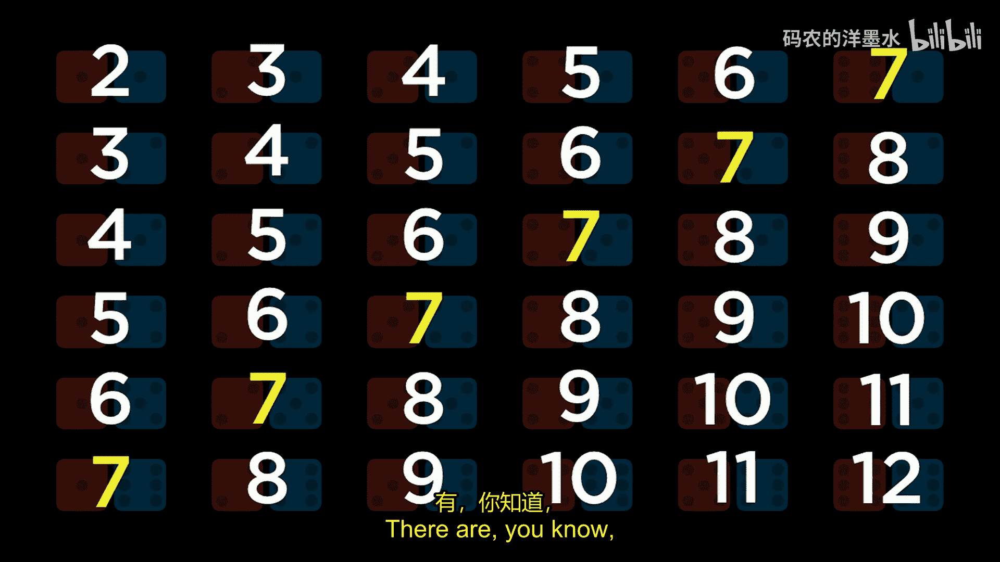

But if you instead consider， you know， what's the probability that I roll2 dice and the sum of those two di rolls as 12。

 for example， we're looking at this diagram。 There's only one possible world in which that can happen。

 And that's the possible world where both the red dye and the blue dye both come up as 6es to give us a sum total of 12。

So based on just taking a look at this diagram， we see that some of these probabilities are likely different。

 The probability that the sum is a 7 must be greater than the probability that the sum is a 12。

 and we can represent that even more formally by saying， okay。

 the probability that we sum to 12 is one out of 36 out of the 36。

 equally likely proable possible worlds，6 squared because we have six options for the red dye and six options for the blue dye out of those 36 options。

 only one of them sums to 12。😊，Whereas on the other hand。

 the probability that if we take two dice rolls and they sum up to the number 7， Well。

 out of those 36 possible worlds， there were  six worlds where the sum was 7。

 And so we get 6 over 36， which we can simplify as a fraction to just one over 6。😊。

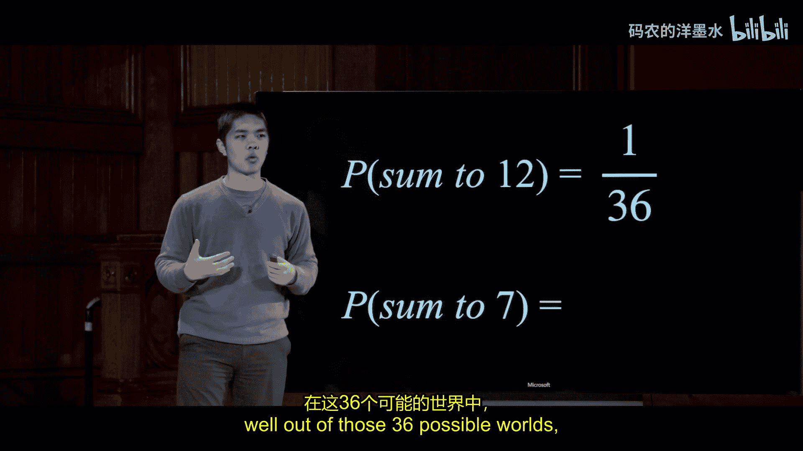

So here now we're able to represent these different ideas of probability。

 representing some events that might be more likely and then other events that are less likely as well。

 And these sorts of judgments where we're figuring out just in the abstract。

 what is the probability that this thing takes place are generally known as unconditional probabilities。

 Some degree of belief we have in some probability。

 some fact about the world in the absence of any other evidence without knowing any additional information。

 if I roll a die， what's the chance it comes up as a two， or if I roll two dice。

 what's the chance that the sum of those two die roll is a7。

But usually when we're thinking about probability， especially when we're thinking about training in AI to intelligently be able to know something about the world and make predictions based on that information。

 it's not unconditional probability that our AI is dealing with， but rather conditional probability。

 probability where rather than having no original knowledge。

 we have some initial knowledge about the world and how the world actually works。

 So conditional probability is the degree of belief in a proposition。

 given some evidence that is already been revealed to us。

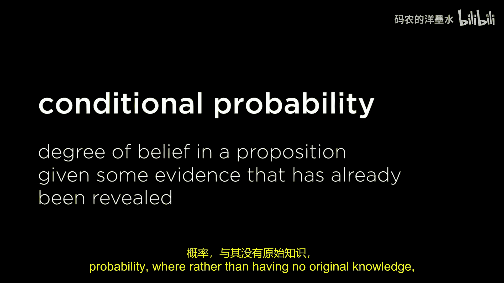

So what does this look like， Well， it looks like this in terms of notation。

 We're going to represent conditional probability as probability of A and then this vertical bar and then B。

 And the way to read this is the thing on the lefthand side of the vertical bar is what we want the probability of here now。

 I want the probability that A is true， that it is the real world that it is the event that actually does take place。

 And then on the right side of the vertical bar is our evidence。

 the information that we already know for certain about the world。 For example， that B is true。

 So the way to read this entire expression is what is the probability of a given B。

 the probability that a is true， given that we already know that B is true。

 And this type of judgment， conditional probability， the probability of one thing。

 given some other fact， comes up quite a lot when we think about the types of calculations we might want our AI to be able to do。

 For example， we might care about the probability of rain today。

 given that we know that it rained yesterday。😊，We could think about the probability of rain today just in the abstract。

 What is the chance that today it rains， but usually we have some additional evidence。

 I know for certain that it rained yesterday。 And so I would like to calculate the probability that it rains today。

 given that I know that it rained yesterday。 or you might imagine that I want to know the probability that my optimal route to my destination changes。

 given the current traffic conditions。 So whether or not traffic conditions change that might change the probability that this route is actually the optimal route。

 or you might imagine in a medical context。 I want to know the probability that a patient has a particular disease。

 given some results of some tests that have been performed on that patient。

 And I have some evidence the results of that test。

 and I would like to know the probability that a patient has a particular disease。

 So this notion of conditional probability comes up everywhere We begin to think about what we would like to reason about but being able to reason a little more intelligently by taking into account evidence that we already have。

 We're more able to get an accurate result for what is the likelihood that someone has this。😊，D。

 if we know this evidence， the results of the test。

 as opposed if we were just calculating the unconditional probability of saying。

 what is the probability they have the disease without any evidence to try and back up our result one way or the other。

So now that we've got this idea of what conditional probability is。

 the next question we have to ask is all right， how do we calculate conditional probability。

 How do we figure out mathematically， if I have an expression like this。

 how do I get a number from that， what does conditional probability actually mean Well。

 the formula for conditional probability looks a little something like this。

 The probability of a given B， the probability that a is true。

 given that we know that B is true is equal to this fraction the probability that a and B are true。

 divided by just the probability that B is true， and the way to intuitively try to think about this is that if I want to know the probability that a is true。

 given that B is true， Well， I want to consider all the ways they could both be true out of the only worlds that I care about are the worlds where B is already true。

 I can sort of ignore all the cases where B isn't true because those aren't relevant to my ultimate computation They're not relevant to what it is that I want to get information about。

So let's take a look at an example。 Let's take a go back to that example of rolling two dice and the idea that those two dice might sum up to the number 12。

 We discussed earlier that the unconditional probability that if I roll two dice and they sum to 12 is one out of 36。

 because out of the 36 possible worlds that I might care about in only one of them is the sum of those two dice 12。

 It's only when red is 6 and blue is also 6。But let's say now that I have some additional information。

 I now want to know what is the probability that the two die sum to 12。

 given that I know that the red dye was a 6。 So I already have some evidence。

 I already know the red die is a 6， I don't know what the blue dye is。

 that information isn't given to me in this expression。

 But given the fact that I know that the red dye rolled a 6。

 What is the probability that we sum to 12。

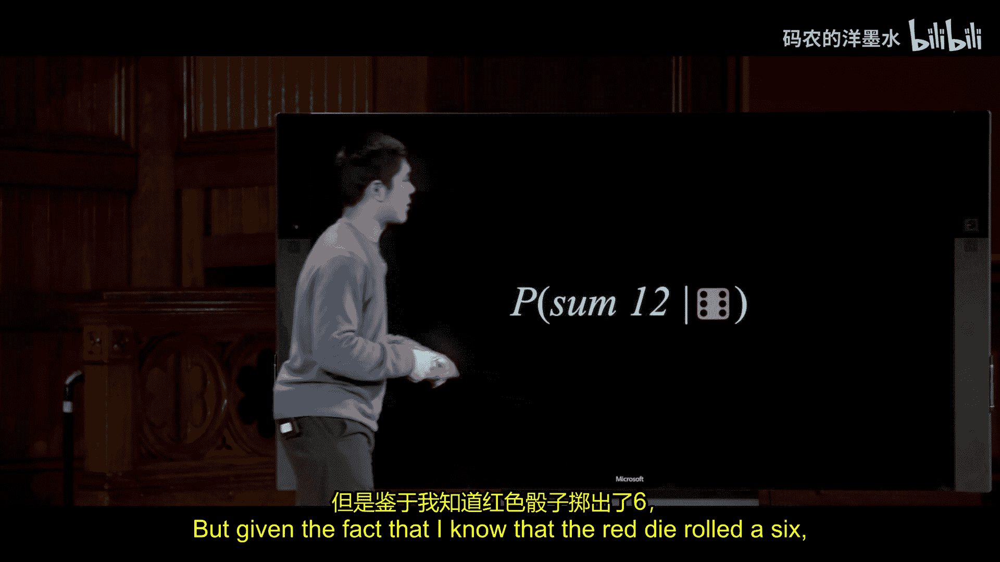

And so we can begin to do the math using that expression from before。

 Here again are all of the possibilities， all of the possible combinations of red dye being one through 6 and blue dye being one through 6。

😊，And I might consider first， Alright， what is the probability of my evidence， my B variable。

 where I want to know what is the probability that the red die is a 6， Well。

 the probability that the red die is a 6 is just one out of 6。

 So these one out of6 options are really the only worlds that I care about here Now。

 All the rest of them are irrelevant to my calculation because I already have this evidence that the red die was a 6。

 So I don't need to care about all the other possibilities that could result。So now。

 in addition to the fact that the red die rolled as a6 and the probability of that。

 the other piece of information I need to know in order to calculate this conditional probability is the probability that both of my variables。

 A and B are true。 the probability that both the red die is a 6 and they all sum to 12。

 So what is the probability that both of these things happen。 Well。

 it only happens in one possible case in one out of these 36 cases and it's the case where both the red and the blue die are equal to 6 is an information piece of information that we already knew。

 And so this probability is equal to one over 36。 And so to get the conditional probability that the sum is 12。

 given that I know that the red dice is equal to 6。

 Well I just divide these two values together and one over 36 divided by one over 6 gives us this probability of one over 6。

 Given that I know that the red die rolled a value is 6。

 the probability that the sum of the two dice is 12 is also one over 6。 and that probably。

Initive sense Q 2， because if the red dies a 6， the only way for me to get to a 12。

 is if the blue die also rolls a 6。 and we know that the probability of the blue dye rolling a 6 is whatever 6。

 So in this case， the conditional probability seems fairly straightforward。

 But this idea of calculating a conditional probability by looking at the probability that both of these events take place is an idea that's going to come up again and again。

 this is the definition now of conditional probability， and we're going use that definition。

 as we think about probability more generally to be able to draw conclusions about the world。

 This again， is that formula， the probability of a given B is equal to the probability that A and B take place divided by the probability of B。

 And you'll see this formula sometimes written in a couple of different ways。

 you could imagine algebraically multiplying both sides of this equation by probability of B to get rid of the fraction。

 and you'll get an expression like this。 The probability of A A B。

 which is this expression over here is just the probability of B。😊。

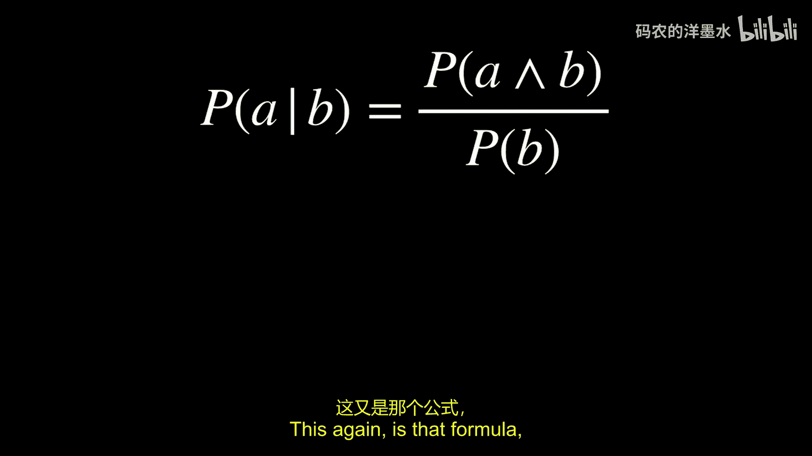

Times the probability of a given B， or you could represent this equivalently since A and B in this expression are interchangeable。

 A and B is the same thing as B and A， you could imagine also representing the probability of A and B as the probability of A times the probability of B given a just switching all of the A's and B's。

 These three are all equivalent ways of trying to represent what joint probability means。

 And so you'll sometimes see all of these equations and D might be useful to you as you begin to reason about probability and to think about what values might be taking place in the real world。

😡，Now， sometimes when we deal with probability， we don't just care about a Boolean event。

 like did this happen or did this not happen？ Sometimes we might want the ability to represent like variable values in a probability space where some variable might take on multiple different possible values。

 and in probability， we call a variable in probability theory， a random variable。

 a random variable and probability is just some variable and probability theory that has some domain of values that it can take on So what do I mean by this。

 what I mean is I might have a random variable that is just called role for example。

 that has six possible values role is my variable and the possible values。

 the domain of values that it can take on are 1，2，3，4，5 and 6。

 and I might like to know the probability of each in this case that happen to all be the same。

 but in other random variables that might not be the case。 For example。

 I might have a random variable to represent the weather， for example。

 where the domain of values that could take on are things like sun or cloudy or rainy or windy or snowy。

Each of those might have a different probability， and I care about knowing what is the probability that the weather equals sun or that the weather equals clouds。

 for instance。😡，And I might like to do some mathematical calculations based on that information。

 Other random variables might be something like traffic。

 What are the odds that there is no traffic or light traffic or heavy traffic。

 traffic in this case is my random variable and the values that that random variable can take on are here。

 It's either none or light or heavy and I， the person doing these calculations。 I。

 the person encoding these random variables into my computer need to make the decision as to what these possible values actually are。

 You might imagine， for example， for a flight， if I care about whether or not I make it or a flight on time。

 My flight has a couple of possible values that it could take on。 My flight could be on time。

 My flight could be delayed。 My flight could be canceled。

 So flight in this case is my random variable And these are the values that it can take on。

 And often I' want to know something about the probability that my random variable takes on each of those possible values。

 And this is what we then call a probability distribution。

 A probability distribution takes a random variable and gives me the probability。😊。

For each of the possible values in its domain。So in the case of this flight， for example。

 my probability distribution might look something like this。

 My probability distribution says the probability that the random variable flight is equal to the value on time is 0。

6 or otherwise put into more English human friendly terms。

 the likelihood that my flight is on time is 60%， for example。 And in this case。

 the probability that my flight is delayed is 30%， the probability that my flight is canceled is 10% or 0。

1 and if you sum up all of these possible values， the sum is going to be one right if you take all of the possible worlds here my 3 possible worlds for the value of the random variable flight add them all up together。

 the result needs to be the number1 per that axiom of probability theory that we've discussed before。

So this now is one way of representing this probability distribution for the random variable flight。

 Sometimes you'll see it represented a little bit more concisely that this is pretty verbose for really just trying to express three possible values And so often you'll instead see the same notation representing using a vector and all a vector is is a sequence of values as opposed to just a single value。

 I might have multiple values。 And so I could extend instead represent this idea this way。 bold P。

 So a larger P generally meaning the probability distribution of this variable flight is equal to this vector represented an angle brackets。

 The probability distribution is 06 03 and 01。 and I would just have to know that this probability distribution is in order of on time or delayed and canceled to know how to interpret this vector to mean the first value in the vector is the probability that my flight is on time。

 The second value in the vector is the probability that my flight is delayed and the third value。

And the vector is the probability that my flight is canceled。

And so this is just an alternate way of representing this idea a little more verboly。 But oftentimes。

 you'll see us just talk about a probability distribution over a random variable。

 And whenever we talk about that， what we're really doing is trying to figure out the probabilities of each of the possible values that that random variable can take on。

 But this notation is just a little bit more succinct。

 even though it can sometimes be a little confusing， depending on the context in which you see it。

 So we'll start to look at examples where we use this sort of notation to describe probability and to describe events that might take place。

😊。

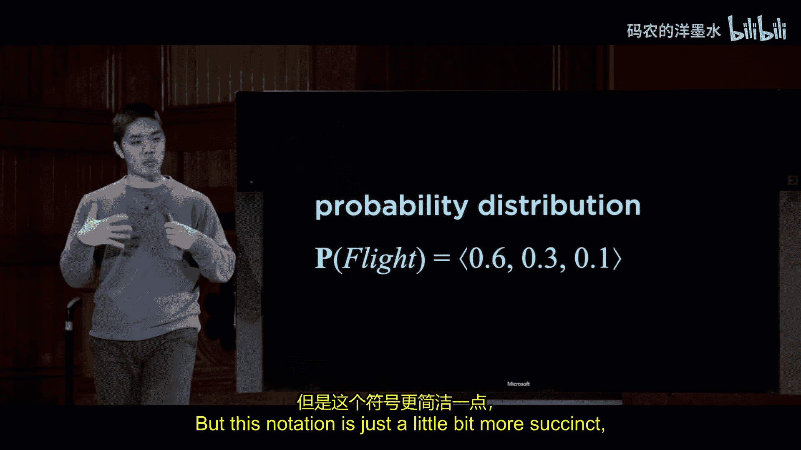

A couple of other important ideas to know with regards to probability theory。

 One is this idea of independence。 and independence refers to the idea that the knowledge of one event doesn't influence the probability of another event。

 So， for example， in the context of my two dice rolls where the red dye and the blue dye。

 the probability that I roll the red dye and the blue dye。 those two events。

 red dye and blue dye are independent knowing the result of the red dye doesn't change the probabilitybilities for the blue dye。

 doesn't give me any additional information about what the value of the blue dye is ultimately going to be。

 But that's not always going to be the case， you might imagine then in the case of weather something like clouds and rain。

 those are probably not independent。 that if it is cloudy that might increase the probability that later in the day。

 it's going to rain。 So some information inform some other event or some other random variable。

 So independence refers to the idea that one event doesn't influence the other。

 And if they're not independent， then there might be some relationship。

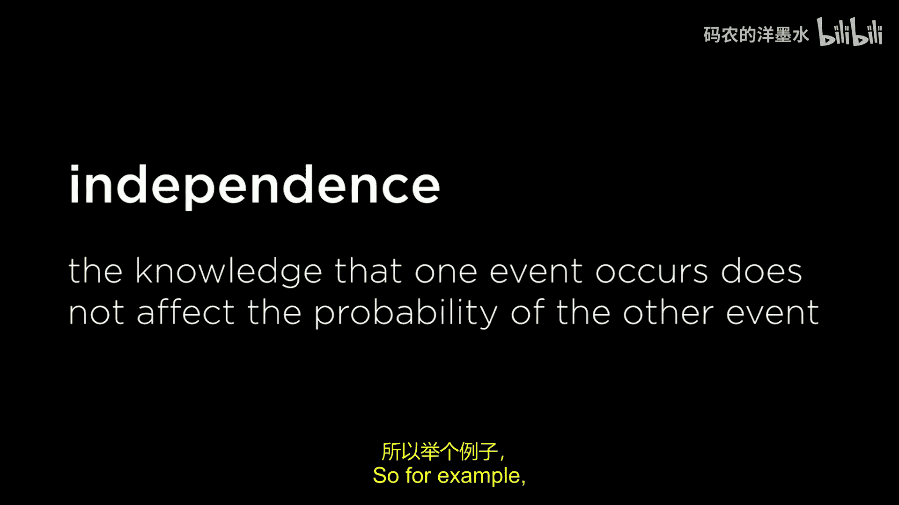

Yeah。So mathematically， formally， what does independence actually mean， Well。

 recall this formula from before， that the probability of a and B is the probability of a times the probability of B given A。

 And the more intuitive way to think about this is that to know how likely it is that A and B happens。

 Well， let's first figure out the likelihood that A happens。

 And then given that we know that A happens， let's figure out the likelihood that B happens and multiply those two things together。

But if A and B were independent， meaning knowing A doesn't change anything about the likelihood that B is true。

 Well， then the probability of B given A， meaning the probability that B is true。

 given that I know A is true。 Well， that I know A is true。

 shouldn't really make a difference if these two things are independent。

 that A shouldn't influence B at all。 So the probability of B given A is really just the probability of B。

 If it is true that A and B are independent。 And so this right here is one example of a definition for what it means for A and B to be independent。

 the probability of A and B is just the probability of A times the probability of B。

 Anytime you find two events， A and B， where this relationship holds。

 then you can say that A and B are independent。So an example of that might be the dice that we were taking a look at before here if I wanted the probability of red being a 6 and blue being a 6。

 well， that's just the probability that red is a6 multiplied by the probability that blue is a 6 both equal to  one over 36。

 So I can say that these two events are independent。What wouldn't be independent， for example。

 would be an example。 So this， for example， has a probability of one over 36。

 as we talked about before。 But what wouldn't be independent would be a case like this。

 The probability that the red dye rolls a 6 and the red dye rolls a 4。If you just naively took， okay。

 red die 6， red die4。 well， if I'm only rolling the die once。

 you might imagine that naive approach is to say， well。

 each of these has a probability of one over 6， so multiply them together and the probability is one over 36。

 But of course if you're only rolling the red die once。

 there is no way you could get two different values for the red dye。 It couldn't both be a 6 and a4。

 So the probability should be 0。 but if you were to multiply probability of red 6 times probability of red 4。

 well that would equal1 over 36， but of course that's not true， because we know that there is no way。

 probability 0 that when we roll the red die once we get both a6 and a4 because only one of those possibility can actually be the result。

And so we can say that the event that red roll is6 and the event that red roll is4。

 those two events are not independent。 If I know that the red roll is a 6。

 I know that the red roll cannot possibly be a4。 So these things are not independent。 And instead。

 if I wanted to calculate the probability。 I would need to use this conditional probability as is the regular definition of the probability of two events taking place。

 And the probability of this now， well the probability of the red roll being a6， that's one over 6。

 But what's the probability that the role is a four， given that the role is a 6， Well， this is just0。

 because theres no way for the for the red roll to be a4。

 given that we already know the red roll is a6。 And so the value if we do at all that multiplication is we get the number 0。

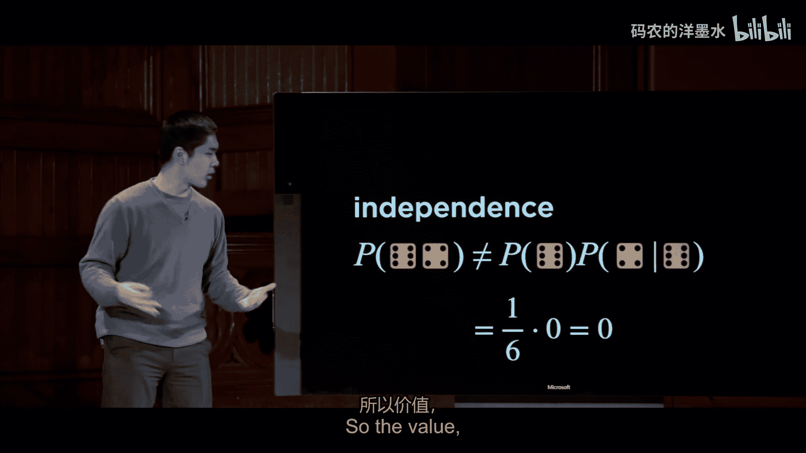

So this idea of conditional probability is going to come up again and again。

 especially as we begin to reason about multiple different random variables that might be interacting with each other in some way。

 and this gets us to one of the most important rules in probability theory。

 which is known as Bay'es rule。 And it turns out that just using the information we've already learned about probability。

 and just applying a little bit of algebra， we can actually derive Bay's rule for ourselves。

 But it's a very important rule when it comes to inference and thinking about probability in the context of what it is that a computer can do or what a mathematician could do by having access to informations about probability。

 So let's go back to these equations to be able to derive Bay'ess rule ourselves。

 We know the probability of A and B， the likelihood that A and B take place is the likelihood of B。

 and then the likelihood of a given that we know that B is already true。

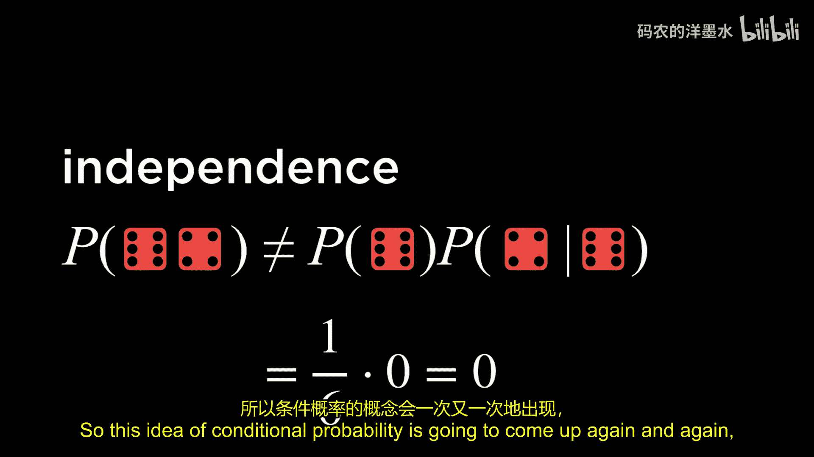

And likewise， the probability of a given A and B is the probability of A， times the probability of B。

 given that we know that a is already true。 This is sort of a symmetric relationship where it doesn't matter the order of A and B and B and A mean the same thing。

 And so in these equations， we can just swap out A and B to be able to represent the exact same idea。

 So we know that these two equations are already true。 we've seen that already。

 And now let's just do a little bit of algebraic manipulation of this stuff。

 Both of these expressions on the right hand side are equal to the probability of A and B。

 So what I can do is take these two expressions on the right hand side and just set them equal to each other。

 if they're both equal to the probability of A and B， then they both must be equal to each other。

 So probability of a times probability of B given A is equal to the probability of B times the probability of A given B。

And now all we're gonna do is do a little bit of division。 I'm going divide both sides by P of a。

 And now I get what is bayes rule， the probability of B given A is equal to the probability of B times the probability of a given B divided by the probability of a。

 and sometimes in basees rule， you'll see the order of these two arguments switched。

 So instead of B times a given B， it'll be a given B times B。

 that ultimately doesn't matter because in multiplication。

 you can switch the order of the two things you're multiplying， and it doesn't change the result。

 but this here right now is the most common formulation of bayes rule。

 The probability of B given A is equal to the probability of a given B times the probability of B divided by the probability of a。

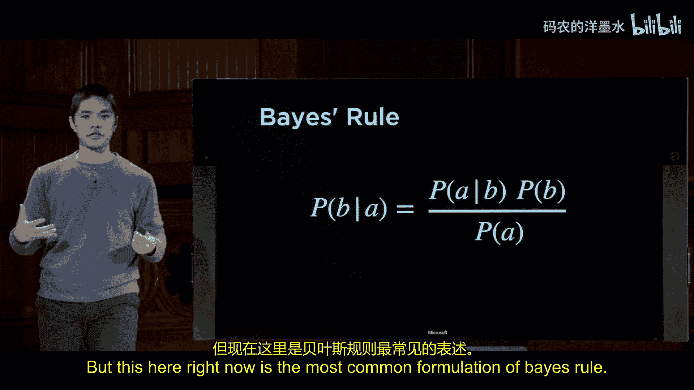

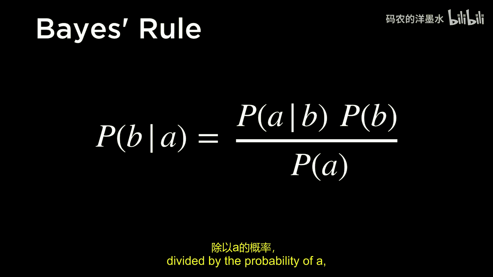

And this rule， it turns out， is really important when it comes to trying to infer things about the world。

 because it means you can express one conditional probability， the conditional probability of B。

 given A。Using knowledge about the probability of a given B。

 using the reverse of that conditional probability。

 So let's first do a little bit of an example with this just to see how we might use it。

 and then explore what this means a little bit more generally。

 So we're going construct a situation where I have some information。

 There are two events that I care about。 The idea that it's cloudy in the morning。

 And the idea that it is rainy in the afternoon。 Those are two different possible events that could take place。

 cloudy in the morning or the A M rainy in the PM。 And what I care about is given clouds in the morning。

 what is the probability of rain in the afternoon。 a reasonable question I might ask in the morning。

 I look outside or an AI's camera looks outside and sees that there are clouds in the morning。

 And we want to conclude。 we want to figure out what is the probability that in the afternoon there is going to be rain。

😊。

Of course， in the abstract， we don't have access to this kind of information。

 but we can use data to begin to try and figure this out。

 So let's imagine now that I have access to some pieces of information。

 I have access to the idea that 80% of rainy afternoons start out with a cloudy morning。

 And you might imagine that I could have gathered this data just by looking at data over a sequence of time that I know that 80% of the time when it's raining in the afternoon。

 it was cloudy that morning。😊，I also know that 40% of days have cloudy mornings。

And I also know that 10% of days have rainy afternoons。

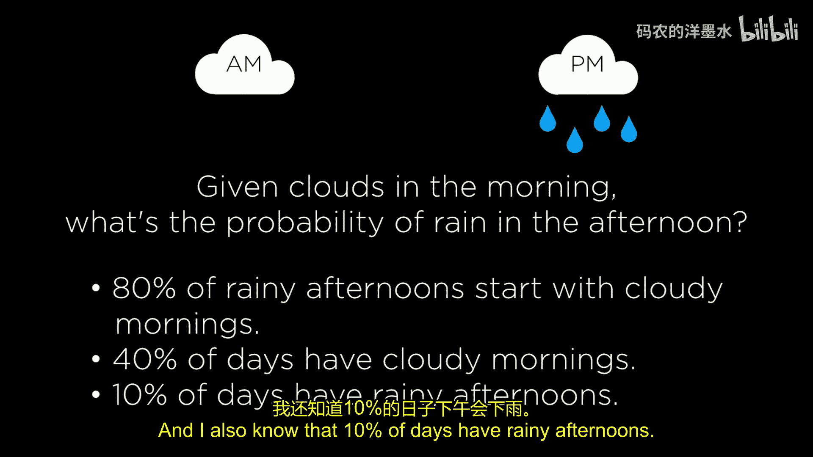

And now， using this information， I would like to figure out。Given clouds in the morning。

 What is the probability that it rains in the afternoon。

 I want to know the probability of afternoon rain， given morning clouds。

 and I can do that in particular， using this fact。 the probability if I know that 80% of rainy afternoons start with cloudy mornings。

 Then I know the probability of cloudy mornings， given rainy afternoon。

 So using sort of the reverse conditional probability。

 I can figure that out expressed in terms of bays rule。

 this is what that would look like probability of rain given clouds is the probability of clouds。

 given rain times the probability of rain divided by the probability of clouds。 here。

 I'm just substituting in for the values of A and B from that equation of bays rule from before。

 And then I can just do the math。 I have this information。 I know that 80% of the time。

 if it was raining then there were clouds in the morning。 So  point8 here， probability of rain is 0。

1 because 10% of days were raining and 40% of days were cloudy。 I do the math。

 And I can figure out the answer is 02。 So the。😊，That it rains in the afternoon。

 given that it was cloudy in the morning， is 0。2 in this case。

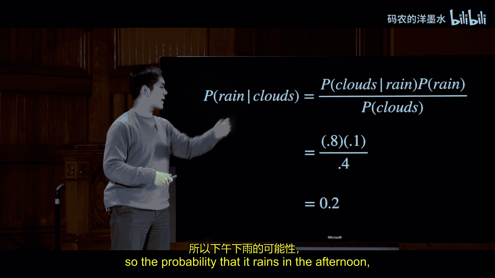

And this now is an application of Bays rule。 The idea that using one conditional probability。

 we can get the reverse conditional probability。 And this is often useful when one of the conditional probabilities might be easier for us to know about or easier for us to have data about and using that information。

 we can calculate the other conditional probability。 So what does this look like， Well。

 it means that knowing the probability of cloudy mornings， given rainy afternoons。

 we can calculate the probability of rainy afternoons， given cloudy mornings， or， for example。

 more generally， if we know the probability of some visible effect。

 some effect that we can see and observe， given some unknown cause that we're not share about， Well。

 then we can calculate the probability of that unknown unknown cause， given the visible effect。

 So what might that look like。😊。

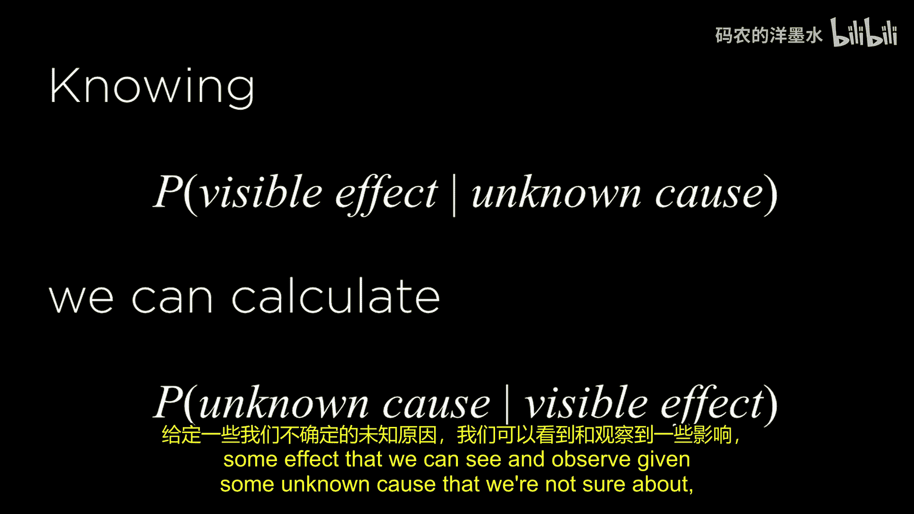

Well， in the context of medicine， for example， I might know the probability of some medical test result。

 given a disease。 Like I know that if someone has a disease， then X percent of the time。

 the medical test result will show up as this， for instance。

 and using that information then I can calculate right。

 what is the probability that given I know the medical test result。

 what is the likelihood that someone has disease。 This is the piece of information that is usually easier to know。

 easier to immediately have access to data for And this is the information that I actually want to calculate or I might want to know。

 for example， if I know that what some probability of counterfeit bills have like blurry text around the edges because counterfeit printers aren't nearly as good at printing text precisely So I have some information about given something is a counterfeit bill。

 like X percent of counterfeit bills have blurry text， for example。

 And using that information that I can calculate some piece of information that I might want to know like given that I know there's blurry text on a bill。

 what is the。

ProThat that bill is counterfeit。 So given one conditional probability。

 I can calculate the other conditional probability as well。

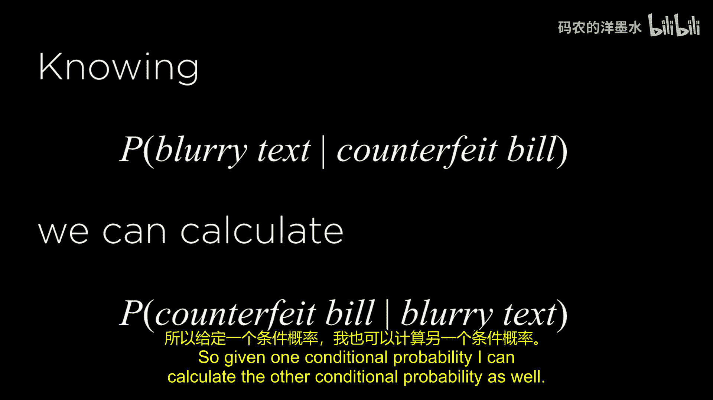

And so now we've taken a look at a couple of different types of probability。

 We've looked at unconditional probability， where I just look at what is the probability of this offend occurring。

 given no additional evidence that I might have access to。

 And we've also looked at conditional probability where I have some sort of evidence。

 and I would like to using that evidence be able to calculate some other probability as well。😡。

The other kind of probability that will be important for us to think about is joint probability。

 And this is when we're considering the likelihood of multiple different events simultaneously。

 And so what do we mean by this， Well， for example。

 I might have probability distributions that look a little something like this。

 Like I want to know the probability distribution of clouds in the morning。

 And that distribution looks like this。40% of the time。 C， which is my random variable here。

 is equal to it's cloudy。 And 60% of the time it's not cloudy。

 So here is just a simple probability distribution that is effectively telling me that 40% of the time it's cloudy。

😊，I might also have a probability distribution for rain in the afternoon。

 where 10% of the time or with probability 0。1， it is raining in the afternoon and with probability 0。

9， it is not raining in the afternoon。 And using just these two pieces of information。

 I don't actually have a whole lot of information about how these two variables relate to each other。

 but I could if I had access to their joint probability。

 meaning for every combination of these two things， meaning morning， cloudy and afternoon rain。

 morning， cloudy and afternoon， not rain， morning， not cloudy and afternoon rain， and morning。

 not cloudy and afternoon， not raining， if I had access to values for each of those four。

 I'd have more information， So information that be organized in a table like this。

 and this rather than just a probability distribution is a joint probability distribution。

 It tells me the probability distribution of each of the possible combinations of values that these random variables can take on。

So if I want to know what is the probability that on any given day， it is both cloudy and rainy。

 Well， I would say， all right， we're looking at cases where it is cloudy and cases where it is raining and the intersection of those two that row in that column is 0。

08。 So that is the probability that it is both cloudy and rainy using that information。😊。

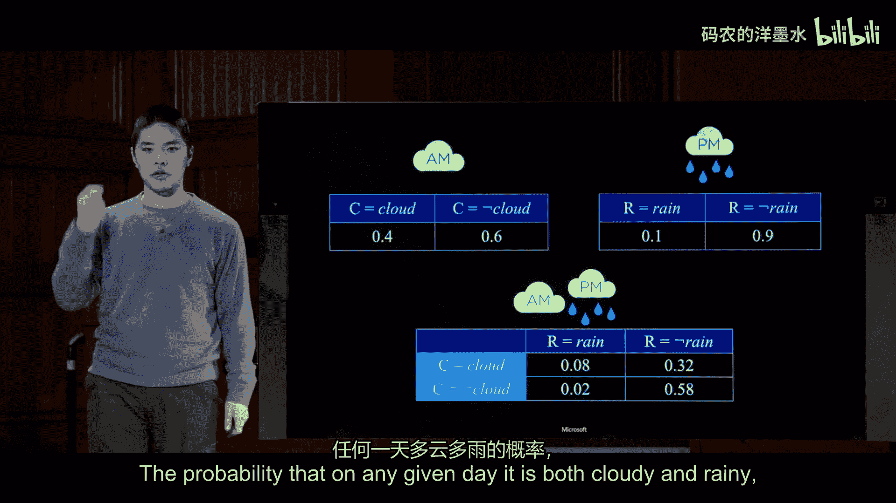

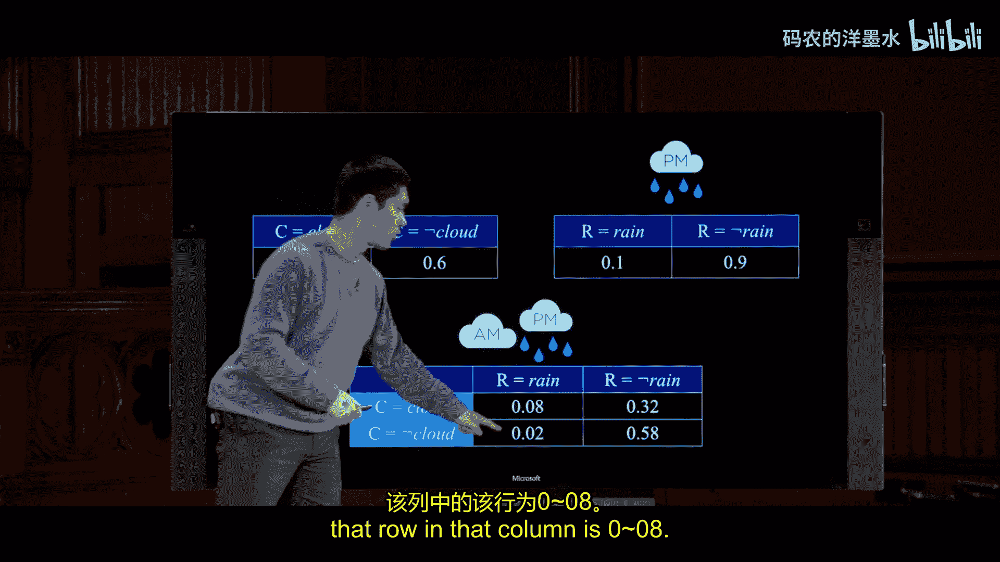

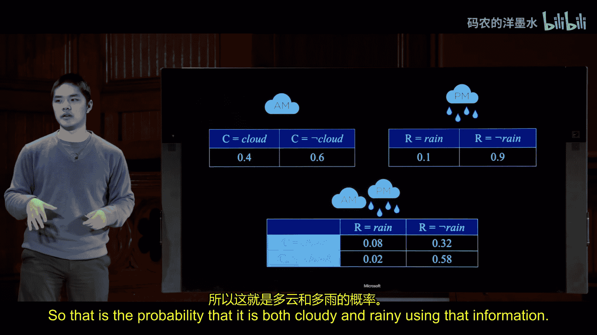

And using this conditional probability table or using this joint probability table。

 I can begin to draw other pieces of information about things like conditional probability。

 So I might ask a question like what is the probability distribution of clouds。

 given that I know that it is raining， meaning I know for sure that it's that it's raining。

 tell me the probability distribution over whether it's cloudy or not。

 given that I know already that it is， in fact， raining。

 And here I'm using C to stand for that random variable。 I'm looking for a distribution。

 meaning the answer to this is not going to be a single value， it's going to be two values。

 a vector of two values where the first value is probability of clouds。

 the second value is probability that it is not cloudy。

 but the sum of those two values is going to be one because when you add up the probabilitybilities of all of the possible worlds。

 the result that you get must be the number one。😊，And well。

 what do we know about how to calculate a conditional probability。

 Well we know that the probability of a， given B is the probability of A and B divided by the probability of B。

So what does this mean， Well， it means that I can calculate the probability of clouds。

 given that it's raining as the probability of clouds and raining divided by the probability of rain。

 And this comma here for the probability distribution of clouds and rain。

 This comma sort of stands in for the word and。 you'll sort of see the logical operator and and the comma used interchangeably。

 this means the probability distribution over the clouds and knowing the fact that it is raining divided by the probability of rain。

😊，And the interesting thing to note here and what we'll often do in order to simplify our mathematics is that dividing by the probability of rain。

 the probability of rain here is just some numerical constant。

 It is some number dividing by probability of rain is just dividing by some constant or in another words。

 multiplying by the inverse of that constant。 And it turns out oftentimes we can just not worry about what the exact value of this is。

 and just know that it is， in fact， a constant value。 And we'll see why in a moment。

 So instead of expressing this as this joint probability divided by the probability of rain。

 sometimes we'll just represent it as alpha times the numerator here。

 the probability distribution of C， this variable and that we know that it is raining。 for instance。

 So all we've done here is said this value of one over the probability of rain。

 that's really just a constant。 we're going divide by or equivalently multiply by the inverse of at the end。

 we'll just call it alpha for now and deal with it a little bit later。😊，But the key idea here now。

 and this is an idea that's going to come up again is that the conditional distribution of sea given rain is proportional to。

 meaning just some factor multipied by the joint probability of sea and rain being true。

 And so how do we figure this out。 Well， this is going to be the probability that it is cloudy。

 given that it's rainy， which is 008， and the probability that it's not cloudy。

 given that it's rainy， which is 0。02。 And so we get alpha times here now is that probability distribution。

 。08 is clouds and rain 0。02 is not cloudy and rain。

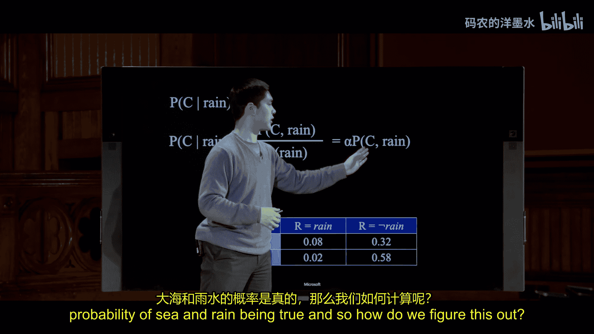

But， of course，0。08 and 。02 don't sum up to the number one。

 And we know that in a probability distribution， if you consider all of the possible values。

 they must sum up to a probability of 1。 And so we know that we just need to figure out some constant to normalize so to speak these values。

 something we can multiply or divide by to get it so that all these probability sum up to 1。

 And it turns out that if we multiply both numbers by 10， then we can get that result of 08 and 0。2。

 the proportions are still equivalent。 but now 0。8 plus 0。2， those sum up to the number one。

So take a look at this and see if you can understand step by step。

 how it is we're getting from one point to another。

 But the key idea here is that by using the joint probabilities。

 these probabilities that it is both cloudy and rainy， and that it is not cloudy and rainy。

 I can take that information and figure out the conditional probability， given that it's raining。

 what is the chance that it's cloudy versus not cloudy。

 just by multiplying by some normalization constant。 so to speak。

 And this is a computer can begin to use to be able to interact with these various different types of probabilitybabilities。

 And it turns out there are a number of other probability rules that are going to be useful to us as we begin to explore how we can actually use this information to encode into our computerism。

 some more complex analysis that we might want to do about probability and distributions and random variables that we might be interacting with。

 So here are a couple of those important probability rules。

 one of the simplest rules is just this negation rule。 What is the probability of not。😊。

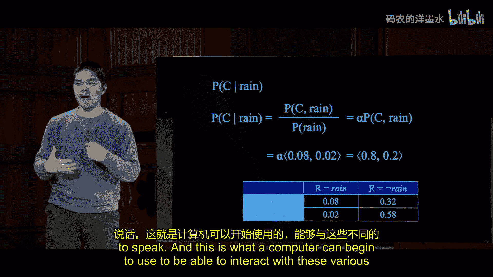

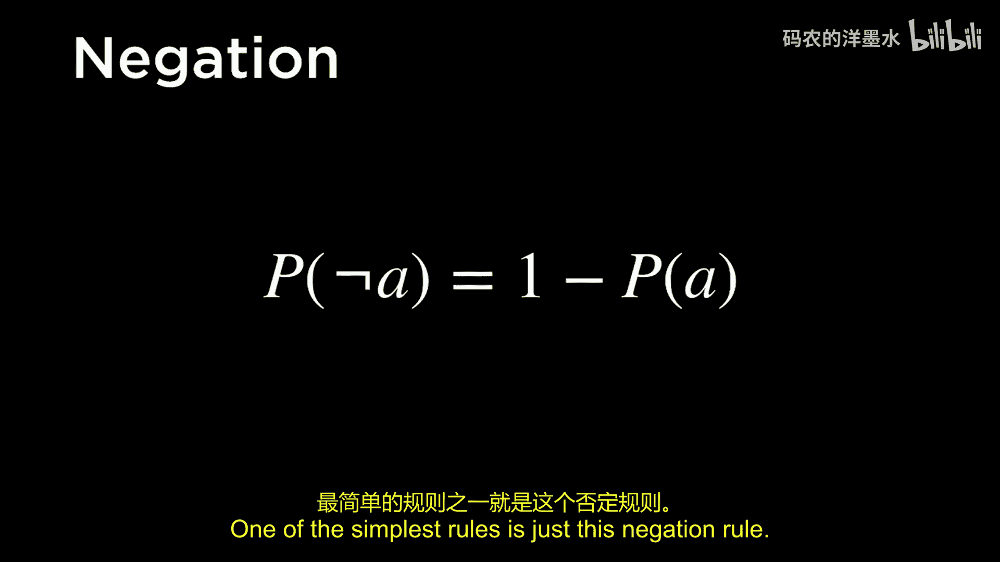

Event A， so a is an event that has some probability。

 And I would like to know what is the probability that a does not occur。

 And it turns out it's just one minus p of a， which makes sense because if those are the two possible cases。

 either a happens or a doesn't happen， then when you add up those two cases， you must get one。

 which means。P of n a must just be1 minus P of a， because P of a and P of n a must sum up to the number one。

 They must include all of the possible cases。😡，We've seen an expression for calculating the probability of A and B。

 We might also reasonably want to calculate the probability of A or B。

 What is the probability that one thing happens or another thing happens。 So for example。

 I might want to calculate what is the probability that if I roll two dice， a red die and a blue die。

 What is the likelihood that a is a 6 or B is a 6 like one or the other。

 And what you might imagine you could do in the wrong way to approach it would be just to say。

 all right， well， a comes up as a6 with the red dye comes up as a6 with probability1 over 6 the same for the blue dye。

 It's also one over 6。 add them together and you get two over6 of the known as one thirdd。

 but this suffers from a problem of overcounting that we've double counted the case where both a and B。

 both the red die and the blue die。 both come up as a6 rule。

 And I've counted that instance twice So of resolve this。

 the actual expression for calculating the probability of a or B uses what we call the inclusion exclusion formula。

 So I take the probability of a。😊，Add it to the probability of B。 That's all same as before。

 But then I need to exclude the cases that I've double counted。 So I subtract from that。

The probability of A and B。 And that gets me the result for A or B。

 I consider all the cases where A is true and all the cases where B is true。

 And if you imagine this is like a Venn diagram of cases where A is true， cases where B is true。

 I just need to subtract out the middle to get rid of the cases that I have overcounted by double counting them inside of both of these individual expressions。

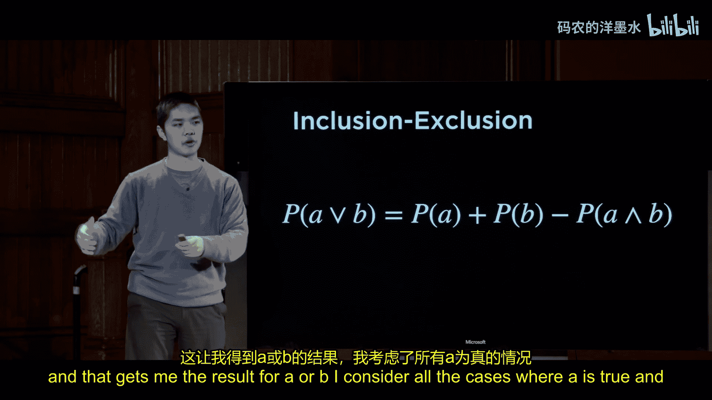

One other rule that's going to be quite helpful is a rule called marginalization。

 So marginalization is answering the question of how do I figure out the probability of a using some other variable that I might have access to like B。

 even if I don't know additional information about it。 I know that B。

 some event can have two possible states， either B happens or B doesn't happen。

 assuming it's a bully and true or false。 And well what that means is that for me to be able to calculate the probability of a。

 There are only two cases， either a happens and B happens， or a happens and B doesn't happen。

 And those are two disjoint， meaning they can't both happen together。

 either B happens or B doesn't happen， they're disjoint or separate cases。

 And so I can figure out the probability of a just by adding up those two cases。

 The probability that a is true。

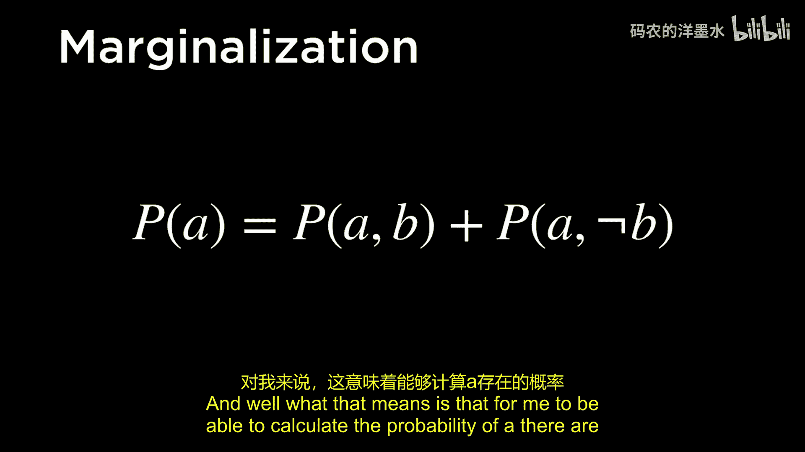

Is the probability that A and B is true。 Plus， the probability that A is true and B isn't true。

 So by marginalizing， I've looked at the two possible cases that might take place。

 either B happens or B doesn't happen。 And in either of those cases。

 I look at what's the probability that A happens。 And if I add those together。

 well then I get the probability that a happens as a whole。So take a look at that rule。

 It doesn't matter what B is or how it's related to a。 So long as I know these joint distributions。

 I can figure out the overall probability of a。 And this can be a useful way if I have a joint distribution。

 like the joint distribution of A and B， to just figure out some unconditional probability like the probability of A。

 and we'll see examples of this soon as well。 Now， sometimes these might not just be random might not just be variables that are events that are like they happened or they didn't happen like B is here。

 there might be some broader probability distribution。

 where there are multiple possible values And so here in order to use this marginalization rule。

 I need to sum up， not just over B and not be but for all of the possible values that the other random variable could take on。

 And so here we'll see a version of this rule for random variables。

 And it's going to include that summation notation to indicate that I'm summing up adding up a whole bunch of individual values。

😊，So here's the rule。 looks a lot more complicated。

 but it's actually equivalent exactly the same rule。

 What I'm saying here is that if I have two random variables， one called x and one called y， Well。

 the probability that x is equal to some value x sub I。

 This is just some value that this variable takes on。

 how do I figure it out Will I'm going to sum up over j where j is going to range over all of the possible values that y can take on。

 Well， let's look at the probability that x equals X I and y equals yj。 So the exact same rule。

 the only difference here is now I'm summing up over all of the possible values that y can take on saying let's add up all of those possible cases and look at this joint distribution this joint probability that x takes on the value I care about。

 given all of the possible values for y。 And if I add all those up。

 then I can get this unconditional probability of what x is equal to whether or not x is equal to some value X。

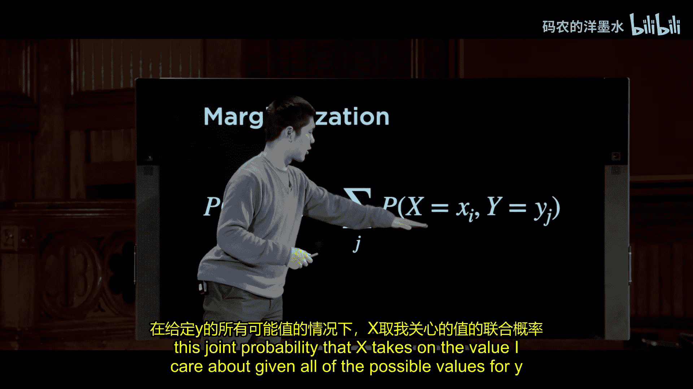

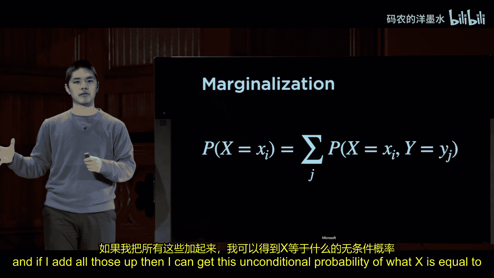

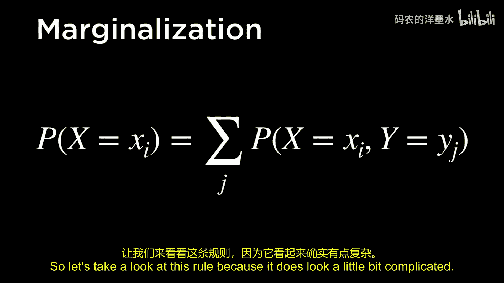

S by。 So let's take a look at this rule because it does look a little bit complicated。

 Let's try and put a concrete example to it Here again， is that same joint distribution from before。

 I have cloud， not cloudy， rainy， not rainy， and maybe I want to access some variable。

 I want to know what is the probability that it is cloudy。Well。

 marginalization says that if I have this joint distribution and I want to know， like。

 what is the probability that it is cloudy， will I need to consider the other variable。

 the variable that's not here， the idea that it's raining， and I consider the two cases。

 either it's raining or it's not raining， And I just sum up the values for each of those possibilities。

In other words， the probability that it is cloudy is equal to the sun。

Of the probability that it's cloudy and it's rainy。😡，And the probability that it's cloudy。

 and it is not。😡，R it。And so these now are values that I have access to。

 These are values that are just inside of this joint probability table。

 What is the probability that it is both cloudy and rainy。 Well。

 it's just the intersection of these two here， which is 0。08。

 And the probability that it's cloudy and not raining。 is all right。 Here's cloudy。

 Here's not raining。 It's 0。32。 So it's 008 plus 。32， which just gives us equal to 0。4。

 That is the unconditional probability that it is， in fact， cloudy。

 And so marginalization gives us a way to go from these joint distributions to just some individual probability that I might care about。

 And you'll see a little bit later why it is that we care about that and why that's actually useful to us as we begin doing some of these calculations。

😊，Last rule we'll take a look at before transitioning to something a little bit different is this rule of conditioning。

 very similar to the marginalization rule， but it says that again， if I have two events A and B。

 but instead of having access to their joint probabilities。

 I have access to their conditional probabilities， how they relate to each other Well， again。

 if I want to know the probability that A happens and I know that there's some other variable B。

 either B happens or B doesn't happen And so I can say that the probability of a is the probability of a given B times the probability of B。

 meaning B happened， and given that I know B happened， what's the likelihood that A happened。

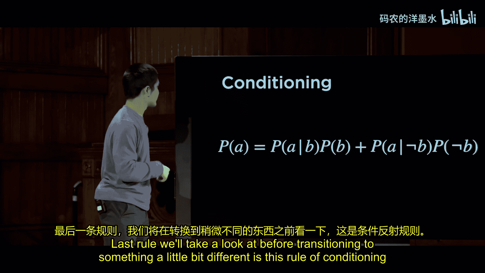

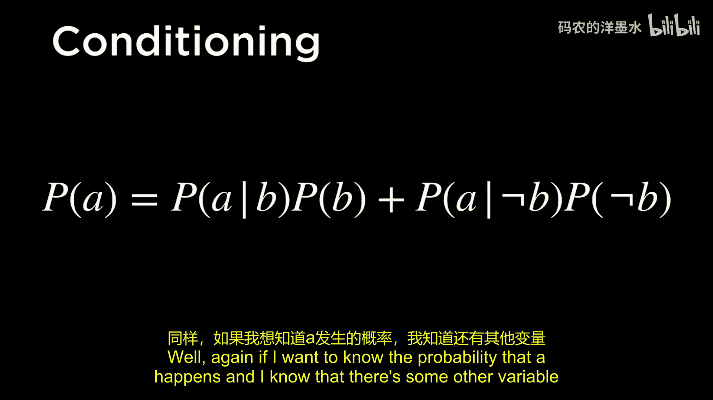

And then I consider the other case that B didn't happen。

 So here's the probability that B didn't happen。 and here's the probability that A happens。

 given that I know that B didn't happen。 And this is really the equivalent rule just using conditional probability instead of joint probability where I'm saying。

 let's look at both of these two cases and condition on B。

 look at the case where B happens and look at the case where B doesn't happen and look at what probabilities I get as a result。

 And just as in the case of marginalization where there was an equivalent rule for random variables that could take on multiple possible values in a domain of possible values here。

 too， conditioning has the same equivalent rule。 again， there's a summation。

 to mean I'm summing over all of the possible values that some random variable y could take on But if I want to know what is the probability that X takes on this value。

 Then I'm going to sum up over all the values J that Y could take on and say， allright。

 what's the chance that Y takes on that value， Yj and multiply it by the conditional probability that X takes。

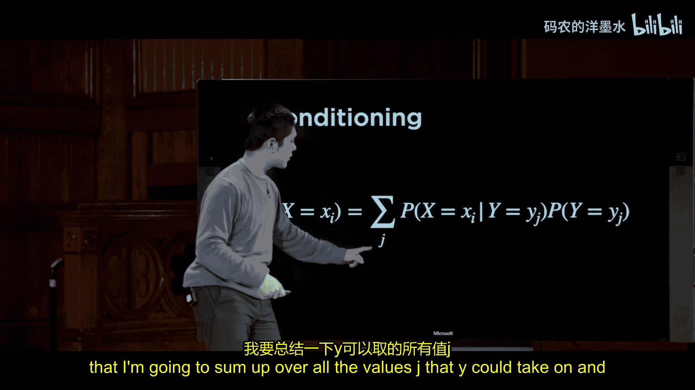

On this value， given that Y took on that value， Y J。 So equivalent rule。

 just using conditional probabilities instead of joint probabilities and using the equation we know about joint probabilities。

 we can translate between these two。

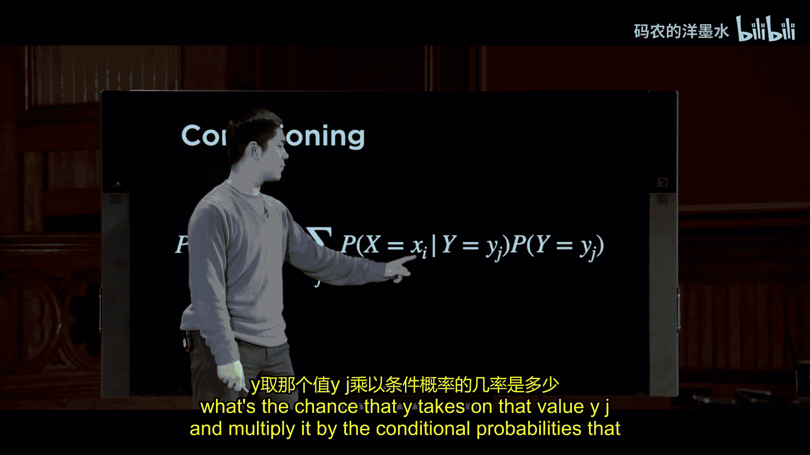

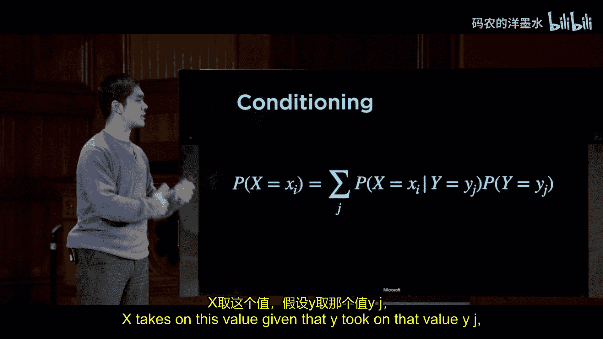

So all right， we've seen a whole lot of mathematics and we've just sort of laid the foundation for mathematics。

 and no need to worry if you haven't seen probability in too much detail up until this point。

 these are sort of the foundations of the ideas that are going to come up as we begin to explore how we can now take these ideas from probability and begin to apply them to represent something inside of our computer。

 something inside of the AI agent we're trying to design that is able to represent information and probabilities and the likelihoods between various different events。

 So there are a number of different probabilistic models that we can generate But the first of the models we're going to talk about are what are known as Bayesian networks and a Bayesian network is just going to be some network of random variables。

 connected random variables that are going to represent the dependence between these random variables that odds are most random variables in this world are not independent from each other that there's some relationship between things that are happening that we care about if it is rainy today that might increase the likelihood that my flight or my train gets。

😊。

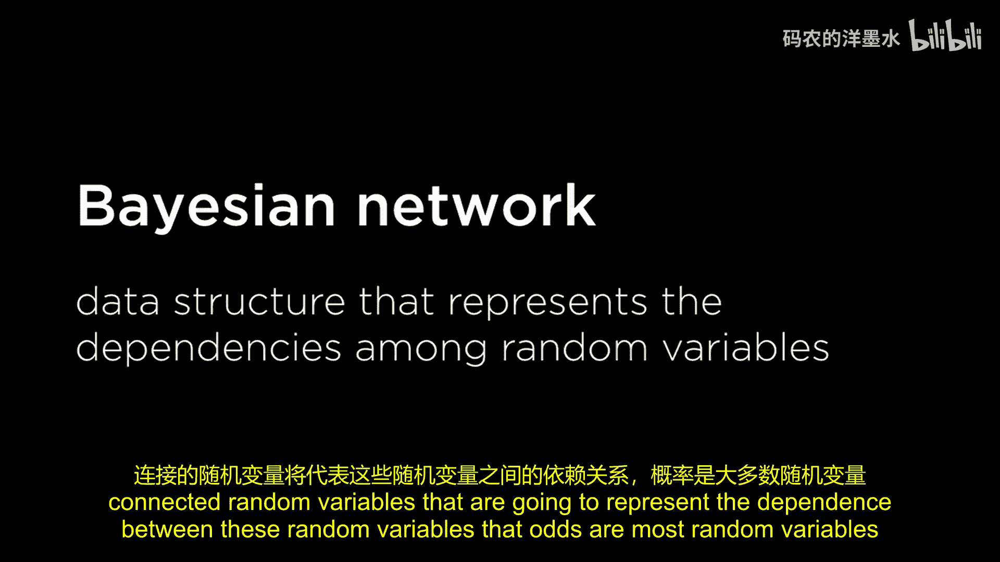

Delayed， for example， there is some dependence between these random variables and a Bayesian network is going to be able to capture those dependencies。

So what is a Bayesian network， What is its actual structure and how does it work， Well。

 a Bayessian network is going to be a directed graph。 And again， we've seen directed graphs before。

 They are individual nodes with arrows or edges that connect one node to another node。

 pointing in a particular direction。And so this directed graph is going to have nodes as well。

 where each node in this directed graph is going to represent a random variable。

 something like the weather or something like whether my train was on time or delayed。

And we're going to have an arrow from a node X to a node y to mean that x is a parent of y。

 So that'll be our notation。 If there's an arrow from x to y。

 X is going to be considered a parent of y。 And the reason that's important。

 is because each of these nodes is going to have a probability distribution that we're going to store along with it。

 which is the distribution of x， given some evidence， given the parents of X。

 So the way to more intuitively think about this is that the parents seem to be thought of as sort of causes for some effect that we're going to observe。

And so let's take a look at an actual example of a Bayesian network and think about the types of logic that might be involved in reasoning about that network。

 Let's imagine for a moment that I have an appointment out of town。

 and I need to take a train in order to get to that appointment。

 So what are the things I might care about， Will I care about， you。

 getting to my appointment on time， Either I make it to my appointment that I'm able to attend it or I miss the appointment。

 And you might imagine that that's influenced by the train that the train is either on time or it's delayed。

 for example。But that train itself is also influenced。 whether the train is on time or not。

 depends maybe on the rain。 You know， is there no rain， I it light rain， iss there heavy rain。

 and it might also be influenced by other variables， too。

 It might be influenced as well by whether or not theres maintenance on the train track， for example。

 if there is maintenance on the train track that probably increases the likelihood that my train is delayed。

 And so we can represent all of these ideas using a Bayesian network that looks a little something like this。

 here I have four nodes representing four random variables that I would like to keep track of I have one random variable called rain that can take on three possible values in its domain。

 either none or light or heavy for no rain light rain or heavy rain。

 I have a variable called maintenance for whether or not there is maintenance on the train track。

 which it has two possible values， just either yes or no。

 either there is maintenance or there's no maintenance happening on the track。

 Then I have a random variable for the train indicating whether or not the train was on time or not。

 That random variable has two possible values in its domain。😊。

The train is either on time or the train is delayed。And then finally。

 I have a random variable for whether I make it to my appointment for my appointment down here。

 I have a random variable called appointment that itself has two possible values。

 attend and miss And so here are the possible values here are my four nodes。

 each of which represents a random variable， each of which has a domain of possible values that it can take on and the arrows。

 the edges pointing from one node to another in some notion of dependence inside of this graph that whether I make it to my appointment or not。

 is dependent upon whether the train is on time or delayed。

 and whether the train is on time or delayed is dependent on two things given by the two arrows pointing at this node。

 it is dependent on whether or not there was maintenance on the train track and it is also dependent upon whether or not it was raining or whether it is raining。

😊，And just to make things a little complicated， let's say as well。

 that whether or not theres maintenance on the track。

 this too might be influenced by the rain that if there's heavier rain， well。

 maybe it's less likely that it's going to be maintenance on the train track that day because they're more likely to want to do maintenance on the track on days when it's not raining。

 for example。 And so these nodes might have different relationships between them。

 But the idea is that we can come up with a probability distribution for any of these nodes based only upon its parents。

And so let's look node by node at what this probability distribution might actually look like。

 And we'll go ahead and begin with this root node。 this rain node here。

 which is at the top and has no arrows pointing into it。

 which means its probability distribution is not going to be a conditional distribution。

 It's not based on anything。 I just have some probability distribution over the possible values for the rain random variable。

And that distribution might look a little something like this。 None， light and heavy。

 each have a possible value Here， I'm saying the likelihood of no rain is 07 of light rain is 0。

2 of heavy rain is 0。1。 for example。 So here is a probability distribution for this root node in this Bayesian network。

And let's now consider the next node in the network。 maintenance。 track maintenance is yes or no。

 And the general idea of what this distribution is going to encode， at least in this story。

 is the idea that the heavier the rain is the less likely it is that there's going to be maintenance on the track because the people that are doing maintenance on the track probably want to wait until a day when it's not as rainy in order to do the track maintenance。

 for example， And so what might that probability distribution look like。

 Well this now is going to be a conditional probability distribution。

 that here the three possible values for the rain， R and variable。

 which I'm here just going to abbreviate to R， either no rain， light rain or heavy rain。

And for each of those possible values， either there is yes track maintenance or no track maintenance。

 and those have probabilities associated with them that I see here that if if it is not raining。

 then there is a probability of 0。4 that there's track maintenance and a probability of 0。

6 that there isn't。 but if there's heavy rain， then here。

 the chance that there is track maintenance of 0。1 and the chance that there is not track maintenance is 0。

9。 each of these rows is going to sum up to one because each of these represent different values of whether or not it's raining。

 the three possible values of that random variable can take on and each is associated with its own probability distribution that is ultimately all going to add up to the number one。

So that there is our distribution for this random variable called maintenance about whether or not there is maintenance on the train track。

And now let's consider the next variable here we have a node inside of our Bayesia network called train that has two possible values on time and delayed。

 And this node is going to be dependent upon the two nodes that are pointing towards it that this whether or not the train is on time or delayed。

 depends on whether or not there's track maintenance， and it depends on whether or not there's rain。

 that heavier rain probably means more likely that my train is delayed。

And if there is track maintenance， that also probably means it's more likely that my train is delayed as well。

 And so you could construct a larger probability distribution。

 a conditional probability distribution that instead of conditioning on just one variable。

 as was the case here， is now conditioning on two variables。

 conditionitioning both on rain represented by R and on maintenance represented by yes， again。

 each of these rows has two values that sum up to the number one。

 one for whether the train is on time， one for whether the train is delayed。😊。

And here I can say something like， allright， if I know there was light rain and track maintenance。

 Well， okay， that would be R is light and M is yes。 Well， then there is a probability of 0。

6 that my train is on time and a probability of 0。4， the train is delayed。

 And you can imagine gathering this data just by looking at real worldor data looking at data about。

 allright， if I knew that it was light rain and there was track maintenance。

 How often was a train delayed or not delayed。 And you could begin to construct this thing。

 But the interesting thing is intelligently being able to try to figure out how might you go about ordering these things。

 What things might influence other nodes inside of this Baysian network。😊。

And the last thing I care about is whether or not I make it to my appointment so did I attend or miss the appointment and ultimately whether I attend or miss the appointment。

 you it is influenced by track maintenance because it's indirectly this idea that right if there is track maintenance well then my train might more likely be delayed and if my train is more likely to be delayed。

 then I'm more likely to miss my appointment， but what we encode in this Bayesian network are just what we might consider to be more direct relationship。

 the train has a direct influence on the appointment and given that I know whether the train is on time or delayed knowing whether there's track maintenance isn't going to give me any additional information that I didn't already have that if I know train these other nodes that are up above isn't really going to influence the result。

And so here we might represent it using another conditional probability distribution that looks a little something like this。

 The train can take on two possible values。 Either my train is on time or my train is delayed。

 And for each of those two possible values， I have a distribution for what are the odds that I'm able to attend the meeting and what are the odds that I miss the meeting。

 And obviously， if my train is on time。 I'm much more likely to be able to attend the meeting than if my train is delayed。

 in which case， I'm more likely to miss that meeting。😊。

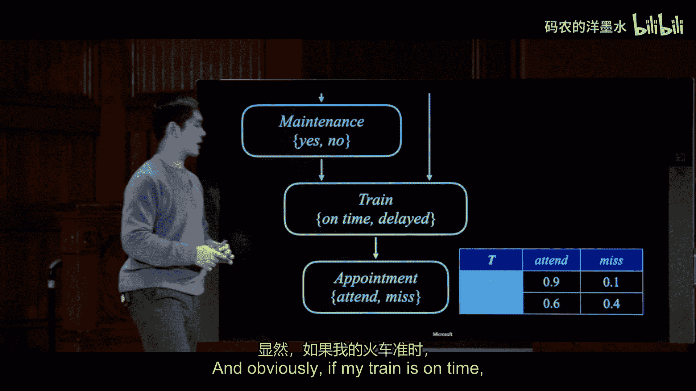

So all of these nodes put all together here represent this Bayesian network。

 this network of random variables whose values they ultimately care about and that have some sort of relationship between them。

 some sort of dependence where these arrows from one node to another。

 indicate some dependence that I can calculate the probability of some node。

 given the parents that happen to exist there。😡。

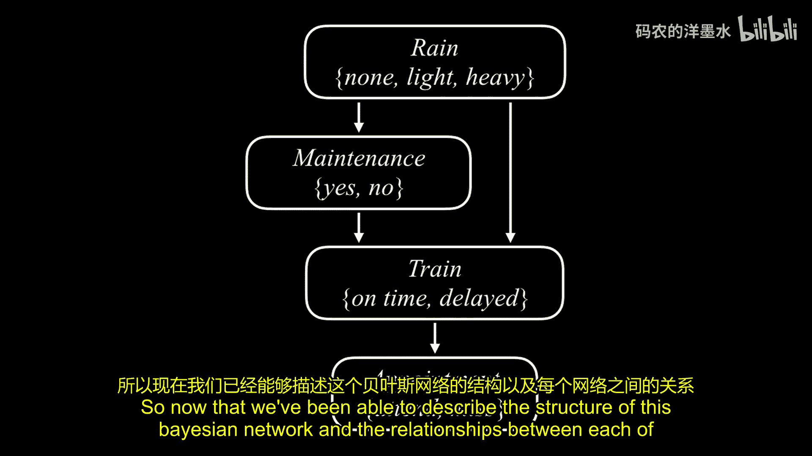

So now that we've been able to describe the structure of this Bayesian network and the relationships between each of these nodes by associating each of the nodes in the network with a probability distribution。

 whether that's an unconditional probability distribution in the case of this root node here like rain and a conditional probability distribution in the case of all of the other nodes whose probabilitybabilities are dependent upon the values of their parents。

 we can begin to do some computation and calculation using the information inside of that table。

 So let's imagine， for example， that I just wanted to compute something simple。

 like the probability of light rain。 how would I get the probability of light rain。 Well。

 light rain Ra here is a root node And so if I wanted to calculate that probability I could just look at the probability distribution for rain and extract from it。

 the probability of light rain。 just a single value that I already have access to。😊。

But we could also imagine wanting to compute more complex joint probabilities。

 like the probability that there is light rain and also no track maintenance。

 This is a joint probability of two values。 light rain and no track maintenance。

 and the way I might do that is first by starting by saying， all right。

 well let me get the probability of light rain。 but now I also want the probability of no track maintenance。

 but of course， this node is dependent upon the value of rain。

 So what I really want is the probability of no track maintenance。

 given that I know that there was light rain。 And so the expression for calculating this idea that the probability of light rain and no track maintenance is really just the probability of light rain and the probability that theres no track maintenance。

 given that I know that there already is light rain。

 So I take the unconditional probability of light rain multiply it by the conditional probability of no track maintenance。

 given that I know that there's light rain。😊，And you can continue to do this again and again for every variable that you want to add into this joint probability that I might want to calculate。

 if I wanted to know the probability of light rain and no track maintenance and a delayed train。

 well， that's going to be the probability of light rain multiplied by the probability of no track maintenance。

 given light rain multiplied by the probability of a delayed train given light rain and no track maintenance。

 because whether the train is on time or delayed is dependent upon both of these other two variables。

 And so I have two pieces of evidence that go into the calculation of that conditional probability。

 And each of these three values is just a value that I can look up by looking at one of these individual probability distributions that is encoded into my Bayesian network。

😊，And if I wanted a joint probability over all four of the variables。

 something like the probability of light rain and no track maintenance and a delayed train。

 And I miss my appointment。 Well， that's going to be multiplying four different values。

 one from each of these individual nodes， it's going be the probability of light rain。

 then of no track maintenance， given light rain， then of a delayed train。

 given light rain and no track maintenance。 And then finally。

 for this node here for whether I make it to my appointment or not。

 it's not dependent upon these two variables， given that I know whether or not the train is on time。

 I only need to care about the conditional probability that I miss my train。

 that I miss my appointment， given that the train happens to be delayed。

 And so that's represented here by four probabilities。

 each of which is located inside of one of these probability distributions for each of the nodes。

 all multiplied together。😊，And so I can take a variable like that and figure out what the joint probability is by multiplying a whole bunch of these individual probabilities from the Bayesia network。

😡，But of course， just as with last time where what I really wanted to do was to be able to get new pieces of information here。

 too。 this is what we're going to want to do with our Bayesian network in the context of knowledge。

 we talked about the problem of inference， given things that I know to be true。

 Can I draw conclusions， make deductions about other facts about the world that I also know to be true。

 and what we're going to do now is apply the same sort of idea to probability。

 using information about which I have some knowledge， whether some evidence or some probabilities。

 can I figure out not other variables for certain， but can I figure out the probabilities of other variables taking on particular values。

 and so here we introduce the problem of inference in a probabilistic setting in a case where variables might not necessarily be true for sure。

 but they might be random variables that take on different values with some probability。

So how do we formally define what exactly this inference problem actually is。 Well。

 the inference problem has a couple of parts to it。 We have some query。

 some variable X that we want to compute the distribution for。

 Maybe I want the probability that I miss my train。

 or I want the probability that there is track maintenance， something that I want information about。

 And then I have some evidence variables， Maybe it's just one piece of evidence。

 Maybe it's multiple pieces of evidence， but I've observed certain variables for some sort of event。

 So， for example， I might have observed that it is raining。 This is evidence that I have。

 I know that there is light rain， or I know that there is heavy rain， and that is evidence I have。

 And using that evidence。 I want to know what is the probability that my train is delayed。

 for example。And that is a query that Im to ask based on this evidence。 So I have a query。

 some variable， evidence， which are some other variables that I have observed inside of my Bayesian network。

 And， of course， that does leave some hidden variables。

 Why these are variables that are not evidence variables and not query variables。

 So you might imagine in the case where I know whether or not it's raining。

 and I want to know whether my train is going to be delayed or not， the hidden variable。

 the thing I don't have access to is something like is there maintenance on the track or am I going to make or not make my appointment。

 for example， these are variables that I don't have access to， they're hidden。

Because they're not things I observed， and they're also not the query。 The thing that I'm asking。

 And so ultimately， what we want to calculate。AsI want to know the probability distribution of X given E。

 the event that I observed。 So given that I observe some event， I observe that it is raining。

 I would like to know what is the distribution over the possible values of the train random variable。

 as it on time。 Is it delayed What's the likelihood。 It's going to be there。

 And it turns out we can do this calculation just using a lot of the probability rules that we've already seen in action。

 And ultimately， we're gonna take a look at the math at a little bit of a high level at an abstract level。

 But ultimately， we can allow computers and programming libraries that already exist to begin to do some of this math for us。

 But it's good to get a general sense for what's actually happening when this inference process takes place。

 Let's imagine， for example， that I want to compute the probability distribution of the appointment random variable。

 given some evidence。 given that I know that there was light rain and no track maintenance。

 So there's my evidence。 these two variables that I observe the values of。

 I observe the value of rain。 I know there's light rain。 And I know that there is no。😊。

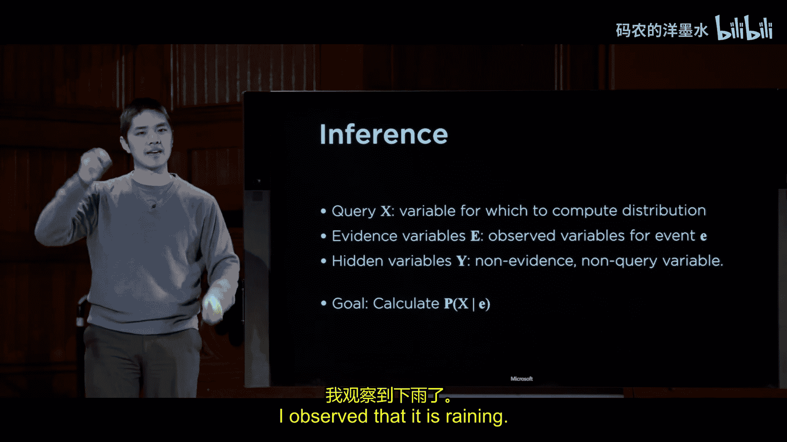

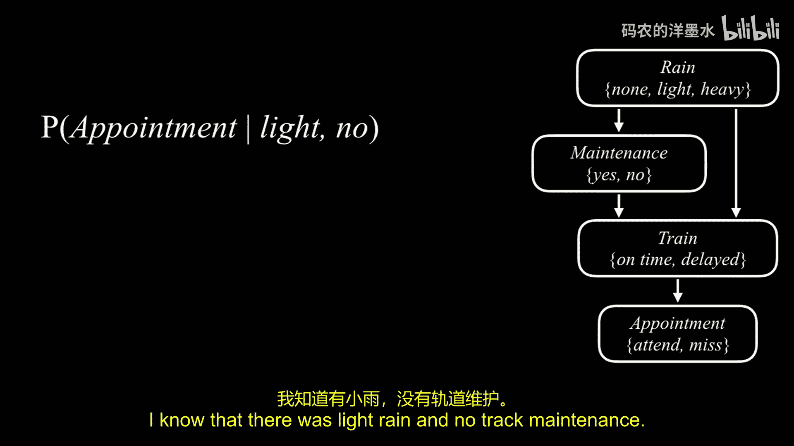

Maintenance going on today。 And what I care about knowing my query is this random variable appointment。

 I want to know the distribution of this random variable appointment。

 Like what is the chance that I am able to attend my appointment。

 What is the chance that I miss my appointment given this evidence and the hidden variable。

 the information that I don't have access to is this variable train。

 This is information that is not part of the evidence that I see， not something that I observe。

 But it is also not the query that I' am asking for。

And so what might this inference procedure look like Well。

 if you recall back from when we' were defining conditional probability and doing math with conditional probabilities。

 we know that a conditional probability is proportional to the joint probability。

 And we remember this by recalling that the probability of a given B is just some constant factor alpha multiplied by the probability of a and B。

 that constant factor alpha turns out to be like dividing over the probability of B。

 but the important thing is that it's just some constant multiplied by the joint distribution。

 the probability that all of these individual things happen。 So in this case。

 I can take the probability of the appointment random variable given light rain and no track maintenance and say that is just going to be proportional some constant alpha multiplied by the joint probability。

 the probability of a particular value for the appointment random variable and light rain and no track maintenance。

😊，Well， all right， how do I calculate this probability of appointment and light rain and no track maintenance when what I really care about is knowing like I need all four of these values to be able to calculate a joint distribution across everything because in particular appointment depends upon the value of train。

Well， in order to do that， here I can begin to use that marginalization trick that there are only two ways I can get any configuration of an appointment。

 light rain and no track maintenance。 either this particular setting of variables happens and the train is on time or this particular setting of variables happens and the train is delayed。

 those are two possible cases that I would want to consider。

 And if I add those two cases up well then I get the result just by adding up all of the possible for the hidden variable or variables if there are multiple。

 But since there's only one hidden variable here， train。

 all I need to do is iterate over all the possible values for that hidden variable train and add up their probabilities。

😊。

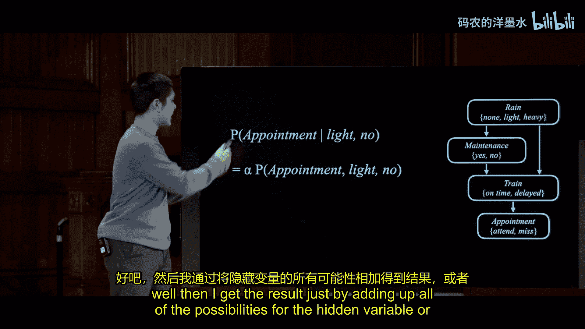

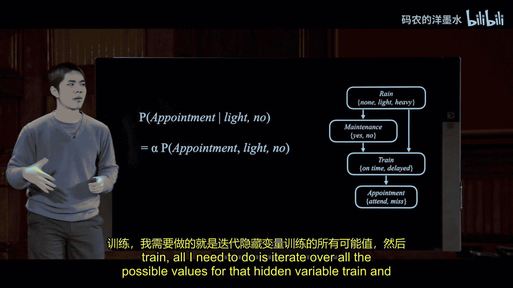

So this probability expression here becomes probability distribution over appointment， light。

 no rain and train is on time， and the probability distribution over the appointment， light rain。

 no track maintenance and that the train is delayed for example。

 So I take both of the possible values for train。 go ahead and add them up。

 These are just joint probabilities that we saw earlier， how to calculate just by going parent。

 parent， parent， parent and calculating those probabilities and multiplying them together。

 And then you'll need to normalize them at the end。

 speaking at a high level to make sure that everything adds up to the number one。😊。

So the formula for how you do this in a process known as inference by enumeration looks a little bit complicated。

 but ultimately， it looks like this。 And let's now try to distill what it is that all of these symbols actually mean。

 Let's start here。 What I care about knowing is the probability of X， my query variable。

 given some sort of evidence。 What do I know about conditional probabilities will a conditional probability is proportional to the joint probability。

 So with some alpha， some normalizing constant multiplied by this joint probability of x and evidence。

😊。

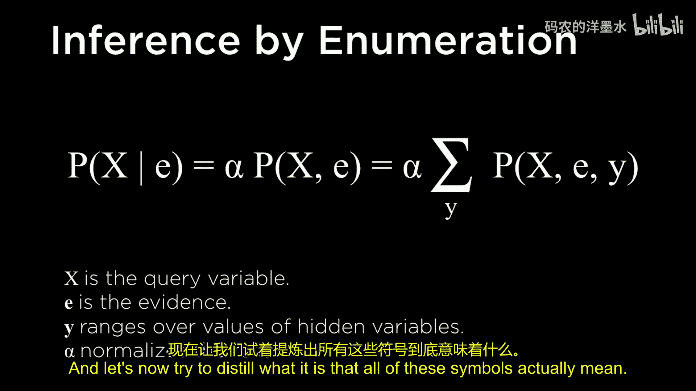

And how do I calculate that， Well， to do that， I'm going to marginalize over all of the hidden variables。

 all the variables that I don't directly observe the values for。

 I'm basically going to iterate over all of the possibilities that it could happen and just sum them all up。

 And so I can translate this into a sum over all Y。

 which ranges over all the possible hidden variables and the values that they could take on。

And adds up all of those possible individual probabilities。

 and that is going to allow me to do this process of inference by enumeration。

 Now ultimately it's pretty annoying if we as humans have to do all of this math for itself for ourselves。

 but turns out this is where computers and AI can be particularly helpful that we can program a computer to understand a Bayesian network to be able to understand these inference procedures and to be able to do these calculations and using the information you've seen here。

 you could implement a Bayesian network from scratch yourself。

 but turns out there are a lot of libraries， especially written in Python that allow us to make it easier to do this sort of probabilistic inference to be able to take a Bayesian network and do these sorts of calculations so that you don't need to know and understand all of the underlying math though it's helpful to have a general sense for how it works。

 but you just need to be able to describe the structure of the network and make queries in order to be able to produce the result。

😊。

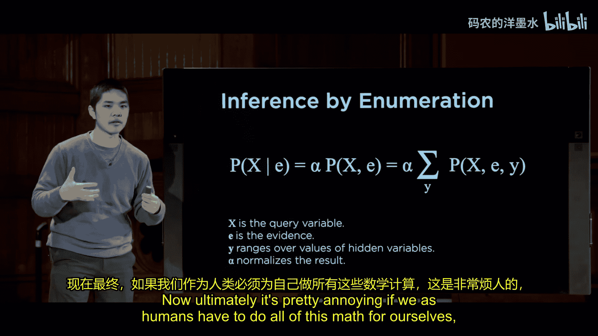

And so let's take a look at an example of that right now。

 It turns out that there are a lot of possible libraries that exist in Python for doing the sort of inference。

 It doesn't matter too much which specific library use they all behave in fairly similar ways。

 But the library I'm going to use here is one known as pomegranate。 And here inside of model dot pi。

 I have defined a Bayesian network， just using the structure in the syntax of the pomegranate library expects。

 And what I'm effectively doing is just in Python creating nodes to represent each of the nodes of the Bayesia network that you saw me describe a moment ago。

 So here on line for after I've imported pomegranate。

 I'm defining a variable called rain that is going to represent a node inside of my Bayessia network。

 It's going to be a node that follows this distribution。

 where there are three possible values none for no rain， light for light rain， heavy for heavy rain。

 And these are the probabilities of each of those taking place。7 is the likelihood of no rain 。

2 for light rain。😊。

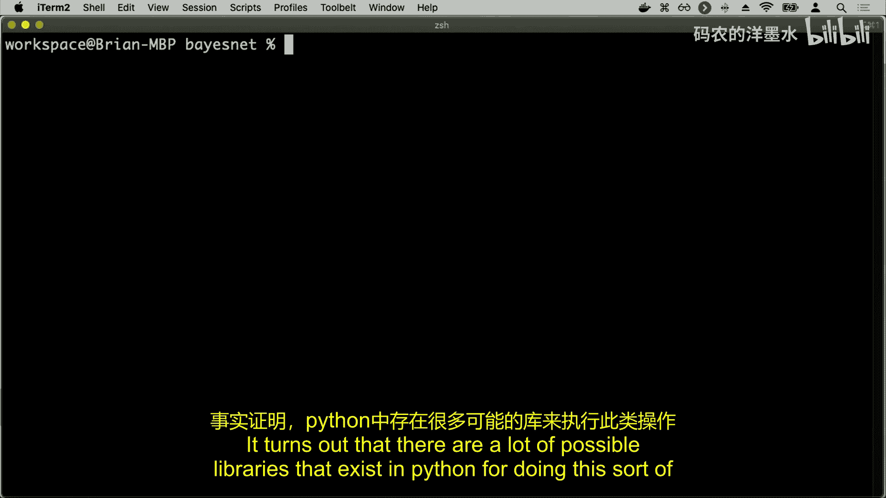

Poin1 for heavy rain。Then after that， we go to the next variable， the variable for track maintenance。

 for example， which is dependent upon that rain variable and this instead of being an unconditional distribution is a conditional distribution。

 as indicated by a conditional probability table here and the idea is that I'm following this is conditional on the distribution of rain So if there is no rain then the chance that there is yes track maintenance is 0。

4， if there's no rain， the chance that there is no track maintenance is 0。6 likewise for light rain。

 I have a distribution for heavy rain， I have a distribution as well。

 but I'm effectively encoding the same information you saw represented graphically a moment ago。

 but I'm telling this python program， that the maintenance node obeys this particular conditional probability distribution。

 and we do the same thing for the other random variables as well train was a node inside my distribution that was a conditional probability table with two parents。

 it was dependent not only on rain but also on track maintenance。

 and so here I'm saying something like。😊，Given that there is no rain and yes， track maintenance。

 the probability that my train is on time is 0。8， and the probability that it's delayed is 0。2。

 And likewise， I can do the same thing for all of the other possible values of the parents of the train node inside of my Bayesian network by saying for all of those possible values。

 here is the distribution that the train node should follow。

And I do the same thing for an appointment based on the distribution of the variable train。

Then at the end， what I do is actually construct this network by describing what the states of the network are and by adding edges between the dependent nodes。

 So I create a new Bayesian network， add states to it， one for rain， one for maintenance。

 one for the train， one for the appointment。 and then I add edges connecting the related pieces。

 Rain has an arrow to maintenance because rain influences track maintenance。

 Rain also influences the train。 maintenance also influences the train and train influences whether I make it to my appointment and B just finalizes the model and does some additional computation So the specific syntax of this is not really the important part。

 Pomegra it just happens to be one of several different libraries that can all be used for similar purposes。

 and you could describe describe and define a library for yourself that implemented similar things。

 But the key idea here is that someone can design a library for a general Bayesian network that has nodes that are based upon its parents。

 and then all programmer needs to do using one of those libraries is to define what those nodes and what those。

😊，Probability distributions R， and we can begin to do some interesting logic based on it。

So let's try doing that like conditional or joint probability calculation that we saw us do by hand before by going into likelihood Dpi where here I'm importing the model that I just define a moment ago and here I'd just like to calculate modeled up probability which calculates the probability for a given observation and I'd like to calculate the probability of no rain no track maintenance my train is on time and I'm able to attend the meeting So sort of the optimal scenario that there' is no rain and no maintenance on the track。

 my train is on time and I'm able to attend the meeting。

 what is the probability that all of that actually happens and I can calculate that using the library and just print out its probability。

😊。

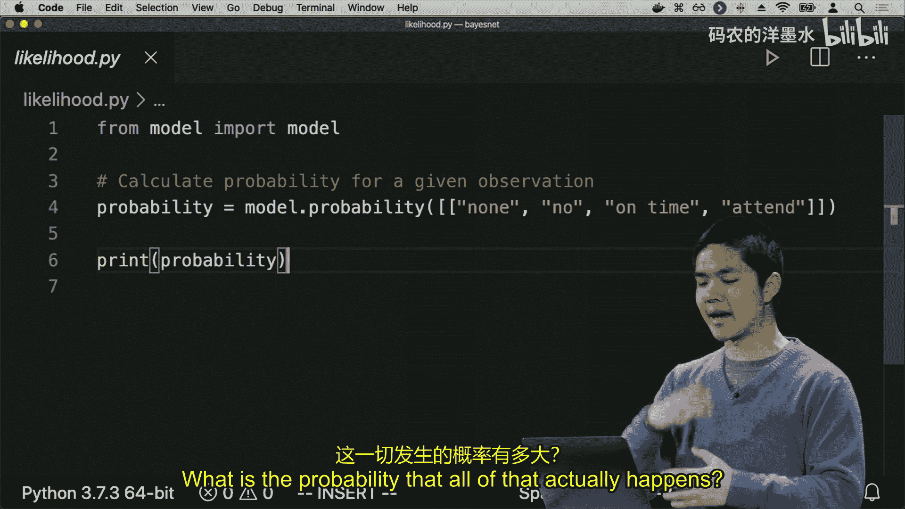

And so I'll go ahead and run Python of likelihood dot pi。And I see that， okay。

 the probability is about 0。34。 So about a third of the time。

 everything goes right for me in this case， No rain， no track maintenance train is on time。

 and I'm able to attend the meeting。 But I could experiment move with this。

 try and calculate other probabilities as well。 What's the probability that everything goes right up until the train。

 But I still miss my meeting。 So no rain， no track maintenance train is on time。

 but I miss the appointment。 Let's calculate that probability。 And right。

 that has a probability of about 0。04。 So about 4% of the time。 The train will be on time。

 There won't be any rain。 no track maintenance。 And yet I'll still miss the meeting。

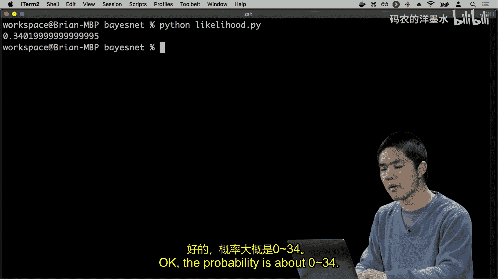

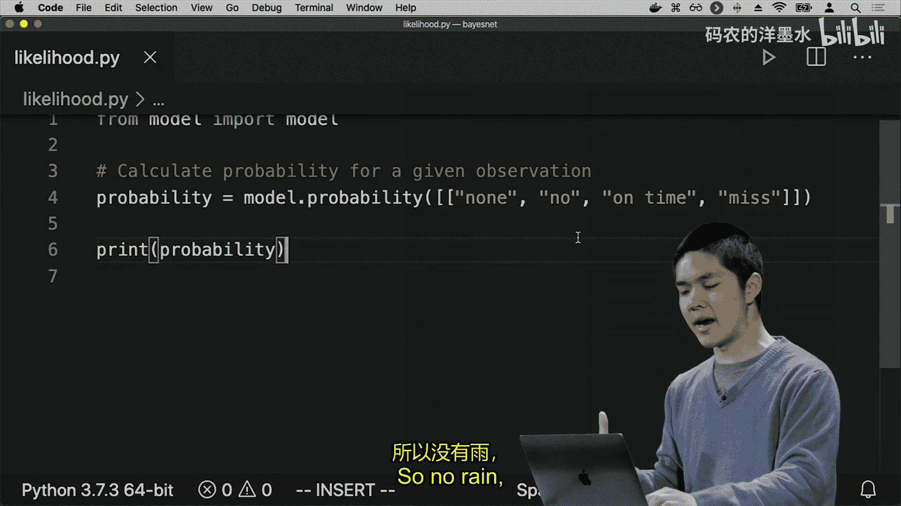

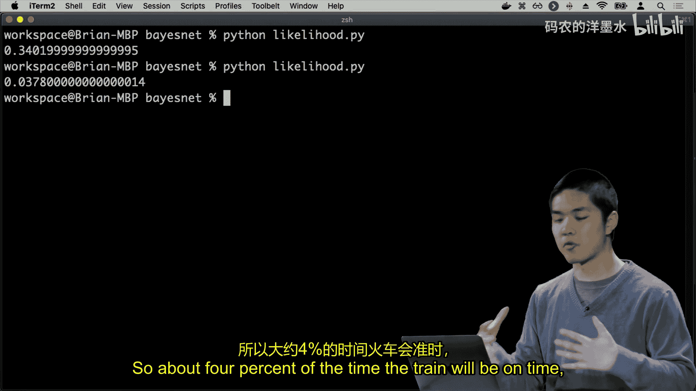

And so this is really just an implementation of the calculation of the joint probabilities that we did before。

 What this library is likely doing is first figuring out the probability of no rain。

 then figuring out the probability of no track maintenance， given no rain。

 then the probability that my train is on time， given both of these values and then the probability that I miss my appointment。

 given that I know that the train was on time。 So this again。

 is the calculation of that joint probability。 And turns out we can also begin to have our computer solve inference problems as well。

 to begin to infer based on information， evidence that we see what is the likelihood of other variables also being true。

😊，So let's go into inference do Pi， for example， where here I'm again importing that exact same model from before。

 importing all the nodes and all the edges and the probability distribution that is encoded there as well。

And now there's a function for doing some sort of prediction。 And here into this model。

 I pass in the evidence that I observe。 So here I've encoded into this Python program。

 the evidence that I have observed。 I have observed the fact that the train is delayed。

 and that is the value for one of the four random variables inside of this Bayesian network。

 and using that information， I would like to be able to draw inspiration and figure out inferences about the values of the other random variables that are inside of my Bayesian network。

 I would like to make predictions about everything else。

 So all of the actual computational logic is happening in just these three lines where I'm making this call to this prediction down below。

 I'm just iterating over all of the states and all the predictions and just printing them out so that we can visually see what the results are。

 But let's find out given the train is delayed。 what can I predict about the values of the other random variables。

😊。

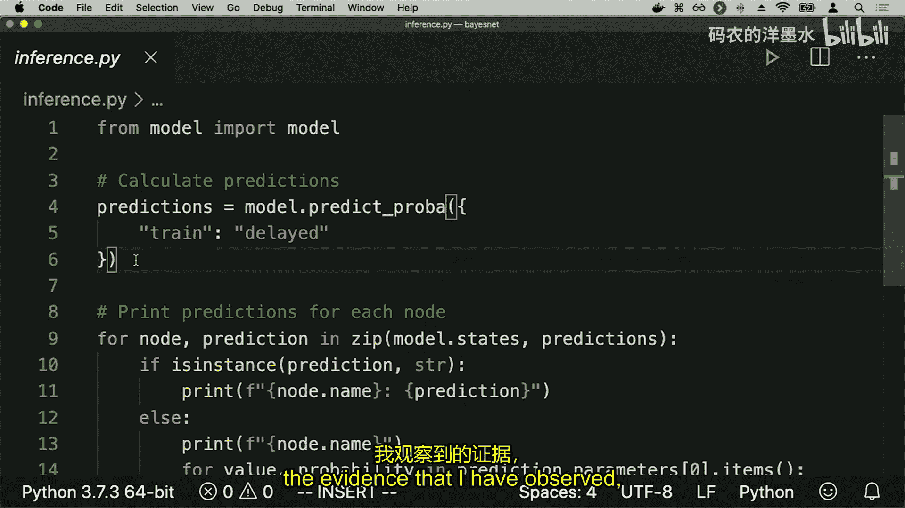

Let's go ahead and run Python inferencefer and。pi。I run that。 And all right。

 here is the result that I get。 Given the fact that I know that the train is delayed。

 This is evidence that I have observed， Well， given that there is a 45% chance or a 46% chance that there was no rain。

 a 31% chance there was light rain， a 23% chance it was heavy rain。

 I can see a probability distribution of a track maintenance and a probability distribution over whether I' am able to attend or miss my appointment。

 Now， we know that whether I attend or missed the appointment。

 that is only dependent upon the train being delayed or not delayed。

 It shouldn't depend on anything else。 So let's imagine， for example。

 that I knew that there was heavy rain。 that shouldn't affect the distribution for making the appointment。

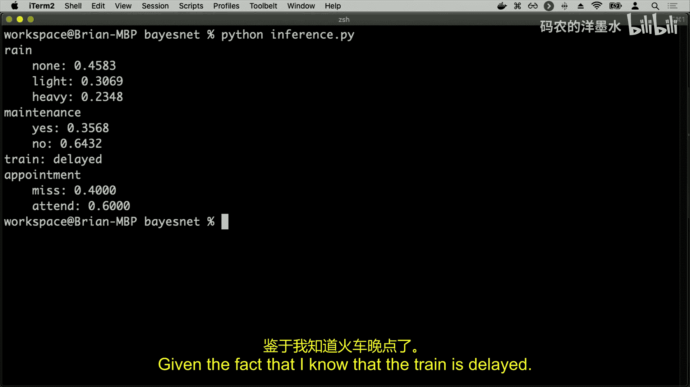

And indeed， if I go up here and add some evidence， say that I know that the value of rain is heavy。

 That is evidence that I now have access to。 I now have two pieces of evidence。

 I know that the rain is heavy， and I know that my train is delayed。

 I can calculate the probability by running this inference procedure again and seeing the result。

I know that the rain is heavy。 I know my train is delayed。

 The probability distribution for track maintenance changed。

 given that I know that there's heavy rain， now it's more likely that there's no track maintenance。

88% as opposed to 64% from here before。And now， what is the probability that I make the appointment。

 Well， that's the same as before。 It's still going to be attend the appointment with probability 0。6。

 missed the appointment with probability 0。4， because it was only dependent upon whether or not my train was on time or delayed。

 And so this here is implementing that idea of that inference algorithm to be able to figure out based on the evidence that I have。

 what can we infer about the values of the other variables that exist as well。

 So inference by enumeration is one way of doing this inference procedure。

 just looping over all of the values。 the hidden variables could take on and figuring out what the probability is。

Now， it turns out this is not particularly efficient。

 and there are definitely optimizations you can make by avoiding repeated work。

 if you're calculating the same sort of probability multiple times。

 there are ways of optimizing the program to avoid having to recalculate the same probabilities again and again。

 But even then as the number of variables get large as the number of possible values of variables could take on get large。

 we're going to start to have to do a lot of computation。

 a lot of calculation to be able to do this inference。 And at that point。

 it might start to get unreasonable in terms of the amount of time that it would take to be able to do this sort of exact inference。

 And it's for that reason that oftentimes when it comes towards probability and things we're not entirely sure about。

 we don't always care about doing exact inference and knowing exactly what the probability is。

 But if we can approximate the inference procedure， do some sort of approximate inference。

 that that can be pretty good as well。 that if I don't know the exact probability。

 but I have a general sense for the probability that I can get increasingly accurate with more time。

 that that's probably。😊，Pretty good， especially if I can get that to happen even faster。😡。

So how could I do approximate inference inside of a Bayesian network？ Well。

 one method is through a procedure known as sampling in the process of sampling。

 I'm going to take a sample of all of the variables inside of this Bayesian network here。

 and how I'm going to sample。 Well， I'm going to sample one of the values from each of these nodes。

 according to their probability distribution。So how might I take a sample of all these nodes。

 Well I'll start at the root。 I'll start with rain。 Here's the distribution for rain。

 and I'll go ahead and using a random number generator or something like it。

 randomly pick one of these three values。 I'll pick none with probability 。7。

 light with probability 。2 and heavy with probability 。1。 So I'll randomly just pick one of them。

 according to that distribution。 And maybe in this case， I pick none， for example。😊。

Then I do the same thing for the other variable。 Maintenance also as a probability distribution。

 And I'm going to sample。 Now there are three probability distributions here。

 but I'm only going to sample from this first row here because I've observed already in my sample。

 that the value of rain is none So given that rain is none。

 I'm going to sample from this distribution to say， all right。

 what should the value of maintenance be。 And in this case， maintenance is going to be。

 let's just say yes， which happens 40% of the time in the event that there is no rain， for example。😊。

And we'll sample all of the rest of the nodes in this way as well that I want to sample from the train distribution and I'll sample from this first row here where there is no rain。

 but there is track maintenance and I'll sample 80% of the time。 I'll say the train is on time。

20% of the time。 I'll say the train is delayed and finally we'll do the same thing for whether I make it to my appointment or not did I attend or miss the appointment。

 will'll sample based on this distribution and maybe say that in this case I attend the appointment。

 which happens 90% of the time when the train is actually on time。😊，So by going through these nodes。

 I can very quickly just do some sampling and get a sample of the possible values that could come up from going through this entire Bayesian network。

 According to those probability distributions。 And where this becomes powerful is if I do this not once。

 But I do this thousands or tens of thousands of times。

 and generate a whole bunch of samples all using this distribution。 I get different samples。

 maybe some of them are the same。 but I get a value。😊。

For each of the possible variables that could come up。And so then if I'm ever faced with a question。

 a question like what is the probability that the train is on time。

 you could do an exact inference procedure。 This is no different than the inference problem we had before。

 where I could just marginalize， look at all the possible other values of the variables and do the computation of inference by enumeration to find out this probability exactly。

😡，But I could also， if I don't care about the exact probability， just sample it。

 approximate it to get close。 And this is a powerful tool in AI。

 where we don't need to be right 100% of the time or we don't need to be exactly right。

 If we just need to be right with some probability， we can often do so more effectively。

 more efficiently。

And so here now are all of those possible samples。 I'll sort of highlight the ones where the train is on time。

 I'm ignoring the ones where the train is delayed。 And， you know， in this case。

 there's like 6 out of8 of the samples have the train is arriving on time。 And so maybe in this case。

 I can say that in six out of8 cases， that's the likelihood that the train is on time。

 And with8 samples， that might not be a great prediction。

 But if I had thousands upon thousands of samples。 then this could be a much better inference procedure to be able to do these sorts of calculations。

 So this is a direct sampling method to just do a bunch of samples and then figure out what the probability of some event is。

😊。

Now， this from before was an unconditional probability。

 What is the probability that the train is on time。

 And I did that by looking at all the samples and figuring out。

 right here are the ones where the train is on time。😡。

But sometimes what I want to calculate is not an unconditional probability。

 but rather a conditional probability， something like what is the probability that there is light rain given that the train is on time。

 something to that effect。 And to do that kind of calculation well what I might do。

Is。Here are all the samples that I have。 and I want to calculate a probability distribution。

 given that I know that the train is on time。 So to be able to do that。

 I can kind of look at the two cases where the train was delayed and ignore or reject them。

 sort of exclude them from the possible samples that I'm considering。

 And now I want to look at these remaining cases where the train is on time。

 here the cases where there's light rain。😊，And I say， okay。

 these are two out of the six possible cases that can give me an approximation for the probability of light rain。

 given the fact that I know the train was on time。 And I did that in almost exactly the same way。

 just by adding an additional step by saying that， all right， when I take each sample。

 let me reject all of the samples that don't match my evidence and only consider the samples that do match what it is that I have in my evidence。

That I want to make some sort of calculation about。

And it turns out using the libraries that we've had for Bayesia networks。😡。

We can begin to implement this same sort of idea like implement rejection sampling。

 which is what this method is called to be able to figure out some probability。

 not provide direct inference， but instead by sampling So what I have here is a program called sample that pi imports the exact same model and what I define first is a program to generate a sample and the way I generate a sample is just by looping over all of the states the states need to be in some sort of order to make sure I'm looping in the correct order。

 but effectively if it is a conditional distribution。

 I'm going to sample based on the parents and otherwise I'm just going to directly sample the variable like rain which has no parents is just an unconditional distribution and keep track of all those parent samples and return the final sample the exact syntax of this again。

 not particularly important and just happens to be part of the implementation details of this particular library the interesting logic is done below now that I have the ability to generate a sample if I want to know the distribution of the appointment random variable given that the train is。

Well， then I begin begin to do calculations like this。

 Let me take 10000 samples and assemble all my results in this list called data。

 I'll go ahead and loop n times in this case 10000 times。 I'll generate a sample。

 and I want to know the distribution of appointment， given that the train is delayed。

 So according to rejection sampling。 I'm only going to consider samples where the train is delayed。

 if the trains not delayed， I'm not going to consider those values at all。 So I'm going to say。

 all right， if I take the sample， look at the value of the train random variable。

 if the train is delayed。 Well， let me go ahead and add to my data that I'm collecting the value of the appointment random variable that it took on in this particular sample。

 So I'm only considering the samples where the train is delayed And for each of those samples considering what the value of appointment is。

 And then at the end， I'm using a python class called counter。

 which quickly counts up all the values inside of a data。

 so I can take this list of data and figure out how many times was my appointment made and how many times was my appointment。

😊，Msed。And so this here， with just a couple lines of code is an implementation of。

 of rejection sampling。 And I can run it by going ahead and running Python sample dot pi。

And when I do that， here is the result I get， this is the result of the counter 1251 times I was able to attend the meeting and 856 times I was able to miss the meeting。

 And you can imagine by doing more and more samples， I'll be able to get a better and better。

 more accurate result。 And this is a randomized process。

 It's going to be an approximation of the probability。 If I run at a different time。

 You'll notice the numbers are similar 1272 and 905。

 but they're not identical because there's some randomization。

 some likelihood that things might be higher or lower。

 And so this is why we generally want to try and use more samples so that we can have a greater amount of confidence in our result。

 be more sure about the result that we're getting of whether or not it accurately reflects or represents the actual underlying probabilities that are inherent inside of this distribution。

😊。

And so this then was an instance of rejection sampling。

 And it turns out there are a number of other sampling methods that you could use to begin to try to sample。

 One problem that rejection sampling has is that if the evidence you're looking for。

 is a fairly unlikely event。 Well， you're going to be rejecting a lot of samples。

 Like if I'm looking for the probability of X， given some evidence E， if E is very unlikely to occur。

 like occurs maybe one every thousand times。 then I'm only going to be considering one out of every thousand samples that I do。

 which is a pretty inefficient method for trying to do this sort of calculation。

 I'm throwing away a lot of samples， and it takes computational effort to be able to generate those samples。

 So I'd like to not have to do something like that。

 So there are other sampling methods that can try and address this one such sampling method is called likelihood waiting。

In likelihood waiting， we follow a slightly different procedure。

 and the goal is to avoid needing to throw out samples that didn't match the evidence。

 And so what we'll do is we'll start by fixing the values for the evidence variables。

 rather than sample everything。 We're going to fix the values of the evidence variables and not sample those。

Then we're going to sample all the other non evidence variables in the same way。

 just using the Bayesian network， looking at the probability distributions。

 sampling all the non evidence variables。But then what we need to do is weight each sample by its likelihood。

 right If our evidence is really unlikely， we want to make sure that we've taken into account how likely was the evidence to actually show up in the sample。

 If I have a sample where the evidence was much more likely to show up than another sample。

 that I want to wait the more likely one higher。 So we're gonna weight each sample by its likelihood where likelihood is just defined as the probability of all the evidence。

 given all the evidence we have， what is the probability that it would happen in that particular sample。

 So before all of our samples were weighted equally。

 they all had a weight of one when we were calculating like the overall average， In this case。

 we're going to weight each sample multiply each sample by its likelihood in order to get the more accurate distribution。

😊，So what would this look like， Well， if I ask the same question。

 what is the probability of light rain， given that the train is on time。

 When I do the sampling procedure and start by trying to sample。

 I'm going to start by fixing the evidence variable。 I'm already going to have in my sample。

 The train is on time。 That way， I don't have to throw out anything。

 I'm only sampling the things where I know the value of the variables that are my evidence are what I expect them to be。

So I'll go ahead and sample from rain。 And maybe this time I sample light rain instead of no rain。

 then I'll sample from track maintenance and say maybe yes， there's track maintenance。

 Then for train。 Well， I've already fixed it in place。 Train was an evidence variable。

 So I'm not gonna bother sampling again。 I'll just go ahead and move on。

 I'll move on to appointment and go ahead and sample from appointment as well。

So now I've generated a sample。 I've generated a sample by fixing this evidence variable and sampling the other three。

And the last step is now weighting this sample。 Like。

 how much weight should it have And the weight is based on like。

 how probable is it that the train was actually on time。 This evidence actually happened。

 Given the values of these other variables， light rain and the fact that， yes。

 there was track maintenance。Well， to do that， I can just go back to the train variable and say。

 allright， if there was light rain and track maintenance， the likelihood of my evidence。

 the likelihood that my train was on time is 0。6。 And so this train。

 this particular sample would have a weight of 0。6。

 And I could repeat the sampling procedure again and again。

 each time every sample would be given a weight according to the probability of the evidence that I see associated with it。

😊，And there are other sampling methods that exist as well。

 But all of them are designed to try and get it the same idea to approximate the inference procedure of figuring out the value of a variable。

So we've now dealt with probability as it pertains to particular variables that have these discrete values。

 but what we haven't really considered is how values might change over time that we've considered something like a variable for rain where rain can take on values of none or light rain or heavy rain。

 But in practice， usually when we consider values for variables like rain。

 we like to consider it for over time， how do the values of these variables change。

 What do we do with when we're dealing with uncertainty over a period of time。

 which can come up in the context of weather， for example。

 if I have sunny days and I have rainy days， and I'd like to know。

 not just like what is the probability that it's raining now。

 But what is the probability that it rains tomorrow or the day after that or the day after that。

 And so to do this， we're going to introduce a slightly different kind of model。

 but here we're gonna have a random variable， not just one for the weather。

 but for every possible time step。 and you can define time step。

 however you like a simple ways just to use days as your time step。

 And so we can define a variable called x sub。😊，TW which is going to be the weather at time T。

 So x sub0 might be the weather on day 0， X sub 1 might be the weather on day 1， so on and so forth。

 X sub 2 is the weather on day2。😡。

But as you can imagine， if we start to do this over longer and longer periods of time。

 there's an incredible amount of data that might go into this。

 if you're keeping track of data about the weather for a year， now。

 suddenly you might be trying to predict the weather tomorrow。

 given 365 days of previous pieces of evidence。 And that's a lot of evidence to have to deal with and manipulate and calculate。

 probably nobody knows what the exact conditional probability distribution is for all of those combinations of variables And so when we're trying to do this inference inside of a computer。

 when we're trying to reasonably do this sort of analysis。

It's helpful to make some simplifying assumptions， some assumptions about the problem that we can just assume are true。

 to make our lives a little bit easier。 even if they're not totally accurate assumptions。

 if they're close to accurate or approximatex， they're usually pretty good。

 And the assumption we're going to make is called the Markov assumption。

 which is the assumption that the current state depends only on a finite sixth number of previous states。

 So the current day's weather depends not on all the previous days's weather for the rest for all of history。

 but the current day's weather I can predict just based on yesterday's weather。

 or just based on the last two dayss weather or the last three days weather。

 but oftentimes we're going to deal with like just the one previous state helps to predict this current state。

😊。

And by putting a whole bunch of these random variables together using this Markov assumption。

 we can create what's called a Markov chain where a Markov chain is just some sequence of random variables where each of the variables distribution follows that Markov assumption and so we'll do an example of this where the Markov assumption is I can predict the weather I it sunny or rainy and we'll just consider those two possibilities for now even though there are other types of weather but I can predict each day's weather just on the prior day's weather using today's weather I can come up with a probability distribution for tomorrow's weather。

😊，And here's what this weather might look like。 It's formatted in terms of a matrix。

 as you might describe it as sort of rows and columns of values。Where on the left hand side。

 I have today's weather represented by the variable X subt。 And over here in the columns。

 I have tomorrow's weather represented by the variable X subt plus 1 T plus  one days weather instead。

 And what this matrix is saying is if today is sunny Well， then， you know。

 it's more likely than not that tomorrow is also sunny。

 oftentimes the weather stays consistent for multiple days in a row。 And， for example。

 let's say that if today is sunny， our model says that tomorrow with probability 。8。

 it will also be sunny。 And with probability 。2 will be raining。😊，And likewise， if today is raining。

 then。It's more likely than not that tomorrow is also raining with probability 。7。

 and it'll be raining with probability 。3， it will be sunny。 So this matrix。

 this description of how it is we transition from one state to the next state is what we're gonna call the transition model and using the transition model。

 you can begin to construct this Markov chain by just predicting， know， given today's weather。

 What's the likelihood of tomorrow's weather happening。

 And you can imagine doing a simple similar sampling procedure where you take this information。

 you sample what tomorrow's weather is going to be using that。

 you sample the next day's weather And the result of that is you can form this Markov chain of like x 0 time time day 0 is sunny。

 the next day is sunny， maybe the next state it changes to raining and raining then raining And the pattern that this Markov chain follows。

 given the distribution that we had access to this transition model here。 is that when it's sunny。

 it tends to stay sunny for a little while。 the next couple days tend to be sunny too。

 And when it's raining， it tends to be raining as well。😊。

And so you get a Markov chain that looks like this。 And you can do analysis on this。 you can say。

 you know， given that today is raining， what is the probability that tomorrow is raining。

 or you can begin to ask probability questions like what is the probability of this sequence of five values Sun。

 sun， rain， rain， rain and answer those sorts of questions too And it turns out there again。

 many python libraries for interacting with models like this of probabilities that have distributions and random variables that are based on previous variables according to this Markov assumption and pomegranate 2 has ways of dealing with these sorts of variables So I'll go ahead and go into the Markov or I'll go ahead and go into the chain directory where I have some information about Markov chains And here I've defined a file called model do pi where I've defined in a very similar syntax And again。

 the exact syntax doesn't matter so much as the idea that I'm encoding this information into a Python program so that the program has access to these distributions。

 I've here to find some。😊。

DistionSo every Markov model begins at some point in time。

 And I need to give it some starting distribution。 And so we'll just say， you know， at the start。

 you can pick 50，50 between sunny and rainy。 We'll say it's sunny，50% of the time。

 rainy 50% of the time。 And then down below， I've here to find the transition model。

 How it is that I transition from one day to the next。

 And here I've encoded that exact same matrix from before。 Then if it was sunny today。

 then with probability 。8， it will be sunny tomorrow。 And itll be rainy tomorrow with probability 0。

2。 And I likewise have another distribution for if it was raining today instead。😊。

And so that alone defines the Markov model。 You can begin to answer questions using that model。

 But one thing I'll just do is sample from the Markov chain。

 And turns out there is a method built into this Markov chain library that allows me to sample 50 states from the chain。

 basically just simulating like 50 instances of weather。

And so let me go ahead and run this Python model。 pi。And when I run it。

What I get is that it's going to sample from this Markov train，50 states。

50 days worth of weather that it's just going to randomly sample。

 And you can imagine sampling many times to be able to get more data to be able to do more analysis。

 But here， for example， it's you know sunny， two day days in a row。

 raininy a whole bunch of days in a row before it changes back to sun。

 And so you get this model that follows the distribution that we originally described that follows the distribution of sunny days tend to lead to more sunny days rainy days tend to lead to more rainy days。

😊。

And that then is a Markov model。 And Markov models rely on us knowing the values of these individual states。

 I know that today is sunny or that today is raining。 And using that information。

 I can draw some sort of inference about what tomorrow is going to be like。But in practice。

 this often isn't the case。 It often isn't the case that I know for certain what the exact state of the world is。

 Oftentimes the state of the world is exactly unknown。

 but I'm able to somehow sense some information about that state。

 that a robot or an AI doesn't have exact knowledge about the world around it。

 but it has some sort of sensor， whether that sensor is a camera or like sensor is that detect distance or a microphone that is sensing audio。

 for example， it is sensing data and using that data。

 that data is somehow related to the state of the world。

 even if it doesn't actually know our AI doesn't know what the underlying true state of the world actually is。

😊，And for that， we need to get into the world of sensor models。

 the way of describing how it is that we translate， what the hidden state。

 the underlying true state of the world is with what the observation。

 what it is that the AI knows that the AI has access to actually is。 And so， for example。

A hidden state might be a robot's position if a robot is exploring new uncharted territory。

 the robot likely doesn't know exactly where it is， but it does have an observation。

 It has robot sensor data， where it can sense you know how far away or possible obstacles around it and using that information using the observed information that it has。

 it can infer something about the hidden state， because what the true hidden state is。

 influences those observations， whatever the robot's true position is。

 effects or has some effect upon what the sensor data the robot is able to collect is。

 even if the robot doesn't actually know for certain what its true position is。Likewise。

 if you think about a voice recognition or a speech recognition program that listens to you and is able to respond to you something like Alexa or or what Apple and Google are doing with their voice recognition as well。

 that you might imagine that the hidden state， the underlying state is what words are actually spoken。

 the true nature of the world contains you saying a particular sequence of words。

 but your phone or your home smart home device doesn't know for sure， exactly what words you said。

 The only observation that the AI has access to is like some audio waveforms And those audio waveforms are。

 of course， dependent upon this hidden state。 And you can infer based on those audio waveforms。

 what the words spoken likely were。😊，But you might not know with 100% certainty what that hidden state actually is。

 And it might be a task to try and predict， given this observation， given these audio waveforms。

 can you figure out what the actual words spoken are。Likewise， you might imagine on a website。

 truee user engagement might be information you don't directly have access to。

 but you can observe data like website or app analytics about how often was this button clicked or how often are people interacting with a page in a particular way。

 and you can use that to infer things about your users as well。

 So this type of problem comes up all the time when we're dealing with AI and trying to infer things about the world。

 that often AI doesn't really know the hidden true state of the world。

 All the AI has access to is some observation that is related to the hidden true state。

 but it's not direct。 There might be some noise there。

 The audio waveform might have some additional noise that might be difficult to parse。

 The sensor data might not be exactly correct。 There's some noise that might not allow you to conclude with certainty what the hidden state is。

 but can allow you to infer what it might be。

And so the simple example we'll take a look at here is imagining the hidden state as the weather。

 whether it's sunny or rainy or not， and imagine you are programming an AI inside of a building that maybe has access to just a camera to inside the building and all you have access to is an observation。

As to whether or not employees are bringing an umbrella into the building or not。

 you can detect whether it's an umbrella or not。And so you might have an observation as to whether or not an umbrella is brought into the building or not。

 And using that information， you want to predict whether it's sunny or rainy。

 even if you don't know what the underlying weather is。

 So the underlying weather might be sunny or rainy。 And if it's raining， obviously。

 people are more likely to bring an umbrella。 And so whether or not people bring an umbrella。

 your observation tells you something about the hidden state。 And， of course。

 this is a bit of a contrived example。 But the idea here is to think about this more broadly in terms of more generally。

 any time you observe something it having to do with some underlying hidden state。

And so to try and model this type of idea where we have these hidden states and observations。

 rather than just use a Markov model， which has state， state state state。

 each of which is connected by that transition matrix that we described before。

 we're going to use what we call a hidden Markov model。 Very similar to a Markov model。

 But this is going to allow us to model a system that has hidden states that we don't directly observe along with some observed event that we do actually see。

 And so in addition to that transition model that we still need of saying， you know。

 given the underlying state of the world， if it's sunny or rainy。

 what's the probability of tomorrow's weather， we also need another model that given some state is going give us an observation of like green。

 Yes， someone brings an umbrella into the office or red。 No， nobody brings umbrellas into the office。

 And so the observation might be。😊。

That if it's sunny， then odds are， nobody's gonna bring an umbrella to the office。

 but maybe some people are just being cautious and they do bring an umbrella to the office anyways。

 And if it's raining， then with much higher probability。

 then people are gonna bring umbrellas into the office。 But maybe if the rain was unexpected。

 people didn't bring an umbrella。 And so it might have some other probability as well。

 So using the observations， you can begin to predict with reasonable likelihood what the underlying state is。

 Even if you don't actually get to observe the underlying state。

 if you don't get to see what the hidden state is actually equal to this here will often call the sensor model。

 it's also often called the emission probabilities， because the state。

 the underlying state emits some sort of emission that you then observe。

 And so that can be another way of describing that same idea。😊。

And the sensor Markov assumption that we're going to use is this an assumption that the evidence variable。

 the thing we observe， the emission that gets produced， depends only on the corresponding state。

 meaning it can predict whether or not people will bring umbrellas or not entirely dependent just on whether it is sunny or rainy today。

 Of course， again， this assumption might not hold in practice that in practice。

 it might depend whether or not people bring umbrellas might depend not just on today's weather。

 but also on yesterday's weather in the day before， but for simplification purposes。

 it can be helpful to apply this sort of assumption。

 just to allow us to be able to reason about these probabilities a little more easily。

 And if we're able to approximate it， we can still often get a very good answer。😊。

And so what these hidden Markov models end up looking like is a little something like this。

 where now， rather than just have one chain of states like sun， sun， rain， rain， rain。

 we instead have this upper level， which is the underlying state of the world。 is it sunny。

 or is it rainy， And those are connected by that transition matrix we described before。

 But each of these states produces an emission produces an observation that I see that on this day。

 it was sunny and people didn't bring umbrellas。 And on this day， it was sunny。

 but people did bring umbrella。 So on this day， it was raining and people did bring umbrellas and so on and so forth。

 And so each of these underlying states represented by x sub t for x sub 1，0，1，2， so on and so forth。

 produces some sort of observation or emission， which is what the E stands for。 E sub 0， E sub1。

 E sub 2， so on， and so forth。😊。

And so this， too， is a way of trying to represent this idea。

 And what you want to think about is that these underlying states are the true nature of the world。

 the robots position as it moves over time。 and that produces some sort of sensor data that might be observed or what people are actually saying and using the emission data of what audio waveforms you detect in order to process that data and try and figure it out。

 And there are a number of possible tasks that you might want to do given this kind of information。

 And one of the simplest is trying to infer something about the future or the past or about the sort of hidden states that might exist。

 And so the tasks that you'll often see。 And we're not going go into the mathematics of these tasks。

 but they're all based on the same idea of conditional probabilities and using the probability distributions we have to draw these sorts of conclusions。

One task is called filtering， which is given observations from the start until now。

 calculate the distribution for the current state， meaningan， you know。

 given information about from the beginning of time until now。

 on which days the people bring an umbrella or not bring an umbrella。

 Can I calculate the probability of the current state that today is it sunny or is it raining Another task that might be possible as prediction。

 which is looking towards the future， given observations about people bringing umbrellas from the beginning of when we started accounting time until now can I figure out the distribution that tomorrow is it sunny or is it raining。

And you can also go backwards as well by a smoothing where I can say given observations from start until now。

 calculate the distributions for some past state。 like I know that today people brought umbrellas and tomorrow。

 people brought umbrellas And so given two days worth of data of people bringing umbrellas。

 what's the probability that yesterday it was raining。

 and that I know that people brought umbrellas today， that might inform that decision as well。

 and might influence those probabilities。 and there's also a most likely explanation task。

 in addition to other tasks that might exist as well。

 which is combining some of these given observations from the start up until now figuring out the most likely sequence of states。

 And this is what we're gonna to take a look at now， this idea that if I have all these observations。

 umbrella， no umbrella， umbrella， no umbrella， can I calculate the most likely states of sun， rain。

 sun， rain and whatnot， that actually represented the true weather that would produce these observations and this is quite common when you're trying to do something like voice recognition。

 for example， that you have these emissions of these。😊，y waveforms。

 and you would like to calculate based on all of the observations that you have。

 what is the most likely sequence of actual words or syllables or sounds that the user actually made when they were speaking to this particular device or other tasks that might come up in that context as well。

😡，And so we can try this out by going ahead and going into the HMM directory。

 HMM for Hid Markov model。

And here。What I've done is I've defined a model。Where this model first defines my possible state sun and rain along with their emission probabilities。

 the observation model or the emission model， where here， given that I know that it's sunny。

 the probability that I see people bring an umbrella is 0。2， the probability of no umbrella is 0。8。😡。

And likewise， if it's raining， then people are more likely to bring an umbrella。

 umbrella has probability 。9。 No umbrella has probability 0。1。

 So the actual underlying hidden states， those states are sun and rain。

 But the things that I observe， the observations that I can see are either umbrella or no umbrella as the things that I observe as a result。

So this then I also need to add to it a transition matrix， same as before。

 saying that if today is sunny， then tomorrow is more likely to be sunny and if today is rainy。

 than tomorrow is more likely to be raining。 as with before， I give it some starting probability。

 saying at first， you know，50，50 chance for whether it's sunny or rainy and then I can create the model based on that information。

 Again， the exact syntax of this is not so important。

 So much as it is the data that I am now encoding into a program such that now。😊。

I can begin to do some inference so I can give my program， for example， a list of observations。

 you know， umbrella， umbrella， no umbrella， umbrella umbrella， so on and so forth， no umbrella。

 no umbrella。 and I would like to calculate， I would like to figure out the most likely explanation for these observations。

 What is likely is whether it rain， rain， I this rain or is it more likely that this was actually sunny and then it switched back to it being rainy。

 And you know that's an interesting question。 we might not be sure because it might just be that it just so happened on this rainy day。

 people decided not to bring an umbrella or it could be that it switched from rainy to sunny back to rainy。

 which doesn't seem too likely， but it certainly could happen。😊。

And using the data we give to the Hi Markov model， our model can begin to predict these answers。

 can begin to figure it out。 So we're going to go ahead and just predict these observations。

 And then for each of those predictions， go ahead and print out what the prediction is。

 And this library just so happens to have a function called predict that does this prediction process for me。

So I run Python sequence do pi。And the result I get is this。

 This is the prediction based on the observations of what all of those states are likely to be。

 and it's likely to be rain than rain。 In this case。

 it thinks that what most likely happened is that it was sunny for a day and then went back to being rainy。

 But in different situations， if it was rainy for longer， maybe。

 or if the probabilities were slightly different， you might imagine that it's more likely that it was rainy all the way through and it just so happened on one rainy day。

 people decided not to bring umbrellas。And so hereto。

 Python libraries can begin to allow for the sort of inference procedure and by taking what we know and by putting it in terms of these tasks that already exists。

 these general tasks that work with hidden Markov models then any time we can take an idea and formulate it as a hidden Markov model formulate it as something that has hidden states and observe emissions that result from those states then we can take advantage of these algorithms that are known to exist for trying to do this sort of inference。

 So now we've seen a couple of ways that AI can begin to deal with uncertainty。

 We've taken a look at probability and how we can use probability to describe numerically things that are likely or more likely or less likely to happen than other events or other variables and using that information we can begin to construct these standard types of models。

 things like Bayesian networks and Markov chains and hidden Markov models that all allow us to be able to describe how particular events relate to other events or how the values of particular variables relate to other variables。

 not for certain， but with some sort。

Probability distribution。 and by formulating things in terms of these models that already exist。

 we can take advantage of Python libraries that implement these sort of models already and allow us just to be able to use them to produce some sort of resulting effect。

 So all of this then allows our AI to begin to deal with these sort of uncertain problems So that our AI doesn't need to know things for certain。

 but can infer based on information it doesn't know。 Next time。

 we'll take a look at additional types of problems that we can solve by taking advantage of AI related algorithms。

 even beyond the world of the types of problems we've already explored。 We'll see you next time。

