# 【全集】哈佛大学CS50 人工智能的概念和算法 中英字幕 课程附完整课件 p06 Lecture 4 - 学习 -BV1ABU5BeE3W_p6-

🎼，All right， welcome back everyone to an introduction to artificial intelligence with Python。

 Now so far in this class， we've used AI to solve a number of different problems。

 giving the AI instructions for how to search for a solution or how to satisfy certain constraints in order to find its way from some input point to some output point in order to solve some sort of problem today we're going to turn to the world of learning。

 in particular the idea of machine learning， which generally refers to the idea where we are not going to give the computer explicit instructions for how to perform a task。

 but rather we are going to give the computer access to information in the form of data or patterns that it can learn from and let the computer try and figure out what those patterns are。

 try and understand that data to be able to perform a task on its own Now machine learning comes in a number of different forms and it's a very wide field So today we'll explore some of the foundational algorithms and ideas that are behind a lot of the different areas within machine learning and one of the most popular is the idea of supervised machine learning or just supervised learning and supervised learning is a particular type of task。

😊，It refers to the task where we give the computer access to a data where that data consists of input output pairs。

 and what we would like the computer to do is we would like our AI to be able to figure out some function that maps inputs to outputs。

 So we have a whole bunch of data that generally consists of some kind of inputs， some evidence。

 some information that the computer will have access to。

 and we would like the computer based on that input information to predict what some output is going to be and we'll give it some data so that the computer can train its model on to begin to understand how it is that this information works and how it is that the inputs and outputs relate to each other。

 But ultimately we hope that our computer will be able to figure out some function that given those inputs is able to get those outputs。

 There are a couple of different tasks within supervised learning。

 The one will focus on and start with is known as classification and classification is the problem where if I give you a whole bunch of inputs。

 you need to figure out some way to map those inputs into discrete。

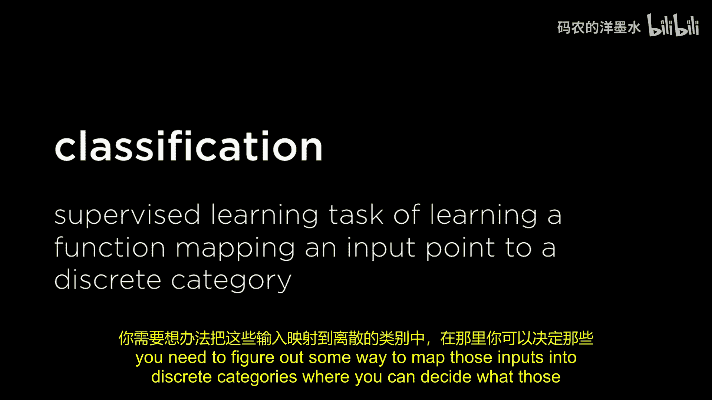

goWhere you can decide what those categories are and it's the job of the computer to predict what those categories are going to be。

 So that might be， for example， I give you information about a bank note like a U dollar。

 and I'm asking you to predict for me， does it belong to the category of authentic banknotes or does it belong to the category of counterfeit banknotes。

 You need to categorize the input and we want to train the computer to figure out some function to be able to do that calculation。

Another example might be the case of weather。 something we've talked about a little bit so far in this class where we would like to predict on a given day。

 know is it going rain on that day， is it going to be cloudy on that day And before we've seen how we could do this if we really give the computer all the exact probabilities for if these are the conditions。

 what's the probability of rain oftentimes we don't have access to that information though but what we do have access to is a whole bunch of data So if we wanted to be able to predict something like is it going to rain or is it not going to rain we would give the computer historical information about days when it was raining and days when it was not raining and ask the computer to look for patterns in that data So what might that data look like Well。

 we could structure that data in a table like this。

 this might be what our table looks like where for any particular day going back we have information about like that day's humidity that day's air pressure and then importantly we have a label。

 something where the human has said that on this particular day it was raining or it was not raining。

 So you could fill in this table with a whole bunch of data and。

m this what we would call a supervised learning exercise is that a human has gone in and labeled each of these data points。

 said that on this day， when these were the values for the humidity and pressure。

 that day was a rainy day and this day was a not rainy day。😡。

And what we would like the computer to be able to do then is to be able to figure out。

 given these inputs， given like the humidity and the pressure。

 can the computer predict what label should be associated with that day。

 does that day look more like it's going to be a day that rains or does it look more like a day when it's not going to rain。

😡，Put a little bit more mathematically。 You can think of this as a function that takes two inputs。

 The inputs being the data points that our computer will have access to things like humidity and pressure。

 so we could write a function F that takes us input， both humidity and pressure。

 And then the output is going to be what category we would ascribe to these particular input points。

 What label we would associate with that input。 So we've seen a couple of example data points here。

 where given this value for humidity and this value for pressure。

 we predict is it going to rain or is it not going to rain。

 And that's information that we just gathered from the world。 We measured on various different days。

 what the humidity and pressure were。 We observed whether or not we saw rain or no rain on that particular day。

 And this function F is what we would like to approximate。 Now， the computer。

 and we humans don't really know exactly how this function F works。

 It's probably quite a complex function。 So what we're going to do instead is attempt to estimate it。

 We would like to come up with a hypothesis function。 H。😊。

Whi is going to try to approximate what F does。 We want to come up with some function H that will also take the same inputs and will also produce an output。

 rain or no rain。 and ideally we'd like these two functions to agree as much as possible。

 So the goal then of the supervised learning classification tasks is going to be to figure out what does that function H look like how can we begin to estimate given all of this information。

 all of this data， what category or what label should be assigned to a particular data point。

 So where could you begin doing this。 Well， a reasonable thing to do， especially in this situation。

 I have two numerical values is I could try to plot this like on a graph that has two axes and x axis and y axis。

 and in this case we're just going to be using two numerical values as input but these same types of ideas scale as you add more and more inputs as well。

 we'll be plotting things in two dimensions but as we soon see you could add more inputs and just imagine things in multiple dimensions and while we humans have trouble conceptualizing anything really beyond three dimensions。

At least visually， a computer has no problem with trying to imagine things in many。

 many more dimensions that for a computer， each dimension is just some separate number that it is keeping track of so it wouldn't be unreasonable for a computer to think in 10 dimensions that are 100 dimensions to be able to try to solve a problem But for now we've got two inputs So we'll graph things along two axes in x axis which'll here represent humidity and a y axis which here represents pressure。

😡。

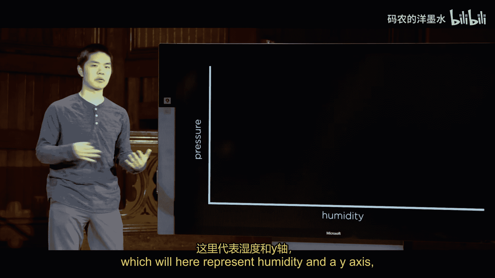

And what we might do is say let's take all of the days that were raining and just try to plot them on this graph and see where they fall on this graph and you know here might be all of the rainy days where each rainy day is one of these blue dots here that corresponds to a particular value for humidity and a particular value for pressure。

😡，And then I might do the same thing with the days that were not rainy。

 so I take all the not rainy days， figure out what their values were for each of these two inputs and go ahead and plot them on this graph as well。

 and I've here plotted them in red， so blue here stands for a rainy day。

 red here stands for a not rainy day。😡，And this then is the input that my computer has access to all of this input。

😡，And what I would like the computer to be able to do is to train a model such that if I'm ever presented with a new input that doesn't have a label associated with it。

 something like this white dot here， I would like to predict given those values for each of the two inputs。

 should we classify it as a blue dot， a rainy day， or should we classify it as a red dot。

 a not rainy day。😡，And if you're just looking at this picture graphically， trying to say， all right。

 this white dot， does it look like it belongs to the blue category or does it look like it belongs to the red category。

 I think most people would agree that it probably belongs to the blue category。 and why is that Well。

 it looks like it's close to other blue dots。 and that's not a very formal notion。

 but it's the notion that will formalize in just a moment that because it seems to be close to like this blue dot here。

 like nothing else is closer to it。 then we might say that it should be categorized as blue。

 it should fall into that category of I think that day is going to be a rainy day based on that input might not be totally accurate。

 but it's a pretty good guess。 and this type of algorithm is actually a very popular and common machine learning algorithm known as nearest neighbor classification。

 It's an algorithm for solving these classification type problems。

 and in nearest neighbor classification， it's going to perform this algorithm。

 What it'll do is given an input it will choose the class of the nearest data point to that input by class we just hear mean category like rain or no rain counter。

or not counterfeit and we choose the category or the class based on the nearest data point so given all that data we just looked at is the nearest data point a blue point or is it a red point and depending on the answer to that question。

 we were able to make some sort of judgment， we were able to say something like we think it's going to be blue or we think it's going to be red。

😡，So likewise， we could apply this to other data points that we encounter as well if suddenly this data point comes about。

 well， its nearest data is red so we would go ahead and classify this as a red point， not raining。

Things get a little bit trickier， though， when you look at a point like this white point over here。😡。

And you ask the same sort of question， should it belong to the category of blue points。

 the rainy days， or should it belong to the category of red points， the not rainy days？Now。

 nearest neighbor classification would say the way you solve this problem is look at which point is nearest to that point。

 you look at this nearest point and say it's red， it's a not rainy day， and then therefore。

 according to nearest neighbor classification， I would say that this unlabeled point。

 well that should also be read， It should also be classified as a not rainy day。😡。

But your intuition might think that that's a reasonable judgment to make that it's the closest thing is a not rainy day。

 So may as well guess that it's not rainy day， but it's probably also reasonable to look at the bigger picture of things and to say。

 yes， it is true that the nearest point to it was a red point。

 but it's surrounded by a whole bunch of other blue points。

 So looking at the bigger picture there's potentially an argument to be made that this point should actually be blue and with only this data we actually don't know for sure。

 we are given some input， something we're trying to predict and we don't necessarily know what the output is going to be。

 So in this case， which one is correct is difficult to say。

 but oftentimes considering more than just a single neighbor。

 considering multiple neighbors can sometimes give us a better result。

And so there's a variant on the nearest neighbor classification algorithm that is known as the K nearest neighbor classification algorithm。

 where K is some parameter， some number that we choose for how many neighbors are we going to look at So one nearest neighbor classification is what we saw before just pick the one nearest neighbor and use that category but with K nearest neighbor classification where K might be three or five or seven to say look at the three or five or seven closest neighbors。

 closest data points to that point works a little bit differently this algorithm will give an input chooseose the most common class out of the K nearest data points to that input So if we look at the five nearest points and you three of them say it's raining and two of them say it's not raining we'll go with the three instead of the two because each one effectively gets one vote towards what they believe the category ought to be and ultimately you choose the category that has the most votes as a consequence of that。

So Can nearest neighbor classification fairly straightforward one to understand intuitively。

 you just like look at the neighbors and figure out what the answer might be。

 And it turns out this can work very， very well for solving a whole variety of different types of classification problems。

 but not every model is going to work under every situation。

 And so one of the things we'll take a look at today。

 especially in the context of supervised machine learning is that there are a number of different approaches to machine learning。

 a number of different algorithms that we can apply， all solving the same type of problem。

 all solving some kind of classification problem where we want to take inputs and organize it into different categories and no one algorithm is necessarily always going to be better than some other algorithm。

 they each have their tradeoffs and maybe depending on the data。

 one type of algorithm is going to be better suited to trying to model that information than some other algorithm。

 And so this is what a lot of machine learning research ends up being about that when you're trying to apply machine learning techniques。

 you're often looking not just one particular algorithm but trying multiple different algorithms。

 trying to see what is going to give you the best results for。

To predict some function that maps inputs to outputs。

So what then are the drawbacks of K nearest neighbor classification。 Well， there are a couple。

 One might be that in the naive approach， at least it could be fairly slow to have to go through and measure the distance between a point in every single one of these points that exist here。

 Now there are ways of trying to get around that。 There are data structures that can help to make it more quickly to be able to find these neighbors。

 There are also techniques you can use to try and prune some of this data。

 remove some of the data points so that you're only left with the relevant data points just to make it a little bit easier。

 But ultimately， what we might like to do is come up with another way of trying to do this classification。

 And one way of trying to do the classification was looking at like what are the neighboring points。

 But another way might be to try to look at all of the data and see if we can come up with some like decision boundary。

 some boundary that will separate the rainy days from the not rainy days。

 And in the case of two dimensions， we can do that by drawing a line， for example。

 So what we might want to try to do is just find some line， find some separator that divides the。😊。

y days， the blue points over here from the not rainy days， the red points over there。

 we're now trying a different approach in contrast with the nearest neighbor approach。

 which just looked at local data around the input data point that we cared about。

 Now what we're doing is trying to use a technique known as linear regression to find some sort of line that will separate the two halves from each other。

 Now， sometimes that are actually be possible to come up with some line that perfectly separates all the rainy days from the not rainy days realistically。

 though this is probably cleaner than many data sets will actually be。 Oftentimes data is messier。

 There are outliers， theres random noise that happens inside of a particular system and what we'd like to do is still be able to figure out what a line might look like So in practice。

 the data will not always be linearly separablere linearly separable refers to some data where I could like draw a line just to separate the two halves of it perfectly Instead。

 you might have a situation like this where theres some rainy points that are on this side of the line and some not rainy points that are。

That side of the line， and there may not be a line that perfectly separates。

What half of the inputs from the other half that perfectly separates all the rainy days from the not rainy days。

 but we can still say that this line does a pretty good job and we'll try to formalize a little bit later what we mean when we say something like this line does a pretty good job of trying to make that prediction。

 But for now， let's just say we're looking for a line that does as good of a job as we can trying to separate one category of things from another category of things。

 So let's now try to formalize this a little bit more mathematically。

 we want to come up with some sort of function， some way we can define this line。

 and our inputs are things like humidity and pressure in this case。

 So our inputs we might call x1 is going to be represent humidity。

 and x2 is going to represent pressure。 These are our inputs that we are going to provide to our machine learning algorithm and given those inputs we would like for our model to be able to predict some sort of output and we are going to predict that using our hypothesis function。

 which we called H。 our hypothesis function is going to。As input， X1 and x2。

 humidity and pressure in this case， and you can imagine if we didn't just have two inputs。

 we had three or four or five inputs or more， we could have this hypothesis function take all of those as input and we'll see examples of that a little bit later as well。

😡，And now the question is， what does this hypothesis function do？😡，Well。

 it really just needs to measure like is this data point on one side of the boundary or is it on the other side of the boundary and how do we formalize that boundary Well the boundary is generally going to be a linear combination of these input variables。

 at least in this particular case what we're trying to do when we say linear combination is take each of these inputs and multiply them by some number that we're gonna to have to figure out。

 We'll generally call that number a weight for how important should these variables be in trying to determine the answer So we'll weight each of these variables with some weight and we might add like a constant to it just to try and make the function a little bit different And the result we just need to compare like is it greater than0 or is it less than0 to say does it belong on one side of the line or the other side of the line。

And so what that mathematical expression might look like is this。😡。

We would take each of my variables x1 and x2， multiply them by some weight。

 I don't yet know what that weight is， but it's going to be some number， weight 1 and weight2。

 and maybe we just want to add some other weight 0 to it because the function might require us to shift the entire value up or down by a certain amount and then we just compare if we do all this map is a greater than or equal to zero if so we might categorize that data point as a rainy day and otherwise we might say no rain。

😡，So the key here then is that this expression is how we are going to calculate whether it's a rainy day or not。

 We're going to do a bunch of math where we take each of the variables， multiply them by a weight。

 maybe add an extra weight to it， see if the result is greater than or equal to0 and using that result of that expression。

 we're able to determine whether it's raining or not raining。

 This expression here is in this case going to refer to just some line if you were to plot that graphically。

 it would just be some line and what the line actually looks like。 depends upon these weights。

 X1 and x2 or the inputs， but these weights really would determine the shape of that line。

 the slope of that line and what that line actually looks like。

So we then would like to figure out what these weights should be。

 we can choose whatever weights we want， but we want to choose weights in such a way that if you pass in a rainy day's humidity and pressure。

 then you end up with a result that is greater than an equal to zero。

 and we would like it such that if we passed into our hypothesis function， not rainy days's inputs。

 then the output that we get should be not rainy。😡，So before we get there。

 let's try and formalize this a little bit more mathematically just to get a sense for how it is that you'll often see this if you ever go further in supervise machine learning and explore this idea。

 One thing is that generally for these categories， we'll sometimes just use the names of the categories like rain and not rain。

 often mathematically if we're trying to do comparisons between these things it's easier just to deal in the world of numbers。

 So we could just say one and0， one for raining0 for not raining。

 So we do all this math and if the result is greater than or equal to0。

 we'll go ahead and say our hypothesis function outputs1。

 meaning raining and otherwise it outputs zero， meaning not raining。😊。

And oftentimes this type of expression will instead express using vector mathematics。

 and all a vector is if you're not familiar with the term。

 is it refers to a sequence of numerical values， you could represent that in Python using like a list of numerical values or a tuple with numerical values。

😡，And here we have a couple of sequences of numerical values， one of our vectors。

 one of our sequences of numerical values are all of these individual weights， W0， W1 and W2。

 so we could construct what we'll call a weight vector and we'll see why this is useful in a moment called W generally represented using a boldface W that is just a sequence of these three weights。

 weight 0 weight 1 and weight 2。😡，And to be able to calculate based on those weights。

 whether we think a day is raining or not raining， we're going to multiply each of those weights by one of our input variables that W2。

 this weight is going to be multiplied by input variable x2 W1 is going be multiplied by input variable x1 and w0 well it's not being multiplied by anything but to make sure the vectors is the same length and we'll see why that's useful in just a second。

 we'll just go ahead and say w0 is being multiplied by1 because you can multiply by something by one and you end up getting the exact same number So in addition to the weight vector W we'll also have an input vector that we'll call x that has three values1 again because we're just multiplying w0 by1 eventually and then x1 and x2。

😡，So here then we've represented two distinct vectors。

 a vector of weights that we need to somehow learn。

 The goal of our machine learning algorithm is to learn what this weight vector is supposed to be。

 We could choose any arbitrary set of numbers and it would produce a function that tries to predict rain or not rain。

 but it probably wouldn't be very good。 What we want to do is come up with a good choice of these weights so that we're able to do the accurate predictions。

😡，And then this input vector represents a particular input to the function。

 a data point for which we would like to estimate， is that day a rainy day or is that day a not rainy day。

 And so that's going to vary just depending on what input is provided to our function。

 what it is that we are trying to estimate。😡，And then to do the calculation。

 we want to calculate this expression here， and it turns out that expression is what we would call the dot product of these two vectors。

 the dot product of two vectors just means taking each of the terms in the vectors and multiplying them together。

 W0 multiply it by 1 W1 multiply it by x1 W2 multiply it by x2。

 and that's why these vectors need to be the same length。😡。

And then we just add all of the results together， so the dot product of dot product of w and x。

 our weight vector and our input vector， that's just going to be w0 times 1 or just w0 plus w1 times x1 multiplying these two terms together。

 plus w2 times x2 multiplying those terms together。😡，So we have our weight vector。

 which we need to figure out。 We need our machine learning algorithm to figure out what the weights should be。

 We have the input vector representing the data point that we're trying to predict a category for。

 predict a label for， and we're able to do that calculation by taking this dot product which you'll often see represented an in vector form。

 but if you haven't seen vectors before you can think of it as identical to just this mathematical expression just doing the multiplication adding the results together and then seeing whether the result is greater than or equal to0 or not。

 this expression here is identical to the expression that we're calculating to see whether or not that answer is greater than or equal to zero in this case。

 And so for that reason， you'll often see the hypothesis function written as something like this。

 a simpler representation where the hypothesis takes as input。

 some input vector X some humidity and pressure for some day and we want to predict an output like rain or no rain or one or0 if we choose to represent things numerically and the way we do that。

😊，Is by taking the dot product of the weights and our input。 If it's greater than or equal to 0。

 we'll go ahead and say the output is 1。 Otherwise the output is going to be 0。 And this hypothesis。

 we say is parameterized by the weights。 depending on what weights we choose。

 we'll end up getting a different hypothesis。 If we choose the weights randomly。

 We're probably not going to get a very good hypothesis function。 We'll get a one or a0。

 but it's probably not accurately going to reflect whether we think a day is going to be rainy or not rainy。

 But if we choose the weights right， we can often do a pretty good job of trying to estimate whether we think the output of the function should be a1 or a0。

And so the question then is how to figure out what these weights should be。

 how to be able to tune those parameters。 And there are a number of ways you can do that。

 One of the most common is known as the perceptron learning rule。 and we'll see more of this later。

 But the idea of the perceptron learning rule and we're not going to get too deep into the mathematics we'll mostly just introduce it more conceptually is to say that given some data point that we would like to learn from some data point that has an input X and an output y where y is like one for rain or0 for not rain then we're going to update the weights。

 and we'll look at the formula in just a moment， but the big picture idea is that we can start with random weights。

 but then learn from the data， like take the data points one at a time。

 and for each one of the data points figure out all right what parameters do we need to change inside of the weights in order to better match that input point so that is the value of having access to a lot of data in the supervised machine learning algorithm is that you take each of the data points and maybe look at the multiple times and。

ly try and figure out whether you need to shift your weights in order to better create some weight vector that is able to correctly or more accurately try to estimate what the output should be。

 whether we think it's going to be raining or whether we think it's not going to be raining。😡。

So what does that weight update look like without going into too much of the mathematics。

 we're going to update each of the weights to be the result of the original weight plus some additional expression and to understand this expression。

 well， why is what the actual output is。😡，And hypothesis of the X the input。

 that's going to be what we thought the input was。 And so I can replace this by saying like what the actual value was minus what our estimate was。

 And based on the difference between the actual value and what our estimate was。

 we might want to change our hypothesis， change the way that we do that estimation。😡。

If the actual value in the estimate were the same thing。

 meaning we were correctly able to predict what category this data point belonged to。

 well then actual value minus estimate that's just going to be0。

 which means this whole term on the right- hand side goes to be0 and the weight doesn't change weight I where I is like weight1 or weight2 or weight 0。

 weight I just stays at weight I and none of the weights change if we were able to correctly predict what category the input belonged to。

😡，But if our hypothesis didn't correctly predict what category the input belonged to， well。

 then maybe then we need to make some changes， adjust the weights so that we're better able to predict this kind of data point in the future。

 and what is the way we might do that， Well， if the actual value was bigger than the estimate。😡，Then。

 and for now we'll go ahead and assume that these x's are positive values。

 then if the actual value is bigger than the estimate。

 well that means we need to increase the weight in order to make it such that the output is bigger and therefore we're more likely to get to the right actual value and so if the actual value is bigger than the estimate。

 then actual value minus estimate thatll be a positive number and so you imagine we're just adding some positive number to the weight just to increase it evera slightly。

 and likewise the inverse case is true that if the actual value was less than the estimate。

 the actual value was0， but we estimated one， meaning it was actually was not raining。

 but we predicted it was going to be raining well then we want to decrease the value of the weight because then in that case we want to try and lower the total value of computing that dot product in order to make it less likely that we would predict that it would actually be raining。

😡，So no need to get too deep into the mathematics of that。

 but the general idea is that every time we encounter some data point。

 we can adjust these weights accordingly to try and make the weights better line up with the actual data that we have access to and you can repeat this process with data point after data point until eventually hopefully your algorithm converges to some set of weights that do a pretty good job of trying to figure out whether a day is going to be rainy or not raining and just as a final point about this particular equation。

 this value alpha here is generally what we'll call the learning rate， it's just some parameter。

 some number we choose for how quickly we're actually going to be updating these weight values that if alpha is bigger。

 then we're going to update these weight values by a lot and if alpha is smaller。

 then we'll update the weight values by less。 and you can choose a value of alpha depending on the problem。

 different values might suit the situation better or worse than others。So after all of that。

 after we've done this training process of take all this data and using this learning rule。

 look at all the pieces of data and use each piece of data as an indication to us of do the weights stay the same。

 do we increase the weights， do we decrease the weights and if so， by how much。

 what you end up with is effectively a threshold function。😡。

And we can look at what the threshold function looks like like this。 On the X axis here。

 we have the output of that function， taking the weights。

 taking the dot product of it with the input。And on the y axis。

 we have what the output is going to be0， which in this case represented like not raining and one。

 which in this case represented raining。 And the way that our hypothesis function works is it calculates this value。

And if it's greater than0 or greater than some threshold value。

 then we declare that it's a rainy day， and otherwise we declare that it's a not rainy day。

 and this then graphically is what that function looks like。

 that initially when the value of this dot product is small， it's not raining， it's not raining。

 it's not raining， but as soon as it crosses that threshold， we suddenly say。

 okay now it's raining now it's raining now it's raining。

 and the way to interpret this kind of representation is that anything on this side of the line。

 that would be the category of data points where we say， yes。

 it's raining anything that falls on this side of the line are the data points where we would say it's not raining。

 And again， we want to choose some value for the weights that results in a function that does a pretty good job of trying to do this estimation。

😊，But one tricky thing with this type of hard threshold is that it only leaves two possible outcomes。

 right， We plug in some data as input， and the output we get is raining or not raining。

 And there's no room for anywhere in between。 And maybe that's what you want。

 Maybe all you want is given some data point。 You would like to be able to classify it into one or two or more of these various different categories。

But it might also be the case that you care about knowing how strong that prediction is， for example。

 So if we go back to this instance here， where we have rainy days on this side of the line。

 not rainy days on that side of the line。You might imagine that let's look now at these two white data points。

 this data point here that we would like to predict a label or a category form。😡。

And this data point over here that we would also like to predict a label or a category for。

 It seems likely that you could pretty confidently say that this data point。

 that should be a rainy day。 seems close to the other rainy days。

 If we're going by the nearest neighbor strategy， it's on this side of the line if we're going by the strategy of just saying。

 you know which side of the line does it fall on by figuring out what those weights should be。😡。

And if we're using the line strategy of just which side of the line does it fall on which side of this decision boundary。

 Well， we'd also say that this point here is also a rainy day because it falls on the side of the line that corresponds to rainy days。

But it's likely that even in this case， we would know that we don't feel nearly as confident about this data point on the left as compared to this data point on the right。

 that for this one on the right， we can feel very confident that， yes， it's a rainy day。 This one。

 you know， it's pretty close to the line if we're judging just by distance。

 And so you might be less sure。But our threshold function doesn't allow for a notion of less sure or more sure about something。

 It's what we would call a hard threshold。 It's once you've crossed this line。

 then immediately we say yes， this is going to be a rainy day anywhere before it。

 we're gonna say it's not a rainy day。 And that may not be helpful in a number of cases。 One。

 this is not a particularly easy function to deal with。

 if as you get deeper into the world of machine learning and are trying to do things like taking derivatives of these curves。

 this type of function makes things challenging。 But the other challenge is that we don't really have any notion of gradation between things。

 We don't have a notion of yes， this is a very strongly。

 strong belief that it's going to be raining as opposed to。

 you know it's probably more likely not that it's going to be raining。

 but maybe not totally sure about that either。So what we can do by taking advantage of a technique known as logistic regression is instead of using this hard threshold type of function。

 we can use instead a logistic function， something we might call a soft threshold。

 And that's going to transform this into looking something a little more like this。

 something that more nicely curves。 And as a result。

 the possible output values are no longer just 0 and 10 for not raining one for raining。

 But you can actually get any real numbered value between 0 and 1。

 that if you're way over on this side， then you get a value of 0。 it's not going to be raining。

 and we're pretty sure about that。 And if you're over on this side， you get a value of 1。 like yes。

 we're very sure that it's going to be raining。 But in between。

 you could get some real numbered value。 We're a value like 0。7。

 might mean you we think it's going to rain， it's more probable that it's going to rain than not based on the data。

 but we're not as confident as some of the other data points might be。

 So one of the advantages of the soft threshold is that it allows us to have an output that。😊。

be some real number that potentially reflects some sort of probability。

 the likelihood that we think that this particular data point belongs to that particular category。

And there are some other nice mathematical properties of that as well。

So that then is two different approaches to trying to solve this type of classification problem。

 One is this nearest neighbor type of approach where you just take a data point and look at the data points that are nearby to try and estimate what category we think it belongs to。

😡，And the other approach is the approach of saying， all right。

 let's just try and use linear regression， figure out what these weights should be。

 adjust the weights in order to figure out what line or what decision boundary is going to best separate these two categories。

😡，It turns out that another popular approach or very popular approach if you just have a data set and you want to start trying to do some learning on it is what we call the support vector machine。

 and we're not gonna to go too much into the mathematics of the support vector machine。

 but we'll at least explore it graphically to see what it is that it looks like and the idea or the motivation behind the support vector machine is the idea that there are actually a lot of different lines that we could draw。

 a lot of different decision boundaries that we could draw to separate two groups So if for example。

 I had the red data points over here and the blue data points over here one possible line I could draw is a line like this that this line here would separate the red points from the blue points and it does so perfectly all the red points are on one side of the line all the blue points are on the other side of the line。

But this should probably make you a little bit nervous if you come up with a model and the model comes up with a line that looks like this。

 and the reason why is that you worry about how well it's going to generalize to other data points that are not necessarily in the data that we have access to for example。

 if there was a point that fell like right here for example。

 on the right side of the line well then based on that we might want to guess that it is in fact a red point。

 but it falls on the side of the line where instead we would estimate that it's a blue point instead。

😡，And so based on that， this line is probably not a great choice just because it is so close to these various data points。

 We might instead prefer like a diagonal line that just goes diagonally through the data like we've seen before。

 but there too， there's a lot of diagonal lines that we could draw as well。 For example。

 I could draw this diagonal line here， which also successfully separates all the red points from all of the blue points from the perspective of something like just trying to figure out some setting of weights that allows us to predict the correct output。

 this line will predict the correct output for this particular set of data every single time because the red points are on one side the blue points are on the other。

 but yet again， you should probably be a little nervous because this line is so close to these red points。

 even though we're able to correctly predict on the input data。If there was a point that fell。

 somewhere in this general area our algorithm， this model would say that yeah。

 we think it's a blue point when in actuality it might belong to the red category instead。

 just because it looks like it's close to the other red points。

 what we really want to be able to say， given this data。

 how can you generalize this as best as possible is to come up with a line like this that seems like the intuitive line to draw。

 and the reason why it's intuitive is because it seems to be as far apart as possible from the red data and the blue data so that if we generalize a little bit and assume that maybe we have some points that are different from the input。

 but still slightly further away， we can still say that something on this side， probably red。

 something on that side， probably blue and we can make those judgments that way。

And that is what support vector machines are designed to do。

 They're designed to try and find what we call the maximum margin separator。

 where the maximum margin separator is just some boundary that maximizes the distance between the groups of points。

 rather than come up with some boundary that's very close to one set or the other where in the case before。

 we wouldn't have cared。 as long as we're categorizing the input。 Well。

 that seems all we need to do the the support vector machine。

 we'll try and find this maximize margin separator。

 some way of trying to maximize that particular distance。

 And it does so by finding what we call the support vectors。

 which are the vectors that are closest to the line and trying to maximize the distance between the line and those particular points。

And it works that way in two dimensions。 It also works in higher dimensions where we're not looking for some line that separates the two data points。

 but instead looking for what we generally call a hyperplane。

 some decision boundary effectively that separates one set of data from the other set of data and this ability to support vector machines to work in higher dimensions actually has a number of other applications as well。

 But one is that it helpful deals with cases where data may not be linearly separable。

 So we talked about linear separability before this idea that you can take data and just draw a line or some linear combination of the inputs that allows us to perfectly separate the two sets from each other。

 there are some data sets that are not linearly separable and some were even two。

 you would not be able to find a good line at all that would try to do that kind of separation。

 something like this， for example。Or if you imagine here are the red points and the blue points around it if you try to find a line that divides the red points from the blue points。

 it's actually going to be difficult， if not impossible to do that any line you choose。

 well if you draw a line here， then you ignore all of these blue points that should actually be blue and not red。

 anywhere else you draw a line， there's going to be a lot of error， a lot of mistakes。

 a lot of what we'll soon call loss。😡，To that line that you draw。

 a lot of points that you're going to categorize incorrectly。

 What we really want is to be able to find better decision boundary that may not be just a straight line through this two dimensional space and what support vector machines can do is they can begin to operate in higher dimensions and be able to find some other decision boundary like the circle in this case that actually is able to separate one of these sets of data from the other set of data a lot better。

 So oftentimes in data sets where the data is not linearly separable。

 support vector machines by working in higher dimensions can actually figure out a way to solve that kind of problem effectively。

So that then three different approaches to trying to solve these sorts of problems we've seen and support vector machines and we've seen trying to use linear regression in the perceptron learning rule to be able to figure out how to categorize inputs and outputs we see in the nearest neighbor approach。

 no one necessarily better than any other again， it's going to depend on the data。

 the information you have access to it's going to depend on what the function looks like that you're ultimately trying to predict。

 and this is where a lot of research and experimentation can be involved in trying to figure out how it is to best perform that kind of estimation。

But classification is only one of the tasks that you might encounter in supervised machine learning。

 because in classification， what we're trying to predict is some discrete category。

 We're trying to predict red or blue， rain or not rain， authentic or counterfeit。

But sometimes what we want to predict is a real numbered value。 And for that。

 we have a related problem， not classification， but instead known as regression。

 and regression is the supervised learning problem where we try and learn a function mapping inputs to output。

 same as before， but instead of the outputs being discrete categories。

 things like rain or not rain in a regression problem。

 the output values that are generally continuous value。

 some real number that we would like to predict this happens all the time as well。

 you might imagine that a company might take this approach if it's trying to figure out。

 for instance， what the effect of its advertising is like how do advertising dollar spent translate into sales for the company's product。

 for example， and so they might like to try to predict some function that takes this input。

 the amount of money spent on advertising。 and here we're just going to use one input。

 but again you could scale this up to many more inputs as well if you have a lot of different kinds of data you have access to and the goal is to learn a function that given this amount of spending on advertising。

 we're going get this amount in sales and you might judge。

Based on having access to a whole bunch of data， like for every past month。

 here is how much we spent on advertising and here is what sales were。

 and we would like to predict some sort of hypothesis function。😡，That again。

 given the amount spent on advertising can predict， in this case some real number。

 some number estimate of how much sales we expect that company to do in this month or in this quarter or whatever unit of time we're choosing to measure things in。

And so again， the approach to solving this type of problem。

 we could try using a linear regression type approach where we take this data and we just plot it on the X axis we have advertising that are spent on the y axis we have sales and we might just want to try and draw a line that does a pretty good job of trying to estimate this relationship between advertising and sales。

 and in this case， unlike before， we're not trying to separate the data points into discrete categories but instead in this case we're just trying to find a line that approximates this relationship between advertising and sales so that if we want to figure out what the estimated sales are for particular advertising budget you just look it up in this line。

 figure out for this amount of advertising we would have this amount of sales and just try and make the estimate that way。

 and so you can try and come up with a line again， figuring out how to modify the weights using various different techniques to try and make it so that this line fits as well as possible。

So with all of these approaches then to trying to solve machine learning style problems。

 the question becomes， how do we evaluate these approaches。

 How do we evaluate the various different hypotheses that we could come up with because each of these algorithms will give us some sort of hypothesis。

 some function that maps inputs to outputs， And we want to know how well does that function work。

 And you can think of evaluating these hypothesisses and trying to get a better hypothesis as kind of like an optimization problem in an optimization problems you' recall from before。

 We were either trying to maximize some objective function by trying to find。A global maximum。

Or we were trying to minimize some cost function by trying to find some global minimum。

 And in the case of evaluating these hypotheses， one thing we might say is that this cost function。

 the thing we're trying to minimize， we might be trying to minimize what we would call a loss function and what a loss function is is it is a function that is going to estimate for us how poorly our function performs more formally。

 it's like a loss of utility by whenever we predict something that is wrong。

 that is a loss of utility that's going to add to the output of our loss function。😡。

And you could come up with any loss function that you want， just some mathematical way of estimating。

 given each of these data points， given what the actual output is and given what our projected output is。

 our estimate， you could calculate some sort of numerical loss for it。

 but there are a couple of popular loss functions that are worth discussing just so that you've seen them before。

😡，When it comes to discrete categories， things like rain or not rain， counterfeit or not counterfeit。

 one approaches the 01 loss function， and the way that works is for each of the data points。😡。

Our loss function takes as input， what the actual output is。

 like whether it was actually raining or not raining and takes our prediction into account。

 Did we predict， given this data point that it was raining or not raining。

 And if the actual value equals the prediction， well。

 then the 01 loss function will just say the loss is 0， there was no loss of utility。

 because we were able to predict correctly。And otherwise。

 if the actual value was not the same thing as what we predicted。 Well， then in that case。

 our loss is one。 We lost something， lost some utility because what we predicted was the output of the function was not what it actually was。

 And the goal then in a situation like this would be to come up with some hypothesis that minimizes the total empirical loss。

 the total amount that we've lost。 If you add up for all these data points。

 what the actual output is and what your hypothesis would have predicted。So in this case。

 for example， if we go back to classifying days as raining or not raining and we came up with this decision boundary。

 how would we evaluate this decision boundary， how much better is it than drawing the line here or drawing the line there。

 where we could take each of the input data points， and each input data point has a label。

 whether it was raining or whether it was not raining， and we could compare it to the prediction。

 whether we predicted it would be raining or not raining。

 and assign it a numerical value as a result。😡，So for example， these points over here。

 they were all raining days and we predicted they would be raining because they fall on the bottom side of the line。

 so they have a loss of zero， nothing lost from those situations and likewise same is true for some of these points over here where it was not raining and we predicted it would not be raining either where we do have loss are points like this point here and that point there where we predicted that it would not be raining but in actuality it's a blue point it was raining or likewise here we predicted that it would be raining。

 but in actuality it's a red point， it was not raining and so as a result we miscategorized these data points that we were trying to train on。

And as a result， there is some loss here， one loss here， there， here and there。

 for a total loss of four for example， in this case。

 and that might be how we would estimate or how we would say that this line is better than a line that goes somewhere else or a line that's further down because this line might minimize the loss that there is no way to do better than just these four points of loss if you're just drawing a straight line through our space。

😡，So the 01 loss function checks。😡，Did we get it right， Did we get it wrong， If we got it right。

 The loss is 0， nothing lost， if we got it wrong， then our loss function for that data point says one。

 and we add up all of those losses across all of our data points to get some sort of empirical loss。

 How much we have lost across all of these original data points that our algorithm had access to。😡。

There are other forms of losses as well that work especially well when we deal with more real valued cases。

 cases like the mapping between advertising budget and amount that we do in sales， for example。

 because in that case you care not just that you get the number exactly right。

 but you care how close you were to the actual value if the actual value as you did like $2800 in sales and you predicted that you would do $2900 in sales maybe that's pretty good。

 that's much better than if you had predicted you do $1000 in sales， for example。

 and so we would like our loss function to be able to take that into account as well， take part。

 take into account not just whether the actual value in the expected value are exactly the same。

But also take into account how far apart they were。

And so for that one approach is what we call L1 loss。

 L1 loss doesn't just look at whether actual un predicteddic are equal to each other。😡。

But we take the absolute value of the actual value minus the predicted value。 In other words。

 we just ask how far apart were the actual and predicted values and we sum that up across all of the data points to be able to get what our answer ultimately is。

😡，So what might this actually look like for our data Well。

 if we go back to this representation where we had advertising along the X axis sales along the y axis。

 Our line was our prediction。 Our estimate for any given amount of advertising what we predicted sales was going to be and our L1 loss is just how far apart vertically along the sales axis our prediction was from each of the data points。

 so we could figure out exactly how far apart our prediction was from each of the data points and figure out as a result of that what our loss is overall for this particular hypothesis just by adding up all of these various different individual losses for each of these data points and our goal then is to try and minimize that loss to try and come up with some line that minimizes what the utility losses by judging how far away our estimate amount of sales is from the actual amount of sales。

 And turns out there other loss functions as well， one that's quite popular is the L2 loss the L2 loss instead of just using the absolute。

😊，Like how far away the actual value is from the predicted value it uses the square of actual minus predicted。

 So how far apart are the actual un predictedd value and it squares that value。

 effectively penalizing much more harshly anything that is a worse prediction。

 So you imagine if you have two data points that you predict as being one value away from their actual value as opposed to one data point that you predict as being two away from its actual value。

 the L2 loss function will more harshly penalize that one that is two away because it's going to square however。

 much the differences between the actual value and the predicted value and depending on the situation you might want to choose a loss function depending on what you care about minimizing if you really care about minimizing the error on more outlier cases。

 than you might want to consider something like this。

 but if you've got a lot of outliers and you don't necessarily care about modeling them then maybe an L1 loss function is preferable。

 but there are tradeoffs here that you need to decide based on a particular set of data。

But what you do run the risk of with any of these loss functions with anything that we're trying to do is a problem known as overfitting。

 and overfitting is a big problem you can encounter in machine learning。

 which happens anytime a model fits too closely with a data set。 And as a result。

 fails to generalize。 We would like our model to be able to accurately predict。

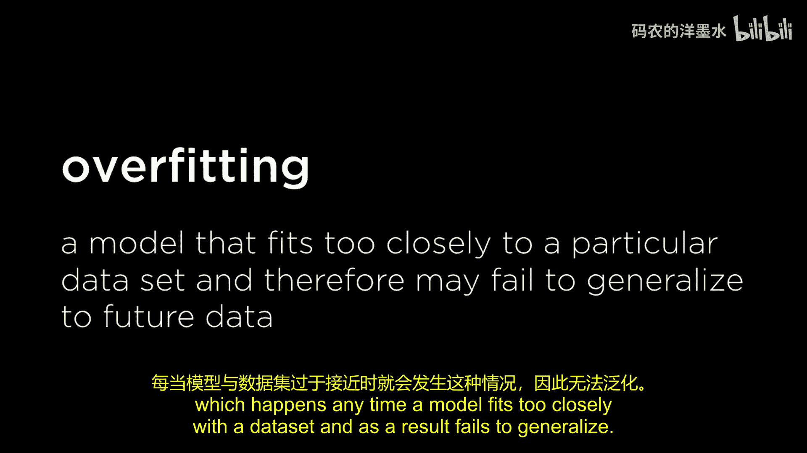

Data and the inputs and output pairs for the data that we have access to。

 But the reason we wanted to do so is because we want our model to generalize well to data that we haven't seen before。

 I would like to take data from the past year of whether it was raining and not raining and use that data to generalize it towards the future。

 to say in the future， is it going to be raining or not raining。

 Or if I have a whole bunch of data on what counterfeit and not counterfeit US dollar bills look like。

In the past， when people have encountered them， I'd like to train a computer to be able to。

 in the future， generalize。To other dollar bills that I might see。As well。

 And the problem with overfitting is that if you try and tie yourself too closely to the data set that you're training your model on。

 you can end up not generalizing very well。 So what does this look like， Well。

 we might imagine the rainy day and not rainy day example again from here where the blue points indicate rainy days and the red points indicate not rainy days and we decided that we felt pretty comfortable with drawing a line like this as the decision boundary between rainy days and not rainy days so we can pretty comfortably say that points on this side more likely to be rainy days points on that side more likely to be not rainy days but the loss。

 the empirical loss isn't zero in this particular case。

 because we didn't categorize everything perfectly。There was this one outlier。

 this one day that it wasn't raining， but yet our model still still predicts that it is raining。

 but that doesn't necessarily mean our model is bad。 It just means the model isn't 100% accurate。

If you really wanted to try and find a hypothesis that resulted in minimizing the loss。

 you could come up with a different decision boundary， it wouldn't be a line。

 but it would look something like this。😡，Like this decision boundary does separate all of the red points from all of the blue points because the red points fall on this side of this decision boundary。

 the blue points fall on the other side of the decision boundary。

 but this we would probably argue is not as good of a prediction。

 even though it seems to be more accurate based on all of the available training data that we have for training this machine learning model。

 we might say that it's probably not going to generalize well。

 that if there were other data points like here and there。

 we might still want to consider those to be rainy days because we think this was probably just an outlier。

 So if the only thing you care about is minimizing the loss on the data you have available to you。

 you run the risk of overfitting。 and this can happen in the classification case， it can also happen。

In the regression case that here we predicted what we thought was a pretty good line relating advertising to sales。

 trying to predict what sales were going to be for a given amount of advertising。

 but I could come up with a line that does a better job of predicting the training data and it would be something that looks like this just you know connecting all of the various different data points and now there is no loss at all。

 now I've perfectly predicted given any advertising what sales are and for all the data available to me it's going to be accurate。

But it's probably not going to generalize very well。

 I have overfi my model on the training data that is available to me。 And so in general。

 we want to avoid overfitting。 We'd like strategies to make sure that we haven't overfit our model to a particular data set。

 And there are a number of ways that you could try to do this。

 One way is by examining what it is that we're optimizing for in an opt problem All we do is we say。

 you know， there is some cost。 and I want to minimize that cost。

And so far we've defined that cost function， the cost of a hypothesis。

 just as being equal to the empirical loss of that hypothesis。

 like how far away are the actual data points the outputs away from what I predicted them to be based on that particular hypothesis and if all you're trying to do is minimize cost。

 meaning minimizing the loss in this case， then the result is going to be that you might overfit that to minimize cost you're going to try and find a way to perfectly match all the input data and that might happen as a result of overfitting on that particular input data。

😡，So in order to address this， you could add something to the cost function。

 What counts as cost will not just loss， but also some measure of the complexity of the hypothesis。

 word the complexity of the hypothesis is something that you would need to define for how complicated does our line look。

 This is sort of anockham's razor style approach where we want to give preference to a simpler decision boundary。

 like a straight line for example， some simpler curve。

 as opposed to something far more complex that might represent the training data better。

 but might not generalize as well， will generally say that a simpler solution is probably the better solution and probably the one that is more likely to generalize well to other inputs。

😡，So we measure what the loss is， but we also measure the complexity。

 and now that all gets taken into account when we consider the overall cost that yes。

 something might have less loss if it better predicts the training data。😡。

But if it's much more complex， it still might not be the best option that we have。

 and we need to come up with some balance between loss and complexity。 And for that reason。

 you'll often see this representative as multiplying the complexity by some parameter that we have to choose parameter Lada in this case where we're saying。

 you know if Lada is a greater value， then we really want to penalize more complex hypotheses whereas if lambda is smaller。

 we're going to penalize more complex hypotheses a little bit and it's up to the machine learning programmer to decide where they want to set that value of lambmbda for how much do I want to penalize a more complex hypothesis that might fit the data a little better。

 And again， there's no one right answer to a lot of these things。

 depending on the data set depending on the data you have available to you and the problem you're trying to solve your choice of these parameters may vary and you may need to experiment a little bit to figure out what the right choice of that is ultimately going to be。

This process then of considering not only loss， but also some measure of the complexity is known as regularization。

 regularization is the process of penalizing a hypothesis that is more complex in order to favor a simpler hypothesis that is more likely to generalize well。

 more likely to be able to apply to other situations that are dealing with other input points unlike the ones that we've necessarily seen before。

 so oftentimes you'll see us add some regularizing term to what we're trying to minimize in order to avoid this problem of overfitting。

😡，Now， another way of making sure we don't overfit is to run some experiments and to see whether or not we are able to generalize our model that we've created to other data sets as well。

 and it's for that reason that oftentimes when you're doing a machine learning experiment when you've got some data and you want to try and come up with some function that predicts given some input。

 what the output is going to be。 you don't necessarily want to do your training on all of the data you have available to you that you could employ a method known as holdout crossvalidation。

 wherein holdout crossvalidation， we split up our data。

 we split up our data into a training set and a testing set。

 The training set is the set of data that we're going to use to train our machine learning model and the testing set is the set of data that we are going to use in order to test to see how well our machine learning model actually performed。

So the learning happens on the training set， we figure out what the parameters should be。

 we figure out what the right model is and then we see all right， now that we've trained the model。

 see how well it does at predicting things inside of the testing set some set of data that we haven't seen before and the hope then is that we're going to be able to predict the testing set pretty well if we're able to generalize based on the training data that's available to us if we've overfit the training data though and we're not able to generalize well then when we look at the testing set。

 it's likely going to be the case that we're not going to predict things in the testing set nearly as effectively。

So this is one method of crossvalation， validating to make sure that the work we have done is actually going to generalize to other data sets as well。

 and there are other statistical techniques we can use as well。

 one of the downsides of this just hold out crossvalidation is if you say I just like split it 50-50。

 I train using 50% of the data and test using the other 50% or you could choose other percentages as well。

 is that there is a fair amount of data that I am now not using to train that I might be able to get a better model as a result。

 for example。So one approach is known as kfold cross validation in kfold cross validation。

 rather than just divide things into two sets and run one experiment。

 we divide things into k different sets。 So maybe I divide things up into 10 different sets and then run 10 different experiments So if I split up my data into 10 different sets of data then what I'll do is each time for each of my 10 experiments。

 I will hold out one of those sets of data where I'll say let me train my model on these nine sets and then test to see how well it predicts on set number 10。

😡，And then pick another set of nine sets to train on and then test it on the other one that I held out where each time I train the model on everything minus the one set that I'm holding out and then test to see how well our model performs on the tests that I did hold out And what you end up getting is like 10 different results。

10 different answers for how accurately our model worked and oftentimes you could just like take the average of those 10 to get an approximation for how well we think our model performs overall。

 But the key idea is separating the training data from the testing data because you want to test your model on data that is different from what you trained the model on because the training you want to avoid overfitting。

 you want to be able to generalize and the way you test whether you're able to generalize is by looking at some data that you haven't seen before and seeing how well were actually able to perform。

And so if we want to actually implement any of these techniques inside of a programming language like Python。

 a number of ways we could do that， we could write this from scratch on our own。

 but there are libraries out there that allow us to take advantage of existing implementations of these algorithms that we can use the same types of algorithms in a lot of different situations and so there's a library。

 very popular one known as PsCt learn， which allows us in Python to be able to very quickly get set up with a lot of these different machine learning models that this library has already written an algorithm for nearest neighbor classification。

 for doing perceptron learning for doing a bunch of other types of inference and supervised learning that we haven't yet talked about。

 but using it we can begin to try actually testing how these methods work and how accurately they perform。

So let's go ahead and take a look at one approach of trying to solve this type of problem。 Allright。

 so I'm first going to pull up banknotes do csv， which is a whole bunch of data provided byuc Irvine。

 which is information about various different bank noteses。

 and people took pictures of various different banknotes and measured various different properties of those banknotes。

 And in particular， some human categorized each of those banknotes as either a counterfeit banknote or as not counterfeit。

 And so what you're looking at here， is each row represents one bankn。

 This is formatted as a cv spreadsheet where just comma separated values separating each of these various different fields。

 We have four different input values for each of these data points。

 just information some measurement that was made on the bankn and what those measurements exactly are aren't as important as the fact that we do have access to this data。

 But more importantly。😊，We have access for each of these data points to a label where0 indicates something like this was not a counterfeit bill。

 meaning it was an authentic bill and a data point labeled one means that it is a counterfeit bill。

 at least according to the human researcher who labeled this particular data。

 So we have a whole bunch of data representing a whole bunch of different data points。

 each of which has these various different measurements that were made on that particular bill。

 and each of which has an output value，0 or one，0， meaning it was a genuine bill one。

 meaning it was a counterfeit bill， and what we would like to do is use supervised learning to begin to predict or model some sort of function that can take these four values as input and predict what the output would be。

 We want our learning algorithm to find some sort of pattern that is able to predict based on these measurements。

 something that you could measure just by taking a photo of a bill。

 predict whether that bill is authentic or whether that bill is counterfeit。

And so how can we do that？ Well， I'm first going to open up Banknote 0 dot Pi and see how it is that we do this。

I'm first importing a lot of things from PsyitLn， but importantly。

 I'm going to set my model equal to the perceptron model。

 which is one of those models that we talked about before。

 we're just going to try and figure out some setting of weights that is able to divide our data into two different groups。

Then I'm going to go ahead and read data in for my file from Banknotes。 CSv。

 and basically for every row， I'm going to separate that row into the first four values of that row。

 which is the evidence for that row。 And then the label where if if the final column in that row is a0。

 the label is authentic and otherwise it's going to be counterfeit。

So I'm effectively reading data in from the CSV file。

 dividing into a whole bunch of rows where each room has some evidence。

 Those four input values that are going to be inputs to my hypothesis function。 And then the label。

 the output， whether it is authentic or counterfeit。

 That is the thing that I am then trying to predict。

 So the next step is that I would like to split up my data into a training set and to testing set。

 some set of data that I would like to train my machine learning model on and some set of data that I would like to use to test that model。

 see how well I performed。 So what I'll do is I'll go ahead and figure out length of the data。

 How many data points do I have， I'll go ahead and take half of them。

 save that number is a number called holdout。 That is how many items I'm going to hold out for my data to save for the testing phase。

 I'll randomly shuffle the data。 So it's in some random order。

 And then I'll say my testing set will be all of the data up to the holdout。

 So I'll take hold out many data items and that will be my testing set。

 My training data will be everything else。 The information that I'm going to train my model on。😊。

And then I'll say I need to divide my training data into two different sets。

 I need to divide it into my x values where x here represents the inputs。 So the x values。

 the x values that I'm going to train on are basically for every row in my training set。

 I'm going get the evidence for that row， those four values where is basically a vector of four numbers where that is going to be all of the input and then I need the y values。

 what are the outputs that I want to learn from the labels that belong to each of these various different input points。

 well that's going to be the same thing for each row in the training data but this time I take that row and get what its label is。

 whether it is authentic or counterfeit。 So I end up with one list of all of these vectors of my input data and one list which follows the same order but is all of the labels that correspond with each of those vectors and then to train my model which in this case is just this perceptron model。

I just call model do fit， pass in the training data and what the labels for those training data are andsyitt learnn will take care of fitting the model will do the entire algorithm for me。

 and then when it's done， I can then test to see how well that model performed so I can say。

 let me get all of these input vectors for what I want to test on So for each row and my testing dataset go ahead and get the evidence。

 and the y values， those are what the actual values were for each of the rows in the testing data。

 what the actual label is。 but then I'm going to generate some predictions。

 I'm going to use this model and try and predict based on the testing vectors。

 I want to predict what the output is and my goal then is to now compare why testing with predictions。

 I want to see how well my predictions based on the model actually reflect what the y values were。

 what the output is that were actually labeled because I now have this labeled data I can assess how well the algorithm worked。

And so now I can just compute how well we did。 I'm going to this zip function basically just lets me look through two different lists 11 by one at the same time。

 So for each actual value and for each predicted value。

 If the actual is the same thing as what I predicted， I'll go ahead and increment the counter by one。

 Otherwise， I'll increment my incorrect counter by one。 And so at the end， I can print out。

 here are the results， Here's how many I got right， Here's how many I got wrong。

 And here was my overall accuracy。 For example。😊，So I can go ahead and run this， I can run Python。

 Banknote0。pi。

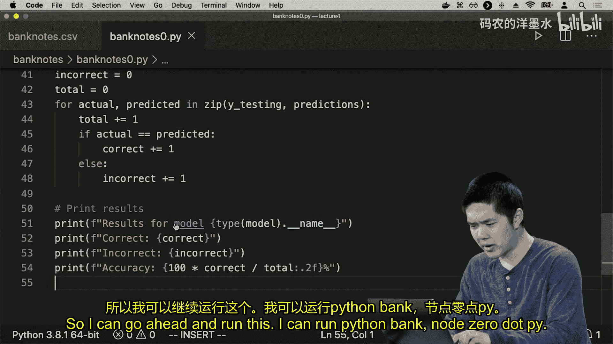

And it's going to train on half the data and then test on half the data。

 And here are the results for my perceptron model。 In this case。

 it correctly was able to classify 679 bills as correctly as are authentic or counterfeit an incorrectly classified 7 of them for an overall accuracy of close to 99% accurate。

 So on this particular data set using this perceptron model。

 we were able to predict very well what the output was going to be。😊。

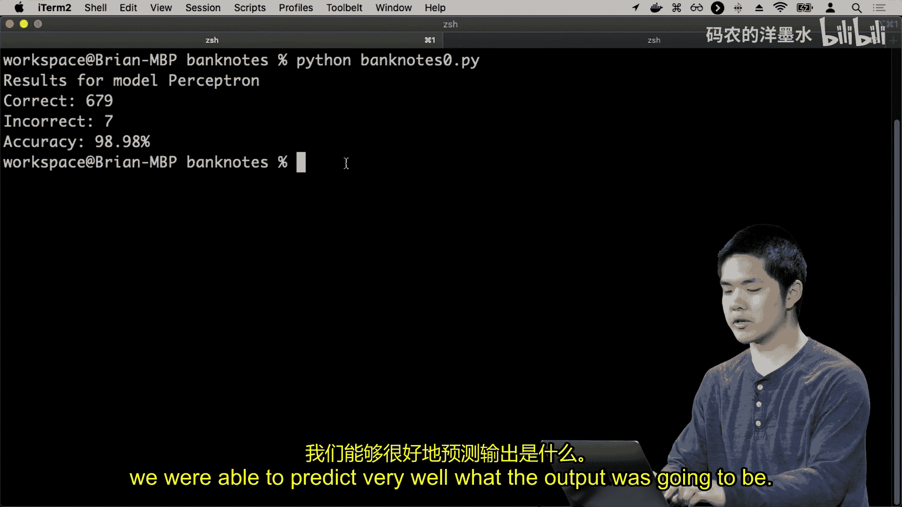

And we can try different models， too， that St learnn makes it very easy just to swap out one model for another model。

So instead of the perceptron model， I can use the support vector machine using the SVC。

 otherwise known as a support vector classifier using a support vector machine to classify things into two different groups。

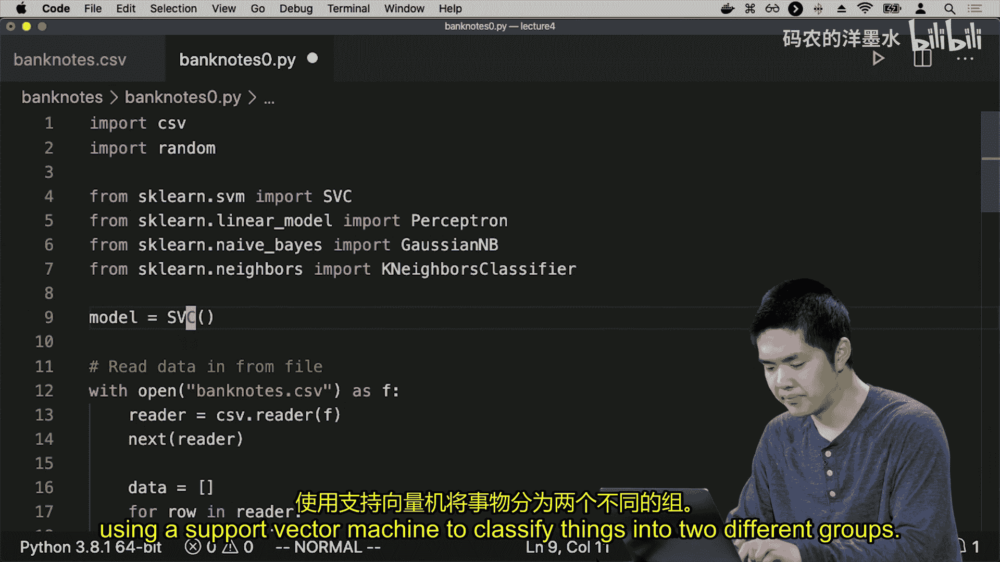

And now see， all right， how well does this perform？And right this time。

 we were able to correctly predict 682 and incorrectly predicted for for accuracy of 99。4%。

 and we could even try the K neighbors classifier。

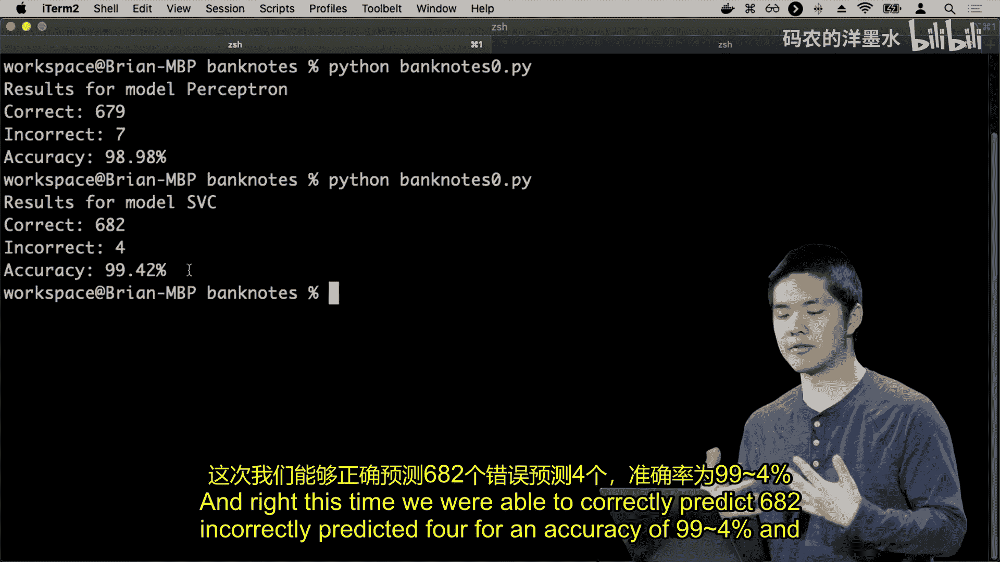

As the model instead， and this takes a parameter and neighbors for how many neighbors do you want to look at。

 Let's just look at one neighbor， the one nearest neighbor and use that to predict。

 Go ahead and run this as well。

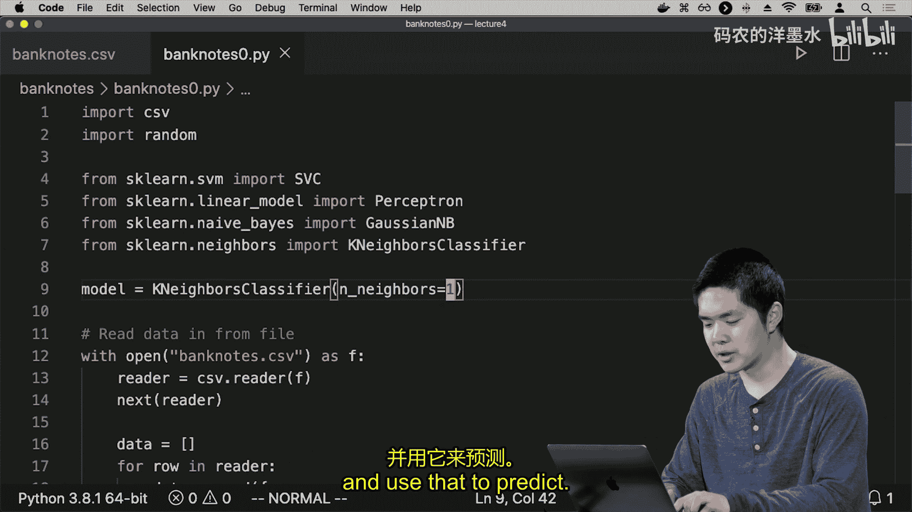

And it looks like based on the K neighbors classifier looking at just one neighbor。

 we were able to correctly classify 685 data points incorrectly classified one。

 Maybe let's try three neighbors instead， instead of just using one neighbor。

 do more of a K nearest neighbors approach where I look at the three nearest neighbors and see how that performs。

 And that one in this case seems to have gotten 100% of all of the。😊。

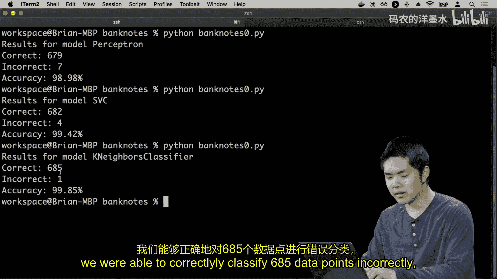

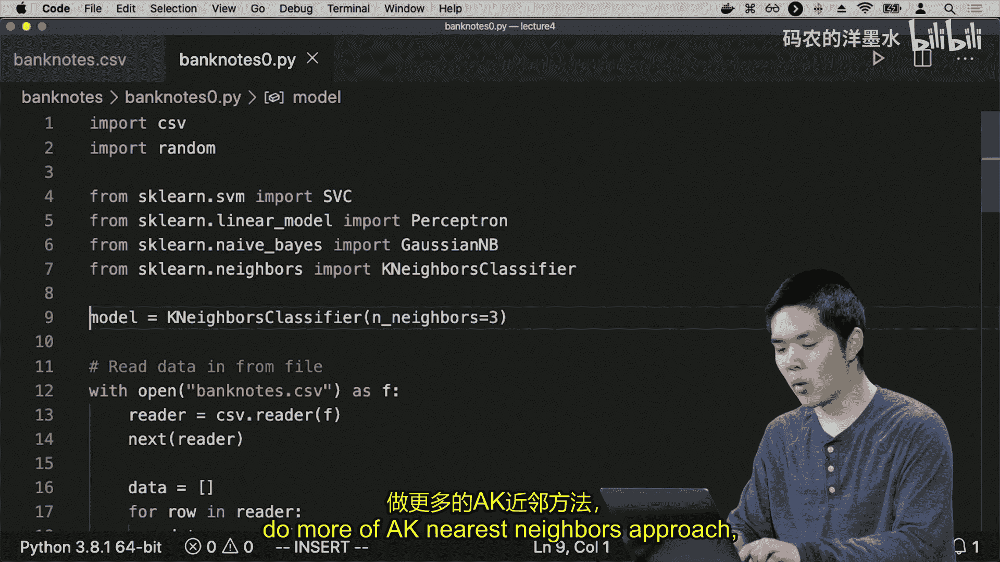

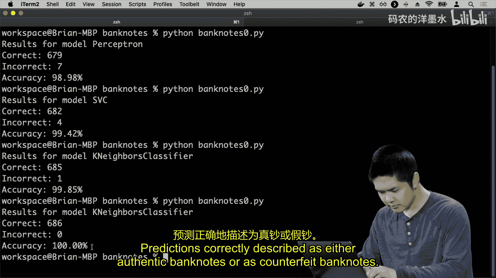

Predictions correctly described as either authentic banknot or as counterfeit bank notes。 And。

 you know， we could run these experiments multiple times because I'm randomly reorganizing the data every time We're technically training these on slightly different dataset sets And so you might want to run multiple experiments to really see how well they're actually going to perform。

 But in short， they all perform very well。 And while some of them perform slightly better than others here。

 that might not always be the case for every data set。

 But you can begin to test now by very quickly putting together these machine learning models using Psyit learn to be able to train on some training set and then test on some testing set as well。

 And this splitting up into training groups and testing groups and testing happens so often thatsyit learn has functions built in for trying to do it。

 I did it all by hand just now。 But if we take a look at banknot1。😊。

We take advantage of some other features that exist in PsyitLn where we can really simplify a lot of our logic that there is a function built in the PsyitLarn called train test split。

 which will automatically split data into a training group and a testing group。

 I just have to say what proportion should be in the testing group， something like 05。

 half the data inside the testing group then I can fit the model on the training data。

 make the predictions on the testing data， and then just count up and psyit learnn has some nice methods for just counting up how many times our testing data match the predictions。

 how many times our testing data didn't match the predictions。 So very quickly。

 you can write programs with not all that many lines of code。

 maybe like 40 lines of code to get through all of these predictions and then as a result。

 see how well we're able to do。 So these types of libraries can allow us without really knowing the implementation details of these algorithms to be able to use the algorithms in a very practical way to be able to solve these types of problems。

😊，So that then was supervised learning this task of given a whole set of data。

 some input output pairs。 we would like to learn some function that maps those inputs to those outputs。

 But turns out there are other forms of learning as well。

 and another popular type of machine learning， especially nowadays。

 is known as reinforcement learning and the idea of reinforcement learning is rather than just being given a whole data set at the beginning of input output pairs reinforcement learning is all about learning from experience in reinforcement learning our agent whether it's like a physical robot that's trying to make actions in the world or just some virtual agent that is a program running somewhere。

 Our agent is going to be given a set of rewards or punishments in the form of like numerical values。

 but you can think of them as reward or punishment And based on that。

 it learns what actions to take in the future that our agent。

 our AI will be put in some sort of environment。 It will make some actions and based on the actions that it makes it learns something it either gets a reward when it does something well。

 it gets a punishment when it does something。Poorly and it learns what to do or what not to do in the future based on those individual experiences。

 And so what this will often look like is it will often start with some agent， some AI。

 which might again be a physical robot if you're imagining a physical robot moving around。

 but it can also just be a program， and our agent is situated in their environment where the environment is where they're going to make their actions and it's what's going to give them rewards or punishments to various actions that they're in。

😊，So， for example， the environment is going to start off by putting our agent inside of a state。

 Our agent has some state， that in a game might be the state of the game that the agent is playing in a world that the agent is exploring might be some position inside of a grid representing the world that they're exploring。

 but the agent is in some sort of state。 And in that state。

 the agent needs to choose to take an action。 The agent likely has multiple actions they can choose from。

 but they pick an action， So they may they take an action in a particular state。

 and as a result of that， the agent will generally get two things in response as we model them。

 the agent gets a new state that they find themselves in after being in this state。

 taking one action they end up in some other state。

And they're also given some sort of numerical reward， positive， meaning reward。

 meaning it was a good thing， negative， generally meaning they did something bad。

 they received some sort of punishment。😡，And that is all the information the agent has。

 It's told what state it's in it makes some sort of action and based on that it ends up in another state and it ends up getting some particular reward and it needs to learn based on that information。

 what actions to begin to take in the future and so you could imagine generalizing this to a lot of different situations This is oftentimes how you train if you've ever seen those robots that are now able to like walk around sort of the way humans do it would be quite difficult to program the robot in exactly the right way to get it to walk the way humans do you could instead train it through reinforcement learning。

 give it some sort of numerical reward every time it does something good。

 like take steps forward and punish it every time it does something bad like fall over and then let the AI just learn based on that sequence of rewards based on trying to take various different actions you can begin to have the agent learn what to do in the future and what not to do。

So in order to begin to formalize this， the first thing we need to do is formalize this notion of what we mean about states and actions and rewards。

 like what does this world look like and oftentimes will formulate this world as what's known as a Markov decision process。

 similar in spirit to Markov chains， which you might recall from before。

 but a Markov decision process is a model that we can use for decision making for an agent trying to make decisions in its environment and it's a model that allows us to represent the various different states that an agent can be in the various different actions that they can take and also what the reward is for taking one action as opposed to another action。

😊，So what then does it actually look like， well， if you recall a Markov chain from before。

 a Markov chain looked a little something like this where we had a whole bunch of these individual states and each state immediately transitioned to another state based on some probability distribution we saw this in the context of the weather before where if it was sunny we said with some probability。

 it't be sunny the next day with some other probability it would be rainy for example。😡。

But we could also imagine generalizing this。 It's not just sun and rain anymore。

 We just have these states where one state leads to another state。

 according to some probability distribution， but in this original model。

 there was no agent that had any control over this process and was just entirely probability based where with some probability we moved to this next state but maybe it's going to be some other state with some other probability What we'll now have is the ability for the agent in this state to choose from a set of actions where maybe instead of just one path forward they have three different choices of actions that each lead down different paths and even this is a bit of an oversimplification because in each of these states you might imagine more branching points where there are more decisions that can be taken as well。

 So we've extended the Markov chain。To say that from a state you now have available action choices and each of those actions might be associated with its own probability distribution of going to various different states。

😡，Then in addition， we'll add another extension。Where any time you move from a state taking an action。

 going into this other state， we can associate a reward with that outcome。

 saying either R is positive， meaning some positive reward or are as negative。

 meaning there was some sort of punishment。 And this then is what will consider to be a Markov decision process that a Markov decision process has some initial set of states of states in the world that we can be in。

 We have some set of actions that given a state， I can say。

 what are the actions that are available to me in that state and action that I can choose from。

Then we have some transition model， the transition model before just said that given my current state。

 what is the probability that I end up in that next state or this other state。

 the transition model now has effectively two things we're conditioning on， we're saying。

 given that I'm in this state and that I take this action。

 what's the probability that I end up in this next state。😡。

Now maybe we live in a very deterministic world in this Markov decision process where given a state and given an action。

 we know for sure what next state will end up in， but maybe there's some randomness in the world that when you take in a state and you take an action。

 you might not always end up in the exact same state。

 there might be some probabilities involved there as well。

 the Markov decision process can handle both of those possible cases。😡，And then finally。

 we have a reward function generally called R that in this case says what is the reward for being in this state。

 taking this action and then getting to S prime this next state So I'm in this original state I take this action I get to this next state。

 what is the reward for doing that process and you can add up these rewards every time you take an action to get the total amount of rewards that an agent might get。

😡，From interacting in a particular environment modeled using this Markov decision process。

 So what might this actually look like in practice， Well。

 let's just create a little simulated world here where I have this agent that is just trying to navigate its way。

 This agent is this yellow dot here， like a robot in the world。

 trying to navigate its way through this grid。 And ultimately。

 it's trying to find its way to the goal。 And if it gets to the green goal。

 then it's going to get some sort of reward。But then we might also have some red squares that are places where you get some sort of punishment。

 some bad place where we don't want the agent to go， and if it ends up in the red square。

 then our agent is going to get some sort of punishment as a result of that。

 but the agent originally doesn't know all of these details。

 It doesn't know that these states are associated with punishments。

 but maybe it does know that this state is associated with a reward， maybe it doesn't。

 but it just needs to sort of interact with the environment to try and figure out what to do and what not to do。

So the first thing the agent might do is given no additional information。

 if it doesn't know what the punishments are， it doesn't know where the rewards are。

 it just might try and take an action。😡，And it takes an action and ends up realizing that it got some sort of punishment and so what does it learned from that experience Well it might learn that when you're in this state in the future。

 don't take the action move to the right that that is a bad action to take that in the future if you ever find yourself back in the state don't take this action of going to the right when you're in this particular state because that leads to punishment that might be the intuition at least。

 and so you could try doing other actions， you move up right that didn't lead to any immediate rewards。

 maybe try something else， then maybe try something else and right now you found you got another punishment and so you learn something from that experience So the next time you do this whole process。

 you know that if you ever end up in this square， you shouldn't take the down action because being in this state and taking that action ultimately leads to some sort of punishment。

 a negative reward in other words and this process repeats that you might imagine just letting our agent explore the world。

 learning over time what states tend to correspond with poor actions learning over time what states correspond。

Poor actions until eventually， if it tries enough things randomly。

 it might find that eventually when you get to this state， if you take the up action in this state。

 it might find that you actually get a reward from that。😡。

And what it can learn from that is that if you're in this state。

 you should take the up action because that leads to a reward。 And over time。

 you can also learn that if you're in this state， you should take the left action because that leads to this state that also lets you eventually get to the reward。

 So you begin to learn over time， not only which actions are good in particular states。

 but also which actions are bad， such that once you know with some sequence of good actions that leads you to some sort of reward。

 our agent can just follow those instructions， follow the experience that it has learned。

 we didn't tell the agent what the goal was， we didn't tell the agent where the punishments were。

 but the agent can begin to learn from this experience and learn to begin to perform these sorts of tasks better in the future。

And so let's now try to formalize this idea。 formalize the idea that we would like to be able to learn in this state。

 taking this action I that a good thing or a bad thing。

 There are lots of different models for reinforcement learning。

 We're just going to look at one of them today。 And the one that we're gonna look at is a method known as Q learning。

 And what Q learning is all about is it's about learning a function。

 a function Q that takes inputs S and a where S is a state and a is an action that you take in that state And what Q is this Q function is going to do is it is going to estimate the value。

 How much reward will I get from taking this action in this state。😊，Originally。

 we don't know what this Q function should be， but over time， based on experience。

 based on trying things out and seeing what the result is。

 I would like to try and learn what Q of SA is for any particular state and any particular action that I might take in that state。

 So what is the approach Well， the approach originally is we'll start with QSA equal to 0 for all states S and for all actions A that initially before I've ever started anything before I've had any experiences I don't know the value of taking any action in any given state。

 So I'm going to assume that the value is just0 all across the board。😡。

But then as I interact with the world， as I experience rewards or punishments。

 or maybe I go to a cell where I don't get either a reward or a punishment， I want to somehow update。

My estimate of QSA， I want to continually update my estimate of QSA based on the experiences and rewards and punishments that I've received。

 such that in the future， my knowledge of what actions are good in what states will be better。

 So when we take an action and receive some sort of reward。

 I want to estimate the new value of QSA and I estimate that based on a couple of different things。

 I estimate it based on the reward that I'm getting from taking this action and getting into the next state。

 But assuming like the situation isn't over， assuming there are still future actions that I might take as well。

 I also need to take into account the expected future rewards。

 that if you imagine an agent interacting with the environment and sometimes you'll take an action and get a reward。

 but then you can keep taking more actions and get more rewards that these both are relevant。

 both the current reward I'm getting from this current step and also my future reward。

 and it might be the case that I'll want to take a step that doesn't immediately lead to a reward because later on and down the line。

😊，Kow it will lead to more rewards as well。 So there's a balancing act between current rewards that the agent experiences and future rewards that the agent experiences as well。

And then we need to update QSA， so we estimate the value of QSA based on the current reward and the expected future rewards。

 and then we need to update this Q function to take into account this new estimate。

 Now we already as we go through this process we'll already have an estimate for what we think the value is now we have a new estimate and then somehow we need to combine these two estimates together and we'll look at more formal ways that we can actually begin to do that。

So to actually show you what this formula looks like。

 here is the approach we'll take with Q learning。 We're going to again start with Q of S and A being equal to 0 for all states。

 and then every time we take an action A in state S and observer rule R。

 we're going to update our value our estimate for Q of SA。😡。

And the idea is that we're going to figure out what the new value estimate is。

 minus what our existing value estimate is。 So we have some preconceived notion for what the value is for taking this action in this state。

 Maybe our expectation is， we currently think the value is 10。

But then we're going to estimate what we now think it's going to be。

 maybe the new value estimate is something like 20。

 so there's a delta of like 10 that our new value estimate is 10 points higher than what our current value estimate happens to be。

😡，And so we have a couple of options here。 We need to decide how much we want to adjust our current expectation of what the value is of taking this action in this particular state and what that difference is。

 how much we add or subtract from our existing notion of how much that we expect the value to be is dependent on this parameter alpha also called the learning rate。

 and alpha represents in effect， how much we value new information compared to how much we value old information in alpha value of one means we really value new information。

 but if we have a new estimate， then it doesn't matter what our old estimate is。

 we're only going to consider our new estimate because we always just want to take into consideration our new information So the way that works is that if you imagine alpha being one Well then we're taking the old value of QSA。

😡，And then adding one times the new value minus the old value。

 And that just leaves us with the new value。 So when alpha is one。

 all we take into consideration is what our new estimate happens to be。😡。

But over time as we go through a lot of experiences， we already have some existing information。

 We might have tried taking this action nine times already， and now we just tried it a 10th time。

 and we don't only want to consider this10th experience。

 I also want to consider the fact that my prior nine experiences those were meaningful to。

 and that's data I don't necessarily want to lose them and so this alpha controls that decision controls how important is the new information0 would mean ignore all the new information。

 just keep this Q value the same。 One means replace the old information entirely with the new information and somewhere in between。

 keep some sort of balance between these two values。😡。

We can put this equation a little bit more formally as well。

 The old value estimate is our old estimate for what the value is of taking this action in a particular state。

 That's just Q of SNA。 So we have it once here， and we're going to add something to it。

 We're going to add alpha times the new value estimate minus the old value estimate。

 but the old value estimate we just look up by calling this Q function。😡。

And what then is the new value estimate based on this experience we have just taken。

 What is our new estimate for the value of taking this action in this particular state， Well。

 it's going to be composed of two parts。 It's going to be composed of what reward did I just get from taking this action in this state。

 And then it's going to be， what can I expect my future rewards to be from this point forward。

 So it's going to be。A some reward I'm getting right now plus whatever I estimate I'm going to get in the future and how do I estimate what I'm going to get in the future？

 Well， it's a bit of another call to this Q function。

 It's going to be take the maximum across all possible actions I could take next and say。

 all right of all of these possible actions I could take which one is going to have the highest reward。

 So this then looks a little bit complicated。 This is going to be our notion for how we're going to perform this kind of update that I have some estimate。

 some old estimate for what the value is of taking this action in this state and I'm going to update it based on new information that I experience some reward。

 I predict what my future reward is going to be。 and using that I update what I estimate the reward will be for taking this action in this particular state and there are other additions you might make to this algorithm as well。

 Sometimes it might not be the case that future rewards you want to wait equally to current rewards。

 maybe you want an agent that。valueues like reward now over reward later。

 and so sometimes you can even add another term in here。

 some other parameter where you discount future rewards and say future rewards are not as valuable as rewards immediately the getting reward in the current time step is better than waiting a year and getting rewards later。

 but that's something up to the programmer to decide what that parameter ought to be。

ButThe big picture idea of this entire formula is to say that every time we experience some new reward。

 we take that into account。 we update our estimate of how good is this action。

 And then in the future， we can make decisions based on that algorithm。

 once we have some good estimate for every state and for every action。

 what the value is of taking that action then we can do something like implement a greedy decision making policy。

 that if I am in a state， and I want to know what action should I take in that state， Well。

 then I consider for all of my possible actions， what is the value of Qs。

 What is my estimated value of taking that action in that state。

 and I will just pick the action that has the highest value。😊，After I evaluate that expression。

So I pick the action that has the highest value and based on that that tells me what action I should take at any given state that I'm in。

 I can just greedily say across all my actions， this action gives me the highest expected value。

 and so I'll go ahead and choose that action as the action that I take as well。

But there is a downside to this kind of approach。 And the downside comes up in a situation like this where we know that。

 you know， there is some solution that gets me to the reward。

And our agent has been able to figure that out， but it might not necessarily be the best way or the fastest way。

 If the agent is allowed to explore a little bit more。

 it might find that it can get the reward faster by taking some other route instead by going through this particular path。

 That is a faster way to get to。That ultimate goal。

 And maybe we would like for the agent to be able to figure that out as well。

 But if the agent always takes the actions that it knows to be best， well。

 when it gets to this particular square， it doesn't know that this is a good action because it's never really tried it。

 But it knows that going down eventually leads its way to this reward。

 So it might learn in the future that it should just always take this route and it's never going to explore and go along that route instead。

So in reinforcement learning， there' is this tension between exploit and exploitation and exploitation generally refers to using knowledge that the AI already has。

 The AI already knows that this is a move that leads to reward。

 so we'll go ahead and use that move and exploration is all about exploring other actions that we may not have explored as thoroughly before。

 because maybe one of these actions， even if I don't know anything about it。

 might lead to better rewards faster or to more rewards in the future。😡。

And so an agent that only ever exploits information and never explores might be able to get reward。

 but it might not maximize its rewards because it doesn't know what other possibilities are out there。

 possibilities that we only know about by taking advantage of exploration。😡。

And so how can we try and address this？ Well， one possible solution is known as the Epsilon greedy algorithm。

 where we set epsilon equal to how often we want to just make a random move。

 where occasionally we will just make a random move in order to say。

 let's try to explore and see what happens。And then the logic of the algorithm will be with probability one minus epsilon choose the estimated best move。

 In a greedy case， we'd always choose the best move。 but in epsilon greedy。

 where're most of the time going to choose the best move。

 we' sometimes going to choose the best move， but sometimes with probability epsilon。

 we're going to choose a random move instead。😡，So every time we're faced with the ability to take an action。

 sometimes we're going to choose the best move， sometimes we're just going to choose a random move。

 so this type of algorithm then can be quite powerful in a reinforcement learning context by not always just choosing the best possible move right now。

 but sometimes especially early on， allowing yourself to make random moves that allow you to explore various different possible states and actions more and maybe over time you might decrease your value of epsilon more and more often choosing the best move after you're more confident that you've explored what all of the possibilities actually are。

😡，So we can put this into practice and one very common application of reinforcement learning is in gameplay that if you want to teach an agent how to play a game。

 you just let the agent play the game a whole bunch and then the reward signal happens at the end of the game when the game is over if our AI won the game it gets a reward of like one for example。

 and if it lost the game it gets a reward of negative one and from that it begins to learn what actions are good and what actions are bad。

 you don't have to tell the AI what's good and what's bad but the AI figures it out based on that reward winning the game is some signal losing the game is some signal and based on all of that it begins to figure out what decisions it should actually make。

😡，So one very simple game which you may have played before is a game called NiIm and in the game of Nim you've got a whole bunch of objects in a whole bunch of different piles where here I've represented each pile as an individual row so you've got one object in the first pile three in the second pile5 and the third pile。

 seven in the fourth pile and the game of Nim is a two player game where players take turns removing objects from piles and the rule is that on any given turn you were allowed to remove as many objects as you want from any one of these piles。

 any one of these rows， you have to remove at least one object but you can remove as many as you want from exactly one of the piles and whoever takes the last object loses。

So player one might like remove four from this pile here。

 player two might remove four from this pile here， so now we've got four piles left，1，3。

1 and three player one might remove know the entirety of the second pile player two if they're being strategic might remove all might remove two from the third pile now we've got three piles left each with one object left player one might remove one from one pile player two removes one from the other pile and now player one is left with choosing this one object from the last pile at which point player one loses the game so fairly simple game piles of objects。

 any turn you choose how many objects to remove from a pile whoever removes the last object loses and this is the type of game you could encode into an AI fairly easily because the states are really just four numbers every state is just how many objects in each of the four piles and the actions are things like how many am I going to remove from each one of these individual piles。

😡，And the reward happens at the end that if you were the player that had to remove the last object。

 then you get some sort of punishment， But if you were not and the other player had to remove the last object。

 well， then you get some sort of reward。 So we could actually try and show a demonstration of this that I have implemented an AI to play the game of Nim。

Alright， so here what we're going to do is create an AI as a result of training the AI on some number of games that the AI is going to play against itself。

 where the idea is the AI will play games against itself。

 learn from each of those experiences and learn what to do in the future and then I。

 the human will play against the AI。 So initially we'll say train zero times。

 meaning we're not going to let the AI play any practice games against itself in order to learn from its experiences。

 We're just going to see how well it plays。

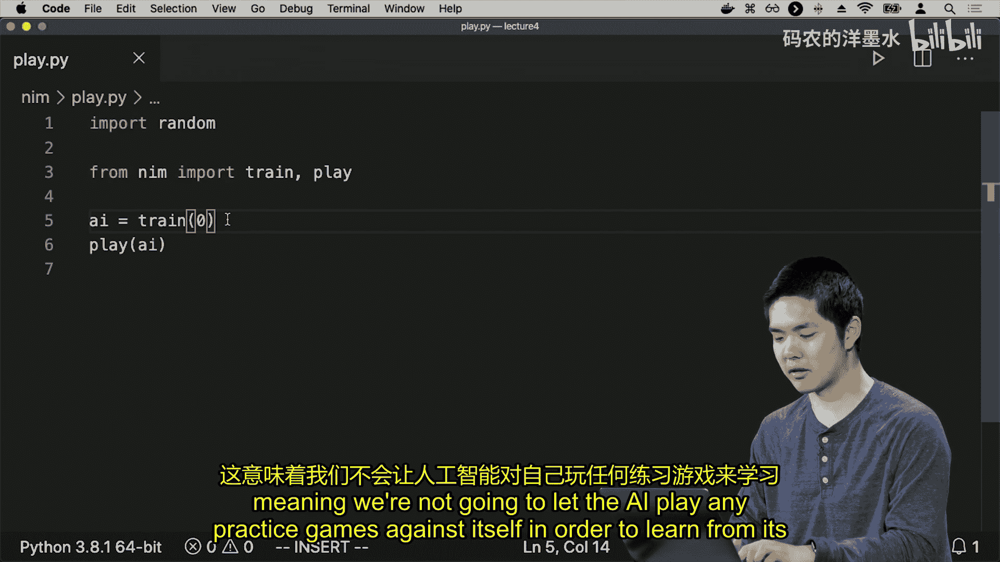

And it looks like there are four piles。 I can choose how many I remove from any one of the piles。

 So maybe from pile 3， I will remove five objects， for example。

 So now AI chose to take one item from pile 0。 So I'm left with these piles now， for example。

 And so here I could choose maybe to say I would like to remove from pile 2。

 I'll remove all five of them， for example。😊，And so AI chose to take two away from pile1。

 Now I'm left with one pile that has one object， one pile that has two objects。 So from pile 3。

 I will remove two objects。 and now I've left the AI with no choice， but to take that last one。

 And so the game is over。 and I was able to win。 but I did so because the AI was really just playing randomly。

 It didn't have any prior experience that it was using in order to make these sorts of judgments。

 Now let me let the AI train itself on like 10000 games。

 I'm gonna to let the AI play 10000 games of Nim against itself every time it wins or loses。

 it's going to learn from that experience。 and learn in the future what to do and what not to do。

 So here then I'll go ahead and run this again。 And now you see the AI running through a whole bunch of training games。

10000 training games against itself。 And now it's going to let me make these sorts of decisions。

 So now I'm going play against the AI maybe I'll remove one from pile3 and the AI took everything from pile 3。

 So I'm left with three piles。 I'll go ahead and from pile 2。😊。

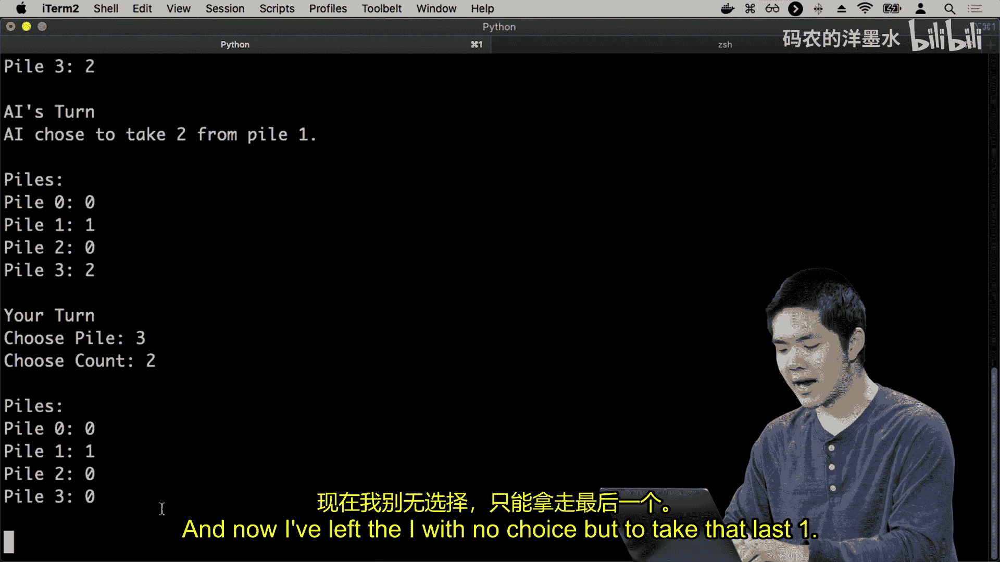

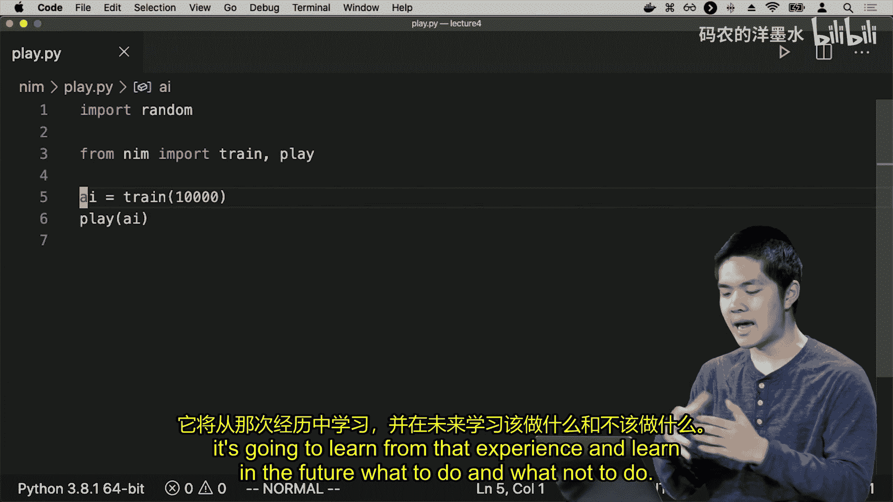

Maybe remove three items and the AI removes one item from pile 0。 I'm left with two piles。

 each of which has two items in it。 I'll remove one from pile 1， I guess。

 and the AI took two from pile2， leaving me with no choice but to take one away from pile 1。

 So it seems like after playing 10000 games of Nim against itself。

 the AI has learned something about what states and what actions tend to be good and has begun to learn some sort of pattern for how to predict what actions are going to be good and what actions are going to be bad in any given state。

So reinforcement learning can be a very powerful technique for achieving these sorts of gameplay agents。

 agents that are able to play a game well， just by learning from experience。

 whether that's playing against other people， or by playing against itself and learning from those experiences as well Now Nim is a bit of an easy game to use reinforcement learning for because there are so few states that are only states that are as many as how many different objects that are in each of these various different piles。

 you might imagine that it's going to be harder if you think of a game like chess or games where there are many。

 many more states and many， many more actions that you can imagine taking where it's not going to be as easy to learn for every state and for every action。

 what the value is going to be So oftentimes in that case。

 we can't necessarily learn exactly what the value is for every state and for every action but we can approximate it so much as we saw with miniax so we could use a depth limiting approach to stop calculating at a certain point in time。

 we can do a similar type of approximation known as function approximation in a reinforcement learning contact。

Where instead of learning a value of Q for every state and every action。

 we just have some function that estimates what the value is for taking this action in this particular state that might be based on various different features of the state that the environment that the agent happens to be in where you might have to choose what those features actually are。

 but you can begin to learn some patterns that generalize beyond one specific state and one specific action that you can begin to learn if certain features tend to be good things or bad things。

 reinforcement learning can allow you using a very similar mechanism to generalize beyond one particular state and say if this other state looks kind of like this state then maybe the similar types of actions that worked in one state will also work in another state as well。

 and so this type of approach can be quite helpful as you begin to deal with reinforcement learning that exist in larger and larger state spaces where it's just not feasible to explore all of the possible states that could actually exist。

So there then are two of the main categories of reinforcement learning， supervised learning。

 where you have labeled input and output pairs and reinforcement learning where an agent learns from rewards or punishment Senate receives the third major category of machine learning that we'll just touch on briefly is known as unsupervised learning and unsupervised learning happens when we have data without any additional feedback without labels that in the supervised learning case。

 all of our data had labels， we labeled a data point with whether that was a rainy day or not rainy day and using those labels we were able to infer what the pattern was。

 or we labeled data as a counterfeit banknote or not a counterfeit and using those labels we were able to draw inferences and patterns to figure out what it does a banknote look like versus not。

In unsupervised learning， we don't have any access to any of those labels。

 but we still would like to learn some of those patterns and one of the tasks that you might want to perform in unsupervised learning is something like clustering where clustering is just a task of given some set of objects organize it into distinct clusters groups of objects that are similar to one another and there's lots of applications for clustering。

 it comes up in genetic research where you might have a whole bunch of different genes and you want to cluster them into similar genes if you're trying to analyze across a population or across species it comes up in an image if you want to take all the pixels of an image。

 cluster them into different parts of the image， comes a lot up in market research if you want to divide your consumers into different groups so you know which groups to target with certain types of product advertisements for example。

 and a number of other context as well in which clustering can be very applicable one technique for clustering is an algorithm known as K means clustering and what K means clustering is going to do。

I goinging to divide all of our data points into K different clusters and it's going to do so by repeating this process of assigning points to clusters and then moving around those clusters at centers we're going to define a cluster by its center。

 the middle of the cluster and then assign points to that cluster based on which center is closest to that point and I'll show you an example of that now here for example。

 I have a whole bunch of unlabeled data just various data points that are in some sort of graphical space and I would like to group them into various different clusters but I don't know how to do that originally and let's say I want to assign like three clusters to this group and you have to choose how many clusters you want and K means clustering that you could try multiple and see how well those values perform but I'll start just by randomly picking some places to put the centers of those clusters that maybe I have a blue cluster a red cluster in a green cluster and I'm going to start with the centers of those clusters just being in these three locations here。

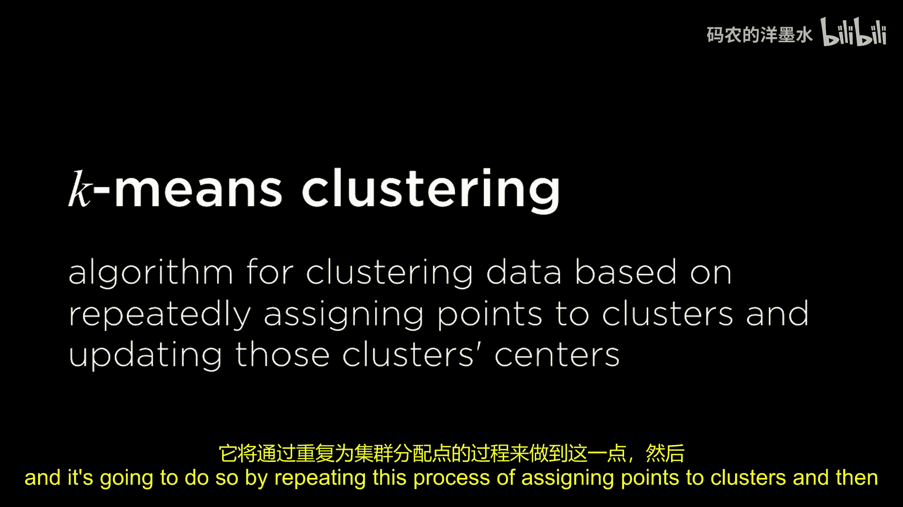

And what K means clustering tells us to do is once I have the centers of the clusters。

 assign every point to a cluster based on which cluster center it is closest to。

So we end up with something like this， where all of these points are closer to the blue cluster center than any other cluster center。

😡，All of these points here are closer to the green cluster center than any other cluster center。

 and then these two points plus these points over here。

 those are all closest to the red cluster center instead。

So here then is one possible assignment of all these points to three different clusters。

 but it's not great that it seems like in this red cluster。

 these points are kind of far apart in this green cluster， these points are kind of far apart。

 it might not be my ideal choice of how I would cluster these various different data points。

 but K means clustering is an iterative process that after I do this。

 theres a next step which is that after I've assigned all of the points to the cluster center that it is nearest to。

 we are going to recenter the clusters， meaning take the cluster centers。

 these diamond shapes here and move them to the middle or the average effectively of all of the points that are in that cluster。

 So we'll take this blue point， this blue center and go ahead and move it to the middle or to the center of all of the points that were assigned to the blue cluster。

 moving it slightly to the right in this case。 and we'll do the same thing for red will'll move the cluster center to the middle of all of these。

😊，Points weighted by how many points there are。 There are more points over here。

 So the red center ends up moving a little bit further that way。 And likewise， for the green center。

 there are many more points on this， this side of the green center。

 So the green center ends up being pulled a little bit further in this direction。

So we recentcenter all of the clusters and then we repeat the process。

 we go ahead and now reassign all of the points to the cluster center that they are now closest to and now that we've moved around the cluster centers。

 these cluster assignments might change that this point originally was closer to the red cluster center。

 but now it's actually closer to the blue cluster center same goes for this point as well。

 and these three points that were originally closer to the green cluster center are now closer to the red cluster center instead。

😡，So we can reassign what colors or which clusters each of these data points belongs to。

 and then repeat the process again， moving each of these cluster means from the middles of the clusterism to the mean。

 the average of all of the other。😡，Points that happen to be there and repeat the process again。

 go ahead and assign each of the points to the cluster that they are closest to。

 So once we reach a point where we've assigned all the points to clusters to the cluster that they are nearest to and nothing changed we've reached a sort of equilibrium in this situation where no points are changing their allegiance and as a result。

 we can declare this algorithm is now over。 and we now have some assignment of each of these points into three different clusters。

 And it looks like we did a pretty good job of trying to identify which points are more similar to one another。

 then they are two points in other groups。 we have the green cluster down here。

 this blue cluster here and then this red cluster over there as well。

 and we did so without any access to some labels to tell us what these various different clusters were。

 We just used an algorithm in an unsupervised sense without any of those labels to figure out which points belonged to which categories。

 And again， lots of applications for this type of clustering technique and there are many more algorithms in each of these various different fields。

machineine learning supervised and reinforcement and unsupervised。

 but those are many of the big picture foundational ideas that underlie a lot of these techniques these are the problems that we're trying to solve and we try and solve those problems using a number of different methods of trying to take data and learn patterns in that data。

 whether that's trying to find neighboring data points that are similar or trying to minimize some sort of loss function or any number of other techniques that allow us to begin to try to solve these sorts of problems That then was a look at some of the principles that are at the foundation of modern machine learning。

 this ability to take data and learn from that data so that the computer can perform a task even if they haven't explicitly been given instructions in order to do so Next time we'll continue this conversation about machine learning。

 looking at other techniques we can use for solving these sorts of problems We'll see you then。

