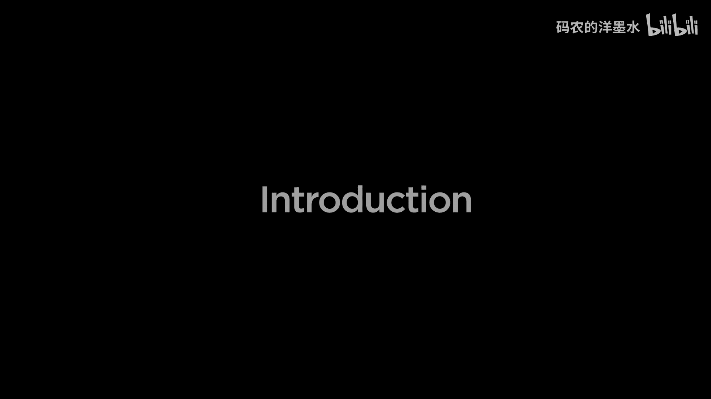
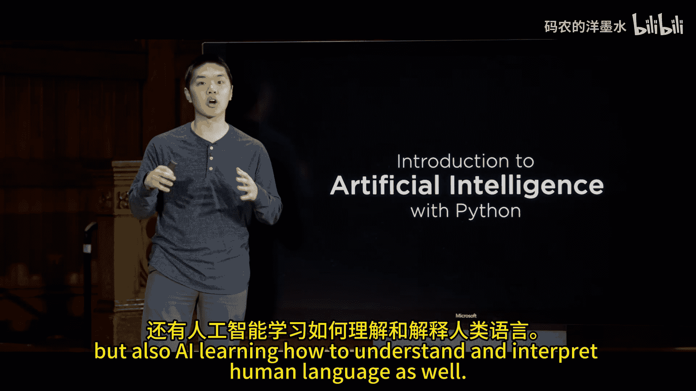
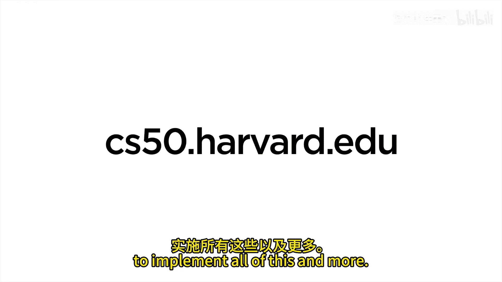

**人工智能导论：P01：课程介绍**

在本节课中，我们将对哈佛大学CS50人工智能课程进行整体介绍，概述课程的核心内容与学习路径。

大家好，这里是CS50。这是由CS50团队的Brian主讲，使用Python的人工智能导论课程。

本课程承接CS50主课程，深入探讨构成现代人工智能基础的概念与算法。

上一节我们介绍了课程背景，本节中我们来看看课程的具体内容结构。以下是本课程将涵盖的核心主题：

首先，我们将探讨人工智能如何为问题寻找解决方案。这些问题可以是学习如何进行游戏，或是寻找前往目的地的驾驶路线。

接着，我们将研究人工智能如何表示信息。这既包括AI确信无疑的知识，也包括AI可能不确定的信息和事件。我们将学习如何表示这些信息，更重要的是，如何利用这些信息进行推理并得出新的结论。

在了解了信息表示后，我们将转向优化问题。我们将探索AI如何解决各种类型的优化问题，例如尝试最大化利润、最小化成本或满足某些其他约束条件。

随后，我们将把注意力转向快速发展的机器学习领域。在这里，我们不会明确告诉AI如何解决问题，而是为AI提供数据和经验，让AI能够自主学习如何执行这些任务。

具体而言，我们将研究神经网络。这是现代机器学习中最流行的工具之一，其灵感来源于人脑学习和推理的方式。

最后，我们将一窥自然语言处理的世界。这样，不仅是我们人类在学习理解人工智能如何说话，AI也能学习如何理解和解释人类语言。

我们将探索这些思想和算法。在此过程中，您将有机会构建自己的人工智能程序，来实现以上所有内容乃至更多。

这就是CS50。

本节课中，我们一起学习了CS50人工智能课程的整体框架，从问题搜索、知识表示与推理，到优化问题、机器学习（特别是神经网络），最后到自然语言处理。课程旨在通过理论与实践相结合的方式，引导我们进入人工智能的世界。